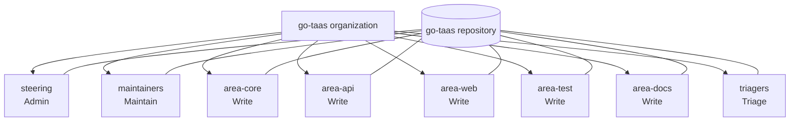

# GitHub Teams and Permission Setup Guide

This guide turns the role ladder in [GOVERNANCE.md](./GOVERNANCE.md) into actual
GitHub configuration: which teams to create, which repository permission each
one gets, who belongs in them, how `CODEOWNERS` and a default-branch ruleset
enforce the two-person rule, and how promotion, retirement, and offboarding
change the setup.

- Chinese version: [GITHUB-TEAMS.zh-cn.md](./GITHUB-TEAMS.zh-cn.md)
- Role definitions and promotion criteria: [GOVERNANCE.md](./GOVERNANCE.md)
- Current roster and checklist: [MAINTAINERS.md](./MAINTAINERS.md)
- Repeatable script: [scripts/github/setup-teams.sh](./scripts/github/setup-teams.sh)

## 1. Summary: eight teams, five permissions

| Team | Community role | Repository permission | Who is in it | Role in `CODEOWNERS` |
| --- | --- | --- | --- | --- |
| `steering` | Steering Committee | **Admin** | 3–5 members | Second approval on high-risk paths; never nested under `maintainers` |
| `maintainers` | Maintainer (global) | **Maintain** | All Maintainers | Default owner for `*`; global fallback review |
| `area-core` | Reviewer + area Maintainer | **Write** | Reviewers and Maintainers of `services/`, `pkg/`, `internal/` | `/services/`, `/pkg/`, `/internal/` |
| `area-api` | Reviewer + area Maintainer | **Write** | Reviewers and Maintainers of `proto/` | `/proto/` |
| `area-web` | Reviewer + area Maintainer | **Write** | Reviewers and Maintainers of `web/` | `/web/` |
| `area-test` | Reviewer + area Maintainer | **Write** | Reviewers and Maintainers of `test/` | `/test/` |
| `area-docs` | Reviewer + area Maintainer | **Write** | Reviewers of `site/` and root Markdown | `/site/`, `/*.md` |
| `triagers` | Triager | **Triage** | All triagers | None (Triage is below Write, so it cannot own code) |

One sentence: **write access goes only to people who review an area; the final
merge gate is the ruleset's approval requirement; Admin belongs only to the
Steering Committee, and must be shared.**

## 2. Concepts: a GitHub permission is not a community role

| GitHub repository permission | Can do | Cannot do | Community role |
| --- | --- | --- | --- |
| **Read** | Read code, open issues and PRs, comment (public repositories need no org membership) | Label, approve, merge | Contributor |
| **Triage** | Manage labels, assignees, milestones; close and reopen; moderate Discussions | Push code, approve, merge | Triager |
| **Write** | Push branches, approve PRs, merge when the ruleset allows it; become a code owner | Change repository settings, publish releases (without an extra grant) | Reviewer, area Maintainer |
| **Maintain** | Everything Write can do + repository management (no sensitive or destructive settings) | Change secrets, branch protection, delete the repository | Maintainer |
| **Admin** | Everything, including teams, secrets, branch protection, integrations | — | Steering Committee |

Two things to keep in mind:

1. **Organization owner and team Admin are different grants.** Giving `steering`
   repository Admin does not make anyone an organization owner. Keep organization
   owners to two people or fewer, and do not assume they match Steering seats.
2. **GitHub cannot express "may approve but may not merge".** Reviewers and area
   Maintainers share Write, so "Reviewers do not merge" is a governance rule, not
   a platform control. What the platform does enforce: at least one approval,
   approval from a code owner, dismissal of stale approvals, and — on high-risk
   paths — review from both `steering` and `maintainers`. Breaking the merge
   convention is handled as a governance matter under `GOVERNANCE.md` §9.

## 3. Team topology and two hard constraints



Hard constraints:

1. **Do not nest.** If `area-core` were a child of `maintainers`, its members
   would inherit the parent's Maintain permission and area isolation would
   disappear. Keep all eight teams flat.
2. **Teams must be Visible, not Secret.** Only a visible team with Write or
   higher is recognized by `CODEOWNERS`; a Secret team is silently ignored and
   the pull request never requests its review.

## 4. Prerequisites

- The operator must be an **organization owner** (creating teams and granting
  repository access needs `admin:org`).
- `gh` is authenticated with `admin:org` and `repo`:

  ```bash
  gh auth refresh -s admin:org,repo
  gh auth status
  ```

- Current repository state (verified): the organization default repository
  permission is `read` (correct — keep it), the organization does not require
  2FA yet, the repository has no teams, and one ruleset named
  `Copilot review for default branch` already exists (do not delete it).
- The organization is on GitHub Free: **repository-level** rulesets and branch
  protection on public repositories are available; **organization-level**
  rulesets require Team/Enterprise and are not used here. Requiring 2FA is
  available on every plan.

## 5. Option A: step-by-step in the web UI

### 5.1 Create the teams

Repeat for every team in §1:

1. Open `https://github.com/orgs/go-taas/teams` → **New team**.
2. **Team name**: the display name (for example `Area: Core Services`); GitHub
   derives the slug `area-core`. `CODEOWNERS` must use the slug.
3. **Description**: see §1. **Parent team**: leave empty (see §3).
4. **Team visibility**: choose **Visible**, not Secret.
5. After creation, open the team → **Repositories** → **Add repository** →
   select `go-taas` → pick the permission from §1 (Admin / Maintain / Write /
   Triage).

### 5.2 Add members and team maintainers

1. Team → **Members** → **Add a member** → type the GitHub username → **Add**.
2. New members are **Member** by default. Give every team at least one
   **Maintainer** (Members list → role dropdown → Maintainer) so membership
   changes do not require an organization owner.
3. Add triagers to `triagers` only. Adding them to an area team silently grants
   Write and breaks the model.

### 5.3 Configure the default-branch ruleset

1. Repository → **Settings** → **Rules** → **Rulesets** → **New ruleset** →
   **New branch ruleset**.
2. **Ruleset name**: `main-branch-protection`.
3. **Enforcement status**:
   - **Evaluate** while the project has one Maintainer (observes, does not
     block — see §5.4);
   - **Active** once a second Maintainer can review.
4. **Bypass list**: empty in the normal case. During bootstrap, if Active is
   required, you may add **Organization admin** temporarily and record the
   removal condition in `MAINTAINERS.md`.
5. **Target branches** → **Add target** → **Include default branch**.
6. Enable these rules:
   - **Restrict deletions**
   - **Block force pushes**
   - **Require linear history**
   - **Require a pull request before merging**
     - Required approvals: **1**
     - **Dismiss stale pull request approvals when new commits are pushed**
     - **Require review from Code Owners**
     - **Require approval of the most recent reviewable push**
     - **Require conversation resolution before merging**
7. Optionally add **Require status checks** later (`Lint`, `Unit tests`,
   `Build`). The names must match exactly what the pull request shows; pick them
   from the list after CI has run at least once.

### 5.4 The single-maintainer deadlock

`Require review from Code Owners` + `Required approvals: 1` means **an author
cannot approve their own pull request**. With one Maintainer, switching to
Active blocks every merge. Three ways to handle it:

| Approach | What to do | When |
| --- | --- | --- |
| Recommended | Keep the ruleset in **Evaluate** until a second Maintainer joins | Bootstrap stage |
| Stopgap | Active + add **Organization admin** to Bypass, and record the removal condition in the roster | When direct pushes must be blocked now |
| Not recommended | Set required approvals to 0 | Gives up the review gate |

The script's `protect` defaults to **Evaluate**; `protect --enforce` blocks.

## 6. Option B: script and gh CLI (recommended, repeatable)

The script wraps the same operations, is idempotent, and only prints a plan by
default.

```bash
# 1. Preview: which teams are missing, which permissions drifted
./scripts/github/setup-teams.sh plan

# 2. Apply: create missing teams and correct repository permissions
./scripts/github/setup-teams.sh apply

# 3. Add people (the team determines the role)
./scripts/github/setup-teams.sh add-member triagers    <username>
./scripts/github/setup-teams.sh add-member area-core   <username>
./scripts/github/setup-teams.sh add-member maintainers <username>
./scripts/github/setup-teams.sh add-member steering    <username> maintainer

# 4. Default-branch ruleset (Evaluate by default)
./scripts/github/setup-teams.sh protect
./scripts/github/setup-teams.sh protect --enforce   # after the second Maintainer

# 5. Conformance check (read-only, non-zero exit on problems)
./scripts/github/setup-teams.sh verify
```

Equivalent core API calls without the script:

```bash
# Create a team
gh api -X POST orgs/go-taas/teams \
  -f name='Area: Core Services' -f description='Owns services/, pkg/, internal/' \
  -f privacy=closed -f notification_setting=notifications_enabled

# Grant repository permission (pull|triage|push|maintain|admin)
gh api -X PUT orgs/go-taas/teams/area-core/repos/go-taas/go-taas \
  -f permission=push

# Add / remove a member
gh api -X PUT    orgs/go-taas/teams/area-core/memberships/<username> -f role=member
gh api -X DELETE orgs/go-taas/teams/area-core/memberships/<username>

# Inspect
gh api orgs/go-taas/teams --jq '.[] | [.slug, .permission] | @tsv'
gh api repos/go-taas/go-taas/rulesets --jq '.[] | [.id, .name, .enforcement] | @tsv'
```

## 7. When `CODEOWNERS` takes effect, and how to verify

`CODEOWNERS` only *requests* review; the ruleset is the actual gate. All of the
following must hold:

1. The file lives in `.github/`, the repository root, or `docs/` (this repository
   uses `.github/CODEOWNERS`).
2. The file exists on the **base branch** of the pull request (a PR to `main`
   uses the version on `main`).
3. Every `@org/team` **exists, is visible, and has Write or higher**.
4. The ruleset has **Require review from Code Owners** enabled.
5. The last matching pattern wins, which is why high-risk paths are last in the
   file.

Verification:

```bash
# Every team reference resolves
./scripts/github/setup-teams.sh verify

# Behavioural check: open a draft PR that touches only docs and confirm that
# area-docs + maintainers are requested; then a PR touching .github/workflows/
# and confirm that both steering and maintainers are requested.
```

## 8. Day-2 operations

| Event | Action | Also update |
| --- | --- | --- |
| Promote to Triager | `add-member triagers <user>` | Roster §4, announcement |
| Promote to Reviewer | `add-member area-<x> <user>` | Roster §3 |
| Promote to Maintainer | `add-member maintainers <user>` + `add-member area-<x> <user>` | Roster §2, §6 |
| Join Steering | `add-member steering <user> maintainer` | Roster §1 |
| Add an area | Create team → grant Write → update `.github/CODEOWNERS` → update roster §6 | Two-person rule applies |
| Move to Emeritus | `remove-member` from every team | Roster §5, keep the history |
| Offboarding | Remove from every team + check Settings → Collaborators for direct grants | Roster, audit record |
| Permission drift | Run `verify`, correct with `apply` | — |

Changing a team maintainer is done in the team's Members list and needs no
organization owner.

## 9. Troubleshooting

| Symptom | Usual cause | Fix |
| --- | --- | --- |
| No team review requested on a PR | Team is Secret; team lacks Write; `CODEOWNERS` is not on the base branch; slug typo | Make it Visible, grant Write, merge the file to `main`, reopen the PR |
| Stuck on "Waiting for code owner" | The only code owner is the PR author, who cannot self-approve | Add a second owner, or use Evaluate per §5.4 |
| Members can still push to `main` | Ruleset is in Evaluate; a bypass role matches; a stale classic protection rule | Switch to Active, clear the bypass list, check Settings → Branches |
| A member cannot merge | Their team only has Triage; the PR has no approval; unresolved conversations | Grant Write, finish review and conversations |
| `gh api` returns 403 creating a team | Token lacks `admin:org`, or the operator is not an org owner | `gh auth refresh -s admin:org,repo` |
| Write access survives team removal | The user is a direct collaborator or belongs to another team | Check Settings → Collaborators and teams |
| Organization rulesets are missing | Organization-level rulesets need Team/Enterprise | Use repository rulesets (this guide's default) |
| A `CODEOWNERS` change has no effect | The target branch does not contain the new file yet | Merge `CODEOWNERS` first; later PRs use the new version |

## 10. Security baseline

- Keep the organization default repository permission at **read**; never grant
  organization-wide Write to save time.
- Keep **organization owners at two people or fewer**, and do not assume they
  overlap with `steering`; Steering gets repository administration through the
  team.
- Enable **required 2FA** (Organization settings → Authentication security).
- Give every area team at least one team maintainer so membership changes do not
  depend on an organization owner.
- Run `verify` regularly and paste the result into a governance issue as an
  audit trail.
- Bot and AI accounts (including the Copilot agent) never join `steering` or
  `maintainers`; use a separate account with read or Triage if needed.
- Do not use Secret teams: that does not hide permissions, it disables
  `CODEOWNERS`.

## 11. Changing this guide

The operations described here change repository access and are a high-risk
change: editing this file requires two approvals, one of whom is not the author
(`GOVERNANCE.md` §6). Script behaviour changes need the same review and a
`verify` before/after output in the pull request.
