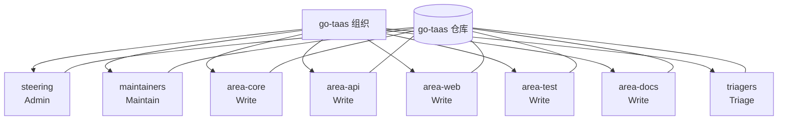

# GitHub Team 与权限配置指南

本指南把 [GOVERNANCE.zh-cn.md](./GOVERNANCE.zh-cn.md) 的角色阶梯落到 GitHub 的
实际配置：创建哪些 Team、每个 Team 授予什么仓库权限、谁应该在里面、如何用
`CODEOWNERS` 与默认分支规则强制执行双人复核，以及日常晋升/荣休/离职怎么改。

- 英文版：[GITHUB-TEAMS.md](./GITHUB-TEAMS.md)
- 角色定义与晋升标准：[GOVERNANCE.zh-cn.md](./GOVERNANCE.zh-cn.md)
- 当前名册与清单：[MAINTAINERS.zh-cn.md](./MAINTAINERS.zh-cn.md)
- 可重复执行的脚本：[scripts/github/setup-teams.sh](./scripts/github/setup-teams.sh)

## 1. 结论：八个 Team，五种权限

| Team | 对应社区角色 | 仓库权限 | 谁在里面 | 在 `CODEOWNERS` 中的作用 |
| --- | --- | --- | --- | --- |
| `steering` | Steering Committee | **Admin** | 3–5 名委员 | 高风险路径的第二签；不与 `maintainers` 嵌套 |
| `maintainers` | Maintainer（全局） | **Maintain** | 全部 Maintainer | `*` 的默认所有者；全局兜底评审 |
| `area-core` | Reviewer + 领域 Maintainer | **Write** | `services/`、`pkg/`、`internal/` 的评审者与维护者 | `/services/`、`/pkg/`、`/internal/` |
| `area-api` | Reviewer + 领域 Maintainer | **Write** | `proto/` 的评审者与维护者 | `/proto/` |
| `area-web` | Reviewer + 领域 Maintainer | **Write** | `web/` 的评审者与维护者 | `/web/` |
| `area-test` | Reviewer + 领域 Maintainer | **Write** | `test/` 的评审者与维护者 | `/test/` |
| `area-docs` | Reviewer + 领域 Maintainer | **Write** | `site/` 与根目录 Markdown 的评审者 | `/site/`、`/*.md` |
| `triagers` | Triager | **Triage** | 全部分诊者 | 不参与（Triage 低于 Write，无法成为 code owner） |

一句话规则：**写权限只给 "评审某个领域" 的人，合并的最终门禁交给规则集中的
批准要求；Admin 只属于 Steering，且必须是共享席位。**

## 2. 概念对照：GitHub 权限不是社区角色

| GitHub 仓库权限 | 可以做什么 | 不能做什么 | 对应社区角色 |
| --- | --- | --- | --- |
| **Read** | 读代码、提 Issue/PR、评论（公开仓库无需组织成员） | 打标签、审批、合并 | Contributor |
| **Triage** | 管理 Issue/PR 的标签、负责人、里程碑；关闭/重开；管理 Discussions | 推送代码、批准、合并 | Triager |
| **Write** | 推送分支、批准 PR、在满足规则时合并；成为 code owner | 改仓库设置、发布 Release（除非另授权限） | Reviewer、领域 Maintainer |
| **Maintain** | Write 的全部 + 管理仓库（不涉及敏感/破坏性设置） | 改密钥、分支保护、删除仓库 | Maintainer |
| **Admin** | 全部，包括 Team、Secrets、分支保护、集成 | — | Steering Committee |

注意两点：

1. **组织 Owner 与 Team Admin 是两件事。** 给 `steering` 仓库 Admin 不等于给组织
   Owner。组织 Owner 应保持在 2 人以内，且与 Steering 席位不必重合。
2. **GitHub 无法表达"可以批准但不能合并"。** Reviewer 与领域 Maintainer 共享
   Write 权限，因此"Reviewer 不合并"是治理约定而非平台强制。真正的强制手段是：
   规则集要求至少 1 个批准 + 必须由 code owner 批准 + 驳回过期批准；高风险路径
   在 `CODEOWNERS` 中同时要求 `steering` 与 `maintainers`。违反合并约定属于治理
   问题，按 `GOVERNANCE.zh-cn.md` §9 处理。

## 3. Team 拓扑与两条硬性约束



硬性约束：

1. **不要嵌套。** 若把 `area-core` 设为 `maintainers` 的子 Team，其成员会继承父
   Team 的 Maintain 权限 —— 领域隔离立即失效。八个 Team 保持平级。
2. **Team 必须可见（Visible，非 Secret）。** 只有可见且拥有 Write 及以上权限的
   Team 才会被 `CODEOWNERS` 识别；Secret Team 会被静默忽略，PR 不会请求评审。

## 4. 前置条件

- 执行者必须是**组织 Owner**（创建 Team、授予仓库权限需要 `admin:org`）。
- `gh` 已登录且具备 `admin:org`、`repo` 权限：

  ```bash
  gh auth refresh -s admin:org,repo
  gh auth status
  ```

- 当前仓库的实际状态（已核对）：组织默认仓库权限为 `read`（正确，保持），组织
  尚未启用强制 2FA，仓库尚无 Team，已存在一个名为
  `Copilot review for default branch` 的规则集（不要删除它）。
- 计划层级为 GitHub Free：**仓库级**规则集与公开仓库的分支保护可用；**组织级**
  规则集需要 Team/Enterprise，本指南不使用组织级规则集。强制 2FA 在所有计划可用。

## 5. 方式一：Web UI 逐步操作

### 5.1 创建 Team

对 §1 表中的每个 Team 重复：

1. 打开 `https://github.com/orgs/go-taas/teams` → **New team**。
2. **Team name** 填显示名（如 `Area: Core Services`），GitHub 会生成 slug
   `area-core`；`CODEOWNERS` 必须用 slug。
3. **Description** 按 §1 填写；**Parent team** 留空（见 §3 约束）。
4. **Team visibility** 选 **Visible**，不要选 Secret。
5. 创建后进入 Team → **Repositories** → **Add repository** → 选择 `go-taas` →
   权限按 §1 选择（Admin / Maintain / Write / Triage）。

### 5.2 添加成员与 Team Maintainer

1. Team → **Members** → **Add a member** → 输入 GitHub 用户名 → **Add**。
2. 新成员默认是 **Member**。为每个 Team 指定至少一名 **Maintainer**（Team 页面
   Members 列表 → 角色下拉 → Maintainer），使其能自行加人，减少组织 Owner 干预。
3. Triager 只加入 `triagers`，不要加入任何 area Team —— 一旦加入就自动获得 Write。

### 5.3 配置默认分支规则集

1. 仓库 → **Settings** → **Rules** → **Rulesets** → **New ruleset** →
   **New branch ruleset**。
2. **Ruleset name**：`main-branch-protection`。
3. **Enforcement status**：
   - 只有一名 Maintainer 时选 **Evaluate**（只观察、不阻断，见 §5.4）；
   - 有两名及以上 Maintainer 时选 **Active**。
4. **Bypass list**：正常情况留空。bootstrap 阶段若必须 Active，可临时加入
   **Organization admin**，并在 `MAINTAINERS.zh-cn.md` 记录移除条件。
5. **Target branches** → **Add target** → **Include default branch**。
6. 勾选规则：
   - **Restrict deletions**
   - **Block force pushes**
   - **Require linear history**
   - **Require a pull request before merging**
     - Required approvals: **1**
     - **Dismiss stale pull request approvals when new commits are pushed**
     - **Require review from Code Owners**
     - **Require approval of the most recent reviewable push**
     - **Require conversation resolution before merging**
7. 保存后可再加 **Require status checks**（例如 `Lint`、`Unit tests`、`Build`）。
   检查名必须与 PR 上显示的名称完全一致，建议等 CI 跑过一次后再从列表中勾选。

### 5.4 单人维护期的死锁与处理

`Require review from Code Owners` + `Required approvals: 1` 意味着 **PR 作者无法
批准自己的 PR**。当前只有一个 Maintainer 时，一旦切到 Active，仓库将无法合并
任何变更。三种处理方式：

| 方式 | 做法 | 适用 |
| --- | --- | --- |
| 推荐 | 规则集保持 **Evaluate**，等第二名 Maintainer 加入后切 Active | bootstrap 阶段 |
| 应急 | Active + Bypass 加入 **Organization admin**，并在名册记录移除条件 | 需要立即阻断直接推送时 |
| 不推荐 | 降低批准数为 0 | 等于放弃评审门禁 |

脚本的 `protect` 默认就是 **Evaluate**，`protect --enforce` 才会阻断。

## 6. 方式二：脚本与 gh CLI（推荐，可重复执行）

脚本封装了同样的操作，幂等、默认只打印计划。

```bash
# 1. 预览：需要创建哪些 Team、权限是否有漂移
./scripts/github/setup-teams.sh plan

# 2. 执行：创建缺失的 Team，并把仓库权限纠正到目标值
./scripts/github/setup-teams.sh apply

# 3. 加人（角色由所在的 Team 决定）
./scripts/github/setup-teams.sh add-member triagers    <username>
./scripts/github/setup-teams.sh add-member area-core   <username>
./scripts/github/setup-teams.sh add-member maintainers <username>
./scripts/github/setup-teams.sh add-member steering    <username> maintainer

# 4. 默认分支规则集（默认 Evaluate）
./scripts/github/setup-teams.sh protect
./scripts/github/setup-teams.sh protect --enforce   # 第二名 Maintainer 到位后

# 5. 合规检查（只读，发现问题返回非零）
./scripts/github/setup-teams.sh verify
```

不使用脚本时，等价的核心 API 调用：

```bash
# 创建 Team
gh api -X POST orgs/go-taas/teams \
  -f name='Area: Core Services' -f description='Owns services/, pkg/, internal/' \
  -f privacy=closed -f notification_setting=notifications_enabled

# 授予仓库权限（pull|triage|push|maintain|admin）
gh api -X PUT orgs/go-taas/teams/area-core/repos/go-taas/go-taas \
  -f permission=push

# 加人 / 移除
gh api -X PUT    orgs/go-taas/teams/area-core/memberships/<username> -f role=member
gh api -X DELETE orgs/go-taas/teams/area-core/memberships/<username>

# 查看现状
gh api orgs/go-taas/teams --jq '.[] | [.slug, .permission] | @tsv'
gh api repos/go-taas/go-taas/rulesets --jq '.[] | [.id, .name, .enforcement] | @tsv'
```

## 7. `CODEOWNERS` 生效条件与验证

`CODEOWNERS` 只是"请求评审"的声明，真正的门禁在规则集里。让它生效需要同时满足：

1. 文件位于 `.github/`、根目录或 `docs/`（本仓库用 `.github/CODEOWNERS`）；
2. 文件在 **PR 的目标分支**上（对 `main` 的 PR 使用 `main` 上的版本）；
3. 每个 `@org/team` 必须**存在、可见、且有 Write 及以上权限**；
4. 规则集勾选了 **Require review from Code Owners**；
5. 最后匹配的规则生效，因此高风险路径写在文件末尾。

验证步骤：

```bash
# 团队引用是否都能解析
./scripts/github/setup-teams.sh verify

# 实际验证：开一个只改 docs 的草稿 PR，确认自动请求了 area-docs + maintainers
# 再开一个改 .github/workflows/ 的 PR，确认 steering 与 maintainers 都被请求
```

## 8. 日常运维

| 事件 | 操作 | 同步更新 |
| --- | --- | --- |
| 晋升 Triager | `add-member triagers <user>` | 名册 §4、Discussions 公告 |
| 晋升 Reviewer | `add-member area-<x> <user>` | 名册 §3 |
| 晋升 Maintainer | `add-member maintainers <user>` + `add-member area-<x> <user>` | 名册 §2、§6 |
| 进入 Steering | `add-member steering <user> maintainer` | 名册 §1 |
| 新增领域 | 建 Team → 授 Write → 更新 `.github/CODEOWNERS` → 更新名册 §6 | 需双人复核 |
| 转 Emeritus | 从所有 Team `remove-member` | 名册 §5，保留历史 |
| 成员离职 | 从所有 Team 移除 + 检查 Settings → Collaborators 是否有直接授权 | 名册、审计记录 |
| 权限漂移 | 运行 `verify`，用 `apply` 纠正 | — |

团队负责人变更直接在 Team → Members 里改角色，不需要组织 Owner。

## 9. 故障排查

| 症状 | 常见原因 | 处理 |
| --- | --- | --- |
| PR 没有自动请求 Team 评审 | Team 是 Secret；Team 没有 Write；`CODEOWNERS` 不在目标分支；slug 拼写错误 | 改为 Visible、补权限、合并到 `main` 后重开 PR |
| 一直显示 "Waiting for code owner" | 唯一 code owner 就是 PR 作者，无法自我批准 | 增加第二名 owner，或按 §5.4 使用 Evaluate |
| 成员仍能直接推 `main` | 规则集处于 Evaluate；Bypass 列表包含该用户角色；仍在用经典分支保护且未生效 | 切 Active、清空 bypass、检查 Settings → Branches |
| 成员无法合并 | 所在 Team 只有 Triage；PR 未获批准；存在未解决对话 | 补 Write、完成评审与对话 |
| `gh api` 创建 Team 返回 403 | token 缺少 `admin:org`，或执行者不是组织 Owner | `gh auth refresh -s admin:org,repo` |
| 移除 Team 成员后仍有写权限 | 该用户是直接协作者，或属于另一个 Team | 检查 Settings → Collaborators and teams |
| 组织级规则集找不到 | Free 计划不支持组织级规则集 | 使用仓库级规则集（本指南默认） |
| `CODEOWNERS` 改动没生效 | PR 目标分支上的文件尚未更新 | 先合并 `CODEOWNERS`，后续 PR 才使用新版本 |

## 10. 安全基线

- 组织默认仓库权限保持 **read**；不要用"给全员 Write"来省事。
- 组织 **Owner 不超过 2 人**，且与 `steering` 成员不必重合；Steering 通过 Team
  Admin 获得仓库管理权。
- 启用 **强制 2FA**（Organization settings → Authentication security）。
- 每个 area Team 至少一名 Team Maintainer，避免所有成员变更都依赖组织 Owner。
- 定期运行 `verify`，把结果贴在治理 Issue 里，形成审计记录。
- Bot/AI 账号（含 Copilot agent）不加入 `steering` 或 `maintainers`，需要时用
  只读或 Triage 权限的独立账号。
- 不要用 Secret Team；它不是"隐藏权限"，而是"让 `CODEOWNERS` 失效"。

## 11. 变更本指南

本指南描述的操作会改变仓库访问权限，属于高风险变更：修改本文件需要两名批准，
其中一人不是作者（`GOVERNANCE.zh-cn.md` §6）。脚本行为变更同样需要双人复核，
并在 PR 中附 `verify` 前后输出。
