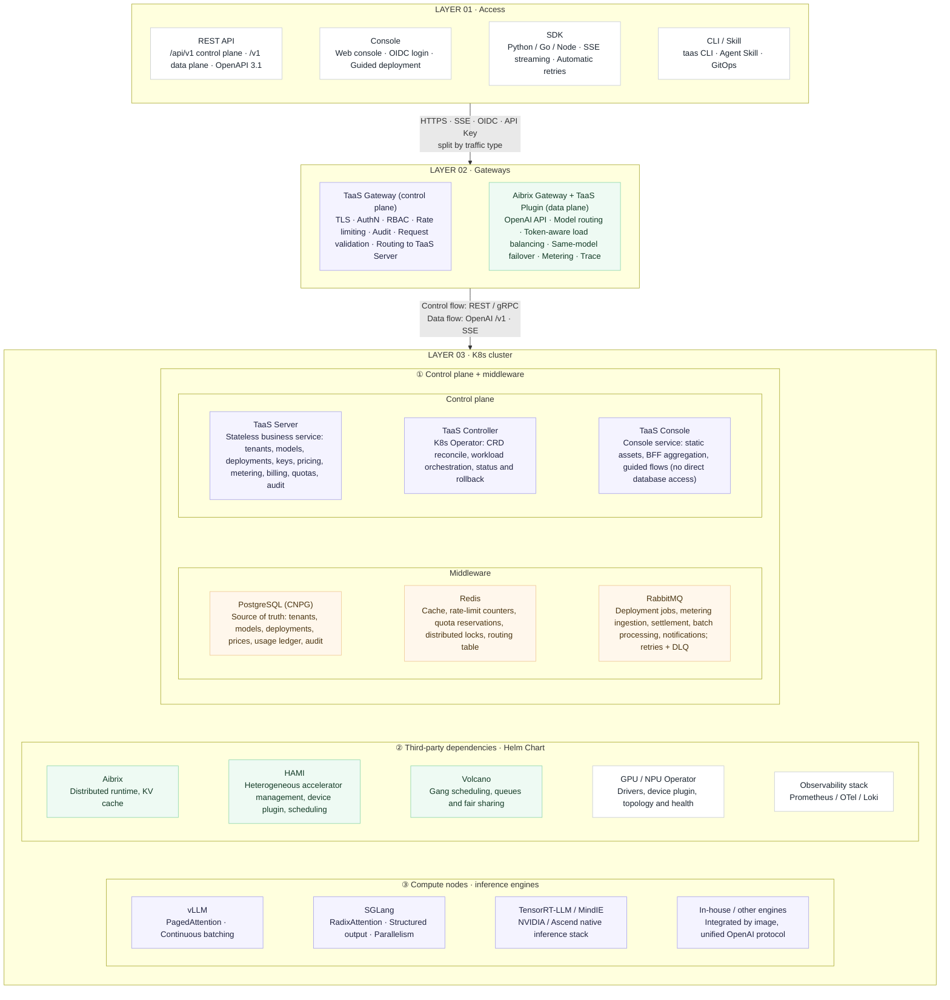

<p align="center">
  
</p>

# Go TaaS

**Token as a Service — an open-source LLM inference and metering/billing platform for AI agents and applications, built on Kubernetes**

[](https://go-taas.com)
[](./LICENSE)
[](https://golang.org/)
[](./CONTRIBUTING.md)

**Go TaaS** is an open-source platform for serving and billing large language models on Kubernetes. Administrators deploy open-source models (Qwen, DeepSeek, LLaMA, etc.) on a range of heterogeneous accelerators and price them per model and card type. Agents and SDKs consume the models through an OpenAI-compatible API, with per-API-Key isolation, token metering, and settlement.

> **Status**: Enterprise-ready (under construction: the enterprise SSO protocols — SAML 2.0, LDAP/LDAPS, WeChat, attribute/role mapping — are not implemented yet) and production-proven. All 50 backlog feature points (rows 1–51; model fine-tuning, row 39, was descoped by the product owner) are implemented across both consoles, with unit + FVT suites and 50 Nightwatch end-to-end suites green on the Docker Compose stack. See the [roadmap](#roadmap) for what shipped in each phase.

**English | [简体中文](./README.zh-cn.md)**

## Table of Contents

- [Features](#features)
- [Architecture](#architecture)
- [Tech Stack](#tech-stack)
- [Getting Started](#getting-started)
- [Usage](#usage)
- [Documentation](#documentation)
- [Roadmap](#roadmap)
- [Contributing](#contributing)
- [Community](#community)
- [Acknowledgements](#acknowledgements)
- [License](#license)

## Features

Every capability below ships a console surface on the end-user and/or admin
console and is covered by an end-to-end test suite.

**Platform foundations**

| Area | Capability |
| --- | --- |
| Heterogeneous compute | Unified management of multiple heterogeneous accelerator cards (vendor-agnostic): node labeling, Device Plugins, and driver deployment are delegated to each vendor's GPU Operator. A live **accelerator inventory** reports per-node accelerator fleet health, and a **compatibility matrix** records which model × engine × card-type combinations are supported. |
| Control plane / data plane separation | Management APIs and inference APIs are served by separate gateways, so platform operations stay available while the inference path scales, upgrades, or degrades. |
| Two consoles, one product | A dedicated **end-user console** at `/` (API `/api/v1/*`) for tenants, and a separate **admin console** at `/admin` (API `/api/v1/admin/*`) for operators — each with its own session, login flow, and role-based routing. |
| Tiered storage and networking | Longhorn for cluster state, MinIO + JuiceFS for weights and images; the cluster runs a CNI pod network with ClusterIP Services and CoreDNS discovery, Envoy Gateway entry with TLS, and NetworkPolicy isolation; standard Ethernet for the control plane, optional RDMA (RoCE / InfiniBand) for inference. |

**Models and inference**

| Area | Capability |
| --- | --- |
| Model catalog & one-click deployment | Register and version models, then deploy with one click from either console or the API; the platform provisions inference workloads through a message queue and a Kubernetes controller, with no hand-written YAML. Version history and rollback are built in. |
| Inference image management | Register, version, and map engine images across the supported accelerator cards, with node-level pre-pulling to shorten cold starts. |
| Distributed inference runtime | Platform-level serving scheme: run inference services as plain Deployments (default) or on an **AIBrix**-managed distributed runtime (StormService / RoleSet). The admin console inspects runtime component health and the models registered with the runtime. |
| vGPU slicing pools | **HAMI**-based GPU sharing: label nodes into slicing pools, define slice templates (memory / core percentages), and co-schedule multiple small inference jobs onto a single physical GPU with binpack or spread placement — pool utilization and per-service slice assignment visible in the admin console. |
| OpenAI-compatible API | `/v1/chat/completions`, `/v1/completions`, and `/v1/embeddings` served by an Envoy-based gateway; authentication, metering, and routing run in Wasm plugins, so inference traffic never passes through business processes. |
| External model providers | Register third-party LLM providers (DeepSeek / OpenAI / OpenAI-compatible), verify connectivity with a five-state probe (`ok` / `unauthorized` / `unreachable` / `error` / `unknown`), curate the upstream model list, and publish models into the catalog — write-only API keys encrypted at rest, and tenants consume them through the same metered OpenAI-compatible gateway. |
| Routing & resilience | Ordered **routing policies** over healthy deployments with bounded same-model failover and retryable-failure categories — no silent model or version substitution. |
| Intelligent model routing | **Routing groups** (virtual model names such as `auto-chat`) over an ordered candidate list of real catalog models, with weighted / cost-priority / latency-priority strategies, keyword-and-regex intent rules, and a filterable decision trail; responses always record the served real model. |
| Autoscaling | Inference autoscaling with scale-to-zero, driven by load signals. |
| Load testing | Run a load test against an inference service and view throughput, latency, and tokens-per-second results. |
| Batch inference | Submit a JSONL batch of requests, process it asynchronously at a discounted rate, monitor progress, and download result/error files. |

**Billing, metering and analytics**

| Area | Capability |
| --- | --- |
| Token metering and billing | Token usage (prompt / completion / cached / reasoning) is metered at the gateway, recorded as tamper-proof vouchers, and settled asynchronously per API Key. |
| Flexible pricing | A model × card-type price matrix with separate input/output token rates, tiered pricing, and packages; balance (prepaid) and quota (postpaid) account modes. |
| Payments and invoices | Payments, invoices, and auto-recharge top-ups, with a full billing ledger. |
| Usage and cost analytics | Usage dashboards, per-request cost attribution, per-API-key usage analytics, cost analytics with trends and cost-per-token, and usage/cost forecasting. |
| Billing reports | Generate and download per-org / per-key / per-model usage and billing reports as CSV, with scheduled report history. |
| Cost optimization | A deterministic, rule-based engine that reads settled usage, price, and deployment data and produces ranked, quantified, dismissible savings recommendations — cheaper-model substitution, batch migration, idle-service scale-to-zero, and cache-hit improvement — each linked to the page where the operator can act. |

**Tenancy, access and governance**

| Area | Capability |
| --- | --- |
| Multi-tenancy | Organization/project isolation across the whole platform, with organization members, roles, and invitations (RBAC). |
| Service quota management | Per-organization quotas on four dimensions — concurrent inference requests (429 + `Retry-After`), number of inference services, batch jobs per day, and maximum output tokens per request — with tier presets, fail-closed enforcement, and an audited change history. |
| Per-tenant model authorization | Restrict which catalog models each tenant may consume. |
| API Keys | Full lifecycle (create / list / revoke), salted-hash storage, per-key rate limits, org spend limits, and per-key **model scoping** so a leaked or over-broad key cannot reach unauthorized models. |
| SSO federation | Pluggable identity providers — LDAP/LDAPS, OIDC/OAuth 2.0 (GitHub, Google, GitLab), SAML 2.0, and WeChat — with account binding, JIT provisioning, and attribute-to-role mapping. |
| Audit & data governance | Audit logging and activity export, deployment history & audit, and GDPR-style data export (usage, billing, request logs) as JSON/CSV. |

**Observability and automation**

| Area | Capability |
| --- | --- |
| Observability | Per-model latency / throughput / error-rate / token-throughput dashboards, per-service CPU / memory / GPU resource metrics, and inference service log viewing. |
| Request tracing | Drill into individual inference requests end-to-end (request → gateway → inference service) with per-phase latency breakdown (TTFT, generation, total) and request-id lookup. |
| Health & errors | Platform component health and dependency status, plus error analysis (code/rate trends, top causes, and drill-down). |
| Fault diagnosis & auto-recovery | Detect inference-service, node, and accelerator failures, classify the root cause deterministically, and recover automatically (restart / reschedule) with operator-confirmed drain; every incident is a timeline in the admin console, and tenants see a degraded-status banner on affected services. |
| Events & automation | Outbound webhooks (deployment, autoscaling, billing, spend-limit, and balance-low events) with signing secrets, retry policy, and a delivery log; plus a notification center with per-user preferences and threshold alerts. |
| Multi-cluster management | Register and manage inference clusters, view cluster health and workload placement, and route model deployments across clusters. |

**Prompt tooling**

| Area | Capability |
| --- | --- |
| Prompt library | Create, version, organize, search, and reuse prompt templates; open a prompt in the playground; per-prompt usage stats. |
| Playground & comparison | Interactive playground, plus side-by-side model comparison on the same prompt with latency / token / cost per model. |
| Prompt evaluation | Curate variable-based test cases, run a saved prompt version against a model, score with deterministic checks or manual review, and compare repeatable run results. |
| API docs explorer & SDK quickstart | An in-console interactive API reference with endpoint lists, request/response examples, and try-it-in-console; plus a quickstart page with OpenAI-compatible snippets (Python / Node / curl) and API-key setup. |

## Architecture



- Traffic is split by audience: administrators enter through the **Control Gateway** (HTTP, generated from the Protobuf contract by `grpc-gateway`), while agents and SDKs call the **Inference Gateway** (Envoy + Wasm). Both are exposed through the cluster's north-south entry point (Envoy Gateway with TLS termination).
- The two gateways are deployed as separate workloads, so control plane APIs and inference APIs scale, upgrade, and fail independently.
- APIs are partitioned by audience: the end-user console and its tenants call `/api/v1/*`, while `/api/v1/admin/*` is reserved for the admin console. A request that carries a session from the wrong surface is rejected before any handler runs.
- The **gRPC Server's single Deployment hosts all 26 microservices** — `auth`, `tenancy`, `account`, `model`, `image`, `infer`, `runtime`, `routing`, `provider`, `metering`, `billing`, `batch`, `audit`, `webhook`, `notification`, `observability`, `tracing`, `resourcemetrics`, `accelerator`, `cluster`, `optimization`, `prompt`, `evaluation`, `fault`, `vgpu`, and `docs` — which call each other in-process and hand work to the Controller through a **message queue** (Kafka / RabbitMQ), decoupling API serving from Kubernetes reconciliation.
- Authentication, metering, and routing run in **Wasm plugins** at the Inference Gateway, so inference traffic never passes through business processes.
- The Inference Gateway verifies every API Key by **calling the `auth` module over gRPC**, backed by a two-level cache (Wasm-local TTL cache, then Redis); on timeout or `auth` unavailability it fails closed.
- **Cluster networking**: pods communicate over the cluster CNI network with ClusterIP Services and CoreDNS-based service discovery; north-south traffic enters through an Envoy Gateway with TLS termination; NetworkPolicies isolate the control plane, data plane, and tenant namespaces; and the inference data path can be placed on an optional **RDMA fabric** (RoCE / InfiniBand) while the control plane stays on standard Ethernet.
- Inference services and the control plane share **one Kubernetes cluster**, isolated through Namespaces, node labels, and taints/tolerations.

See the [Architecture Design](./site/docs/design/architecture.md) for component responsibilities, gateway design, and collaboration flows.

## Tech Stack

| Layer | Choice |
| --- | --- |
| Backend | Go, gRPC + grpc-gateway, GORM |
| Data | PostgreSQL, Redis (Valkey-compatible), Kafka / RabbitMQ |
| Control plane gateway | grpc-gateway — HTTP/JSON and OpenAPI generated from Protobuf |
| Data plane gateway | Envoy + Wasm |
| Storage | Longhorn for cluster state; MinIO + JuiceFS for inference weights and images |
| Network | Cluster CNI pod network with ClusterIP Services and CoreDNS discovery; Envoy Gateway with TLS termination for north-south entry; NetworkPolicy namespace isolation. Standard Ethernet for the control plane; RDMA (RoCE / InfiniBand) optional for inference |
| Orchestration | Kubernetes + client-go |
| Inference engines | vLLM / SGLang / TensorRT-LLM and other mainstream engines, adapted to multiple heterogeneous accelerator cards |
| Frontend (`web/`) | React 18 + TypeScript + Vite + Phosphor Icons — a single SPA serving both the end-user and admin consoles |
| Testing | Go unit tests + FVT suites (`test/fvt`) and Nightwatch browser end-to-end suites (`test/e2e`) |

## Getting Started

The full, verified path — cluster prerequisites, every third-party component with its official
installation link, the production values file, console exposure with DNS and TLS, and the first-run
checklist — lives in **[Installing Go TaaS on Kubernetes](./site/docs/getting-started/installation.md)**
([中文](./site/docs/getting-started/installation.zh-cn.md)). The quick path:

### 1. Kubernetes (skip if you have a cluster)

The reference deployment runs on **[RKE2](https://docs.rke2.io/install/quickstart)**; k3s, kind and
managed Kubernetes (EKS/GKE/AKS) work too. Requirements: Kubernetes 1.25+ with a default
StorageClass. GPU nodes need the NVIDIA GPU Operator (or the vendor's device plugin) so
`nvidia.com/gpu` is allocatable.

### 2. Third-party components

Install these with their own charts — the platform does not vendor them:

| Component | Needed for | Official installation guide |
| --- | --- | --- |
| Gateway API CRDs + Envoy Gateway | exposing the console through a Gateway with TLS | [Gateway API](https://gateway-api.sigs.k8s.io/guides/) · [Envoy Gateway](https://gateway.envoyproxy.io/docs/install/install-helm/) |
| AIBrix | inference serving (`StormService`, `ModelClaim`, `aibrix-eg`) | [AIBrix](https://aibrix.readthedocs.io/latest/getting_started/installation/installation.html) |
| Volcano | gang scheduling + priority preemption | [Volcano](https://volcano.sh/en/docs/installation/) |
| JuiceFS CSI (or any RWX storage) | model weights shared by the control plane and inference pods | [JuiceFS CSI](https://juicefs.com/docs/csi/getting_started/) |
| Harbor (optional) | image import / upload into your own registry | [Harbor](https://goharbor.io/docs/2.11.0/install-config/) |
| kube-prometheus-stack (optional) | metrics and latency pages | [kube-prometheus-stack](https://github.com/prometheus-community/helm-charts/tree/main/charts/kube-prometheus-stack) |
| HAMi (optional) | vGPU slicing | [HAMi](https://project-hami.io/docs/get-started/deploy-with-helm) |
| cert-manager (optional) | issuing the console and inference certificates | [cert-manager](https://cert-manager.io/docs/installation/helm/) |

The **console alone** needs none of them beyond a cluster and a StorageClass.

### 3. Install the platform

```bash
git clone https://github.com/go-taas/go-taas.git
cd go-taas

helm install taas deploy/helm/go-taas \
  --namespace taas --create-namespace \
  --set auth.seedSso.adminLocalPassword='<YourStr0ng!Pass>'
```

With no further overrides the chart provisions in-cluster PostgreSQL, Redis and RabbitMQ, generates
their credentials into the release Secret, and seeds the platform administrator `admin` in its own
account store — no IdP required (`dependencies.keycloak.mode: disabled` is the default). For a real
deployment, copy the annotated [production values file](./site/docs/getting-started/installation.md#51-the-values-file)
and add the shared weights PVC, the Harbor registry and the Volcano scheduling block.

### 4. Open the console

```bash
kubectl --namespace taas port-forward svc/taas-go-taas-server 9091:9091
# end-user console: http://127.0.0.1:9091/ · admin console: http://127.0.0.1:9091/admin
```

Sign in as `admin` with the password from `auth.seedSso.adminLocalPassword`. To expose it on a real
hostname behind a Gateway, apply the [console HTTPRoute](./site/docs/getting-started/installation.md#option-b--gateway-api-httproute-with-real-dns-and-tls)
with `timeouts.request: 900s` (model and image uploads are long transfers).

> Resource names are prefixed with the release name and the chart name: release `taas` + chart
> `go-taas` gives `taas-go-taas-server`, `taas-go-taas-postgresql`, and so on.

### Prerequisites (building from source)

- Go 1.26+
- golangci-lint v2
- buf
- Node.js 20+ (frontend, `web/`)
- Docker + Docker Compose (for the local stack)
- Git

### Build from Source

```bash
git clone https://github.com/go-taas/go-taas.git
cd go-taas

make pbgen   # generate Protobuf code (gRPC stubs + grpc-gateway + OpenAPI)
make deps    # update dependencies
make lint    # static checks
make ut      # unit tests
make fvt     # functional verification tests
make build   # build the binary
make test    # full test target
```

### Docker Compose (development stack)

A one-command experience environment for a machine with a local Kubernetes context: control plane
(with console), PostgreSQL, Redis, the message queue, and a JuiceFS client that mounts the shared
model-weights filesystem. It is a development environment, not an installation path — use the Helm
chart for anything shared.

```bash
cp .env.example .env   # fill in Harbor + JuiceFS/MinIO values (see below)
make compose-up    # build images (console included) and start the local stack
make compose-ps    # show stack status
make compose-logs  # follow logs (or: make compose-logs SERVICE=taas-server)
make compose-down  # stop and remove the stack
```

The stack reads `.env` (git-ignored; see `.env.example` for the full list):

- `HARBOR_URL` / `HARBOR_USERNAME` / `HARBOR_PASSWORD` — the internal
  container registry the image-import flow pushes engine images into
  (all imports land in the `taas` project).
- `JUICE_FS_*` — the JuiceFS model-weights filesystem (MinIO bucket +
  Redis metadata) that the control plane mounts at `/data/weights` and
  the inference pods read through the cluster StorageClass.
- `WEIGHTS_STORAGE_CLASS` — the JuiceFS-backed StorageClass the
  controller provisions the shared `model-weights` PVC from.

`make compose-up` creates the Kubernetes resources the stack needs
automatically (via `deploy/compose/scripts/cluster-up.sh`): the MinIO
bucket, the JuiceFS filesystem, the `taas` namespace, the
`juicefs-taas-models` StorageClass + secret, the `model-weights` PVC, the
Redis NodePort (the cluster Redis is ClusterIP-only, so it is published
on the node IP at `:30379`), and the accelerator node labels.
`make compose-down` removes the compose stack (including the database
volume) and cleans up all of those cluster resources (via
`deploy/compose/scripts/cluster-down.sh`).

The console is served by `taas-server`, same origin as the API (no CORS setup
needed): the **end-user console** at `http://localhost:9091/` and the **admin
console** at `http://localhost:9091/admin`. End-user APIs live under
`/api/v1/*` (login and signup under `/api/v1/auth/*`); management APIs live
under `/api/v1/admin/*`. The gateway listens on `9091` (HTTP/JSON + console),
`9090` (gRPC) and `9092` (metrics/healthz).

A standalone `taas-console` image (nginx serving the same Vite bundle, with
`/api/` reverse-proxied to the gateway) is also published for deployments that
scale or release the frontend independently of the control plane:

```bash
make docker-build    # builds taas-server, taas-controller and taas-console
# run it (point TASS_PROXY_PASS at the gateway):
docker run -p 8080:8080 -e TASS_PROXY_PASS=http://<gateway-host>:9091 \
  ghcr.io/go-taas/go-taas/taas-console:latest
```

On restricted networks, point the image build at local mirrors:

```bash
make compose-up GOPROXY=https://goproxy.cn,direct NPM_REGISTRY=https://registry.npmmirror.com
```

### Helm chart reference

Every value — external PostgreSQL / Redis / RabbitMQ, credentials from an existing Secret, resource
labels, the data-plane Gateway and the gateway plugin — is documented in the chart's
[README](./deploy/helm/go-taas/README.md) ([中文](./deploy/helm/go-taas/README.zh-cn.md)). Local
validation renders and lints the chart:

```bash
make helm-lint        # lint the chart (values schema included)
make helm-template    # render all templates with default values
```

## Usage

### Python (OpenAI SDK)

```python
from openai import OpenAI

client = OpenAI(
    base_url="https://<your-taas-host>/v1",
    api_key="sk-xxxxxxxx",
)

resp = client.chat.completions.create(
    model="qwen2.5-7b",
    messages=[{"role": "user", "content": "Hello, introduce yourself."}],
)
print(resp.choices[0].message.content)
```

### cURL

```bash
curl https://<your-taas-host>/v1/chat/completions \
  -H "Content-Type: application/json" \
  -H "Authorization: Bearer sk-xxxxxxxx" \
  -d '{
    "model": "qwen2.5-7b",
    "messages": [{"role": "user", "content": "Hello!"}]
  }'
```

## Documentation

The project website is **[go-taas.com](https://go-taas.com)**. Read the documentation in the **[documentation browser](https://go-taas.com/docs.html)** — a
searchable, bilingual reader with a table of contents and rendered diagrams — or open a
document directly:

| Document | Language |
| --- | --- |
| [Documentation browser](https://go-taas.com/docs.html) | English / 中文 |
| [Installation and deployment guide](./site/docs/getting-started/installation.md) | English |
| [安装与部署指南](./site/docs/getting-started/installation.zh-cn.md) | 中文 |
| [Architecture Design](./site/docs/design/architecture.md) | English |
| [架构设计文档](./site/docs/design/architecture.zh-cn.md) | 中文 |

The [`site/docs/`](./site/docs) directory carries the full documentation set — the same
files the browser renders:

- [`site/docs/getting-started/`](./site/docs/getting-started) — the installation and deployment guide (EN + `zh-cn`).
- [`site/docs/design/`](./site/docs/design) — product/UI design documents, one per feature point (EN + `zh-cn`).
- [`site/docs/architecture/`](./site/docs/architecture) — architecture and detailed design documents, one per feature point (EN + `zh-cn`).
- `site/docs/api/` — OpenAPI/Swagger specs per service (auth, model, infer, billing, …), generated by `make pbgen` and not committed.

## Roadmap

All four phases below have shipped and are end-to-end verified on the Docker
Compose stack; remaining work is operational hardening (tracked outside the
feature backlog).

| Phase | Status | Delivered |
| --- | --- | --- |
| Phase 1 (MVP) | ✅ Shipped | Model catalog & one-click deployment, API Key lifecycle, control/inference gateway split, gateway-side auth and metering. |
| Phase 2 | ✅ Shipped | Price matrix, balance/quota, tiered pricing, async settlement, usage/cost analytics, payments/invoices/auto-recharge, audit logging, RBAC, notifications. |
| Phase 3 | ✅ Shipped | Accelerator inventory & health, multi-vendor engine and image adaptation, model × engine × card-type compatibility matrix. |
| Phase 4 | ✅ Shipped | Autoscaling, routing policies, load testing, observability & tracing, webhooks, notification center, prompt library & evaluation, batch inference, multi-cluster management, API docs explorer, data export, distributed inference runtime (AIBrix), external model providers, intelligent model routing, cost optimization, service quota management, vGPU slicing pools (HAMI), fault diagnosis & auto-recovery. |
| Next | 🚧 Planned | RDMA networking; community operations are tracked separately outside the feature backlog (Helm one-click install via `deploy/helm/go-taas`, project governance via [GOVERNANCE.md](./GOVERNANCE.md)). |

## Contributing

Contributions of all kinds are welcome — code, documentation, bug reports, and feature ideas. See [CONTRIBUTING.md](./CONTRIBUTING.md) for the development setup, commit conventions, and pull request guidelines, and [CONTRIBUTING.zh-cn.md](./CONTRIBUTING.zh-cn.md) for the Chinese version.

- Follow [Conventional Commits](https://www.conventionalcommits.org/) (validated by commitlint)
- Run `make lint` and `make ut` before submitting
- Use the issue templates for bug reports and feature requests
- New here? Pick a `good first issue` and say hello in Discussions

## Community

- [Website](https://go-taas.com) — project homepage and documentation browser
- [GitHub Issues](https://github.com/go-taas/go-taas/issues) — bug reports and feature requests
- [GitHub Discussions](https://github.com/go-taas/go-taas/discussions) — questions and open discussion
- [Governance](./GOVERNANCE.md) — roles, permissions, promotion, and decision-making
- [Maintainers](./MAINTAINERS.md) — current role holders, area ownership, and review service levels
- [Team & permission setup](./GITHUB-TEAMS.md) — how the organization teams, permissions, `CODEOWNERS`, and branch ruleset are configured
- [Role ladder](./CONTRIBUTING.md#community-roles-and-growth) — how to grow from contributor to maintainer; non-code contributions count

## Acknowledgements

Go TaaS stands on the shoulders of the open-source community. We gratefully
acknowledge:

- [Kubernetes](https://kubernetes.io) — the container-orchestration foundation the whole platform runs on
- [AIBrix](https://github.com/vllm-project/aibrix) — serving runtime and autoscaling building blocks integrated by the platform (ModelClaim, PodAutoscaler)
- [Volcano](https://github.com/volcano-sh/volcano) — batch/gang scheduling reference for heterogeneous cluster workloads
- [HAMi](https://github.com/Project-HAMi/HAMi) — heterogeneous GPU sharing & virtualization inspiration for the accelerator tier

## License

Go TaaS is licensed under the [Apache License 2.0](./LICENSE).