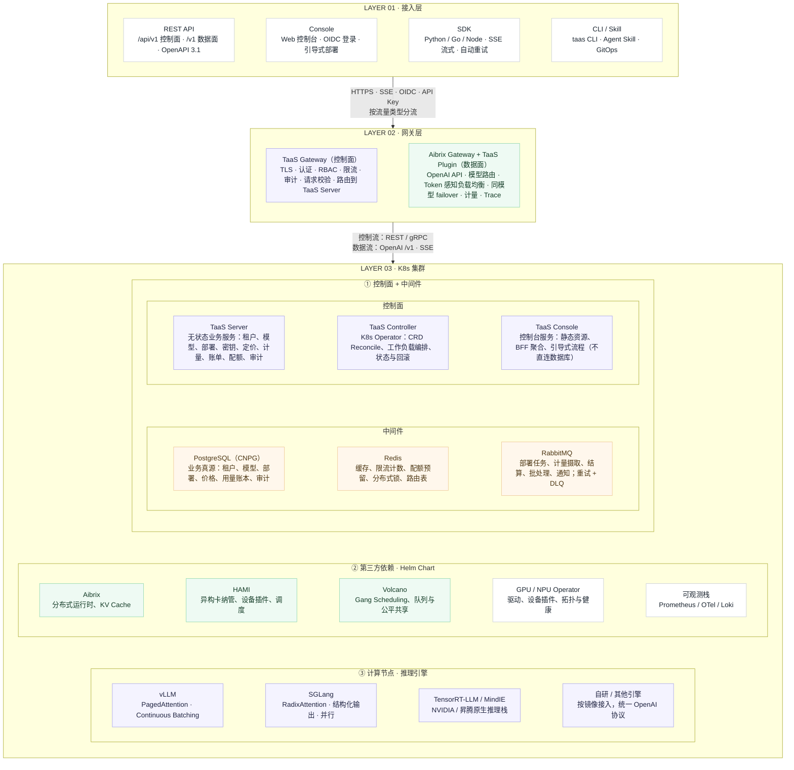

<p align="center">
  
</p>

# Go TaaS

**Token as a Service —— 基于 Kubernetes、面向智能体与应用的开源大模型推理服务与计量计费平台**

[](./LICENSE)
[](https://golang.org/)
[](./CONTRIBUTING.md)

**Go TaaS** 是一个在 Kubernetes 上提供大模型推理与计费服务的开源平台。管理员在多种异构加速卡上部署开源模型（Qwen、DeepSeek、LLaMA 等），并按「模型 × 卡型」灵活定价；智能体与 SDK 通过 OpenAI 兼容 API 消费模型，按 API Key 隔离，按 token 计量并异步结算。

> **状态**：企业级 · 生产可用。全部 50 个特性点（编号 1–51，其中微调管理已由产品负责人裁剪，即第 39 行）均已在两套控制台实现，单元测试与 FVT 套件通过，50 个 Nightwatch 端到端套件在 Docker Compose 环境全绿。各阶段交付内容见[路线图](#路线图)。

**English | [简体中文](./README.zh-cn.md)**

## 目录

- [特性](#特性)
- [架构](#架构)
- [技术栈](#技术栈)
- [快速开始](#快速开始)
- [使用示例](#使用示例)
- [文档](#文档)
- [路线图](#路线图)
- [参与贡献](#参与贡献)
- [社区](#社区)
- [致谢](#致谢)
- [许可证](#许可证)

## 特性

下表每一能力都在普通用户控制台和/或 admin 控制台有对应界面，并配有端到端测试套件。

**平台基础**

| 领域 | 能力 |
| --- | --- |
| 异构算力 | 统一纳管多种异构加速卡（厂商无关）；节点打标、Device Plugin 与驱动部署由各厂商 GPU Operator 完成。**加速器清单**实时上报各节点加速器机队健康状态，**兼容性矩阵**记录「模型 × 引擎 × 卡型」的支持情况。 |
| 控制面 / 数据面分离 | 管理 API 与推理 API 由两个独立网关承载，推理链路扩缩容、升级或降级时平台管理能力不受影响。 |
| 双控制台，一致体验 | 面向租户的**普通用户控制台**位于 `/`（API `/api/v1/*`），面向运维的 **admin 控制台**位于 `/admin`（API `/api/v1/admin/*`），各自独立会话、独立登录与基于角色的路由。 |
| 存储与网络分层 | Longhorn 承载集群状态，MinIO + JuiceFS 承载权重与镜像；集群内运行 CNI Pod 网络，提供 ClusterIP Service 与 CoreDNS 服务发现、Envoy Gateway + TLS 入口与 NetworkPolicy 隔离；控制面走常规以太网，推理可选 RDMA（RoCE / InfiniBand）。 |

**模型与推理**

| 领域 | 能力 |
| --- | --- |
| 模型目录与一键部署 | 登记并版本化模型，从任一控制台或 API 一键部署；平台经消息队列与 Kubernetes Controller 编排推理工作负载，无需手写 YAML，并内置版本历史与回滚。 |
| 推理镜像管理 | 统一登记、版本化并维护各受支持加速卡的引擎镜像适配关系，节点级预热缩短冷启动。 |
| OpenAI 兼容 API | `/v1/chat/completions`、`/v1/completions`、`/v1/embeddings` 由基于 Envoy 的网关承载；鉴权、计量与路由运行在 Wasm 插件中，推理流量不经过业务进程。 |
| 分布式推理运行时 | 平台级服务形态：推理服务既可以普通 Deployment（默认）运行，也可以交由 **AIBrix** 分布式运行时（StormService / RoleSet）托管；管理控制台可查看运行时组件健康与被其纳管的模型。 |
| vGPU 切分池 | 基于 **HAMI** 的 GPU 共享：通过标签把节点划入切分池，定义切片模板（显存 / 算力百分比），让多个小推理作业以 binpack 或 spread 策略共调度到同一块物理 GPU；管理控制台可查看池利用率与每服务的切片分配。 |
| 外部模型提供方 | 登记第三方大模型提供方（DeepSeek / OpenAI / OpenAI 兼容），通过五态连通性探测（`ok` / `unauthorized` / `unreachable` / `error` / `unknown`）验证可用性，维护上游模型清单并发布到目录；API Key 只写不可读、加密落库，租户经同一套 OpenAI 兼容计费网关消费。 |
| 路由与容灾 | **路由策略**按序使用健康部署，在同一模型内做有界故障转移与可重试失败分类，绝不静默替换模型或版本。 |
| 智能模型路由 | **路由组**（虚拟模型名，如 `auto-chat`）按序编排真实目录模型候选，支持加权、成本优先、时延优先三种策略与关键词/正则意图规则，并保留可筛选的决策轨迹；响应始终记录实际服务的真实模型。 |
| 弹性伸缩 | 推理弹性伸缩并支持缩容到零（scale-to-zero）。 |
| 压测 | 对推理服务发起压测，查看吞吐、时延与 tokens/秒 结果。 |
| 批量推理 | 提交 JSONL 批量请求，异步按折扣价处理，监控进度并下载结果/错误文件。 |

**计费、计量与分析**

| 领域 | 能力 |
| --- | --- |
| Token 计量与计费 | 网关侧计量 token 用量（prompt / completion / cached / reasoning），生成防篡改凭单，按 API Key 异步结算。 |
| 灵活定价 | 「模型 × 卡型」价格矩阵，输入/输出 token 分别定价，支持阶梯价与套餐包；余额（预付费）与额度（后付费）两种账户模式。 |
| 支付与发票 | 支付、发票与自动充值，完整账单流水。 |
| 用量与成本分析 | 用量看板、按请求成本归集、按 API Key 用量分析、含趋势与「每 token 成本」的成本分析，以及用量/成本预测。 |
| 账单报表 | 按组织 / Key / 模型生成并下载用量与账单 CSV 报表，支持定时报表历史。 |
| 成本优化 | 基于平台自身已结算用量、价格与部署数据的确定性规则引擎，产出可排序、可量化、可忽略的成本节省建议 —— 更便宜模型替换、迁移批量推理、空闲服务缩容到零、缓存命中率提升 —— 每条建议都直达可操作页面。 |

**租户、权限与治理**

| 领域 | 能力 |
| --- | --- |
| 多租户 | 全平台组织 / 项目两级隔离，含组织成员、角色与邀请（RBAC）。 |
| 服务配额管理 | 按组织的四维资源配额 —— 并发推理请求数（429 + `Retry-After`）、推理服务数、每日批量作业数与单请求最大输出 token 数 —— 支持档位预设、fail-closed 强制与可审计的变更历史。 |
| 租户级模型授权 | 限定每个租户可消费的目录模型。 |
| API Key | 全生命周期（创建 / 列出 / 吊销），加盐哈希存储，支持每 Key 限流、组织支出上限，以及每 Key **模型范围限定**，让泄露或过权的 Key 无法访问未授权模型。 |
| SSO 联邦认证 | 插件化身份提供方 —— LDAP/LDAPS、OIDC/OAuth 2.0（GitHub、Google、GitLab）、SAML 2.0 与微信 —— 支持账号绑定、JIT 预置与属性到角色的映射。 |
| 审计与数据治理 | 审计日志与活动导出、部署历史审计，以及符合 GDPR 的数据导出（用量、账单、请求日志，JSON/CSV）。 |

**可观测与自动化**

| 领域 | 能力 |
| --- | --- |
| 可观测 | 按模型查看时延 / 吞吐 / 错误率 / token 吞吐看板，按服务查看 CPU / 内存 / GPU 资源指标，并可查看推理服务日志。 |
| 请求链路追踪 | 端到端下钻单条推理请求（请求 → 网关 → 推理服务），查看分阶段时延（TTFT、生成、总时延）与按 request-id 检索。 |
| 健康与错误 | 平台组件健康与依赖状态，以及错误分析（错误码/率趋势、Top 原因与下钻）。 |
| 故障诊断与自动容错 | 检测推理服务、节点与加速卡故障，确定性归类根因，自动执行恢复（重启 / 重新调度），排水需运维确认；每个事件在管理控制台都有完整时间线，受影响服务对租户展示降级状态横幅。 |
| 事件与自动化 | 出站 Webhook（部署、伸缩、计费、支出上限、余额不足事件）支持签名密钥、重试策略与投递日志；通知中心支持按用户偏好与阈值告警。 |
| 多集群管理 | 注册并管理推理集群，查看集群健康与工作负载分布，并把模型部署路由到不同集群。 |

**提示词工具**

| 领域 | 能力 |
| --- | --- |
| 提示词库 | 创建、版本化、归类、搜索与复用提示词模板；在 playground 中打开；查看每个提示词的用量统计。 |
| Playground 与对比 | 交互式 playground，以及对同一提示词的多模型并排对比（时延 / token / 成本）。 |
| 提示词评测 | 维护基于变量的测试用例，用指定模型运行某个提示词版本，使用确定性检查或人工评审打分，并对比可复现的运行结果。 |
| API 文档浏览器与 SDK 快速开始 | 控制台内的交互式 API 参考，含端点列表、请求/响应示例与「在控制台试用」；并提供 OpenAI 兼容代码片段（Python / Node / curl）与 API Key 配置的快速开始页面。 |

## 架构



- 流量按受众分流：管理员经**控制面 Gateway**（HTTP，由 `grpc-gateway` 从 Protobuf 契约生成）进入，智能体与 SDK 调用**推理 Gateway**（Envoy + Wasm）；两者都通过集群的南北向入口（Envoy Gateway + TLS 终结）对外暴露。
- 两个网关作为独立工作负载部署，控制面 API 与推理 API 的扩缩容、升级与故障域完全隔离。
- API 按受众分区：普通用户控制台及其租户调用 `/api/v1/*`，`/api/v1/admin/*` 专供 admin 控制台；携带错误面会话的请求会在进入任何 handler 之前被拒绝。
- **gRPC Server 以单个 Deployment 承载全部 24 个微服务** —— `auth`、`tenancy`、`account`、`model`、`image`、`infer`、`runtime`、`routing`、`provider`、`metering`、`billing`、`batch`、`audit`、`webhook`、`notification`、`observability`、`tracing`、`resourcemetrics`、`accelerator`、`cluster`、`optimization`、`prompt`、`evaluation`、`docs` —— 模块间进程内调用，并经**消息队列**（Kafka / RabbitMQ）把工作交给 Controller，API 服务与 Kubernetes 调谐解耦。
- 鉴权、计量与路由运行在推理 Gateway 的 **Wasm 插件**中，推理流量不经过业务进程。
- 推理 Gateway 通过 **gRPC 调用 `auth` 模块**校验每个 API Key，两级缓存（Wasm 本地 TTL 缓存 → Redis）支撑；超时或 `auth` 不可用时按 fail-closed 拒绝。
- **集群网络**：Pod 之间经集群 CNI 网络通信并使用 ClusterIP Service 与 CoreDNS 服务发现；南北向流量经 Envoy Gateway + TLS 终结进入；NetworkPolicy 隔离控制面、数据面与租户命名空间；推理数据链路可选走 **RDMA 网络**（RoCE / InfiniBand），控制面保持常规以太网。
- 推理服务与控制面共享**同一个 Kubernetes 集群**，通过 Namespace、节点标签与污点/容忍度隔离。

组件职责、网关设计与协作流程详见[架构设计文档](./site/docs/design/architecture.zh-cn.md)。

## 技术栈

| 层次 | 选型 |
| --- | --- |
| 后端 | Go、gRPC + grpc-gateway、GORM |
| 数据 | PostgreSQL、Redis（兼容 Valkey）、Kafka / RabbitMQ |
| 控制面网关 | grpc-gateway —— 从 Protobuf 生成 HTTP/JSON 与 OpenAPI |
| 数据面网关 | Envoy + Wasm |
| 存储 | Longhorn 承载集群状态；MinIO + JuiceFS 承载推理权重与镜像 |
| 网络 | 集群 CNI Pod 网络 + ClusterIP Service + CoreDNS 服务发现；Envoy Gateway + TLS 终结承载南北向入口；NetworkPolicy 提供命名空间隔离。控制面走常规以太网；推理可选 RDMA（RoCE / InfiniBand） |
| 编排 | Kubernetes + client-go |
| 推理引擎 | vLLM / SGLang / TensorRT-LLM 等主流引擎，适配多种异构加速卡 |
| 前端（`web/`） | React 18 + TypeScript + Vite + Phosphor Icons —— 单一 SPA，同时承载普通用户与 admin 两套控制台 |
| 测试 | Go 单元测试与 FVT 套件（`test/fvt`）、Nightwatch 浏览器端到端套件（`test/e2e`） |

## 快速开始

### 一键部署（Helm）

使用自研 [Helm Chart](./deploy/helm/go-taas) 把整套栈部署到 Kubernetes（要求 Kubernetes 1.25+ 与 Helm 3.8+）：

```bash
helm install taas deploy/helm/go-taas --namespace taas --create-namespace
kubectl --namespace taas port-forward svc/taas-server 9091:9091
# 控制台：http://127.0.0.1:9091/ · /admin
```

默认配置下，Chart 会在集群内置备 PostgreSQL、Redis 与 RabbitMQ（每个依赖均可切换为外部实例），并把凭据接线到控制面。完整的 values 参考、外部依赖接线方式与生产检查清单见 Chart 的 [README](./deploy/helm/go-taas/README.zh-cn.md)（英文版 [README.md](./deploy/helm/go-taas/README.md)）。

### 环境要求

- Go 1.26+
- golangci-lint v2
- buf
- Node.js 20+（前端，`web/`）
- Docker 与 Docker Compose（本地环境）
- Git

### 从源码构建

```bash
git clone https://github.com/go-taas/go-taas.git
cd go-taas

make pbgen   # 生成 Protobuf 代码（gRPC stubs + grpc-gateway + OpenAPI）
make deps    # 更新依赖
make lint    # 静态检查
make ut      # 单元测试
make fvt     # 功能验证测试
make build   # 构建二进制
make test    # 完整测试目标
```

### Docker Compose 体验

一键体验环境：控制面（含控制台）+ PostgreSQL + Redis + 消息队列 + 挂载共享
模型权重文件系统的 JuiceFS 客户端。

```bash
cp .env.example .env   # 填写 Harbor 与 JuiceFS/MinIO 配置（见下）
make compose-up    # 构建镜像（含控制台）并启动本地环境
make compose-ps    # 查看环境状态
make compose-logs  # 跟踪日志（或：make compose-logs SERVICE=taas-server）
make compose-down  # 停止并删除环境
```

环境通过 `.env` 读取配置（该文件已被 git 忽略，完整变量见 `.env.example`）：

- `HARBOR_URL` / `HARBOR_USERNAME` / `HARBOR_PASSWORD` —— 镜像导入流程推送
  引擎镜像的内部 Harbor 地址（所有导入镜像都落在 `taas` 项目下）。
- `JUICE_FS_*` —— 模型权重文件系统（MinIO 桶 + Redis 元数据）。控制面把它
  挂载到 `/data/weights`，推理 Pod 通过集群 StorageClass 读取同一文件系统。
- `WEIGHTS_STORAGE_CLASS` —— controller 用来创建共享 `model-weights` PVC 的
  JuiceFS StorageClass。

`make compose-up` 会自动创建环境所需的 Kubernetes 资源（通过
`deploy/compose/scripts/cluster-up.sh`）：MinIO 桶、JuiceFS 文件系统、
`taas` 命名空间、`juicefs-taas-models` StorageClass 与 secret、
`model-weights` PVC、Redis NodePort（集群 Redis 是 ClusterIP 服务，宿主机
无法直连，因此通过 NodePort 暴露到节点 IP 的 `:30379`），以及加速器节点
标签。`make compose-down` 会删除 compose 环境（含数据库卷）并清理上述全部
集群资源（通过 `deploy/compose/scripts/cluster-down.sh`）。

控制台由 `taas-server` 提供，与 API 同源（无需 CORS 配置）：**普通用户
控制台** 位于 `http://localhost:9091/`，**admin 控制台** 位于
`http://localhost:9091/admin`。用户类 API 位于 `/api/v1/*`（登录、注册
在 `/api/v1/auth/*`）；管理类 API 位于 `/api/v1/admin/*`。
网关端口：`9091`（HTTP/JSON + 控制台）、`9090`（gRPC）、`9092`（指标/健康检查）。

另发布独立的 `taas-console` 镜像（nginx 承载同一 Vite 产物，`/api/` 反代到网关），
供前端与控制面独立扩缩容、独立发布的部署场景使用：

```bash
make docker-build    # 构建 taas-server、taas-controller 与 taas-console 三个镜像
# 运行（通过 TASS_PROXY_PASS 指向网关）：
docker run -p 8080:8080 -e TASS_PROXY_PASS=http://<网关地址>:9091 \
  ghcr.io/go-taas/go-taas/taas-console:latest
```

受限网络下可为镜像构建指定国内镜像源：

```bash
make compose-up GOPROXY=https://goproxy.cn,direct NPM_REGISTRY=https://registry.npmmirror.com
```

### 生产部署（Helm）

在专属 Kubernetes 环境中，使用自研 Helm Chart 部署控制面：[deploy/helm/go-taas](./deploy/helm/go-taas)（完整的 values 参考、外部依赖接线方式与生产检查清单见 Chart 的 [README](./deploy/helm/go-taas/README.zh-cn.md)，英文版为 [README.md](./deploy/helm/go-taas/README.md)）：

```bash
helm install taas deploy/helm/go-taas --namespace taas --create-namespace
kubectl --namespace taas port-forward svc/taas-server 9091:9091
# 控制台：http://127.0.0.1:9091/
```

PostgreSQL、Redis 与 RabbitMQ 通过按依赖配置的策略接入控制面 —— 既可以是 Chart 置备并管理的集群内实例，也可以是外部服务（Chart 不负责其部署，只负责把凭据接入）。凭据可来自 Chart 的密钥生成器、`secrets.existingSecret`，或两者并用。本地可用以下目标校验 Chart：

```bash
make helm-lint        # lint the chart (values schema included)
make helm-template    # render all templates with default values
```

## 使用示例

### Python（OpenAI SDK）

```python
from openai import OpenAI

client = OpenAI(
    base_url="https://<your-taas-host>/v1",
    api_key="sk-xxxxxxxx",
)

resp = client.chat.completions.create(
    model="qwen2.5-7b",
    messages=[{"role": "user", "content": "你好，介绍一下你自己。"}],
)
print(resp.choices[0].message.content)
```

### cURL

```bash
curl https://<your-taas-host>/v1/chat/completions \
  -H "Content-Type: application/json" \
  -H "Authorization: Bearer sk-xxxxxxxx" \
  -d '{
    "model": "qwen2.5-7b",
    "messages": [{"role": "user", "content": "你好！"}]
  }'
```

## 文档

在**[文档浏览器](https://go-taas.com/docs.html)**中阅读完整文档集 —— 支持搜索、中英双语、目录导航与图表渲染 —— 也可直接打开单个文档：

| 文档 | 语言 |
| --- | --- |
| [文档浏览器](https://go-taas.com/docs.html) | English / 中文 |
| [Architecture Design](./site/docs/design/architecture.md) | English |
| [架构设计文档](./site/docs/design/architecture.zh-cn.md) | 中文 |

[`site/docs/`](./site/docs) 目录包含完整文档集，浏览器渲染的正是这些文件：

- [`site/docs/design/`](./site/docs/design) —— 每个特性点的产品/UI 设计文档（英文 + `zh-cn`）。
- [`site/docs/architecture/`](./site/docs/architecture) —— 每个特性点的架构与详细设计文档（英文 + `zh-cn`）。
- `site/docs/api/` —— 按服务生成的 OpenAPI/Swagger 规范（auth、model、infer、billing 等），由 `make pbgen` 生成，不入库。

## 路线图

下列四个阶段均已交付并在 Docker Compose 环境完成端到端验证；剩余为运维
加固工作（在特性待办之外单独跟踪）。

| 阶段 | 状态 | 已交付 |
| --- | --- | --- |
| Phase 1（MVP） | ✅ 已交付 | 模型目录与一键部署、API Key 生命周期、控制/推理网关分离、网关侧鉴权与计量。 |
| Phase 2 | ✅ 已交付 | 价格矩阵、余额/额度、阶梯价、异步结算、用量/成本分析、支付/发票/自动充值、审计日志、RBAC、通知。 |
| Phase 3 | ✅ 已交付 | 加速器清单与健康、多厂商引擎与镜像适配、模型 × 引擎 × 卡型兼容性矩阵。 |
| Phase 4 | ✅ 已交付 | 弹性伸缩、路由策略、压测、可观测与链路追踪、Webhook、通知中心、提示词库与评测、批量推理、多集群管理、API 文档浏览器、数据导出、分布式推理运行时（AIBrix）、外部模型提供方、智能模型路由、成本优化、服务配额管理、vGPU 切分池（HAMI）、故障诊断与自动容错。 |
| 后续 | 🚧 规划中 | RDMA 网络；社区运营在特性待办之外单独跟踪（Helm 一键部署见 `deploy/helm/go-taas`，项目治理见 [GOVERNANCE.zh-cn.md](./GOVERNANCE.zh-cn.md)）。 |

## 参与贡献

欢迎各种形式的贡献 —— 代码、文档、缺陷报告与功能建议。开发环境、提交规范与 PR 指引见 [CONTRIBUTING.md](./CONTRIBUTING.md)，中文版见 [CONTRIBUTING.zh-cn.md](./CONTRIBUTING.zh-cn.md)。

- 遵循 [Conventional Commits](https://www.conventionalcommits.org/zh-hans/)（由 commitlint 校验）
- 提交前运行 `make lint` 与 `make ut`
- 缺陷报告与功能请求请使用 issue 模板
- 第一次参与？挑一个 `good first issue`，在 Discussions 里打个招呼

## 社区

- [GitHub Issues](https://github.com/go-taas/go-taas/issues) —— 缺陷报告与功能请求
- [GitHub Discussions](https://github.com/go-taas/go-taas/discussions) —— 问题与开放讨论
- [治理规则](./GOVERNANCE.zh-cn.md) —— 角色、权限、晋升与决策机制
- [维护者名册](./MAINTAINERS.zh-cn.md) —— 当前角色持有者、领域归属与评审服务等级
- [Team 与权限配置](./GITHUB-TEAMS.zh-cn.md) —— 组织 Team、仓库权限、`CODEOWNERS` 与分支规则集的配置方法
- [角色阶梯](./CONTRIBUTING.zh-cn.md#社区角色与成长) —— 从贡献者成长为维护者的路径；非代码贡献同样计入

## 致谢

Go TaaS 站在开源社区的肩膀上。感谢以下上游社区：

- [Kubernetes](https://kubernetes.io) —— 整个平台运行的容器编排基座
- [AIBrix](https://github.com/vllm-project/aibrix) —— 平台对接的推理服务运行时与弹性伸缩组件（ModelClaim、PodAutoscaler）
- [Volcano](https://github.com/volcano-sh/volcano) —— 面向异构集群的批量/gang 调度实践参考
- [HAMi](https://github.com/Project-HAMi/HAMi) —— 异构 GPU 共享与虚拟化思路参考

## 许可证

Go TaaS 基于 [Apache License 2.0](./LICENSE) 许可发布。
