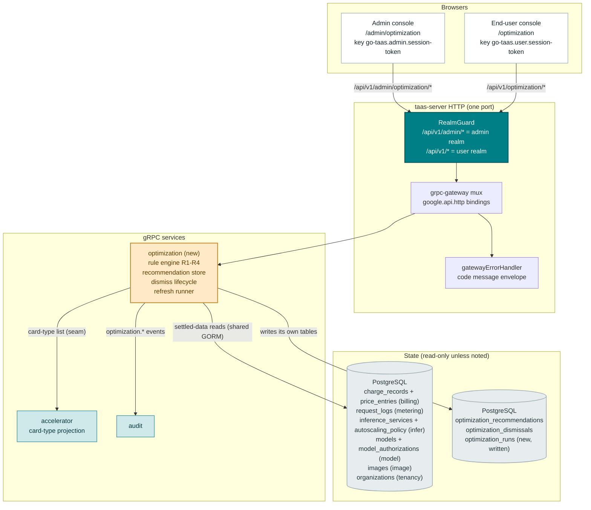
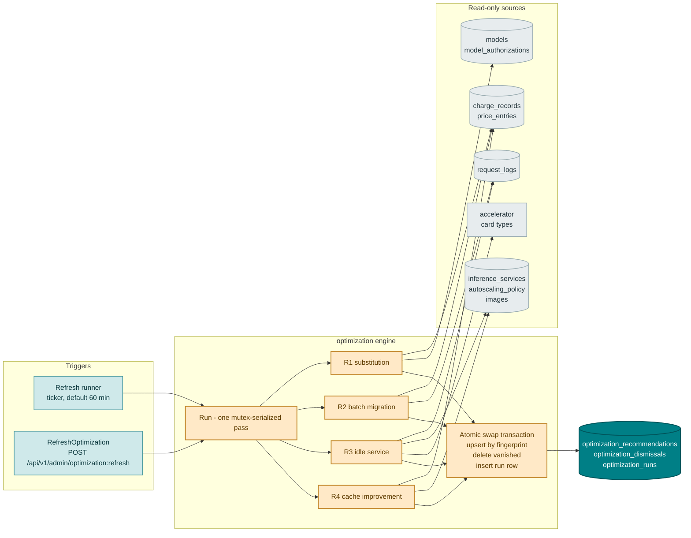
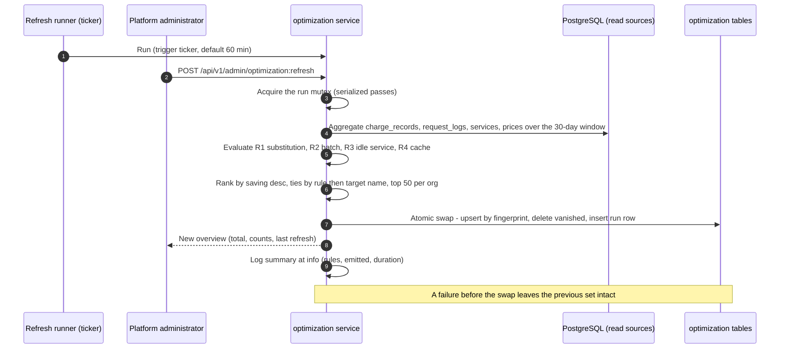
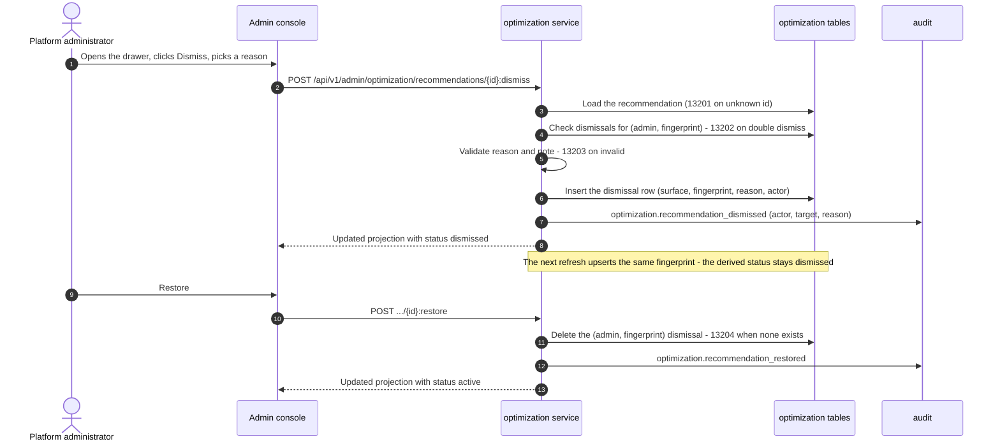
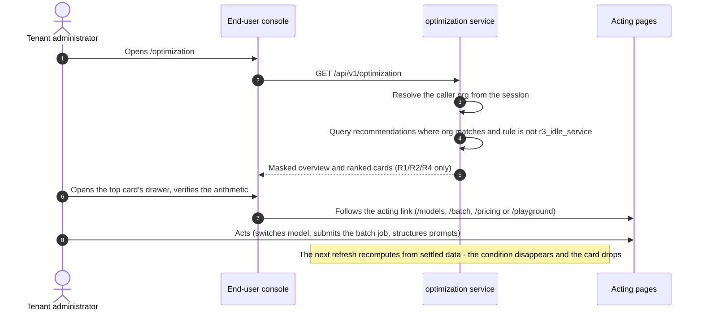

# Cost Optimization Recommendations — Architecture and Detailed Design

| Attribute | Content |
| --- | --- |
| Feature point | Cost optimization recommendations — a deterministic, rule-based engine inside a new `optimization` module that reads the platform's own settled usage, price and deployment data (last 30 days) and produces ranked, quantified, dismissible savings recommendations: R1 cheaper-model substitution (grant-aware, context-length-checked, saving floor), R2 batch migration (offline-shaped key traffic, 50% discount), R3 idle-service scale-to-zero (admin-only, idle GPU cost), R4 cache-hit improvement (low cache-hit rate on a caching-capable engine) — each with verifiable inputs/arithmetic, an estimated monthly saving, a one-click acting-page link, and a dismiss/restore lifecycle with fingerprint persistence. Advice-only invariant: the engine never acts. Admin surface `/admin/optimization` + `/api/v1/admin/optimization/*`; end-user surface `/optimization` + `/api/v1/optimization/*` (R1/R2/R4 only, masked projection) (backlog row 50) |
| Document scope | Architecture and detailed design for feature-50: the new `optimization` module (rule engine, recommendation store, dismiss/restore lifecycle, refresh runner); the `taas.optimization.v1.OptimizationService` proto with eleven RPCs bound under `/api/v1/admin/optimization/*` and `/api/v1/optimization/*`; the `optimization_recommendations`, `optimization_dismissals` and `optimization_runs` tables; the exact rule algorithms (R1–R4) with their thresholds and arithmetic; the read seams into billing, metering, infer, batch, model, image and accelerator data; error handling (13201–13205 plus 10038/10036); configuration, security, rollout, and a function-level task list per layer |
| Owning modules | New `optimization` module (`services/optimization`): the rule engine, the recommendation store, the dismiss/restore lifecycle and the refresh runner; read-only seams into `billing` (charge records, price matrix), `metering` (request logs), `infer` (services, autoscaling), `model` (catalog, grants), `image` (engine names), `accelerator` (card-type list), `tenancy` (org names); `audit` (`optimization.*` events); `pkg/errors` (132xx block); `pkg/config` (`optimization` section); `pkg/server` (admin + user prefix bindings, unchanged realm guard); `web` admin console (`OptimizationPage`) and end-user console (`UserOptimizationPage`) |
| Related documents | [Requirement Analysis and UI/UX Design](../design/cost-optimization-recommendations.md) · [Architecture Design](../design/architecture.md) §2.2 `model`, §2.4 `infer`, §3.1 control gateway, §4.3 inference request and billing loop · [Pricing](./pricing.md) (the price matrix and charge records R1/R2/R4 read) · [Batch Inference](./batch-inference.md) (the 50% batch discount R2 applies) · [Inference Autoscaling](./inference-autoscaling.md) (the per-service policy R3 inspects) · [Accelerator Inventory](./accelerator-inventory.md) (the fleet card-type list R3 checks) · [Per-Tenant Model Authorization](./model-authorization.md) (the grant rule R1 respects) · [Cost Analytics Dashboard](./cost-analytics-dashboard.md) (the read-only analytics input this feature builds on) · [Console Surface Separation](./console-surface-separation.md) (the two surfaces, the masked-projection rule) |
| Status | Architecture complete, handed to the Developer agent |

---

## 1. Overview and Goals

Features #25/#28/#29 gave go-taas cost **visibility** — what was spent, attributed by org, model and key. What is still missing is cost **actionability**: a ranked worklist that tells the operator and each tenant where money is being wasted, how much is recoverable, and exactly where to click to act. Every comparable platform converges on this shape (AWS Cost Optimization Hub, Azure Advisor, OpenAI/Anthropic cost guidance): deterministic rules over the platform's own settled data, each recommendation carrying its inputs and arithmetic so the reader can verify it line by line.

This feature adds a **deterministic, rule-based optimization engine** in a new `optimization` module. On a fixed interval (default 60 minutes) and on an explicit admin trigger, the engine recomputes the active recommendation set from the **last 30 days of settled data** and replaces the stored snapshot; dismissed recommendations persist by **fingerprint** so a dismissed condition does not nag again while it stays active. Four rules ship in v1: **R1 cheaper-model substitution**, **R2 batch migration**, **R3 idle-service scale-to-zero** (admin-only), **R4 cache-hit improvement**. The **advice-only invariant** is the core product rule: the engine computes and explains, never acts — the acting pages stay human-driven.

**Goals**:

- Two pages: `/admin/optimization` (`OptimizationPage`, fleet-wide with org/model filters and the Refresh-now button) and `/optimization` (`UserOptimizationPage`, the tenant's own masked projection), per design §5.1–§5.4.
- A new `optimization` module owning the rule engine, the recommendation store, the dismiss/restore lifecycle and the refresh runner, with its own error block **132xx** (design D2, D9).
- The exact surface bindings for eleven RPCs on a new `taas.optimization.v1.OptimizationService` — six admin-prefix, five user-prefix (design §6).
- The four deterministic rules with config-constant thresholds and verifiable arithmetic (design D3, D4; FR1.3–FR1.6).
- **Fingerprint persistence**: `sha256(rule | target_type | target_id | suggestion)` keyed dismiss state per surface, surviving snapshot replacement (design D6; FR3.3).
- The masked end-user projection: R1/R2/R4 only, no service ids, replica counts or card prices, acting links to end-user pages only (design D8; FR4).
- Audit events `optimization.refreshed`, `optimization.recommendation_dismissed`, `optimization.recommendation_restored` with the acting identity (design FR5.4).
- Numbered acceptance criteria (AC1–AC14) testable in Nightwatch, FVT and unit tests.

**Non-goals** (from the design, restated): automatic enforcement of any recommendation (deliberately excluded — advice only); ML/anomaly advisors and prompt-content analysis (deliberately excluded); forecasting and confidence bands (feature #36); cost analytics and attribution (feature #29, read-only input); budget alerts and spend limits (feature #6); per-rule threshold editing UI (thresholds are config constants); recommendation email/webhook delivery (the notification center #26 could carry it later); multi-currency estimates (the platform settles in one currency); and the acting pages themselves (features #13, #49, #16, #42, #25 — reused unchanged, this feature only links to them).

### 1.1 Reading order of this document

Section 2 records the architecture decisions (AD1–AD16; AD10–AD16 are refinements the architecture adds, marked as such). Sections 3–5 are the component view, the data model and the API design. Section 6 is the frontend architecture (page → route → API-prefix table, navigation, shared components, auth guard). Sections 7–8 are the sequence diagrams and error handling. Sections 9–11 are configuration, security and rollout. Section 12 is the acceptance-criteria traceability. Sections 13–15 are the function-level detailed design (including the exact rule algorithms), the ordered implementation task list, and the deferred items.

---

## 2. Architecture Decisions

AD1–AD9 restate the UI/UX design's decisions (D1–D9) as implementation-level rules. **AD10–AD16 are refinements** the architecture adds; each is marked with the design decision it refines and preserves that decision's intent so the Developer and Test agents implement one reading.

| # | Decision | Rationale |
| --- | --- | --- |
| AD1 | **Both surfaces get a dedicated section**: admin `/admin/optimization` + `/api/v1/admin/optimization/*` (fleet-wide, org/model filters, Refresh now), end-user `/optimization` + `/api/v1/optimization/*` (the caller's org, masked) — not a tab on `/admin/cost` | Design D1. Recommendations are an actionable worklist with their own lifecycle, not analytics; the operator optimizes the fleet, the tenant optimizes its own spend |
| AD2 | **A new `optimization` module** (`services/optimization`) owns the rule engine, the recommendation store, the dismiss/restore lifecycle and the refresh runner, with its own error block **13201–13299**. It reads `billing`, `metering`, `infer`, `batch`, `model`, `image` and `accelerator` data **read-only**; it writes nothing outside its own tables | Design D2. A distinct concern (rules, estimates, a worklist lifecycle) with its own cadence; a dedicated module keeps the analytics modules read-only and the engine unit-testable in isolation |
| AD3 | **Four deterministic rules for v1** — R1 cheaper-model substitution, R2 batch migration, R3 idle-service scale-to-zero (admin-only), R4 cache-hit improvement — with all thresholds as **config constants** under `optimization.*`, documented in the drawer; no runtime threshold editing | Design D3. The platform's cost levers are few and known; explicit thresholds keep the engine deterministic and the copy honest |
| AD4 | **Estimates are arithmetic, not forecasts**: monthly saving = (current effective price − alternative effective price) × observed monthly volume, using the same 30-day settled window for every rule; the drawer shows the inputs and the formula. No confidence bands, no growth assumptions | Design D4. A recommendation the operator can verify line-by-line; forecasting is #36 |
| AD5 | **Ranking is by estimated monthly saving descending**, ties by rule then target display name; the engine persists the **top 50 per organization** (the worklist bound); the summary cards total the stored active set | Design D5. The worklist metaphor: the biggest lever first; the per-org cap bounds noise for large fleets while guaranteeing every org its full worklist on the user surface |
| AD6 | **Refresh is periodic and snapshotted**: a ticker (default 60 min, `optimization.refreshIntervalMinutes`, 10–1440) plus the `RefreshOptimization` admin trigger; each run recomputes from settled data and **atomically replaces** the active set in one transaction; dismissed fingerprints persist. A failed run leaves the previous set intact — a failed refresh never empties the worklist | Design D6, FR1.2, FR1.7. Deterministic recomputation keeps estimates honest; the single-transaction swap is the failure semantics AC10 verifies |
| AD7 | **Substitution suggestions respect grants**: R1 only proposes a model the org is already granted, or that is public/grantable (the #13 default-allow rule); the drawer states which case applies; the acting path is the grant page then optionally a routing group | Design D7. A suggestion the tenant cannot act on is noise; the grant check is the platform's own authorization rule applied to advice |
| AD8 | **Both surfaces share the rule set and the card/drawer components**; the admin surface adds org/model filters, the fleet total and Refresh now; the end-user surface is org-scoped with the masked projection — no service ids, replica counts or card prices, and the idle-service rule is **admin-only**. A user-realm session on an admin route gets **10038**; a session without the role gets **10036** | Design D8. Consistent with the console-surface separation and the masked-projection rule; services are operator resources |
| AD9 | **New error codes in an optimization block (13201–13299)**, the next free block after routing's 131xx: **13201 `CodeRecommendationNotFound`**, **13202 `CodeRecommendationDismissed`**, **13203 `CodeRecommendationDismissReasonInvalid`**, **13204 `CodeRecommendationRestoreInvalid`**, **13205 `CodeOptimizationRangeInvalid`**. Realm failures reuse **10038** and role failures **10036** | Design D9. A new module (AD2) gets a fresh block; distinct codes keep each failure mode actionable |
| AD10 | **REFINEMENT of design D2 — the engine reads sibling-module data through narrow read-only repositories on the shared GORM handle (the `infer.modelRepository` pattern), not internal RPCs.** `services/optimization` gains `reads.go` with five small read interfaces — charge/price reads (`charge_records`, `price_entries`), request-log reads (`request_logs`), service reads (`inference_services` + the global autoscaling policy), catalog reads (`models`, `model_authorizations`) and image reads (`images`) — each a plain SELECT/aggregate on the shared database, plus a `CardTypeLister` seam implemented by the `accelerator` service (its card-type set lives in an in-memory projection, not a table) | The design leaves "internal RPCs or shared repositories" to the Architect. The shared-handle read is the established pattern (`infer` reads the model catalog this way): no new RPC surface, no cross-service latency on a batch job, and the read seams are narrow enough to keep the modules decoupled. The accelerator projection is the one exception — it is not a table, so it stays a seam |
| AD11 | **REFINEMENT of design D6/FR3.3 — the store is three tables and the dismiss state is a separate table keyed `(surface, fingerprint)`; a recommendation's `status` is derived at read time, never stored.** `optimization_recommendations` holds the computed conditions (fingerprint-unique, upserted each refresh so `recommendation_id` and `first_seen_at` stay stable while the condition persists); `optimization_dismissals` holds one row per `(surface, fingerprint)` with reason/note/actor/time; `optimization_runs` logs each refresh (the last-refresh timestamp survives an empty result set). Read RPCs LEFT-JOIN dismissals for the requesting surface to derive `status`, `dismissed_reason`, `dismissed_by`, `dismissed_at` | The design keys dismiss state by `(surface, fingerprint)` (FR3.4) while FR1.1 puts `status` in the row projection — a stored status column could not be active for one surface and dismissed for the other. Deriving at read time makes both surfaces correct over one shared condition row, and the separate dismissals table is what survives snapshot replacement (the recommendations row is deleted when the condition disappears; the dismissal is not) |
| AD12 | **REFINEMENT of design FR1.3 — model context lengths come from the config map `optimization.modelContextLengths` (model name → max context tokens), and R1 fails closed on unknown lengths: a model A or B without a configured length is excluded from substitution.** The catalog stores no context-length field today (`models`/`model_versions` carry ids, names, weights, versions — nothing about context) | The design makes "B's context length ≥ 80% of A's" a hard filter, but the platform has no context-length source. A config map keeps the rule deterministic and honest; failing closed (never propose a substitution we cannot verify) preserves US9's "never see a recommendation the platform cannot technically deliver". Trade-off, accepted: R1 activates only for models the operator has annotated; a catalog context-length field is the follow-up (Section 15) |
| AD13 | **REFINEMENT of design FR1.4 — R2's offline-shape test reads `request_logs` (hour-of-day against configured peak windows, prompt-token size, streaming status), and "a model the batch API serves" means any catalog model: the batch worker dispatches through the same serving path and accepts any catalog model id.** Peak windows are config: `optimization.peakHours` (default `["09:00-18:00"]`), `optimization.peakWeekdaysOnly` (default true), evaluated in `optimization.timezone` (default UTC) | `request_logs` is the only per-request record with `created_at`, `prompt_tokens` and `status` (success/error/streaming) — exactly the offline-shape signals. The batch service validates a single model per file but does not restrict which catalog model, so the catalog-existence check is the whole "batch-served" test |
| AD14 | **REFINEMENT of design FR1.5 — R3's card hourly cost comes from the config map `optimization.cardHourlyCosts` (accelerator type → hourly cost in the platform currency); the accelerator inventory contributes the fleet card-type existence check via the `CardTypeLister` seam. A service whose card type is missing from either is skipped — never a zero-saving or unpriced recommendation.** The billing price matrix prices tokens per (model, card), not GPU hours; there is no per-card hourly cost anywhere in the platform today | The design says "from the accelerator inventory #18 and the price matrix" but neither stores a GPU-hour rate. The config map is the smallest faithful reading of the design's own skip rule ("if either lacks data for a service's card type, the rule skips the service"), keeps the arithmetic operator-verifiable, and matches D3's config-constant discipline. Trade-off, accepted: R3 activates only for card types the operator has priced |
| AD15 | **REFINEMENT of design FR1.6 — R4's "engine supports prefix caching" is config-driven: a model qualifies when any non-terminated inference service for that model runs an image whose `Engine` is in `optimization.prefixCacheEngines` (default `["vllm", "sglang"]`).** The cache discount is the price entry's `input_price_per_million − cached_price_per_million` for the (model, card) cell with the `"default"` card fallback | The engine name lives on the image row (`images.engine`), the only engine signal the platform stores; a configured set keeps the rule deterministic and lets new engines be enabled without code. The price-entry arithmetic reuses the billing module's own cached-price field — no new price data |
| AD16 | **REFINEMENT of design FR1.1 — the acting link is stored per recommendation as both surface variants (`acting_page_admin`, `acting_page_user` jsonb columns, each `{route, label}`), and the read RPC projects only the requesting surface's variant.** R1's admin route is parameterized by the candidate model's id (`/admin/models/{id}/authorizations`), so the link cannot be derived statically | The design specifies different acting pages per surface (FR4.3 vs §5.3); computing both at refresh time (when the target ids are known) and projecting per surface keeps one shared condition row (AD11) and makes the masking rule a pure projection |

---

## 3. Component View

### 3.1 Ownership

| Layer / component | Owns | Changes in this feature |
| --- | --- | --- |
| **Static bundle (SPA)** | One Vite bundle (`web/dist`) embedded into `taas-server`; served by the gateway's SPA fallback | Two new pages (`OptimizationPage`, `UserOptimizationPage`), two nav items, route registration in `App.tsx`, i18n keys, the shared recommendation card/drawer/dismiss-dialog components |
| **Gateway (`pkg/server`)** | HTTP composition: `RealmGuard` → `withConsole` → grpc-gateway mux; the unified error renderer; the SPA fallback | No change — the new RPCs bind under `/api/v1/admin/optimization/*` and `/api/v1/optimization/*`, which `RealmGuard` already classifies by prefix |
| **grpc-gateway mux** | Path → RPC routing from `google.api.http` annotations | New bindings for the eleven optimization RPCs (Section 5) |
| **`optimization` (new)** | The `optimization_recommendations`, `optimization_dismissals` and `optimization_runs` tables; the eleven RPCs; the rule engine (R1–R4); the refresh runner | New service: `services/optimization` |
| **`billing`** | Price matrix, charge records | **No code change** — the engine reads `charge_records` and `price_entries` through its own read repository (AD10) |
| **`metering`** | Vouchers, usage records, request logs | **No code change** — the engine reads `request_logs` through its own read repository (AD13) |
| **`infer`** | Inference services, autoscaling policy | **No code change** — the engine reads `inference_services` and the global `autoscaling_policy` row through its own read repository |
| **`model`** | Catalog, grants | **No code change** — the engine reads `models` and `model_authorizations` through its own read repository (AD10) |
| **`image`** | Engine image catalog | **No code change** — the engine reads `images` (engine names) through its own read repository (AD15) |
| **`accelerator`** | The fleet card-type projection | A `CardTypeLister`-shaped read already exists (`ListCardTypes`); the optimization service consumes it as a seam (AD14) |
| **`tenancy`** | Organizations | **No code change** — the engine reads org display names through its own read repository |
| **`audit`** | Best-effort audit recorder | Reused: the optimization module calls `Recorder.Record` for `optimization.*` events |
| **`pkg/mq`** | The canonical subjects | **No new subject** — the engine is a periodic in-process ticker; refreshes and dismissals are DB writes |
| **`pkg/errors`** | Code blocks per module | One new optimization block: **13201–13205** (13206–13299 reserved) |
| **`pkg/config`** | The merged configuration tree | New `optimization` section (refresh interval, window, rule thresholds, context lengths, card costs, peak windows, cache engines) |
| **`test/e2e/mock`** | The compose test fixtures | Reused unchanged; the FVT harness seeds charge/request/service fixtures for the rule matrix |

### 3.2 Component view



### 3.3 Request identity chain

The optimization RPCs split across the two surfaces (AD1, AD8). The chain is:

1. `RealmGuard` (HTTP, `pkg/server/realm.go`) — the path prefix decides the expected realm: `/api/v1/admin/optimization/*` → admin realm; `/api/v1/optimization/*` → user realm. With no `Authorization` header: pass through (transitional). With a header: resolve the session realm from Redis; mismatch → **10038**; unknown/expired/realm-less → **10027**.
2. grpc-gateway mux — routes by the annotated path and forwards `authorization`.
3. `optimization` handler —
   - **Admin RPCs** (overview, list, get, dismiss, restore, refresh): resolve the actor (`SessionUserResolver`) and gate on the admin role via `tenancy.RoleGuard` (**10036**), the `provider.requireAdminRole` shape; platform-scoped (the optional `organization_id` filter is a query parameter, never an identity source).
   - **User RPCs** (my-overview, my-list, my-get, my-dismiss, my-restore): resolve the caller's organization from the session (`SessionOrgResolver.SessionActiveOrg` — the billing `GetBalance` pattern: the session's active org wins, `X-Organization-Id` ignored); every query is hard-scoped to that org and excludes `rule = r3_idle_service` (the masked projection, AD8).

A user-realm session presented on any `/api/v1/admin/optimization/*` route is rejected with **10038 `CodeRealmMismatch`** (FR5.1, AC11). A session lacking the required role receives **10036 `CodeForbidden`** (AC12).

### 3.4 The engine seam

The engine is a periodic batch job inside the `optimization` service — a ticker mirroring the settlement-cadence pattern — plus the synchronous `RefreshOptimization` trigger. It is not request-triggered.



- **`Run`** is serialized by a mutex (a ticker tick and an admin trigger never overlap; the trigger waits, then runs, then returns the new summary).
- **Failure semantics** (AD6): every rule computes into memory first; the store is touched only by the final atomic swap. Any error before the swap leaves the previous active set and the previous run row intact; the failure is logged at error level and the page shows the stale banner (AC10).
- **Idempotence** (FR1.2): the same settled data yields the same set — the rules are pure functions of the window's data plus config constants.

---

## 4. Data Model

The feature adds **three tables**, all created by the `optimization` service's `Migrate` via `db.AutoMigrate(...)` (Section 4.4). No existing table changes.

### 4.1 `optimization_recommendations`

One row is one computed condition in the latest snapshot (AD11). The fingerprint is the stable identity; `recommendation_id` and `first_seen_at` are preserved across refreshes by the upsert.

| Column | Type | Notes |
| --- | --- | --- |
| `id` | string (PK, uuid) | Server-generated UUID v4 on first insert, exposed as `recommendation_id`; stable while the fingerprint persists |
| `fingerprint` | string (64), unique | `sha256(rule \| target_type \| target_id \| suggestion)` hex; the upsert key |
| `rule` | string (32), index | `r1_substitution` / `r2_batch` / `r3_idle_service` / `r4_cache` |
| `target_type` | string (16) | `org_model` (R1/R4) / `api_key` (R2) / `service` (R3) |
| `target_id` | string (256) | R1/R4: `org_id/model_id`; R2: the api-key id; R3: the service id |
| `target_display` | string (256) | Denormalized at compute time: "`<org>` → `<model>`" / "`<org>` / key `<name>`" / "service `<name>`" |
| `organization_id` | string (64), index | Denormalized filter column (FR2.1) |
| `model_id` | string (128), nullable, index | Denormalized filter column (R1/R2/R4; NULL for R3) |
| `api_key_id` | string (64), nullable | Denormalized (R2) |
| `service_id` | string (64), nullable | Denormalized (R3) |
| `suggestion` | string (512) | The proposed change, human-readable |
| `estimated_monthly_saving` | float64 | Rounded to 2 decimals at compute time; serialized as a JSON string with 2 places |
| `currency` | string (8) | The platform's single settlement currency |
| `inputs` | jsonb | The rule-specific inputs object (usage window, request counts, token counts, prices, cache rates) — the drawer's "Why" table |
| `arithmetic` | string (512) | The formula with the numbers substituted |
| `alternatives` | jsonb | R1 only: `[{model_id, model_name, estimated_monthly_saving, input_price, output_price}]`, saving-desc; `[]` otherwise |
| `acting_page_admin` | jsonb | `{route, label}` — the admin acting link (AD16) |
| `acting_page_user` | jsonb | `{route, label}` — the end-user acting link (AD16) |
| `first_seen_at` | timestamp | Preserved by the upsert: the first time this fingerprint appeared |
| `last_computed_at` | timestamp | Bumped every refresh that recomputes the fingerprint |
| `created_at` / `updated_at` | timestamp | UTC |

The GORM model is `Recommendation` in `services/optimization/optimization_model.go`; `TableName()` returns `"optimization_recommendations"`.

### 4.2 `optimization_dismissals`

One row is one surface's dismissal of one fingerprint (AD11). Rows survive snapshot replacement and condition disappearance — the fingerprint, not the recommendation row, is the identity (FR3.3).

| Column | Type | Notes |
| --- | --- | --- |
| `id` | string (PK, uuid) | Server-generated UUID v4 |
| `surface` | string (8) | `admin` / `user` — `uniqueIndex:idx_optimization_dismissals_surface_fp (surface, fingerprint), priority:1` |
| `fingerprint` | string (64) | The other half of the composite unique key, priority 2 |
| `reason` | string (16) | `not_applicable` / `planned` / `other` |
| `note` | string (256) | Required for `other`, empty otherwise; ≤ 256 chars |
| `dismissed_by` | string (64) | The acting user id (admin or tenant actor per surface) |
| `dismissed_at` | timestamp | UTC, indexed with `surface` |

The GORM model is `Dismissal` in `services/optimization/optimization_model.go`; `TableName()` returns `"optimization_dismissals"`. `Restore` deletes the row; a later re-dismissal inserts a fresh one.

### 4.3 `optimization_runs`

One row per engine pass (AD11) — the refresh log and the source of the "last refresh" card, correct even when a pass emits zero recommendations.

| Column | Type | Notes |
| --- | --- | --- |
| `id` | string (PK, uuid) | Server-generated UUID v4 |
| `started_at` / `finished_at` | timestamp | UTC |
| `duration_ms` | int64 | |
| `rules_evaluated` | int | 4 (the rule count run) |
| `recommendations_emitted` | int | The size of the new snapshot |
| `trigger` | string (16) | `ticker` / `admin` |
| `success` | bool | `false` rows carry `error` |
| `error` | string (512) | Empty on success |

The GORM model is `Run` in `services/optimization/optimization_model.go`; `TableName()` returns `"optimization_runs"`.

### 4.4 Migration and init-SQL upgrade path

This repository does **not** use hand-written init-SQL scripts: every table's schema is the GORM model created by the owning service's `Migrate` via `db.AutoMigrate(...)`, and there are no `.sql` files under `deploy/`. The upgrade path is:

1. Add `Recommendation`, `Dismissal` and `Run` to `services/optimization/optimization_model.go`.
2. `optimization.Service.Migrate(ctx)` returns `db.AutoMigrate(&Recommendation{}, &Dismissal{}, &Run{})`; `MigrateSchemaForFVT(db)` does the same for the FVT harness.
3. `apps/taas-server/main.go` registers the `optimization` service (after `billing`, beside `routing`) so the tables are created on server startup.
4. No init-SQL edit, no manual DDL, no data backfill. The tables start empty; the first refresh (ticker or trigger) populates the snapshot. Until then both pages show the empty state — unchanged behavior for existing deployments.

---

## 5. API Design

### 5.1 Surface mapping

Six RPCs bind **only** on the admin prefix; five bind **only** on the user prefix (AD1). No RPC is dual-bound: the admin and user projections differ (fleet filters + R3 vs org-scoped masked), and separate RPCs keep each handler's scoping explicit.

| RPC | HTTP method + path | Surface | Status |
| --- | --- | --- | --- |
| `GetOptimizationOverview` | `GET /api/v1/admin/optimization` | admin | new |
| `ListOptimizationRecommendations` | `GET /api/v1/admin/optimization/recommendations` | admin | new |
| `GetOptimizationRecommendation` | `GET /api/v1/admin/optimization/recommendations/{recommendation_id}` | admin | new |
| `DismissRecommendation` | `POST /api/v1/admin/optimization/recommendations/{recommendation_id}:dismiss` | admin | new |
| `RestoreRecommendation` | `POST /api/v1/admin/optimization/recommendations/{recommendation_id}:restore` | admin | new |
| `RefreshOptimization` | `POST /api/v1/admin/optimization:refresh` | admin | new |
| `GetMyOptimization` | `GET /api/v1/optimization` | user | new |
| `ListMyOptimizationRecommendations` | `GET /api/v1/optimization/recommendations` | user | new |
| `GetMyOptimizationRecommendation` | `GET /api/v1/optimization/recommendations/{recommendation_id}` | user | new |
| `DismissMyRecommendation` | `POST /api/v1/optimization/recommendations/{recommendation_id}:dismiss` | user | new |
| `RestoreMyRecommendation` | `POST /api/v1/optimization/recommendations/{recommendation_id}:restore` | user | new |

Gateway routing notes: the colon custom verbs follow the established `:playground` / `:export` convention; `GET /api/v1/admin/optimization` (collection root) and `GET /api/v1/admin/optimization/recommendations` are distinct static paths — no wildcard conflict. No existing RPC changes in this feature.

### 5.2 Proto contract (`proto/taas/optimization/v1/optimization.proto`, new)

```proto
syntax = "proto3";

package taas.optimization.v1;

import "google/api/annotations.proto";
import "taas/common/v1/common.proto";

option go_package = "github.com/go-taas/go-taas/proto/taas/optimization/v1;optimizationv1";

// OptimizationService serves the cost-optimization worklist: the rule
// engine's snapshot (overview + ranked recommendations), the
// dismiss/restore lifecycle and the refresh trigger (feature #50).
// Admin-surface RPCs are served under /api/v1/admin/optimization;
// user-surface RPCs under /api/v1/optimization (org-scoped, masked).
service OptimizationService {
  // GetOptimizationOverview returns the fleet summary cards: total
  // estimated monthly saving (active), count by rule, dismissed count,
  // last refresh time and the top org by estimated saving.
  rpc GetOptimizationOverview(GetOptimizationOverviewRequest) returns (GetOptimizationOverviewResponse) {
    option (google.api.http) = {get: "/api/v1/admin/optimization"};
  }

  // ListOptimizationRecommendations returns the ranked recommendations
  // with pagination and rule/status/org/model/min-saving filters.
  rpc ListOptimizationRecommendations(ListOptimizationRecommendationsRequest) returns (ListOptimizationRecommendationsResponse) {
    option (google.api.http) = {get: "/api/v1/admin/optimization/recommendations"};
  }

  // GetOptimizationRecommendation returns one recommendation with its
  // full inputs, arithmetic, alternatives and dismiss state.
  rpc GetOptimizationRecommendation(GetOptimizationRecommendationRequest) returns (GetOptimizationRecommendationResponse) {
    option (google.api.http) = {get: "/api/v1/admin/optimization/recommendations/{recommendation_id}"};
  }

  // DismissRecommendation records a dismissal with a required reason.
  rpc DismissRecommendation(DismissRecommendationRequest) returns (DismissRecommendationResponse) {
    option (google.api.http) = {
      post: "/api/v1/admin/optimization/recommendations/{recommendation_id}:dismiss"
      body: "*"
    };
  }

  // RestoreRecommendation moves a dismissed recommendation back to active.
  rpc RestoreRecommendation(RestoreRecommendationRequest) returns (RestoreRecommendationResponse) {
    option (google.api.http) = {
      post: "/api/v1/admin/optimization/recommendations/{recommendation_id}:restore"
      body: "*"
    };
  }

  // RefreshOptimization triggers an immediate engine run and returns
  // the new summary. Audited (optimization.refreshed).
  rpc RefreshOptimization(RefreshOptimizationRequest) returns (RefreshOptimizationResponse) {
    option (google.api.http) = {
      post: "/api/v1/admin/optimization:refresh"
      body: "*"
    };
  }

  // GetMyOptimization returns the caller org's own summary and ranked
  // active recommendations (R1/R2/R4 only, masked projection).
  rpc GetMyOptimization(GetMyOptimizationRequest) returns (GetMyOptimizationResponse) {
    option (google.api.http) = {get: "/api/v1/optimization"};
  }

  // ListMyOptimizationRecommendations returns the caller org's own
  // ranked recommendations with rule/status/min-saving filters.
  rpc ListMyOptimizationRecommendations(ListMyOptimizationRecommendationsRequest) returns (ListMyOptimizationRecommendationsResponse) {
    option (google.api.http) = {get: "/api/v1/optimization/recommendations"};
  }

  // GetMyOptimizationRecommendation returns one of the caller org's
  // recommendations (another org's id returns 13201).
  rpc GetMyOptimizationRecommendation(GetMyOptimizationRecommendationRequest) returns (GetMyOptimizationRecommendationResponse) {
    option (google.api.http) = {get: "/api/v1/optimization/recommendations/{recommendation_id}"};
  }

  // DismissMyRecommendation records the tenant's own dismissal
  // (surface-scoped state, same codes and audit events).
  rpc DismissMyRecommendation(DismissMyRecommendationRequest) returns (DismissMyRecommendationResponse) {
    option (google.api.http) = {
      post: "/api/v1/optimization/recommendations/{recommendation_id}:dismiss"
      body: "*"
    };
  }

  // RestoreMyRecommendation undoes the tenant's own dismissal.
  rpc RestoreMyRecommendation(RestoreMyRecommendationRequest) returns (RestoreMyRecommendationResponse) {
    option (google.api.http) = {
      post: "/api/v1/optimization/recommendations/{recommendation_id}:restore"
      body: "*"
    };
  }
}

// Recommendation is the full FR1.1 projection. status and the
// dismissed_* fields are derived per requesting surface (AD11).
message Recommendation {
  string recommendation_id = 1;
  string rule = 2;              // r1_substitution | r2_batch | r3_idle_service | r4_cache
  string target_type = 3;       // org_model | api_key | service
  string target_id = 4;
  string target_display = 5;
  string suggestion = 6;
  string estimated_monthly_saving = 7; // decimal string, 2 places
  string currency = 8;
  string inputs_json = 9;       // rule-specific inputs object
  string arithmetic = 10;
  ActingPage acting_page = 11;  // the requesting surface's variant (AD16)
  string status = 12;           // active | dismissed (derived)
  string dismissed_reason = 13; // not_applicable | planned | other
  string dismissed_note = 14;
  string dismissed_by = 15;
  int64 dismissed_at = 16;
  string fingerprint = 17;
  int64 first_seen_at = 18;
  int64 last_computed_at = 19;
  repeated AlternativeModel alternatives = 20; // R1 only
}

// ActingPage is the one-click acting link (route + label).
message ActingPage {
  string route = 1;
  string label = 2;
}

// AlternativeModel is an R1 runner-up candidate with its prices.
message AlternativeModel {
  string model_id = 1;
  string model_name = 2;
  string estimated_monthly_saving = 3; // decimal string, 2 places
  string input_price_per_million = 4;  // decimal string
  string output_price_per_million = 5; // decimal string
}

// RuleCount is one rule's active count in the overview.
message RuleCount {
  string rule = 1;
  int64 count = 2;
}

// OptimizationOverview is the summary-card payload (FR2.2 / FR4.1).
message OptimizationOverview {
  string total_estimated_monthly_saving = 1; // decimal string, 2 places
  string currency = 2;
  int64 active_count = 3;
  repeated RuleCount count_by_rule = 4;
  int64 dismissed_count = 5;
  int64 last_refresh_at = 6;       // unix seconds, last successful run
  string top_organization_id = 7;  // admin only, empty on the user surface
  string top_organization_name = 8;
  string top_organization_saving = 9;
}

message GetOptimizationOverviewRequest {}

message GetOptimizationOverviewResponse {
  taas.common.v1.Response response = 1;
  OptimizationOverview overview = 2;
}

message ListOptimizationRecommendationsRequest {
  taas.common.v1.PageRequest page = 1;
  string rule = 2;              // empty = all
  string status = 3;            // active (default) | dismissed | all
  string organization_id = 4;   // empty = all orgs (admin filter)
  string model_id = 5;          // empty = all models (admin filter)
  string min_saving = 6;        // decimal string, empty = no floor
}

message ListOptimizationRecommendationsResponse {
  taas.common.v1.Response response = 1;
  repeated Recommendation recommendations = 2;
  taas.common.v1.PageMeta page_meta = 3;
}

message GetOptimizationRecommendationRequest {
  string recommendation_id = 1;
}

message GetOptimizationRecommendationResponse {
  taas.common.v1.Response response = 1;
  Recommendation recommendation = 2;
}

message DismissRecommendationRequest {
  string recommendation_id = 1;
  string reason = 2; // not_applicable | planned | other
  string note = 3;   // required for other, max 256 chars
}

message DismissRecommendationResponse {
  taas.common.v1.Response response = 1;
  Recommendation recommendation = 2; // the updated projection
}

message RestoreRecommendationRequest {
  string recommendation_id = 1;
}

message RestoreRecommendationResponse {
  taas.common.v1.Response response = 1;
  Recommendation recommendation = 2;
}

message RefreshOptimizationRequest {}

message RefreshOptimizationResponse {
  taas.common.v1.Response response = 1;
  OptimizationOverview overview = 2; // the new summary
}

// ---- user surface (org-scoped, masked: R1/R2/R4 only) ----

message GetMyOptimizationRequest {}

message GetMyOptimizationResponse {
  taas.common.v1.Response response = 1;
  OptimizationOverview overview = 2;
  repeated Recommendation recommendations = 3; // the ranked first page
}

message ListMyOptimizationRecommendationsRequest {
  taas.common.v1.PageRequest page = 1;
  string rule = 2;       // empty = all (r1/r2/r4 only)
  string status = 3;     // active (default) | dismissed | all
  string min_saving = 4; // decimal string
}

message ListMyOptimizationRecommendationsResponse {
  taas.common.v1.Response response = 1;
  repeated Recommendation recommendations = 2;
  taas.common.v1.PageMeta page_meta = 3;
}

message GetMyOptimizationRecommendationRequest {
  string recommendation_id = 1;
}

message GetMyOptimizationRecommendationResponse {
  taas.common.v1.Response response = 1;
  Recommendation recommendation = 2;
}

message DismissMyRecommendationRequest {
  string recommendation_id = 1;
  string reason = 2;
  string note = 3;
}

message DismissMyRecommendationResponse {
  taas.common.v1.Response response = 1;
  Recommendation recommendation = 2;
}

message RestoreMyRecommendationRequest {
  string recommendation_id = 1;
}

message RestoreMyRecommendationResponse {
  taas.common.v1.Response response = 1;
  Recommendation recommendation = 2;
}
```

### 5.3 Changed contracts

None. The optimization feature adds a new service and reads sibling data through shared-handle repositories (AD10); no existing proto, route or table changes.

### 5.4 Validation contract

| Field | Rule | Error |
| --- | --- | --- |
| `recommendation_id` (get/dismiss/restore) | must exist; on the user surface must belong to the caller's org and not be an R3 row | 13201 |
| Dismiss `reason` | one of `not_applicable` / `planned` / `other` | 13203 |
| Dismiss `note` | required when `reason = other`; ≤ 256 chars | 13203 |
| Double dismiss | the (surface, fingerprint) already has a dismissal row | 13202 |
| Restore of an active recommendation | no dismissal row exists for (surface, fingerprint) | 13204 |
| `rule` filter | one of the four rule values or empty | 13205 |
| `status` filter | `active` / `dismissed` / `all` or empty (default active) | 13205 |
| `min_saving` | a non-negative decimal when set | 13205 |
| `organization_id` / `model_id` filters | plain equality filters, no format validation | — |

Serialization conventions unchanged: HTTP 200 on success, business errors as `{"code": <int>, "message": "..."}`, int64 fields serialized as JSON strings, `estimated_monthly_saving` as a decimal string with 2 places.

---

## 6. Frontend Architecture

### 6.1 Page → route → API-prefix table

| Page | Route | API prefix | Surface |
| --- | --- | --- | --- |
| `OptimizationPage` (new, `web/src/pages/OptimizationPage.tsx`) | `/admin/optimization` | `/api/v1/admin/optimization` | admin |
| `UserOptimizationPage` (new, `web/src/pages/user/UserOptimizationPage.tsx`) | `/optimization` | `/api/v1/optimization` | user |

The admin page contains **no `/api/v1/*` call**; the user page contains **no `/api/v1/admin/*` call** (FR5.1, AC11). Per the console-surface separation, the admin page is an admin-realm source (`web/src/pages/*.tsx`) and the user page a user-realm source (`web/src/pages/user/**`). The acting links navigate within the page's own surface: admin links target `/admin/models/{id}/authorizations`, `/admin/routing-groups`, `/admin/autoscaling`, `/admin/batch`, `/admin/pricing`; user links target `/models`, `/batch`, `/pricing`, `/playground` (FR4.3, AC3).

### 6.2 Navigation placement

`AdminShell`'s `ADMIN_NAV_ITEMS` gains one item directly after Forecast (the cost cluster):

```tsx
{ path: '/admin/forecast', labelKey: 'nav.forecast', testid: 'nav-forecast', icon: ChartLine },
{ path: '/admin/optimization', labelKey: 'nav.optimization', testid: 'nav-optimization', icon: TrendDown },
```

`UserShell`'s `USER_NAV_ITEMS` gains one item directly after Forecast:

```tsx
{ path: '/forecast', labelKey: 'nav.forecast', testid: 'user-nav-forecast', icon: ChartLine },
{ path: '/optimization', labelKey: 'nav.optimization', testid: 'user-nav-optimization', icon: TrendDown },
```

`App.tsx` registers the two routes (admin block beside the other `/admin/*` routes, user block beside the other user routes):

```tsx
<Route path="/admin/optimization" element={<OptimizationPage />} />
<Route path="/optimization" element={<UserOptimizationPage />} />
```

### 6.3 Shared components and state to reuse

- `Dialog` (the dismiss reason dialog), the `data` table/card styles, `PageMeta` pagination, the `badge` classes (one color per rule badge), the drawer pattern from `RoutingDecisionsPage`/`AcceleratorNodeDetailPage`, `usePolling` (`web/src/components.tsx`) for the overview refresh — all existing console conventions.
- **Both pages share one component set** (design D8): `RecommendationCard` (rule badge, target, suggestion one-liner, "≈ ¥X / month", status, first seen, chevron), `RecommendationDrawer` (What / Why inputs table / arithmetic line / R1 price comparison + alternatives / acting link / dismiss-restore), `DismissDialog` (reason radio group + note textarea with the 256 counter), `SummaryCards` (total, active with per-rule chips, dismissed, last refresh + Refresh now on admin only). They live in `web/src/components/optimization/` (the `CostChart` shared-component pattern) and are imported by both pages; the admin page adds the Organization and Model filter selects, the user page omits them and the idle-service rule option.
- The stale banner (AC10/AC13): when the overview's `last_refresh_at` is older than the configured interval or the load failed, the page shows the last-successful-refresh banner with retry — the existing error-banner convention.

### 6.4 Auth guard per surface

- `OptimizationPage` renders inside `AdminShell`, whose shell guard enforces the admin session realm (`/admin/login`, token `go-taas.admin.session-token`); a user-realm session on an admin API route is rejected by `RealmGuard` with **10038**, and the shell redirects to `/admin/login?reason=realm`.
- A session without the required role receives **10036**; the page renders the standard permission-denied state with a link back to `/admin` (AC12).
- `UserOptimizationPage` renders inside `UserShell` (user session realm); any org member sees the org's own recommendations — no extra role gate (the org scoping is the boundary).

### 6.5 `data-testid` hooks (binding, kebab-case)

`optimization-summary-cards`, `optimization-total-saving`, `optimization-active-count`, `optimization-dismissed-count`, `optimization-last-refresh`, `optimization-refresh-now` (admin), `optimization-filter-rule`, `optimization-filter-status`, `optimization-filter-organization` (admin), `optimization-filter-model` (admin), `optimization-filter-min-saving`, `optimization-recommendation-card-{recommendation_id}`, `optimization-card-saving-{recommendation_id}`, `optimization-drawer`, `optimization-drawer-inputs`, `optimization-drawer-arithmetic`, `optimization-drawer-alternatives`, `optimization-drawer-acting-link`, `optimization-dismiss-open-{recommendation_id}`, `optimization-dismiss-dialog`, `optimization-dismiss-reason-{reason}`, `optimization-dismiss-note`, `optimization-restore-{recommendation_id}`, `optimization-empty`, `optimization-stale-banner` — plus `nav-optimization` / `user-nav-optimization`.

---

## 7. Sequence Diagrams

### 7.1 The refresh run (ticker and admin trigger)



### 7.2 Dismiss and restore with fingerprint persistence



### 7.3 The tenant acts on a recommendation (user surface, masked)



---

## 8. Error Handling

| Condition | HTTP | Code | Constant | Notes |
| --- | --- | --- | --- | --- |
| Unknown recommendation id (get/dismiss/restore), or on the user surface an id of another org or an R3 row | 500 | 13201 | `CodeRecommendationNotFound` | The masked projection treats foreign/R3 ids as not found (AC9) |
| Dismissing an already-dismissed recommendation (same surface) | 500 | 13202 | `CodeRecommendationDismissed` | |
| Invalid dismiss reason or over-length/missing note | 500 | 13203 | `CodeRecommendationDismissReasonInvalid` | |
| Restoring a non-dismissed recommendation | 500 | 13204 | `CodeRecommendationRestoreInvalid` | |
| Invalid filter or range (bad `rule`/`status`, negative `min_saving`) | 500 | 13205 | `CodeOptimizationRangeInvalid` | |
| User-realm session on an admin route | 500 | 10038 | `CodeRealmMismatch` | Reused — realm separation (FR5.1) |
| Session without the required role | 500 | 10036 | `CodeForbidden` | Reused — permission denial (FR5.1) |

All business errors use the unified envelope `{"code": <int>, "message": "..."}` with HTTP 500, the repo convention. A failed engine run is not an API error: it is logged at error level, the previous snapshot stays, and the pages render the stale banner (FR1.7, AC10, AC13).

---

## 9. Configuration

New `optimization` section in `pkg/config` (`OptimizationConfig`, mapped `mapstructure:"optimization"`), defaulted in `applyDefaults`, validated in `Validate`:

| Key | Type | Default | Notes |
| --- | --- | --- | --- |
| `optimization.refreshIntervalMinutes` | int | 60 | The refresh ticker period (FR1.2); range 10–1440 |
| `optimization.windowDays` | int | 30 | The settled-data window every rule reads (D4); range 7–90 |
| `optimization.topNPerOrg` | int | 50 | The per-org persistence bound (AD5); range 10–200 |
| `optimization.currency` | string | `"CNY"` | The estimate currency — the platform's single settlement currency |
| `optimization.r1.minRequests` | int | 1000 | R1 eligibility (FR1.3) |
| `optimization.r1.minBilledTokens` | int64 | 10000000 | R1 eligibility (10M) |
| `optimization.r1.contextRatio` | float | 0.8 | B's context must be at least 80% of A's |
| `optimization.r1.minSaving` | float64 | 100 | The saving floor (¥100/month) |
| `optimization.r2.minRequests` | int | 1000 | R2 eligibility per (org, key, model) |
| `optimization.r2.offlineRatio` | float | 0.9 | The offline-shape threshold |
| `optimization.r2.promptTokenFloor` | int64 | 512 | The non-interactive prompt-size floor |
| `optimization.r3.idleRequestsPerDay` | int64 | 10 | R3 eligibility over the idle window |
| `optimization.r3.idleWindowDays` | int | 7 | The idle-observation window |
| `optimization.r4.minPromptTokens` | int64 | 1000000 | R4 eligibility (1M) |
| `optimization.r4.maxCacheHitRate` | float | 0.05 | R4 eligibility (< 5%) |
| `optimization.r4.defaultHitAssumption` | float | 0.5 | The 50% assumed hit rate for the estimate |
| `optimization.modelContextLengths` | map[string]int64 | `{}` | Model name → max context tokens (AD12); R1 fails closed on unknown |
| `optimization.cardHourlyCosts` | map[string]float64 | `{}` | Accelerator type → hourly GPU cost in `currency` (AD14); R3 skips missing |
| `optimization.peakHours` | []string | `["09:00-18:00"]` | R2's peak windows, `HH:MM-HH:MM` (AD13) |
| `optimization.peakWeekdaysOnly` | bool | true | Peak windows apply Monday–Friday only |
| `optimization.timezone` | string | `"UTC"` | IANA name; the timezone peak windows are evaluated in |
| `optimization.prefixCacheEngines` | []string | `["vllm", "sglang"]` | Engines that support prefix caching (AD15) |

`configs/config.yaml` gains:

```yaml
# Cost optimization recommendations (feature #50). The optimization
# module owns the rule engine, the recommendation store and the
# refresh runner. All thresholds are config constants (design D3).
optimization:
  # refreshIntervalMinutes is the engine ticker period (FR1.2).
  refreshIntervalMinutes: 60
  # windowDays is the settled-data window every rule reads (D4).
  windowDays: 30
  # topNPerOrg bounds the per-org persisted worklist (AD5).
  topNPerOrg: 50
  # currency is the platform's single settlement currency.
  currency: CNY
  r1:
    minRequests: 1000
    minBilledTokens: 10000000
    contextRatio: 0.8
    minSaving: 100
  r2:
    minRequests: 1000
    offlineRatio: 0.9
    promptTokenFloor: 512
  r3:
    idleRequestsPerDay: 10
    idleWindowDays: 7
  r4:
    minPromptTokens: 1000000
    maxCacheHitRate: 0.05
    defaultHitAssumption: 0.5
  # modelContextLengths maps model name to max context tokens (AD12).
  # R1 only proposes substitutions between annotated models.
  modelContextLengths: {}
  # cardHourlyCosts maps accelerator type to hourly GPU cost (AD14).
  # R3 only prices services whose card type is annotated here.
  cardHourlyCosts: {}
  peakHours: ["09:00-18:00"]
  peakWeekdaysOnly: true
  timezone: UTC
  prefixCacheEngines: ["vllm", "sglang"]
```

The compose stack needs no new environment variable — the defaults apply; a deployment overrides via the standard `CONFIG_` env mapping (e.g. `CONFIG_OPTIMIZATION_REFRESHINTERVALMINUTES`).

---

## 10. Security Considerations

- **Realm separation** (binding): the admin RPCs are admin-surface and the user RPCs user-surface; a wrong-realm session is rejected with **10038** before the handler; the admin page never calls `/api/v1/*` and the user page never calls `/api/v1/admin/*` (AC11).
- **Role enforcement**: every admin RPC requires the admin role via `tenancy.RoleGuard` (**10036**); the user RPCs require only a valid user-realm session — the org scoping is the boundary.
- **Org scoping at the service layer** (FR5.4 note 7): the user RPCs resolve the caller's org from the session and never trust a client-supplied org id; a foreign recommendation id returns **13201**, not a leak (AC9).
- **Masked projection** (D8/FR4): the user surface excludes R3 entirely and projects no service ids, replica counts or card prices in any field — `inputs_json` for R1/R2/R4 carries token prices and usage counts only (token prices are already tenant-visible on `/pricing`); the acting links never target `/admin/*` (AC8).
- **Advice-only invariant**: the engine has no write path into any sibling module's tables (AD10's read-only seams); it cannot act, only advise.
- **Prompt content**: the engine reads aggregate metadata only (token counts, timestamps, statuses, prices) — never prompt text; R2's offline-shape test uses sizes and hours, not content (design §1.2).
- **Audit**: `optimization.refreshed`, `optimization.recommendation_dismissed` and `optimization.recommendation_restored` carry the acting identity, target and (for dismiss) the reason (FR5.4, AC14); list/read calls are not audited, per the platform's read-path convention.

---

## 11. Rollout and Upgrade Notes

1. **Additive only**: three new tables via AutoMigrate, a new proto file, new routes. No existing column, message field or route changes; existing callers are unaffected.
2. **Deploy order**: none — the `optimization` service registers beside `routing` in `apps/taas-server/main.go`; its `Migrate` creates the tables on startup. The read seams are nil-safe: until wired, the engine skips rules whose sources are unavailable and the RPCs return the empty state.
3. **No seed data**: the tables start empty; both pages show the empty state until the first refresh runs (the ticker fires within one interval of startup).
4. **Feature activation is config-driven**: R1 needs `modelContextLengths` annotations and R3 needs `cardHourlyCosts` annotations (AD12, AD14) — out of the box the engine emits R2/R4 recommendations only, and only for traffic that meets the thresholds. This is the fail-closed reading of the design's skip rules, not a defect.
5. **Rollback**: the optimization tables can be dropped in a rollback deployment because nothing else reads them; disabling the runner (`optimization.refreshIntervalMinutes` at its minimum still runs — the kill switch is removing the service registration) restores the pre-feature behavior completely.
6. **Load**: one engine pass is a bounded set of GROUP BY aggregates over 30 days of `charge_records`/`request_logs` plus small catalog reads, run at most once per 10 minutes — comparable to the settlement runner's cadence; the mutex prevents pile-up.

---

## 12. Acceptance-Criteria Traceability

| AC | Design requirement | Architecture sections |
| --- | --- | --- |
| AC1 summary cards + ranked cards with badge/target/saving/status/first-seen | FR5.2, §5.3 | §5.2 (`GetOptimizationOverview`, `Recommendation`), §6.1–6.3, §13.6 |
| AC2 filter bar (rule/status/org/model/min-saving), ranking desc | FR2.1, D5 | §5.2 (list filters), §5.4, §13.2, §13.6 |
| AC3 drawer inputs/arithmetic/R1 comparison + correct acting links | FR2.3, §5.3, FR4.3 | §4.1 (`inputs`, `arithmetic`, `alternatives`, acting pages), AD16, §13.3, §6.1 |
| AC4 dismiss/restore lifecycle, 13202/13204, audit | FR3.1–FR3.2 | §4.2, §5.4, §7.2, §8, §13.2 |
| AC5 fingerprint persistence across refresh | FR3.3, D6 | AD6, AD11, §4.1–4.2, §7.1, §13.3 (swap) |
| AC6 rule determinism (unit) | FR1.2, D3/D4 | §13.3 (the exact algorithms), §14 (unit tests) |
| AC7 R1 respects grants | FR1.3, D7 | §13.3 (R1 step 4), §10 |
| AC8 R3 admin-only masking, no service internals on user surface | FR4.1–FR4.2, D8 | §3.3, §4.1, §13.2 (user queries), §10 |
| AC9 end-user org scoping (13201 on foreign id) | FR4.2 | §3.3, §5.4, §8, §13.2 |
| AC10 refresh recomputes; failed refresh keeps previous set + stale banner | FR1.2, FR1.7, FR2.4 | AD6, §3.4, §7.1, §13.3, §6.3 |
| AC11 negative realm separation, no cross-surface calls | FR5.1 | §3.3, §6.1–6.4, §10 |
| AC12 role denial (10036) + permission-denied states | FR5.1, §5.3 | §3.3, §6.4, §8 |
| AC13 empty and error states with the specified copy | FR5.3 | §6.3, §13.6 |
| AC14 audit trail with identity, target, reason | FR5.4, FR3.1 | §7.2, §10, §13.2 (recordAudit) |

---

## 13. Detailed Design

### 13.1 File layout

| Module | File | Responsibility |
| --- | --- | --- |
| `proto/taas/optimization/v1` | `optimization.proto` | The `OptimizationService` contract (Section 5.2); generated `pb.go` is git-ignored (only `.proto` committed) |
| `services/optimization` | `optimization_model.go` | `Recommendation`, `Dismissal`, `Run` GORM models + bounds constants |
| | `recommendation_repository.go` | Fingerprint upsert, snapshot swap, filtered list/get, dismissal insert/delete, overview aggregates, run insert |
| | `reads.go` | The five read-only repositories on the shared GORM handle (AD10) + the `CardTypeLister` seam interface |
| | `engine.go` | `Run(ctx, trigger)` — the mutex, the window, the four rules, ranking, the per-org cap, the atomic swap |
| | `rules.go` | R1–R4 as pure functions: `(ctx, window, config, reads) → []ComputedRecommendation` |
| | `fingerprint.go` | `Fingerprint(rule, targetType, targetID, suggestion) string` — sha256 hex |
| | `service.go` | The eleven RPCs, `Migrate`, `NewForFVT`, `MigrateSchemaForFVT`, the seams and setters |
| | `refresh_runner.go` | The ticker runner (the settlement-cadence pattern) |
| `pkg/errors` | `codes.go`, `messages.go` | The 132xx block after the routing block |
| `pkg/config` | `api.go`, `configuration.go` | `OptimizationConfig` (+ `R1Config`…`R4Config`), defaults, validation |
| `apps/taas-server` | `main.go` | Registration + seam wiring + refresh runner |
| `web/src` | `pages/OptimizationPage.tsx`, `pages/user/UserOptimizationPage.tsx`, `components/optimization/{RecommendationCard,RecommendationDrawer,DismissDialog,SummaryCards}.tsx` | The two pages + the shared component set |
| | `shells/AdminShell.tsx`, `shells/UserShell.tsx`, `App.tsx` | Nav items + routes |
| | `api.ts`, `locales/en.ts`, `locales/zh.ts` | Types + i18n keys |
| `test/fvt` | `optimization_fvt_test.go` | The FVT suite (Section 14) |

### 13.2 `services/optimization` — service layer

`Service` implements `optimizationv1.OptimizationServiceServer` and mirrors the routing module's shape:

- **Fields**: `components server.Components`; `repo *Repository`; seams `sessionOrgResolver`, `sessionUserResolver`, `roleGuard`, `auditRecorder`, `cardTypes CardTypeLister`; `engine *Engine` (holds the run mutex and the read repositories).
- **`New(components)`** / **`NewForFVT(db)`** / **`MigrateSchemaForFVT(db)`** — the routing pattern; `Migrate` AutoMigrates the three models.
- **`requireAdminRole(ctx)`** — the provider's exact shape (resolve active org, resolve actor, `RequireRole(..., roleAdmin)`; skip when no session/org, the admin realm guard is the boundary).
- **`actor(ctx)`** — the acting user id or `"system"`.
- **`recordAudit(ctx, action, resourceID, metadata)`** — best-effort `optimization.*` events.
- **`project(row, dismissal, surface)`** — maps a `Recommendation` row + its derived dismissal to the proto projection: `status`/`dismissed_*` from the dismissal, `acting_page` from the surface's jsonb column (AD16), `estimated_monthly_saving` formatted to 2 decimal places as a string.

Per-RPC responsibilities:

- **`GetOptimizationOverview`**: `requireAdminRole` → `repo.Overview(ctx, surfaceAdmin)` — `SUM(estimated_monthly_saving)` and `COUNT(*)` over active rows (no admin-surface dismissal), `count_by_rule` grouped, `dismissed_count` (rows with an admin dismissal), `last_refresh_at` from the last successful `optimization_runs` row, top org by summed saving.
- **`ListOptimizationRecommendations`**: `requireAdminRole` → validate filters (§5.4 → 13205) → `repo.List(ctx, Filter{Rule, Status, OrgID, ModelID, MinSaving, Offset, Limit}, surfaceAdmin)` — the LEFT-JOIN dismissal derivation, ordered by saving DESC, rule ASC, target_display ASC → map with `project`.
- **`GetOptimizationRecommendation`**: `requireAdminRole` → `repo.GetByID` (**13201**) → `project` with the row's alternatives decoded.
- **`DismissRecommendation`**: `requireAdminRole` → `repo.GetByID` (**13201**) → validate reason/note (**13203**) → `repo.InsertDismissal(surfaceAdmin, fingerprint, reason, note, actor)` — an existing row → **13202** → audit `optimization.recommendation_dismissed` (metadata: rule, target, reason, note) → return the updated projection.
- **`RestoreRecommendation`**: `requireAdminRole` → `repo.GetByID` (**13201**) → `repo.DeleteDismissal(surfaceAdmin, fingerprint)` — no row → **13204** → audit `optimization.recommendation_restored` → return the updated projection.
- **`RefreshOptimization`**: `requireAdminRole` → `engine.Run(ctx, triggerAdmin)` (synchronous; waits on the mutex) → audit `optimization.refreshed` (metadata: emitted count, duration) → return `repo.Overview(ctx, surfaceAdmin)`.
- **`GetMyOptimization`**: resolve the caller's org (`sessionOrgResolver.SessionActiveOrg`) → `repo.Overview(ctx, surfaceUser, orgID)` with `rule != r3_idle_service` → the overview plus the ranked first page.
- **`ListMyOptimizationRecommendations`**: resolve org → validate filters (**13205**) → `repo.List(..., surfaceUser, orgID)` — org-scoped, R3 excluded.
- **`GetMyOptimizationRecommendation`**: resolve org → `repo.GetByID` → foreign org or R3 → **13201** (AC9) → `project` (user variant).
- **`DismissMyRecommendation` / `RestoreMyRecommendation`**: resolve org → load (**13201**, foreign/R3 → **13201**) → the same dismiss/restore flow keyed `(surfaceUser, fingerprint)` with the same codes (**13202/13203/13204**) and audit events carrying the tenant actor (FR3.4).

### 13.3 `services/optimization` — the engine (`engine.go`, `rules.go`)

**`Run(ctx, trigger)`** (AD6):

1. Acquire the run mutex (a concurrent trigger waits).
2. Compute `window = [now−windowDays, now]`.
3. Run R1, R2, R3, R4 (below) — each returns `[]ComputedRecommendation`; a rule-level error is logged and **skips only that rule** (a partial snapshot is better than none; a total error aborts before the swap).
4. Merge, rank by `estimated_monthly_saving` DESC, `rule` ASC, `target_display` ASC; keep the **top `topNPerOrg` per organization** (AD5).
5. Fingerprint each entry (`sha256(rule | target_type | target_id | suggestion)` hex).
6. **Atomic swap** in one transaction: upsert each fingerprint (preserve `id`, `first_seen_at`; update the computed fields), delete rows whose fingerprint is not in the new set, insert the `optimization_runs` row.
7. Log the summary at info (rules evaluated, emitted, duration); on error log at error and return it — the previous set is untouched.

**R1 — cheaper-model substitution** (per org, per model A):

1. Aggregate `charge_records` over the window, priced rows only: `GROUP BY (organization_id, model_id, accelerator_type)` → `requests`, `prompt_tokens`, `completion_tokens`, `spend`.
2. Eligibility per (org, A): `Σrequests ≥ r1.minRequests` AND `Σ(prompt+completion) ≥ r1.minBilledTokens`.
3. Context gate (AD12): A's length from `modelContextLengths[A.Name]`; unknown → skip (org, A).
4. Candidates B: catalog models with `B.ID ≠ A.ID`; grant check — `model_authorizations` has zero rows for B (public, default-allow) **or** a row for this org (granted); B's length known and `≥ contextRatio × A's length`. Record which case (granted vs public) for the drawer.
5. Per card group of A: B's rates = `ApplicablePrice(B, card, windowEnd)`, miss → `ApplicablePrice(B, "default", windowEnd)`, miss → skip the group (unpriced). `spend_B = prompt/1e6 × inB + completion/1e6 × outB`; `saving_group = spend_A_group − spend_B_group`.
6. `total = Σ saving_group` over all priced groups (negative groups offset — the honest arithmetic); require `total ≥ r1.minSaving`.
7. Best B = max total; alternatives = the other qualifying B, saving DESC. Suggestion: "Switch `<org>`'s traffic on `<model A>` to `<model B>`". `inputs`: window, requests, prompt/completion tokens, per-card prices and the observed token mix. `arithmetic`: "(¥`inA` × `P`M + ¥`outA` × `C`M) − (¥`inB` × `P`M + ¥`outB` × `C`M) ≈ ¥`X`/month". Acting: admin `/admin/models/{B}/authorizations` "Configure grants"; user `/models` "View model catalog".

**R2 — batch migration** (per org, per key, per model):

1. Aggregate `charge_records` by `(organization_id, api_key_id, model_id)`: `Σrequests ≥ r2.minRequests`.
2. The model must exist in the catalog (AD13's batch-served test).
3. Offline shape from `request_logs` (org, key, model, window): (a) `≥ offlineRatio` of rows have `created_at` outside the configured peak windows (evaluated in `optimization.timezone`, weekdays-only when `peakWeekdaysOnly`), **or** (b) `≥ offlineRatio` of rows have `prompt_tokens ≥ promptTokenFloor` AND `status ≠ 'streaming'`.
4. `saving = 0.5 × Σspend` on that (org, key, model) — the batch discount is `batch.BatchDiscountFactor` (0.5), read as a constant.
5. Suggestion: "Key `<name>`'s offline workload on `<model>` fits the batch API". Acting: admin `/admin/batch` "Submit batch job"; user `/batch` "Submit batch job".

**R3 — idle-service scale-to-zero** (per service, admin-only):

1. Services with `state ≠ terminated`.
2. Effective autoscaling: the service's `Autoscaling` JSON overrides the global `autoscaling_policy` singleton row (empty `{}` = inherit); candidate when effective `Enabled = false` **or** `ScaleToZero = false`.
3. Idle: `COUNT(request_logs WHERE service_id = service.ID AND created_at ≥ now−idleWindowDays) / idleWindowDays < idleRequestsPerDay`.
4. Card gate (AD14): `cardHourlyCosts[service.AcceleratorType]` exists **and** the card type is in the accelerator `CardTypeLister` list; either missing → skip the service.
5. `saving = Replicas × hourlyCost × 24 × 30`. Suggestion: "Enable scale-to-zero on service `<name>`". `inputs`: idle requests/day, replicas, card type, hourly cost. Acting: admin `/admin/autoscaling` "Enable scale-to-zero". No user acting page (the rule is admin-only).

**R4 — cache-hit improvement** (per org, per model):

1. Aggregate `charge_records` by (org, model) across cards: `Σprompt_tokens ≥ r4.minPromptTokens`.
2. `hitRate = Σcached_tokens / Σprompt_tokens < r4.maxCacheHitRate`.
3. Engine gate (AD15): some non-terminated service for the model runs an image whose `Engine ∈ prefixCacheEngines`; none → skip.
4. Per card: rates = `ApplicablePrice(model, card)` else `"default"`; `discount = inPrice − cachedPrice`; `cacheMiss = prompt − cached`; `assumedCached = defaultHitAssumption × cacheMiss`; `saving_group = assumedCached/1e6 × discount`. Sum over cards.
5. Suggestion: "Structure prompts on `<model>` for prefix caching". `inputs`: cache-hit rate, prompt tokens, assumed hit rate, prices. Acting: admin `/admin/pricing` "View pricing"; user `/pricing` "View pricing".

### 13.4 `services/optimization` — repositories

**`Repository`** (`recommendation_repository.go`, the `database.Manager` pattern): `UpsertSnapshot(ctx, entries []ComputedRecommendation, now)` (the transactional swap: upsert by fingerprint + delete vanished), `GetByID(ctx, id)` (**13201**), `List(ctx, filter, surface, orgScope)` (the LEFT-JOIN dismissal derivation, rule/status/org/model/min-saving filters, R3 exclusion when org-scoped, ranking order, pagination + total), `Overview(ctx, surface, orgScope)` (the summary aggregates), `InsertDismissal(ctx, surface, fingerprint, reason, note, actor)` (unique violation → **13202**), `DeleteDismissal(ctx, surface, fingerprint)` (no row → **13204**), `InsertRun(ctx, run)`.

**`reads.go`** (AD10) — five narrow read-only interfaces over the shared GORM handle, plus the accelerator seam:

```go
// chargeReader reads billing's settled aggregates (read-only).
type chargeReader interface {
    ChargeGroups(ctx context.Context, since time.Time) ([]ChargeGroup, error) // org, key, model, card, requests, prompt, completion, cached, spend (priced only)
    ApplicablePrice(ctx context.Context, modelID, cardType string, at int64) (*PriceRates, error) // input, output, cached per million; nil when unpriced
}

// requestLogReader reads metering's per-request logs (read-only).
type requestLogReader interface {
    KeyModelLogs(ctx context.Context, since time.Time) ([]KeyModelLog, error) // org, key, model, prompt_tokens, status, created_at
    CountByServiceSince(ctx context.Context, since time.Time) (map[string]int64, error)
}

// serviceReader reads infer's deployment state (read-only).
type serviceReader interface {
    ActiveServices(ctx context.Context) ([]ServiceRow, error) // id, org, name, model_id, image_id, replicas, accelerator_type, state, autoscaling JSON
    GlobalAutoscalingPolicy(ctx context.Context) (*PolicyRow, error)
}

// catalogReader reads the model catalog and grants (read-only).
type catalogReader interface {
    ListModels(ctx context.Context) ([]ModelRow, error) // id, name
    GrantCounts(ctx context.Context) (map[string]int64, error)      // model_id -> grant row count
    OrgGrants(ctx context.Context) (map[string]map[string]bool, error) // model_id -> org_id -> granted
    ImageEngines(ctx context.Context) (map[string]string, error)    // image_id -> engine
    OrgNames(ctx context.Context) (map[string]string, error)        // org_id -> display name
}

// CardTypeLister is implemented by the accelerator service (its
// card-type set lives in the in-memory projection, not a table).
type CardTypeLister interface {
    ListCardTypes(ctx context.Context) ([]CardType, error) // (vendor, card_type) pairs
}
```

### 13.5 The integration seams and wiring (`apps/taas-server/main.go`)

After `routingSvc` and beside the analytics services:

```go
// Feature #50: the optimization service owns the cost-optimization
// rule engine, the recommendation store and the refresh runner. It
// reads sibling data read-only and writes only its own tables.
optimizationSvc := optimization.New(srv.Components())
srv.RegisterService(optimizationSvc)
```

In the post-`Init()` wiring block:

```go
optimizationSvc.SetSessionOrgResolver(authSvc)
optimizationSvc.SetSessionUserResolver(authSvc)
optimizationSvc.SetRoleGuard(tenancy.NewRoleGuard(gormDB))
optimizationSvc.SetAuditRecorder(auditRecorder)
optimizationSvc.SetCardTypeLister(acceleratorSvc)
```

And the refresh runner:

```go
if runner := optimization.NewRefreshRunner(srv.Components()); runner != nil {
    srv.AddRunner(runner)
}
```

Nil seams are safe: the engine skips R3 when `CardTypeLister` is nil, and the RPCs degrade to the empty state — the transitional shape every seam follows.

### 13.6 Frontend detailed design

- **`OptimizationPage`** (`/admin/optimization`): loads `GET /api/v1/admin/optimization` (overview + first page) and `GET .../recommendations?{page, rule, status, organization_id, model_id, min_saving}`; renders `SummaryCards` (with the Refresh-now button → `POST ...:refresh` → reload), the filter bar (Rule select with all four rules, Status, Organization, Model, Min saving — filters apply immediately), the ranked `RecommendationCard` list, `RecommendationDrawer` on card click, `DismissDialog` on dismiss. States: loading skeletons, empty ("No recommendations — the engine found no savings opportunities in the last 30 days"), error banner + retry, stale banner (last successful refresh shown), permission-denied (10036, link to `/admin`).
- **`UserOptimizationPage`** (`/optimization`): loads `GET /api/v1/optimization` and `GET /api/v1/optimization/recommendations?{page, rule, status, min_saving}`; identical layout minus the Organization/Model filters, the idle-service rule option and Refresh now; the drawer omits operator internals; acting links target `/models`, `/batch`, `/pricing`, `/playground`; the empty state adds "Check back after the next refresh".
- **`RecommendationDrawer`**: What (the suggestion), Why (the `inputs_json` table rendered per rule), the arithmetic line in mono, R1's side-by-side price comparison and the alternatives list, Act (the `acting_page` link — the console maps known routes to its nav i18n label and falls back to the payload label), Dismiss/Restore.
- **`DismissDialog`**: the three reason radio buttons, the note textarea shown for `other` with a 256-char counter, inline validation mirroring §5.4; a **13203** response highlights the offending field; **13202** shows "Already dismissed".
- **`api.ts`**: `OptimizationOverview`, `OptimizationRecommendation`, `ActingPage`, `AlternativeModel` types; `estimated_monthly_saving` typed as string.
- **i18n**: `nav.optimization`, the `optimization.*` keys (cards, drawer, dismiss dialog, states) in `en.ts`/`zh.ts` (the `routingGroups.*` convention).

### 13.7 Error-code placement

`pkg/errors/codes.go` gains the block after the routing block (13101–13113):

```go
// Optimization: 13201-13299 (feature #50, design D9). The block
// holds the cost-optimization worklist's failure modes; 13206-13299
// are reserved for future optimization codes.
CodeRecommendationNotFound            Code = 13201 // RECOMMENDATION_NOT_FOUND
CodeRecommendationDismissed           Code = 13202 // RECOMMENDATION_DISMISSED
CodeRecommendationDismissReasonInvalid Code = 13203 // RECOMMENDATION_DISMISS_REASON_INVALID
CodeRecommendationRestoreInvalid      Code = 13204 // RECOMMENDATION_RESTORE_INVALID
CodeOptimizationRangeInvalid          Code = 13205 // OPTIMIZATION_RANGE_INVALID
```

`messages.go` gains the five messages ("recommendation not found", "recommendation already dismissed", "invalid dismiss reason or note", "recommendation is not dismissed", "invalid optimization filter or range").

---

## 14. Ordered Implementation Task List

1. **`pkg/errors`**: the 132xx block + messages.
2. **`pkg/config`**: `OptimizationConfig` (+ per-rule sub-configs, maps, peak windows) + defaults + validation + the `configs/config.yaml` section.
3. **`proto/taas/optimization/v1/optimization.proto`**: the full contract (Section 5.2); regenerate.
4. **`services/optimization/optimization_model.go`**: the three GORM models + bounds constants.
5. **`services/optimization/reads.go`**: the five read repositories + `CardTypeLister`.
6. **`services/optimization/fingerprint.go`**: the fingerprint helper.
7. **`services/optimization/rules.go`**: R1–R4 as pure functions with unit-testable outputs.
8. **`services/optimization/engine.go`**: `Run` — mutex, window, ranking, per-org cap, atomic swap.
9. **`services/optimization/recommendation_repository.go`**: upsert/swap, list/get with the dismissal LEFT JOIN, overview aggregates, dismissals, runs.
10. **`services/optimization/service.go`**: the eleven RPCs, `Migrate`, `NewForFVT`, `MigrateSchemaForFVT`, seams and setters.
11. **`services/optimization/refresh_runner.go`**: the ticker runner.
12. **`apps/taas-server/main.go`**: registration, seam wiring, runner.
13. **`web/src/api.ts` + locales**: types and i18n keys.
14. **`web/src/components/optimization/`**: the shared component set (card, drawer, dismiss dialog, summary cards).
15. **`web/src/pages/OptimizationPage.tsx`** + nav + route.
16. **`web/src/pages/user/UserOptimizationPage.tsx`** + nav + route.
17. **Unit tests** (`services/optimization`, sqlite in-memory): each rule's fixture → exact expected recommendations and estimates (AC6); the fingerprint upsert preserves id/first_seen; the swap deletes vanished; the dismissal derivation; filter validation (13205); dismiss/restore codes (13202/13203/13204); org scoping and R3 exclusion (AC8/AC9). Coverage ≥ 80% on the new files.
18. **`test/fvt/optimization_fvt_test.go`**: seeded charge/request/service/price fixtures → the rule matrix; dismiss → refresh → still dismissed (AC5); refresh failure keeps the previous set (AC10); realm/role negatives (10038/10036, AC11/AC12); audit events (AC14); the user-surface masking (AC8) and org scoping (AC9).
19. **`test/e2e`**: the Nightwatch suite for AC1–AC4, AC8, AC10–AC13's console surfaces (the `routing-groups` suite's structure).

---

## 15. Deferred Items

| Item | Where |
| --- | --- |
| A catalog context-length field (replacing the `modelContextLengths` config map) | A future model-catalog increment; until then R1 is config-annotated (AD12) |
| A priced card-type table (replacing the `cardHourlyCosts` config map) | A future pricing increment if GPU-hour pricing becomes first-party; until then R3 is config-annotated (AD14) |
| Per-rule threshold editing UI | Future work — thresholds are config constants in v1 (design D3) |
| Recommendation delivery via email/webhook | The notification center (#26) could carry it later (design §8) |
| ML / anomaly-detection advisors, prompt-content analysis | Deliberately excluded (design §1.2) — deterministic rules over aggregate metadata only |
| Forecasting, confidence bands, growth assumptions | Feature #36 (design §8) |
| More rules (e.g. right-sizing replicas, spot/preemptible capacity) | Later increments on the same engine skeleton (rules as pure functions, Section 13.3) |
