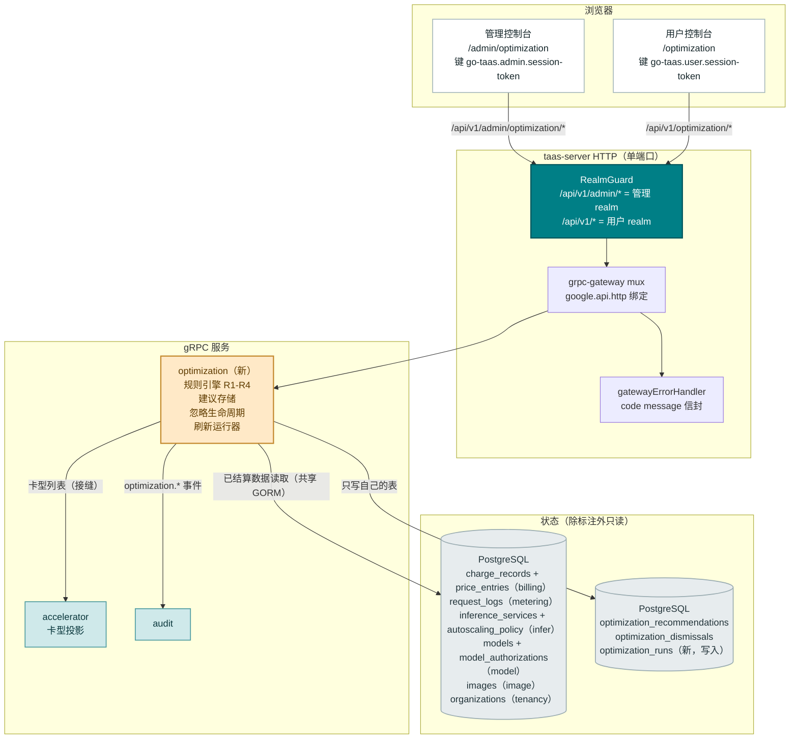
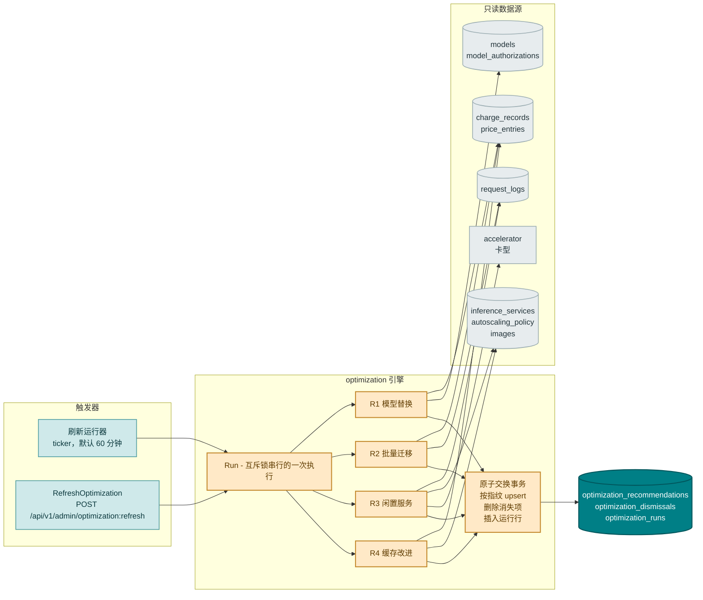
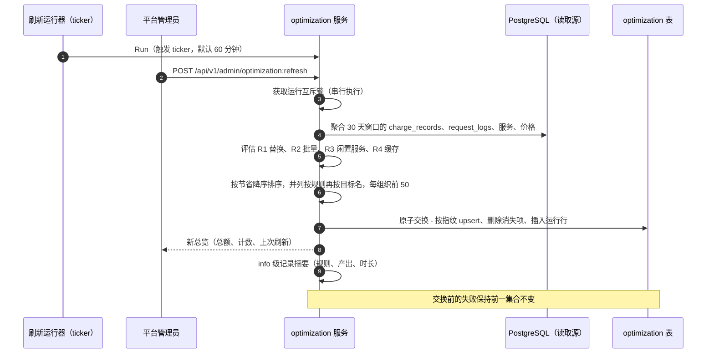
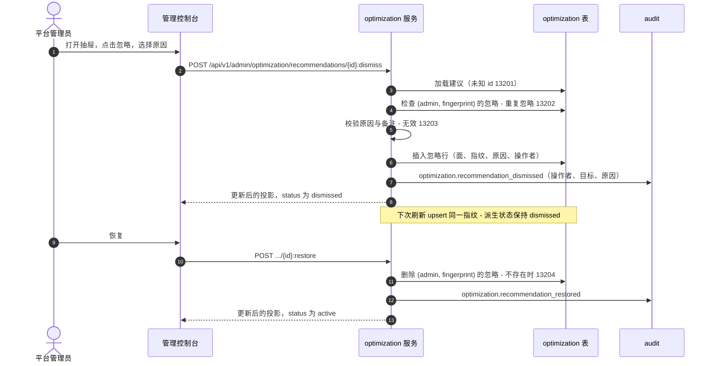
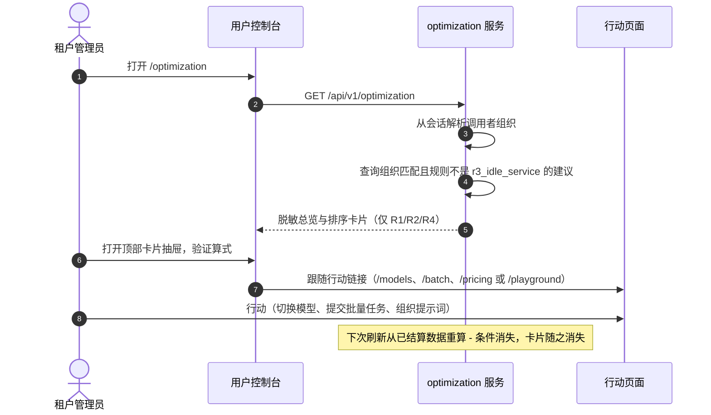

# 成本优化建议 — 架构与详细设计

| 属性 | 内容 |
| --- | --- |
| 功能点 | 成本优化建议 — 新 `optimization` 模块内的确定性规则引擎，读取平台自身的已结算用量、价格与部署数据（近 30 天），产出可排序、可量化、可忽略的节省建议：R1 更廉价模型替换（感知授权、上下文长度校验、节省门槛）、R2 批量迁移（离线形态的 Key 流量、五折）、R3 闲置服务缩容到零（仅管理员、闲置 GPU 成本）、R4 缓存命中改进（支持缓存引擎上的低命中率）— 每条建议携带可验证的输入/算式、预估月节省金额、一键行动页链接，以及带指纹持久化的忽略/恢复生命周期。仅建议不变式：引擎绝不执行动作。管理面 `/admin/optimization` + `/api/v1/admin/optimization/*`；用户面 `/optimization` + `/api/v1/optimization/*`（仅 R1/R2/R4，脱敏投影）（待办第 50 行） |
| 文档范围 | 功能 50 的架构与详细设计：新 `optimization` 模块（规则引擎、建议存储、忽略/恢复生命周期、刷新运行器）；`taas.optimization.v1.OptimizationService` proto，十一个 RPC 绑定在 `/api/v1/admin/optimization/*` 与 `/api/v1/optimization/*` 之下；`optimization_recommendations`、`optimization_dismissals`、`optimization_runs` 三张表；R1–R4 的精确规则算法（阈值与算式）；对 billing、metering、infer、batch、model、image、accelerator 数据的只读接缝；错误处理（13201–13205 加 10038/10036）；配置、安全、发布升级，以及逐层的函数级任务清单 |
| 负责模块 | 新 `optimization` 模块（`services/optimization`）：规则引擎、建议存储、忽略/恢复生命周期、刷新运行器；对 `billing`（计费记录、价格矩阵）、`metering`（请求日志）、`infer`（服务、自动伸缩）、`model`（目录、授权）、`image`（引擎名）、`accelerator`（卡型列表）、`tenancy`（组织名）的只读接缝；`audit`（`optimization.*` 事件）；`pkg/errors`（132xx 块）；`pkg/config`（`optimization` 节）；`pkg/server`（管理 + 用户前缀绑定，Realm 守卫不变）；`web` 管理台（`OptimizationPage`）与用户台（`UserOptimizationPage`） |
| 相关文档 | [需求分析与 UI/UX 设计](../design/cost-optimization-recommendations.zh-cn.md) · [架构设计](../design/architecture.zh-cn.md) §2.2 `model`、§2.4 `infer`、§3.1 控制网关、§4.3 推理请求与计费闭环 · [定价](./pricing.zh-cn.md)（R1/R2/R4 读取的价格矩阵与计费记录） · [批量推理](./batch-inference.zh-cn.md)（R2 应用的五折批量折扣） · [推理自动伸缩](./inference-autoscaling.zh-cn.md)（R3 检查的每服务策略） · [加速器库存](./accelerator-inventory.zh-cn.md)（R3 校验的集群卡型列表） · [按租户模型授权](./model-authorization.zh-cn.md)（R1 遵循的授权规则） · [成本分析看板](./cost-analytics-dashboard.zh-cn.md)（本功能构建其上的只读分析输入） · [控制台双面分离](./console-surface-separation.zh-cn.md)（两个控制台、脱敏投影规则） |
| 状态 | 架构完成，已移交开发智能体 |

---

## 1. 概述与目标

功能 #25/#28/#29 给了 go-taas 成本**可见性**——花了什么、按组织/模型/Key 归因。仍然缺失的是成本**可行动性**：一份排序的工作清单，告诉运营者和每个租户钱浪费在哪里、可回收多少、以及确切点击哪里去处理。所有可比平台都收敛到这个形态（AWS Cost Optimization Hub、Azure Advisor、OpenAI/Anthropic 的成本指引）：基于平台自身已结算数据的确定性规则，每条建议携带输入与算式，读者可以逐行验证。

本功能在新 `optimization` 模块中加入**确定性、基于规则的优化引擎**。按固定间隔（默认 60 分钟）与管理员显式触发，引擎从**近 30 天已结算数据**重算活跃建议集合并整体替换存储快照；被忽略的建议按**指纹**持久化，因此被忽略的条件在仍然活跃期间不会再次骚扰。v1 交付四条规则：**R1 更廉价模型替换**、**R2 批量迁移**、**R3 闲置服务缩容到零**（仅管理员）、**R4 缓存命中改进**。**仅建议不变式**是核心产品规则：引擎只计算和解释，绝不执行——行动页始终由人驱动。

**目标**：

- 两个页面：`/admin/optimization`（`OptimizationPage`，全集群视角，组织/模型过滤与立即刷新按钮）与 `/optimization`（`UserOptimizationPage`，租户自身的脱敏投影），见设计 §5.1–§5.4。
- 新 `optimization` 模块，负责规则引擎、建议存储、忽略/恢复生命周期与刷新运行器，独立错误块 **132xx**（设计 D2、D9）。
- 新 `taas.optimization.v1.OptimizationService` 上十一个 RPC 的精确双面绑定——六个管理前缀、五个用户前缀（设计 §6）。
- 四条确定性规则，阈值为配置常量、算式可验证（设计 D3、D4；FR1.3–FR1.6）。
- **指纹持久化**：`sha256(rule | target_type | target_id | suggestion)` 按面键控的忽略状态，跨快照替换存活（设计 D6；FR3.3）。
- 脱敏的用户面投影：仅 R1/R2/R4，无服务 id、副本数或卡价，行动链接只指向用户面页面（设计 D8；FR4）。
- 审计事件 `optimization.refreshed`、`optimization.recommendation_dismissed`、`optimization.recommendation_restored` 携带操作者身份（设计 FR5.4）。
- 可在 Nightwatch、FVT 与单元测试中验证的编号验收标准（AC1–AC14）。

**非目标**（来自设计，重述）：任何建议的自动执行（刻意排除——仅建议）；ML/异常检测顾问与提示词内容分析（刻意排除）；预测与置信区间（功能 #36）；成本分析与归因（功能 #29，只读输入）；预算告警与消费限额（功能 #6）；逐规则阈值编辑 UI（阈值为配置常量）；建议的邮件/webhook 推送（通知中心 #26 后续可承载）；多币种估算（平台单一结算币种）；以及行动页本身（功能 #13、#49、#16、#42、#25——原样复用，本功能只链接）。

### 1.1 本文阅读顺序

第 2 节记录架构决策（AD1–AD16；AD10–AD16 是架构补充的细化决策，已标注）。第 3–5 节是组件视图、数据模型与 API 设计。第 6 节是前端架构（页面 → 路由 → API 前缀表、导航、共享组件、鉴权守卫）。第 7–8 节是时序图与错误处理。第 9–11 节是配置、安全与发布升级。第 12 节是验收标准追溯。第 13–15 节是函数级详细设计（含精确规则算法）、有序实施任务清单与延后项。

---

## 2. 架构决策

AD1–AD9 将 UI/UX 设计的决策（D1–D9）重述为实现级规则。**AD10–AD16 是架构补充的细化决策**；每条都标注其细化的设计决策并保持该决策的意图，使开发与测试智能体按同一解读实现。

| # | 决策 | 理由 |
| --- | --- | --- |
| AD1 | **两个面各得一个专属版块**：管理面 `/admin/optimization` + `/api/v1/admin/optimization/*`（全集群、组织/模型过滤、立即刷新），用户面 `/optimization` + `/api/v1/optimization/*`（调用者组织、脱敏）——不是 `/admin/cost` 上的一个页签 | 设计 D1。建议是带独立生命周期的可行动工作清单，不是分析；运营者优化集群，租户优化自己的消费 |
| AD2 | **新 `optimization` 模块**（`services/optimization`）负责规则引擎、建议存储、忽略/恢复生命周期与刷新运行器，独立错误块 **13201–13299**。它对 `billing`、`metering`、`infer`、`batch`、`model`、`image`、`accelerator` 数据**只读**；只写自己的表 | 设计 D2。一个独立关注点（规则、估算、工作清单生命周期）有自己的节奏；专属模块保持分析模块只读、引擎可独立单元测试 |
| AD3 | **v1 四条确定性规则** — R1 更廉价模型替换、R2 批量迁移、R3 闲置服务缩容到零（仅管理员）、R4 缓存命中改进 — 全部阈值为 `optimization.*` 下的**配置常量**，在抽屉中文档化；无运行时阈值编辑 | 设计 D3。平台的成本杠杆少而已知；显式阈值保持引擎确定性与文案诚实 |
| AD4 | **估算是算术而非预测**：月节省 =（当前有效价格 − 替代有效价格）× 观测月量，所有规则使用同一个 30 天已结算窗口；抽屉展示输入与公式。无置信区间、无增长假设 | 设计 D4。运营者可逐行验证的建议；预测是 #36 |
| AD5 | **按预估月节省降序排序**，并列时按规则再按目标展示名；引擎按组织持久化**前 50 条**（工作清单边界）；汇总卡片对已存储活跃集合求和 | 设计 D5。工作清单隐喻：最大的杠杆在前；按组织封顶限制大型集群的噪音，同时保证每个组织在用户面看到完整工作清单 |
| AD6 | **刷新是周期性且快照式**：ticker（默认 60 分钟，`optimization.refreshIntervalMinutes`，10–1440）加 `RefreshOptimization` 管理员触发；每次运行从已结算数据重算并在**单事务内原子替换**活跃集合；被忽略的指纹持久化。失败的运行保持前一集合不变——失败的刷新绝不清空工作清单 | 设计 D6、FR1.2、FR1.7。确定性重算保持估算诚实；单事务交换是 AC10 验证的失败语义 |
| AD7 | **替换建议遵循授权**：R1 只提议该组织已被授权、或公开/可授权的模型（#13 默认放行规则）；抽屉说明属于哪种情形；行动路径是授权页，然后可选路由组 | 设计 D7。租户无法行动的建议是噪音；授权检查是平台自身授权规则应用于建议 |
| AD8 | **两个面共享规则集与卡片/抽屉组件**；管理面增加组织/模型过滤、集群总额与立即刷新；用户面按组织限定并脱敏投影——无服务 id、副本数或卡价，闲置服务规则**仅管理员**。用户面会话访问管理路由得到 **10038**；无角色的会话得到 **10036** | 设计 D8。与控制台双面分离和脱敏投影规则一致；服务是运营者资源 |
| AD9 | **新错误块（13201–13299）**，排在路由 131xx 之后的下一个空闲块：**13201 `CodeRecommendationNotFound`**、**13202 `CodeRecommendationDismissed`**、**13203 `CodeRecommendationDismissReasonInvalid`**、**13204 `CodeRecommendationRestoreInvalid`**、**13205 `CodeOptimizationRangeInvalid`**。Realm 失败复用 **10038**，角色失败复用 **10036** | 设计 D9。新模块（AD2）获得新块；独立错误码让每种失败可行动 |
| AD10 | **对设计 D2 的细化 — 引擎通过共享 GORM 句柄上的窄只读仓储读取兄弟模块数据（`infer.modelRepository` 模式），而非内部 RPC。** `services/optimization` 新增 `reads.go`，含五个小型只读接口——计费/价格读取（`charge_records`、`price_entries`）、请求日志读取（`request_logs`）、服务读取（`inference_services` + 全局自动伸缩策略）、目录读取（`models`、`model_authorizations`）与镜像读取（`images`）——每个都是共享数据库上的普通 SELECT/聚合；另加一个由 `accelerator` 服务实现的 `CardTypeLister` 接缝（其卡型集合在内存投影中，不在表里） | 设计把"内部 RPC 或共享仓储"留给架构师。共享句柄读取是既有模式（`infer` 就这样读模型目录）：无新 RPC 面、批量作业无跨服务延迟，且窄接缝保持模块解耦。加速器投影是唯一例外——它不是表，因此保持为接缝 |
| AD11 | **对设计 D6/FR3.3 的细化 — 存储为三张表，忽略状态是按 `(surface, fingerprint)` 键控的独立表；建议的 `status` 在读取时派生，绝不落库。** `optimization_recommendations` 存储计算出的条件（指纹唯一，每次刷新 upsert，使 `recommendation_id` 与 `first_seen_at` 在条件持续期间保持稳定）；`optimization_dismissals` 每 `(surface, fingerprint)` 一行，含原因/备注/操作者/时间；`optimization_runs` 记录每次刷新（最后一次刷新时间戳在空结果集下也正确）。读取 RPC 按请求面 LEFT-JOIN 忽略表派生 `status`、`dismissed_reason`、`dismissed_by`、`dismissed_at` | 设计按 `(surface, fingerprint)` 键控忽略状态（FR3.4），而 FR1.1 把 `status` 放进行投影——落库的 status 列无法对一个面是 active、对另一个面是 dismissed。读取时派生让两个面在同一共享条件行上都正确；独立的忽略表正是跨快照替换存活的部分（条件消失时建议行被删除，忽略记录不删） |
| AD12 | **对设计 FR1.3 的细化 — 模型上下文长度来自配置映射 `optimization.modelContextLengths`（模型名 → 最大上下文 token 数），R1 对未知长度失败关闭：未配置长度的模型 A 或 B 不参与替换。** 目录今天不存储上下文长度字段（`models`/`model_versions` 只有 id、名称、权重、版本——与上下文无关） | 设计把"B 的上下文长度 ≥ A 的 80%"作为硬过滤，但平台没有上下文长度来源。配置映射保持规则确定且诚实；失败关闭（绝不提议无法验证的替换）保住 US9 的"绝不看到平台技术上无法交付的建议"。取舍（已接受）：R1 仅对运营者标注过的模型生效；目录上下文长度字段是后续项（第 15 节） |
| AD13 | **对设计 FR1.4 的细化 — R2 的离线形态检测读取 `request_logs`（小时分布对照配置的峰值窗口、提示词 token 大小、流式状态），"批量 API 服务的模型"指任何目录模型：批量 worker 走同一服务路径分发，接受任何目录模型 id。** 峰值窗口为配置：`optimization.peakHours`（默认 `["09:00-18:00"]`）、`optimization.peakWeekdaysOnly`（默认 true），在 `optimization.timezone`（默认 UTC）中求值 | `request_logs` 是唯一带 `created_at`、`prompt_tokens` 与 `status`（success/error/streaming）的逐请求记录——正是离线形态信号。批量服务校验单文件单模型但不限制哪个目录模型，因此目录存在性检查就是完整的"批量可服务"测试 |
| AD14 | **对设计 FR1.5 的细化 — R3 的卡每小时成本来自配置映射 `optimization.cardHourlyCosts`（加速器类型 → 平台币种的每小时成本）；加速器库存通过 `CardTypeLister` 接缝贡献集群卡型存在性校验。卡型在任一映射中缺失的服务被跳过——绝不产出零节省或未定价的建议。** 计费价格矩阵按（模型，卡）给 token 定价，而非 GPU 小时；平台今天没有任何按卡的每小时成本 | 设计说"来自加速器库存 #18 与价格矩阵"，但两者都不存 GPU 小时费率。配置映射是设计自身跳过规则（"任一缺少该服务卡型的数据，规则跳过该服务"）的最小忠实解读，保持算术可被运营者验证，并符合 D3 的配置常量纪律。取舍（已接受）：R3 仅对运营者定价过的卡型生效 |
| AD15 | **对设计 FR1.6 的细化 — R4 的"引擎支持前缀缓存"由配置驱动：当该模型存在任一非 terminated 推理服务运行其 `Engine` 属于 `optimization.prefixCacheEngines`（默认 `["vllm", "sglang"]`）的镜像时，该模型合格。** 缓存折扣取价格条目的 `input_price_per_million − cached_price_per_million`，按（模型，卡）单元格并回退 `"default"` 卡 | 引擎名在镜像行上（`images.engine`），是平台存储的唯一引擎信号；配置集合保持规则确定性并允许不改代码启用新引擎。价格条目算式复用 billing 模块自己的 cached 价格字段——无新价格数据 |
| AD16 | **对设计 FR1.1 的细化 — 行动链接按建议存储两个面的变体（`acting_page_admin`、`acting_page_user` 两个 jsonb 列，各 `{route, label}`），读取 RPC 只投影请求面的变体。** R1 的管理路由由候选模型 id 参数化（`/admin/models/{id}/authorizations`），因此链接无法静态推导 | 设计按面指定不同行动页（FR4.3 对 §5.3）；在刷新时（目标 id 已知）计算两个变体并按面投影，保持一个共享条件行（AD11），并使脱敏规则成为纯投影 |

---

## 3. 组件视图

### 3.1 职责划分

| 层 / 组件 | 职责 | 本功能的变更 |
| --- | --- | --- |
| **静态包（SPA）** | 一个 Vite 包（`web/dist`）嵌入 `taas-server`；由网关的 SPA 回退服务 | 两个新页面（`OptimizationPage`、`UserOptimizationPage`）、两个导航项、`App.tsx` 路由注册、i18n 键、共享的建议卡片/抽屉/忽略对话框组件 |
| **网关（`pkg/server`）** | HTTP 组合：`RealmGuard` → `withConsole` → grpc-gateway mux；统一错误渲染器；SPA 回退 | 无变更——新 RPC 绑定在 `/api/v1/admin/optimization/*` 与 `/api/v1/optimization/*` 之下，`RealmGuard` 已按前缀分类 |
| **grpc-gateway mux** | 按 `google.api.http` 注解做路径 → RPC 路由 | 十一个优化 RPC 的新绑定（第 5 节） |
| **`optimization`（新）** | `optimization_recommendations`、`optimization_dismissals`、`optimization_runs` 三张表；十一个 RPC；规则引擎（R1–R4）；刷新运行器 | 新服务：`services/optimization` |
| **`billing`** | 价格矩阵、计费记录 | **无代码变更** — 引擎通过自己的只读仓储读取 `charge_records` 与 `price_entries`（AD10） |
| **`metering`** | 凭证、用量记录、请求日志 | **无代码变更** — 引擎通过自己的只读仓储读取 `request_logs`（AD13） |
| **`infer`** | 推理服务、自动伸缩策略 | **无代码变更** — 引擎通过自己的只读仓储读取 `inference_services` 与全局 `autoscaling_policy` 行 |
| **`model`** | 目录、授权 | **无代码变更** — 引擎通过自己的只读仓储读取 `models` 与 `model_authorizations`（AD10） |
| **`image`** | 引擎镜像目录 | **无代码变更** — 引擎通过自己的只读仓储读取 `images`（引擎名）（AD15） |
| **`accelerator`** | 集群卡型投影 | 已有 `CardTypeLister` 形态的读取（`ListCardTypes`）；优化服务作为接缝消费（AD14） |
| **`tenancy`** | 组织 | **无代码变更** — 引擎通过自己的只读仓储读取组织显示名 |
| **`audit`** | 尽力而为审计记录器 | 复用：优化模块为 `optimization.*` 事件调用 `Recorder.Record` |
| **`pkg/mq`** | 规范 subject | **无新 subject** — 引擎是进程内周期 ticker；刷新与忽略都是 DB 写 |
| **`pkg/errors`** | 按模块的错误块 | 一个新优化块：**13201–13205**（13206–13299 预留） |
| **`pkg/config`** | 合并配置树 | 新 `optimization` 节（刷新间隔、窗口、规则阈值、上下文长度、卡成本、峰值窗口、缓存引擎） |
| **`test/e2e/mock`** | compose 测试夹具 | 原样复用；FVT 夹具为规则矩阵播种计费/请求/服务数据 |

### 3.2 组件视图



### 3.3 请求身份链

优化 RPC 跨两个面拆分（AD1、AD8）。链路为：

1. `RealmGuard`（HTTP，`pkg/server/realm.go`）— 路径前缀决定期望 realm：`/api/v1/admin/optimization/*` → 管理 realm；`/api/v1/optimization/*` → 用户 realm。无 `Authorization` 头：透传（过渡期）。有头：从 Redis 解析会话 realm；不匹配 → **10038**；未知/过期/无 realm → **10027**。
2. grpc-gateway mux — 按注解路径路由并转发 `authorization`。
3. `optimization` handler —
   - **管理 RPC**（overview、list、get、dismiss、restore、refresh）：解析操作者（`SessionUserResolver`）并通过 `tenancy.RoleGuard` 以管理员角色门控（**10036**），即 `provider.requireAdminRole` 形态；平台级（可选的 `organization_id` 过滤是查询参数，绝非身份来源）。
   - **用户 RPC**（my-overview、my-list、my-get、my-dismiss、my-restore）：从会话解析调用者组织（`SessionOrgResolver.SessionActiveOrg` — billing `GetBalance` 模式：会话活跃组织优先，忽略 `X-Organization-Id`）；每个查询硬限定到该组织并排除 `rule = r3_idle_service`（脱敏投影，AD8）。

用户面会话访问任何 `/api/v1/admin/optimization/*` 路由被 **10038 `CodeRealmMismatch`** 拒绝（FR5.1，AC11）。缺少所需角色的会话得到 **10036 `CodeForbidden`**（AC12）。

### 3.4 引擎接缝

引擎是 `optimization` 服务内的周期批处理作业——镜像结算节奏模式的 ticker——加同步的 `RefreshOptimization` 触发。它不由请求触发。



- **`Run`** 由互斥锁串行（ticker 触发与管理员触发绝不重叠；触发等待、运行、然后返回新摘要）。
- **失败语义**（AD6）：每条规则先在内存中计算；只有最终原子交换触碰存储。交换前的任何错误保持前一活跃集合与前一行运行记录不变；失败按 error 级别记录日志，页面显示过期横幅（AC10）。
- **幂等性**（FR1.2）：相同的已结算数据产出相同集合——规则是窗口数据加配置常量的纯函数。

---

## 4. 数据模型

本功能新增**三张表**，全部由 `optimization` 服务的 `Migrate` 通过 `db.AutoMigrate(...)` 创建（第 4.4 节）。无既有表变更。

### 4.1 `optimization_recommendations`

一行是最新快照中一个计算出的条件（AD11）。指纹是稳定身份；upsert 使 `recommendation_id` 与 `first_seen_at` 跨刷新保持。

| 列 | 类型 | 说明 |
| --- | --- | --- |
| `id` | string (PK, uuid) | 首次插入时服务端生成的 UUID v4，暴露为 `recommendation_id`；指纹持续期间稳定 |
| `fingerprint` | string (64), unique | `sha256(rule \| target_type \| target_id \| suggestion)` 十六进制；upsert 键 |
| `rule` | string (32), index | `r1_substitution` / `r2_batch` / `r3_idle_service` / `r4_cache` |
| `target_type` | string (16) | `org_model`（R1/R4）/ `api_key`（R2）/ `service`（R3） |
| `target_id` | string (256) | R1/R4：`org_id/model_id`；R2：api-key id；R3：服务 id |
| `target_display` | string (256) | 计算时反规范化：「`<组织>` → `<模型>`」/「`<组织>` / key `<名称>`」/「服务 `<名称>`」 |
| `organization_id` | string (64), index | 反规范化过滤列（FR2.1） |
| `model_id` | string (128), nullable, index | 反规范化过滤列（R1/R2/R4；R3 为 NULL） |
| `api_key_id` | string (64), nullable | 反规范化（R2） |
| `service_id` | string (64), nullable | 反规范化（R3） |
| `suggestion` | string (512) | 建议的变更，人类可读 |
| `estimated_monthly_saving` | float64 | 计算时四舍五入到 2 位小数；序列化为 2 位小数的 JSON 字符串 |
| `currency` | string (8) | 平台单一结算币种 |
| `inputs` | jsonb | 规则特定的输入对象（用量窗口、请求数、token 数、价格、缓存率）— 抽屉的"为什么"表 |
| `arithmetic` | string (512) | 数字代入后的公式 |
| `alternatives` | jsonb | 仅 R1：`[{model_id, model_name, estimated_monthly_saving, input_price, output_price}]`，按节省降序；否则 `[]` |
| `acting_page_admin` | jsonb | `{route, label}` — 管理面行动链接（AD16） |
| `acting_page_user` | jsonb | `{route, label}` — 用户面行动链接（AD16） |
| `first_seen_at` | timestamp | upsert 保留：该指纹首次出现的时间 |
| `last_computed_at` | timestamp | 每次重算出该指纹的刷新都会更新 |
| `created_at` / `updated_at` | timestamp | UTC |

GORM 模型是 `services/optimization/optimization_model.go` 中的 `Recommendation`；`TableName()` 返回 `"optimization_recommendations"`。

### 4.2 `optimization_dismissals`

一行是一个面对一个指纹的忽略（AD11）。行跨快照替换与条件消失存活——身份是指纹，不是建议行（FR3.3）。

| 列 | 类型 | 说明 |
| --- | --- | --- |
| `id` | string (PK, uuid) | 服务端生成的 UUID v4 |
| `surface` | string (8) | `admin` / `user` — `uniqueIndex:idx_optimization_dismissals_surface_fp (surface, fingerprint), priority:1` |
| `fingerprint` | string (64) | 复合唯一键的另一半，priority 2 |
| `reason` | string (16) | `not_applicable` / `planned` / `other` |
| `note` | string (256) | `other` 时必填，否则为空；≤ 256 字符 |
| `dismissed_by` | string (64) | 操作用户 id（按面为管理员或租户操作者） |
| `dismissed_at` | timestamp | UTC，与 `surface` 一起建索引 |

GORM 模型是 `services/optimization/optimization_model.go` 中的 `Dismissal`；`TableName()` 返回 `"optimization_dismissals"`。`Restore` 删除该行；之后的再次忽略插入新行。

### 4.3 `optimization_runs`

每次引擎执行一行（AD11）——刷新日志与"上次刷新"卡片的来源，即使一次执行产出零条建议也正确。

| 列 | 类型 | 说明 |
| --- | --- | --- |
| `id` | string (PK, uuid) | 服务端生成的 UUID v4 |
| `started_at` / `finished_at` | timestamp | UTC |
| `duration_ms` | int64 | |
| `rules_evaluated` | int | 4（运行的规则数） |
| `recommendations_emitted` | int | 新快照的大小 |
| `trigger` | string (16) | `ticker` / `admin` |
| `success` | bool | `false` 行携带 `error` |
| `error` | string (512) | 成功时为空 |

GORM 模型是 `services/optimization/optimization_model.go` 中的 `Run`；`TableName()` 返回 `"optimization_runs"`。

### 4.4 迁移与 init-SQL 升级路径

本仓库**不**使用手写 init-SQL 脚本：每张表的 schema 都是由所属服务 `Migrate` 通过 `db.AutoMigrate(...)` 创建的 GORM 模型，`deploy/` 下没有 `.sql` 文件。升级路径为：

1. 在 `services/optimization/optimization_model.go` 中加入 `Recommendation`、`Dismissal`、`Run`。
2. `optimization.Service.Migrate(ctx)` 返回 `db.AutoMigrate(&Recommendation{}, &Dismissal{}, &Run{})`；`MigrateSchemaForFVT(db)` 为 FVT 夹具做同样的事。
3. `apps/taas-server/main.go` 注册 `optimization` 服务（在 `billing` 之后、`routing` 旁边），表在服务器启动时创建。
4. 无 init-SQL 编辑、无手工 DDL、无数据回填。表初始为空；首次刷新（ticker 或触发）填充快照。在此之前两个页面显示空状态——对既有部署行为不变。

---

## 5. API 设计

### 5.1 双面映射

六个 RPC **只**绑定管理前缀；五个**只**绑定用户前缀（AD1）。没有 RPC 双绑定：管理与用户投影不同（集群过滤 + R3 对 组织限定脱敏），分离的 RPC 让每个 handler 的限定显式化。

| RPC | HTTP 方法 + 路径 | 面 | 状态 |
| --- | --- | --- | --- |
| `GetOptimizationOverview` | `GET /api/v1/admin/optimization` | 管理 | 新增 |
| `ListOptimizationRecommendations` | `GET /api/v1/admin/optimization/recommendations` | 管理 | 新增 |
| `GetOptimizationRecommendation` | `GET /api/v1/admin/optimization/recommendations/{recommendation_id}` | 管理 | 新增 |
| `DismissRecommendation` | `POST /api/v1/admin/optimization/recommendations/{recommendation_id}:dismiss` | 管理 | 新增 |
| `RestoreRecommendation` | `POST /api/v1/admin/optimization/recommendations/{recommendation_id}:restore` | 管理 | 新增 |
| `RefreshOptimization` | `POST /api/v1/admin/optimization:refresh` | 管理 | 新增 |
| `GetMyOptimization` | `GET /api/v1/optimization` | 用户 | 新增 |
| `ListMyOptimizationRecommendations` | `GET /api/v1/optimization/recommendations` | 用户 | 新增 |
| `GetMyOptimizationRecommendation` | `GET /api/v1/optimization/recommendations/{recommendation_id}` | 用户 | 新增 |
| `DismissMyRecommendation` | `POST /api/v1/optimization/recommendations/{recommendation_id}:dismiss` | 用户 | 新增 |
| `RestoreMyRecommendation` | `POST /api/v1/optimization/recommendations/{recommendation_id}:restore` | 用户 | 新增 |

网关路由说明：冒号自定义动词沿用既有的 `:playground` / `:export` 约定；`GET /api/v1/admin/optimization`（集合根）与 `GET /api/v1/admin/optimization/recommendations` 是不同的静态路径——无通配符冲突。本功能无既有 RPC 变更。

### 5.2 Proto 契约（`proto/taas/optimization/v1/optimization.proto`，新增）

```proto
syntax = "proto3";

package taas.optimization.v1;

import "google/api/annotations.proto";
import "taas/common/v1/common.proto";

option go_package = "github.com/go-taas/go-taas/proto/taas/optimization/v1;optimizationv1";

// OptimizationService 提供成本优化工作清单：规则引擎的快照
// （总览 + 排序建议）、忽略/恢复生命周期与刷新触发（功能 #50）。
// 管理 RPC 服务于 /api/v1/admin/optimization；
// 用户 RPC 服务于 /api/v1/optimization（组织限定、脱敏）。
service OptimizationService {
  // GetOptimizationOverview 返回集群汇总卡片：活跃建议的预估月
  // 节省总额、按规则计数、忽略计数、上次刷新时间与节省最多的组织。
  rpc GetOptimizationOverview(GetOptimizationOverviewRequest) returns (GetOptimizationOverviewResponse) {
    option (google.api.http) = {get: "/api/v1/admin/optimization"};
  }

  // ListOptimizationRecommendations 返回排序建议，支持分页与
  // 规则/状态/组织/模型/最低节省过滤。
  rpc ListOptimizationRecommendations(ListOptimizationRecommendationsRequest) returns (ListOptimizationRecommendationsResponse) {
    option (google.api.http) = {get: "/api/v1/admin/optimization/recommendations"};
  }

  // GetOptimizationRecommendation 返回一条建议的完整输入、算式、
  // 备选与忽略状态。
  rpc GetOptimizationRecommendation(GetOptimizationRecommendationRequest) returns (GetOptimizationRecommendationResponse) {
    option (google.api.http) = {get: "/api/v1/admin/optimization/recommendations/{recommendation_id}"};
  }

  // DismissRecommendation 以必填原因记录一次忽略。
  rpc DismissRecommendation(DismissRecommendationRequest) returns (DismissRecommendationResponse) {
    option (google.api.http) = {
      post: "/api/v1/admin/optimization/recommendations/{recommendation_id}:dismiss"
      body: "*"
    };
  }

  // RestoreRecommendation 将被忽略的建议恢复为活跃。
  rpc RestoreRecommendation(RestoreRecommendationRequest) returns (RestoreRecommendationResponse) {
    option (google.api.http) = {
      post: "/api/v1/admin/optimization/recommendations/{recommendation_id}:restore"
      body: "*"
    };
  }

  // RefreshOptimization 触发立即引擎执行并返回新摘要。
  // 审计（optimization.refreshed）。
  rpc RefreshOptimization(RefreshOptimizationRequest) returns (RefreshOptimizationResponse) {
    option (google.api.http) = {
      post: "/api/v1/admin/optimization:refresh"
      body: "*"
    };
  }

  // GetMyOptimization 返回调用者组织自身的摘要与排序活跃建议
  //（仅 R1/R2/R4，脱敏投影）。
  rpc GetMyOptimization(GetMyOptimizationRequest) returns (GetMyOptimizationResponse) {
    option (google.api.http) = {get: "/api/v1/optimization"};
  }

  // ListMyOptimizationRecommendations 返回调用者组织自身的排序
  // 建议，支持规则/状态/最低节省过滤。
  rpc ListMyOptimizationRecommendations(ListMyOptimizationRecommendationsRequest) returns (ListMyOptimizationRecommendationsResponse) {
    option (google.api.http) = {get: "/api/v1/optimization/recommendations"};
  }

  // GetMyOptimizationRecommendation 返回调用者组织的一条建议
  //（他组织的 id 返回 13201）。
  rpc GetMyOptimizationRecommendation(GetMyOptimizationRecommendationRequest) returns (GetMyOptimizationRecommendationResponse) {
    option (google.api.http) = {get: "/api/v1/optimization/recommendations/{recommendation_id}"};
  }

  // DismissMyRecommendation 记录租户自身的忽略
  //（按面键控的状态，同样的错误码与审计事件）。
  rpc DismissMyRecommendation(DismissMyRecommendationRequest) returns (DismissMyRecommendationResponse) {
    option (google.api.http) = {
      post: "/api/v1/optimization/recommendations/{recommendation_id}:dismiss"
      body: "*"
    };
  }

  // RestoreMyRecommendation 撤销租户自身的忽略。
  rpc RestoreMyRecommendation(RestoreMyRecommendationRequest) returns (RestoreMyRecommendationResponse) {
    option (google.api.http) = {
      post: "/api/v1/optimization/recommendations/{recommendation_id}:restore"
      body: "*"
    };
  }
}

// Recommendation 是完整的 FR1.1 投影。status 与 dismissed_* 字段
// 按请求面派生（AD11）。
message Recommendation {
  string recommendation_id = 1;
  string rule = 2;              // r1_substitution | r2_batch | r3_idle_service | r4_cache
  string target_type = 3;       // org_model | api_key | service
  string target_id = 4;
  string target_display = 5;
  string suggestion = 6;
  string estimated_monthly_saving = 7; // 十进制字符串，2 位小数
  string currency = 8;
  string inputs_json = 9;       // 规则特定的输入对象
  string arithmetic = 10;
  ActingPage acting_page = 11;  // 请求面的变体（AD16）
  string status = 12;           // active | dismissed（派生）
  string dismissed_reason = 13; // not_applicable | planned | other
  string dismissed_note = 14;
  string dismissed_by = 15;
  int64 dismissed_at = 16;
  string fingerprint = 17;
  int64 first_seen_at = 18;
  int64 last_computed_at = 19;
  repeated AlternativeModel alternatives = 20; // 仅 R1
}

// ActingPage 是一键行动链接（路由 + 标签）。
message ActingPage {
  string route = 1;
  string label = 2;
}

// AlternativeModel 是 R1 的落选候选及其价格。
message AlternativeModel {
  string model_id = 1;
  string model_name = 2;
  string estimated_monthly_saving = 3; // 十进制字符串，2 位小数
  string input_price_per_million = 4;  // 十进制字符串
  string output_price_per_million = 5; // 十进制字符串
}

// RuleCount 是总览中一条规则的活跃计数。
message RuleCount {
  string rule = 1;
  int64 count = 2;
}

// OptimizationOverview 是汇总卡片载荷（FR2.2 / FR4.1）。
message OptimizationOverview {
  string total_estimated_monthly_saving = 1; // 十进制字符串，2 位小数
  string currency = 2;
  int64 active_count = 3;
  repeated RuleCount count_by_rule = 4;
  int64 dismissed_count = 5;
  int64 last_refresh_at = 6;       // unix 秒，上次成功运行
  string top_organization_id = 7;  // 仅管理面，用户面为空
  string top_organization_name = 8;
  string top_organization_saving = 9;
}

message GetOptimizationOverviewRequest {}

message GetOptimizationOverviewResponse {
  taas.common.v1.Response response = 1;
  OptimizationOverview overview = 2;
}

message ListOptimizationRecommendationsRequest {
  taas.common.v1.PageRequest page = 1;
  string rule = 2;              // 空 = 全部
  string status = 3;            // active（默认）| dismissed | all
  string organization_id = 4;   // 空 = 全部组织（管理过滤）
  string model_id = 5;          // 空 = 全部模型（管理过滤）
  string min_saving = 6;        // 十进制字符串，空 = 无下限
}

message ListOptimizationRecommendationsResponse {
  taas.common.v1.Response response = 1;
  repeated Recommendation recommendations = 2;
  taas.common.v1.PageMeta page_meta = 3;
}

message GetOptimizationRecommendationRequest {
  string recommendation_id = 1;
}

message GetOptimizationRecommendationResponse {
  taas.common.v1.Response response = 1;
  Recommendation recommendation = 2;
}

message DismissRecommendationRequest {
  string recommendation_id = 1;
  string reason = 2; // not_applicable | planned | other
  string note = 3;   // other 时必填，最长 256 字符
}

message DismissRecommendationResponse {
  taas.common.v1.Response response = 1;
  Recommendation recommendation = 2; // 更新后的投影
}

message RestoreRecommendationRequest {
  string recommendation_id = 1;
}

message RestoreRecommendationResponse {
  taas.common.v1.Response response = 1;
  Recommendation recommendation = 2;
}

message RefreshOptimizationRequest {}

message RefreshOptimizationResponse {
  taas.common.v1.Response response = 1;
  OptimizationOverview overview = 2; // 新摘要
}

// ---- 用户面（组织限定、脱敏：仅 R1/R2/R4）----

message GetMyOptimizationRequest {}

message GetMyOptimizationResponse {
  taas.common.v1.Response response = 1;
  OptimizationOverview overview = 2;
  repeated Recommendation recommendations = 3; // 排序的第一页
}

message ListMyOptimizationRecommendationsRequest {
  taas.common.v1.PageRequest page = 1;
  string rule = 2;       // 空 = 全部（仅 r1/r2/r4）
  string status = 3;     // active（默认）| dismissed | all
  string min_saving = 4; // 十进制字符串
}

message ListMyOptimizationRecommendationsResponse {
  taas.common.v1.Response response = 1;
  repeated Recommendation recommendations = 2;
  taas.common.v1.PageMeta page_meta = 3;
}

message GetMyOptimizationRecommendationRequest {
  string recommendation_id = 1;
}

message GetMyOptimizationRecommendationResponse {
  taas.common.v1.Response response = 1;
  Recommendation recommendation = 2;
}

message DismissMyRecommendationRequest {
  string recommendation_id = 1;
  string reason = 2;
  string note = 3;
}

message DismissMyRecommendationResponse {
  taas.common.v1.Response response = 1;
  Recommendation recommendation = 2;
}

message RestoreMyRecommendationRequest {
  string recommendation_id = 1;
}

message RestoreMyRecommendationResponse {
  taas.common.v1.Response response = 1;
  Recommendation recommendation = 2;
}
```

### 5.3 变更的契约

无。优化功能新增一个服务并通过共享句柄仓储读取兄弟数据（AD10）；无既有 proto、路由或表变更。

### 5.4 校验契约

| 字段 | 规则 | 错误 |
| --- | --- | --- |
| `recommendation_id`（get/dismiss/restore） | 必须存在；用户面上必须属于调用者组织且不是 R3 行 | 13201 |
| 忽略 `reason` | `not_applicable` / `planned` / `other` 之一 | 13203 |
| 忽略 `note` | `reason = other` 时必填；≤ 256 字符 | 13203 |
| 重复忽略 | (surface, fingerprint) 已有忽略行 | 13202 |
| 恢复活跃建议 | (surface, fingerprint) 无忽略行 | 13204 |
| `rule` 过滤 | 四个规则值之一或空 | 13205 |
| `status` 过滤 | `active` / `dismissed` / `all` 或空（默认 active） | 13205 |
| `min_saving` | 设置时为非负十进制数 | 13205 |
| `organization_id` / `model_id` 过滤 | 普通等值过滤，无格式校验 | — |

序列化约定不变：成功 HTTP 200，业务错误为 `{"code": <int>, "message": "..."}`，int64 字段序列化为 JSON 字符串，`estimated_monthly_saving` 为 2 位小数的十进制字符串。

---

## 6. 前端架构

### 6.1 页面 → 路由 → API 前缀表

| 页面 | 路由 | API 前缀 | 面 |
| --- | --- | --- | --- |
| `OptimizationPage`（新增，`web/src/pages/OptimizationPage.tsx`） | `/admin/optimization` | `/api/v1/admin/optimization` | 管理 |
| `UserOptimizationPage`（新增，`web/src/pages/user/UserOptimizationPage.tsx`） | `/optimization` | `/api/v1/optimization` | 用户 |

管理页**不含任何 `/api/v1/*` 调用**；用户页**不含任何 `/api/v1/admin/*` 调用**（FR5.1，AC11）。按控制台双面分离，管理页是管理 realm 源（`web/src/pages/*.tsx`），用户页是用户 realm 源（`web/src/pages/user/**`）。行动链接在页面自己的面内导航：管理链接指向 `/admin/models/{id}/authorizations`、`/admin/routing-groups`、`/admin/autoscaling`、`/admin/batch`、`/admin/pricing`；用户链接指向 `/models`、`/batch`、`/pricing`、`/playground`（FR4.3，AC3）。

### 6.2 导航位置

`AdminShell` 的 `ADMIN_NAV_ITEMS` 在 Forecast 之后（成本集群）新增一项：

```tsx
{ path: '/admin/forecast', labelKey: 'nav.forecast', testid: 'nav-forecast', icon: ChartLine },
{ path: '/admin/optimization', labelKey: 'nav.optimization', testid: 'nav-optimization', icon: TrendDown },
```

`UserShell` 的 `USER_NAV_ITEMS` 在 Forecast 之后新增一项：

```tsx
{ path: '/forecast', labelKey: 'nav.forecast', testid: 'user-nav-forecast', icon: ChartLine },
{ path: '/optimization', labelKey: 'nav.optimization', testid: 'user-nav-optimization', icon: TrendDown },
```

`App.tsx` 注册两条路由（管理块在其他 `/admin/*` 路由旁，用户块在其他用户路由旁）：

```tsx
<Route path="/admin/optimization" element={<OptimizationPage />} />
<Route path="/optimization" element={<UserOptimizationPage />} />
```

### 6.3 复用的共享组件与状态

- `Dialog`（忽略原因对话框）、`data` 表格/卡片样式、`PageMeta` 分页、`badge` 类（每规则一种颜色的徽章）、`RoutingDecisionsPage`/`AcceleratorNodeDetailPage` 的抽屉模式、`usePolling`（`web/src/components.tsx`，总览轮询）——全部是既有控制台约定。
- **两个页面共享一套组件**（设计 D8）：`RecommendationCard`（规则徽章、目标、建议一句话、"≈ ¥X / 月"、状态、首次出现、展开箭头）、`RecommendationDrawer`（是什么 / 为什么输入表 / 算式行 / R1 价格对比 + 备选 / 行动链接 / 忽略-恢复）、`DismissDialog`（原因单选组 + 256 计数的备注文本域）、`SummaryCards`（总额、带每规则 chip 的活跃数、忽略数、上次刷新 + 仅管理面的立即刷新）。它们放在 `web/src/components/optimization/`（`CostChart` 共享组件模式），被两个页面导入；管理页增加组织与模型过滤下拉，用户页省略它们与闲置服务规则选项。
- 过期横幅（AC10/AC13）：当总览的 `last_refresh_at` 早于配置间隔或加载失败时，页面显示带上次成功刷新时间的横幅与重试——既有的错误横幅约定。

### 6.4 每个面的鉴权守卫

- `OptimizationPage` 渲染在 `AdminShell` 内，其外壳守卫强制管理会话 realm（`/admin/login`，令牌 `go-taas.admin.session-token`）；用户面会话访问管理 API 路由被 `RealmGuard` 以 **10038** 拒绝，外壳重定向到 `/admin/login?reason=realm`。
- 缺少所需角色的会话得到 **10036**；页面渲染标准无权限状态并附返回 `/admin` 的链接（AC12）。
- `UserOptimizationPage` 渲染在 `UserShell` 内（用户会话 realm）；任何组织成员可见本组织的建议——无额外角色门（组织限定即边界）。

### 6.5 `data-testid` 钩子（绑定，kebab-case）

`optimization-summary-cards`、`optimization-total-saving`、`optimization-active-count`、`optimization-dismissed-count`、`optimization-last-refresh`、`optimization-refresh-now`（管理）、`optimization-filter-rule`、`optimization-filter-status`、`optimization-filter-organization`（管理）、`optimization-filter-model`（管理）、`optimization-filter-min-saving`、`optimization-recommendation-card-{recommendation_id}`、`optimization-card-saving-{recommendation_id}`、`optimization-drawer`、`optimization-drawer-inputs`、`optimization-drawer-arithmetic`、`optimization-drawer-alternatives`、`optimization-drawer-acting-link`、`optimization-dismiss-open-{recommendation_id}`、`optimization-dismiss-dialog`、`optimization-dismiss-reason-{reason}`、`optimization-dismiss-note`、`optimization-restore-{recommendation_id}`、`optimization-empty`、`optimization-stale-banner` — 加 `nav-optimization` / `user-nav-optimization`。

---

## 7. 时序图

### 7.1 刷新执行（ticker 与管理员触发）



### 7.2 带指纹持久化的忽略与恢复



### 7.3 租户对建议采取行动（用户面，脱敏）



---

## 8. 错误处理

| 条件 | HTTP | 错误码 | 常量 | 说明 |
| --- | --- | --- | --- | --- |
| 未知建议 id（get/dismiss/restore），或用户面上他组织的 id 或 R3 行 | 500 | 13201 | `CodeRecommendationNotFound` | 脱敏投影把外来/R3 id 视为不存在（AC9） |
| 忽略已被忽略的建议（同面） | 500 | 13202 | `CodeRecommendationDismissed` | |
| 无效忽略原因或超长/缺失备注 | 500 | 13203 | `CodeRecommendationDismissReasonInvalid` | |
| 恢复未忽略的建议 | 500 | 13204 | `CodeRecommendationRestoreInvalid` | |
| 无效过滤或范围（坏的 `rule`/`status`、负的 `min_saving`） | 500 | 13205 | `CodeOptimizationRangeInvalid` | |
| 用户面会话访问管理路由 | 500 | 10038 | `CodeRealmMismatch` | 复用 — realm 分离（FR5.1） |
| 缺少所需角色的会话 | 500 | 10036 | `CodeForbidden` | 复用 — 权限拒绝（FR5.1） |

所有业务错误使用统一信封 `{"code": <int>, "message": "..."}`，HTTP 500，仓库约定。引擎执行失败不是 API 错误：按 error 级别记录日志，前一快照保留，页面渲染过期横幅（FR1.7，AC10，AC13）。

---

## 9. 配置

`pkg/config` 新增 `optimization` 节（`OptimizationConfig`，映射 `mapstructure:"optimization"`），在 `applyDefaults` 中填默认值，在 `Validate` 中校验：

| 键 | 类型 | 默认 | 说明 |
| --- | --- | --- | --- |
| `optimization.refreshIntervalMinutes` | int | 60 | 刷新 ticker 周期（FR1.2）；范围 10–1440 |
| `optimization.windowDays` | int | 30 | 每条规则读取的已结算数据窗口（D4）；范围 7–90 |
| `optimization.topNPerOrg` | int | 50 | 每组织持久化上限（AD5）；范围 10–200 |
| `optimization.currency` | string | `"CNY"` | 估算币种 — 平台单一结算币种 |
| `optimization.r1.minRequests` | int | 1000 | R1 资格（FR1.3） |
| `optimization.r1.minBilledTokens` | int64 | 10000000 | R1 资格（1000 万） |
| `optimization.r1.contextRatio` | float | 0.8 | B 的上下文必须至少为 A 的 80% |
| `optimization.r1.minSaving` | float64 | 100 | 节省门槛（¥100/月） |
| `optimization.r2.minRequests` | int | 1000 | 每（组织，Key，模型）的 R2 资格 |
| `optimization.r2.offlineRatio` | float | 0.9 | 离线形态阈值 |
| `optimization.r2.promptTokenFloor` | int64 | 512 | 非交互提示词大小下限 |
| `optimization.r3.idleRequestsPerDay` | int64 | 10 | 闲置窗口上的 R3 资格 |
| `optimization.r3.idleWindowDays` | int | 7 | 闲置观测窗口 |
| `optimization.r4.minPromptTokens` | int64 | 1000000 | R4 资格（100 万） |
| `optimization.r4.maxCacheHitRate` | float | 0.05 | R4 资格（< 5%） |
| `optimization.r4.defaultHitAssumption` | float | 0.5 | 估算采用的 50% 假设命中率 |
| `optimization.modelContextLengths` | map[string]int64 | `{}` | 模型名 → 最大上下文 token（AD12）；R1 对未知失败关闭 |
| `optimization.cardHourlyCosts` | map[string]float64 | `{}` | 加速器类型 → `currency` 计的每小时 GPU 成本（AD14）；R3 跳过缺失 |
| `optimization.peakHours` | []string | `["09:00-18:00"]` | R2 的峰值窗口，`HH:MM-HH:MM`（AD13） |
| `optimization.peakWeekdaysOnly` | bool | true | 峰值窗口仅适用于周一至周五 |
| `optimization.timezone` | string | `"UTC"` | IANA 名称；峰值窗口求值所用时区 |
| `optimization.prefixCacheEngines` | []string | `["vllm", "sglang"]` | 支持前缀缓存的引擎（AD15） |

`configs/config.yaml` 新增：

```yaml
# 成本优化建议（功能 #50）。optimization 模块负责规则引擎、
# 建议存储与刷新运行器。所有阈值都是配置常量（设计 D3）。
optimization:
  # refreshIntervalMinutes 是引擎 ticker 周期（FR1.2）。
  refreshIntervalMinutes: 60
  # windowDays 是每条规则读取的已结算数据窗口（D4）。
  windowDays: 30
  # topNPerOrg 限定每组织持久化的工作清单（AD5）。
  topNPerOrg: 50
  # currency 是平台单一结算币种。
  currency: CNY
  r1:
    minRequests: 1000
    minBilledTokens: 10000000
    contextRatio: 0.8
    minSaving: 100
  r2:
    minRequests: 1000
    offlineRatio: 0.9
    promptTokenFloor: 512
  r3:
    idleRequestsPerDay: 10
    idleWindowDays: 7
  r4:
    minPromptTokens: 1000000
    maxCacheHitRate: 0.05
    defaultHitAssumption: 0.5
  # modelContextLengths 映射模型名到最大上下文 token（AD12）。
  # R1 只在已标注的模型之间提议替换。
  modelContextLengths: {}
  # cardHourlyCosts 映射加速器类型到每小时 GPU 成本（AD14）。
  # R3 只为卡型已在此标注的服务定价。
  cardHourlyCosts: {}
  peakHours: ["09:00-18:00"]
  peakWeekdaysOnly: true
  timezone: UTC
  prefixCacheEngines: ["vllm", "sglang"]
```

compose 栈无需新环境变量——默认值生效；部署通过标准 `CONFIG_` 环境映射覆盖（如 `CONFIG_OPTIMIZATION_REFRESHINTERVALMINUTES`）。

---

## 10. 安全考量

- **Realm 分离**（绑定）：管理 RPC 是管理面、用户 RPC 是用户面；错误 realm 的会话在 handler 之前被 **10038** 拒绝；管理页绝不调用 `/api/v1/*`，用户页绝不调用 `/api/v1/admin/*`（AC11）。
- **角色强制**：每个管理 RPC 通过 `tenancy.RoleGuard` 要求管理员角色（**10036**）；用户 RPC 只要求有效的用户面会话——组织限定即边界。
- **服务层的组织限定**（FR5.4 注 7）：用户 RPC 从会话解析调用者组织，绝不信任客户端提供的组织 id；外来建议 id 返回 **13201**，而非泄露（AC9）。
- **脱敏投影**（D8/FR4）：用户面完全排除 R3，任何字段不投影服务 id、副本数或卡价——R1/R2/R4 的 `inputs_json` 只携带 token 价格与用量计数（token 价格本就对租户可见于 `/pricing`）；行动链接绝不指向 `/admin/*`（AC8）。
- **仅建议不变式**：引擎对任何兄弟模块的表没有写路径（AD10 的只读接缝）；它不能执行，只能建议。
- **提示词内容**：引擎只读取聚合元数据（token 计数、时间戳、状态、价格）——绝不读取提示词文本；R2 的离线形态检测使用大小与小时，不是内容（设计 §1.2）。
- **审计**：`optimization.refreshed`、`optimization.recommendation_dismissed`、`optimization.recommendation_restored` 携带操作身份、目标与（忽略时的）原因（FR5.4，AC14）；列表/读取调用不审计，符合平台读取路径约定。

---

## 11. 发布与升级说明

1. **仅增量**：AutoMigrate 三张新表、新 proto 文件、新路由。无既有列、消息字段或路由变更；既有调用者不受影响。
2. **部署顺序**：无——`optimization` 服务在 `apps/taas-server/main.go` 中注册于 `routing` 旁边；其 `Migrate` 在启动时建表。读取接缝 nil 安全：未接线时引擎跳过数据源不可用的规则，RPC 返回空状态。
3. **无种子数据**：表初始为空；首次刷新运行前两个页面显示空状态（ticker 在启动后一个间隔内触发）。
4. **功能激活由配置驱动**：R1 需要 `modelContextLengths` 标注，R3 需要 `cardHourlyCosts` 标注（AD12、AD14）——开箱即用时引擎只产出 R2/R4 建议，且仅针对满足阈值的流量。这是设计跳过规则的失败关闭解读，不是缺陷。
5. **回滚**：优化表可在回滚部署中删除，因为没有其他模块读取它们；移除服务注册（运行器的开关）即完全恢复功能前行为。
6. **负载**：一次引擎执行是有界的一组 GROUP BY 聚合（30 天 `charge_records`/`request_logs`）加少量目录读取，至多每 10 分钟一次——与结算运行器的节奏相当；互斥锁防止堆积。

---

## 12. 验收标准追溯

| AC | 设计需求 | 架构章节 |
| --- | --- | --- |
| AC1 汇总卡片 + 带徽章/目标/节省/状态/首次出现的排序卡片 | FR5.2、§5.3 | §5.2（`GetOptimizationOverview`、`Recommendation`）、§6.1–6.3、§13.6 |
| AC2 过滤栏（规则/状态/组织/模型/最低节省），降序排序 | FR2.1、D5 | §5.2（列表过滤）、§5.4、§13.2、§13.6 |
| AC3 抽屉输入/算式/R1 对比 + 正确行动链接 | FR2.3、§5.3、FR4.3 | §4.1（`inputs`、`arithmetic`、`alternatives`、行动页）、AD16、§13.3、§6.1 |
| AC4 忽略/恢复生命周期，13202/13204，审计 | FR3.1–FR3.2 | §4.2、§5.4、§7.2、§8、§13.2 |
| AC5 刷新间的指纹持久化 | FR3.3、D6 | AD6、AD11、§4.1–4.2、§7.1、§13.3（交换） |
| AC6 规则确定性（单元） | FR1.2、D3/D4 | §13.3（精确算法）、§14（单元测试） |
| AC7 R1 遵循授权 | FR1.3、D7 | §13.3（R1 第 4 步）、§10 |
| AC8 R3 仅管理员脱敏，用户面无服务内部信息 | FR4.1–FR4.2、D8 | §3.3、§4.1、§13.2（用户查询）、§10 |
| AC9 用户面组织限定（外来 id 13201） | FR4.2 | §3.3、§5.4、§8、§13.2 |
| AC10 刷新重算；失败刷新保留前一集合 + 过期横幅 | FR1.2、FR1.7、FR2.4 | AD6、§3.4、§7.1、§13.3、§6.3 |
| AC11 负向 realm 分离，无跨面调用 | FR5.1 | §3.3、§6.1–6.4、§10 |
| AC12 角色拒绝（10036）+ 无权限状态 | FR5.1、§5.3 | §3.3、§6.4、§8 |
| AC13 指定文案的空态与错误态 | FR5.3 | §6.3、§13.6 |
| AC14 带身份、目标、原因的审计轨迹 | FR5.4、FR3.1 | §7.2、§10、§13.2（recordAudit） |

---

## 13. 详细设计

### 13.1 文件布局

| 模块 | 文件 | 职责 |
| --- | --- | --- |
| `proto/taas/optimization/v1` | `optimization.proto` | `OptimizationService` 契约（第 5.2 节）；生成的 `pb.go` 被 git 忽略（只提交 `.proto`） |
| `services/optimization` | `optimization_model.go` | `Recommendation`、`Dismissal`、`Run` GORM 模型 + 边界常量 |
| | `recommendation_repository.go` | 指纹 upsert、快照交换、过滤 list/get、忽略插入/删除、总览聚合、运行插入 |
| | `reads.go` | 共享 GORM 句柄上的五个只读仓储（AD10）+ `CardTypeLister` 接缝接口 |
| | `engine.go` | `Run(ctx, trigger)` — 互斥锁、窗口、四条规则、排序、每组织上限、原子交换 |
| | `rules.go` | R1–R4 作为纯函数：`(ctx, window, config, reads) → []ComputedRecommendation` |
| | `fingerprint.go` | `Fingerprint(rule, targetType, targetID, suggestion) string` — sha256 十六进制 |
| | `service.go` | 十一个 RPC、`Migrate`、`NewForFVT`、`MigrateSchemaForFVT`、接缝与 setter |
| | `refresh_runner.go` | ticker 运行器（结算节奏模式） |
| `pkg/errors` | `codes.go`、`messages.go` | 路由块之后的 132xx 块 |
| `pkg/config` | `api.go`、`configuration.go` | `OptimizationConfig`（+ `R1Config`…`R4Config`）、默认值、校验 |
| `apps/taas-server` | `main.go` | 注册 + 接缝接线 + 刷新运行器 |
| `web/src` | `pages/OptimizationPage.tsx`、`pages/user/UserOptimizationPage.tsx`、`components/optimization/{RecommendationCard,RecommendationDrawer,DismissDialog,SummaryCards}.tsx` | 两个页面 + 共享组件集 |
| | `shells/AdminShell.tsx`、`shells/UserShell.tsx`、`App.tsx` | 导航项 + 路由 |
| | `api.ts`、`locales/en.ts`、`locales/zh.ts` | 类型 + i18n 键 |
| `test/fvt` | `optimization_fvt_test.go` | FVT 套件（第 14 节） |

### 13.2 `services/optimization` — 服务层

`Service` 实现 `optimizationv1.OptimizationServiceServer`，镜像 routing 模块的形态：

- **字段**：`components server.Components`；`repo *Repository`；接缝 `sessionOrgResolver`、`sessionUserResolver`、`roleGuard`、`auditRecorder`、`cardTypes CardTypeLister`；`engine *Engine`（持有运行互斥锁与读取仓储）。
- **`New(components)`** / **`NewForFVT(db)`** / **`MigrateSchemaForFVT(db)`** — routing 模式；`Migrate` AutoMigrate 三个模型。
- **`requireAdminRole(ctx)`** — provider 的精确形态（解析活跃组织、解析操作者、`RequireRole(..., roleAdmin)`；无会话/组织时跳过，管理 realm 守卫是边界）。
- **`actor(ctx)`** — 操作用户 id 或 `"system"`。
- **`recordAudit(ctx, action, resourceID, metadata)`** — 尽力而为的 `optimization.*` 事件。
- **`project(row, dismissal, surface)`** — 将 `Recommendation` 行 + 派生忽略映射为 proto 投影：`status`/`dismissed_*` 来自忽略，`acting_page` 来自该面的 jsonb 列（AD16），`estimated_monthly_saving` 格式化为 2 位小数字符串。

各 RPC 职责：

- **`GetOptimizationOverview`**：`requireAdminRole` → `repo.Overview(ctx, surfaceAdmin)` — 活跃行（无管理面忽略）上的 `SUM(estimated_monthly_saving)` 与 `COUNT(*)`、分组的 `count_by_rule`、`dismissed_count`（有管理面忽略的行）、来自最后成功 `optimization_runs` 行的 `last_refresh_at`、按节省求和最高的组织。
- **`ListOptimizationRecommendations`**：`requireAdminRole` → 校验过滤（§5.4 → 13205）→ `repo.List(ctx, Filter{Rule, Status, OrgID, ModelID, MinSaving, Offset, Limit}, surfaceAdmin)` — LEFT-JOIN 忽略派生，按节省 DESC、规则 ASC、target_display ASC 排序 → 用 `project` 映射。
- **`GetOptimizationRecommendation`**：`requireAdminRole` → `repo.GetByID`（**13201**）→ `project` 并解码行的备选。
- **`DismissRecommendation`**：`requireAdminRole` → `repo.GetByID`（**13201**）→ 校验原因/备注（**13203**）→ `repo.InsertDismissal(surfaceAdmin, fingerprint, reason, note, actor)` — 已有行 → **13202** → 审计 `optimization.recommendation_dismissed`（元数据：规则、目标、原因、备注）→ 返回更新后的投影。
- **`RestoreRecommendation`**：`requireAdminRole` → `repo.GetByID`（**13201**）→ `repo.DeleteDismissal(surfaceAdmin, fingerprint)` — 无行 → **13204** → 审计 `optimization.recommendation_restored` → 返回更新后的投影。
- **`RefreshOptimization`**：`requireAdminRole` → `engine.Run(ctx, triggerAdmin)`（同步；等待互斥锁）→ 审计 `optimization.refreshed`（元数据：产出数、时长）→ 返回 `repo.Overview(ctx, surfaceAdmin)`。
- **`GetMyOptimization`**：解析调用者组织（`sessionOrgResolver.SessionActiveOrg`）→ `repo.Overview(ctx, surfaceUser, orgID)`，带 `rule != r3_idle_service` → 总览加排序第一页。
- **`ListMyOptimizationRecommendations`**：解析组织 → 校验过滤（**13205**）→ `repo.List(..., surfaceUser, orgID)` — 组织限定、排除 R3。
- **`GetMyOptimizationRecommendation`**：解析组织 → `repo.GetByID` → 外来组织或 R3 → **13201**（AC9）→ `project`（用户变体）。
- **`DismissMyRecommendation` / `RestoreMyRecommendation`**：解析组织 → 加载（**13201**，外来/R3 → **13201**）→ 以 `(surfaceUser, fingerprint)` 键控的相同忽略/恢复流程，同样的错误码（**13202/13203/13204**）与携带租户操作者的审计事件（FR3.4）。

### 13.3 `services/optimization` — 引擎（`engine.go`、`rules.go`）

**`Run(ctx, trigger)`**（AD6）：

1. 获取运行互斥锁（并发触发等待）。
2. 计算 `window = [now−windowDays, now]`。
3. 运行 R1、R2、R3、R4（下述）— 每条返回 `[]ComputedRecommendation`；规则级错误记录日志并**只跳过该规则**（部分快照好过没有；整体错误在交换前中止）。
4. 合并，按 `estimated_monthly_saving` DESC、`rule` ASC、`target_display` ASC 排序；每组织保留**前 `topNPerOrg` 条**（AD5）。
5. 为每条计算指纹（`sha256(rule | target_type | target_id | suggestion)` 十六进制）。
6. 单事务内**原子交换**：upsert 每个指纹（保留 `id`、`first_seen_at`；更新计算字段），删除指纹不在新集合中的行，插入 `optimization_runs` 行。
7. info 级记录摘要（评估规则数、产出数、时长）；出错时 error 级记录并返回——前一集合未触碰。

**R1 — 更廉价模型替换**（每组织、每模型 A）：

1. 聚合窗口内 `charge_records`，仅已定价行：`GROUP BY (organization_id, model_id, accelerator_type)` → `requests`、`prompt_tokens`、`completion_tokens`、`spend`。
2. 每（组织，A）资格：`Σrequests ≥ r1.minRequests` 且 `Σ(prompt+completion) ≥ r1.minBilledTokens`。
3. 上下文门（AD12）：A 的长度取 `modelContextLengths[A.Name]`；未知 → 跳过（组织，A）。
4. 候选 B：目录模型且 `B.ID ≠ A.ID`；授权检查 — `model_authorizations` 对 B 零行（公开，默认放行）**或**存在该组织的行（已授权）；B 的长度已知且 `≥ contextRatio × A 的长度`。记录属于哪种情形（已授权 vs 公开）供抽屉使用。
5. 对 A 的每个卡组：B 的费率 = `ApplicablePrice(B, card, windowEnd)`，未命中 → `ApplicablePrice(B, "default", windowEnd)`，仍未命中 → 跳过该组（未定价）。`spend_B = prompt/1e6 × inB + completion/1e6 × outB`；`saving_group = spend_A_group − spend_B_group`。
6. `total = Σ saving_group`（所有已定价组；负组抵消——诚实的算术）；要求 `total ≥ r1.minSaving`。
7. 最优 B = total 最大；备选 = 其他合格 B，按节省 DESC。建议："将 `<组织>` 在 `<模型 A>` 上的流量切换到 `<模型 B>`"。`inputs`：窗口、请求数、prompt/completion token、每卡价格与观测 token 混合。`arithmetic`："（¥`inA` × `P`M + ¥`outA` × `C`M）−（¥`inB` × `P`M + ¥`outB` × `C`M）≈ ¥`X`/月"。行动：管理 `/admin/models/{B}/authorizations` "配置授权"；用户 `/models` "查看模型目录"。

**R2 — 批量迁移**（每组织、每 Key、每模型）：

1. 按 `(organization_id, api_key_id, model_id)` 聚合 `charge_records`：`Σrequests ≥ r2.minRequests`。
2. 模型必须存在于目录（AD13 的批量可服务测试）。
3. 来自 `request_logs`（组织、Key、模型、窗口）的离线形态：(a) `≥ offlineRatio` 的行 `created_at` 在配置的峰值窗口之外（在 `optimization.timezone` 中求值，`peakWeekdaysOnly` 时仅工作日），**或** (b) `≥ offlineRatio` 的行 `prompt_tokens ≥ promptTokenFloor` 且 `status ≠ 'streaming'`。
4. `saving = 0.5 × Σspend`（该组织、Key、模型）— 批量折扣为 `batch.BatchDiscountFactor`（0.5），作为常量读取。
5. 建议："Key `<名称>` 在 `<模型>` 上的离线负载适合批量 API"。行动：管理 `/admin/batch` "提交批量任务"；用户 `/batch` "提交批量任务"。

**R3 — 闲置服务缩容到零**（每服务，仅管理员）：

1. `state ≠ terminated` 的服务。
2. 有效自动伸缩：服务的 `Autoscaling` JSON 覆盖全局 `autoscaling_policy` 单例行（空 `{}` = 继承）；当有效 `Enabled = false` **或** `ScaleToZero = false` 时为候选。
3. 闲置：`COUNT(request_logs WHERE service_id = service.ID AND created_at ≥ now−idleWindowDays) / idleWindowDays < idleRequestsPerDay`。
4. 卡门（AD14）：`cardHourlyCosts[service.AcceleratorType]` 存在**且**该卡型在加速器 `CardTypeLister` 列表中；任一缺失 → 跳过该服务。
5. `saving = Replicas × hourlyCost × 24 × 30`。建议："在服务 `<名称>` 上启用缩容到零"。`inputs`：每日闲置请求数、副本数、卡型、每小时成本。行动：管理 `/admin/autoscaling` "启用缩容到零"。无用户行动页（规则仅管理员）。

**R4 — 缓存命中改进**（每组织、每模型）：

1. 跨卡按（组织，模型）聚合 `charge_records`：`Σprompt_tokens ≥ r4.minPromptTokens`。
2. `hitRate = Σcached_tokens / Σprompt_tokens < r4.maxCacheHitRate`。
3. 引擎门（AD15）：该模型存在某个非 terminated 服务运行 `Engine ∈ prefixCacheEngines` 的镜像；无 → 跳过。
4. 每卡：费率 = `ApplicablePrice(model, card)` 否则 `"default"`；`discount = inPrice − cachedPrice`；`cacheMiss = prompt − cached`；`assumedCached = defaultHitAssumption × cacheMiss`；`saving_group = assumedCached/1e6 × discount`。跨卡求和。
5. 建议："在 `<模型>` 上组织提示词以利用前缀缓存"。`inputs`：缓存命中率、prompt token、假设命中率、价格。行动：管理 `/admin/pricing` "查看定价"；用户 `/pricing` "查看定价"。

### 13.4 `services/optimization` — 仓储

**`Repository`**（`recommendation_repository.go`，`database.Manager` 模式）：`UpsertSnapshot(ctx, entries, now)`（事务交换：按指纹 upsert + 删除消失项）、`GetByID(ctx, id)`（**13201**）、`List(ctx, filter, surface, orgScope)`（LEFT-JOIN 忽略派生、规则/状态/组织/模型/最低节省过滤、组织限定时排除 R3、排序、分页 + 总数）、`Overview(ctx, surface, orgScope)`（汇总聚合）、`InsertDismissal(ctx, surface, fingerprint, reason, note, actor)`（唯一冲突 → **13202**）、`DeleteDismissal(ctx, surface, fingerprint)`（无行 → **13204**）、`InsertRun(ctx, run)`。

**`reads.go`**（AD10）— 共享 GORM 句柄上的五个窄只读接口，加加速器接缝：

```go
// chargeReader 读取 billing 的已结算聚合（只读）。
type chargeReader interface {
    ChargeGroups(ctx context.Context, since time.Time) ([]ChargeGroup, error) // org, key, model, card, requests, prompt, completion, cached, spend（仅已定价）
    ApplicablePrice(ctx context.Context, modelID, cardType string, at int64) (*PriceRates, error) // 每百万 input, output, cached；未定价时 nil
}

// requestLogReader 读取 metering 的逐请求日志（只读）。
type requestLogReader interface {
    KeyModelLogs(ctx context.Context, since time.Time) ([]KeyModelLog, error) // org, key, model, prompt_tokens, status, created_at
    CountByServiceSince(ctx context.Context, since time.Time) (map[string]int64, error)
}

// serviceReader 读取 infer 的部署状态（只读）。
type serviceReader interface {
    ActiveServices(ctx context.Context) ([]ServiceRow, error) // id, org, name, model_id, image_id, replicas, accelerator_type, state, autoscaling JSON
    GlobalAutoscalingPolicy(ctx context.Context) (*PolicyRow, error)
}

// catalogReader 读取模型目录与授权（只读）。
type catalogReader interface {
    ListModels(ctx context.Context) ([]ModelRow, error) // id, name
    GrantCounts(ctx context.Context) (map[string]int64, error)      // model_id -> 授权行数
    OrgGrants(ctx context.Context) (map[string]map[string]bool, error) // model_id -> org_id -> 已授权
    ImageEngines(ctx context.Context) (map[string]string, error)    // image_id -> engine
    OrgNames(ctx context.Context) (map[string]string, error)        // org_id -> 显示名
}

// CardTypeLister 由 accelerator 服务实现（其卡型集合在内存投影中，不在表里）。
type CardTypeLister interface {
    ListCardTypes(ctx context.Context) ([]CardType, error) // (vendor, card_type) 对
}
```

### 13.5 集成接缝与接线（`apps/taas-server/main.go`）

在 `routingSvc` 之后、分析服务旁边：

```go
// 功能 #50：optimization 服务负责成本优化规则引擎、建议存储
// 与刷新运行器。它只读兄弟数据，只写自己的表。
optimizationSvc := optimization.New(srv.Components())
srv.RegisterService(optimizationSvc)
```

在 `Init()` 之后的接线块中：

```go
optimizationSvc.SetSessionOrgResolver(authSvc)
optimizationSvc.SetSessionUserResolver(authSvc)
optimizationSvc.SetRoleGuard(tenancy.NewRoleGuard(gormDB))
optimizationSvc.SetAuditRecorder(auditRecorder)
optimizationSvc.SetCardTypeLister(acceleratorSvc)
```

以及刷新运行器：

```go
if runner := optimization.NewRefreshRunner(srv.Components()); runner != nil {
    srv.AddRunner(runner)
}
```

nil 接缝安全：`CardTypeLister` 为 nil 时引擎跳过 R3，RPC 退化为空状态——每个接缝都遵循的过渡形态。

### 13.6 前端详细设计

- **`OptimizationPage`**（`/admin/optimization`）：加载 `GET /api/v1/admin/optimization`（总览 + 第一页）与 `GET .../recommendations?{page, rule, status, organization_id, model_id, min_saving}`；渲染 `SummaryCards`（含立即刷新按钮 → `POST ...:refresh` → 重新加载）、过滤栏（含全部四条规则的规则下拉、状态、组织、模型、最低节省——过滤立即生效）、排序的 `RecommendationCard` 列表、点击卡片打开 `RecommendationDrawer`、忽略时打开 `DismissDialog`。状态：加载骨架、空态（"暂无建议 — 引擎在过去 30 天未发现节省机会"）、错误横幅 + 重试、过期横幅（显示上次成功刷新）、无权限（10036，链接到 `/admin`）。
- **`UserOptimizationPage`**（`/optimization`）：加载 `GET /api/v1/optimization` 与 `GET /api/v1/optimization/recommendations?{page, rule, status, min_saving}`；布局相同，去掉组织/模型过滤、闲置服务规则选项与立即刷新；抽屉省略运营者内部信息；行动链接指向 `/models`、`/batch`、`/pricing`、`/playground`；空态追加"请在下一次刷新后再来看看"。
- **`RecommendationDrawer`**：是什么（建议）、为什么（按规则渲染的 `inputs_json` 表）、等宽字体的算式行、R1 的并排价格对比与备选列表、行动（`acting_page` 链接——控制台把已知路由映射到导航 i18n 标签，载荷标签兜底）、忽略/恢复。
- **`DismissDialog`**：三个原因单选按钮、`other` 时显示的 256 字符计数备注文本域、镜像 §5.4 的内联校验；**13203** 响应高亮出错字段；**13202** 显示"已忽略"。
- **`api.ts`**：`OptimizationOverview`、`OptimizationRecommendation`、`ActingPage`、`AlternativeModel` 类型；`estimated_monthly_saving` 类型为 string。
- **i18n**：`nav.optimization`、`en.ts`/`zh.ts` 中的 `optimization.*` 键（卡片、抽屉、忽略对话框、状态）（`routingGroups.*` 约定）。

### 13.7 错误码落位

`pkg/errors/codes.go` 在路由块（13101–13113）之后新增：

```go
// Optimization: 13201-13299（功能 #50，设计 D9）。该块承载成本
// 优化工作清单的失败模式；13206-13299 为未来优化错误码预留。
CodeRecommendationNotFound            Code = 13201 // RECOMMENDATION_NOT_FOUND
CodeRecommendationDismissed           Code = 13202 // RECOMMENDATION_DISMISSED
CodeRecommendationDismissReasonInvalid Code = 13203 // RECOMMENDATION_DISMISS_REASON_INVALID
CodeRecommendationRestoreInvalid      Code = 13204 // RECOMMENDATION_RESTORE_INVALID
CodeOptimizationRangeInvalid          Code = 13205 // OPTIMIZATION_RANGE_INVALID
```

`messages.go` 新增五条消息（"recommendation not found"、"recommendation already dismissed"、"invalid dismiss reason or note"、"recommendation is not dismissed"、"invalid optimization filter or range"）。

---

## 14. 有序实施任务清单

1. **`pkg/errors`**：132xx 块 + 消息。
2. **`pkg/config`**：`OptimizationConfig`（+ 逐规则子配置、映射、峰值窗口）+ 默认值 + 校验 + `configs/config.yaml` 节。
3. **`proto/taas/optimization/v1/optimization.proto`**：完整契约（第 5.2 节）；重新生成。
4. **`services/optimization/optimization_model.go`**：三个 GORM 模型 + 边界常量。
5. **`services/optimization/reads.go`**：五个读取仓储 + `CardTypeLister`。
6. **`services/optimization/fingerprint.go`**：指纹助手。
7. **`services/optimization/rules.go`**：R1–R4 作为纯函数，输出可单元测试。
8. **`services/optimization/engine.go`**：`Run` — 互斥锁、窗口、排序、每组织上限、原子交换。
9. **`services/optimization/recommendation_repository.go`**：upsert/交换、带忽略 LEFT JOIN 的 list/get、总览聚合、忽略、运行。
10. **`services/optimization/service.go`**：十一个 RPC、`Migrate`、`NewForFVT`、`MigrateSchemaForFVT`、接缝与 setter。
11. **`services/optimization/refresh_runner.go`**：ticker 运行器。
12. **`apps/taas-server/main.go`**：注册、接缝接线、运行器。
13. **`web/src/api.ts` + 语言包**：类型与 i18n 键。
14. **`web/src/components/optimization/`**：共享组件集（卡片、抽屉、忽略对话框、汇总卡片）。
15. **`web/src/pages/OptimizationPage.tsx`** + 导航 + 路由。
16. **`web/src/pages/user/UserOptimizationPage.tsx`** + 导航 + 路由。
17. **单元测试**（`services/optimization`，内存 sqlite）：每条规则的夹具 → 精确期望的建议与估算（AC6）；指纹 upsert 保留 id/first_seen；交换删除消失项；忽略派生；过滤校验（13205）；忽略/恢复错误码（13202/13203/13204）；组织限定与 R3 排除（AC8/AC9）。新文件覆盖率 ≥ 80%。
18. **`test/fvt/optimization_fvt_test.go`**：播种计费/请求/服务/价格夹具 → 规则矩阵；忽略 → 刷新 → 仍忽略（AC5）；刷新失败保留前一集合（AC10）；realm/角色负向（10038/10036，AC11/AC12）；审计事件（AC14）；用户面脱敏（AC8）与组织限定（AC9）。
19. **`test/e2e`**：AC1–AC4、AC8、AC10–AC13 控制台面的 Nightwatch 套件（`routing-groups` 套件的结构）。

---

## 15. 延后项

| 项目 | 去向 |
| --- | --- |
| 目录上下文长度字段（替代 `modelContextLengths` 配置映射） | 未来的模型目录增量；在此之前 R1 依赖配置标注（AD12） |
| 定价的卡型表（替代 `cardHourlyCosts` 配置映射） | 若 GPU 小时定价成为一等公民，未来的定价增量；在此之前 R3 依赖配置标注（AD14） |
| 逐规则阈值编辑 UI | 未来工作 — v1 阈值为配置常量（设计 D3） |
| 建议的邮件/webhook 推送 | 通知中心（#26）后续可承载（设计 §8） |
| ML / 异常检测顾问、提示词内容分析 | 刻意排除（设计 §1.2）— 仅基于聚合元数据的确定性规则 |
| 预测、置信区间、增长假设 | 功能 #36（设计 §8） |
| 更多规则（如副本右尺寸、spot/抢占式容量） | 基于同一引擎骨架的后续增量（规则为纯函数，第 13.3 节） |
