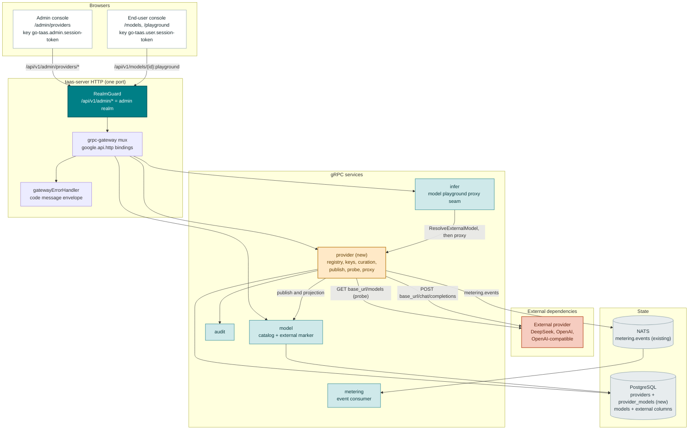
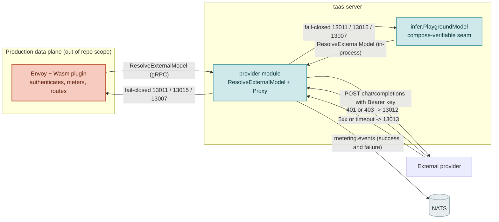
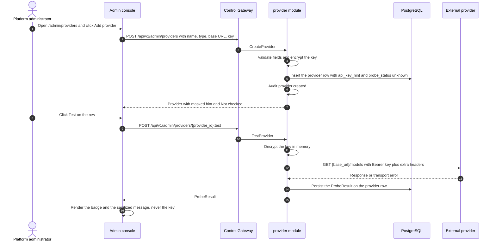
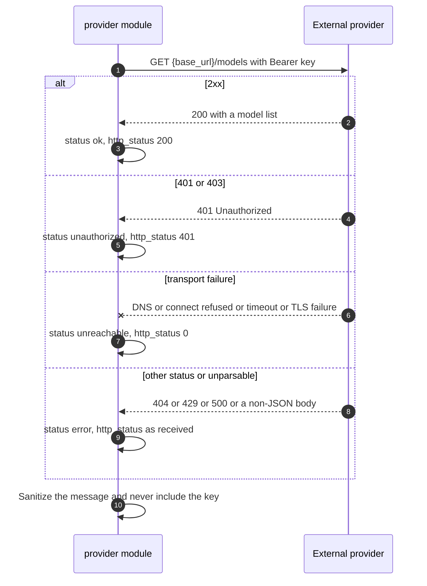
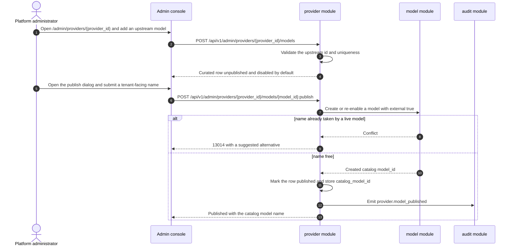
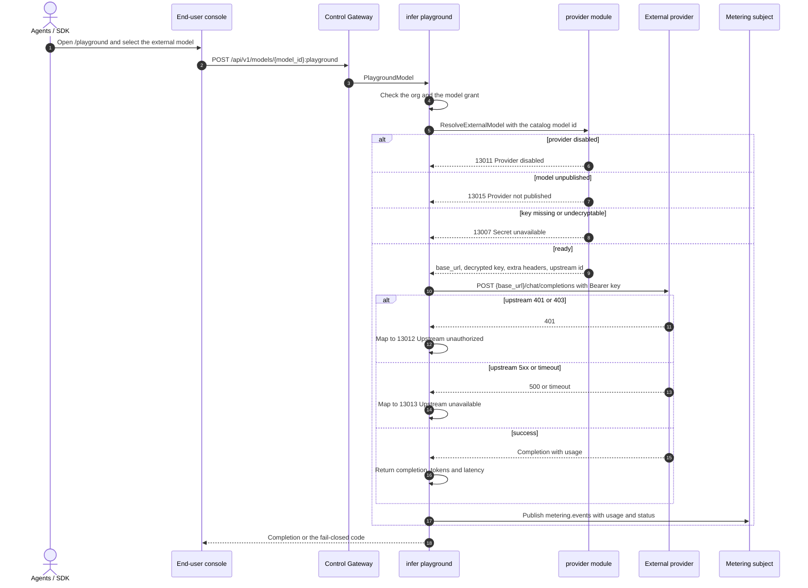
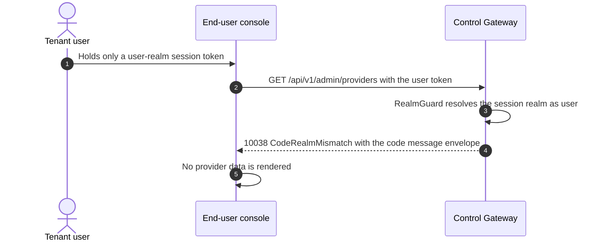

# External Model Providers — Architecture and Detailed Design

| Attribute | Content |
| --- | --- |
| Feature point | External model providers — a platform operator registers third-party LLM providers (DeepSeek, OpenAI, any OpenAI-compatible endpoint), verifies connectivity, curates the upstream models they expose, and publishes them into the existing catalog so tenant organizations consume them exactly like self-hosted models (backlog row 48) |
| Document scope | Architecture and detailed design for feature-48: a new `provider` module owning the provider registry, AES-256-GCM write-only keys, upstream-model curation, the publish linkage into the `model` catalog, the connectivity-probe worker and the external-model proxy; the `taas.provider.v1.ProviderService` proto with twelve RPCs bound only under `/api/v1/admin/providers/*` plus one internal `ResolveExternalModel` RPC; the `providers` and `provider_models` tables and the additive `models` columns; the five-state connectivity probe and its exact status mapping; the enforcement seam that proxies a published external model on the metered path; error handling (13001–13016 plus 10038/10036); configuration, security, rollout, and a function-level task list per layer |
| Owning modules | New `provider` module (`services/provider`): the registry, encrypted keys, upstream curation, publishing, the probe worker and the external chat proxy; `model` (additive external columns and the external marker in the admin and masked user projections); `infer` (the compose-verifiable external-model proxy seam in the model-based playground); `audit` (provider and publish events); `pkg/errors` (130xx block); `pkg/config` (provider section); `pkg/server` (admin-prefix bindings, unchanged realm guard); `web` admin console (`ProvidersPage`, `ProviderDetailPage`) plus the external marker on the existing catalog/detail pages |
| Related documents | [Requirement Analysis and UI/UX Design](../design/external-model-providers.md) · [Architecture Design](../design/architecture.md) §2.2 `model`, §2.4 `infer`, §3.1 control gateway, §3.2 data plane (Envoy + Wasm), §4.3 inference request and billing loop · [Model Catalog & One-Click Deployment](./model-catalog-deployment.md) (the catalog this feature publishes into) · [Per-Tenant Model Authorization](./model-authorization.md) (the grant path external models reuse unchanged) · [Webhook Notifications](./webhook-notifications.md) (the AES-256-GCM secret-at-rest pattern this feature reuses) · [Console Surface Separation](./console-surface-separation.md) (the two surfaces, `AdminShell`, the masked-projection rule) · [Distributed Inference Runtime](./distributed-inference-runtime.md) (the sibling admin-only registry module whose shape this feature mirrors) |
| Status | Architecture complete, handed to the Developer agent |

---

## 1. Overview and Goals

go-taas's catalog today describes **only self-hosted models**. `RegisterModelRequest` (`proto/taas/model/v1/model.proto`) carries `name`, `version`, `weight_path`, `description`, `source` and `source_model_id`, and every catalog model is assumed to be served by a vLLM pod on the cluster through an inference service and routed by the data-plane gateway. `source` (`modelscope` / `huggingface`) is a **weights hub**, not a serving endpoint, and `models` / `model_versions` persist no base URL, endpoint or credential.

This feature closes a real product gap: frontier and specialty models the operator does **not** want to or cannot self-host — DeepSeek, OpenAI, any private OpenAI-compatible endpoint — have no path into the platform. The operator **registers a provider** (base URL plus write-only encrypted key), **verifies connectivity**, **curates** the upstream model ids that should be offered, and **publishes** selected models into the existing catalog. Published models become first-class catalog models marked `external=true`, so **grants (feature #13), the masked user catalog, the playground and the metered/billed path all work unchanged** and a tenant cannot tell an externally hosted model from a self-hosted one except for an External marker.

**Goals**:

- Two admin pages, `/admin/providers` (`ProvidersPage`) and `/admin/providers/:providerId` (`ProviderDetailPage`), inside `AdminShell`, with the provider table, the create/edit dialog, the connectivity panel and the upstream-model table (design §5.3–§5.4).
- A new `provider` module owning the registry, the encrypted write-only keys, upstream curation, the publish mapping, the scheduled probe worker and the external chat proxy, with its own error block **130xx** (design D2, D9).
- The exact admin-prefix bindings for twelve RPCs on a new `taas.provider.v1.ProviderService` plus one internal `ResolveExternalModel` RPC (design §6).
- The **five-state connectivity probe** (`unknown` / `ok` / `unauthorized` / `unreachable` / `error`) with the exact status mapping, a persisted `ProbeResult`, and the guarantee that a real DeepSeek `401` renders as `unauthorized`, never `unreachable` (design D5, FR3.3.1).
- Publishing into the existing `models` catalog through additive columns, so features #13/#12/#4/#5 are reused unchanged (design D4).
- The enforcement seam that resolves and proxies a published external model with fail-closed semantics and emits metering on success **and** failure, verifiable end-to-end in the compose stack (design D8, FR6).
- Numbered acceptance criteria (AC1–AC15) testable in Nightwatch and FVT against the compose stack.

**Non-goals** (from the design, restated): cross-provider or cross-model fallback and weighted routing (feature #45 routing policies); automatic mirroring of a provider's full `/models` list (curation is operator-driven); per-tenant or per-key provider credentials (credentials are platform assets); provisioned-throughput or quota management on the provider; fine-tuning or dataset operations on external models; self-hosted model deployment (feature #2) and the distributed runtime (feature #47); the metering/billing/analytics pipeline itself (features #4/#25/#28/#29, reused unchanged); and any new end-user page (design D1 — tenants consume models, not providers).

### 1.1 Reading order of this document

Section 2 records the architecture decisions (AD1–AD14; AD12–AD14 are refinements the architecture adds, marked as such). Sections 3–5 are the component view, the data model and the API design. Section 6 is the frontend architecture (page → route → API-prefix table, navigation, shared components, auth guard). Sections 7–8 are the sequence diagrams and error handling. Sections 9–11 are configuration, security and rollout. Section 12 is the acceptance-criteria traceability. Sections 13–15 are the function-level detailed design (including the exact probe status mapping, the key-handling algorithm and the publish semantics), the ordered implementation task list, and the deferred items.

---

## 2. Architecture Decisions

AD1–AD11 restate the UI/UX design's decisions (D1–D11) as implementation-level rules. **AD12–AD14 are refinements** the architecture adds; each is marked with the design decision it refines and preserves that decision's intent so the Developer and Test agents implement one reading.

| # | Decision | Rationale |
| --- | --- | --- |
| AD1 | **The feature is admin-surface only**: routes `/admin/providers` and `/admin/providers/:providerId`, API prefix `/api/v1/admin/providers/*`. There is **no `/api/v1/*` binding** and no new end-user page | Design D1. Provider registration, keys, curation and publishing are operator-orchestration (feature-17 masked-projection rule); tenants consume models through the existing user surfaces. Consistent with the admin-only runtime (#47), accelerator (#18) and webhook (#23) surfaces |
| AD2 | **A new `provider` module** (`services/provider`) owns the registry, the encrypted keys, upstream curation, the publish mapping, the scheduled probe worker and the external chat proxy, with its own error block **13001–13016**. `model` still owns the catalog, `infer` still owns inference services, the data-plane gateway still owns routing | Design D2. A provider is a distinct concern (an external endpoint plus a credential) with its own registry and background probe; a dedicated module keeps it out of the self-hosted model lifecycle |
| AD3 | **API keys are write-only and encrypted at rest (AES-256-GCM)**, reusing the reviewed cipher in `services/webhook/secret.go` (`EncryptSecret` / `DecryptSecret`) — **no second crypto path**. The master key resolves exactly like the webhook's: `provider.secretEncryptionKey`, env `CONFIG_PROVIDER_SECRETENCRYPTIONKEY`, else the dev-only fallback `"dev-provider-key-" + mq.namespace`. No read RPC returns the plaintext or the ciphertext — only a masked hint | Design D3. The repo already ships a reviewed encryption pattern; reusing it keeps one audited crypto path and write-only semantics prevent disclosure through the API, logs or the console (AD12 resolves the dev-fallback vs. 13007 interaction) |
| AD4 | **Publishing enters the existing catalog**: publishing creates (or re-enables) a `models` row with `external=true`, `provider_id` and `upstream_model_id`, using **additive columns**. No `model_versions` row is created — an external model has no weight artifact (AD13). Grants (#13), the user catalog and the playground then work unchanged, and the tenant contract stays the catalog model id | Design D4. Reusing the catalog reuses the whole grant/authorization/playground path and avoids a parallel, divergent model-identity system (the Azure "deployment name decoupled from the upstream id" pattern) |
| AD5 | **Connectivity is a first-class five-state signal** (`unknown` / `ok` / `unauthorized` / `unreachable` / `error`), produced by a **real HTTP probe** (AD7) of the provider on demand and on a schedule, and persisted on the provider row with latency, HTTP status, a sanitized message and checked-at | Design D5. Collapsing a credential failure into a network failure would mislead the operator; the API returns exactly the states the page renders |
| AD6 | **Guard rails are explicit**: a provider whose last probe is `unauthorized` cannot be enabled (13012); a non-`https` base URL carries a persistent `Non-HTTPS endpoint` warning; a provider with published models cannot be deleted (13016) and a published upstream row cannot be removed (13016); secrets are never returned by any RPC; disabling a provider is always allowed | Design D6. Misconfiguration of an external dependency must be loud, not silent; the guards are cheap, testable and prevent the most damaging operator errors |
| AD7 | **The probe is a real HTTP `GET {base_url}/models` with `Authorization: Bearer <decrypted key>` plus the provider's extra headers, under the provider's request timeout.** The probe runs **server-side** in the `provider` module, never in the browser | Design D11, FR3.2. Every OpenAI-compatible provider exposes `/models`; a server-side probe is the platform's view of reachability, not the operator's workstation's, and the browser never receives the key |
| AD8 | **Explicit failure semantics**: a user-realm session on `/api/v1/admin/providers/*` is rejected with **10038 `CodeRealmMismatch`**; a session without the required role receives **10036 `CodeForbidden`**; a request for a model whose provider is disabled fails closed with **13011**, whose model is unpublished with **13015**, and whose key is missing/undecryptable with **13007**; an upstream `401`/`403` maps to **13012** and upstream `5xx`/timeout/connection failure to **13013** | Design D8, D7. Realm separation is a hard product invariant, and an external dependency outage must produce actionable codes, not a generic 500 |
| AD9 | **New error codes in a provider block (13001–13016)**, the next free block after runtime's 129xx: **13001 `CodeProviderNotFound`**, **13002 `CodeProviderNameConflict`**, **13003 `CodeProviderNameInvalid`**, **13004 `CodeProviderBaseURLInvalid`**, **13005 `CodeProviderTypeInvalid`**, **13006 `CodeProviderAPIKeyRequired`**, **13007 `CodeProviderSecretUnavailable`**, **13008 `CodeProviderModelNotFound`**, **13009 `CodeProviderModelExists`**, **13010 `CodeProviderModelInvalid`**, **13011 `CodeProviderDisabled`**, **13012 `CodeProviderUpstreamUnauthorized`**, **13013 `CodeProviderUpstreamUnavailable`**, **13014 `CodeProviderPublishConflict`**, **13015 `CodeProviderNotPublished`**, **13016 `CodeProviderInUse`**. Realm failures reuse **10038** and role failures **10036** | Design D9. A new module (AD2) gets a fresh block; distinct codes keep each failure mode actionable and let the proxy map upstream failures without guessing |
| AD10 | **Provider records are platform-global** (no `X-Organization-Id`); the tenant only ever sees the published catalog model | Design D10. Credentials and endpoints are platform assets; tenant isolation stays on the model grant (feature #13), not on the provider record |
| AD11 | **Upstream-model curation is a real table** (`provider_models`), not a mirror of the provider's `/models` list, and the probe result is **persisted** on the provider row rather than computed on page load | Design D5/FR4/FR3.6. Curation is the operator's explicit act; a persisted `ProbeResult` lets the page show last-known status without a live call, and a scheduled worker keeps it fresh |
| AD12 | **REFINEMENT of design D3/D8 — the master key resolves exactly like the webhook's.** An explicit `provider.secretEncryptionKey` is used when set; otherwise the module falls back to `"dev-provider-key-" + mq.namespace`, so create/rotate works in the compose stack with no key configured. **13007 `CodeProviderSecretUnavailable`** is returned when the stored ciphertext cannot be decrypted with the resolved key (a changed master key, a tampered row, an empty ciphertext on an existing provider), or when no key material is resolvable at all — **not** merely because `provider.secretEncryptionKey` is empty | The design's FR2.2 wording ("when the master key is not configured, create/update returns 13007") would break the compose/e2e flow, in which no provider key is provisioned and webhook secrets already work through the same dev fallback. Reusing the webhook fallback (AD3) keeps "one crypto path, one key-resolution rule" and turns 13007 into a genuine decryption failure. Production sets the key (Section 10/11) |
| AD13 | **REFINEMENT of design D4/FR5 — an external catalog model has no `model_versions` row.** Publishing writes only the `models` row; `latest_version` is empty for an external model in every projection (admin and user), and the admin/user catalog render "—" for the version. Publishing/unpublishing never touches `model_versions`, and `weight_path` stays empty | An external model has no weight artifact and no version history; fabricating a version row would create a phantom artifact the controller might try to deploy (the self-hosted path reads `model_versions.weight_path`). Keeping external models version-less makes the `model` module's deploy path naturally inapplicable and keeps the diff additive. The design only requires `external=true`, `provider_id`, `upstream_model_id` (FR5.2) |
| AD14 | **REFINEMENT of design FR6/D7 — the enforcement seam is one internal `ResolveExternalModel` RPC plus a `provider.Proxy`, and it is exercised in-repo by the model-based playground.** The production data-plane gateway (Envoy + Wasm, out of repository scope) calls `ResolveExternalModel` and proxies. Because the repository has no server-side `/v1/*` handler and the compose stack has no Envoy, the same resolver + proxy is wired into `infer.PlaygroundModel` (`POST /api/v1/models/{model_id}:playground`, user surface), which performs a **real server-side OpenAI-compatible call** to the provider and emits a `metering.events` event — making AC9/AC10/AC11 end-to-end verifiable in compose against the `mock-infer` fixture. The admin `PlaygroundInfer` (service-based) is unchanged because an external model has no inference service | The design pins the data-plane contract but the repository must be verifiable without Envoy. The model-based playground is the only in-repo, tenant-reachable inference invocation and already carries `model_id` + `api_key_id` + org; wiring the external proxy there reuses the grant check and the metering subject, adds no new tenant route, and pins exactly the contract the production data plane will call. No cross-provider fallback (design D7) |

---

## 3. Component View

### 3.1 Ownership

| Layer / component | Owns | Changes in this feature |
| --- | --- | --- |
| **Static bundle (SPA)** | One Vite bundle (`web/dist`) embedded into `taas-server`; served by the gateway's SPA fallback | Two new admin pages (`ProvidersPage`, `ProviderDetailPage`), one nav item, route registration in `App.tsx`, i18n keys, and an External badge on the existing catalog/detail pages |
| **Gateway (`pkg/server`)** | HTTP composition: `RealmGuard` → `withConsole` → grpc-gateway mux; the unified error renderer; the SPA fallback | No change — the new RPCs bind under `/api/v1/admin/providers/*`, which `RealmGuard` already classifies as the admin surface |
| **grpc-gateway mux** | Path → RPC routing from `google.api.http` annotations | New bindings for the twelve provider RPCs (Section 5). `ResolveExternalModel` carries **no** HTTP annotation and is internal-gRPC-only |
| **`provider` (new)** | The `providers` and `provider_models` tables, encrypted keys, upstream curation, the publish mapping, the probe worker, the external chat proxy and the twelve admin RPCs | New service: `services/provider` |
| **`model`** | The catalog (`models`, `model_versions`, `model_authorizations`) and the admin/available projections | Additive columns (`external`, `provider_id`, `upstream_model_id`, `published`); the external marker in `ListModels`/`GetModel` and the masked `ListAvailableModels`/`GetAvailableModel`; `published = true` filter in the user projection |
| **`infer`** | Inference services and the model-based playground | `PlaygroundModel` resolves an external model through the injected `ExternalModelProxy` and returns a real completion; a `SetExternalModelProxy` setter (the `SetModelAuthorizer` pattern) |
| **`audit`** | Best-effort audit recorder | Reused: the provider module calls `Recorder.Record` for `provider.*` events (never the key) |
| **`pkg/mq`** | The canonical subjects | **No new subject** — the proxy publishes on the existing `metering.events` subject |
| **`pkg/errors`** | Code blocks per module | One new provider block: **13001–13016** |
| **`pkg/config`** | The merged configuration tree | New `provider` section (secret key, probe interval/worker, default request timeout) |
| **`test/e2e/mock`** | The compose test fixtures | **Extend `mock_infer.py`** with `GET /v1/models` and the error-prefix variants (explicitly a test-infrastructure change, Section 9) |

### 3.2 Component view



### 3.3 Request identity chain

The provider RPCs are **admin-surface, admin-role, platform-scoped** (AD1, AD10). The chain is:

1. `RealmGuard` (HTTP, `pkg/server/realm.go`) — the path prefix `/api/v1/admin/providers/*` decides the expected realm `admin`. With no `Authorization` header: pass through (transitional, feature-17 AD4). With a header: resolve the session realm from Redis; mismatch → **10038**; unknown/expired/realm-less → **10027**.
2. grpc-gateway mux — routes by the annotated path and forwards `authorization`.
3. `provider` handler — resolves the actor (`SessionUserResolver`) and gates every RPC on the admin role via `tenancy.RoleGuard` (**10036**). Reads (`ListProviders`, `GetProvider`, `ListProviderModels`) and writes (create/update/delete/test/publish/unpublish) all require the admin role; no `X-Organization-Id` is required or honored (AD10).

A user-realm session presented on any `/api/v1/admin/providers/*` route is rejected with **10038 `CodeRealmMismatch`** (design FR8.4, AC12). A session lacking the required role receives **10036 `CodeForbidden`** (AC13).

### 3.4 The enforcement seam

Two callers share one resolution contract (AD14):



- **`ResolveExternalModel`** is an internal gRPC RPC (`taas.provider.v1.ProviderService`, no `google.api.http` annotation). Given a catalog `model_id`, it returns `{provider_id, provider_name, base_url, api_key, extra_headers, upstream_model_id, request_timeout_seconds}` or a fail-closed code (13011/13015/13007/13008). The plaintext key exists only in memory for the duration of the call (AD12).
- **`provider.Proxy`** performs `POST {base_url}/chat/completions` with `Authorization: Bearer <key>` plus the provider's extra headers, under the provider timeout, preserving streaming behavior for the production data plane. It maps upstream `401`/`403` → **13012** and upstream `5xx`/timeout/connection failure → **13013**, and **always** emits a `metering.events` event (success or failure) with the parsed usage.
- **Compose-verifiable path** (AD14): `infer.PlaygroundModel` calls the injected `ExternalModelProxy` (implemented by `provider.Service`) when the target model is `external=true`, and returns the completion, tokens and latency to the console. `mock-infer` plays the external provider. This gives AC9 (end-to-end with metering) and AC10 (fail-closed mapping) a real, in-repo execution path.
- **No cross-provider fallback** (design D7): a request targets exactly one provider; a failure maps to a distinct code and never silently retries elsewhere.

---

## 4. Data Model

The feature adds **two tables** (`providers`, `provider_models`) and **four additive columns** on the existing `models` table. All schema is the GORM model created by the owning service's `Migrate` via `db.AutoMigrate(...)` (Section 4.4).

### 4.1 `providers`

| Column | Type | Notes |
| --- | --- | --- |
| `id` | string (PK, uuid) | Server-generated UUID v4, exposed as `provider_id` |
| `name` | string (64, unique) | `^[a-z0-9][a-z0-9-]*$`, 1–64 chars, unique via `uniqueIndex` |
| `type` | string (32) | `deepseek` / `openai` / `openai_compatible` |
| `base_url` | string (512) | Absolute `http(s)` URL with a host; trailing slash stripped at use |
| `enabled` | bool | Default `false` on create |
| `request_timeout_seconds` | int | Default `10`, range `1`–`120` |
| `extra_headers` | jsonb | `{ "<header-name>": "<base64 AES-256-GCM ciphertext of the value>" }`; reads expose names only (AD3, security) |
| `api_key_ciphertext` | bytea (nullable) | AES-256-GCM `nonce || ciphertext` of the key; never selected into a response |
| `api_key_hint` | string (16) | The masked hint (`••••3f9a`), computed at create/rotate; reads return it and never decrypt |
| `probe_status` | string (16) | `unknown` / `ok` / `unauthorized` / `unreachable` / `error`; default `unknown` |
| `probe_latency_ms` | int64 | `0` when no response |
| `probe_http_status` | int | `0` when no response |
| `probe_message` | string (256) | The sanitized message (never the key, never the upstream body) |
| `probe_checked_at` | timestamp (nullable) | `NULL` before the first probe |
| `created_by` / `updated_by` | string (64) | Acting admin user id (empty when unresolved, transitional) |
| `created_at` / `updated_at` | timestamp | UTC |

The GORM model is `Provider` in `services/provider/provider_model.go`; `TableName()` returns `"providers"`. `api_key_hint` is stored (not derived) so no read path ever needs the master key (AD3).

### 4.2 `provider_models`

| Column | Type | Notes |
| --- | --- | --- |
| `id` | string (PK, uuid) | Exposed as `model_id` (the platform's row id, distinct from `upstream_model_id`) |
| `provider_id` | string (uuid, index) | Owning provider |
| `upstream_model_id` | string (128) | The provider's model id; unique per provider |
| `display_name` | string (128) | Optional, default empty |
| `context_window` | int64 | `0` = unknown, range `0`–`10 000 000` |
| `enabled` | bool | Default `true` |
| `published` | bool | Default `false`; set by publish |
| `catalog_model_id` | string (uuid, nullable) | The published `models.id`, set by publish |
| `created_at` / `updated_at` | timestamp | UTC |

The GORM model is `ProviderModel` in `services/provider/provider_model.go`; `TableName()` returns `"provider_models"`. A composite `uniqueIndex:idx_provider_models_provider_upstream (provider_id, upstream_model_id)` enforces uniqueness within a provider (design FR4.2 → **13009**).

### 4.3 `models` (additive columns)

| Column | Type | Notes |
| --- | --- | --- |
| `external` | bool | `not null;default:false`; true for a published external model |
| `provider_id` | string (uuid) | `not null;default:''`; index; set on publish |
| `upstream_model_id` | string (128) | `not null;default:''`; set on publish |
| `published` | bool | `not null;default:true`; unpublished external models are hidden from the user projection |

`published` defaults to `true` so every existing self-hosted model keeps today's behavior with **no backfill**. The `external`, `provider_id` and `upstream_model_id` columns are empty/false for self-hosted models. Per **AD13**, no `model_versions` row is created for an external model, so `models.name` remains the unique catalog identity and `weight_path` stays empty.

### 4.4 Migration and init-SQL upgrade path

This repository does **not** use hand-written init-SQL scripts: every table's schema is the GORM model created by the owning service's `Migrate` via `db.AutoMigrate(...)` (e.g. `services/cluster/service.go` `Migrate` → `AutoMigrate(&Cluster{})`), and there are no `.sql` files under `deploy/`. The upgrade path is:

1. Add `Provider` and `ProviderModel` to `services/provider/provider_model.go`.
2. `provider.Service.Migrate(ctx)` returns `db.AutoMigrate(&Provider{}, &ProviderModel{})`.
3. Add the four columns to `models.Model` in `services/model/model_model.go`; `model.Service.Migrate` already calls `AutoMigrate(&Model{}, &Version{}, ...)` and picks them up with no change beyond the struct.
4. `apps/taas-server/main.go` registers the `provider` service in the migrate order (after `model`, before `infer`) so the tables and columns are created on server startup.
5. No init-SQL edit, no manual DDL, no data backfill. The tables start empty and the new `models` columns take their defaults, so an existing deployment upgrades with unchanged behavior.

---

## 5. API Design

### 5.1 Surface mapping

Every RPC is bound **only** on the admin prefix `/api/v1/admin/providers/*`, except the internal resolver (AD1, AD14).

| RPC | HTTP method + path | Surface | Status |
| --- | --- | --- | --- |
| `ListProviders` | `GET /api/v1/admin/providers` | admin | new |
| `CreateProvider` | `POST /api/v1/admin/providers` | admin | new |
| `GetProvider` | `GET /api/v1/admin/providers/{provider_id}` | admin | new |
| `UpdateProvider` | `PATCH /api/v1/admin/providers/{provider_id}` | admin | new |
| `DeleteProvider` | `DELETE /api/v1/admin/providers/{provider_id}` | admin | new |
| `TestProvider` | `POST /api/v1/admin/providers/{provider_id}:test` | admin | new |
| `ListProviderModels` | `GET /api/v1/admin/providers/{provider_id}/models` | admin | new |
| `AddProviderModel` | `POST /api/v1/admin/providers/{provider_id}/models` | admin | new |
| `UpdateProviderModel` | `PATCH /api/v1/admin/providers/{provider_id}/models/{model_id}` | admin | new |
| `RemoveProviderModel` | `DELETE /api/v1/admin/providers/{provider_id}/models/{model_id}` | admin | new |
| `PublishProviderModel` | `POST /api/v1/admin/providers/{provider_id}/models/{model_id}:publish` | admin | new |
| `UnpublishProviderModel` | `POST /api/v1/admin/providers/{provider_id}/models/{model_id}:unpublish` | admin | new |
| `ResolveExternalModel` | internal gRPC (no HTTP annotation) | internal | new |
| `ListAvailableModels` / `GetAvailableModel` | `GET /api/v1/models`, `/api/v1/models/{model_id}` | user | changed (external marker) |
| `ListModels` / `GetModel` | `GET /api/v1/admin/models`, `/api/v1/admin/models/{model_id}` | admin | changed (external marker + provider fields) |

### 5.2 Proto contract (`proto/taas/provider/v1/provider.proto`, new)

```proto
syntax = "proto3";

package taas.provider.v1;

import "google/api/annotations.proto";
import "taas/common/v1/common.proto";

option go_package = "github.com/go-taas/go-taas/proto/taas/provider/v1;providerv1";

// ProviderService serves the external model-provider registry, the
// connectivity probe and upstream-model curation (feature #48).
// Admin-surface API: served under /api/v1/admin/providers.
service ProviderService {
  // ListProviders returns the registered providers with masked key hints,
  // the last probe result and model counts. Supports pagination, a name
  // search and type/enabled/probe-status filters.
  rpc ListProviders(ListProvidersRequest) returns (ListProvidersResponse) {
    option (google.api.http) = {get: "/api/v1/admin/providers"};
  }

  // CreateProvider registers a provider. api_key is required on create.
  rpc CreateProvider(CreateProviderRequest) returns (CreateProviderResponse) {
    option (google.api.http) = {post: "/api/v1/admin/providers" body: "*"};
  }

  // GetProvider returns one provider, masked. Unknown id -> 13001.
  rpc GetProvider(GetProviderRequest) returns (GetProviderResponse) {
    option (google.api.http) = {get: "/api/v1/admin/providers/{provider_id}"};
  }

  // UpdateProvider edits mutable fields. An omitted or empty api_key keeps
  // the existing credential; a non-empty key rotates it.
  rpc UpdateProvider(UpdateProviderRequest) returns (UpdateProviderResponse) {
    option (google.api.http) = {patch: "/api/v1/admin/providers/{provider_id}" body: "*"};
  }

  // DeleteProvider removes a provider and its curated models. Blocked while
  // any curated model is published -> 13016.
  rpc DeleteProvider(DeleteProviderRequest) returns (DeleteProviderResponse) {
    option (google.api.http) = {delete: "/api/v1/admin/providers/{provider_id}"};
  }

  // TestProvider runs a synchronous connectivity probe and returns the
  // persisted five-state ProbeResult. A probe is always allowed.
  rpc TestProvider(TestProviderRequest) returns (TestProviderResponse) {
    option (google.api.http) = {post: "/api/v1/admin/providers/{provider_id}:test" body: "*"};
  }

  // ListProviderModels returns the curated upstream models with their
  // published/catalog binding.
  rpc ListProviderModels(ListProviderModelsRequest) returns (ListProviderModelsResponse) {
    option (google.api.http) = {get: "/api/v1/admin/providers/{provider_id}/models"};
  }

  // AddProviderModel adds a curated upstream model row.
  rpc AddProviderModel(AddProviderModelRequest) returns (AddProviderModelResponse) {
    option (google.api.http) = {post: "/api/v1/admin/providers/{provider_id}/models" body: "*"};
  }

  // UpdateProviderModel edits display name, context window and enabled.
  // The upstream id is immutable.
  rpc UpdateProviderModel(UpdateProviderModelRequest) returns (UpdateProviderModelResponse) {
    option (google.api.http) = {patch: "/api/v1/admin/providers/{provider_id}/models/{model_id}" body: "*"};
  }

  // RemoveProviderModel removes a curated row. Blocked while published -> 13016.
  rpc RemoveProviderModel(RemoveProviderModelRequest) returns (RemoveProviderModelResponse) {
    option (google.api.http) = {delete: "/api/v1/admin/providers/{provider_id}/models/{model_id}"};
  }

  // PublishProviderModel publishes a curated, enabled row as a catalog
  // model (external=true). A live name conflict -> 13014. Idempotent.
  rpc PublishProviderModel(PublishProviderModelRequest) returns (PublishProviderModelResponse) {
    option (google.api.http) = {post: "/api/v1/admin/providers/{provider_id}/models/{model_id}:publish" body: "*"};
  }

  // UnpublishProviderModel marks the catalog model unpublished. Grants are
  // retained but inert. Idempotent.
  rpc UnpublishProviderModel(UnpublishProviderModelRequest) returns (UnpublishProviderModelResponse) {
    option (google.api.http) = {post: "/api/v1/admin/providers/{provider_id}/models/{model_id}:unpublish" body: "*"};
  }

  // ResolveExternalModel resolves a catalog model to its provider, the
  // decrypted key and the upstream model id, or a fail-closed code. This
  // is an INTERNAL RPC: it has no google.api.http annotation and is never
  // reachable through the gateway. It is called by the data-plane gateway
  // and by infer.PlaygroundModel.
  rpc ResolveExternalModel(ResolveExternalModelRequest) returns (ResolveExternalModelResponse) {}
}

message Provider {
  string provider_id = 1;
  string name = 2;
  string type = 3;                 // deepseek | openai | openai_compatible
  string base_url = 4;
  bool enabled = 5;
  int64 request_timeout_seconds = 6;
  repeated string extra_header_names = 7; // names only, never values
  string api_key_hint = 8;         // masked, e.g. "••••3f9a"
  ProbeResult last_probe = 9;
  int64 upstream_model_count = 10;
  int64 published_model_count = 11;
  int64 created_at = 12;
  int64 updated_at = 13;
}

message ProbeResult {
  string status = 1;         // unknown | ok | unauthorized | unreachable | error
  int64 latency_ms = 2;
  int32 http_status = 3;     // 0 when no response was received
  string message = 4;        // sanitized, never the key or the upstream body
  int64 checked_at = 5;      // 0 before the first probe
}

message ListProvidersRequest {
  taas.common.v1.PageRequest page = 1;
  string name = 2;           // name substring search
  string type = 3;           // deepseek | openai | openai_compatible
  string enabled = 4;        // "" | "true" | "false"
  string probe_status = 5;   // unknown | ok | unauthorized | unreachable | error
}

message ListProvidersResponse {
  taas.common.v1.Response response = 1;
  repeated Provider providers = 2;
  taas.common.v1.PageMeta page_meta = 3;
}

message CreateProviderRequest {
  string name = 1;
  string type = 2;
  string base_url = 3;
  string api_key = 4;               // write-only, required on create
  bool enabled = 5;
  int64 request_timeout_seconds = 6; // 0 -> default 10
  map<string, string> extra_headers = 7;
}

message CreateProviderResponse {
  taas.common.v1.Response response = 1;
  Provider provider = 2;
}

message GetProviderRequest { string provider_id = 1; }

message GetProviderResponse {
  taas.common.v1.Response response = 1;
  Provider provider = 2;
}

message UpdateProviderRequest {
  string provider_id = 1;
  string name = 2;
  string type = 3;
  string base_url = 4;
  // api_key is optional: omitted or empty keeps the existing credential;
  // a non-empty value rotates it. Never returned by any read.
  string api_key = 5;
  bool enabled = 6;
  int64 request_timeout_seconds = 7;
  map<string, string> extra_headers = 8;
}

message UpdateProviderResponse {
  taas.common.v1.Response response = 1;
  Provider provider = 2;
}

message DeleteProviderRequest { string provider_id = 1; }
message DeleteProviderResponse { taas.common.v1.Response response = 1; }

message TestProviderRequest { string provider_id = 1; }

message TestProviderResponse {
  taas.common.v1.Response response = 1;
  ProbeResult probe = 2;
}

message ProviderModel {
  string model_id = 1;            // the platform's curated row id
  string upstream_model_id = 2;
  string display_name = 3;
  int64 context_window = 4;       // 0 = unknown
  bool enabled = 5;
  bool published = 6;
  string catalog_model_id = 7;
  string catalog_model_name = 8;
  int64 created_at = 9;
  int64 updated_at = 10;
}

message ListProviderModelsRequest {
  string provider_id = 1;
  taas.common.v1.PageRequest page = 2;
  string upstream_model_id = 3;
  string enabled = 4;    // "" | "true" | "false"
  string published = 5;  // "" | "true" | "false"
}

message ListProviderModelsResponse {
  taas.common.v1.Response response = 1;
  repeated ProviderModel models = 2;
  taas.common.v1.PageMeta page_meta = 3;
}

message AddProviderModelRequest {
  string provider_id = 1;
  string upstream_model_id = 2;
  string display_name = 3;
  int64 context_window = 4;
  bool enabled = 5;
}

message AddProviderModelResponse {
  taas.common.v1.Response response = 1;
  ProviderModel model = 2;
}

message UpdateProviderModelRequest {
  string provider_id = 1;
  string model_id = 2;
  string display_name = 3;
  int64 context_window = 4;
  bool enabled = 5;
}

message UpdateProviderModelResponse {
  taas.common.v1.Response response = 1;
  ProviderModel model = 2;
}

message RemoveProviderModelRequest {
  string provider_id = 1;
  string model_id = 2;
}
message RemoveProviderModelResponse { taas.common.v1.Response response = 1; }

message PublishProviderModelRequest {
  string provider_id = 1;
  string model_id = 2;
  // tenant_facing_name defaults to display_name, else upstream_model_id.
  string tenant_facing_name = 3;
}

message PublishProviderModelResponse {
  taas.common.v1.Response response = 1;
  string catalog_model_id = 2;
  string catalog_model_name = 3;
  ProviderModel model = 4;
}

message UnpublishProviderModelRequest {
  string provider_id = 1;
  string model_id = 2;
}
message UnpublishProviderModelResponse { taas.common.v1.Response response = 1; }

// ResolveExternalModel is internal (no HTTP annotation). It is called by
// the data-plane gateway and by infer.PlaygroundModel.
message ResolveExternalModelRequest {
  string model_id = 1;    // the catalog model id (preferred)
  string model_name = 2;  // the catalog model name (fallback)
}

message ResolvedExternalModel {
  string provider_id = 1;
  string provider_name = 2;
  string base_url = 3;
  string upstream_model_id = 4;
  int64 request_timeout_seconds = 5;
  // api_key and extra_headers are returned ONLY on this internal RPC and
  // exist in memory for the duration of the request. No admin read RPC
  // ever carries them.
  string api_key = 6;
  map<string, string> extra_headers = 7;
}

message ResolveExternalModelResponse {
  taas.common.v1.Response response = 1;
  ResolvedExternalModel model = 2;
}
```

`proto/taas/model/v1/model.proto` is extended **additively**:

```proto
// ModelSummary (admin projection) gains:
bool external = 7;
string provider_name = 8;      // empty unless external
string provider_id = 9;        // admin only
string upstream_model_id = 10; // admin only
bool published = 11;           // false for an unpublished external model

// AvailableModel (masked user projection) gains ONLY:
bool external = 6;
string provider_name = 7;      // masked; the user projection never carries
                               // provider_id, upstream_model_id, base_url,
                               // the key or the key hint
```

### 5.3 Gateway routing

The grpc-gateway mux routes the twelve annotated RPCs from the `google.api.http` bindings above; custom verbs (`:test`, `:publish`, `:unpublish`) follow the existing `{model_id}:grant` convention (`body: "*"` on POST). `ResolveExternalModel` has no annotation and is reachable only on the internal gRPC port. `RealmGuard` needs no change: `/api/v1/admin/` already maps to the admin surface. The JSON envelope is unchanged: HTTP 200 on success, business errors as `{"code": <int>, "message": "..."}`, int64 fields serialized as JSON strings.

### 5.4 Validation contract

| Field | Rule | Code |
| --- | --- | --- |
| `name` | 1–64 chars, `^[a-z0-9][a-z0-9-]*$` | 13003 `CodeProviderNameInvalid` |
| `name` | unique across providers | 13002 `CodeProviderNameConflict` |
| `type` | ∈ `{deepseek, openai, openai_compatible}` | 13005 `CodeProviderTypeInvalid` |
| `base_url` | absolute `http(s)` URL with a host | 13004 `CodeProviderBaseURLInvalid` |
| `api_key` | non-empty on create | 13006 `CodeProviderAPIKeyRequired` |
| `request_timeout_seconds` | `1`–`120` (0 → default 10) | 13010 `CodeProviderModelInvalid` (generic scalar-field code, design FR1.6) |
| `extra_headers` | each name `^[A-Za-z0-9-]+$`, names unique, value ≤ 1024 chars | 13010 `CodeProviderModelInvalid` |
| `upstream_model_id` | 1–128 chars, unique within the provider | 13009 `CodeProviderModelExists` (duplicate) / 13010 (missing/empty) |
| `context_window` | `0`–`10 000 000` | 13010 `CodeProviderModelInvalid` |
| `tenant_facing_name` | 1–128 chars, `^[a-z0-9][a-z0-9._-]*$` | 13010 `CodeProviderModelInvalid` |

Provider-row lookup failures return **13001 `CodeProviderNotFound`**; curated-row lookup failures return **13008 `CodeProviderModelNotFound`**.

---

## 6. Frontend Architecture

### 6.1 Page → route → API prefix

| Feature | Surface | Web route | API prefix |
| --- | --- | --- | --- |
| Provider list (search/sort/filter) | admin | `/admin/providers` | `/api/v1/admin/providers` |
| Create / edit provider | admin | `/admin/providers` (dialog) | `/api/v1/admin/providers`, `/api/v1/admin/providers/{provider_id}` |
| Delete provider | admin | `/admin/providers` (confirmation) | `/api/v1/admin/providers/{provider_id}` |
| Connectivity test | admin | `/admin/providers`, `/admin/providers/:providerId` | `/api/v1/admin/providers/{provider_id}:test` |
| Provider detail + upstream models | admin | `/admin/providers/:providerId` | `/api/v1/admin/providers/{provider_id}`, `/api/v1/admin/providers/{provider_id}/models` |
| Publish / unpublish | admin | `/admin/providers/:providerId` (dialog / confirmation) | `/api/v1/admin/providers/{provider_id}/models/{model_id}:publish` / `:unpublish` |
| External marker (admin catalog) | admin | `/admin/models`, `/admin/models/:id` (existing, changed) | `/api/v1/admin/models`, `/api/v1/admin/models/{model_id}` (existing, changed) |
| Tenant catalog / detail (existing) | user | `/models`, `/models/:modelId` (existing, changed) | `/api/v1/models`, `/api/v1/models/{model_id}` (existing, changed) |
| Tenant playground (existing) | user | `/playground` (existing, unchanged interaction) | `/api/v1/models/{model_id}:playground` (existing, now proxies external models) |

Management is entirely on the **admin surface**; tenant consumption is entirely on the **end-user surface** and reuses existing pages. No new end-user route is created (AD1). The admin pages contain no `/api/v1/*` call and the user pages contain no `/api/v1/admin/*` call.

### 6.2 Navigation placement

`AdminShell.ADMIN_NAV_ITEMS` (`web/src/shells/AdminShell.tsx`) is a **flat array** today — the design's "Operations group" is a conceptual grouping, not an implemented one (this mirrors how runtime #47 was added). The feature adds one item directly after `nav-runtime`:

```ts
{ path: '/admin/providers', labelKey: 'nav.providers', testid: 'nav-providers', icon: Key },
```

The two routes are registered in `web/src/App.tsx` inside `AdminRoutes` next to the existing `/admin/models` and `/admin/runtime` routes:

```tsx
<Route path="/admin/providers" element={<ProvidersPage />} />
<Route path="/admin/providers/:providerId" element={<ProviderDetailPage />} />
```

### 6.3 Shared components and state to reuse

| Need | Reuse |
| --- | --- |
| Realm-scoped HTTP client | `web/src/api.ts` `useApi()` (admin realm: prefix `/api/v1/admin/*`, token `go-taas.admin.session-token`) |
| Status badges | `web/src/components/StatusBadge.tsx` for the probe badge (`Reachable` / `Credentials rejected` / `Unreachable` / `Error` / `Not checked`) and the enabled/published badges |
| Table, pagination, filters | The existing catalog/runtime table + toolbar patterns (same page-size 20 convention) |
| Dialogs / confirmations | The existing modal + confirmation patterns (create/edit dialog, publish dialog, unpublish/delete confirmations) |
| Toasts | The existing toast helper for "Provider deleted." / "Model published." / "Model unpublished." |
| i18n | `web/src/locales/en.ts` + `zh.ts` gain `nav.providers`, the page copy and the error copy |

No new global state is introduced: each page owns its list state and polls the provider list while visible (the design's "Showing stale data" banner keeps the last good rows on a failed poll).

### 6.4 Auth guard per surface

- **Admin pages**: `AdminShell` redirects to `/admin/login` when `go-taas.admin.session-token` is empty; a `10038`/`10027` from `/api/v1/admin/auth/session` clears the token and redirects with the realm/expired reason (existing behavior). Provider pages inherit this guard unchanged.
- **End-user pages**: `UserShell` owns the user realm; the external marker on `/models` and the playground call only `/api/v1/*`.
- The two surfaces never share a token; a user-realm token on `/api/v1/admin/providers/*` is rejected by the gateway with **10038** (AC12).

### 6.5 `data-testid` hooks the Test agent can drive

Provider list: `provider-list`, `provider-add`, `provider-refresh`, `provider-search`, `provider-filter-type`, `provider-filter-status`, `provider-filter-enabled`, `provider-row-{provider_id}`, `provider-status-{provider_id}`, `provider-enabled-{provider_id}`, `provider-test-{provider_id}`, `provider-view-{provider_id}`, `provider-edit-{provider_id}`, `provider-delete-{provider_id}`, `provider-nonhttps-chip-{provider_id}`.

Create/edit dialog: `provider-dialog`, `provider-form-name`, `provider-form-type`, `provider-form-base-url`, `provider-form-api-key`, `provider-form-enabled`, `provider-form-timeout`, `provider-form-headers`, `provider-form-submit`, `provider-form-cancel`.

Detail page: `provider-detail`, `provider-detail-name`, `provider-detail-base-url`, `provider-detail-key-hint`, `provider-detail-headers`, `provider-test-panel`, `provider-test-now`, `provider-test-message`, `provider-model-table`, `provider-model-add`, `provider-model-row-{model_id}`, `provider-model-publish-{model_id}`, `provider-model-unpublish-{model_id}`, `provider-model-remove-{model_id}`, `provider-publish-dialog`, `provider-publish-name`, `provider-publish-confirm`.

Tenant-facing: `models-external-badge`, `model-detail-external-marker`, `model-detail-provider-name`, `playground-model-select` (existing).

---

## 7. Sequence Diagrams

### 7.1 Create a provider and probe it



### 7.2 The five-state probe mapping



### 7.3 Curate upstream models and publish



### 7.4 Tenant consumes a published external model on the metered path



### 7.5 Wrong-realm rejection



---

## 8. Error Handling

| Condition | Code | Constant | HTTP / body |
| --- | --- | --- | --- |
| Unknown provider | 13001 | `CodeProviderNotFound` | business envelope |
| Duplicate provider name | 13002 | `CodeProviderNameConflict` | business envelope |
| Invalid provider name | 13003 | `CodeProviderNameInvalid` | business envelope |
| Invalid base URL | 13004 | `CodeProviderBaseURLInvalid` | business envelope |
| Unsupported provider type | 13005 | `CodeProviderTypeInvalid` | business envelope |
| API key required on create | 13006 | `CodeProviderAPIKeyRequired` | business envelope |
| Secret unavailable (undecryptable / no key material) | 13007 | `CodeProviderSecretUnavailable` | fail-closed on resolve |
| Unknown upstream model row | 13008 | `CodeProviderModelNotFound` | business envelope |
| Duplicate upstream model id | 13009 | `CodeProviderModelExists` | business envelope |
| Invalid upstream model field | 13010 | `CodeProviderModelInvalid` | business envelope |
| Provider disabled | 13011 | `CodeProviderDisabled` | fail-closed before the upstream call |
| Upstream authentication rejected | 13012 | `CodeProviderUpstreamUnauthorized` | maps upstream 401/403; also blocks enabling |
| Upstream 5xx / timeout / connection failure | 13013 | `CodeProviderUpstreamUnavailable` | maps upstream 5xx/timeout |
| Publish name conflict | 13014 | `CodeProviderPublishConflict` | business envelope |
| Model not published | 13015 | `CodeProviderNotPublished` | fail-closed before the upstream call |
| Provider in use (has published models) | 13016 | `CodeProviderInUse` | delete / remove guard |
| User-realm session on an admin route | 10038 | `CodeRealmMismatch` | reused — realm separation |
| Session without the required role | 10036 | `CodeForbidden` | reused — permission denial |

The 130xx messages join the canonical table in `pkg/errors/messages.go` (e.g. `CodeProviderNotFound: "provider not found"`), and the codes join `pkg/errors/codes.go` as a new `provider` block after runtime's 129xx. No existing code changes meaning.

---

## 9. Configuration

New `provider` block in `pkg/config/api.go` + `configs/config.yaml`, wired into the root `Configuration` (the `webhook`/`runtime` pattern). All keys take the `CONFIG_` env override.

| Key | Default | Description |
| --- | --- | --- |
| `provider.secretEncryptionKey` | `""` | AES-256-GCM master key for key-at-rest encryption. Empty falls back to `"dev-provider-key-" + mq.namespace` (AD12); production must set it |
| `provider.probeInterval` | `60s` | The scheduled probe period for enabled providers (design FR3.6) |
| `provider.probeWorker.enabled` | `true` | Kill switch for the probe worker runner |
| `provider.probeWorker.workers` | `2` | Concurrent probe handlers |
| `provider.defaultRequestTimeoutSeconds` | `10` | Default per-provider request timeout when the request omits one (range 1–120) |

`configs/config.yaml` gains:

```yaml
provider:
  # secretEncryptionKey is the AES-256-GCM master key for provider-key
  # encryption at rest. Empty falls back to a dev-only key derived from
  # the MQ namespace; production must set it (shared with webhook's rule).
  secretEncryptionKey: ""
  # probeInterval is the scheduled connectivity-probe period for enabled
  # providers.
  probeInterval: 60s
  probeWorker:
    enabled: true
    workers: 2
  # defaultRequestTimeoutSeconds is the default per-provider timeout.
  defaultRequestTimeoutSeconds: 10
```

`deploy/compose/docker-compose.yaml` adds to the `taas-server` environment (mirroring the webhook key line):

```yaml
# Feature #48: the provider secret-at-rest encryption key. Read from the
# .env file; empty falls back to a dev-only key.
CONFIG_PROVIDER_SECRETENCRYPTIONKEY: ${PROVIDER_SECRET_ENCRYPTION_KEY:-}
```

`.env.example` gains `PROVIDER_SECRET_ENCRYPTION_KEY=` with the same comment as `WEBHOOK_SECRET_ENCRYPTION_KEY`.

**Test fixture (explicitly test infrastructure, per the environment ground truth).** `test/e2e/mock/mock_infer.py` is extended so the compose stack exercises all five probe states and both upstream failure mappings **without external network**:

- `GET /v1/models` → `200` with `{"data":[{"id":"gpt-4o",...}]}` (probe **`ok`**).
- `GET /v1/models` on the prefix path `/unauthorized/...` (matched by a `Base Path`), i.e. a provider whose base URL ends in `/unauthorized` → `401` (probe **`unauthorized`**, the AC4 distinction without needing the real DeepSeek host).
- `GET /v1/models` on the prefix `/unavailable/...` → `503` (probe **`error`**).
- `POST /v1/chat/completions` unchanged → `200` with a deterministic completion (the proxied external call, AC9).
- `POST /v1/chat/completions` on `/unauthorized/...` → `401` (upstream → **13012**).
- `POST /v1/chat/completions` on `/unavailable/...` → `503` (upstream → **13013**).

A provider pointed at an unroutable host (e.g. `http://127.0.0.1:1`) yields **`unreachable`**. The real `https://api.deepseek.com` probe remains available as an FVT that is only run when the environment has egress (documented, not required by compose).

---

## 10. Security Considerations

- **Write-only keys**: no provider proto message has a plaintext or ciphertext key field. Reads return `api_key_hint` only (last 4 for keys ≥ 8 chars, otherwise fully masked). The hint is stored at create/rotate, so no read path decrypts. The single exception is the **internal** `ResolveExternalModel`, reachable only on the internal gRPC port and carrying the key in memory for one request (AD14).
- **Encryption at rest**: keys and extra-header values use `webhook.EncryptSecret` (AES-256-GCM, `nonce || ciphertext`). Key resolution mirrors the webhook's (AD3/AD12).
- **No logging**: the key, the decrypted value and the `Authorization` header are never logged, returned, put in a trace, or included in a probe result. Probe messages are sanitized to the category plus at most the HTTP status and reason phrase.
- **Non-HTTPS warning**: a non-`https` base URL is accepted but carries a persistent `Non-HTTPS endpoint` marker in the list and detail.
- **Fail-closed**: disabled provider → 13011, unpublished model → 13015, undecryptable/missing key → 13007, all **before** any upstream call (design FR6.2).
- **Distinct upstream failures**: upstream 401/403 → 13012, upstream 5xx/timeout/connection failure → 13013; the tenant receives a stable platform message and never the upstream body, the base URL or the key (design FR6.5).
- **Realm separation**: a user-realm session on `/api/v1/admin/providers/*` → 10038; a role-less session → 10036 (AD8).
- **Masked projection**: the user catalog/detail never carries `provider_id`, `upstream_model_id`, the base URL, the key or the hint; only `external` and `provider_name` (design FR5.6).
- **Audit without secrets**: `provider.*` audit events carry the acting operator and no key material (design FR1.7).

---

## 11. Rollout / Upgrade Notes

- **Additive only**: two new tables plus four `models` columns with defaults; no backfill and no data migration. An existing deployment upgrades with unchanged behavior (`published=true` for every existing model, `external=false`).
- **Provider key**: production must set `provider.secretEncryptionKey` (or `PROVIDER_SECRET_ENCRYPTION_KEY`) before creating providers. A later change to the master key makes existing provider keys undecryptable and surfaces **13007** on use; the operator rotates the key (AD12, Section 10).
- **Probe worker**: enabled by default at a 60 s interval and only probes **enabled** providers; it is a read-only `GET /models` per provider per interval. It never disables a provider automatically (the operator decides, design FR3.6).
- **Console-visible changes** (release notes): the admin console gains **Providers** in the navigation; the admin catalog and the end-user catalog/detail gain an **External** badge; the user playground now lists published external models.
- **Enforcement**: the production data plane must integrate `ResolveExternalModel`; until it does, external models are reachable in-repo only through the model-based playground (AD14). This is the single integration follow-up for the data-plane team, and the contract is frozen in Section 5.2.
- **No controller involvement**: an external model has no Kubernetes resource and no Deployment, so the controller is untouched (design §1.5).

---

## 12. Acceptance-Criteria Traceability

| # | Criterion (design §7) | Where addressed | Level |
| --- | --- | --- | --- |
| AC1 | Provider table columns + search/filter/sort/pagination | §6.1, §6.5, §13.9 | E2E |
| AC2 | Create dialog validation + masked hint + status Not checked | §5.4, §7.1, §13.2 | E2E |
| AC3 | Write-only key, hint only, blank edit keeps it | §10, §13.4 | FVT + E2E |
| AC4 | Five-state probe mapping incl. DeepSeek 401 = unauthorized | §7.2, §13.3, §9 | FVT + E2E |
| AC5 | Upstream curation validation + published-only removal | §5.4, §13.2 | E2E + FVT |
| AC6 | Publish + External catalog model + 13014 conflict | §7.3, §13.5 | E2E + FVT |
| AC7 | Unpublish hides, fails closed 13015, grants inert | §13.5, §7.4 | FVT + E2E |
| AC8 | Guard rails (no enable on unauthorized, non-HTTPS, delete 13016) | §2 AD6, §13.2 | FVT + E2E |
| AC9 | End-to-end external consumption with metering | §3.4, §7.4, §13.6 | FVT + E2E |
| AC10 | Fail-closed 13011/13015/13012/13013 distinct | §8, §13.6 | FVT |
| AC11 | Tenant-facing External marker, no internals leaked | §5.2, §6.5, §13.7 | E2E |
| AC12 | Negative realm separation 10038 | §3.3, §7.5 | FVT + E2E |
| AC13 | Permission denied 10036 | §3.3, §6.4 | E2E |
| AC14 | Audit events with no key | §10, §13.2 | FVT |
| AC15 | Page states (loading/empty/stale/disabled/permission-denied) | §6.3, §6.5 | E2E |

---

## 13. Detailed Design

### 13.1 File layout

| Module | File | Contents |
| --- | --- | --- |
| `proto/taas/provider/v1` | `provider.proto` | `ProviderService` + messages (Section 5.2) |
| `proto/taas/model/v1` | `model.proto` | Additive `ModelSummary` / `AvailableModel` fields |
| `services/provider` | `provider_model.go` | GORM models `Provider`, `ProviderModel` (Section 4) |
| | `provider_repository.go` | CRUD + lookups + probe persistence |
| | `provider_model_repository.go` | Curated-row CRUD + publish binding |
| | `secret.go` | Key/hint helpers reusing `webhook.EncryptSecret`/`DecryptSecret` |
| | `probe.go` | The probe client and the status mapping (Section 13.3) |
| | `probe_worker.go` | The `server.Runner` scheduled probe |
| | `proxy.go` | `ResolveExternalModel` + the chat proxy + metering emit |
| | `service.go` | The twelve admin RPCs, the internal resolver, `Migrate`, setters |
| `services/model` | `model_model.go` | Additive `external`/`provider_id`/`upstream_model_id`/`published` |
| | `service.go` | External marker in `ListModels`/`GetModel`; `published` filter + external fields in `ListAvailableModels`/`GetAvailableModel` |
| `services/infer` | `playground_model.go` | External-model branch calling `ExternalModelProxy` |
| | `service.go` | `ExternalModelProxy` interface + `SetExternalModelProxy` |
| `pkg/errors` | `codes.go`, `messages.go` | The 13001–13016 block + messages |
| `pkg/config` | `api.go`, `configuration.go` | `ProviderConfig` + defaults/validation |
| `apps/taas-server` | `main.go` | Register `provider`, wire `infer.SetExternalModelProxy(providerSvc)`, pass the secret key |
| `web/src` | `pages/ProvidersPage.tsx`, `pages/ProviderDetailPage.tsx`, `App.tsx`, `shells/AdminShell.tsx`, `api.ts`, `locales/en.ts`, `locales/zh.ts` | Section 6 |
| `test` | `fvt/provider_fvt_test.go`, `e2e/tests/provider.js`, `test/e2e/mock/mock_infer.py` | Section 9 |

### 13.2 `provider` module

- `Service.Migrate(ctx)` → `db.AutoMigrate(&Provider{}, &ProviderModel{})`.
- `CreateProvider`: validate (Section 5.4) → resolve the master key → `EncryptSecret(key, masterKey)` → compute `api_key_hint` → `Repository.Create` → audit `provider.created`. A missing key → 13006; an unusable key/cipher → 13007.
- `UpdateProvider`: validate; when `api_key` is non-empty, re-encrypt and re-hint and audit `provider.key_rotated`; when `enabled` transitions, audit `provider.enabled`/`provider.disabled`; **block enabling when `probe_status == unauthorized`** → 13012 even if the request tries to set `enabled=true` (design FR7.1, AC8); audit `provider.updated` otherwise.
- `DeleteProvider`: reject with **13016** when `published_model_count > 0`; otherwise delete the provider and its curated rows (a single transaction) and audit `provider.deleted`.
- `AddProviderModel` / `UpdateProviderModel` / `RemoveProviderModel`: validate (13010/13009/13008); removal of a `published` row → **13016**; audit `provider.model_added`/`provider.model_updated`/`provider.model_removed`.
- `TestProvider`: load the provider (13001), run the probe (Section 13.3), persist the `ProbeResult`, return it. Always allowed, even disabled (design FR3.7).
- The probe worker (`probe_worker.go`) implements `server.Runner`: on `provider.probeInterval`, for each **enabled** provider, run the probe and persist. It is gated by `provider.probeWorker.enabled` and uses `provider.probeWorker.workers` concurrent handlers.

### 13.3 The probe client and the status mapping

`probe.go` exposes `func (c *ProbeClient) Probe(ctx context.Context, p *Provider, key string) ProbeResult`:

1. `url := strings.TrimRight(p.BaseURL, "/") + "/models"`.
2. Build a `GET` with `Authorization: Bearer <key>` and the provider's **decrypted** extra headers; `ctx` carries `time.Duration(p.RequestTimeoutSeconds) * time.Second`.
3. `start := time.Now()`; `resp, err := c.httpClient.Do(req)`; `latency := time.Since(start).Milliseconds()`.
4. **If `err != nil`** → `status = unreachable`, `http_status = 0`, and the message is derived from the error class (`net.DNSError` → "DNS resolution failed"; `context.DeadlineExceeded` → "Connection timed out after <n>s"; a TLS/`x509` error → "TLS handshake failed"; anything else → "Connection failed"). Every transport failure maps to `unreachable` — this is the guarantee AC4 tests (a DNS/connect/TLS/timeout failure **must not** be `unauthorized`).
5. **Else examine `resp.StatusCode`**:
   - `200 ≤ code < 300` → `status = ok`.
   - `code == 401 || code == 403` → `status = unauthorized`, message "HTTP <code> <reason> — credentials rejected". This is the DeepSeek-401 case: **`unauthorized`, never `unreachable`** (design FR3.3.1, AC4).
   - any other code (`404`, `429`, `5xx`, …) → `status = error`, message "HTTP <code> <reason>".
6. `checked_at = time.Now()`; the message is always sanitized (category + at most status/reason phrase) and never contains the key, the `Authorization` header or the upstream body (design FR3.4).
7. `TestProvider` and the worker both persist `{probe_status, probe_latency_ms, probe_http_status, probe_message, probe_checked_at}`; a provider with no probe keeps `probe_status = unknown` and `probe_checked_at = NULL` (design §5.3 "Not checked").

### 13.4 Key handling and rotation

- **Create**: encrypt `api_key` with the resolved master key (AD3/AD12); `api_key_hint = mask(key)` where `mask(k) = "••••" + k[len(k)-4:]` when `len(k) ≥ 8`, else `"••••••••"`.
- **Update**: an omitted or empty `api_key` leaves `api_key_ciphertext` and `api_key_hint` untouched (design FR1.4 — "leave blank to keep"); a non-empty `api_key` re-encrypts, re-hints and audits `provider.key_rotated`; the old ciphertext is overwritten (design FR2.3).
- **Reads**: `Provider` messages carry `api_key_hint` and `extra_header_names` only. No admin read RPC decrypts anything.
- **Use**: `ResolveExternalModel` decrypts in memory for the duration of one request; the plaintext is never persisted, cached beyond the call, or logged (design FR2.5).

### 13.5 Publish and unpublish semantics

- **Publish** (`PublishProviderModel`): load the provider (13001) and row (13008); the row must be `enabled` (a disabled row → 13010, design FR4.5); resolve `tenant_facing_name` (default `display_name`, else `upstream_model_id`) and validate it. Then:
  - If the row already has `catalog_model_id` → set that model's `published=true`, `external=true` and return it (**idempotent no-op success**, design FR5.4).
  - Else if a **live** (published) catalog model already has the name → **13014** with a suggested alternative.
  - Else create `models{name, external=true, provider_id, upstream_model_id, published=true}` (**no version row**, AD13) and set the row's `catalog_model_id`, `published=true`.
  - Audit `provider.model_published`.
- **Tenant-facing catalog entry**: `name = tenant_facing_name`, `latest_version = ""` (AD13), `external = true`, `provider_name` (masked surface). There is no persisted `source` column on `models`; "external" is expressed by the `external` flag (design FR5.2 requires only `external`/`provider_id`/`upstream_model_id`).
- **Unpublish** (`UnpublishProviderModel`): set the catalog model's `published=false` (design FR5.5a). Existing grant rows are **retained** and become inert (FR5.5b); requests fail closed with **13015** (FR5.5c); there is **no routing to tear down** because an external model has no inference service and no Deployment (FR5.5d). Idempotent; audit `provider.model_unpublished`.
- **Disable / delete**: disabling a provider fails closed at resolve time with **13011**; deleting a provider is blocked while any row is published (**13016**), and a published row cannot be removed (**13016**).
- **Grants**: publishing does not create grants; a tenant consumes the model under the existing default-allow rule, and the operator grants it with feature #13 exactly like a self-hosted model.

### 13.6 Enforcement, proxy and metering

- `ProviderService.ResolveExternalModel(ctx, req)` (internal): look up the catalog model by id/name; require `external=true` and `published=true` (else **13015**); load the provider (unknown → 13008/13001) and require `enabled=true` (else **13011**); decrypt the key (undecryptable/missing → **13007**); return `ResolvedExternalModel`.
- `Proxy.ProxyChat(ctx, resolved, body)` performs `POST {base_url}/chat/completions` with `Authorization: Bearer <key>` plus the decrypted extra headers, under `resolved.RequestTimeoutSeconds`. It maps upstream `401`/`403` → **13012**, upstream `5xx`/timeout/connection failure → **13013**, and other upstream errors → **13013** with the category in the message; a success returns the upstream body.
- **Metering**: on **every** outcome the proxy publishes a `meteringEvent` (the exact struct in `services/metering/event_consumer.go`) on `mq.DefaultSubjects().MeteringEvents` with `{request_id, organization_id, api_key_id, model_id, usage, completed_at, latency_ms, status: success|error, error}`. The existing `metering.EventConsumer` then writes the voucher and billing runs unchanged (design FR6.4).
- **In-repo caller**: `infer.Service` defines
  ```go
  type ExternalModelProxy interface {
      ProxyExternalChat(ctx context.Context, modelID, orgID, apiKeyID string, body []byte) ([]byte, error)
  }
  func (s *Service) SetExternalModelProxy(p ExternalModelProxy) { s.externalProxy = p }
  ```
  `PlaygroundModel` looks up the model; when `models.external == true` it calls `s.externalProxy.ProxyExternalChat(...)` (implemented by `provider.Service`, which resolves, proxies, emits metering and returns the OpenAI body) and maps the response into `PlaygroundModelResponse{completion, prompt_tokens, completion_tokens, latency_ms}`. When the proxy is unwired, the handler keeps today's stub behavior for self-hosted models.
- **Production data plane** (out of repo scope): the Envoy + Wasm plugin calls `ResolveExternalModel` and proxies `POST {base_url}/chat/completions`, mapping upstream failures identically; the Wasm→`metering.events` path is unchanged. The contract is frozen in Section 5.2.

### 13.7 Model projections

- `model.Repository.ListModels` / `GetModel`: include `external`, `provider_name` (resolved from `provider_id` via a lookup injected as `providerNameResolver`, or denormalized at publish into a read-time join), `provider_id`, `upstream_model_id`, `published`. Admin sees unpublished external models (with a "Unpublished" marker).
- `model.Repository.ListAvailableModels`: add `WHERE published = true` (self-hosted default true, unchanged) and populate `external` + `provider_name` only. `GetAvailableModel`: same; an external model returns no autoscaling summary and an empty compatibility string (the console renders "Not applicable").
- No `weight_path`, `provider_id`, `upstream_model_id`, base URL, key or hint reaches the user projection.

### 13.8 Configuration wiring

`ProviderConfig` is added to `Configuration.Provider` (`mapstructure:"provider"`); `applyDefaults` sets `probeInterval=60s`, `probeWorker.enabled=true`, `probeWorker.workers=2`, `defaultRequestTimeoutSeconds=10`; `Validate` rejects a negative interval/workers (the webhook/runtime pattern). `apps/taas-server/main.go`: construct `providerSvc := provider.New(srv.Components())`, `providerSvc.SetSecretKey(resolveProviderKey(cfg))`, `providerSvc.SetDefaultTimeout(cfg.Provider.DefaultRequestTimeoutSeconds)`, `srv.RegisterService(providerSvc)`, add its probe worker via `AddRunner`, and after `srv.Init()` wire `inferSvc.SetExternalModelProxy(providerSvc)` and `providerSvc.SetModelCatalog(modelSvc)` (the publish delegation, injected as the `ModelCatalog` interface — the `SetModelAuthorizer` pattern).

### 13.9 Console

- `ProvidersPage` (`/admin/providers`): toolbar (search, type/status/enabled filters), the provider table (Name, Type, Base URL, Status badge, Enabled switch, Models `published/curated`, Last checked, Actions), the create/edit dialog with the write-only key field, the delete confirmation, and the inline quick-test. Polls the list while visible; keeps last-good rows on a failed poll ("Showing stale data").
- `ProviderDetailPage` (`/admin/providers/:providerId`): overview card (masked key hint, base URL, timeout, extra-header names), connectivity card (five-state badge, latency, HTTP status, checked-at, sanitized message, Test now, schedule note), and the upstream-model table with add/edit/remove + publish/unpublish, including the disabled/guarded states (FR4.4/FR4.5/FR7.4).
- Existing pages: `pages/ModelsPage.tsx` and `pages/ModelDetailPage.tsx` (admin) gain the External badge plus `provider_name`/`provider_id`/`upstream_model_id`; `pages/user/ModelsPage.tsx` and `pages/user/ModelDetailPage.tsx` gain the External badge and "Provided by `<provider>` (external)" only; `pages/user/PlaygroundPage.tsx` lists published external models.

---

## 14. Ordered Implementation Task List

1. **Errors**: add the 13001–13016 block to `pkg/errors/codes.go` + canonical messages to `pkg/errors/messages.go`.
2. **Config**: `ProviderConfig` + defaults/validation + `configs/config.yaml` + compose env + `.env.example`.
3. **Proto**: `proto/taas/provider/v1/provider.proto`; the additive `model.proto` fields; regenerate (`buf generate`).
4. **Data model**: `Provider`/`ProviderModel` GORM models; the additive `models` columns.
5. **Provider module core**: `secret.go` (reuse the webhook cipher), `provider_repository.go`, `service.go` create/update/delete/list/get with validation + audit + the enable guard.
6. **Probe**: `probe.go` (the mapping in Section 13.3) + `probe_worker.go`.
7. **Curation**: `provider_model_repository.go` + the four curation RPCs.
8. **Publish**: the publish/unpublish logic (Section 13.5) + the `ModelCatalog` seam + the model projection changes (Section 13.7) + `published` filter.
9. **Enforcement**: `ResolveExternalModel` (internal) + `proxy.go` + the metering emit + the `infer.ExternalModelProxy` seam.
10. **Wiring**: `apps/taas-server/main.go` (register, secret key, proxy, catalog).
11. **Console**: `ProvidersPage`, `ProviderDetailPage`, routes, nav, i18n, and the External badge on the existing pages.
12. **Tests**: FVT (`fvt/provider_fvt_test.go`) for the codes/key handling/publish/proxy/metering; extend `test/e2e/mock/mock_infer.py`; Nightwatch `e2e/tests/provider.js` for AC1–AC15.
13. **Docs**: keep this pair in sync if any contract changes during implementation.

---

## 15. Deferred Items

| Item | Where / why |
| --- | --- |
| Cross-provider / cross-model fallback and weighted routing | Feature #45; excluded here (design D7) |
| Automatic mirroring of a provider's full `/models` list | Deliberately excluded (design §1.2) — curation is operator-driven; the probe's `/models` response is not consumed to auto-create rows |
| Per-tenant or per-key provider credentials | Deliberately excluded (design D7) — credentials are platform assets |
| Provisioned-throughput / quota management on the provider | A later increment if required |
| Streaming (SSE) pass-through in the compose-verifiable playground path | The playground is non-streaming; SSE pass-through is specified for the production data plane (Section 13.6) and stays out of the compose path |
| Production data-plane integration of `ResolveExternalModel` | The Envoy + Wasm plugin is out of repository scope; the contract is frozen (Section 5.2) and is the one data-plane follow-up |
| Fine-tuning / dataset operations on external models | Out of product scope (token-as-a-service) |
| End-user provider page | Deliberately absent (design D1) |
