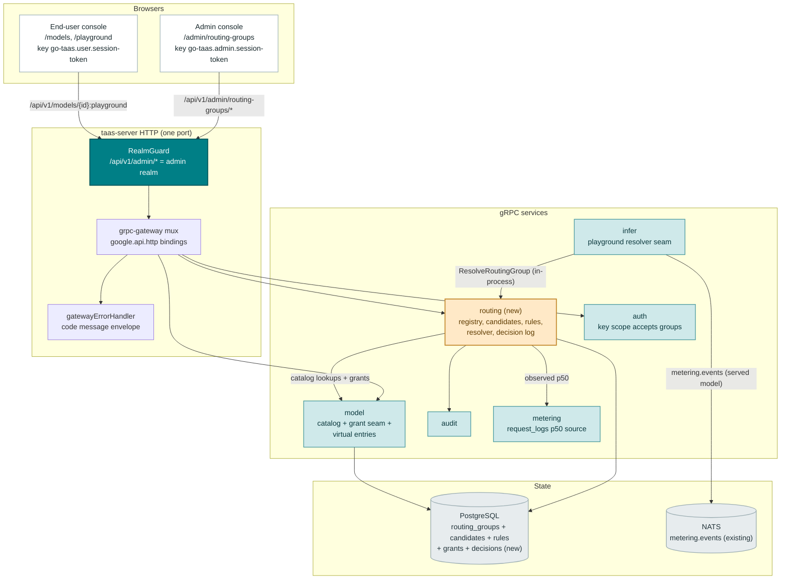
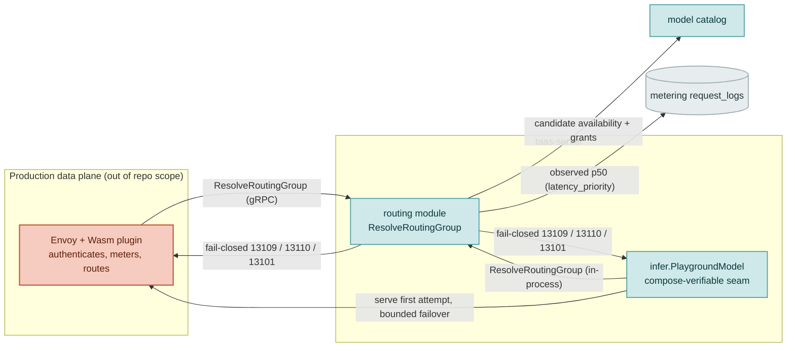
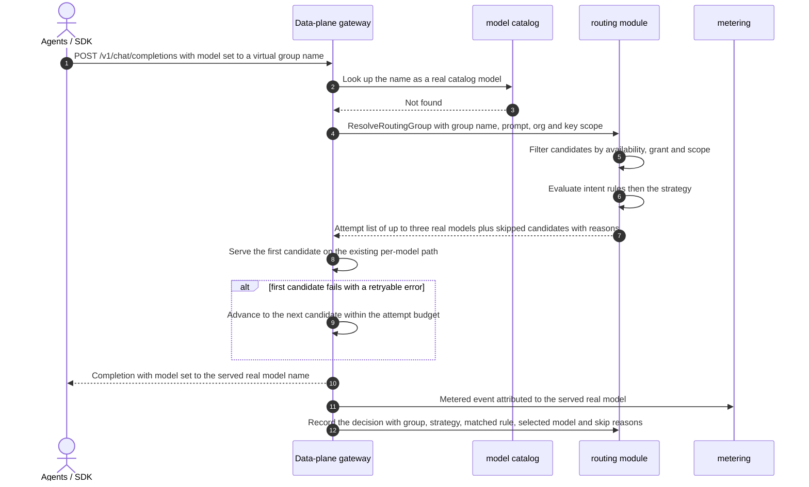
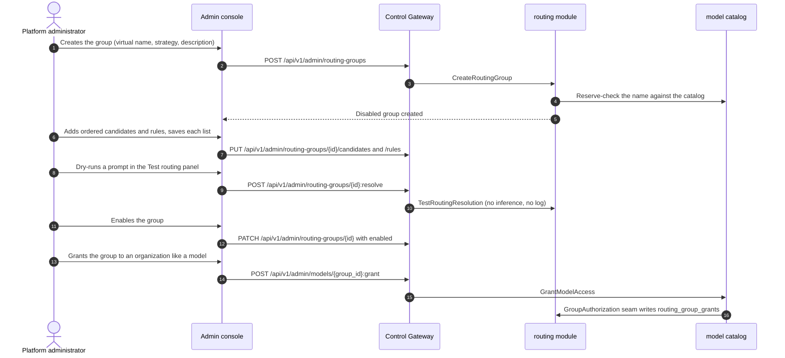
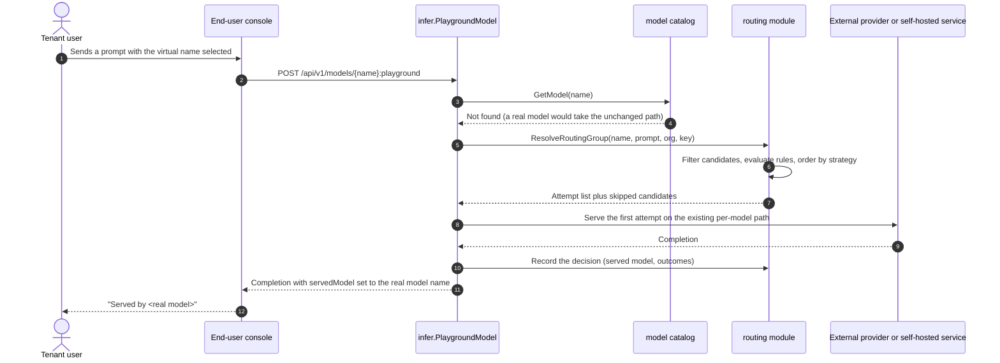

# Intelligent Model Routing — Architecture and Detailed Design

| Attribute | Content |
| --- | --- |
| Feature point | Intelligent model routing — routing groups (virtual models): an operator creates a group under a virtual name (e.g. `auto-chat`) holding an ordered candidate list of real catalog models (self-hosted or published external) with weights and optional cost/latency tier annotations; callers request the virtual name and the platform selects one candidate per request via a bounded, auditable strategy (`manual` / `weighted` / `cost-priority` / `latency-priority`), optionally overridden by explicit keyword/regex intent rules; every decision is logged; no silent substitution — real model ids always route unchanged and responses record the served model (backlog row 49) |
| Document scope | Architecture and detailed design for feature-49: a new `routing` module owning the group registry, candidate lists, intent rules, request-time resolution and the decision log; the `taas.routing.v1.RoutingService` proto with ten RPCs bound only under `/api/v1/admin/routing-groups/*` plus one internal `ResolveRoutingGroup` RPC; the `routing_groups`, `routing_group_candidates`, `routing_group_rules` and `routing_decisions` tables; the exact resolution algorithm (eligibility filtering → intent-rule matching → strategy ordering → 3-attempt truncation); the integration seams into the model catalog, grants (#13), key scopes (#46), the playground, metering attribution and audit; error handling (13101–13113 plus 10038/10036); configuration, security, rollout, and a function-level task list per layer |
| Owning modules | New `routing` module (`services/routing`): the group registry, candidates, rules, the resolver and the decision log; `model` (the grant-able list and the masked user catalog gain virtual entries); `auth` (key-scope validation accepts group names); `infer` (the compose-verifiable virtual-name resolution seam in the model-based playground); `metering` (attribution to the served real model — unchanged code, a binding rule); `audit` (routing events); `pkg/errors` (131xx block); `pkg/config` (routing section); `pkg/server` (admin-prefix bindings, unchanged realm guard); `web` admin console (`RoutingGroupsPage`, `RoutingGroupDetailPage`, `RoutingDecisionsPage`) plus the Auto marker and served-model display on the existing tenant pages |
| Related documents | [Requirement Analysis and UI/UX Design](../design/intelligent-model-routing.md) · [Architecture Design](../design/architecture.md) §2.2 `model`, §2.4 `infer`, §3.1 control gateway, §3.2 data plane (Envoy + Wasm), §4.3 inference request and billing loop · [Inference Routing Policies](./inference-routing-policies.md) (the #45 retry categories and no-substitution invariant this feature extends) · [External Model Providers](./external-model-providers.md) (published external models as candidates, and the module template this feature mirrors) · [Per-Tenant Model Authorization](./model-authorization.md) (the grant path routing groups reuse) · [API Key Model Scoping](./api-key-model-scoping.md) (the key-scope filter applied to candidates) · [Console Surface Separation](./console-surface-separation.md) (the two surfaces, `AdminShell`, the masked-projection rule) |
| Status | Architecture complete, handed to the Developer agent |

---

## 1. Overview and Goals

Feature #45 gave go-taas **same-model** routing: an ordered list of inference-service deployments serving one exact catalog model and version, with bounded retry. What is still missing is the **caller-facing** capability: request **one stable virtual name** and let the platform pick the actual serving model per request — cheapest for simple prompts, fastest under load, a specialist model when the prompt asks for it — without the caller rewriting its client when the operator re-balances the fleet.

This feature adds **routing groups (virtual models)**. An operator creates a group under a virtual name (e.g. `auto-chat`) holding an ordered candidate list of **real catalog models** — self-hosted or published external (#48) — each with a weight and optional cost/latency tier annotations. Callers request the virtual name; the platform selects one candidate per request via a bounded, explicit strategy, optionally overridden by auditable keyword/regex intent rules; every decision is logged and inspectable. The **no-silent-substitution invariant** is the core product rule: a request naming a real model id always goes to that model unchanged, and a response always records which real model served it.

**Goals**:

- Three admin pages, `/admin/routing-groups` (`RoutingGroupsPage`), `/admin/routing-groups/:groupId` (`RoutingGroupDetailPage`) and `/admin/routing-groups/decisions` (`RoutingDecisionsPage`), inside `AdminShell`, with the group table, create dialog, candidate editor, strategy configuration, intent-rule editor, dry-run test panel and the filterable decision log (design §5.3–§5.5).
- A new `routing` module owning the group registry, candidate lists, intent rules, request-time resolution and the decision log, with its own error block **131xx** (design D2, D12).
- The exact admin-prefix bindings for ten RPCs on a new `taas.routing.v1.RoutingService` plus one internal `ResolveRoutingGroup` RPC (design §6).
- The **four bounded strategies** (`manual`, `weighted`, `cost_priority`, `latency_priority`) with operator-declared tiers (never scraped prices) and observed p50 latency from the existing request-log path (design D3).
- **Explicit, ordered keyword/regex intent rules** that override the strategy when they match, with a dry-run test panel and RE2-only regex (design D4).
- The **no-silent-substitution invariant** end to end: real model id → unchanged path; virtual name → group resolution; the response records the served real model (design D5, §1.4).
- The grant/scope integration: a group is granted exactly like a model (#13), listable in a key's model scope (#46), and each candidate is **independently** checked at resolution time with recorded skip reasons and fail-closed **13109** (design D6).
- **Bounded failover** down the ordered candidate list on the #45 retryable categories, at most 3 total attempts; `manual` is an alias with exactly one attempt (design D7).
- **Metering attribution to the served real model** and a **decision log** with bounded retention (default 7 days) (design D8, D9).
- Numbered acceptance criteria (AC1–AC16) testable in Nightwatch and FVT against the compose stack.

**Non-goals** (from the design, restated): same-model deployment ordering and retries (feature #45, reused unchanged); embedding/semantic classifiers and bandit/adaptive routing (deliberately excluded); caller-controlled per-request routing knobs (deliberately excluded); live price scraping or automatic tier discovery (tiers are operator-declared); canary/percentage traffic splitting; per-tenant or per-org group overrides; automatic candidate health eviction (the gateway's existing health routing and #45 handle readiness); AIBrix-side routing configuration (feature #47 stays a runtime projection); the metering/billing pipeline itself (features #4/#25/#28, reused unchanged); and any new end-user management page (design D11 — tenants consume virtual names, they do not manage them).

### 1.1 Reading order of this document

Section 2 records the architecture decisions (AD1–AD15; AD12–AD15 are refinements the architecture adds, marked as such). Sections 3–5 are the component view, the data model and the API design. Section 6 is the frontend architecture (page → route → API-prefix table, navigation, shared components, auth guard). Sections 7–8 are the sequence diagrams and error handling. Sections 9–11 are configuration, security and rollout. Section 12 is the acceptance-criteria traceability. Sections 13–15 are the function-level detailed design (including the exact resolution algorithm), the ordered implementation task list, and the deferred items.

---

## 2. Architecture Decisions

AD1–AD11 restate the UI/UX design's decisions (D1–D11) as implementation-level rules. **AD12–AD15 are refinements** the architecture adds; each is marked with the design decision it refines and preserves that decision's intent so the Developer and Test agents implement one reading.

| # | Decision | Rationale |
| --- | --- | --- |
| AD1 | **Management is admin-surface only**: routes `/admin/routing-groups`, `/admin/routing-groups/:groupId` and `/admin/routing-groups/decisions`, API prefix `/api/v1/admin/routing-groups/*`. There is **no `/api/v1/*` management binding** and no new end-user management page. Tenant consumption reuses the existing user surfaces (`/models`, `/playground`, `/v1`) with a masked projection | Design D1/D11. Group configuration (candidates, weights, tiers, strategy, rules) is operator knowledge; tenants see only the virtual name, an "Auto" marker and the served model. Consistent with the admin-only provider (#48), runtime (#47) and routing-policies (#45) surfaces |
| AD2 | **A new `routing` module** (`services/routing`) owns the group registry, candidate lists, intent rules, request-time resolution and the decision log, with its own error block **13101–13113** (13105 unallocated, see AD9). `model` still owns the catalog, `infer` still owns inference services, the data-plane gateway still owns per-model serving | Design D2. A routing group is a distinct concern (a virtual name mapping to many real models, with selection strategies and decision history); a dedicated module keeps it out of the catalog and the #45 policy engine, whose object axis is deployments within one model |
| AD3 | **The four strategies are bounded and explainable**: `manual` (the pinned candidate is the only attempt), `weighted` (one random draw proportional to weight, then the remaining eligible candidates in descending weight order as the failover tail), `cost_priority` (eligible candidates ordered by declared `cost_tier` ascending, missing tier = 6, ties → declared order), `latency_priority` (eligible candidates ordered by observed p50 latency over a 15-minute window ascending; candidates without samples fall back to declared `latency_tier` ascending, missing tier = 6, and sort after sampled candidates). Tiers are operator-declared annotations, never scraped prices | Design D3. Every selection is explainable from operator-visible configuration plus platform-observed latency; no bandits, no embeddings, no hidden judges |
| AD4 | **Intent rules are explicit, ordered classifiers on the prompt**: `keyword` (case-insensitive substring, 1–256 chars) or `regex` (RE2, must compile, 1–256 chars); evaluated in declared order; the **first matching enabled rule wins** and its target becomes the first attempt; the matched rule is recorded in the decision log. A dry-run `TestRoutingResolution` previews the match and the attempt list without executing inference and without logging | Design D4. Mirrors the AIBrix semantic-router pattern but implemented in go-taas's own control plane with explicit, auditable rules — RE2's linear time bounds evaluation cost |
| AD5 | **No silent substitution** (the binding invariant): a request naming a **real catalog model id or name** always goes to that model — no group is consulted, no decision-log entry is created. Intelligent routing applies **only** when the caller explicitly requests an **enabled group's virtual name**. The response records the served real model: the OpenAI-compatible `model` field and the playground `servedModel` field carry the **served** model's name, never the virtual name | Design D5, §1.4. By calling the virtual name the caller has opted into platform selection — that is the contract of the name; a caller can always verify what answered |
| AD6 | **A routing group is granted to organizations exactly like a model** (feature #13) and is listable in a key's model scope (feature #46). At request time each candidate must **independently** satisfy (a) catalog availability (an external candidate must be published), (b) the org grant, and (c) the key scope; ineligible candidates are skipped with a recorded reason (`skipped_unavailable` / `skipped_unauthorized`); if none remain the request fails closed with **13109** | Design D6. The group is the *entry* permission, the candidate is the *serving* permission — both are enforced, and the skip reasons make misconfiguration visible in the decision log |
| AD7 | **Bounded failover down the ordered candidate list** on the #45 retryable categories (connection/timeout before response, HTTP 429, HTTP 5xx), at most **3 total attempts**; `manual` is an alias — exactly one attempt, no failover. When every attempt fails, the caller receives the last attempt's existing error and the decision log records `failed_retryable` per candidate | Design D7. Reuses #45's bounded retry semantics; caps latency and duplicate-work risk; alias behavior stays predictable |
| AD8 | **Metering and billing attribute to the served real model** (its real price matrix), exactly as a direct request to that model; request logs show the real served model. The group attribution lives in the decision log — it is the group-attribution view, not the billing truth | Design D8. Billing truth is the model that actually computed the tokens; group attribution is an operational view layered on top |
| AD9 | **New error codes in a routing block (13101–13113)**, the next free block after provider's 130xx: **13101 `CodeRoutingGroupNotFound`**, **13102 `CodeRoutingGroupNameConflict`**, **13103 `CodeRoutingGroupNameInvalid`**, **13104 `CodeRoutingGroupCandidateInvalid`**, **13106 `CodeRoutingGroupCandidateExists`**, **13107 `CodeRoutingGroupStrategyInvalid`**, **13108 `CodeRoutingGroupRuleInvalid`**, **13109 `CodeRoutingGroupNoEligibleCandidate`**, **13110 `CodeRoutingGroupDisabled`**, **13111 `CodeRoutingGroupInUse`**, **13112 `CodeRoutingGroupRuleExists`**, **13113 `CodeRoutingGroupNameReserved`**. **13105 is intentionally unallocated** — the design's D12 table skips it; the constant is simply not defined, leaving a free slot for a future routing code. Realm failures reuse **10038** and role failures **10036** | Design D12. A new module (AD2) gets a fresh block; distinct codes keep each failure mode actionable and let the resolver fail closed precisely |
| AD10 | **Virtual names are reserved-validated**: pattern `^[a-z][a-z0-9-]{2,63}$` (3–64 chars), must not collide with a real catalog model name (**13113**) nor another group (**13102**). The virtual name and real model names share one resolution namespace at the gateway, and a **real-model match always wins** (AD5) | Design D10. Collisions would create silent substitution or ambiguous resolution |
| AD11 | **Every routing decision is logged** with bounded retention (default 7 days, `routing.decisionRetentionDays`): `{decision_id, request_id, group, strategy, matched rule, selected model, candidates considered with per-candidate outcome and skip reason, api key, org, timestamp}`, denormalizing the group and candidate names so the log stays readable after deletion. Dry runs are never logged | Design D9. Decision transparency is the acceptance condition for platform-managed selection; bounded retention keeps the log operational |
| AD12 | **REFINEMENT of design D6/FR6.1 — a group grant is a `model_authorizations` row whose `model_id` is the group's id, written through a new `routing`-owned seam, not through `model.GrantModelAccess`.** The `model` module gains a `GrantableLister`-shaped read seam (implemented by `routing`) so the admin grant panel and the masked user catalog can list groups beside models, but the grant/revoke/list RPCs on `/api/v1/admin/models/*` keep validating **catalog models only**; groups are granted through the same RPC surface **by id** with the routing module as the validation seam. Concretely: `model.Service` gains `SetGroupAuthorizer(g GroupAuthorization)` where `GroupAuthorization` exposes `GroupExists(ctx, id) (bool, error)` and `CountGroupGrants(ctx, id) (int64, error)`; `GrantModelAccess`/`RevokeModelAccess`/`ListModelAuthorizations` first try the group seam (an id that names an enabled-or-disabled group is routed to the `routing` repository's grant table `routing_group_grants`), else fall through to the catalog path unchanged | The design says "granted exactly like a model" but the `model_authorizations` table is keyed by catalog `models.id`; writing group ids into it would corrupt the #13 default-allow rule (a `CountAuthorizations` on a group id would be indistinguishable from a model's). A parallel `routing_group_grants` table with the same shape (composite unique `(group_id, organization_id)`, `granted_by`, `created_at`) reuses the whole grant UX and semantics without touching the #13 invariants. The admin grant panel already lives on `/admin/models/:modelId`; the design's FR6.1 keeps that surface, so the seam must live in `model` — but the **data** lives in `routing`, keeping module ownership clean (AD2) |
| AD13 | **REFINEMENT of design FR6.2 — the key-scope list stores group ids, and `VerifyAPIKey`'s scope check accepts a group id unchanged.** `auth.validateKeyScope`'s existence check is widened through a new `GroupExistenceChecker` seam (`SetGroupExistenceChecker`, the `SetModelExistenceChecker` pattern): an entry that is not a catalog model id is checked against the routing groups; unknown → the existing 10008 invalid-scope error. The scope verdict comparison stays a plain string equality (a group id in the list authorizes the group id in the request), so the data-plane enforcement path needs **no change** — the playground resolver passes the resolved candidate ids through the same `VerifyAPIKey` contract | The design says "a granted group name is listable in a key's model scope"; the scope column stores opaque id strings compared by equality, so group ids flow through the existing enforcement with zero data-plane changes. Widening only the **write-time validation** seam keeps `auth` decoupled from `routing` internals (the same fail-open-until-wired shape as #46's AD6) |
| AD14 | **REFINEMENT of design FR5.2/FR3.4 — the enforcement seam is one internal `ResolveRoutingGroup` RPC, exercised in-repo by the model-based playground, and the latency source is the metering `request_logs` table.** The production data-plane gateway (Envoy + Wasm, out of repository scope) calls `ResolveRoutingGroup` and walks the attempt list. Because the repository has no server-side `/v1/*` handler, the same resolver is wired into `infer.PlaygroundModel` (`POST /api/v1/models/{model_id}:playground`, user surface) through a `RoutingResolver` seam (`SetRoutingResolver`, the `SetExternalModelProxy` pattern): when the model lookup misses, the playground resolves the virtual name, serves the first attempt on the existing per-model path (external proxy or self-hosted response), records the decision and returns `servedModel`. `latency_priority` reads observed p50 from `request_logs` (`model_id`, `latency_ms`, `status='success'`, `created_at` within the last 15 minutes), computed in one query per resolution with the metering module's nearest-rank percentile convention | The design pins the data-plane contract but the repository must be verifiable without Envoy (the #48 AD14 pattern). The playground is the only in-repo, tenant-reachable inference invocation and already carries `model_id` + `api_key_id` + org. `request_logs` is the existing per-request latency record (feature #12) with `ModelID` + `LatencyMs` + `Status` — the natural observed-latency source, requiring no new instrumentation |
| AD15 | **REFINEMENT of design FR1.1/FR7.2 — `request_count_24h` and the decision filters are computed from `routing_decisions` with plain indexed queries, and the decision log's `candidates_considered` is a jsonb column.** `request_count_24h` is a `COUNT(*)` on `routing_decisions` where `group_id = ?` and `created_at > now()-24h` (an admin list page of ≤ 100 groups; no denormalized counter is warranted). The `candidates_considered` array (model id, name, outcome, detail per candidate) is stored as a jsonb string column on `routing_decisions` — the `routing_policies.service_ids` convention — decoded at the repository boundary | A denormalized counter would need transactional updates on the request path for a list-page nicety; jsonb keeps the decision row self-contained (FR7.4's denormalization rule) without a per-candidate table that retention purging would have to cascade |

---

## 3. Component View

### 3.1 Ownership

| Layer / component | Owns | Changes in this feature |
| --- | --- | --- |
| **Static bundle (SPA)** | One Vite bundle (`web/dist`) embedded into `taas-server`; served by the gateway's SPA fallback | Three new admin pages (`RoutingGroupsPage`, `RoutingGroupDetailPage`, `RoutingDecisionsPage`), one nav item, route registration in `App.tsx` (static `decisions` before `:groupId`), i18n keys, the Auto badge on the user catalog/detail pages, the served-model line in the playground, and the group entries in the admin grant panel and key-scope picker |
| **Gateway (`pkg/server`)** | HTTP composition: `RealmGuard` → `withConsole` → grpc-gateway mux; the unified error renderer; the SPA fallback | No change — the new RPCs bind under `/api/v1/admin/routing-groups/*`, which `RealmGuard` already classifies as the admin surface |
| **grpc-gateway mux** | Path → RPC routing from `google.api.http` annotations | New bindings for the ten routing RPCs (Section 5). `ResolveRoutingGroup` carries **no** HTTP annotation and is internal-gRPC-only |
| **`routing` (new)** | The `routing_groups`, `routing_group_candidates`, `routing_group_rules`, `routing_group_grants` and `routing_decisions` tables; the ten admin RPCs; the resolver (eligibility, rules, strategy); the decision log and its retention runner | New service: `services/routing` |
| **`model`** | The catalog (`models`, `model_versions`, `model_authorizations`) and the admin/available projections | `GrantModelAccess`/`RevokeModelAccess`/`ListModelAuthorizations` accept group ids through the `GroupAuthorization` seam (AD12); `ListAvailableModels`/`GetAvailableModel` append granted groups as masked virtual entries (`virtual: true`) through a `VirtualModelLister` seam; `ListModels` (admin) is unchanged |
| **`auth`** | API keys, sessions, `VerifyAPIKey` | `validateKeyScope` accepts group ids through the `GroupExistenceChecker` seam (AD13); the verdict comparison and data-plane enforcement are unchanged |
| **`infer`** | Inference services and the model-based playground | `PlaygroundModel` resolves a virtual name through the injected `RoutingResolver` when the catalog lookup misses, serves the first attempt, records the decision and returns `servedModel`; a `SetRoutingResolver` setter (the `SetExternalModelProxy` pattern) |
| **`metering`** | Vouchers, usage records, request logs | **No code change** — attribution to the served real model is the binding rule (AD8): the playground path emits the metering event with the served model's id, exactly as a direct request |
| **`audit`** | Best-effort audit recorder | Reused: the routing module calls `Recorder.Record` for `routing.*` events |
| **`pkg/mq`** | The canonical subjects | **No new subject** — resolution is a synchronous internal RPC and the decision log is a DB write; the playground path publishes on the existing `metering.events` subject |
| **`pkg/errors`** | Code blocks per module | One new routing block: **13101–13113** (13105 unallocated) |
| **`pkg/config`** | The merged configuration tree | New `routing` section (decision retention days, retention runner, latency window) |
| **`test/e2e/mock`** | The compose test fixtures | Reused unchanged — `mock-infer` plays the self-hosted candidate; the external path reuses the #48 fixtures |

### 3.2 Component view



### 3.3 Request identity chain

The routing admin RPCs are **admin-surface, admin-role, platform-scoped** (AD1). The chain is:

1. `RealmGuard` (HTTP, `pkg/server/realm.go`) — the path prefix `/api/v1/admin/routing-groups/*` decides the expected realm `admin`. With no `Authorization` header: pass through (transitional). With a header: resolve the session realm from Redis; mismatch → **10038**; unknown/expired/realm-less → **10027**.
2. grpc-gateway mux — routes by the annotated path and forwards `authorization`.
3. `routing` handler — resolves the actor (`SessionUserResolver`) and gates every RPC on the admin role via `tenancy.RoleGuard` (**10036**), the `provider.requireAdminRole` shape: reads and writes all require the admin role; no `X-Organization-Id` is required or honored (groups are platform-global).

A user-realm session presented on any `/api/v1/admin/routing-groups/*` route is rejected with **10038 `CodeRealmMismatch`** (design FR8.4, AC13). A session lacking the required role receives **10036 `CodeForbidden`** (AC14).

### 3.4 The enforcement seam

Two callers share one resolution contract (AD14):



- **`ResolveRoutingGroup`** is an internal gRPC RPC (`taas.routing.v1.RoutingService`, no `google.api.http` annotation). Given `{group_name, prompt, org_id, api_key_id}`, it returns `{attempt_list[{model_id, model_name}] (≤ 3), skipped[{model_id, model_name, reason}]}` or a fail-closed code (**13101** unknown, **13110** disabled, **13109** no eligible candidate).
- **Compose-verifiable path** (AD14): `infer.PlaygroundModel` calls the injected `RoutingResolver` (implemented by `routing.Service`) when the catalog model lookup misses, walks the attempt list on the existing per-model path (the external proxy for an external candidate, the self-hosted response otherwise), records the decision and returns `servedModel`. This gives AC7–AC11 a real, in-repo execution path.
- **No silent substitution** (AD5): the resolver is consulted **only** after the real-model lookup misses; a real-model request never enters the routing path and never creates a decision entry.

---

## 4. Data Model

The feature adds **five tables**, all created by the `routing` service's `Migrate` via `db.AutoMigrate(...)` (Section 4.5). No existing table changes.

### 4.1 `routing_groups`

| Column | Type | Notes |
| --- | --- | --- |
| `id` | string (PK, uuid) | Server-generated UUID v4, exposed as `group_id` |
| `name` | string (64, unique) | The virtual name, `^[a-z][a-z0-9-]{2,63}$`, unique via `uniqueIndex` |
| `description` | string (256) | Optional, default `''` |
| `strategy` | string (32) | `manual` / `weighted` / `cost_priority` / `latency_priority`; default `weighted` |
| `enabled` | bool | Default `false` on create; enabling validates FR1.4 |
| `created_by` / `updated_by` | string (64) | Acting admin user id (empty when unresolved, transitional) |
| `created_at` / `updated_at` | timestamp | UTC |

The GORM model is `Group` in `services/routing/routing_model.go`; `TableName()` returns `"routing_groups"`.

### 4.2 `routing_group_candidates`

| Column | Type | Notes |
| --- | --- | --- |
| `id` | string (PK, uuid) | Server-generated UUID v4, exposed as `candidate_id` |
| `group_id` | string (uuid, index) | Owning group; composite unique with `model_id` |
| `model_id` | string (uuid) | The real catalog model's id; `uniqueIndex:idx_routing_group_candidates_group_model (group_id, model_id)` |
| `model_name` | string (128) | Denormalized at save time (FR7.4) |
| `weight` | int | 1–100, default 10 |
| `cost_tier` | int (nullable) | 1–5 (1 = lowest cost); `NULL` = undeclared |
| `latency_tier` | int (nullable) | 1–5 (1 = fastest); `NULL` = undeclared |
| `pinned` | bool | Default `false`; only meaningful for `manual` |
| `position` | int | The declared order, 0-based |
| `created_at` / `updated_at` | timestamp | UTC |

The GORM model is `Candidate` in `services/routing/routing_model.go`; `TableName()` returns `"routing_group_candidates"`. The whole list is atomically replaced by `ReplaceRoutingGroupCandidates` (delete-all + insert in one transaction), mirroring the #45 policy-save pattern — there is no per-row CRUD.

### 4.3 `routing_group_rules`

| Column | Type | Notes |
| --- | --- | --- |
| `id` | string (PK, uuid) | Server-generated UUID v4, exposed as `rule_id` |
| `group_id` | string (uuid, index) | Owning group |
| `name` | string (64) | 1–64 chars, unique within the group: `uniqueIndex:idx_routing_group_rules_group_name (group_id, name)` |
| `match_type` | string (16) | `keyword` / `regex` |
| `pattern` | string (256) | 1–256 chars; `regex` must compile in RE2 |
| `target_model_id` | string (uuid) | Must be a candidate of the same group |
| `target_model_name` | string (128) | Denormalized at save time |
| `enabled` | bool | Default `true` |
| `position` | int | The declared order, 0-based |
| `created_at` / `updated_at` | timestamp | UTC |

The GORM model is `Rule` in `services/routing/routing_model.go`; `TableName()` returns `"routing_group_rules"`. Atomically replaced by `ReplaceRoutingGroupRules` (0–50 entries).

### 4.4 `routing_group_grants` and `routing_decisions`

**`routing_group_grants`** (AD12) — one row means "this organization may use this routing group"; the same shape and semantics as `model_authorizations`:

| Column | Type | Notes |
| --- | --- | --- |
| `id` | string (PK, uuid) | Server-generated UUID v4 |
| `group_id` | string (uuid) | `uniqueIndex:idx_routing_group_grants_group_org (group_id, organization_id), priority:1` |
| `organization_id` | string (64) | The other half of the composite unique key |
| `granted_by` | string (64) | The caller's user id |
| `created_at` | timestamp | UTC, indexed with `group_id` |

The default-allow rule is derived, never stored: a group with zero grant rows is open to every organization, and the first row restricts it (the #13 AD2 rule, restated for groups). Grants are idempotent (`ON CONFLICT DO NOTHING`) and survive group deletion only as decision-log denormalization — `DeleteRoutingGroup` is blocked while grants exist (**13111**), so grants are deleted only by explicit revoke.

**`routing_decisions`** (AD11, AD15) — one row per real resolution (dry runs never logged):

| Column | Type | Notes |
| --- | --- | --- |
| `id` | string (PK, uuid) | Exposed as `decision_id` |
| `request_id` | string (128), index | The inference request id |
| `group_id` | string (uuid) | Index (with `created_at`) |
| `group_name` | string (64) | Denormalized (FR7.4) |
| `strategy` | string (32) | The group's strategy at decision time |
| `matched_rule_id` | string (uuid) | Empty when no rule matched |
| `matched_rule_name` | string (64) | Denormalized; `none` rendering is the UI's |
| `selected_model_id` | string (uuid) | Empty when the decision failed closed |
| `selected_model_name` | string (128) | Denormalized |
| `candidates` | jsonb | `[{model_id, model_name, outcome, detail}]`; outcomes ∈ {`served`, `skipped_unavailable`, `skipped_unauthorized`, `failed_retryable`, `not_attempted`} |
| `api_key_id` | string (64) | The calling key |
| `organization_id` | string (64) | Index |
| `created_at` | timestamp | UTC, indexed (`idx_routing_decisions_group_created (group_id, created_at)`, `idx_routing_decisions_created (created_at)`) |

The GORM models are `GroupGrant` and `Decision` in `services/routing/routing_model.go`; `TableName()` returns `"routing_group_grants"` / `"routing_decisions"`.

### 4.5 Migration and init-SQL upgrade path

This repository does **not** use hand-written init-SQL scripts: every table's schema is the GORM model created by the owning service's `Migrate` via `db.AutoMigrate(...)` (e.g. `services/provider/service.go` `Migrate` → `AutoMigrate(&Provider{}, &ProviderModel{})`), and there are no `.sql` files under `deploy/`. The upgrade path is:

1. Add `Group`, `Candidate`, `Rule`, `GroupGrant` and `Decision` to `services/routing/routing_model.go`.
2. `routing.Service.Migrate(ctx)` returns `db.AutoMigrate(&Group{}, &Candidate{}, &Rule{}, &GroupGrant{}, &Decision{})`; `MigrateSchemaForFVT(db)` does the same for the FVT harness.
3. `apps/taas-server/main.go` registers the `routing` service (after `provider`, beside `infer`) so the tables are created on server startup.
4. No init-SQL edit, no manual DDL, no data backfill. The tables start empty, so an existing deployment upgrades with unchanged behavior — no group exists, every request keeps today's real-model path (AD5).

---

## 5. API Design

### 5.1 Surface mapping

Every management RPC is bound **only** on the admin prefix `/api/v1/admin/routing-groups/*`; the internal resolver has no HTTP annotation (AD1, AD14). The changed user-surface RPCs keep their existing bindings.

| RPC | HTTP method + path | Surface | Status |
| --- | --- | --- | --- |
| `ListRoutingGroups` | `GET /api/v1/admin/routing-groups` | admin | new |
| `CreateRoutingGroup` | `POST /api/v1/admin/routing-groups` | admin | new |
| `GetRoutingGroup` | `GET /api/v1/admin/routing-groups/{group_id}` | admin | new |
| `UpdateRoutingGroup` | `PATCH /api/v1/admin/routing-groups/{group_id}` | admin | new |
| `DeleteRoutingGroup` | `DELETE /api/v1/admin/routing-groups/{group_id}` | admin | new |
| `ReplaceRoutingGroupCandidates` | `PUT /api/v1/admin/routing-groups/{group_id}/candidates` | admin | new |
| `ReplaceRoutingGroupRules` | `PUT /api/v1/admin/routing-groups/{group_id}/rules` | admin | new |
| `TestRoutingResolution` | `POST /api/v1/admin/routing-groups/{group_id}:resolve` | admin | new |
| `ListRoutingDecisions` | `GET /api/v1/admin/routing-groups/decisions` | admin | new |
| `GetRoutingDecision` | `GET /api/v1/admin/routing-groups/decisions/{decision_id}` | admin | new |
| `ResolveRoutingGroup` | internal gRPC (no HTTP annotation) | internal | new |
| `ListAvailableModels` / `GetAvailableModel` | `GET /api/v1/models`, `/api/v1/models/{model_id}` | user | changed (virtual entries) |
| `PlaygroundModel` | `POST /api/v1/models/{model_id}:playground` | user | changed (accepts a group name, gains `served_model`) |
| `GrantModelAccess` / `RevokeModelAccess` / `ListModelAuthorizations` | `POST /api/v1/admin/models/{model_id}:grant` / `:revoke`, `GET /api/v1/admin/models/{model_id}/authorizations` | admin | changed (accept group ids) |
| `CreateAPIKey` / `UpdateAPIKeyScope` | `POST /api/v1/auth/api-keys`, `PUT /api/v1/auth/api-keys/{key_id}/scope` | user | changed (scope accepts group ids) |

Gateway routing note: the grpc-gateway matches **by exact path pattern**, and `GET /api/v1/admin/routing-groups/decisions` (a static segment) is registered alongside `GET /api/v1/admin/routing-groups/{group_id}` — the gateway's pattern matcher prefers the literal segment over the wildcard, the same coexistence `GET /api/v1/admin/billing/reports/schedules` already has beside `/api/v1/admin/billing/reports/{report_id}`. The SPA route table registers `/admin/routing-groups/decisions` **before** `/admin/routing-groups/:groupId` (FR8.1).

### 5.2 Proto contract (`proto/taas/routing/v1/routing.proto`, new)

```proto
syntax = "proto3";

package taas.routing.v1;

import "google/api/annotations.proto";
import "taas/common/v1/common.proto";

option go_package = "github.com/go-taas/go-taas/proto/taas/routing/v1;routingv1";

// RoutingService serves the routing-group registry, the candidate and
// rule lists, the dry-run resolver and the decision log (feature #49).
// Admin-surface API: served under /api/v1/admin/routing-groups.
service RoutingService {
  // ListRoutingGroups returns the groups with strategy, candidate and
  // rule counts and the 24h request count. Supports pagination, a name
  // search and strategy/enabled filters.
  rpc ListRoutingGroups(ListRoutingGroupsRequest) returns (ListRoutingGroupsResponse) {
    option (google.api.http) = {get: "/api/v1/admin/routing-groups"};
  }

  // CreateRoutingGroup creates a disabled group. Candidates and rules
  // are configured afterwards on the detail page.
  rpc CreateRoutingGroup(CreateRoutingGroupRequest) returns (CreateRoutingGroupResponse) {
    option (google.api.http) = {
      post: "/api/v1/admin/routing-groups"
      body: "*"
    };
  }

  // GetRoutingGroup returns one group with its ordered candidate and
  // rule lists. Unknown id -> 13101.
  rpc GetRoutingGroup(GetRoutingGroupRequest) returns (GetRoutingGroupResponse) {
    option (google.api.http) = {get: "/api/v1/admin/routing-groups/{group_id}"};
  }

  // UpdateRoutingGroup edits name, description, strategy and enabled.
  // Enabling requires >= 1 candidate; enabling a manual group requires
  // exactly one pinned candidate -> 13107. A name change re-validates
  // the reserved-name rules.
  rpc UpdateRoutingGroup(UpdateRoutingGroupRequest) returns (UpdateRoutingGroupResponse) {
    option (google.api.http) = {
      patch: "/api/v1/admin/routing-groups/{group_id}"
      body: "*"
    };
  }

  // DeleteRoutingGroup removes the group. Blocked while any
  // organization grant references it -> 13111. Decision-log entries
  // survive (they denormalize the group name).
  rpc DeleteRoutingGroup(DeleteRoutingGroupRequest) returns (DeleteRoutingGroupResponse) {
    option (google.api.http) = {delete: "/api/v1/admin/routing-groups/{group_id}"};
  }

  // ReplaceRoutingGroupCandidates atomically replaces the ordered
  // candidate list (1-20 entries). Each entry must reference a real
  // catalog model; duplicates -> 13106; invalid fields -> 13104.
  rpc ReplaceRoutingGroupCandidates(ReplaceRoutingGroupCandidatesRequest) returns (ReplaceRoutingGroupCandidatesResponse) {
    option (google.api.http) = {
      put: "/api/v1/admin/routing-groups/{group_id}/candidates"
      body: "*"
    };
  }

  // ReplaceRoutingGroupRules atomically replaces the ordered rule list
  // (0-50 entries). A duplicate name -> 13112; an invalid pattern,
  // regex or target -> 13108.
  rpc ReplaceRoutingGroupRules(ReplaceRoutingGroupRulesRequest) returns (ReplaceRoutingGroupRulesResponse) {
    option (google.api.http) = {
      put: "/api/v1/admin/routing-groups/{group_id}/rules"
      body: "*"
    };
  }

  // TestRoutingResolution is a dry run: given a prompt, it returns the
  // matched rule (or none), the attempt list and the skipped candidates
  // with reasons — without executing inference and without writing a
  // decision-log entry.
  rpc TestRoutingResolution(TestRoutingResolutionRequest) returns (TestRoutingResolutionResponse) {
    option (google.api.http) = {
      post: "/api/v1/admin/routing-groups/{group_id}:resolve"
      body: "*"
    };
  }

  // ListRoutingDecisions returns the decision log. Supports pagination
  // and group/strategy/matched-rule/selected-model/outcome/range
  // filters.
  rpc ListRoutingDecisions(ListRoutingDecisionsRequest) returns (ListRoutingDecisionsResponse) {
    option (google.api.http) = {get: "/api/v1/admin/routing-groups/decisions"};
  }

  // GetRoutingDecision returns one decision with the candidates
  // considered. Unknown id -> 13101.
  rpc GetRoutingDecision(GetRoutingDecisionRequest) returns (GetRoutingDecisionResponse) {
    option (google.api.http) = {get: "/api/v1/admin/routing-groups/decisions/{decision_id}"};
  }

  // ResolveRoutingGroup resolves a virtual name to an ordered attempt
  // list plus the skipped candidates with reasons, or a fail-closed
  // code (13101 unknown, 13110 disabled, 13109 no eligible candidate).
  // This is an INTERNAL RPC: it has no google.api.http annotation and is
  // never reachable through the gateway. It is called by the data-plane
  // gateway and by infer.PlaygroundModel.
  rpc ResolveRoutingGroup(ResolveRoutingGroupRequest) returns (ResolveRoutingGroupResponse) {}
}

message RoutingGroup {
  string group_id = 1;
  string name = 2;
  string description = 3;
  string strategy = 4; // manual | weighted | cost_priority | latency_priority
  bool enabled = 5;
  int64 candidate_count = 6;
  int64 rule_count = 7;
  int64 request_count_24h = 8;
  int64 created_at = 9;
  int64 updated_at = 10;
}

message RoutingGroupCandidate {
  string candidate_id = 1;
  string model_id = 2;
  string model_name = 3;
  int32 weight = 4;    // 1-100, default 10
  int32 cost_tier = 5;    // 1-5, 0 = undeclared
  int32 latency_tier = 6; // 1-5, 0 = undeclared
  bool pinned = 7;
  int32 position = 8;
}

message RoutingGroupRule {
  string rule_id = 1;
  string name = 2;
  string match_type = 3; // keyword | regex
  string pattern = 4;
  string target_model_id = 5;
  string target_model_name = 6;
  bool enabled = 7;
  int32 position = 8;
}

message ListRoutingGroupsRequest {
  taas.common.v1.PageRequest page = 1;
  string name = 2;      // substring search
  string strategy = 3;  // optional filter
  string enabled = 4;   // "" | "true" | "false"
}
message ListRoutingGroupsResponse {
  taas.common.v1.Response response = 1;
  repeated RoutingGroup groups = 2;
  taas.common.v1.PageMeta page_meta = 3;
}

message CreateRoutingGroupRequest {
  string name = 1;
  string description = 2;
  string strategy = 3; // default weighted
}
message CreateRoutingGroupResponse {
  taas.common.v1.Response response = 1;
  RoutingGroup group = 2;
}

message GetRoutingGroupRequest {
  string group_id = 1;
}
message GetRoutingGroupResponse {
  taas.common.v1.Response response = 1;
  RoutingGroup group = 2;
  repeated RoutingGroupCandidate candidates = 3;
  repeated RoutingGroupRule rules = 4;
}

message UpdateRoutingGroupRequest {
  string group_id = 1;
  string name = 2;
  string description = 3;
  string strategy = 4;
  bool enabled = 5;
}
message UpdateRoutingGroupResponse {
  taas.common.v1.Response response = 1;
  RoutingGroup group = 2;
}

message DeleteRoutingGroupRequest {
  string group_id = 1;
}
message DeleteRoutingGroupResponse {
  taas.common.v1.Response response = 1;
}

message RoutingGroupCandidateInput {
  string model_id = 1;
  int32 weight = 2;
  int32 cost_tier = 3;
  int32 latency_tier = 4;
  bool pinned = 5;
}
message ReplaceRoutingGroupCandidatesRequest {
  string group_id = 1;
  repeated RoutingGroupCandidateInput candidates = 2;
}
message ReplaceRoutingGroupCandidatesResponse {
  taas.common.v1.Response response = 1;
  repeated RoutingGroupCandidate candidates = 2;
}

message RoutingGroupRuleInput {
  string name = 1;
  string match_type = 2;
  string pattern = 3;
  string target_model_id = 4;
  bool enabled = 5;
}
message ReplaceRoutingGroupRulesRequest {
  string group_id = 1;
  repeated RoutingGroupRuleInput rules = 2;
}
message ReplaceRoutingGroupRulesResponse {
  taas.common.v1.Response response = 1;
  repeated RoutingGroupRule rules = 2;
}

message TestRoutingResolutionRequest {
  string group_id = 1;
  string prompt = 2;
}
message TestRoutingResolutionResponse {
  taas.common.v1.Response response = 1;
  string matched_rule_id = 2; // empty when none matched
  string matched_rule_name = 3;
  repeated RoutingGroupCandidate attempts = 4; // <= 3, ordered
  repeated SkippedCandidate skipped = 5;
}
message SkippedCandidate {
  string model_id = 1;
  string model_name = 2;
  string reason = 3; // skipped_unavailable | skipped_unauthorized
}

message DecisionCandidate {
  string model_id = 1;
  string model_name = 2;
  string outcome = 3; // served | skipped_unavailable | skipped_unauthorized | failed_retryable | not_attempted
  string detail = 4;
}

message RoutingDecision {
  string decision_id = 1;
  string request_id = 2;
  string group_id = 3;
  string group_name = 4;
  string strategy = 5;
  string matched_rule_id = 6;
  string matched_rule_name = 7;
  string selected_model_id = 8;
  string selected_model_name = 9;
  repeated DecisionCandidate candidates_considered = 10;
  string api_key_id = 11;
  string organization_id = 12;
  int64 created_at = 13;
}

message ListRoutingDecisionsRequest {
  taas.common.v1.PageRequest page = 1;
  string group_id = 2;
  string strategy = 3;
  string matched_rule = 4;    // name search
  string selected_model = 5;  // name search
  string outcome = 6;         // served | failed
  string range = 7;           // 1h | 24h | 7d
}
message ListRoutingDecisionsResponse {
  taas.common.v1.Response response = 1;
  repeated RoutingDecision decisions = 2;
  taas.common.v1.PageMeta page_meta = 3;
}

message GetRoutingDecisionRequest {
  string decision_id = 1;
}
message GetRoutingDecisionResponse {
  taas.common.v1.Response response = 1;
  RoutingDecision decision = 2;
}

message ResolveRoutingGroupRequest {
  string group_name = 1;
  string prompt = 2;
  string org_id = 3;
  string api_key_id = 4;
}
message ResolveRoutingGroupResponse {
  taas.common.v1.Response response = 1;
  repeated string attempt_model_ids = 2;   // <= 3, ordered
  repeated string attempt_model_names = 3; // parallel to attempt_model_ids
  repeated SkippedCandidate skipped = 4;
  string matched_rule_id = 5;
  string matched_rule_name = 6;
  string strategy = 7;
}
```

### 5.3 Changed contracts

**`PlaygroundModel`** (`proto/taas/infer/v1/infer.proto`, additive): `PlaygroundModelResponse` gains `string served_model = 7;` — the served real model's **name** (empty when the request named a real model and the playground did not resolve a group, so existing callers are unaffected). The request is unchanged: `model_id` (the path field) may now carry a group's virtual name.

**`AvailableModel`** (`proto/taas/model/v1/model.proto`, additive): gains `bool virtual = 8;` — true for a granted routing group's masked entry. A virtual entry carries `model_id` (the group id), `name` (the virtual name), an empty `latest_version`, `virtual: true`, and nothing else (no autoscaling, no compatibility, no external marker). `ListAvailableModels`/`GetAvailableModel` append the org's granted groups after the catalog models.

**`GrantModelAccess` / `RevokeModelAccess` / `ListModelAuthorizations`** (`proto/taas/model/v1/model.proto`, unchanged shape): the `model_id` path field may now carry a routing group's id; the service routes it to the group grant path through the `GroupAuthorization` seam (AD12). The response of `ListModelAuthorizations` is unchanged (grant rows carry the resource id either way).

**`CreateAPIKey` / `UpdateAPIKeyScope`** (`proto/taas/auth/v1/auth.proto`, unchanged shape): the `models` list entries may now be routing group ids; `validateKeyScope` resolves each entry as a catalog model id first, then a group id (AD13).

### 5.4 Validation contract

| Field | Rule | Error |
| --- | --- | --- |
| Group name | required, 3–64 chars, `^[a-z][a-z0-9-]{2,63}$` | 13103 |
| Group name uniqueness | no other group with the same name | 13102 |
| Group name reservation | no real catalog model with the same name | 13113 |
| Description | ≤ 256 chars | 13103 |
| Strategy | one of the four values | 13107 |
| Enable | ≥ 1 candidate; `manual` requires exactly one pinned | 13107 |
| Candidate model | must exist in the catalog (self-hosted or published external); no nested groups | 13104 |
| Candidate model uniqueness | no duplicate `model_id` within the list | 13106 |
| Candidate weight | 1–100 (default 10) | 13104 |
| Candidate tiers | 1–5 or empty | 13104 |
| Candidate pin | only with `manual`, at most one | 13104 |
| Candidate list size | 1–20 entries | 13104 |
| Rule name | required, 1–64 chars, unique within the group | 13112 |
| Rule match type | `keyword` / `regex` | 13108 |
| Rule pattern | 1–256 chars; `regex` must compile in RE2 | 13108 |
| Rule target | must be a candidate of the same group | 13108 |
| Rule list size | 0–50 entries | 13108 |
| Delete group | no organization grants may reference it | 13111 |

Serialization conventions unchanged: HTTP 200 on success, business errors as `{"code": <int>, "message": "..."}`, int64 fields serialized as JSON strings.

---

## 6. Frontend Architecture

### 6.1 Page → route → API-prefix table

| Page | Route | API prefix | Surface |
| --- | --- | --- | --- |
| `RoutingGroupsPage` (new) | `/admin/routing-groups` | `/api/v1/admin/routing-groups` | admin |
| `RoutingGroupDetailPage` (new) | `/admin/routing-groups/:groupId` | `/api/v1/admin/routing-groups/{group_id}`, `.../candidates`, `.../rules`, `...:resolve` | admin |
| `RoutingDecisionsPage` (new) | `/admin/routing-groups/decisions` | `/api/v1/admin/routing-groups/decisions`, `.../decisions/{decision_id}` | admin |
| `ModelsPage` (changed) | `/models` | `/api/v1/models` | user |
| `ModelDetailPage` (user, changed) | `/models/:modelId` | `/api/v1/models/{model_id}` | user |
| `PlaygroundPage` (changed) | `/playground` | `/api/v1/models/{model_id}:playground` | user |
| `ModelDetailPage` (admin, changed) | `/admin/models/:modelId` | `/api/v1/admin/models/{model_id}:grant` / `:revoke` / `/authorizations` | admin |
| `ApiKeysPage` (user, changed) | `/api-keys` | `/api/v1/auth/api-keys/{key_id}/scope` | user |

The three admin pages contain **no `/api/v1/*` call**; the changed user pages contain **no `/api/v1/admin/*` call** (FR8.3, AC13).

### 6.2 Navigation placement

`AdminShell`'s `ADMIN_NAV_ITEMS` gains one item directly after Routing policies (FR8.1):

```tsx
{ path: '/admin/routing-policies', labelKey: 'nav.routingPolicies', testid: 'nav-routing-policies', icon: ArrowsSplit },
{ path: '/admin/routing-groups', labelKey: 'nav.routingGroups', testid: 'nav-routing-groups', icon: Shuffle },
```

`App.tsx` registers the routes with the static `decisions` route **before** the `:groupId` route:

```tsx
<Route path="/admin/routing-groups" element={<RoutingGroupsPage />} />
<Route path="/admin/routing-groups/decisions" element={<RoutingDecisionsPage />} />
<Route path="/admin/routing-groups/:groupId" element={<RoutingGroupDetailPage />} />
```

### 6.3 Shared components and state to reuse

- `Dialog` (the create/delete/disable confirmations), the `data` table styles, `PageMeta` pagination, the `badge` classes (`Manual` / `Weighted` / `Cost priority` / `Latency priority` strategy badges, the `Auto` badge, the `External` badge on external candidates) — all existing console conventions.
- The ordered-list editor pattern from `RoutingPoliciesPage` (Up/Down/Remove row actions, an add row, one atomic save) is mirrored for candidates and rules.
- `ModelAuthorizationsPanel` (admin model detail) is unchanged in shape — the grant list simply gains group rows marked "Auto" because the API accepts group ids (AD12).
- The key-scope picker in `ApiKeysPage` lists `/api/v1/models` output, which now includes virtual entries — the "(Auto)" label comes from the `virtual` flag; no new fetch.
- The playground's model selector and response panel gain the virtual option label and the "Served by" line from the new `servedModel` field.

### 6.4 Auth guard per surface

- The three admin pages render inside `AdminShell`, whose shell guard enforces the admin session realm (`/admin/login`, token `go-taas.admin.session-token`); a user-realm session on an admin API route is rejected by `RealmGuard` with **10038**, and the shell redirects to `/admin/login?reason=realm`.
- A session without the required role receives **10036**; each page renders the standard permission-denied state with a link back to `/admin` (AC14).
- The changed user pages keep the `UserShell` guard (user session realm); no new guard logic.

### 6.5 `data-testid` hooks (binding, kebab-case)

`routing-groups-table`, `routing-group-row-{group_id}`, `routing-groups-add`, `routing-group-candidate-list`, `routing-group-candidate-row-{model_id}`, `routing-group-rule-row-{rule_id}`, `routing-group-test-prompt`, `routing-group-test-result`, `routing-decisions-table`, `routing-decision-row-{decision_id}`, `models-auto-badge`, `playground-served-model` — plus the existing conventions (`nav-routing-groups`, `routing-groups-empty`, `routing-group-enabled-toggle-{group_id}`, `routing-group-delete-{group_id}`, `routing-group-save-candidates`, `routing-group-save-rules`, `routing-group-test-preview`).

---

## 7. Sequence Diagrams

### 7.1 Virtual-name request resolution (the enforcement path)



### 7.2 Create → configure → enable → grant (the operator path)



### 7.3 Playground resolution (the compose-verifiable path)



---

## 8. Error Handling

| Condition | HTTP | Code | Constant | Notes |
| --- | --- | --- | --- | --- |
| Unknown routing group (get/update/delete/candidates/rules/resolve) | 500 | 13101 | `CodeRoutingGroupNotFound` | Fail closed |
| Duplicate group name (create/update) | 500 | 13102 | `CodeRoutingGroupNameConflict` | |
| Invalid group name or description | 500 | 13103 | `CodeRoutingGroupNameInvalid` | Pattern/length |
| Invalid candidate field (model reference, weight, tier, pin, list size) | 500 | 13104 | `CodeRoutingGroupCandidateInvalid` | |
| *(unallocated)* | — | 13105 | — | Intentionally skipped by design D12; reserved for a future routing code |
| Duplicate candidate model in a group | 500 | 13106 | `CodeRoutingGroupCandidateExists` | |
| Invalid strategy or strategy config (manual without a pin, enable without candidates) | 500 | 13107 | `CodeRoutingGroupStrategyInvalid` | |
| Invalid intent rule (pattern, regex compile, target, list size) | 500 | 13108 | `CodeRoutingGroupRuleInvalid` | |
| No eligible candidate at request time | 500 | 13109 | `CodeRoutingGroupNoEligibleCandidate` | **Fail closed** — every candidate was skipped |
| Request for a disabled group | 500 | 13110 | `CodeRoutingGroupDisabled` | **Fail closed** |
| Group in use (organization grants reference it) | 500 | 13111 | `CodeRoutingGroupInUse` | Delete guard |
| Duplicate rule name within a group | 500 | 13112 | `CodeRoutingGroupRuleExists` | |
| Virtual name reserved by a real catalog model | 500 | 13113 | `CodeRoutingGroupNameReserved` | |
| User-realm session on an admin route | 500 | 10038 | `CodeRealmMismatch` | Reused — realm separation |
| Session without the required role | 500 | 10036 | `CodeForbidden` | Reused — permission denial |
| A name that is neither a real model nor a group | 500 | 10101 | `CodeModelNotFound` | Reused — the existing model-not-found error, no new code (FR5.3) |
| A candidate the org is not granted | 500 | 10105 | `CodeModelUnauthorized` | Reused on the direct-candidate path; the resolver records `skipped_unauthorized` instead |
| A group outside a scoped key's scope | 500 | 10039 | `CodeAPIKeyModelNotAllowed` | Reused — the existing key-scope enforcement (FR6.2) |

All business errors use the unified envelope `{"code": <int>, "message": "..."}` with HTTP 500, the repo convention. The fail-closed codes (13109, 13110) are returned to the caller **after** the decision entry is written (FR5.5), so the failure is inspectable in the log.

---

## 9. Configuration

New `routing` section in `pkg/config` (`RoutingConfig`, mapped `mapstructure:"routing"`), defaulted in `applyDefaults`, validated in `Validate`:

| Key | Type | Default | Notes |
| --- | --- | --- | --- |
| `routing.decisionRetentionDays` | int | 7 | Decision-log retention (design D9/FR7.3); range 1–90 |
| `routing.retention.enabled` | bool | true | The retention runner's kill switch (the repo's boolean convention) |
| `routing.retention.batchSize` | int | 1000 | Rows deleted per retention pass |
| `routing.retention.interval` | duration | 1h | Ticker period between passes |
| `routing.latencyWindow` | duration | 15m | The observed-p50 window for `latency_priority` (design FR3.4) |

`configs/config.yaml` gains:

```yaml
# Intelligent model routing (feature #49). The routing module owns the
# routing-group registry, the request-time resolver and the decision log.
routing:
  # decisionRetentionDays bounds the decision-log retention (FR7.3).
  decisionRetentionDays: 7
  # retention configures the decision-log retention runner.
  retention:
    enabled: true
    batchSize: 1000
    interval: 1h
  # latencyWindow is the observed-p50 window for latency_priority.
  latencyWindow: 15m
```

The compose stack (`deploy/compose/docker-compose.yaml`) needs no new environment variable — the defaults apply; a deployment overrides via the standard `CONFIG_` env mapping (e.g. `CONFIG_ROUTING_DECISIONRETENTIONDAYS`).

---

## 10. Security Considerations

- **Realm separation** (binding): every management RPC is admin-surface; a user-realm session is rejected with **10038** before the handler; the admin pages never call `/api/v1/*` (AC13).
- **Role enforcement**: every management RPC requires the admin role via `tenancy.RoleGuard` (**10036**); groups are platform-global (no `X-Organization-Id` honored).
- **Masked tenant projection** (FR8.5): the user catalog's virtual entry carries only `model_id`, `name`, `description`, `virtual: true` — never candidates, weights, tiers, strategy or rules. The playground shows the served model's name (transparency), not the group's configuration.
- **Fail-closed resolution**: a disabled group (13110), an unknown name (13101) or a fully ineligible candidate list (13109) never falls back to a real model — the caller gets an explicit error, and the decision log records why each candidate was skipped.
- **No credential surface**: the routing module stores no secrets; candidates reference catalog models only. The external-candidate path reuses the #48 proxy, which holds the decrypted key only in memory.
- **Prompt handling in rules**: keyword/regex patterns are matched server-side against the prompt; patterns are RE2 (linear time — no ReDoS), capped at 256 chars, and at most 50 rules per group are evaluated in order, bounding per-request classification cost. Decision logs record rule **names** and model names, never prompt text.
- **Audit**: every group mutation emits a `routing.*` audit event with the acting operator (FR1.7); grants emit `model.grant`/`model.revoke` with the group id as the resource (the #13 convention).

---

## 11. Rollout and Upgrade Notes

1. **Additive only**: five new tables via AutoMigrate, new proto file, additive response fields (`served_model`, `virtual`), widened validation seams. No existing column, message field number or route changes; existing callers are unaffected (a missing `served_model` is empty; a catalog without groups lists no virtual entries).
2. **Deploy order**: none — the routing service registers beside `infer` in `apps/taas-server/main.go`; its `Migrate` creates the tables on startup. The seams (`SetRoutingResolver`, `SetGroupAuthorization`, `SetGroupExistenceChecker`, `SetVirtualModelLister`) are nil-safe: until wired, the playground's virtual-name branch fails closed with the existing model-not-found error, exactly today's behavior.
3. **No seed data**: the tables start empty; no group exists until an operator creates one, so the upgrade is behaviorally invisible (AD5's invariant guarantees real-model requests never consult routing).
4. **Feature activation is operator-driven**: a group affects traffic only after create → candidates → (rules) → enable → grant; every step is validated and audited.
5. **Rollback**: disabling every group (or deleting them — grants must be revoked first, 13111) restores the pre-feature behavior completely; the tables can be dropped in a rollback deployment because nothing else reads them.
6. **Data-plane production note**: the Envoy+Wasm gateway adopts `ResolveRoutingGroup` in its own release cadence (out of repository scope); the contract is frozen by this document and pinned in-repo by the playground seam (AD14).

---

## 12. Acceptance-Criteria Traceability

| AC | Design requirement | Architecture sections |
| --- | --- | --- |
| AC1 group table with search/filters/sorting/pagination | FR1.1 | §5.1–5.2 (`ListRoutingGroups`), §6.1–6.2, §13 (web) |
| AC2 create dialog validation (13103/13102/13113), disabled create | FR1.2, FR1.6 | §5.4, §8, §13 (service validation order) |
| AC3 candidate editor, 13106/13104, atomic save | FR2.1–FR2.4 | §4.2, §5.2, §5.4, §13 (repository replace) |
| AC4 strategy config, manual pin, enable guards (13107) | FR1.4, FR3.1 | §5.4, §13 (resolver), §8 |
| AC5 rule editor, 13108/13112, top-down first-match | FR4.1–FR4.3 | §4.3, §5.4, §13 (rule matcher) |
| AC6 dry-run panel, no inference, no log | FR4.5 | §5.2 (`TestRoutingResolution`), §13 (dry-run flag) |
| AC7 no silent substitution, served-model response | FR5.1, FR5.4, §1.4 | AD5, §3.4, §13 (playground hook), §7.1 |
| AC8 end-to-end virtual consumption with metering attribution | FR5.2, FR6.3 | AD8, AD14, §7.3, §13 (metering rule) |
| AC9 intent-rule override visible in served-by and log | FR4.4 | §13 (resolver ordering), §4.4 |
| AC10 strategy behaviors (manual/weighted/cost/latency) | FR3.1–FR3.4 | AD3, §13 (strategy orderer) |
| AC11 authorization fail-closed (skips, 13109, 13110) | FR3.6, FR5.3, D6 | AD6, §13 (eligibility filter), §8 |
| AC12 decisions page, filters, drawer | FR7.1–FR7.2 | §4.4, §5.2, §6.1, §13 (web) |
| AC13 realm separation (10038), no cross-surface calls | FR8.3–FR8.4 | §3.3, §6.1–6.4, §10 |
| AC14 role denial (10036), permission-denied states | FR8.4 | §3.3, §6.4, §8 |
| AC15 tenant Auto marker, playground label, grant/scope lists | FR6.1–FR6.2, FR8.5 | AD12, AD13, §5.3, §6.3 |
| AC16 guards (13111) and page states | FR1.5, §5.3–§5.5 | §5.4, §8, §13 (web states) |

---

## 13. Detailed Design

### 13.1 File layout

| Module | File | Responsibility |
| --- | --- | --- |
| `proto/taas/routing/v1` | `routing.proto` | The `RoutingService` contract (Section 5.2); generated `pb.go` is git-ignored (only `.proto` committed) |
| `services/routing` | `routing_model.go` | `Group`, `Candidate`, `Rule`, `GroupGrant`, `Decision` GORM models + bounds constants |
| | `routing_repository.go` | Group CRUD, name lookups, candidate/rule atomic replace, grant operations, `request_count_24h` |
| | `decision_repository.go` | Decision insert, filtered list, get, retention delete, observed-p50 query |
| | `resolver.go` | `Resolve(ctx, groupName, prompt, orgID, apiKeyID, dryRun)` — the eligibility filter, rule matcher, strategy orderer and attempt truncation |
| | `service.go` | The ten admin RPCs + `ResolveRoutingGroup`, `Migrate`, `NewForFVT`, `MigrateSchemaForFVT`, the seams and setters |
| | `retention_runner.go` | The decision-log retention runner (the `RequestLogRetentionRunner` pattern) |
| `services/model` | `service.go` (additive) | The `GroupAuthorization` seam on grant/revoke/list; the `VirtualModelLister` seam on the available projections |
| `services/auth` | `model_authorizer.go` (additive) | The `GroupExistenceChecker` seam + `checkModelsExist` widening |
| `services/infer` | `playground_model.go` (additive) | The virtual-name branch: lookup miss → `RoutingResolver` → serve → record → `servedModel` |
| | `service.go` (additive) | The `RoutingResolver` interface + `SetRoutingResolver` setter |
| `pkg/errors` | `codes.go`, `messages.go` | The 131xx block after the provider block |
| `pkg/config` | `api.go`, `configuration.go` | `RoutingConfig`, defaults, validation |
| `apps/taas-server` | `main.go` | Registration + seam wiring + retention runner |
| `web/src` | `pages/RoutingGroupsPage.tsx`, `pages/RoutingGroupDetailPage.tsx`, `pages/RoutingDecisionsPage.tsx` | The three admin pages |
| | `shells/AdminShell.tsx`, `App.tsx` | Nav item + routes |
| | `pages/user/ModelsPage.tsx`, `pages/user/ModelDetailPage.tsx`, `pages/user/PlaygroundPage.tsx` | Auto badge, virtual entry, served-by line |
| | `api.ts`, `locales/en.ts`, `locales/zh.ts` | Types + i18n keys |
| `test/fvt` | `routing_fvt_test.go` | The FVT suite (Section 14) |

### 13.2 `services/routing` — service layer

`Service` implements `routingv1.RoutingServiceServer` and mirrors the provider module's shape:

- **Fields**: `components server.Components`; `groupRepo *Repository`; `decisionRepo *DecisionRepository`; seams `catalog ModelCatalog` (extended), `sessionOrgResolver`, `sessionUserResolver`, `roleGuard`, `auditRecorder`, `latencySource LatencySource`.
- **`New(components)`** / **`NewForFVT(db)`** / **`MigrateSchemaForFVT(db)`** — the provider pattern; `Migrate` AutoMigrates the five models.
- **`requireAdminRole(ctx)`** — the provider's exact shape (resolve active org, resolve actor, `RequireRole(..., roleAdmin)`; skip when no session/org, the admin realm guard is the boundary).
- **`actor(ctx)`** — the acting user id or `"system"`.
- **`recordAudit(ctx, action, resourceID, metadata)`** — best-effort `routing.*` events.

Per-RPC responsibilities:

- **`ListRoutingGroups`**: `requireAdminRole` → build `GroupFilter{Name, Strategy, Enabled, Offset, Limit}` → `repo.List` → for each group `decisionRepo.CountSince(groupID, now-24h)` (AD15) → map to `RoutingGroup` summaries.
- **`CreateRoutingGroup`**: `requireAdminRole` → validate name (pattern → 13103; `repo.FindByName` → 13102; `catalog.ModelNameExists` → 13113) → validate description length (13103) and strategy (13107) → insert with `enabled=false` → audit `routing.group_created`.
- **`GetRoutingGroup`**: `requireAdminRole` → `repo.GetByID` (13101) → `repo.ListCandidates` + `repo.ListRules` ordered by `position` → full projection.
- **`UpdateRoutingGroup`**: `requireAdminRole` → `repo.GetByID` (13101) → if the name changed, re-run the create-time name validation → if the strategy changed, validate the value (13107) → if `enabled=true`: load candidates; zero → 13107; `manual` without exactly one pin → 13107; a pin on a non-manual group → 13104 → persist → audit `routing.group_updated` plus `routing.group_enabled`/`routing.group_disabled` on toggle.
- **`DeleteRoutingGroup`**: `requireAdminRole` → `repo.GetByID` (13101) → `repo.CountGrants(groupID)` > 0 → **13111** → delete the group and its candidates/rules in one transaction (decisions survive, denormalized) → audit `routing.group_deleted`.
- **`ReplaceRoutingGroupCandidates`**: `requireAdminRole` → `repo.GetByID` (13101) → validate the list (1–20 entries; each `model_id` exists in the catalog via `catalog.GetModel` — a nested group id fails with 13104; no duplicate → 13106; weight 1–100 and tiers 1–5-or-empty → 13104; pins only with `manual` and at most one → 13104) → denormalize `model_name` from the catalog rows → `repo.ReplaceCandidates` (transactional delete+insert, positions 0-based) → audit `routing.candidates_updated` with before/after.
- **`ReplaceRoutingGroupRules`**: `requireAdminRole` → `repo.GetByID` (13101) → load the current candidates (targets must reference them) → validate (0–50 entries; name 1–64 unique in the list → 13112; match type → 13108; pattern 1–256, `regexp.Compile` for `regex` → 13108; target ∈ candidates → 13108) → `repo.ReplaceRules` → audit `routing.rules_updated`.
- **`TestRoutingResolution`**: `requireAdminRole` → `repo.GetByID` (13101) → `resolver.Resolve(ctx, group, prompt, org, "", dryRun=true)` — the **platform org** context is used for the dry run (the admin surface has no tenant org; the panel's purpose is rule/strategy preview, and the response separates skipped candidates with reasons) → return the matched rule, attempts and skipped; **no decision write**.
- **`ListRoutingDecisions`**: `requireAdminRole` → build `DecisionFilter{GroupID, Strategy, MatchedRule, SelectedModel, Outcome, Since}` from the request (`range` presets 1h/24h/7d → `Since`; `outcome=served` → `selected_model_id != ''`, `outcome=failed` → `selected_model_id = ''`) → `decisionRepo.List` newest-first → map.
- **`GetRoutingDecision`**: `requireAdminRole` → `decisionRepo.GetByID` (13101) → full projection with decoded `candidates`.
- **`ResolveRoutingGroup`** (internal): `repo.FindByName` (miss → 13101) → `!enabled` → 13110 → `resolver.Resolve(ctx, group, prompt, orgID, apiKeyID, dryRun=false)` → on success the caller (gateway/playground) records the final outcome via `RecordDecision`; the resolver itself returns the plan. **Fail-closed 13109 is returned by the resolver when no candidate is eligible, and the playground records the decision entry before propagating the error** (FR5.5).

### 13.3 `services/routing` — the resolver (`resolver.go`)

`Resolve(ctx, group *Group, prompt, orgID, apiKeyID string, dryRun bool) (*Resolution, error)` runs the binding algorithm in order:

1. **Load** the group's candidates (ordered by `position`) and rules (ordered by `position`, `enabled` only).
2. **Eligibility filter** (FR3.6) — for each candidate, in declared order:
   - **(a) Availability**: `catalog.GetModel(model_id)`; a miss or an unpublished external model → skip `skipped_unavailable` (detail "model unavailable"). A self-hosted model is available if it exists (the gateway's health routing and #45 handle serving readiness — AD "no health eviction").
   - **(b) Org grant**: `catalog.IsModelAuthorized(model_id, orgID)` (the #13 default-allow rule) → skip `skipped_unauthorized` (detail "org not granted").
   - **(c) Key scope**: when `apiKeyID` is non-empty and the key is model-scoped, fetch the key's scope list (via the `KeyScopeLister` seam, implemented by `auth`); a scoped key whose list excludes the candidate → skip `skipped_unauthorized` (detail "not in key scope"). An unscoped key skips this check.
   - Eligible candidates proceed; every skip is recorded with its reason.
3. **No eligible candidate** → fail closed **13109** (in dry run: return the skipped list with an empty attempt list and no error, so the panel can render it).
4. **Intent rules** (FR4.3–FR4.4) — evaluate the enabled rules in `position` order against the prompt: `keyword` → `strings.Contains(strings.ToLower(prompt), strings.ToLower(pattern))`; `regex` → a precompiled RE2 `MatchString`. The **first match wins**; its target (which is by construction a candidate — validated at save time — but may have been filtered in step 2) becomes the first attempt **only if it is eligible**; a matched-but-ineligible target falls through to the strategy order (the match is still recorded). No match → `matched_rule` empty.
5. **Strategy order** (AD3) — order the eligible candidates:
   - `manual`: the pinned candidate only (it is the sole eligible attempt by construction; if it was filtered, step 3 already failed closed).
   - `weighted`: draw one candidate with probability proportional to `weight` (a single `rand.Intn(totalWeight)` walk); the drawn candidate first, the rest in descending weight order (ties → declared order).
   - `cost_priority`: ascending `cost_tier`, missing = 6 (ties → declared order).
   - `latency_priority`: candidates **with** observed samples first, ordered by observed p50 ascending (from `latencySource.ObservedP50(ctx, modelIDs, window)` — one `request_logs` query: `SELECT model_id, latency_ms FROM request_logs WHERE model_id IN ? AND status = 'success' AND created_at > ?`, p50 by the metering nearest-rank convention); then candidates **without** samples ordered by declared `latency_tier` ascending (missing = 6, ties → declared order).
6. **Assemble the attempt list**: rule target first (when matched and eligible), then the strategy order minus the target, **truncated to 3** (FR3.5). `manual` yields exactly one attempt.
7. **Return** the `Resolution{Attempts, Skipped, MatchedRule, Strategy}`. The gateway/playground walks the attempts on the existing per-model path with the #45 retryable categories (connect/timeout before response, HTTP 429, HTTP 5xx) within the 3-attempt budget; `manual` never advances.

`RecordDecision(ctx, req)` writes the decision entry: `request_id`, the denormalized group/rule/model names, the `candidates` jsonb (each candidate with its final outcome — `served` for the one that answered, `failed_retryable` for attempts that failed retryably, `not_attempted` for the untried tail, `skipped_*` carried from step 2), `api_key_id`, `organization_id`. It is called by the playground seam after the response is determined (success or fail-closed), before the response is committed (FR5.5). Dry runs never call it.

### 13.4 `services/routing` — repositories

**`Repository`** (`routing_repository.go`, the `database.Manager` pattern): `Create` (uuid, unique violation → 13102), `GetByID` (13101), `FindByName` (nil, nil on miss), `Update` (map update, unique violation → 13102), `Delete` (transactional group + candidates + rules), `List(GroupFilter)` (LIKE search, strategy/enabled filters, pagination + total), `ListCandidates(groupID)` / `ReplaceCandidates(groupID, rows)` (transactional delete+insert), `ListRules(groupID)` / `ReplaceRules(groupID, rows)`, `GrantAccess` / `RevokeAccess` / `ListGrants` / `CountGrants` / `HasGrant` / `IsGroupAuthorized` (the `model_authorizations` shapes on `routing_group_grants`), `CountGrantsForGroups(ids)` (batch, for the admin grant-able list).

**`DecisionRepository`** (`decision_repository.go`): `Insert` (uuid, `candidates` encoded as jsonb), `GetByID` (13101), `List(DecisionFilter)` (group/strategy/matched-rule LIKE/selected-model LIKE/outcome/time-range filters, `created_at DESC` pagination), `CountSince(groupID, since)` (the 24h counter), `DeleteBefore(cutoff, batchSize)` (retention), `ObservedP50(modelIDs, since)` (the latency query above, grouped in Go by the nearest-rank percentile).

### 13.5 The integration seams

**`model.GroupAuthorization`** (AD12) — implemented by `routing.Service`:

```go
type GroupAuthorization interface {
    GroupExists(ctx context.Context, groupID string) (bool, error)
    GrantGroupAccess(ctx context.Context, groupID, organizationID, grantedBy string) error
    RevokeGroupAccess(ctx context.Context, groupID, organizationID string) error
    ListGroupAuthorizations(ctx context.Context, groupID string, offset, limit int) ([]*GroupGrantRow, int64, error)
    CountGroupGrants(ctx context.Context, groupID string) (int64, error)
}
```

`model.GrantModelAccess` resolves the path id: `repo.GetModel(id)` succeeds → the unchanged catalog path; fails with 10101 → `groupAuth.GroupExists(id)` → true → the group grant path (audit `model.grant`, resource the group id); else → 10101 unchanged. `RevokeModelAccess` and `ListModelAuthorizations` mirror this. Nil seam → catalog-only, the transitional shape.

**`model.VirtualModelLister`** — implemented by `routing.Service`:

```go
type VirtualModelLister interface {
    // ListGrantedGroups returns the organization's granted groups as
    // masked virtual entries (id, name, description), honoring the
    // default-allow rule (zero grants = all groups).
    ListGrantedGroups(ctx context.Context, organizationID string) ([]*VirtualModelEntry, error)
}
```

`ListAvailableModels` appends the entries after the catalog models with `virtual: true`, empty `latest_version`, no autoscaling/compatibility/external fields; `GetAvailableModel` resolves a virtual id through the same seam. Nil seam → unchanged output.

**`auth.GroupExistenceChecker`** (AD13) — implemented by `routing.Service`:

```go
type GroupExistenceChecker interface {
    GroupExists(ctx context.Context, groupID string) (bool, error)
}
```

`checkModelsExist` tries `ModelExists` first; a miss falls through to `GroupExists`; both miss → the existing 10008 invalid-scope error. Nil seam → catalog-only.

**`infer.RoutingResolver`** (AD14) — implemented by `routing.Service`:

```go
type RoutingResolver interface {
    // ResolveRoutingGroup resolves a virtual name to an ordered attempt
    // list plus skipped candidates, or a fail-closed code (13101/13110/
    // 13109). RecordDecision persists the final outcome; it is called
    // by the playground after the response is determined.
    ResolveRoutingGroup(ctx context.Context, groupName, prompt, orgID, apiKeyID string) (*routingv1.ResolveRoutingGroupResponse, error)
    RecordDecision(ctx context.Context, group *routingv1.ResolveRoutingGroupResponse, requestID, selectedModelID, selectedModelName string, outcomes map[string]string) error
}
```

`PlaygroundModel`'s hook, after `GetModel` fails with 10101 and before returning the error: if `s.routingResolver != nil`, call `ResolveRoutingGroup(req.GetModelId(), req.GetPrompt(), orgID, req.GetApiKeyId())`; on success serve the first attempt — an external candidate through the existing `playExternalModel` path, a self-hosted candidate through the existing `FindBlockingServiceByModel` path — and on a retryable failure advance within the attempt list (bounded, AD7); record the decision; return the response with `ServedModel` set to the served model's **name**. On a resolver error (13101/13110/13109): record the fail-closed decision (except 13101-unknown, which is the plain model-not-found path and logs nothing, FR5.3) and propagate the code. A real-model request never enters this branch (AD5).

**`routing.LatencySource`** — implemented by `metering.Repository` (or read directly via the shared GORM handle, the `infer.modelRepository` pattern; the decision is: a narrow interface `ObservedP50(ctx, modelIDs []string, since time.Time) (map[string]int64, error)` implemented in the routing module against `request_logs`, keeping the metering module unchanged — the table is read-only to routing).

**`routing.KeyScopeLister`** — implemented by `auth.Service`:

```go
type KeyScopeLister interface {
    // APIKeyModels returns the key's model-scope list (empty = unscoped).
    APIKeyModels(ctx context.Context, apiKeyID string) ([]string, error)
}
```

### 13.6 Wiring (`apps/taas-server/main.go`)

After `providerSvc` and beside `inferSvc`:

```go
// Feature #49: the routing service owns the routing-group registry,
// the request-time resolver and the decision log. It migrates after
// model (its catalog seam) and beside infer (its playground seam).
routingSvc := routing.New(srv.Components())
srv.RegisterService(routingSvc)
```

In the post-`Init()` wiring block:

```go
routingSvc.SetSessionOrgResolver(authSvc)
routingSvc.SetSessionUserResolver(authSvc)
routingSvc.SetRoleGuard(tenancy.NewRoleGuard(gormDB))
routingSvc.SetAuditRecorder(auditRecorder)
routingSvc.SetModelCatalog(modelSvc)
routingSvc.SetKeyScopeLister(authSvc)
modelSvc.SetGroupAuthorization(routingSvc)
modelSvc.SetVirtualModelLister(routingSvc)
authSvc.SetGroupExistenceChecker(routingSvc)
inferSvc.SetRoutingResolver(routingSvc)
```

And the retention runner:

```go
if runner := routing.NewDecisionRetentionRunnerRunner(srv.Components()); runner != nil {
    srv.AddRunner(runner)
}
```

### 13.7 Frontend detailed design

- **`RoutingGroupsPage`**: loads `GET /api/v1/admin/routing-groups?{page, name, strategy, enabled}`; renders the table (Name mono + `Auto` badge, Strategy badge, Candidates, Rules, Requests 24h, Enabled toggle, Updated, View/Delete actions); the create dialog posts and navigates to the detail page; the delete confirmation is guarded by the 13111-disabled state (the row's Delete is disabled when `request_count_24h`-independent grant info is unavailable — the page disables Delete only on a 13111 response and via the tooltip copy; the authoritative guard is the server's). States: loading skeletons, empty, error banner + retry, stale-data banner, permission-denied (10036).
- **`RoutingGroupDetailPage`**: loads `GET .../{group_id}`; four cards — Overview (name/description/strategy/enabled form, `PATCH` on save), Candidates (ordered editor, `PUT .../candidates`), Intent rules (ordered editor, `PUT .../rules`), Test routing (prompt textarea, `POST ...:resolve`, result panel with matched rule, attempt list, skipped with reasons). Client-side validation mirrors §5.4 with the design's error copy; the strategy select shows the one-sentence semantics hint; switching away from `manual` clears the pin with a notice.
- **`RoutingDecisionsPage`**: loads `GET .../decisions?{page, group_id, strategy, matched_rule, selected_model, outcome, range}`; the toolbar filters; the row click opens the drawer with the full entry and the candidates-considered table; `?group=<id>` pre-filters (navigated from the detail page's View decisions).
- **User pages**: `ModelsPage` renders the `Auto` badge (`models-auto-badge`) and `—` version for `virtual` entries; the user `ModelDetailPage` shows the Auto marker and the "platform-managed model group" note, hiding autoscaling/compatibility/load-test sections for virtual entries; `PlaygroundPage` labels virtual options "`<name>` (Auto)" and renders "Served by `<real model>`" (`playground-served-model`) when `servedModel` differs from the requested name.
- **`api.ts`**: `RoutingGroup`, `RoutingGroupCandidate`, `RoutingGroupRule`, `RoutingDecision`, `TestRoutingResolutionResponse` types; `AvailableModel` gains `virtual?: boolean`; `PlaygroundInferResponse` gains `servedModel?: string`.
- **i18n**: `nav.routingGroups`, the `routingGroups.*` and `routingDecisions.*` keys in `en.ts`/`zh.ts` (the `routingPolicies.*` convention).

### 13.8 Error-code placement

`pkg/errors/codes.go` gains the block after the provider block (13001–13016):

```go
// Routing: 13101-13199 (feature #49, design D12). 13105 is
// intentionally unallocated — the design's table skips it.
CodeRoutingGroupNotFound          Code = 13101 // ROUTING_GROUP_NOT_FOUND
CodeRoutingGroupNameConflict      Code = 13102 // ROUTING_GROUP_NAME_CONFLICT
CodeRoutingGroupNameInvalid       Code = 13103 // ROUTING_GROUP_NAME_INVALID
CodeRoutingGroupCandidateInvalid  Code = 13104 // ROUTING_GROUP_CANDIDATE_INVALID
CodeRoutingGroupCandidateExists   Code = 13106 // ROUTING_GROUP_CANDIDATE_EXISTS
CodeRoutingGroupStrategyInvalid   Code = 13107 // ROUTING_GROUP_STRATEGY_INVALID
CodeRoutingGroupRuleInvalid       Code = 13108 // ROUTING_GROUP_RULE_INVALID
CodeRoutingGroupNoEligibleCandidate Code = 13109 // ROUTING_GROUP_NO_ELIGIBLE_CANDIDATE
CodeRoutingGroupDisabled          Code = 13110 // ROUTING_GROUP_DISABLED
CodeRoutingGroupInUse             Code = 13111 // ROUTING_GROUP_IN_USE
CodeRoutingGroupRuleExists        Code = 13112 // ROUTING_GROUP_RULE_EXISTS
CodeRoutingGroupNameReserved      Code = 13113 // ROUTING_GROUP_NAME_RESERVED
```

`messages.go` gains the twelve messages ("routing group not found", "routing group name already exists", "invalid routing group name", "invalid routing group candidate", "routing group candidate already exists", "invalid routing group strategy", "invalid routing group rule", "no eligible routing group candidate", "routing group disabled", "routing group in use", "routing group rule already exists", "routing group name reserved by a model").

---

## 14. Ordered Implementation Task List

1. **`pkg/errors`**: add the 131xx block (13105 unallocated) + messages.
2. **`pkg/config`**: `RoutingConfig` + defaults + validation + the `configs/config.yaml` section.
3. **`proto/taas/routing/v1/routing.proto`**: the full contract (Section 5.2); regenerate.
4. **`services/routing/routing_model.go`**: the five GORM models + bounds constants.
5. **`services/routing/routing_repository.go`**: group CRUD, candidates/rules replace, grants, list/filter.
6. **`services/routing/decision_repository.go`**: decision insert/list/get, `CountSince`, `DeleteBefore`, `ObservedP50`.
7. **`services/routing/resolver.go`**: the eligibility filter, rule matcher, strategy orderer, truncation, `RecordDecision`.
8. **`services/routing/service.go`**: the ten admin RPCs + `ResolveRoutingGroup`, `Migrate`, `NewForFVT`, `MigrateSchemaForFVT`, the seams (`ModelCatalog`, `KeyScopeLister`) and setters.
9. **`services/routing/retention_runner.go`**: the decision retention runner.
10. **`services/model`**: the `GroupAuthorization` + `VirtualModelLister` seams and their use in grant/revoke/list and the available projections.
11. **`services/auth`**: the `GroupExistenceChecker` seam and the `checkModelsExist` widening.
12. **`services/infer`**: the `RoutingResolver` interface, `SetRoutingResolver`, and the `PlaygroundModel` virtual-name branch with `served_model`.
13. **`apps/taas-server/main.go`**: registration, seam wiring, retention runner.
14. **`web/src/api.ts` + locales**: types and i18n keys.
15. **`web/src/pages/RoutingGroupsPage.tsx`** + nav + route.
16. **`web/src/pages/RoutingGroupDetailPage.tsx`** + route.
17. **`web/src/pages/RoutingDecisionsPage.tsx`** + route (before `:groupId`).
18. **User pages**: Auto badge, virtual detail note, playground served-by line, key-scope picker label.
19. **`test/fvt/routing_fvt_test.go`**: the FVT suite — registry CRUD + validation codes; candidate/rule replace codes; resolver matrix (manual/weighted/cost/latency, rule override, eligibility skips, 13109/13110 fail-closed); decision log + filters + retention; grant/scope integration; playground `servedModel` + metering attribution; realm/role negatives (10038/10036).
20. **`test/e2e`**: the Nightwatch suite for AC1–AC16's console surfaces (the `routing-policies` suite's structure).

---

## 15. Deferred Items

| Item | Where |
| --- | --- |
| Canary / percentage traffic splitting and per-org group overrides | A later increment if required (design §8) |
| Automatic candidate health eviction | The gateway's existing health routing and #45 handle readiness (design §8) |
| Live price scraping or automatic cost/latency tier discovery | Deliberately excluded — tiers are operator-declared (design D3) |
| Embedding / semantic classifiers, bandit and adaptive routing | Deliberately excluded (design §1.2) |
| A decision-log export or long-term analytics view | The billing-reports/analytics features (#25/#28/#29) remain the analytics surfaces; the decision log is operational with bounded retention |
| Data-plane (Envoy + Wasm) adoption of `ResolveRoutingGroup` | Out of repository scope; the contract is frozen here and pinned by the playground seam (AD14) |
