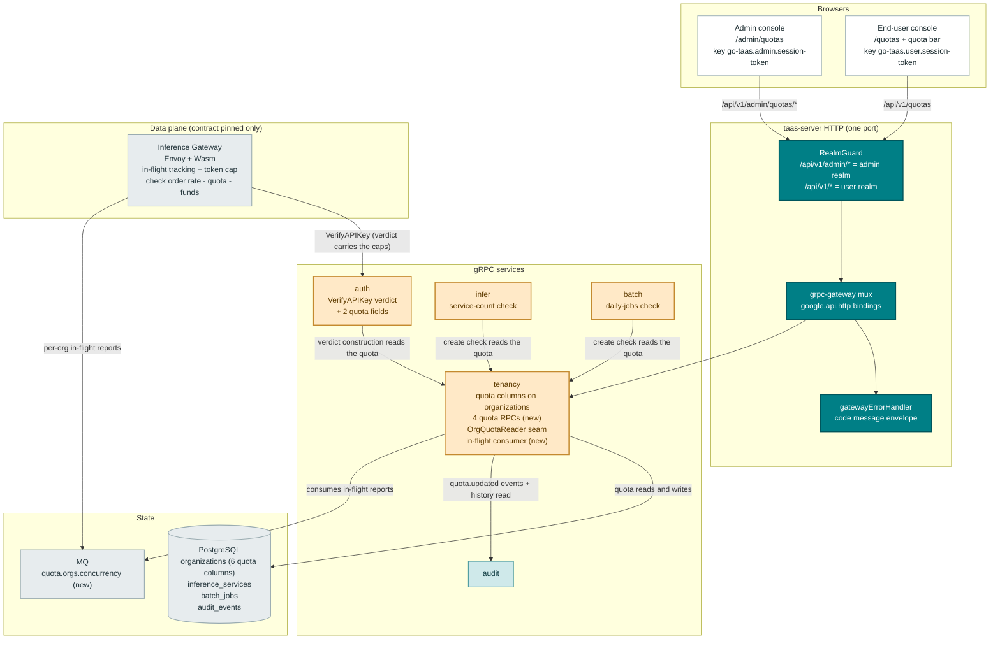
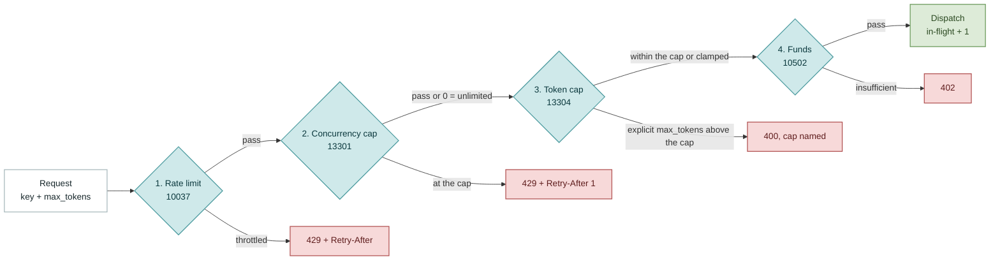
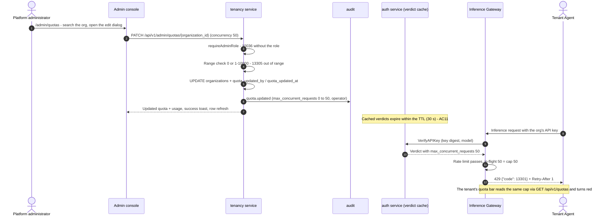
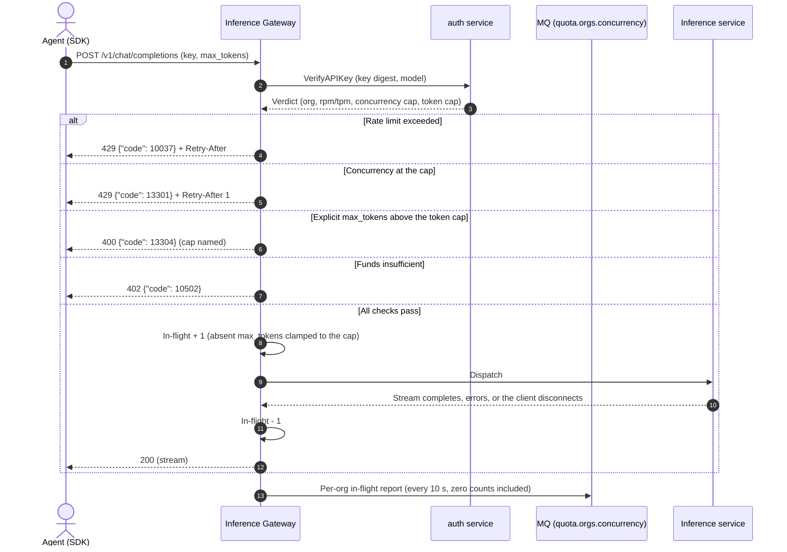
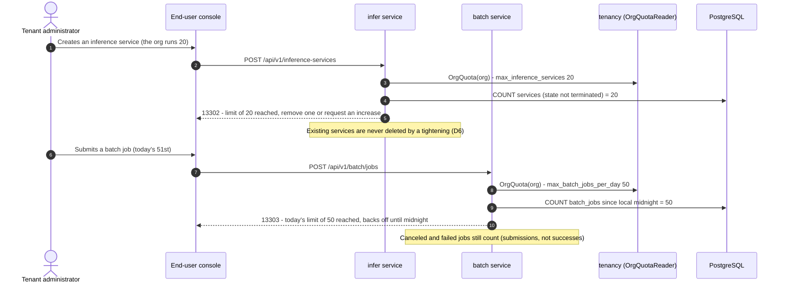

# Service Quota Management — Architecture and Detailed Design

| Attribute | Content |
| --- | --- |
| Feature point | Service quota management — per-organization **resource quotas** on four dimensions (`max_concurrent_requests`, `max_inference_services`, `max_batch_jobs_per_day`, `max_output_tokens_per_request`; 0 = unlimited), operator-configured on the admin surface, enforced fail-closed at the Inference Gateway (concurrency, per-request output tokens — riding the `VerifyAPIKey` verdict) and the control plane (service count at `CreateInferenceService`, daily batch jobs at `CreateBatchJob`), with a tenant quota bar and `/quotas` page on the end-user surface and `/admin/quotas` (org table, presets, change history) on the admin surface (backlog row 51) |
| Document scope | Architecture and detailed design for feature-51: the six additive quota columns on `organizations`; the four new tenancy RPCs bound under `/api/v1/admin/quotas/*` and `/api/v1/quotas`; the `VerifyAPIKey` verdict extension (response fields 7/8, cache mechanics, backward compatibility); the `infer`/`batch` create-time checks; the pinned gateway enforcement contract (check order rate → quota → funds, in-flight tracking, the `quota.orgs.concurrency` MQ relay, 13301/13304 rendering); the 133xx error block; the admin/user pages and the quota bar; configuration, security, rollout, and a function-level task list per layer |
| Owning modules | `tenancy` (the quota columns on `organizations`, the four quota RPCs, the `OrgQuotaReader` seam, the in-flight report consumer); `auth` (the verdict extension on `VerifyAPIKey`); `infer` (the service-count check); `batch` (the daily-jobs check); `pkg/mq` (one new subject); `pkg/errors` (the 133xx block); `pkg/config` (the `quota` section); `pkg/server` (no change — `RealmGuard` classifies the new prefixes); `audit` (reused — `quota.updated` events); `web` admin console (`QuotasPage`) and end-user console (`UserQuotasPage`, `QuotaBar`); Inference Gateway (data plane — **contract pinned only**, out of repository scope) |
| Related documents | [Requirement Analysis and UI/UX Design](../design/service-quota-management.md) · [Architecture Design](../design/architecture.md) §2.4 `auth`/`infer`, §3.1 control gateway, §3.2 data plane · [Rate Limits & Spend Limits](./rate-limits-spend-limits.md) (the per-key RPM/TPM verdict-riding pattern this feature extends, the 10037 check that runs first) · [Balance & Quota Account Modes](./balance-quota.md) (the funds check 10502 that runs after quotas) · [Multi-Tenancy](./multi-tenancy.md) (the organizations table the columns land on) · [Batch Inference](./batch-inference.md) (the `batch_jobs` table the daily counter reads) · [Inference Autoscaling](./inference-autoscaling.md) (the gateway in-flight MQ reporting precedent, AD11 there) · [API Key Management](./api-key-management.md) (the verdict cache whose TTL bounds propagation) · [Audit Logging](./audit-logging.md) (the `quota.updated` events and the change-history read) · [Console Surface Separation](./console-surface-separation.md) (the two surfaces, the masked-projection rule) |
| Status | Architecture complete, handed to the Developer agent |

---

## 1. Overview and Goals

Features #6 and #8 gave go-taas the **money** rails — per-key rate limits (RPM/TPM) and org funds/spend enforcement. What is still missing is the **resource** dimension: how many requests an organization may hold in flight, how many inference services it may deploy, how many batch jobs it may submit per day, and how many tokens a single request may generate. Rate limits cannot catch any of these — 60 RPM of ten-minute streaming requests holds sixty concurrent GPU slots indefinitely, and a tenant can deploy fifty idle services while staying perfectly inside its rate and spend limits.

This feature adds **per-organization resource quotas**: four bounded dimensions stored on the organization row, operator-configured on the admin surface, enforced fail-closed — the two hot-path dimensions (concurrency, per-request output tokens) ride the `VerifyAPIKey` verdict to the Inference Gateway exactly as #6's RPM/TPM do, and the two lifecycle dimensions (service count, batch jobs/day) are checked by `infer` and `batch` at create time. The constraint is **visible to the constrained party**: a quota bar on every end-user page and a `/quotas` detail page, so a limit is a plannable constraint rather than a mysterious 429. The core invariants: quotas protect the fleet (not the bill — money stays on #6/#8), enforcement never queues or partially executes, quota errors (133xx) are never conflated with rate (10037) or funds (10502), 0 = unlimited with a permissive default, and tightening is non-destructive (usage drains naturally).

**Goals**:

- Two pages and one shared component: `/admin/quotas` (`QuotasPage` — org table with live usage, edit dialog with presets, change-history drawer) and `/quotas` (`UserQuotasPage` — four dimension cards, Request-increase mailto), plus the `QuotaBar` in the end-user org context area, per design §5.1–§5.4.
- Four quota dimensions on the organization row with bounded ranges and 0 = unlimited defaults (design D2, FR1.1).
- Four new RPCs on `TenancyService`: three admin-prefix (`/api/v1/admin/quotas*`) and one user-prefix (`/api/v1/quotas`) (design §6).
- The `VerifyAPIKey` verdict extension: `max_concurrent_requests` and `max_output_tokens_per_request` cached with the verdict, TTL ≤ 30 s bounding propagation (design D3, FR2.1).
- The pinned gateway contract: check order rate → quota concurrency → token cap → funds, per-org in-flight tracking (increment on accept, decrement on completion), 13301 as 429 + `Retry-After: 1`, 13304 as 400 with the cap named, absent `max_tokens` clamped, per-org in-flight reports on MQ (design FR2.2–FR2.4, §6 notes).
- Create-time guards: 13302 in `CreateInferenceService`, 13303 in `CreateBatchJob`, inside the existing flows, non-destructive on tightening (design FR3).
- A new error block **133xx** (13301–13306) in `pkg/errors` (design D4).
- Audit events `quota.updated` (old → new per dimension, acting operator) and the per-org change history (last 20) on the admin surface (design D9, FR1.3–FR1.4).
- Numbered acceptance criteria (AC1–AC14) testable in Nightwatch, FVT and unit tests; the gateway contract verified synthetically (the established out-of-repository pattern).

**Non-goals** (from the design, restated): per-key quotas (deliberately excluded — the resource axes are org-level facts, D2); quota tiers/plans as a data model (D5 — presets are UI constants); tenant self-service quota changes and approval workflows (D7 — operator-only, mailto for requests); project-level quotas (deferred with #5's project model); per-model/per-endpoint quotas (future — the org axis ships first); quota overage billing (deliberately excluded — hard fail-closed caps, money stays on #6/#8); rate limits RPM/TPM and spend limits (feature #6, reused unchanged); funds/balance enforcement (feature #8, reused unchanged); autoscaling interaction (autoscaling still scales within the org's service quota — the quota caps the ceiling, #16 caps the behavior); and the gateway implementation itself (data plane, out of repository scope — the contract is pinned here and verified synthetically, FR5.4).

### 1.1 Reading order of this document

Section 2 records the architecture decisions (AD1–AD18; AD11–AD18 are refinements the architecture adds, marked as such). Sections 3–5 are the component view, the data model and the API design (including the pinned gateway contract). Section 6 is the frontend architecture (page → route → API-prefix table, navigation, shared components, auth guard). Sections 7–8 are the sequence diagrams and error handling. Sections 9–11 are configuration, security and rollout. Section 12 is the acceptance-criteria traceability. Sections 13–15 are the function-level detailed design, the ordered implementation task list, and the deferred items.

---

## 2. Architecture Decisions

AD1–AD10 restate the UI/UX design's decisions (D1–D10) as implementation-level rules. **AD11–AD18 are refinements** the architecture adds; each is marked with the design decision it refines and preserves that decision's intent so the Developer and Test agents implement one reading.

| # | Decision | Rationale |
| --- | --- | --- |
| AD1 | **Both surfaces get a dedicated section**: admin `/admin/quotas` + `/api/v1/admin/quotas/*` (fleet-wide org table, edit dialog, change history), end-user `/quotas` + `/api/v1/quotas/*` (the caller's own org, read-only) — not extensions of #6's rate-limit editor or #5's org editor | Design D1. Quotas are a distinct object class (org-level resource axes with their own enforcement points and history); a dedicated page keeps #6's key-level throttles and this feature's org-level resources separately inspectable |
| AD2 | **Four quota dimensions on the organization row**: `max_concurrent_requests` (0 = unlimited, default 0; when set, 1–10000), `max_inference_services` (0 = unlimited; 1–1000), `max_batch_jobs_per_day` (0 = unlimited; 1–10000), `max_output_tokens_per_request` (0 = unlimited; 64–32768). All four are **per-org**, never per-key | Design D2. The four resource axes the platform can actually starve on; bounded ranges keep values sane; 0 = unlimited keeps the default permissive. A tenant with two keys must not double every limit |
| AD3 | **Hot-path dimensions ride the `VerifyAPIKey` verdict** exactly as #6's RPM/TPM do: the verdict gains `max_concurrent_requests` and `max_output_tokens_per_request`; the gateway tracks in-flight requests per org (increment on accept, decrement on completion including disconnects) and validates/clamps the request's `max_tokens` before dispatch. Lifecycle dimensions (`max_inference_services`, `max_batch_jobs_per_day`) are enforced by `infer` and `batch` at create time. The verdict cache TTL (30 s) bounds quota-change propagation | Design D3. Zero new hot-path RPCs (the #6 contract pattern); in-flight tracking is gateway-local state, the only place that sees accept/complete; create-time checks are naturally control-plane |
| AD4 | **A dedicated error block 133xx**: 13301 `CodeQuotaConcurrencyExceeded` (HTTP 429 + `Retry-After: 1`), 13302 `CodeQuotaServiceCountExceeded`, 13303 `CodeQuotaBatchJobsExceeded`, 13304 `CodeQuotaOutputTokensExceeded` (HTTP 400, cap named), 13305 `CodeQuotaInvalid` (validation, dimension named), 13306 `CodeQuotaNotFound`. Realm failures reuse 10038, role failures 10036 | Design D4. Three-errors-never-conflated: quota ≠ rate (10037) ≠ funds (10502). The 429-vs-400 split mirrors the semantics — concurrency is transient (retry later), the others are configuration (fix the request or the quota) |
| AD5 | **Presets are UI constants in the admin page only**: Default (all unlimited), Starter (10 / 3 / 5 / 4096), Growth (50 / 20 / 50 / 8192), Enterprise (200 / 100 / 500 / 16384). Selecting a preset fills the form; the operator may edit any field before saving. No preset round-trip, no preset storage | Design D5. Operators configure dozens of orgs; presets speed the common cases without freezing the model. Raw fields remain the source of truth |
| AD6 | **Change windows**: hot-path dimensions take effect within the verdict TTL (≤ 30 s); lifecycle dimensions on the next create call. Tightening below current usage never kills in-flight requests or deletes services — it blocks new ones and usage drains naturally | Design D6. Predictable, non-destructive tightening: the guard blocks at the boundary, never revokes what is already running |
| AD7 | **Quota management is operator-only**; the tenant surface is read-only (the bar + `/quotas`). A tenant "request increase" action is a mailto link to the configured operator address, not a workflow | Design D7. The constrained party must not hold the lever; a mailto covers the one-operator platform without an approval-flow stack |
| AD8 | **The tenant quota bar shows all four dimensions** (usage / limit, or "Unlimited") in the end-user org context area plus the `/quotas` detail page; usage counters are in-flight requests (gateway state), service count (infer), batch jobs today (batch), and the token cap (a constant display). No tenant ever sees another org's quotas | Design D8. Visible-before-you-hit-it: the bar makes the constraint transparent and the 13301 error diagnosable |
| AD9 | **All quota mutations are audited** (`quota.updated` with old → new values per dimension and the acting operator) and the admin page shows a per-org change history (last 20 changes) | Design D9. Quota changes are fleet-protection decisions with fairness implications; the history answers "who tightened this and when" |
| AD10 | **Realm and surface binding**: management is admin-only (`/admin/quotas` + `/api/v1/admin/quotas/*`); the tenant view is end-user (`/quotas` + `/api/v1/quotas/*`). A user-realm session on an admin route gets **10038**; a session without the platform-admin role gets **10036** | Design D10. Consistent with the console-surface separation; quota internals (fleet-wide comparisons) are operator knowledge, the org's own quotas are the tenant's |
| AD11 | **REFINEMENT of design D2/FR1.1 — the quota state is six additive columns on `organizations`, no new tables.** `max_concurrent_requests`, `max_inference_services`, `max_batch_jobs_per_day`, `max_output_tokens_per_request` (int64, NOT NULL, DEFAULT 0 = unlimited) plus `quota_updated_by` (string(64), DEFAULT '') and `quota_updated_at` (timestamp, NULL) denormalized for the admin table's Updated / Updated by columns. Usage counters are computed, never stored (Section 4.2) | The design pins "the quota fields live on the organization row (additive AutoMigrate columns)" and the enforcement needs no per-dimension history table — the audit trail already is the history (AD16). Six columns on an existing table is the smallest schema that satisfies FR1.1's projection (which includes `updated_at`/`updated_by`) with zero backfill: existing rows read as all-unlimited, the pre-feature behavior |
| AD12 | **REFINEMENT of design D3/FR2.1 — the verdict extension mechanics.** `keyVerdict` (the auth service's cached verdict struct) gains `MaxConcurrentRequests` (`json:"max_concurrent_requests"`) and `MaxOutputTokensPerRequest` (`json:"max_output_tokens_per_request"`); `VerifyAPIKeyResponse` gains proto fields **7 and 8** (fields 1–6 are taken). Both the cache-miss path (verdict construction reads the org quota through the `OrgQuotaReader` seam) and the cache-hit path (the fields deserialize from the cached JSON) carry them. A verdict cached before the upgrade deserializes without the two keys → zero → unlimited: backward compatible, and the propagation window of any change is bounded by the cache TTL (≤ 30 s). A quota-read error during verdict construction logs a warning and degrades to unlimited (never fails `VerifyAPIKey` itself — an auth outage over a quota-display hiccup would stop all inference) | The design specifies the verdict fields and the TTL bound but not the cache mechanics; this pins them. The fail-open-on-read-error trade-off is accepted deliberately: the window is bounded by the TTL and the alternative (failing the verdict) turns a quota-table hiccup into a fleet-wide auth outage |
| AD13 | **REFINEMENT of design D3/FR3 — one narrow read seam, three consumers.** `tenancy` exports a read-only `OrgQuotaReader` interface (`OrgQuota(ctx, organizationID) (OrgQuota, error)`, the four limits as a value struct) in `services/tenancy/quota.go`, implemented by the tenancy repository and exposed on the tenancy service. `apps/taas-server/main.go` injects it into `auth` (verdict construction), `infer` (`CreateInferenceService`) and `batch` (`CreateBatchJob`) via `SetOrgQuotaReader` setters; a nil seam reads as unlimited (the transitional-seam convention, so FVT setups are unchanged). `tenancy` additionally gains a `sessionOrgResolver` seam (`SessionActiveOrg`, the billing pattern) for `GetMyQuota`'s org scoping and a `requireAdminRole` gate (the provider shape) for the three admin quota RPCs — the existing tenancy RPCs keep the admin realm guard as their boundary, unchanged | The design says the checks read "the org's quota" without pinning how. One exported interface (one implementation, three consumers) avoids three consumer-side re-declarations of the same shape; the import direction (`auth`/`infer`/`batch` → `tenancy`) creates no cycle because tenancy defines its session seams locally and imports none of the three. The admin gate is new because the existing tenancy RPCs rely on the realm guard alone — quota mutations are the first tenancy writes that must also enforce the role (FR5.1) |
| AD14 | **REFINEMENT of design FR2.4/FR1.2 — the in-flight usage relay rides the inference-autoscaling MQ precedent.** The gateway publishes per-org in-flight counts on the new subject **`quota.orgs.concurrency`** (JSON `{organization_id, in_flight, reported_at}`), one message per organization per report interval (default 10 s, zero counts included so stale entries clear). A consumer runner in `tenancy` (`quota_concurrency_consumer.go`, a `server.Runner` gated by `quota.concurrencyConsumer.enabled`) keeps the latest snapshot per org in a mutex-guarded in-memory map and exposes `CurrentInFlight(orgID)`, which returns **0** for a missing or stale entry (older than `quota.concurrencyConsumer.staleAfter`, default 2 m). The subscription is a plain subscribe (every taas-server replica keeps its own map — a queue group would leave replicas blind). The quota RPCs read the snapshot best-effort; a tenancy restart starts empty and refills within one report interval | The design requires the quota RPCs to surface live in-flight usage (FR1.2/FR4.1) while the counter is gateway-local state (FR2.4). The autoscaling feature already established gateway→MQ in-flight reporting as the platform's pattern; reusing it keeps one relay mechanism. Best-effort semantics (missing/stale/restart → 0) are the design's own framing — the counter is a display snapshot, never an enforcement input (enforcement is gateway-local) |
| AD15 | **REFINEMENT of design FR3.2 — the daily batch counter is a live COUNT, no new table.** `COUNT(*) FROM batch_jobs WHERE organization_id = ? AND created_at >= <local midnight>`, where local midnight is computed in the configured `quota.timezone` (default UTC, the platform timezone documented in the drawer). Canceled and failed jobs count (the guard is on submissions, not successes). The batch repository gains `CountJobsSince(ctx, orgID, since)`; the check runs inside the existing create flow | The design pins the COUNT shape and the no-new-table rule; this pins the timezone source (the platform has no per-org timezone) and the repository seam. A midnight-bound COUNT on an indexed `(organization_id, created_at)` is exact at the moment of the check and needs no counter table, no reset job and no drift repair |
| AD16 | **REFINEMENT of design D9/FR1.3 — the change history is a direct `audit_events` read embedded in `GetOrganizationQuota`.** The mutation writes one `quota.updated` event (resource type `organization`, resource id the org, actor the operator) whose metadata jsonb is `{"changes": [{"dimension": "max_concurrent_requests", "old": 0, "new": 50}, …]}` — only dimensions that actually changed. The history read selects `audit_events WHERE organization_id = ? AND action = 'quota.updated' ORDER BY created_at DESC` (a narrow shared-handle read, the established cross-module read pattern — the audit service's `ListAuditEvents` filter has no resource-id shape for this), flattens each event's `changes` array into per-dimension entries, and returns the newest 20 entries | The design sources the drawer "from the audit trail" without pinning the read. One event per mutation (with a changes array) keeps the trail compact and atomic; flattening at read time gives the drawer its per-dimension Old → New rows. The direct read is deliberate: the audit module is unchanged and the query is organization- and action-scoped |
| AD17 | **REFINEMENT of design D5/FR1.5 — presets live as a typed constant map in `QuotasPage.tsx`** (`default`/`starter`/`growth`/`enterprise` → the four values), rendered as four one-click buttons in the edit dialog that set the form state; the operator can edit any field afterwards. No API, no config, no i18n-driven values | The design makes presets a UI convenience only; a constant map is the smallest implementation, keeps the values reviewable in one place, and guarantees the form stays editable after a fill |
| AD18 | **REFINEMENT of design D7/FR4.3 — the request-increase address is the config key `quota.requestIncreaseTo` (default empty), surfaced to the tenant through `GetMyQuotaResponse.request_increase_email`.** The `/quotas` page renders the Request-increase button as a `mailto:` link (subject and body prefilled with the org's display name, URL-encoded); when the configured address is empty the button is hidden. The compose/e2e stack sets the key so AC8 exercises the link | The design says "a mailto to the configured operator address" without pinning where the address is configured or how the SPA learns it. Riding `GetMyQuota` avoids a new config-projection endpoint; empty-hides is the fail-closed reading (a button that mails nobody is worse than no button) |

---

## 3. Component View

### 3.1 Ownership

| Layer / component | Owns | Changes in this feature |
| --- | --- | --- |
| **Static bundle (SPA)** | One Vite bundle (`web/dist`) embedded into `taas-server`; served by the gateway's SPA fallback | Two new pages (`QuotasPage`, `UserQuotasPage`), the `QuotaBar` component, two nav items, route registration in `App.tsx`, i18n keys, the preset constants |
| **Gateway (`pkg/server`)** | HTTP composition: `RealmGuard` → `withConsole` → grpc-gateway mux; the unified error renderer; the SPA fallback | **No change** — the new RPCs bind under `/api/v1/admin/quotas*` and `/api/v1/quotas`, which `RealmGuard` already classifies by prefix |
| **grpc-gateway mux** | Path → RPC routing from `google.api.http` annotations | New bindings for the four quota RPCs (Section 5) |
| **`tenancy`** | Organizations, projects, members, invitations | The six quota columns on `Organization`; the four quota RPCs; the `OrgQuotaReader` seam; the `sessionOrgResolver` seam and `requireAdminRole` gate; the in-flight consumer runner; the change-history read |
| **`auth`** | Sessions, API keys, the `VerifyAPIKey` verdict cache | The verdict gains the two quota fields (cache-miss construction + response mapping); the `SetOrgQuotaReader` seam |
| **`infer`** | Inference services | The service-count check in `CreateInferenceService` (13302); `CountActiveServicesByOrg` in its repository; the `SetOrgQuotaReader` seam |
| **`batch`** | Batch jobs | The daily-jobs check in `CreateBatchJob` (13303); `CountJobsSince` in its repository; the `SetOrgQuotaReader` seam |
| **`metering` / `billing`** | Usage records, funds | **No change** — quotas compose with, but never touch, the money axes |
| **`audit`** | Best-effort audit recorder, the `audit_events` table | Reused unchanged: tenancy records `quota.updated` events and reads the history directly (AD16) |
| **`pkg/mq`** | The canonical subjects | One new subject constant: `SubjectQuotaOrgsConcurrency` = `quota.orgs.concurrency` |
| **`pkg/errors`** | Code blocks per module | One new quota block: **13301–13306** (13307–13399 reserved) |
| **`pkg/config`** | The merged configuration tree | New `quota` section (timezone, request-increase address, consumer settings) |
| **Inference Gateway (data plane)** | Envoy + Wasm: auth, metering, routing | **Contract pinned only** (Section 5.3) — verdict quota fields, check order, in-flight tracking, 13301/13304 rendering, the MQ report; the data-plane track implements it, the compose mock honors it |
| **`test/e2e` mock** | The compose test fixtures | The mock gateway honors the pinned contract (including the MQ in-flight report) so the e2e bar shows live usage |

### 3.2 Component view



### 3.3 Request identity chain

The quota RPCs split across the two surfaces (AD1, AD10). The chain is:

1. `RealmGuard` (HTTP, `pkg/server/realm.go`) — the path prefix decides the expected realm: `/api/v1/admin/quotas*` → admin realm; `/api/v1/quotas` → user realm. With no `Authorization` header: pass through (transitional). With a header: resolve the session realm from Redis; mismatch → **10038 `CodeRealmMismatch`**; unknown/expired/realm-less → **10027**.
2. grpc-gateway mux — routes by the annotated path and forwards `authorization`.
3. `tenancy` handler —
   - **Admin RPCs** (`ListOrganizationQuotas`, `GetOrganizationQuota`, `UpdateOrganizationQuota`): resolve the actor (`SessionUserID`) and gate on the admin role via `requireAdminRole` → `tenancy.RoleGuard.RequireRole(..., roleAdmin)` (**10036 `CodeForbidden`**), the `provider.requireAdminRole` shape (AD13). Platform-scoped: the `organization_id` path parameter is the target, never an identity source.
   - **User RPC** (`GetMyQuota`): resolve the caller's organization from the session (`sessionOrgResolver.SessionActiveOrg`, the billing `resolveOrg` pattern — the session's active org wins, the transitional `X-Organization-Id` header is the fallback, an empty context → **10005**); the response is hard-scoped to that org. No client-supplied org id is ever trusted (design §6 note 7).

A user-realm session presented on any `/api/v1/admin/quotas*` route is rejected with **10038** (FR5.1, AC12). A session lacking the required role receives **10036** and the admin page renders the standard permission-denied state (AC13). The end-user surface has no quota mutation route at all (FR4.4, AC9).

### 3.4 The enforcement split

Enforcement lives at two points, and the usage display at a third:

- **Hot path (gateway, contract pinned)** — concurrency and the per-request token cap are enforced by the Inference Gateway from the verdict, before dispatch (Section 5.3). The gateway is the only component that sees request accept/complete, so it is the only place in-flight tracking can be exact.
- **Lifecycle (control plane)** — the service count and daily batch counters are enforced inside the existing create flows in `infer` and `batch` (Sections 13.6–13.7), reading the limits through the `OrgQuotaReader` seam (AD13).
- **Usage display (tenancy, best-effort)** — the quota RPCs assemble the usage snapshot: in-flight from the MQ relay consumer (AD14), service count and batch-today from narrow COUNT reads on the shared handle (the established cross-module read pattern; display reads, independently evolvable from the enforcement queries).

---

## 4. Data Model

The feature adds **no new tables**. The quota state is six additive columns on `organizations` (AD11); the usage counters are computed (Section 4.2); the change history is the existing `audit_events` table (Section 4.3).

### 4.1 `organizations` (additive columns)

| Column | Type | Notes |
| --- | --- | --- |
| `max_concurrent_requests` | int64, NOT NULL, DEFAULT 0 | 0 = unlimited; when set, 1–10000 (FR1.1) |
| `max_inference_services` | int64, NOT NULL, DEFAULT 0 | 0 = unlimited; when set, 1–1000 |
| `max_batch_jobs_per_day` | int64, NOT NULL, DEFAULT 0 | 0 = unlimited; when set, 1–10000 |
| `max_output_tokens_per_request` | int64, NOT NULL, DEFAULT 0 | 0 = unlimited; when set, 64–32768 |
| `quota_updated_by` | string(64), NOT NULL, DEFAULT '' | The acting operator of the last change; '' = never updated |
| `quota_updated_at` | timestamp, NULL | The last change time; NULL = never updated |

The columns are added to the existing `Organization` GORM model in `services/tenancy/tenancy_model.go` (additive fields; the existing `TableName()` stays `"organizations"`). `UpdateOrganization` (the existing org-editor RPC) does **not** gain the fields — quota writes go exclusively through `UpdateOrganizationQuota`, which also stamps `quota_updated_by`/`quota_updated_at` and audits (AD13, FR1.4).

### 4.2 Usage counters (computed, never stored)

| Counter | Source | Notes |
| --- | --- | --- |
| `concurrent_requests` | The in-flight consumer's snapshot (AD14) | Gateway-local state relayed on `quota.orgs.concurrency`; missing/stale (> `staleAfter`) or after a restart → 0; best-effort by design (FR2.4) |
| `inference_services` | `COUNT(*) FROM inference_services WHERE organization_id = ? AND state <> 'terminated'` | Non-terminated services — the same population the org's service list shows; a narrowing read on the shared handle |
| `batch_jobs_today` | `COUNT(*) FROM batch_jobs WHERE organization_id = ? AND created_at >= <local midnight>` | Local midnight in `quota.timezone` (AD15); canceled and failed jobs count |
| token cap | The limit itself | A constant display — there is no "current usage" for a per-request cap |

The enforcement queries in `infer` and `batch` are the same shapes but live in their own repositories (the authoritative checks); tenancy's copies are display reads. The deliberate one-line duplication keeps display and enforcement independently evolvable (AD13).

### 4.3 Change history (`audit_events`, reused)

Each `UpdateOrganizationQuota` that changes at least one dimension writes one audit event via the existing best-effort recorder:

- `action = "quota.updated"`, `resource_type = "organization"`, `resource_id = <organization_id>`, `organization_id = <organization_id>`, `actor_user_id = <operator>`, `result = "success"`.
- `metadata` (jsonb): `{"changes": [{"dimension": "<column>", "old": <int>, "new": <int>}, …]}` — only the dimensions whose value actually changed; a PATCH that changes nothing writes no event (FR5.3: mutations are audited, no-ops are not mutations).

The history read (embedded in `GetOrganizationQuota`, AD16): select `audit_events` where `organization_id = ?` and `action = 'quota.updated'`, newest first, flatten each event's `changes` array into per-dimension entries (one event with two changed dimensions yields two entries sharing the timestamp and operator), return the newest 20 entries. List/read RPCs are not audited, per the platform's read-path convention (FR5.3).

### 4.4 Migration and init-SQL upgrade path

This repository does **not** use hand-written init-SQL scripts: every schema change is the GORM model created/altered by the owning service's `Migrate` via `db.AutoMigrate(...)`, and there are no `.sql` files under `deploy/`. The upgrade path is:

1. Add the six fields to `Organization` in `services/tenancy/tenancy_model.go`.
2. The existing tenancy `Migrate` (and `MigrateSchemaForFVT`) already AutoMigrates `Organization` — the columns are added on the next startup as `ALTER TABLE organizations ADD COLUMN ... DEFAULT ...`.
3. No data backfill: existing rows read 0/0/0/0 + ''/NULL = all-unlimited, exactly the pre-feature behavior. No manual DDL, no compose change.

---

## 5. API Design

### 5.1 Surface mapping

Four RPCs are new; three existing RPCs change behavior (one contract change, two rejection-code additions). No RPC is dual-bound: the admin RPCs are fleet-scoped management, the user RPC is the caller's own org — different projections, different guards.

| RPC | HTTP method + path | Surface | Status | Purpose |
| --- | --- | --- | --- | --- |
| `ListOrganizationQuotas` (extends `taas.tenancy.v1.TenancyService`) | `GET /api/v1/admin/quotas` | admin | **new** | Per-org quota rows with best-effort live usage; pagination, name search, limit-state filter |
| `GetOrganizationQuota` | `GET /api/v1/admin/quotas/{organization_id}` | admin | **new** | One org's quota + usage + the last 20 change-history entries; unknown org → 13306 |
| `UpdateOrganizationQuota` | `PATCH /api/v1/admin/quotas/{organization_id}` | admin | **new** | Set any subset of the four dimensions; audited; 13305 on out-of-range values |
| `GetMyQuota` | `GET /api/v1/quotas` | user | **new** | The caller's own org quota with live usage (org-scoped from the session) |
| `VerifyAPIKey` (`taas.auth.v1.AuthService`) | internal (gateway → `auth`) | n/a | **changed** | The verdict/response gain `max_concurrent_requests` (field 7) and `max_output_tokens_per_request` (field 8) |
| `CreateInferenceService` (`taas.infer.v1`) | `POST /api/v1/inference-services` | user | **changed** | Gains the org service-count check; 13302 at the limit (no proto change) |
| `CreateBatchJob` (`taas.batch.v1`) | `POST /api/v1/batch/jobs` | user | **changed** | Gains the daily batch-job check; 13303 at the limit (no proto change) |

Gateway routing notes: `GET /api/v1/admin/quotas` (collection root) and `GET /api/v1/admin/quotas/{organization_id}` are distinct paths — no wildcard conflict; the PATCH follows the existing `UpdateOrganization` convention on the same mux. The design's `unlimited_only`/`limited_only` filter (FR1.2) maps to a single `limit_state` query parameter (`all` (default) / `limited` / `unlimited`) — one parameter, three states, no boolean pair to validate.

### 5.2 Proto contract

**Additions to `proto/taas/tenancy/v1/tenancy.proto`** (inside the existing `TenancyService` and message set):

```proto
  // ---- service quotas (feature #51) ----

  // ListOrganizationQuotas returns every organization's quota row with
  // best-effort live usage, pagination, a name search and a limit-state
  // filter (admin surface, requireAdminRole).
  rpc ListOrganizationQuotas(ListOrganizationQuotasRequest) returns (ListOrganizationQuotasResponse) {
    option (google.api.http) = {get: "/api/v1/admin/quotas"};
  }

  // GetOrganizationQuota returns one organization's quota, live usage
  // and the last 20 change-history entries (admin surface). An unknown
  // organization returns 13306.
  rpc GetOrganizationQuota(GetOrganizationQuotaRequest) returns (GetOrganizationQuotaResponse) {
    option (google.api.http) = {get: "/api/v1/admin/quotas/{organization_id}"};
  }

  // UpdateOrganizationQuota sets any subset of the four dimensions
  // (proto3 optional tracks presence; an explicit 0 means unlimited).
  // Out-of-range values return 13305 with the dimension named. Audited
  // as quota.updated; tightening below current usage is allowed and
  // non-destructive.
  rpc UpdateOrganizationQuota(UpdateOrganizationQuotaRequest) returns (UpdateOrganizationQuotaResponse) {
    option (google.api.http) = {
      patch: "/api/v1/admin/quotas/{organization_id}"
      body: "*"
    };
  }

  // GetMyQuota returns the caller's own organization quota with live
  // usage (user surface; the org is resolved from the session, never
  // from a client-supplied id).
  rpc GetMyQuota(GetMyQuotaRequest) returns (GetMyQuotaResponse) {
    option (google.api.http) = {get: "/api/v1/quotas"};
  }

// OrganizationQuota is the FR1.1 projection. All max_* fields are
// int64 with 0 = unlimited.
message OrganizationQuota {
  string organization_id = 1;
  string organization_name = 2;
  int64 max_concurrent_requests = 3;
  int64 max_inference_services = 4;
  int64 max_batch_jobs_per_day = 5;
  int64 max_output_tokens_per_request = 6;
  int64 updated_at = 7; // unix seconds, 0 = never updated
  string updated_by = 8; // "" = never updated
}

// QuotaUsage is the best-effort live-usage snapshot (FR1.2/FR4.1).
message QuotaUsage {
  int64 concurrent_requests = 1; // gateway in-flight snapshot (AD14)
  int64 inference_services = 2;  // non-terminated service count
  int64 batch_jobs_today = 3;    // COUNT since local midnight (AD15)
}

// QuotaChangeEntry is one flattened dimension change (AD16).
message QuotaChangeEntry {
  int64 changed_at = 1; // unix seconds
  string operator = 2;  // acting user id
  string dimension = 3; // max_concurrent_requests | max_inference_services | max_batch_jobs_per_day | max_output_tokens_per_request
  int64 old_value = 4;
  int64 new_value = 5;
}

// OrganizationQuotaRow is one list row: the quota plus its usage.
message OrganizationQuotaRow {
  OrganizationQuota quota = 1;
  QuotaUsage usage = 2;
}

message ListOrganizationQuotasRequest {
  taas.common.v1.PageRequest page = 1;
  string name = 2;        // display-name/id substring search, case-insensitive
  string limit_state = 3; // all (default) | limited | unlimited
}

message ListOrganizationQuotasResponse {
  taas.common.v1.Response response = 1;
  repeated OrganizationQuotaRow quotas = 2;
  taas.common.v1.PageMeta page_meta = 3;
}

message GetOrganizationQuotaRequest {
  string organization_id = 1;
}

message GetOrganizationQuotaResponse {
  taas.common.v1.Response response = 1;
  OrganizationQuota quota = 2;
  QuotaUsage usage = 3;
  repeated QuotaChangeEntry changes = 4; // newest first, last 20
}

message UpdateOrganizationQuotaRequest {
  string organization_id = 1;
  // optional tracks presence: absent = unchanged, explicit 0 = unlimited.
  optional int64 max_concurrent_requests = 2;
  optional int64 max_inference_services = 3;
  optional int64 max_batch_jobs_per_day = 4;
  optional int64 max_output_tokens_per_request = 5;
}

message UpdateOrganizationQuotaResponse {
  taas.common.v1.Response response = 1;
  OrganizationQuota quota = 2;
  QuotaUsage usage = 3;
}

message GetMyQuotaRequest {}

message GetMyQuotaResponse {
  taas.common.v1.Response response = 1;
  OrganizationQuota quota = 2;
  QuotaUsage usage = 3;
  // request_increase_email is the configured operator mailbox for the
  // Request-increase mailto (AD18); empty hides the button.
  string request_increase_email = 4;
}
```

**Change to `proto/taas/auth/v1/auth.proto`** — `VerifyAPIKeyResponse` gains the two org-level caps (fields 1–6 are taken; the new fields are 7 and 8):

```proto
message VerifyAPIKeyResponse {
  taas.common.v1.Response response = 1;
  string organization_id = 2;
  string key_id = 3;
  string role = 4;
  // rate_limit_rpm is the max requests per minute; 0 = unlimited
  // (feature #11, AD1). The gateway enforces it locally.
  int64 rate_limit_rpm = 5;
  // rate_limit_tpm is the max tokens per minute; 0 = unlimited.
  int64 rate_limit_tpm = 6;
  // max_concurrent_requests is the org's in-flight request cap; 0 =
  // unlimited (feature #51, design D3). The gateway enforces it
  // locally after the rate-limit check.
  int64 max_concurrent_requests = 7;
  // max_output_tokens_per_request is the org's per-request output
  // token cap; 0 = unlimited. The gateway validates or clamps the
  // request's max_tokens against it before dispatch.
  int64 max_output_tokens_per_request = 8;
}
```

`CreateInferenceService` and `CreateBatchJob` change **behavior only** (new rejection codes through the unified envelope) — no proto, route or message change.

### 5.3 The pinned gateway contract (data plane, out of repository scope)

The Inference Gateway is not in this repository; the contract below is binding for the data-plane track and is verified synthetically in FVT (the established pattern — the compose mock gateway honors it for e2e, FR5.4). The check order is binding (design §1.4, §6 note 2):



The contract, item by item:

1. **Verdict fields**: the gateway reads `max_concurrent_requests` and `max_output_tokens_per_request` from the `VerifyAPIKey` response exactly as it reads `rate_limit_rpm`/`rate_limit_tpm` today (FR2.1). 0 = unlimited → the respective check is skipped.
2. **Check order**: rate limit (10037, 429 + `Retry-After`) → quota concurrency (13301) → token cap (13304) → funds (10502, 402) → dispatch. A throttled key never reaches the quota check; a quota-blocked request never reaches the funds check (AC7).
3. **Concurrency**: a per-org in-flight counter (keyed by the verdict's `organization_id`), incremented when a request is accepted for dispatch and decremented on completion — stream end, error, or client disconnect (FR2.2). At the cap, the request is rejected with HTTP 429, body `{"code": 13301, "message": ...}`, and **`Retry-After: 1`** (the in-flight window is short; no `Retry-After` on the other quota codes — they are configuration errors, not transient load, §6 note 5).
4. **Token cap**: an explicit `max_tokens` above the cap is rejected with HTTP 400, body `{"code": 13304, "message": ...}` naming the cap ("capped at N tokens per request"); an absent `max_tokens` is dispatched with `max_tokens` clamped to the cap; `max_tokens ≤ cap` passes unchanged (FR2.3). The check validates/clamps the OpenAI-compatible body before dispatch.
5. **In-flight reporting**: the gateway publishes one JSON message per organization on `quota.orgs.concurrency` every report interval (default 10 s), zero counts included, payload `{"organization_id": "...", "in_flight": <int>, "reported_at": <unix seconds>}` (AD14). A gateway restart re-derives counters from active streams where possible, else starts at zero — documented, bounded, best-effort (FR2.4).
6. **Error rendering**: 13301 → 429 + `Retry-After: 1`; 13304 → 400; both with the unified `{"code", "message"}` body. These two codes are gateway-rendered statuses on the data plane; the control plane never returns them (concurrency/token-cap enforcement is gateway-only). All other 133xx codes surface through grpc-gateway as the unified envelope with HTTP 500, the repo convention.

### 5.4 Validation contract

| Field | Rule | Error |
| --- | --- | --- |
| `organization_id` (get/update) | must exist | 13306 |
| `max_concurrent_requests` | 0 or 1–10000 | 13305 (dimension named) |
| `max_inference_services` | 0 or 1–1000 | 13305 (dimension named) |
| `max_batch_jobs_per_day` | 0 or 1–10000 | 13305 (dimension named) |
| `max_output_tokens_per_request` | 0 or 64–32768 | 13305 (dimension named) |
| `limit_state` filter | `all` / `limited` / `unlimited` (empty = all) | 13305 |
| PATCH body | any subset; an empty patch is a no-op returning the current quota (no audit event) | — |
| `GetMyQuota` org context | resolved from the session (transitional header fallback); empty → | 10005 |

Serialization conventions unchanged: HTTP 200 on success, business errors as `{"code": <int>, "message": "..."}`, int64 fields as JSON strings (the quota maxima and usage counters included).

---

## 6. Frontend Architecture

### 6.1 Page → route → API-prefix table

| Page / component | Route | API prefix | Surface |
| --- | --- | --- | --- |
| `QuotasPage` (new, `web/src/pages/QuotasPage.tsx`) | `/admin/quotas` | `/api/v1/admin/quotas` | admin |
| `UserQuotasPage` (new, `web/src/pages/user/UserQuotasPage.tsx`) | `/quotas` | `/api/v1/quotas` | user |
| `QuotaBar` (new, `web/src/pages/user/quotas/QuotaBar.tsx`) | org context strip (all end-user pages) | `/api/v1/quotas` | user |

The admin page contains **no `/api/v1/*` call**; the user page and bar contain **no `/api/v1/admin/*` call** (FR5.1, AC12). Per the console-surface separation, the admin page is an admin-realm source (`web/src/pages/*.tsx`) and the user page, bar and card components are user-realm sources (`web/src/pages/user/**`).

### 6.2 Navigation placement

`AdminShell`'s `ADMIN_NAV_ITEMS` gains one item directly after Invitations (the tenancy cluster):

```tsx
{ path: '/admin/quotas', labelKey: 'nav.quotas', testid: 'nav-quotas', icon: SlidersHorizontal },
```

`UserShell`'s `USER_NAV_ITEMS` gains one item directly after Forecast (the usage cluster):

```tsx
{ path: '/quotas', labelKey: 'nav.quotas', testid: 'user-nav-quotas', icon: Gauge },
```

`App.tsx` registers the two routes (admin block beside the other `/admin/*` routes, user block beside the other user routes):

```tsx
<Route path="/admin/quotas" element={<QuotasPage />} />
<Route path="/quotas" element={<UserQuotasPage />} />
```

`UserShell` additionally renders `QuotaBar` in the org context area, beside the `OrgSwitcher` (design §5.4): it polls `GET /api/v1/quotas` on a 30 s `usePolling` interval, hides entirely when all four dimensions are unlimited (the default — no visual noise for unconstrained orgs), and links to `/quotas` on click.

### 6.3 Shared components and state to reuse

- `Dialog` (the edit dialog and its inline validation), the `data` table styles, `PageMeta` pagination, the drawer pattern from `RoutingDecisionsPage`/`AcceleratorNodeDetailPage`, `usePolling` (`web/src/components.tsx`) for the bar and the admin table refresh, the badge/progress-bar classes — all existing console conventions.
- **`QuotaDimensionCard`** (`web/src/pages/user/quotas/QuotaDimensionCard.tsx`): one dimension card — name, plain-language description ("Requests in flight right now across your organization"), the usage/limit pair ("12 / 50" or "Unlimited"), a progress bar (amber ≥ 80%, red 100%), and for the token cap a constant display ("Each request may generate at most 8192 tokens"). Used by `UserQuotasPage`; the bar renders the same logic compactly.
- **`QuotaBar`** (`web/src/pages/user/quotas/QuotaBar.tsx`): four compact chips — "In flight 12/50", "Services 3/20", "Batch today 5/50", "Tokens ≤ 8192" (or "Unlimited" per chip); amber at ≥ 80%, red at 100%; a failed poll keeps the last good data (the stale convention) and the bar hides when all dimensions are unlimited.
- **The preset constants** (AD17) live in `QuotasPage.tsx` as a typed map (`default`/`starter`/`growth`/`enterprise` → the four values); the edit dialog renders them as four one-click fill buttons, and every field stays editable after a fill.
- The **Request-increase mailto** (AD18): `mailto:{request_increase_email}?subject=...&body=...` with the org's display name prefilled, `encodeURIComponent`-safe; hidden when `request_increase_email` is empty.

### 6.4 Auth guard per surface

- `QuotasPage` renders inside `AdminShell`, whose shell guard enforces the admin session realm (`/admin/login`, token `go-taas.admin.session-token`); a user-realm session on an admin API route is rejected by `RealmGuard` with **10038**, and the shell redirects to `/admin/login?reason=realm`.
- A session without the required role receives **10036** from `requireAdminRole`; the page renders the standard permission-denied state with a link back to `/admin` (AC13).
- `UserQuotasPage` and `QuotaBar` render inside `UserShell` (user session realm); any org member sees the org's own quotas — no extra role gate (the org scoping is the boundary), and permission-denied is impossible on the user surface (design §5.4).

### 6.5 `data-testid` hooks (binding, kebab-case)

Admin: `nav-quotas`, `quota-table`, `quota-row-{organization_id}`, `quota-usage-concurrency-{organization_id}`, `quota-usage-services-{organization_id}`, `quota-usage-batch-{organization_id}`, `quota-token-cap-{organization_id}`, `quota-updated-{organization_id}`, `quota-updated-by-{organization_id}`, `quota-edit-{organization_id}`, `quota-edit-dialog`, `quota-preset-{preset}`, `quota-field-{dimension}`, `quota-field-error-{dimension}`, `quota-save`, `quota-history-{organization_id}`, `quota-history-drawer`, `quota-history-entry-{index}`, `quota-search`, `quota-filter-limit-state`, `quota-pagination`, `quota-empty`, `quota-permission-denied`.

User: `user-nav-quotas`, `quota-bar`, `quota-bar-chip-{dimension}`, `quota-cards`, `quota-card-{dimension}`, `quota-card-usage-{dimension}`, `quota-request-increase`, `quota-unlimited-empty`, `quota-error`.

---

## 7. Sequence Diagrams

### 7.1 The operator caps a noisy tenant (hot-path propagation)



### 7.2 Gateway enforcement (the pinned check order)



### 7.3 Create-time guards (lifecycle dimensions)



---

## 8. Error Handling

| Condition | HTTP | Code | Constant | Notes |
| --- | --- | --- | --- | --- |
| Org concurrency at its limit | **429 + `Retry-After: 1`** | 13301 | `CodeQuotaConcurrencyExceeded` | Gateway-rendered (data plane, Section 5.3); the control plane never returns it |
| Org at its inference-service limit | 500 | 13302 | `CodeQuotaServiceCountExceeded` | `CreateInferenceService` rejection; message names the current count and the limit |
| Org at its daily batch-job limit | 500 | 13303 | `CodeQuotaBatchJobsExceeded` | `CreateBatchJob` rejection; message names today's count and the limit |
| Request `max_tokens` above the org cap | **400** | 13304 | `CodeQuotaOutputTokensExceeded` | Gateway-rendered (data plane); the message names the cap |
| Quota value out of range (or invalid `limit_state`) | 500 | 13305 | `CodeQuotaInvalid` | Validation; the dimension is named in the message |
| Unknown organization (quota read/update) | 500 | 13306 | `CodeQuotaNotFound` | |
| User-realm session on an admin route | 500 | 10038 | `CodeRealmMismatch` | Reused — realm separation (FR5.1) |
| Session without the required role | 500 | 10036 | `CodeForbidden` | Reused — permission denial (FR5.1) |
| No org context on `GetMyQuota` | 500 | 10005 | `CodeOrganizationNotFound` | Reused — the org-guard convention |

Rendering split (binding for the Test agent): **13301 and 13304 are data-plane gateway statuses** (429 with `Retry-After: 1`, and 400) verified synthetically against the pinned contract (AC3, AC4, AC7); **13302/13303/13305/13306 are control-plane business errors** through grpc-gateway with the unified `{"code": <int>, "message": "..."}` envelope and HTTP 500, the repo convention. `Retry-After` appears only on 13301 (the in-flight window is short; the other codes are configuration errors, not transient load).

---

## 9. Configuration

New `quota` section in `pkg/config` (`QuotaConfig`, mapped `mapstructure:"quota"`), defaulted in `applyDefaults`, validated in `Validate`:

| Key | Type | Default | Notes |
| --- | --- | --- | --- |
| `quota.timezone` | string | `"UTC"` | IANA name; the platform timezone the batch daily counter's local midnight is evaluated in (AD15), documented in the admin drawer |
| `quota.requestIncreaseTo` | string | `""` | The operator mailbox for the tenant Request-increase mailto (AD18); empty hides the button; the compose/e2e stack sets it |
| `quota.concurrencyConsumer.enabled` | bool | `true` | The in-flight report consumer runner kill switch (AD14) |
| `quota.concurrencyConsumer.workers` | int | `2` | Concurrent report handlers |
| `quota.concurrencyConsumer.staleAfter` | duration | `2m` | A report older than this reads as 0 (best-effort, FR2.4) |

`pkg/mq` gains the subject constant `SubjectQuotaOrgsConcurrency = "quota.orgs.concurrency"` (the canonical-subjects file, beside `infer.services.concurrency`).

`configs/config.yaml` gains:

```yaml
# Service quotas (feature #51). The four org quota dimensions live on
# the organization row; the gateway enforces the hot-path dimensions
# from the VerifyAPIKey verdict (contract pinned in the architecture
# doc), the control plane enforces the lifecycle dimensions at create.
quota:
  # timezone is the platform timezone the batch daily counter's local
  # midnight is evaluated in (AD15).
  timezone: UTC
  # requestIncreaseTo is the operator mailbox the tenant
  # Request-increase button mails to (AD18); empty hides the button.
  requestIncreaseTo: ""
  concurrencyConsumer:
    # enabled turns the gateway in-flight report consumer on or off.
    enabled: true
    # workers is the concurrent report handler count.
    workers: 2
    # staleAfter is how old a gateway in-flight report may be before
    # the snapshot reads as 0 (best-effort, FR2.4).
    staleAfter: 2m
```

The compose stack sets `CONFIG_QUOTA_REQUESTINCREASETO` so the e2e suite exercises the mailto link (AC8); the mock gateway honors the pinned contract including the MQ report so the bar shows live usage.

---

## 10. Security Considerations

- **Realm separation** (binding): the three management RPCs are admin-surface (`/api/v1/admin/quotas*`) and `GetMyQuota` user-surface (`/api/v1/quotas`); a wrong-realm session is rejected with **10038** before the handler; the admin page never calls `/api/v1/*` and the user page and bar never call `/api/v1/admin/*` (AC12).
- **Role enforcement**: every admin quota RPC passes `requireAdminRole` (`tenancy.RoleGuard`, role admin) → **10036** (AC13); the user RPC requires only a valid user-realm session — the org scoping is the boundary.
- **Org scoping at the service layer** (design §6 note 7): `GetMyQuota` resolves the caller's org from the session (transitional header fallback) and never trusts a client-supplied org id; no field of the response carries another org's data (AC9). The request message has no org field at all.
- **Fail-closed enforcement, fail-open display**: the enforcement checks reject (never queue, never partially execute); the usage snapshot degrades to 0 on missing/stale relay data — a display degradation, never an enforcement bypass (enforcement is gateway-local state, not the relay).
- **Verdict integrity**: the quota fields ride the same cached verdict as RPM/TPM, with the same TTL bound; a verdict cannot be forged by the caller (it is server-computed from the key digest and cached server-side).
- **Non-destructive tightening**: no quota write deletes or kills tenant resources — the update path touches only the six org columns (D6, US9).
- **Audit**: `quota.updated` events carry the acting operator, the org and the per-dimension old → new values (FR5.3, AC10); list/read calls are not audited, per the read-path convention.
- **The mailto** (AD18): the address is operator-configured config, not user input; the org display name is inserted URL-encoded — org display names are operator-managed data (the org editor is admin-surface).

---

## 11. Rollout and Upgrade Notes

1. **Additive only**: six columns with permissive defaults on `organizations` (AutoMigrate), a new proto extension, new routes, one MQ subject. No existing column, message field or route changes; existing callers are unaffected.
2. **No behavior change until an operator sets a quota**: every dimension defaults to 0 = unlimited — the gateway's new verdict fields read 0 and skip their checks, the create guards skip, the bar hides. The feature is inert until deliberately activated (§1.4 rule 4).
3. **Verdict backward compatibility** (AD12): verdicts cached before the upgrade deserialize without the quota keys → 0 → unlimited; the fields appear in new verdicts as caches expire (≤ 30 s). An older gateway that receives the extended response ignores the unknown proto fields — the two deployments order freely.
4. **Deploy order**: none — one binary; the columns migrate on startup, the consumer runner starts (gated by config), the seams wire in `main.go`. Nil seams read as unlimited, so partial setups (e.g. FVT) behave as pre-feature.
5. **Propagation windows** (D6, AC11): hot-path changes (concurrency, token cap) are enforced within the verdict TTL (≤ 30 s); lifecycle changes (services, batch/day) on the next create call. Both windows are documented in the admin drawer copy.
6. **Rollback**: rolling the binary back leaves the six columns in place (harmless — nothing else reads them) and restores the pre-feature behavior completely; the MQ subject simply has no subscriber. Quota values survive a rollback and re-apply on re-upgrade.
7. **Load**: the create-time guards add one indexed COUNT per create call; the quota list adds two COUNTs per page row (best-effort, page-bounded); the consumer handles one small JSON message per org per 10 s — negligible against the existing runners.

---

## 12. Acceptance-Criteria Traceability

| AC | Design requirement | Architecture sections |
| --- | --- | --- |
| AC1 admin org table (usage/limit columns, Token cap, Updated, Updated by) + search + filter + pagination | FR1.2, §5.3 | §5.1–5.2 (`ListOrganizationQuotas`), §4.1–4.2, §6.1–6.3, §13.2–13.3, §13.9 |
| AC2 edit-dialog validation (ranges, "0 = unlimited" copy), 13305 with the dimension named, one-click presets remaining editable | FR1.4–FR1.5, D5 | §5.4, AD17, §13.2 (Update), §13.9 |
| AC3 concurrency enforcement (synthetic): N+1st rejected 13301 + `Retry-After: 1`, slot freed on completion, unlimited never rejects | FR2.2, §6 note 2 | §5.3 (pinned contract), AD12, §7.2, §13.5, test/fvt (§14) |
| AC4 token-cap enforcement (synthetic): explicit over-cap → 13304 naming the cap; absent `max_tokens` clamped and completes; ≤ cap passes | FR2.3 | §5.3, AD12, §7.2, §13.5 |
| AC5 service-count guard: N+1st create → 13302 with the count; tightening below the running count is non-destructive | FR3.1, D6 | AD13, §13.6, §7.3, §11.5 |
| AC6 batch daily guard: N+1st create → 13303 with today's count; canceled/failed count | FR3.2 | AD15, §13.7, §7.3 |
| AC7 check order: rate before quota, quota before funds | §1.4, §6 note 2 | §5.3 (flowchart + items 2–3), §7.2 |
| AC8 quota bar (four chips, amber ≥ 80%, red 100%, hides when all unlimited) + `/quotas` cards + Request-increase mailto | FR4.2–FR4.3, D8 | AD18, §6.1–6.3, §13.9 |
| AC9 tenant org scoping: only the caller's org, no leak, no tenant mutation route | FR4.1, FR4.4 | §3.3, §5.2 (GetMyQuota), §10, §13.2 |
| AC10 change history and audit: `quota.updated` old → new + operator, drawer last 20 | FR1.3–FR1.4, D9 | AD16, §4.3, §7.1, §13.2–13.3 |
| AC11 propagation window: hot-path ≤ 30 s, lifecycle next create, drawer documents both | D6, D3 | AD12, §11.5, §7.1 |
| AC12 negative realm separation (10038), no cross-surface calls | FR5.1 | §3.3, §6.1, §6.4, §10 |
| AC13 role denial (10036) + permission-denied state with the `/admin` link | FR5.1, §5.3 | §3.3, §6.4, §8 |
| AC14 states: loading, empty (admin "No organizations yet"; user all-unlimited friendly), error | FR5.2, §5.4 | §6.3, §13.9 |

---

## 13. Detailed Design

### 13.1 File layout

| Module | File | Responsibility |
| --- | --- | --- |
| `proto/taas/tenancy/v1` | `tenancy.proto` | The four quota RPCs + messages (Section 5.2); regenerate |
| `proto/taas/auth/v1` | `auth.proto` | `VerifyAPIKeyResponse` fields 7–8; regenerate |
| `services/tenancy` | `tenancy_model.go` | The six additive fields on `Organization` (AD11) |
| | `quota.go` (new) | The `OrgQuota` value struct, the exported `OrgQuotaReader` interface, the range constants and `ValidateQuota` (AD13) |
| | `quota_repository.go` (new) | Quota list/get/update, the usage COUNT reads, the change-history read (AD16) |
| | `quota_service.go` (new) | The four RPCs, `requireAdminRole`, the `sessionOrgResolver` seam, `SetSessionOrgResolver` |
| | `quota_concurrency_consumer.go` (new) | The MQ consumer runner + the snapshot map + `CurrentInFlight` (AD14) |
| `services/auth` | `apikey_cache.go`, `service.go` | The verdict fields, the cache-miss construction, the response mapping, `SetOrgQuotaReader` (AD12) |
| `services/infer` | `service.go`, the infer repository | `checkServiceQuota` in `CreateInferenceService`, `CountActiveServicesByOrg`, `SetOrgQuotaReader` |
| `services/batch` | `service.go`, the batch repository | `checkBatchQuota` in `CreateBatchJob`, `CountJobsSince`, `SetOrgQuotaReader` |
| `pkg/errors` | `codes.go`, `messages.go` | The 133xx block after the optimization block |
| `pkg/config` | `api.go`, `configuration.go` | `QuotaConfig` (+ `QuotaConcurrencyConsumerConfig`), defaults, validation |
| `pkg/mq` | the canonical-subjects file | `SubjectQuotaOrgsConcurrency` |
| `apps/taas-server` | `main.go` | Seam wiring (Section 13.10) |
| `web/src` | `pages/QuotasPage.tsx` (new) | The admin page: table, filter bar, edit dialog + presets, history drawer |
| | `pages/user/UserQuotasPage.tsx` (new), `pages/user/quotas/{QuotaBar,QuotaDimensionCard}.tsx` (new) | The user page + the shared bar/card components |
| | `shells/AdminShell.tsx`, `shells/UserShell.tsx`, `App.tsx` | Nav items, the bar placement, routes |
| | `api.ts`, `locales/en.ts`, `locales/zh.ts` | Types + i18n keys |
| `test/fvt` | `quota_fvt_test.go` (new) | The FVT suite (Section 14) |
| `test/e2e` | the Nightwatch suite | AC1–AC2, AC8–AC14's console surfaces |

### 13.2 `services/tenancy` — the quota service layer

`Service` (the existing struct) gains: `sessionOrgResolver SessionOrgResolver` (a local interface with `SessionActiveOrg(ctx) (string, error)`, the billing pattern) + `SetSessionOrgResolver`; `concurrency *ConcurrencyConsumer` (nil-safe); the existing `roleGuard`, `sessionResolver` and `auditRecorder` are reused. `requireAdminRole(ctx)` mirrors the provider shape exactly: resolve the active org via `sessionOrgResolver` (tolerate `CodeSessionInvalid`), resolve the actor via `sessionResolver`, skip when either is absent (the admin realm guard is the boundary), else `roleGuard.RequireRole(ctx, orgID, userID, roleAdmin)` → **10036**.

Per-RPC responsibilities:

- **`ListOrganizationQuotas`**: `requireAdminRole` → validate `limit_state` (**13305**) → `repo.ListOrganizationQuotas(ctx, QuotaListFilter{Name, LimitState, Offset, Limit})` (org rows with the six columns; `limited` = any of the four maxima > 0) → per row assemble `QuotaUsage`: `concurrent_requests` from `concurrency.CurrentInFlight(orgID)`, `inference_services` from `repo.CountActiveServicesByOrg`, `batch_jobs_today` from `repo.CountBatchJobsSince(orgID, midnight)` → `PageMeta`. Usage assembly is per page row only (bounded), best-effort (a COUNT error logs a warning and yields 0 for that row — the list never fails on usage).
- **`GetOrganizationQuota`**: `requireAdminRole` → `repo.GetOrganizationQuota(ctx, orgID)` (**13306** on unknown) → usage as above → `repo.ListQuotaChanges(ctx, orgID, 20)` (AD16) → the full response.
- **`UpdateOrganizationQuota`**: `requireAdminRole` → load the org (**13306**) → for each present optional field validate the range (**13305**, dimension named in the message) → diff against the current values; no actual change → return the current quota + usage (no write, no audit) → `repo.UpdateOrganizationQuota(ctx, orgID, patch, actor, now)` (one UPDATE of the changed columns + `quota_updated_by`/`quota_updated_at`) → `recordAudit("quota.updated", orgID, orgID, "success", metadata{"changes": [...]})` (best-effort) → return the updated quota + usage.
- **`GetMyQuota`**: resolve the org (`sessionOrgResolver.SessionActiveOrg`, the transitional header fallback, empty → **10005**) → `repo.GetOrganizationQuota` → usage → `request_increase_email` from `cfg.Quota.RequestIncreaseTo`. No role gate; no org parameter exists on the request.

### 13.3 `services/tenancy` — the quota repository

`quota_repository.go` (the `database.Manager` pattern, same handle as the existing tenancy repository):

- `ListOrganizationQuotas(ctx, filter)` — `SELECT` org rows with the six columns; `name` matches `display_name ILIKE '%q%'` or the id prefix; `limit_state` filters `limited` = any max > 0 / `unlimited` = all zero; ordered by `display_name`, paginated with a total count.
- `GetOrganizationQuota(ctx, orgID)` — one row or GORM `ErrRecordNotFound` → **13306**.
- `UpdateOrganizationQuota(ctx, orgID, patch, actor, now)` — the UPDATE (only changed columns + the two stamps).
- `CountActiveServicesByOrg(ctx, orgID)` — `COUNT(*) FROM inference_services WHERE organization_id = ? AND state <> 'terminated'` (the shared-handle display read, AD13's noted duplication).
- `CountBatchJobsSince(ctx, orgID, since)` — `COUNT(*) FROM batch_jobs WHERE organization_id = ? AND created_at >= ?`.
- `ListQuotaChanges(ctx, orgID, limit)` — `SELECT created_at, actor_user_id, metadata FROM audit_events WHERE organization_id = ? AND action = 'quota.updated' ORDER BY created_at DESC` (walk until `limit` flattened entries are collected, newest first; AD16).
- `OrgQuota(ctx, orgID)` — the `OrgQuotaReader` implementation: the four maxima off the org row (unknown org → the zero struct, not an error — a missing org during verdict construction must read as unlimited, never fail auth; AD12's fail-open rule).

### 13.4 `services/tenancy` — the in-flight consumer (AD14)

`quota_concurrency_consumer.go`:

- `concurrencyReport` — the MQ payload: `OrganizationID string json:"organization_id"`, `InFlight int64 json:"in_flight"`, `ReportedAt int64 json:"reported_at"`.
- `ConcurrencyConsumer` — holds `mu sync.RWMutex`, `snapshots map[string]concurrencySnapshot` (`{inFlight int64, reportedAt time.Time}`), `staleAfter`, and the components handle; implements the `server.Runner` interface (the notification-consumer shape): on `Start`, subscribe to `SubjectQuotaOrgsConcurrency` with `workers` handlers — a **plain subscribe, no queue group** (every replica keeps its own map; a queue group would leave the other replicas blind).
- Handler: decode, `mu.Lock`, store `snapshots[orgID] = {inFlight, reportedAt}`.
- `CurrentInFlight(orgID) int64` — `mu.RLock`; missing entry or `time.Since(reportedAt) > staleAfter` → 0.
- Gated by `quota.concurrencyConsumer.enabled`; a nil consumer (FVT, partial setups) answers 0 for every org.

### 13.5 `services/auth` — the verdict extension (AD12)

- `apikey_cache.go`: `keyVerdict` gains `MaxConcurrentRequests int64 json:"max_concurrent_requests"` and `MaxOutputTokensPerRequest int64 json:"max_output_tokens_per_request"`.
- `service.go` `VerifyAPIKey`, **cache-miss path** (after the key row loads and the org is known): if `s.orgQuotaReader != nil`, `q, err := s.orgQuotaReader.OrgQuota(ctx, key.OrganizationID)`; on error log a warning and use the zero struct (fail-open — a quota-read hiccup must not fail `VerifyAPIKey` and stop all inference; the window is bounded by the TTL); set `verdict.MaxConcurrentRequests = q.MaxConcurrentRequests` and `verdict.MaxOutputTokensPerRequest = q.MaxOutputTokensPerRequest` before `cache.Set`. The **cache-hit path needs no code change**: the fields deserialize from the cached JSON, and entries cached before the upgrade lack the keys → zero → unlimited.
- The response mapping gains `MaxConcurrentRequests: verdict.MaxConcurrentRequests` and `MaxOutputTokensPerRequest: verdict.MaxOutputTokensPerRequest` (proto fields 7/8).
- `SetOrgQuotaReader(tenancy.OrgQuotaReader)` — the injection seam; nil reads as unlimited (existing FVT setups unchanged).

### 13.6 `services/infer` — the service-count check (FR3.1)

- The infer repository gains `CountActiveServicesByOrg(ctx, orgID) (int64, error)` — `COUNT(*) WHERE organization_id = ? AND state <> 'terminated'`.
- `CreateInferenceService`: immediately after `checkOrg(ctx, orgID, true)` and before the name-pattern validation — the org-level guard runs as soon as the org context is validated, before any payload work:

```go
if err := s.checkServiceQuota(ctx, orgID); err != nil {
    return nil, err
}
```

- `checkServiceQuota`: nil reader → nil (unlimited); `q.MaxInferenceServices == 0` → nil; `count, err := s.repo.CountActiveServicesByOrg(ctx, orgID)`; `count >= q.MaxInferenceServices` → **13302** with user-facing copy naming both numbers ("Your organization has reached its limit of 20 inference services. Request an increase or remove an unused service."). The check never deletes or mutates existing services (D6).
- `SetOrgQuotaReader` — the injection seam.

### 13.7 `services/batch` — the daily-jobs check (FR3.2, AD15)

- The batch repository gains `CountJobsSince(ctx, orgID, since time.Time) (int64, error)`.
- `CreateBatchJob`: immediately after the org context is resolved and before the completion-window and payload validation (fail fast — do not parse an upload that will be rejected):

```go
if err := s.checkBatchQuota(ctx, orgID); err != nil {
    return nil, err
}
```

- `checkBatchQuota`: nil reader → nil; `q.MaxBatchJobsPerDay == 0` → nil; `midnight := todayAtMidnight(cfg.Quota.Timezone)` (`time.Date(y, m, d, 0, 0, 0, 0, tz)` from `time.Now().In(tz)`); `count, err := s.repo.CountJobsSince(ctx, orgID, midnight)`; `count >= q.MaxBatchJobsPerDay` → **13303** naming today's count and the limit. Canceled and failed jobs count (the `batch_jobs` rows exist regardless of state — the guard is on submissions).
- `SetOrgQuotaReader` — the injection seam.

### 13.8 Error-code placement

`pkg/errors/codes.go` gains the block after the optimization block (13201–13205):

```go
// Quotas: 13301-13399 (feature #51, design D4). The block holds the
// org resource-quota failure modes; 13307-13399 are reserved for
// future quota codes. 13301/13304 are rendered by the Inference
// Gateway (429/400) per the pinned contract; the rest surface through
// grpc-gateway as the unified envelope.
CodeQuotaConcurrencyExceeded   Code = 13301 // QUOTA_CONCURRENCY_EXCEEDED
CodeQuotaServiceCountExceeded  Code = 13302 // QUOTA_SERVICE_COUNT_EXCEEDED
CodeQuotaBatchJobsExceeded     Code = 13303 // QUOTA_BATCH_JOBS_EXCEEDED
CodeQuotaOutputTokensExceeded  Code = 13304 // QUOTA_OUTPUT_TOKENS_EXCEEDED
CodeQuotaInvalid               Code = 13305 // QUOTA_INVALID
CodeQuotaNotFound              Code = 13306 // QUOTA_NOT_FOUND
```

`messages.go` gains the six messages, each naming the dimension/count/limit where the design requires it ("organization concurrency limit exceeded", "organization inference-service limit reached", "organization daily batch-job limit reached", "max_tokens exceeds the organization cap", "invalid quota value", "organization quota not found").

### 13.9 Frontend detailed design

- **`QuotasPage`** (`/admin/quotas`): loads `GET /api/v1/admin/quotas?{page, name, limit_state}`; renders the org table — Org (name + id), Concurrency ("12 / 50" or "Unlimited"), Services, Batch today (same shape), Token cap ("8192" or "Unlimited"), Updated (relative), Updated by; row click opens the edit dialog, the history icon opens the drawer. Filter bar: name search, Limit state (All / Limited / Unlimited), pagination. **Edit dialog**: the preset row (Default / Starter / Growth / Enterprise — one click fills the four fields, AD17), the four number fields labeled with their ranges and "0 = unlimited", inline validation ("Enter 0 (unlimited) or 1–10000" style copy), Save → `PATCH /api/v1/admin/quotas/{id}`; a **13305** response highlights the offending field with the server copy; success shows a toast and refreshes the row. **History drawer**: Time, Operator, Dimension, Old → New ("Concurrency: 50 → 100"), newest first, 20 entries, plus the propagation-window note (hot-path ≤ 30 s, lifecycle next create — D6/AC11) and the batch-counter timezone note. States: loading skeletons; empty ("No organizations yet"); error (stale with retry); permission-denied (10036, link to `/admin`).
- **`UserQuotasPage`** (`/quotas`): loads `GET /api/v1/quotas`; renders four `QuotaDimensionCard`s; below them the **Request increase** button (the AD18 mailto with the org name prefilled, hidden when `request_increase_email` is empty) and the note that quotas are set by the platform operator. States: loading; the friendly all-unlimited empty state ("No limits are set for your organization — usage is unrestricted"); error (stale with retry).
- **`QuotaBar`** (UserShell org context area, beside `OrgSwitcher`): `usePolling` on `GET /api/v1/quotas` (30 s); four chips ("In flight 12/50", "Services 3/20", "Batch today 5/50", "Tokens ≤ 8192", or "Unlimited" per chip); amber ≥ 80%, red 100%; click navigates to `/quotas`; hides when all four maxima are 0; a failed poll keeps the last good chips.
- **`api.ts`**: `OrganizationQuota`, `QuotaUsage`, `QuotaChangeEntry`, `OrganizationQuotaRow` types; the int64 fields typed as strings (the serialization convention).
- **i18n**: `nav.quotas` and the `quota.*` keys (table, dialog, presets, drawer, cards, bar, states) in `en.ts`/`zh.ts` (the `routingGroups.*` convention).

### 13.10 The integration seams and wiring (`apps/taas-server/main.go`)

In the post-`Init()` wiring block:

```go
// Feature #51: the org quota seams. Tenancy owns the quota columns;
// auth rides them on the VerifyAPIKey verdict, infer and batch check
// them at create time (AD13).
tenancySvc.SetSessionOrgResolver(authSvc)
authSvc.SetOrgQuotaReader(tenancySvc)
inferSvc.SetOrgQuotaReader(tenancySvc)
batchSvc.SetOrgQuotaReader(tenancySvc)
```

And the consumer runner (gated by `quota.concurrencyConsumer.enabled`):

```go
if runner := tenancy.NewConcurrencyConsumer(srv.Components()); runner != nil {
    srv.AddRunner(runner)
}
```

Nil seams are safe everywhere: a nil reader reads as unlimited and a nil consumer answers 0 — the transitional shape every seam follows, so existing FVT setups and partial deployments behave as pre-feature.

---

## 14. Ordered Implementation Task List

1. **`pkg/errors`**: the 133xx block + messages (dimension/count/limit named where required).
2. **`pkg/config`**: `QuotaConfig` (+ consumer sub-config) + defaults + validation + the `configs/config.yaml` section.
3. **`pkg/mq`**: `SubjectQuotaOrgsConcurrency`.
4. **`proto/taas/tenancy/v1/tenancy.proto`**: the four RPCs + messages; **`proto/taas/auth/v1/auth.proto`**: fields 7–8; regenerate.
5. **`services/tenancy/tenancy_model.go`**: the six additive `Organization` fields.
6. **`services/tenancy/quota.go`**: `OrgQuota`, the exported `OrgQuotaReader`, the range constants, `ValidateQuota`.
7. **`services/tenancy/quota_repository.go`**: list/get/update, the usage COUNTs, the change-history read, the `OrgQuota` reader implementation.
8. **`services/tenancy/quota_service.go`**: the four RPCs, `requireAdminRole`, the `sessionOrgResolver` seam.
9. **`services/tenancy/quota_concurrency_consumer.go`**: the runner, the snapshot map, `CurrentInFlight`.
10. **`services/auth`**: the verdict fields, the cache-miss construction (fail-open on read error), the response mapping, `SetOrgQuotaReader`.
11. **`services/infer`**: `CountActiveServicesByOrg`, `checkServiceQuota` (13302), `SetOrgQuotaReader`.
12. **`services/batch`**: `CountJobsSince`, `checkBatchQuota` (13303, midnight in `quota.timezone`), `SetOrgQuotaReader`.
13. **`apps/taas-server/main.go`**: the seam wiring + the consumer runner.
14. **`web/src/api.ts` + locales**: types and i18n keys.
15. **`web/src/pages/QuotasPage.tsx`** + nav + route (table, filter bar, edit dialog + presets, history drawer).
16. **`web/src/pages/user/UserQuotasPage.tsx`** + `pages/user/quotas/` components + nav + route + the `QuotaBar` in `UserShell`.
17. **Unit tests** (`services/tenancy`, `services/auth`, `services/infer`, `services/batch`, sqlite in-memory): range validation per dimension (13305); the PATCH diff/no-op/audit-metadata logic; the change-history flatten; `CurrentInFlight` staleness; the verdict construction (nil reader, read error → unlimited); the create guards at/below the limit and the unlimited skip; the midnight computation across timezones. Coverage ≥ 80% on the new files.
18. **`test/fvt/quota_fvt_test.go`**: the admin RPC matrix (list filters, get + history, update + audit + 13305/13306); `GetMyQuota` org scoping (AC9); the create guards (AC5, AC6); the synthetic gateway-contract tests (AC3, AC4, AC7 — the pinned check order, `Retry-After: 1`, the clamp-vs-reject rule); realm/role negatives (10038/10036, AC12/AC13); propagation (verdict re-read after update, AC11).
19. **`test/e2e`**: the Nightwatch suite for AC1, AC2, AC8–AC14's console surfaces (the `routing-groups` suite's structure), with the compose mock gateway honoring the pinned contract and `CONFIG_QUOTA_REQUESTINCREASETO` set.

---

## 15. Deferred Items

| Item | Where |
| --- | --- |
| Per-key quotas | Deliberately excluded (design §1.2, D2) — the resource axes are org-level facts |
| Quota tiers/plans as a data model | Deliberately excluded (D5) — presets are UI constants (AD17); raw fields are the truth |
| Tenant self-service quota changes and approval workflows | Deliberately excluded (D7) — operator-only, the mailto covers requests (AD18) |
| Project-level quotas | Deferred with #5's project model (design §8) |
| Per-model / per-endpoint quotas | Future work — the org axis ships first (design §8) |
| Quota overage billing | Deliberately excluded (§1.4) — hard fail-closed caps, money stays on #6/#8 |
| The gateway implementation | Data-plane track, out of repository scope — the contract is pinned in Section 5.3 and verified synthetically (FR5.4) |
| Precise in-flight re-derivation on gateway restart | Gateway-side future work — the contract allows re-derive-or-zero (FR2.4); the display degrades to 0, bounded and documented |
| A resource-id filter on the audit service's `ListAuditEvents` | Future audit increment — until then the change history is tenancy's narrow direct read (AD16) |
