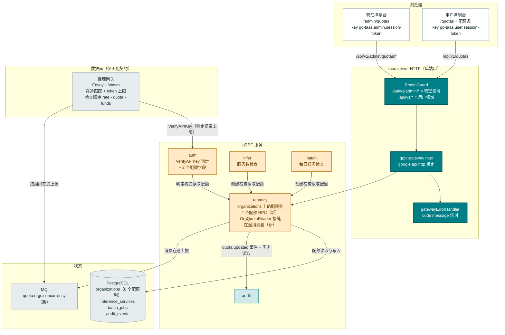
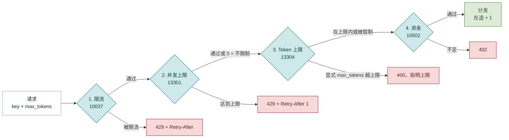
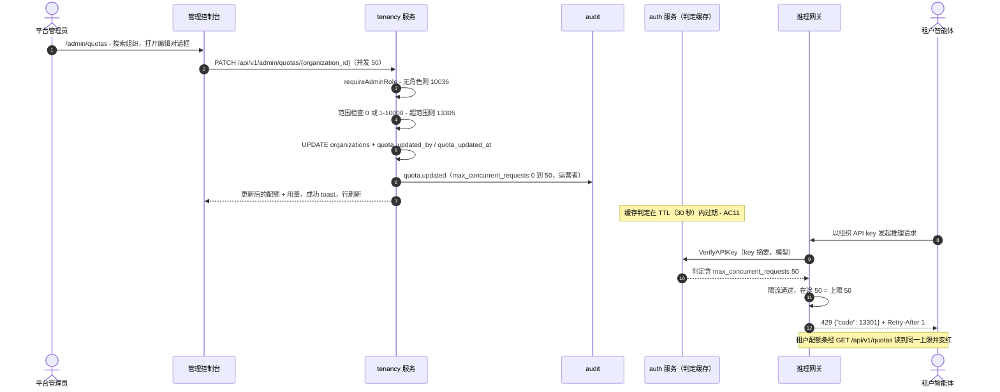
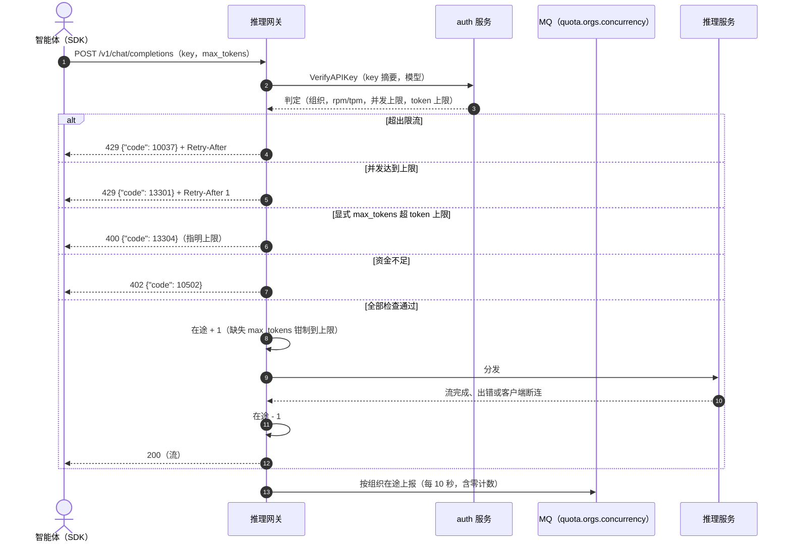
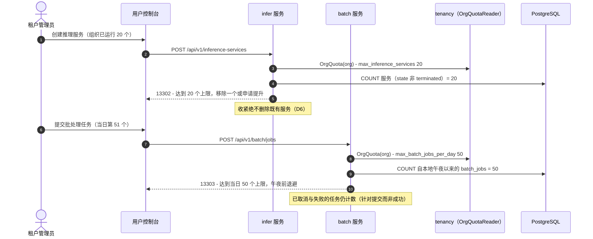

# 服务配额管理 — 架构与详细设计

| 属性 | 内容 |
| --- | --- |
| 功能点 | 服务配额管理 — 组织级**资源配额**，四个维度（`max_concurrent_requests`、`max_inference_services`、`max_batch_jobs_per_day`、`max_output_tokens_per_request`；0 = 不限制），由运营者在管理面配置，在推理网关（并发、单请求输出 token — 搭乘 `VerifyAPIKey` 判定）与控制面（`CreateInferenceService` 的服务数检查、`CreateBatchJob` 的每日批处理任务检查）fail-closed 执行；租户侧提供配额条与 `/quotas` 页面，管理侧提供 `/admin/quotas`（组织表格、预设、变更历史）（backlog 第 51 行） |
| 文档范围 | feature-51 的架构与详细设计：`organizations` 上的六个增量配额列；绑定在 `/api/v1/admin/quotas/*` 与 `/api/v1/quotas` 的四个新 tenancy RPC；`VerifyAPIKey` 判定扩展（响应字段 7/8、缓存机制、向后兼容）；`infer`/`batch` 的创建时检查；网关执行契约（检查顺序 rate → quota → funds、在途跟踪、`quota.orgs.concurrency` MQ 中继、13301/13304 渲染）；133xx 错误块；管理/用户页面与配额条；配置、安全、发布，以及逐层的函数级任务清单 |
| 负责模块 | `tenancy`（`organizations` 上的配额列、四个配额 RPC、`OrgQuotaReader` 接缝、在途上报消费者）；`auth`（`VerifyAPIKey` 判定扩展）；`infer`（服务数检查）；`batch`（每日任务检查）；`pkg/mq`（一个新 subject）；`pkg/errors`（133xx 块）；`pkg/config`（`quota` 节）；`pkg/server`（无变更 — `RealmGuard` 按前缀分类新路由）；`audit`（复用 — `quota.updated` 事件）；`web` 管理控制台（`QuotasPage`）与用户控制台（`UserQuotasPage`、`QuotaBar`）；推理网关（数据面 — **仅固化契约**，不在仓库范围内） |
| 相关文档 | [需求分析与 UI/UX 设计](../design/service-quota-management.md) · [架构设计](../design/architecture.md) §2.4 `auth`/`infer`、§3.1 控制网关、§3.2 数据面 · [限流与消费限额](./rate-limits-spend-limits.md)（本功能扩展的 per-key RPM/TPM 判定搭载模式、先于配额执行的 10037 检查） · [余额与配额账户模式](./balance-quota.md)（在配额之后执行的资金检查 10502） · [多租户](./multi-tenancy.md)（配额列落地的 organizations 表） · [批量推理](./batch-inference.md)（每日计数读取的 `batch_jobs` 表） · [推理自动扩缩容](./inference-autoscaling.md)（网关在途 MQ 上报先例，彼处 AD11） · [API Key 管理](./api-key-management.md)（其 TTL 界定传播窗口的判定缓存） · [审计日志](./audit-logging.md)（`quota.updated` 事件与变更历史读取） · [控制台双面分离](./console-surface-separation.md)（两个面、脱敏投影规则） |
| 状态 | 架构设计完成，已移交 Developer 智能体 |

---

## 1. 概述与目标

Feature #6 与 #8 给了 go-taas **资金**护栏 — per-key 限流（RPM/TPM）与组织资金/消费执行。仍然缺失的是**资源**维度：一个组织可以同时保持多少在途请求、部署多少推理服务、每天提交多少批处理任务、单个请求最多生成多少 token。限流抓不住其中任何一个 — 每分钟 60 次的十分钟流式请求会无限期占用六十个并发 GPU 槽位，而租户可以在完全遵守限流与消费限额的前提下部署五十个空闲服务。

本功能新增**组织级资源配额**：存储在组织行上的四个有界维度，由运营者在管理面配置，fail-closed 执行 — 两个热路径维度（并发、单请求输出 token）与 #6 的 RPM/TPM 完全相同地搭乘 `VerifyAPIKey` 判定到达推理网关，两个生命周期维度（服务数、每日批处理）由 `infer` 与 `batch` 在创建时检查。约束对被约束方**可见**：每个用户页面上的配额条与 `/quotas` 详情页，让限额成为可规划的约束而非神秘的 429。核心不变量：配额保护的是集群而非账单（资金留在 #6/#8）、执行从不排队也不部分执行、配额错误（133xx）绝不与限流（10037）或资金（10502）混淆、0 = 不限制且默认宽松、收紧是非破坏性的（用量自然排空）。

**目标**：

- 两个页面与一个共享组件：`/admin/quotas`（`QuotasPage` — 带实时用量的组织表格、带预设的编辑对话框、变更历史抽屉）与 `/quotas`（`UserQuotasPage` — 四个维度卡片、申请提升 mailto），以及用户控制台组织上下文区的 `QuotaBar`，见设计 §5.1–§5.4。
- 组织行上的四个配额维度，有界范围与 0 = 不限制默认值（设计 D2、FR1.1）。
- `TenancyService` 上的四个新 RPC：三个管理前缀（`/api/v1/admin/quotas*`）与一个用户前缀（`/api/v1/quotas`）（设计 §6）。
- `VerifyAPIKey` 判定扩展：`max_concurrent_requests` 与 `max_output_tokens_per_request` 随判定缓存，TTL ≤ 30 秒界定传播（设计 D3、FR2.1）。
- 固化的网关契约：检查顺序 rate → quota 并发 → token 上限 → funds、按组织在途跟踪（接受时递增、完成时递减）、13301 为 429 + `Retry-After: 1`、13304 为 400 并指明上限、缺失 `max_tokens` 时钳制、按组织在途数经 MQ 上报（设计 FR2.2–FR2.4、§6 注）。
- 创建时守卫：`CreateInferenceService` 中的 13302、`CreateBatchJob` 中的 13303，在既有流程内部，收紧非破坏（设计 FR3）。
- `pkg/errors` 中的新错误块 **133xx**（13301–13306）（设计 D4）。
- 审计事件 `quota.updated`（逐维度 old → new、操作运营者）与管理面的组织变更历史（最近 20 条）（设计 D9、FR1.3–FR1.4）。
- 可在 Nightwatch、FVT 与单元测试中验证的编号验收标准（AC1–AC14）；网关契约以既有模式合成验证。

**非目标**（来自设计，重述）：per-key 配额（刻意排除 — 资源轴是组织级事实，D2）；作为数据模型的配额层级/套餐（D5 — 预设是 UI 常量）；租户自助配额变更与审批流（D7 — 仅运营者，申请走 mailto）；项目级配额（随 #5 的项目模型推迟）；per-model/per-endpoint 配额（未来 — 组织轴先行）；配额超额计费（刻意排除 — 硬性 fail-closed 上限，资金留在 #6/#8）；限流 RPM/TPM 与消费限额（feature #6，原样复用）；资金/余额执行（feature #8，原样复用）；与自动扩缩容的交互（扩缩容仍在组织服务配额内进行 — 配额限定天花板，#16 限定行为）；以及网关实现本身（数据面，不在仓库范围 — 契约在此固化并合成验证，FR5.4）。

### 1.1 本文阅读顺序

第 2 节记录架构决策（AD1–AD18；AD11–AD18 是架构补充的细化，已标注）。第 3–5 节是组件视图、数据模型与 API 设计（含固化的网关契约）。第 6 节是前端架构（页面 → 路由 → API 前缀表、导航、共享组件、鉴权守卫）。第 7–8 节是时序图与错误处理。第 9–11 节是配置、安全与发布。第 12 节是验收标准追溯。第 13–15 节是函数级详细设计、有序实现任务清单与推迟项。

---

## 2. 架构决策

AD1–AD10 将 UI/UX 设计的决策（D1–D10）重述为实现级规则。**AD11–AD18 是架构补充的细化**；每条都标注其细化的设计决策并保留该决策的意图，使 Developer 与 Test 智能体按同一解读实现。

| # | 决策 | 理由 |
| --- | --- | --- |
| AD1 | **两个面各获得专属区块**：管理 `/admin/quotas` + `/api/v1/admin/quotas/*`（全集群组织表格、编辑对话框、变更历史），用户 `/quotas` + `/api/v1/quotas/*`（调用者自己的组织，只读）— 不是 #6 限流编辑器或 #5 组织编辑器的扩展 | 设计 D1。配额是独立的对象类（组织级资源轴，有自己的执行点与历史）；专属页面让 #6 的 key 级限流与本功能的组织级资源各自可查 |
| AD2 | **组织行上的四个配额维度**：`max_concurrent_requests`（0 = 不限制，默认 0；设置时 1–10000）、`max_inference_services`（0 = 不限制；1–1000）、`max_batch_jobs_per_day`（0 = 不限制；1–10000）、`max_output_tokens_per_request`（0 = 不限制；64–32768）。四个都是**组织级**，绝非 per-key | 设计 D2。平台真正可能被耗尽的四个资源轴；有界范围保证取值 sane；0 = 不限制保证默认宽松。持有两把 key 的租户不得让每个限额翻倍 |
| AD3 | **热路径维度搭乘 `VerifyAPIKey` 判定**，与 #6 的 RPM/TPM 完全一致：判定增加 `max_concurrent_requests` 与 `max_output_tokens_per_request`；网关按组织跟踪在途请求（接受时递增、完成时递减，含断连）并在分发前校验/钳制请求的 `max_tokens`。生命周期维度（`max_inference_services`、`max_batch_jobs_per_day`）由 `infer` 与 `batch` 在创建时执行。判定缓存 TTL（30 秒）界定配额变更的传播 | 设计 D3。零新增热路径 RPC（#6 契约模式）；在途跟踪是网关本地状态，唯一能看到接受/完成的地方；创建时检查天然属于控制面 |
| AD4 | **专属错误块 133xx**：13301 `CodeQuotaConcurrencyExceeded`（HTTP 429 + `Retry-After: 1`）、13302 `CodeQuotaServiceCountExceeded`、13303 `CodeQuotaBatchJobsExceeded`、13304 `CodeQuotaOutputTokensExceeded`（HTTP 400，指明上限）、13305 `CodeQuotaInvalid`（校验，指明维度）、13306 `CodeQuotaNotFound`。领域失败复用 10038，角色失败复用 10036 | 设计 D4。三类错误绝不混淆：配额 ≠ 限流（10037）≠ 资金（10502）。429 与 400 的拆分对应语义 — 并发是瞬态（稍后重试），其余是配置（改请求或改配额） |
| AD5 | **预设仅是管理页面中的 UI 常量**：Default（全部不限制）、Starter（10 / 3 / 5 / 4096）、Growth（50 / 20 / 50 / 8192）、Enterprise（200 / 100 / 500 / 16384）。选择预设填充表单；运营者可在保存前编辑任意字段。无预设往返、无预设存储 | 设计 D5。运营者要配置几十个组织；预设加速常见场景而不冻结模型。原始字段仍是事实源 |
| AD6 | **变更窗口**：热路径维度在判定 TTL 内（≤ 30 秒）生效；生命周期维度在下一次创建调用时生效。收紧到低于当前用量绝不杀死在途请求或删除服务 — 只阻断新的，用量自然排空 | 设计 D6。可预测、非破坏的收紧：守卫在边界阻断，绝不撤销已在运行的 |
| AD7 | **配额管理仅限运营者**；租户面只读（配额条 + `/quotas`）。租户的「申请提升」动作是指向配置的运营者地址的 mailto 链接，不是工作流 | 设计 D7。被约束方不得持有杠杆；mailto 覆盖单运营者平台而无需审批流技术栈 |
| AD8 | **租户配额条展示全部四个维度**（用量 / 限额，或「不限制」），位于用户组织上下文区，外加 `/quotas` 详情页；用量计数为在途请求（网关状态）、服务数（infer）、今日批处理（batch）、token 上限（常量展示）。任何租户看不到其他组织的配额 | 设计 D8。可见先于命中：配额条让约束透明、13301 错误可诊断 |
| AD9 | **所有配额变更均审计**（`quota.updated`，逐维度 old → new 与操作运营者），管理页面展示组织变更历史（最近 20 条） | 设计 D9。配额变更是有公平性影响的集群保护决策；历史回答「谁在何时收紧的」 |
| AD10 | **领域与面绑定**：管理仅限 admin（`/admin/quotas` + `/api/v1/admin/quotas/*`）；租户视图是 end-user（`/quotas` + `/api/v1/quotas/*`）。用户领域会话访问管理路由得到 **10038**；无平台管理员角色的会话得到 **10036** | 设计 D10。与控制台双面分离一致；配额内部信息（全集群对比）是运营者知识，组织自己的配额是租户的 |
| AD11 | **对设计 D2/FR1.1 的细化 — 配额状态是 `organizations` 上的六个增量列，无新表。** `max_concurrent_requests`、`max_inference_services`、`max_batch_jobs_per_day`、`max_output_tokens_per_request`（int64，NOT NULL，DEFAULT 0 = 不限制），外加为管理表格 Updated / Updated by 列反规范化的 `quota_updated_by`（string(64)，DEFAULT ''）与 `quota_updated_at`（timestamp，NULL）。用量计数只计算、绝不存储（第 4.2 节） | 设计已钉死「配额字段在组织行上（增量 AutoMigrate 列）」，且执行不需要逐维度历史表 — 审计轨迹本身就是历史（AD16）。现有表上的六列是满足 FR1.1 投影（含 `updated_at`/`updated_by`）的最小 schema，零回填：现有行读作全部不限制，即 feature 前行为 |
| AD12 | **对设计 D3/FR2.1 的细化 — 判定扩展机制。** `keyVerdict`（auth 服务缓存的判定结构体）增加 `MaxConcurrentRequests`（`json:"max_concurrent_requests"`）与 `MaxOutputTokensPerRequest`（`json:"max_output_tokens_per_request"`）；`VerifyAPIKeyResponse` 增加 proto 字段 **7 与 8**（字段 1–6 已占用）。缓存未命中路径（判定构造经 `OrgQuotaReader` 接缝读取组织配额）与缓存命中路径（字段从缓存 JSON 反序列化）都携带它们。升级前缓存的判定反序列化时缺少这两个键 → 零 → 不限制：向后兼容，且任何变更的传播窗口受缓存 TTL（≤ 30 秒）界定。判定构造期间的配额读取错误记录警告并降级为不限制（绝不让 `VerifyAPIKey` 本身失败 — 配额展示故障演变为鉴权中断会停掉全部推理） | 设计规定了判定字段与 TTL 界定但未规定缓存机制；此处钉死。读取错误时 fail-open 的取舍是刻意接受的：窗口受 TTL 界定，而替代方案（判定失败）会把配额表故障变成全集群鉴权中断 |
| AD13 | **对设计 D3/FR3 的细化 — 一个窄读取接缝，三个消费者。** `tenancy` 在 `services/tenancy/quota.go` 中导出只读 `OrgQuotaReader` 接口（`OrgQuota(ctx, organizationID) (OrgQuota, error)`，四个限额的值结构体），由 tenancy 仓储实现并在 tenancy 服务上暴露。`apps/taas-server/main.go` 通过 `SetOrgQuotaReader` 注入 `auth`（判定构造）、`infer`（`CreateInferenceService`）与 `batch`（`CreateBatchJob`）；nil 接缝读作不限制（过渡接缝惯例，FVT 设置不变）。`tenancy` 另外为 `GetMyQuota` 的组织限定获得 `sessionOrgResolver` 接缝（`SessionActiveOrg`，billing 模式），并为三个管理配额 RPC 获得 `requireAdminRole` 门（provider 形态）— 既有 tenancy RPC 保持以管理领域守卫为边界，不变 | 设计说检查读取「组织的配额」但未钉死方式。一个导出接口（一个实现、三个消费者）避免三个消费方重复声明同一形状；导入方向（`auth`/`infer`/`batch` → `tenancy`）不构成环，因为 tenancy 本地定义其会话接缝且不导入三者之一。管理门是新增的，因为既有 tenancy RPC 仅依赖领域守卫 — 配额变更是第一批还必须执行角色的 tenancy 写入（FR5.1） |
| AD14 | **对设计 FR2.4/FR1.2 的细化 — 在途用量中继沿用推理自动扩缩容的 MQ 先例。** 网关在新 subject **`quota.orgs.concurrency`** 上发布按组织在途数（JSON `{organization_id, in_flight, reported_at}`），每个上报间隔（默认 10 秒）每组织一条消息（含零计数以清除陈旧条目）。`tenancy` 中的消费者 runner（`quota_concurrency_consumer.go`，由 `quota.concurrencyConsumer.enabled` 门控的 `server.Runner`）在互斥锁保护的内存在图中保存每组织最新快照并暴露 `CurrentInFlight(orgID)`，对缺失或陈旧条目（早于 `quota.concurrencyConsumer.staleAfter`，默认 2 分钟）返回 **0**。订阅是普通 subscribe（每个 taas-server 副本维护自己的 map — queue group 会让其他副本失明）。配额 RPC 尽力而为地读取快照；tenancy 重启后从空开始并在一个上报间隔内回填 | 设计要求配额 RPC 呈现实时在途用量（FR1.2/FR4.1），而计数器是网关本地状态（FR2.4）。自动扩缩容功能已确立网关→MQ 在途上报为平台模式；复用它保持单一中继机制。尽力而为语义（缺失/陈旧/重启 → 0）正是设计自己的表述 — 计数器是展示快照，绝不是执行输入（执行是网关本地的） |
| AD15 | **对设计 FR3.2 的细化 — 每日批处理计数器是实时 COUNT，无新表。** `COUNT(*) FROM batch_jobs WHERE organization_id = ? AND created_at >= <本地午夜>`，本地午夜按配置的 `quota.timezone`（默认 UTC，抽屉中记录的平台时区）计算。已取消与失败的任务也计数（守卫针对提交而非成功）。batch 仓储增加 `CountJobsSince(ctx, orgID, since)`；检查在既有创建流程内运行 | 设计钉死了 COUNT 形状与无新表规则；此处钉死时区来源（平台无按组织时区）与仓储接缝。索引 `(organization_id, created_at)` 上的午夜边界 COUNT 在检查时刻是精确的，不需要计数表、重置任务或漂移修复 |
| AD16 | **对设计 D9/FR1.3 的细化 — 变更历史是嵌入 `GetOrganizationQuota` 的直接 `audit_events` 读取。** 变更写入一条 `quota.updated` 事件（资源类型 `organization`、资源 id 为组织、actor 为运营者），其 metadata jsonb 为 `{"changes": [{"dimension": "max_concurrent_requests", "old": 0, "new": 50}, …]}` — 仅实际变化的维度。历史读取选择 `audit_events WHERE organization_id = ? AND action = 'quota.updated' ORDER BY created_at DESC`（窄共享句柄读取，既有的跨模块读取模式 — 审计服务的 `ListAuditEvents` 过滤器没有适配此用途的 resource-id 形状），将每个事件的 `changes` 数组展平为逐维度条目，返回最新 20 条 | 设计说抽屉「来自审计轨迹」但未钉死读取。每次变更一条事件（带 changes 数组）保持轨迹紧凑且原子；读取时展平给抽屉逐维度的 Old → New 行。直接读取是刻意的：审计模块不变，查询按组织与 action 限定 |
| AD17 | **对设计 D5/FR1.5 的细化 — 预设以类型化常量 map 形式存在于 `QuotasPage.tsx`**（`default`/`starter`/`growth`/`enterprise` → 四个值），在编辑对话框中渲染为四个一键填充按钮并设置表单状态；运营者随后可编辑任意字段。无 API、无配置、无 i18n 驱动的值 | 设计规定预设仅是 UI 便利；常量 map 是最小实现，让值在一处可审，并保证填充后表单仍可编辑 |
| AD18 | **对设计 D7/FR4.3 的细化 — 申请提升地址是配置键 `quota.requestIncreaseTo`（默认空），经 `GetMyQuotaResponse.request_increase_email` 呈现给租户。** `/quotas` 页面将「申请提升」按钮渲染为 `mailto:` 链接（主题与正文预填组织显示名，URL 编码）；配置地址为空时隐藏按钮。compose/e2e 栈设置该键使 AC8 练习该链接 | 设计说「mailto 到配置的运营者地址」但未钉死地址在哪配置、SPA 如何获知。搭乘 `GetMyQuota` 避免新的配置投影端点；空则隐藏是 fail-closed 解读（邮寄给无人的按钮比没有按钮更糟） |

---

## 3. 组件视图

### 3.1 职责归属

| 层 / 组件 | 职责 | 本功能变更 |
| --- | --- | --- |
| **静态包（SPA）** | 一个 Vite 包（`web/dist`）嵌入 `taas-server`；由网关 SPA 回退服务 | 两个新页面（`QuotasPage`、`UserQuotasPage`）、`QuotaBar` 组件、两个导航项、`App.tsx` 路由注册、i18n 键、预设常量 |
| **网关（`pkg/server`）** | HTTP 组合：`RealmGuard` → `withConsole` → grpc-gateway mux；统一错误渲染器；SPA 回退 | **无变更** — 新 RPC 绑定在 `/api/v1/admin/quotas*` 与 `/api/v1/quotas` 下，`RealmGuard` 已按前缀分类 |
| **grpc-gateway mux** | 来自 `google.api.http` 注解的路径 → RPC 路由 | 四个配额 RPC 的新绑定（第 5 节） |
| **`tenancy`** | 组织、项目、成员、邀请 | `Organization` 上的六个配额列；四个配额 RPC；`OrgQuotaReader` 接缝；`sessionOrgResolver` 接缝与 `requireAdminRole` 门；在途消费者 runner；变更历史读取 |
| **`auth`** | 会话、API key、`VerifyAPIKey` 判定缓存 | 判定增加两个配额字段（缓存未命中构造 + 响应映射）；`SetOrgQuotaReader` 接缝 |
| **`infer`** | 推理服务 | `CreateInferenceService` 中的服务数检查（13302）；其仓储中的 `CountActiveServicesByOrg`；`SetOrgQuotaReader` 接缝 |
| **`batch`** | 批处理任务 | `CreateBatchJob` 中的每日任务检查（13303）；其仓储中的 `CountJobsSince`；`SetOrgQuotaReader` 接缝 |
| **`metering` / `billing`** | 用量记录、资金 | **无变更** — 配额与资金轴组合但绝不触碰 |
| **`audit`** | 尽力而为审计记录器、`audit_events` 表 | 原样复用：tenancy 记录 `quota.updated` 事件并直接读取历史（AD16） |
| **`pkg/mq`** | 规范 subject | 一个新 subject 常量：`SubjectQuotaOrgsConcurrency` = `quota.orgs.concurrency` |
| **`pkg/errors`** | 按模块的代码块 | 一个新配额块：**13301–13306**（13307–13399 保留） |
| **`pkg/config`** | 合并配置树 | 新 `quota` 节（时区、申请提升地址、消费者设置） |
| **推理网关（数据面）** | Envoy + Wasm：鉴权、计量、路由 | **仅固化契约**（第 5.3 节）— 判定配额字段、检查顺序、在途跟踪、13301/13304 渲染、MQ 上报；数据面轨道实现它，compose mock 遵循它 |
| **`test/e2e` mock** | compose 测试夹具 | mock 网关遵循固化契约（含 MQ 在途上报），使 e2e 配额条显示实时用量 |

### 3.2 组件视图



### 3.3 请求身份链

配额 RPC 分布在两个面上（AD1、AD10）。链路为：

1. `RealmGuard`（HTTP，`pkg/server/realm.go`）— 路径前缀决定期望领域：`/api/v1/admin/quotas*` → 管理领域；`/api/v1/quotas` → 用户领域。无 `Authorization` 头：透传（过渡期）。有头：从 Redis 解析会话领域；不匹配 → **10038 `CodeRealmMismatch`**；未知/过期/无领域 → **10027**。
2. grpc-gateway mux — 按注解路径路由并转发 `authorization`。
3. `tenancy` 处理器 —
   - **管理 RPC**（`ListOrganizationQuotas`、`GetOrganizationQuota`、`UpdateOrganizationQuota`）：解析操作者（`SessionUserID`）并经 `requireAdminRole` → `tenancy.RoleGuard.RequireRole(..., roleAdmin)` 门控管理员角色（**10036 `CodeForbidden`**），即 `provider.requireAdminRole` 形态（AD13）。平台级作用域：`organization_id` 路径参数是目标，绝不是身份来源。
   - **用户 RPC**（`GetMyQuota`）：从会话解析调用者组织（`sessionOrgResolver.SessionActiveOrg`，billing `resolveOrg` 模式 — 会话活跃组织优先，过渡性 `X-Organization-Id` 头为回退，空上下文 → **10005**）；响应硬限定到该组织。绝不信任客户端提供的组织 id（设计 §6 注 7）。

用户领域会话访问任何 `/api/v1/admin/quotas*` 路由被 **10038** 拒绝（FR5.1、AC12）。缺少所需角色的会话得到 **10036**，管理页面渲染标准无权限状态（AC13）。用户面根本没有配额变更路由（FR4.4、AC9）。

### 3.4 执行拆分

执行位于两个点，用量展示位于第三个：

- **热路径（网关，固化契约）** — 并发与单请求 token 上限由推理网关根据判定执行，在分发之前（第 5.3 节）。网关是唯一能看到请求接受/完成的组件，因此是在途跟踪唯一可以精确的地方。
- **生命周期（控制面）** — 服务数与每日批处理计数器在 `infer` 与 `batch` 的既有创建流程内执行（第 13.6–13.7 节），经 `OrgQuotaReader` 接缝读取限额（AD13）。
- **用量展示（tenancy，尽力而为）** — 配额 RPC 组装用量快照：在途来自 MQ 中继消费者（AD14），服务数与今日批处理来自共享句柄上的窄 COUNT 读取（既有跨模块读取模式；展示读取，与执行查询独立演进）。

---

## 4. 数据模型

本功能**不新增任何表**。配额状态是 `organizations` 上的六个增量列（AD11）；用量计数是计算的（第 4.2 节）；变更历史是既有的 `audit_events` 表（第 4.3 节）。

### 4.1 `organizations`（增量列）

| 列 | 类型 | 说明 |
| --- | --- | --- |
| `max_concurrent_requests` | int64，NOT NULL，DEFAULT 0 | 0 = 不限制；设置时 1–10000（FR1.1） |
| `max_inference_services` | int64，NOT NULL，DEFAULT 0 | 0 = 不限制；设置时 1–1000 |
| `max_batch_jobs_per_day` | int64，NOT NULL，DEFAULT 0 | 0 = 不限制；设置时 1–10000 |
| `max_output_tokens_per_request` | int64，NOT NULL，DEFAULT 0 | 0 = 不限制；设置时 64–32768 |
| `quota_updated_by` | string(64)，NOT NULL，DEFAULT '' | 最近一次变更的操作运营者；'' = 从未变更 |
| `quota_updated_at` | timestamp，NULL | 最近一次变更时间；NULL = 从未变更 |

这些列加到 `services/tenancy/tenancy_model.go` 中既有的 `Organization` GORM 模型上（增量字段；既有 `TableName()` 保持 `"organizations"`）。`UpdateOrganization`（既有的组织编辑器 RPC）**不**获得这些字段 — 配额写入只经 `UpdateOrganizationQuota`，它同时盖 `quota_updated_by`/`quota_updated_at` 戳并审计（AD13、FR1.4）。

### 4.2 用量计数器（只计算，绝不存储）

| 计数器 | 来源 | 说明 |
| --- | --- | --- |
| `concurrent_requests` | 在途消费者快照（AD14） | 网关本地状态经 `quota.orgs.concurrency` 中继；缺失/陈旧（> `staleAfter`）或重启后 → 0；设计上尽力而为（FR2.4） |
| `inference_services` | `COUNT(*) FROM inference_services WHERE organization_id = ? AND state <> 'terminated'` | 非终止服务 — 与组织服务列表展示的同一群体；共享句柄上的窄读取 |
| `batch_jobs_today` | `COUNT(*) FROM batch_jobs WHERE organization_id = ? AND created_at >= <本地午夜>` | `quota.timezone` 中的本地午夜（AD15）；已取消与失败的任务计数 |
| token 上限 | 限额本身 | 常量展示 — 单请求上限没有「当前用量」 |

`infer` 与 `batch` 中的执行查询是相同形状但位于各自仓储中（权威检查）；tenancy 的副本是展示读取。刻意的一行重复让展示与执行独立演进（AD13）。

### 4.3 变更历史（`audit_events`，复用）

每个至少变更一个维度的 `UpdateOrganizationQuota` 经既有尽力而为记录器写入一条审计事件：

- `action = "quota.updated"`、`resource_type = "organization"`、`resource_id = <organization_id>`、`organization_id = <organization_id>`、`actor_user_id = <运营者>`、`result = "success"`。
- `metadata`（jsonb）：`{"changes": [{"dimension": "<列名>", "old": <int>, "new": <int>}, …]}` — 仅值实际变化的维度；什么都不改的 PATCH 不写事件（FR5.3：变更被审计，无操作不是变更）。

历史读取（嵌入 `GetOrganizationQuota`，AD16）：选择 `audit_events` 中 `organization_id = ?` 且 `action = 'quota.updated'` 的行，最新在前，将每个事件的 `changes` 数组展平为逐维度条目（一个事件变更两个维度产生共享时间戳与操作者的两条条目），返回最新 20 条。列表/读取 RPC 不审计，遵循平台读取路径惯例（FR5.3）。

### 4.4 迁移与 init-SQL 升级路径

本仓库**不**使用手写 init-SQL 脚本：每个 schema 变更都是 owning 服务 `Migrate` 经 `db.AutoMigrate(...)` 创建/变更的 GORM 模型，`deploy/` 下没有 `.sql` 文件。升级路径：

1. 在 `services/tenancy/tenancy_model.go` 的 `Organization` 上增加六个字段。
2. 既有 tenancy `Migrate`（及 `MigrateSchemaForFVT`）已 AutoMigrate `Organization` — 列在下次启动时以 `ALTER TABLE organizations ADD COLUMN ... DEFAULT ...` 加入。
3. 无数据回填：现有行读作 0/0/0/0 + ''/NULL = 全部不限制，恰为 feature 前行为。无手工 DDL、无 compose 变更。

---

## 5. API 设计

### 5.1 面映射

四个 RPC 是新增的；三个既有 RPC 行为变更（一个契约变更、两个拒绝码新增）。没有 RPC 双重绑定：管理 RPC 是全集群管理，用户 RPC 是调用者自己的组织 — 不同投影、不同守卫。

| RPC | HTTP 方法 + 路径 | 面 | 状态 | 用途 |
| --- | --- | --- | --- | --- |
| `ListOrganizationQuotas`（扩展 `taas.tenancy.v1.TenancyService`） | `GET /api/v1/admin/quotas` | admin | **新增** | 带尽力而为实时用量的逐组织配额行；分页、名称搜索、限额状态过滤 |
| `GetOrganizationQuota` | `GET /api/v1/admin/quotas/{organization_id}` | admin | **新增** | 单组织的配额 + 用量 + 最近 20 条变更历史；未知组织 → 13306 |
| `UpdateOrganizationQuota` | `PATCH /api/v1/admin/quotas/{organization_id}` | admin | **新增** | 设置四个维度的任意子集；审计；超范围值 13305 |
| `GetMyQuota` | `GET /api/v1/quotas` | user | **新增** | 调用者自己组织的配额与实时用量（从会话限定组织） |
| `VerifyAPIKey`（`taas.auth.v1.AuthService`） | 内部（网关 → `auth`） | n/a | **变更** | 判定/响应增加 `max_concurrent_requests`（字段 7）与 `max_output_tokens_per_request`（字段 8） |
| `CreateInferenceService`（`taas.infer.v1`） | `POST /api/v1/inference-services` | user | **变更** | 增加组织服务数检查；达到限额时 13302（无 proto 变更） |
| `CreateBatchJob`（`taas.batch.v1`） | `POST /api/v1/batch/jobs` | user | **变更** | 增加每日批处理任务检查；达到限额时 13303（无 proto 变更） |

网关路由说明：`GET /api/v1/admin/quotas`（集合根）与 `GET /api/v1/admin/quotas/{organization_id}` 是不同路径 — 无通配冲突；PATCH 遵循同一 mux 上既有的 `UpdateOrganization` 惯例。设计的 `unlimited_only`/`limited_only` 过滤（FR1.2）映射为单个 `limit_state` 查询参数（`all`（默认）/ `limited` / `unlimited`）— 一个参数、三个状态、无需校验布尔对。

### 5.2 Proto 契约

**对 `proto/taas/tenancy/v1/tenancy.proto` 的增补**（在既有 `TenancyService` 与消息集内）：

```proto
  // ---- service quotas (feature #51) ----

  // ListOrganizationQuotas returns every organization's quota row with
  // best-effort live usage, pagination, a name search and a limit-state
  // filter (admin surface, requireAdminRole).
  rpc ListOrganizationQuotas(ListOrganizationQuotasRequest) returns (ListOrganizationQuotasResponse) {
    option (google.api.http) = {get: "/api/v1/admin/quotas"};
  }

  // GetOrganizationQuota returns one organization's quota, live usage
  // and the last 20 change-history entries (admin surface). An unknown
  // organization returns 13306.
  rpc GetOrganizationQuota(GetOrganizationQuotaRequest) returns (GetOrganizationQuotaResponse) {
    option (google.api.http) = {get: "/api/v1/admin/quotas/{organization_id}"};
  }

  // UpdateOrganizationQuota sets any subset of the four dimensions
  // (proto3 optional tracks presence; an explicit 0 means unlimited).
  // Out-of-range values return 13305 with the dimension named. Audited
  // as quota.updated; tightening below current usage is allowed and
  // non-destructive.
  rpc UpdateOrganizationQuota(UpdateOrganizationQuotaRequest) returns (UpdateOrganizationQuotaResponse) {
    option (google.api.http) = {
      patch: "/api/v1/admin/quotas/{organization_id}"
      body: "*"
    };
  }

  // GetMyQuota returns the caller's own organization quota with live
  // usage (user surface; the org is resolved from the session, never
  // from a client-supplied id).
  rpc GetMyQuota(GetMyQuotaRequest) returns (GetMyQuotaResponse) {
    option (google.api.http) = {get: "/api/v1/quotas"};
  }

// OrganizationQuota is the FR1.1 projection. All max_* fields are
// int64 with 0 = unlimited.
message OrganizationQuota {
  string organization_id = 1;
  string organization_name = 2;
  int64 max_concurrent_requests = 3;
  int64 max_inference_services = 4;
  int64 max_batch_jobs_per_day = 5;
  int64 max_output_tokens_per_request = 6;
  int64 updated_at = 7; // unix seconds, 0 = never updated
  string updated_by = 8; // "" = never updated
}

// QuotaUsage is the best-effort live-usage snapshot (FR1.2/FR4.1).
message QuotaUsage {
  int64 concurrent_requests = 1; // gateway in-flight snapshot (AD14)
  int64 inference_services = 2;  // non-terminated service count
  int64 batch_jobs_today = 3;    // COUNT since local midnight (AD15)
}

// QuotaChangeEntry is one flattened dimension change (AD16).
message QuotaChangeEntry {
  int64 changed_at = 1; // unix seconds
  string operator = 2;  // acting user id
  string dimension = 3; // max_concurrent_requests | max_inference_services | max_batch_jobs_per_day | max_output_tokens_per_request
  int64 old_value = 4;
  int64 new_value = 5;
}

// OrganizationQuotaRow is one list row: the quota plus its usage.
message OrganizationQuotaRow {
  OrganizationQuota quota = 1;
  QuotaUsage usage = 2;
}

message ListOrganizationQuotasRequest {
  taas.common.v1.PageRequest page = 1;
  string name = 2;        // display-name/id substring search, case-insensitive
  string limit_state = 3; // all (default) | limited | unlimited
}

message ListOrganizationQuotasResponse {
  taas.common.v1.Response response = 1;
  repeated OrganizationQuotaRow quotas = 2;
  taas.common.v1.PageMeta page_meta = 3;
}

message GetOrganizationQuotaRequest {
  string organization_id = 1;
}

message GetOrganizationQuotaResponse {
  taas.common.v1.Response response = 1;
  OrganizationQuota quota = 2;
  QuotaUsage usage = 3;
  repeated QuotaChangeEntry changes = 4; // newest first, last 20
}

message UpdateOrganizationQuotaRequest {
  string organization_id = 1;
  // optional tracks presence: absent = unchanged, explicit 0 = unlimited.
  optional int64 max_concurrent_requests = 2;
  optional int64 max_inference_services = 3;
  optional int64 max_batch_jobs_per_day = 4;
  optional int64 max_output_tokens_per_request = 5;
}

message UpdateOrganizationQuotaResponse {
  taas.common.v1.Response response = 1;
  OrganizationQuota quota = 2;
  QuotaUsage usage = 3;
}

message GetMyQuotaRequest {}

message GetMyQuotaResponse {
  taas.common.v1.Response response = 1;
  OrganizationQuota quota = 2;
  QuotaUsage usage = 3;
  // request_increase_email is the configured operator mailbox for the
  // Request-increase mailto (AD18); empty hides the button.
  string request_increase_email = 4;
}
```

**对 `proto/taas/auth/v1/auth.proto` 的变更** — `VerifyAPIKeyResponse` 增加两个组织级上限（字段 1–6 已占用；新字段为 7 与 8）：

```proto
message VerifyAPIKeyResponse {
  taas.common.v1.Response response = 1;
  string organization_id = 2;
  string key_id = 3;
  string role = 4;
  // rate_limit_rpm is the max requests per minute; 0 = unlimited
  // (feature #11, AD1). The gateway enforces it locally.
  int64 rate_limit_rpm = 5;
  // rate_limit_tpm is the max tokens per minute; 0 = unlimited.
  int64 rate_limit_tpm = 6;
  // max_concurrent_requests is the org's in-flight request cap; 0 =
  // unlimited (feature #51, design D3). The gateway enforces it
  // locally after the rate-limit check.
  int64 max_concurrent_requests = 7;
  // max_output_tokens_per_request is the org's per-request output
  // token cap; 0 = unlimited. The gateway validates or clamps the
  // request's max_tokens against it before dispatch.
  int64 max_output_tokens_per_request = 8;
}
```

`CreateInferenceService` 与 `CreateBatchJob` 仅变更**行为**（经统一信封的新拒绝码）— 无 proto、路由或消息变更。

### 5.3 固化的网关契约（数据面，不在仓库范围）

推理网关不在本仓库中；以下契约对数据面轨道是绑定的，并在 FVT 中合成验证（既有模式 — compose mock 网关为 e2e 遵循它，FR5.4）。检查顺序是绑定的（设计 §1.4、§6 注 2）：



契约逐项：

1. **判定字段**：网关从 `VerifyAPIKey` 响应读取 `max_concurrent_requests` 与 `max_output_tokens_per_request`，与今天读取 `rate_limit_rpm`/`rate_limit_tpm` 完全一致（FR2.1）。0 = 不限制 → 跳过相应检查。
2. **检查顺序**：限流（10037，429 + `Retry-After`）→ 配额并发（13301）→ token 上限（13304）→ 资金（10502，402）→ 分发。被限流的 key 绝不到达配额检查；被配额阻断的请求绝不到达资金检查（AC7）。
3. **并发**：按组织在途计数器（以判定的 `organization_id` 为键），请求被接受分发时递增，完成时递减 — 流结束、错误或客户端断连（FR2.2）。达到上限时，请求以 HTTP 429、body `{"code": 13301, "message": ...}` 与 **`Retry-After: 1`** 拒绝（在途窗口很短；其余配额码无 `Retry-After` — 它们是配置错误而非瞬态负载，§6 注 5）。
4. **Token 上限**：显式 `max_tokens` 超上限以 HTTP 400、body `{"code": 13304, "message": ...}` 拒绝并指明上限（「每个请求上限 N 个 token」）；缺失 `max_tokens` 的请求以钳制到上限的 `max_tokens` 分发；`max_tokens ≤ 上限` 原样通过（FR2.3）。检查在分发前校验/钳制 OpenAI 兼容 body。
5. **在途上报**：网关每个上报间隔（默认 10 秒）在 `quota.orgs.concurrency` 上按组织发布一条 JSON 消息（含零计数），负载 `{"organization_id": "...", "in_flight": <int>, "reported_at": <unix 秒>}`（AD14）。网关重启时尽可能从活跃流重新推导计数器，否则从零开始 — 已记录、有界、尽力而为（FR2.4）。
6. **错误渲染**：13301 → 429 + `Retry-After: 1`；13304 → 400；均带统一 `{"code", "message"}` body。这两个码是数据面上网关渲染的状态；控制面绝不返回它们（并发/token 上限执行仅限网关）。其余 133xx 码经 grpc-gateway 以统一信封与 HTTP 500 呈现，即仓库惯例。

### 5.4 校验契约

| 字段 | 规则 | 错误 |
| --- | --- | --- |
| `organization_id`（get/update） | 必须存在 | 13306 |
| `max_concurrent_requests` | 0 或 1–10000 | 13305（指明维度） |
| `max_inference_services` | 0 或 1–1000 | 13305（指明维度） |
| `max_batch_jobs_per_day` | 0 或 1–10000 | 13305（指明维度） |
| `max_output_tokens_per_request` | 0 或 64–32768 | 13305（指明维度） |
| `limit_state` 过滤 | `all` / `limited` / `unlimited`（空 = all） | 13305 |
| PATCH body | 任意子集；空 patch 是返回当前配额的无操作（无审计事件） | — |
| `GetMyQuota` 组织上下文 | 从会话解析（过渡性头回退）；为空 → | 10005 |

序列化惯例不变：成功 HTTP 200，业务错误为 `{"code": <int>, "message": "..."}`，int64 字段为 JSON 字符串（含配额上限与用量计数器）。

---

## 6. 前端架构

### 6.1 页面 → 路由 → API 前缀表

| 页面 / 组件 | 路由 | API 前缀 | 面 |
| --- | --- | --- | --- |
| `QuotasPage`（新，`web/src/pages/QuotasPage.tsx`） | `/admin/quotas` | `/api/v1/admin/quotas` | admin |
| `UserQuotasPage`（新，`web/src/pages/user/UserQuotasPage.tsx`） | `/quotas` | `/api/v1/quotas` | user |
| `QuotaBar`（新，`web/src/pages/user/quotas/QuotaBar.tsx`） | 组织上下文条（所有用户页面） | `/api/v1/quotas` | user |

管理页面**不含任何 `/api/v1/*` 调用**；用户页面与配额条**不含任何 `/api/v1/admin/*` 调用**（FR5.1、AC12）。按控制台双面分离，管理页面是管理领域源（`web/src/pages/*.tsx`），用户页面、配额条与卡片组件是用户领域源（`web/src/pages/user/**`）。

### 6.2 导航位置

`AdminShell` 的 `ADMIN_NAV_ITEMS` 在 Invitations 之后（tenancy 集群）增加一项：

```tsx
{ path: '/admin/quotas', labelKey: 'nav.quotas', testid: 'nav-quotas', icon: SlidersHorizontal },
```

`UserShell` 的 `USER_NAV_ITEMS` 在 Forecast 之后（用量集群）增加一项：

```tsx
{ path: '/quotas', labelKey: 'nav.quotas', testid: 'user-nav-quotas', icon: Gauge },
```

`App.tsx` 注册两个路由（管理块在其他 `/admin/*` 路由旁，用户块在其他用户路由旁）：

```tsx
<Route path="/admin/quotas" element={<QuotasPage />} />
<Route path="/quotas" element={<UserQuotasPage />} />
```

`UserShell` 另外在组织上下文区、`OrgSwitcher` 旁渲染 `QuotaBar`（设计 §5.4）：它以 30 秒 `usePolling` 间隔轮询 `GET /api/v1/quotas`，四个维度全部不限制时整体隐藏（默认 — 不受限组织的零视觉噪音），点击跳转 `/quotas`。

### 6.3 复用的共享组件与状态

- `Dialog`（编辑对话框及其内联校验）、`data` 表格样式、`PageMeta` 分页、`RoutingDecisionsPage`/`AcceleratorNodeDetailPage` 的抽屉模式、`usePolling`（`web/src/components.tsx`，用于配额条与管理表格刷新）、badge/进度条类 — 全部是既有控制台惯例。
- **`QuotaDimensionCard`**（`web/src/pages/user/quotas/QuotaDimensionCard.tsx`）：单个维度卡片 — 名称、通俗描述（「您的组织当前在途的请求数」）、用量/限额对（「12 / 50」或「不限制」）、进度条（≥ 80% 琥珀色、100% 红色），token 上限为常量展示（「每个请求最多生成 8192 个 token」）。由 `UserQuotasPage` 使用；配额条以紧凑形式渲染同一逻辑。
- **`QuotaBar`**（`web/src/pages/user/quotas/QuotaBar.tsx`）：四个紧凑 chip — 「在途 12/50」「服务 3/20」「今日批处理 5/50」「Token ≤ 8192」（或每 chip「不限制」）；≥ 80% 琥珀色、100% 红色；轮询失败保留最后的好数据（陈旧惯例），四个维度全部不限制时隐藏。
- **预设常量**（AD17）以类型化 map 形式存在于 `QuotasPage.tsx`（`default`/`starter`/`growth`/`enterprise` → 四个值）；编辑对话框将其渲染为四个一键填充按钮，填充后每个字段仍可编辑。
- **申请提升 mailto**（AD18）：`mailto:{request_increase_email}?subject=...&body=...`，预填组织显示名，`encodeURIComponent` 安全；`request_increase_email` 为空时隐藏按钮。

### 6.4 各面鉴权守卫

- `QuotasPage` 渲染在 `AdminShell` 内，其 shell 守卫强制管理会话领域（`/admin/login`，token `go-taas.admin.session-token`）；用户领域会话访问管理 API 路由被 `RealmGuard` 以 **10038** 拒绝，shell 重定向到 `/admin/login?reason=realm`。
- 缺少所需角色的会话从 `requireAdminRole` 得到 **10036**；页面渲染带回 `/admin` 链接的标准无权限状态（AC13）。
- `UserQuotasPage` 与 `QuotaBar` 渲染在 `UserShell` 内（用户会话领域）；任何组织成员可见本组织配额 — 无额外角色门（组织限定即边界），用户面不可能出现无权限状态（设计 §5.4）。

### 6.5 `data-testid` 钩子（绑定，kebab-case）

管理侧：`nav-quotas`、`quota-table`、`quota-row-{organization_id}`、`quota-usage-concurrency-{organization_id}`、`quota-usage-services-{organization_id}`、`quota-usage-batch-{organization_id}`、`quota-token-cap-{organization_id}`、`quota-updated-{organization_id}`、`quota-updated-by-{organization_id}`、`quota-edit-{organization_id}`、`quota-edit-dialog`、`quota-preset-{preset}`、`quota-field-{dimension}`、`quota-field-error-{dimension}`、`quota-save`、`quota-history-{organization_id}`、`quota-history-drawer`、`quota-history-entry-{index}`、`quota-search`、`quota-filter-limit-state`、`quota-pagination`、`quota-empty`、`quota-permission-denied`。

用户侧：`user-nav-quotas`、`quota-bar`、`quota-bar-chip-{dimension}`、`quota-cards`、`quota-card-{dimension}`、`quota-card-usage-{dimension}`、`quota-request-increase`、`quota-unlimited-empty`、`quota-error`。

---

## 7. 时序图

### 7.1 运营者限制嘈杂租户（热路径传播）



### 7.2 网关执行（固化的检查顺序）



### 7.3 创建时守卫（生命周期维度）



---

## 8. 错误处理

| 条件 | HTTP | 码 | 常量 | 说明 |
| --- | --- | --- | --- | --- |
| 组织并发达到上限 | **429 + `Retry-After: 1`** | 13301 | `CodeQuotaConcurrencyExceeded` | 网关渲染（数据面，第 5.3 节）；控制面绝不返回它 |
| 组织达到推理服务上限 | 500 | 13302 | `CodeQuotaServiceCountExceeded` | `CreateInferenceService` 拒绝；消息指明当前数与限额 |
| 组织达到每日批处理任务上限 | 500 | 13303 | `CodeQuotaBatchJobsExceeded` | `CreateBatchJob` 拒绝；消息指明今日数与限额 |
| 请求 `max_tokens` 超组织上限 | **400** | 13304 | `CodeQuotaOutputTokensExceeded` | 网关渲染（数据面）；消息指明上限 |
| 配额值超范围（或无效 `limit_state`） | 500 | 13305 | `CodeQuotaInvalid` | 校验；消息指明维度 |
| 未知组织（配额读取/更新） | 500 | 13306 | `CodeQuotaNotFound` | |
| 用户领域会话访问管理路由 | 500 | 10038 | `CodeRealmMismatch` | 复用 — 领域分离（FR5.1） |
| 会话缺少所需角色 | 500 | 10036 | `CodeForbidden` | 复用 — 权限拒绝（FR5.1） |
| `GetMyQuota` 无组织上下文 | 500 | 10005 | `CodeOrganizationNotFound` | 复用 — 组织守卫惯例 |

渲染拆分（对 Test 智能体绑定）：**13301 与 13304 是数据面网关状态**（429 带 `Retry-After: 1`，与 400），针对固化契约合成验证（AC3、AC4、AC7）；**13302/13303/13305/13306 是控制面业务错误**，经 grpc-gateway 以统一 `{"code": <int>, "message": "..."}` 信封与 HTTP 500 呈现，即仓库惯例。`Retry-After` 仅出现在 13301（在途窗口很短；其余码是配置错误而非瞬态负载）。

---

## 9. 配置

`pkg/config` 中的新 `quota` 节（`QuotaConfig`，映射 `mapstructure:"quota"`），在 `applyDefaults` 中默认、在 `Validate` 中校验：

| 键 | 类型 | 默认 | 说明 |
| --- | --- | --- | --- |
| `quota.timezone` | string | `"UTC"` | IANA 名称；批处理每日计数器本地午夜的评估平台时区（AD15），记录在管理抽屉中 |
| `quota.requestIncreaseTo` | string | `""` | 租户申请提升 mailto 的运营者邮箱（AD18）；为空隐藏按钮；compose/e2e 栈设置它 |
| `quota.concurrencyConsumer.enabled` | bool | `true` | 在途上报消费者 runner 的开关（AD14） |
| `quota.concurrencyConsumer.workers` | int | `2` | 并发上报处理器数 |
| `quota.concurrencyConsumer.staleAfter` | duration | `2m` | 早于此的上报读作 0（尽力而为，FR2.4） |

`pkg/mq` 增加 subject 常量 `SubjectQuotaOrgsConcurrency = "quota.orgs.concurrency"`（规范 subject 文件，`infer.services.concurrency` 旁）。

`configs/config.yaml` 增加：

```yaml
# 服务配额（feature #51）。四个组织配额维度位于组织行上；网关
# 从 VerifyAPIKey 判定执行热路径维度（契约固化于架构文档），
# 控制面在创建时执行生命周期维度。
quota:
  # timezone 是批处理每日计数器本地午夜的评估平台时区（AD15）。
  timezone: UTC
  # requestIncreaseTo 是租户「申请提升」按钮邮寄的运营者邮箱
  # （AD18）；为空隐藏按钮。
  requestIncreaseTo: ""
  concurrencyConsumer:
    # enabled 开关网关在途上报消费者。
    enabled: true
    # workers 是并发上报处理器数。
    workers: 2
    # staleAfter 是网关在途上报多旧之后快照读作 0
    # （尽力而为，FR2.4）。
    staleAfter: 2m
```

compose 栈设置 `CONFIG_QUOTA_REQUESTINCREASETO` 使 e2e 套件练习 mailto 链接（AC8）；mock 网关遵循固化契约（含 MQ 上报）使配额条显示实时用量。

---

## 10. 安全考量

- **领域分离**（绑定）：三个管理 RPC 是管理面（`/api/v1/admin/quotas*`），`GetMyQuota` 是用户面（`/api/v1/quotas`）；错误领域会话在处理器之前被 **10038** 拒绝；管理页面绝不调用 `/api/v1/*`，用户页面与配额条绝不调用 `/api/v1/admin/*`（AC12）。
- **角色执行**：每个管理配额 RPC 通过 `requireAdminRole`（`tenancy.RoleGuard`，admin 角色）→ **10036**（AC13）；用户 RPC 仅需有效用户领域会话 — 组织限定即边界。
- **服务层组织限定**（设计 §6 注 7）：`GetMyQuota` 从会话解析调用者组织（过渡性头回退），绝不信任客户端提供的组织 id；响应的任何字段都不携带其他组织的数据（AC9）。请求消息根本没有组织字段。
- **执行 fail-closed、展示 fail-open**：执行检查拒绝（绝不排队、绝不部分执行）；用量快照在中继数据缺失/陈旧时降级为 0 — 这是展示降级，绝不是执行绕过（执行是网关本地状态，不是中继）。
- **判定完整性**：配额字段与 RPM/TPM 搭乘同一缓存判定，同一 TTL 界定；调用者无法伪造判定（它由服务端从 key 摘要计算并服务端缓存）。
- **非破坏收紧**：任何配额写入都不删除或杀死租户资源 — 更新路径只触碰六个组织列（D6、US9）。
- **审计**：`quota.updated` 事件携带操作运营者、组织与逐维度 old → new 值（FR5.3、AC10）；列表/读取调用不审计，遵循读取路径惯例。
- **mailto**（AD18）：地址是运营者配置的 config，不是用户输入；组织显示名以 URL 编码插入 — 组织显示名是运营者管理的数据（组织编辑器在管理面）。

---

## 11. 发布与升级说明

1. **仅增量**：`organizations` 上带宽松默认值的六列（AutoMigrate）、新 proto 扩展、新路由、一个 MQ subject。无既有列、消息字段或路由变更；既有调用方不受影响。
2. **运营者设置配额前无行为变更**：每个维度默认 0 = 不限制 — 网关的新判定字段读 0 并跳过检查、创建守卫跳过、配额条隐藏。功能在被刻意激活前是惰性的（§1.4 规则 4）。
3. **判定向后兼容**（AD12）：升级前缓存的判定反序列化时缺少配额键 → 0 → 不限制；随缓存过期（≤ 30 秒）新判定携带字段。收到扩展响应的旧网关忽略未知 proto 字段 — 两种部署顺序自由。
4. **部署顺序**：无 — 单二进制；列在启动时迁移，消费者 runner 启动（受配置门控），接缝在 `main.go` 中接线。nil 接缝读作不限制，因此部分设置（如 FVT）表现为 feature 前。
5. **传播窗口**（D6、AC11）：热路径变更（并发、token 上限）在判定 TTL 内（≤ 30 秒）执行；生命周期变更（服务、每日批处理）在下一次创建调用时执行。两个窗口都记录在管理抽屉文案中。
6. **回滚**：回滚二进制后六列留在原处（无害 — 没有其他东西读取它们）并完全恢复 feature 前行为；MQ subject 只是没有订阅者。配额值在回滚后保留，再升级时重新生效。
7. **负载**：创建时守卫为每次创建调用增加一次索引 COUNT；配额列表为每页行增加两次 COUNT（尽力而为、按页有界）；消费者每 10 秒每组织处理一条小 JSON 消息 — 相对既有 runner 可忽略。

---

## 12. 验收标准追溯

| AC | 设计需求 | 架构章节 |
| --- | --- | --- |
| AC1 管理组织表格（用量/限额列、Token 上限、Updated、Updated by）+ 搜索 + 过滤 + 分页 | FR1.2、§5.3 | §5.1–5.2（`ListOrganizationQuotas`）、§4.1–4.2、§6.1–6.3、§13.2–13.3、§13.9 |
| AC2 编辑对话框校验（范围、「0 = 不限制」文案）、13305 指明维度、一键填充后仍可编辑的预设 | FR1.4–FR1.5、D5 | §5.4、AD17、§13.2（Update）、§13.9 |
| AC3 并发执行（合成）：第 N+1 个被拒 13301 + `Retry-After: 1`，完成后释放槽位，不限制绝不拒绝 | FR2.2、§6 注 2 | §5.3（固化契约）、AD12、§7.2、§13.5、test/fvt（§14） |
| AC4 Token 上限执行（合成）：显式超限 → 13304 指明上限；缺失 `max_tokens` 被钳制并完成；≤ 上限通过 | FR2.3 | §5.3、AD12、§7.2、§13.5 |
| AC5 服务数守卫：第 N+1 次创建 → 13302 带计数；收紧低于运行数非破坏 | FR3.1、D6 | AD13、§13.6、§7.3、§11.5 |
| AC6 每日批处理守卫：第 N+1 次创建 → 13303 带今日计数；已取消/失败计数 | FR3.2 | AD15、§13.7、§7.3 |
| AC7 检查顺序：限流先于配额、配额先于资金 | §1.4、§6 注 2 | §5.3（流程图 + 条目 2–3）、§7.2 |
| AC8 配额条（四 chip、≥ 80% 琥珀、100% 红、全部不限制时隐藏）+ `/quotas` 卡片 + 申请提升 mailto | FR4.2–FR4.3、D8 | AD18、§6.1–6.3、§13.9 |
| AC9 租户组织限定：仅调用者组织、无泄漏、无租户变更路由 | FR4.1、FR4.4 | §3.3、§5.2（GetMyQuota）、§10、§13.2 |
| AC10 变更历史与审计：`quota.updated` old → new + 运营者，抽屉最近 20 条 | FR1.3–FR1.4、D9 | AD16、§4.3、§7.1、§13.2–13.3 |
| AC11 传播窗口：热路径 ≤ 30 秒、生命周期下次创建，抽屉记录两者 | D6、D3 | AD12、§11.5、§7.1 |
| AC12 负向领域分离（10038）、无跨面调用 | FR5.1 | §3.3、§6.1、§6.4、§10 |
| AC13 角色拒绝（10036）+ 带 `/admin` 链接的无权限状态 | FR5.1、§5.3 | §3.3、§6.4、§8 |
| AC14 状态：加载、空（管理「暂无组织」；用户全部不限制友好态）、错误 | FR5.2、§5.4 | §6.3、§13.9 |

---

## 13. 详细设计

### 13.1 文件布局

| 模块 | 文件 | 职责 |
| --- | --- | --- |
| `proto/taas/tenancy/v1` | `tenancy.proto` | 四个配额 RPC + 消息（第 5.2 节）；重新生成 |
| `proto/taas/auth/v1` | `auth.proto` | `VerifyAPIKeyResponse` 字段 7–8；重新生成 |
| `services/tenancy` | `tenancy_model.go` | `Organization` 上的六个增量字段（AD11） |
| | `quota.go`（新） | `OrgQuota` 值结构体、导出的 `OrgQuotaReader` 接口、范围常量与 `ValidateQuota`（AD13） |
| | `quota_repository.go`（新） | 配额列表/读取/更新、用量 COUNT 读取、变更历史读取（AD16） |
| | `quota_service.go`（新） | 四个 RPC、`requireAdminRole`、`sessionOrgResolver` 接缝、`SetSessionOrgResolver` |
| | `quota_concurrency_consumer.go`（新） | MQ 消费者 runner + 快照 map + `CurrentInFlight`（AD14） |
| `services/auth` | `apikey_cache.go`、`service.go` | 判定字段、缓存未命中构造、响应映射、`SetOrgQuotaReader`（AD12） |
| `services/infer` | `service.go`、infer 仓储 | `CreateInferenceService` 中的 `checkServiceQuota`、`CountActiveServicesByOrg`、`SetOrgQuotaReader` |
| `services/batch` | `service.go`、batch 仓储 | `CreateBatchJob` 中的 `checkBatchQuota`、`CountJobsSince`、`SetOrgQuotaReader` |
| `pkg/errors` | `codes.go`、`messages.go` | optimization 块之后的 133xx 块 |
| `pkg/config` | `api.go`、`configuration.go` | `QuotaConfig`（+ `QuotaConcurrencyConsumerConfig`）、默认值、校验 |
| `pkg/mq` | 规范 subject 文件 | `SubjectQuotaOrgsConcurrency` |
| `apps/taas-server` | `main.go` | 接缝接线（第 13.10 节） |
| `web/src` | `pages/QuotasPage.tsx`（新） | 管理页面：表格、过滤栏、编辑对话框 + 预设、历史抽屉 |
| | `pages/user/UserQuotasPage.tsx`（新）、`pages/user/quotas/{QuotaBar,QuotaDimensionCard}.tsx`（新） | 用户页面 + 共享条/卡片组件 |
| | `shells/AdminShell.tsx`、`shells/UserShell.tsx`、`App.tsx` | 导航项、配额条位置、路由 |
| | `api.ts`、`locales/en.ts`、`locales/zh.ts` | 类型 + i18n 键 |
| `test/fvt` | `quota_fvt_test.go`（新） | FVT 套件（第 14 节） |
| `test/e2e` | Nightwatch 套件 | AC1–AC2、AC8–AC14 的控制台面 |

### 13.2 `services/tenancy` — 配额服务层

`Service`（既有结构体）增加：`sessionOrgResolver SessionOrgResolver`（带 `SessionActiveOrg(ctx) (string, error)` 的本地接口，billing 模式）+ `SetSessionOrgResolver`；`concurrency *ConcurrencyConsumer`（nil 安全）；复用既有 `roleGuard`、`sessionResolver` 与 `auditRecorder`。`requireAdminRole(ctx)` 精确镜像 provider 形态：经 `sessionOrgResolver` 解析活跃组织（容忍 `CodeSessionInvalid`），经 `sessionResolver` 解析操作者，任一缺失时跳过（管理领域守卫即边界），否则 `roleGuard.RequireRole(ctx, orgID, userID, roleAdmin)` → **10036**。

逐 RPC 职责：

- **`ListOrganizationQuotas`**：`requireAdminRole` → 校验 `limit_state`（**13305**）→ `repo.ListOrganizationQuotas(ctx, QuotaListFilter{Name, LimitState, Offset, Limit})`（带六列的组织行；`limited` = 四个上限任一 > 0）→ 逐行组装 `QuotaUsage`：`concurrent_requests` 来自 `concurrency.CurrentInFlight(orgID)`、`inference_services` 来自 `repo.CountActiveServicesByOrg`、`batch_jobs_today` 来自 `repo.CountBatchJobsSince(orgID, midnight)` → `PageMeta`。用量组装仅按页行（有界）、尽力而为（COUNT 错误记录警告并为该行产出 0 — 列表绝不因用量失败）。
- **`GetOrganizationQuota`**：`requireAdminRole` → `repo.GetOrganizationQuota(ctx, orgID)`（未知 → **13306**）→ 用量同上 → `repo.ListQuotaChanges(ctx, orgID, 20)`（AD16）→ 完整响应。
- **`UpdateOrganizationQuota`**：`requireAdminRole` → 加载组织（**13306**）→ 对每个存在的 optional 字段校验范围（**13305**，消息指明维度）→ 与当前值求差；无实际变更 → 返回当前配额 + 用量（无写入、无审计）→ `repo.UpdateOrganizationQuota(ctx, orgID, patch, actor, now)`（一次 UPDATE 变更列 + `quota_updated_by`/`quota_updated_at`）→ `recordAudit("quota.updated", orgID, orgID, "success", metadata{"changes": [...]})`（尽力而为）→ 返回更新后的配额 + 用量。
- **`GetMyQuota`**：解析组织（`sessionOrgResolver.SessionActiveOrg`，过渡性头回退，空 → **10005**）→ `repo.GetOrganizationQuota` → 用量 → 来自 `cfg.Quota.RequestIncreaseTo` 的 `request_increase_email`。无角色门；请求上不存在组织参数。

### 13.3 `services/tenancy` — 配额仓储

`quota_repository.go`（`database.Manager` 模式，与既有 tenancy 仓储同一句柄）：

- `ListOrganizationQuotas(ctx, filter)` — 带六列的组织行 `SELECT`；`name` 匹配 `display_name ILIKE '%q%'` 或 id 前缀；`limit_state` 过滤 `limited` = 任一上限 > 0 / `unlimited` = 全零；按 `display_name` 排序，带总数分页。
- `GetOrganizationQuota(ctx, orgID)` — 单行或 GORM `ErrRecordNotFound` → **13306**。
- `UpdateOrganizationQuota(ctx, orgID, patch, actor, now)` — UPDATE（仅变更列 + 两个戳）。
- `CountActiveServicesByOrg(ctx, orgID)` — `COUNT(*) FROM inference_services WHERE organization_id = ? AND state <> 'terminated'`（共享句柄展示读取，AD13 注明的重复）。
- `CountBatchJobsSince(ctx, orgID, since)` — `COUNT(*) FROM batch_jobs WHERE organization_id = ? AND created_at >= ?`。
- `ListQuotaChanges(ctx, orgID, limit)` — `SELECT created_at, actor_user_id, metadata FROM audit_events WHERE organization_id = ? AND action = 'quota.updated' ORDER BY created_at DESC`（遍历直至收集 `limit` 条展平条目，最新在前；AD16）。
- `OrgQuota(ctx, orgID)` — `OrgQuotaReader` 实现：组织行上的四个上限（未知组织 → 零结构体，不是错误 — 判定构造期间缺失的组织必须读作不限制，绝不让 auth 失败；AD12 的 fail-open 规则）。

### 13.4 `services/tenancy` — 在途消费者（AD14）

`quota_concurrency_consumer.go`：

- `concurrencyReport` — MQ 负载：`OrganizationID string json:"organization_id"`、`InFlight int64 json:"in_flight"`、`ReportedAt int64 json:"reported_at"`。
- `ConcurrencyConsumer` — 持有 `mu sync.RWMutex`、`snapshots map[string]concurrencySnapshot`（`{inFlight int64, reportedAt time.Time}`）、`staleAfter` 与 components 句柄；实现 `server.Runner` 接口（notification-consumer 形态）：`Start` 时以 `workers` 个处理器订阅 `SubjectQuotaOrgsConcurrency` — **普通 subscribe，无 queue group**（每个副本维护自己的 map；queue group 会让其他副本失明）。
- 处理器：解码，`mu.Lock`，存 `snapshots[orgID] = {inFlight, reportedAt}`。
- `CurrentInFlight(orgID) int64` — `mu.RLock`；条目缺失或 `time.Since(reportedAt) > staleAfter` → 0。
- 由 `quota.concurrencyConsumer.enabled` 门控；nil 消费者（FVT、部分设置）对每个组织回答 0。

### 13.5 `services/auth` — 判定扩展（AD12）

- `apikey_cache.go`：`keyVerdict` 增加 `MaxConcurrentRequests int64 json:"max_concurrent_requests"` 与 `MaxOutputTokensPerRequest int64 json:"max_output_tokens_per_request"`。
- `service.go` `VerifyAPIKey`，**缓存未命中路径**（key 行加载且组织已知后）：若 `s.orgQuotaReader != nil`，`q, err := s.orgQuotaReader.OrgQuota(ctx, key.OrganizationID)`；出错时记录警告并使用零结构体（fail-open — 配额读取故障绝不能让 `VerifyAPIKey` 失败并停掉全部推理；窗口受 TTL 界定）；在 `cache.Set` 前设置 `verdict.MaxConcurrentRequests = q.MaxConcurrentRequests` 与 `verdict.MaxOutputTokensPerRequest = q.MaxOutputTokensPerRequest`。**缓存命中路径无需代码变更**：字段从缓存 JSON 反序列化，升级前缓存的条目缺少键 → 零 → 不限制。
- 响应映射增加 `MaxConcurrentRequests: verdict.MaxConcurrentRequests` 与 `MaxOutputTokensPerRequest: verdict.MaxOutputTokensPerRequest`（proto 字段 7/8）。
- `SetOrgQuotaReader(tenancy.OrgQuotaReader)` — 注入接缝；nil 读作不限制（既有 FVT 设置不变）。

### 13.6 `services/infer` — 服务数检查（FR3.1）

- infer 仓储增加 `CountActiveServicesByOrg(ctx, orgID) (int64, error)` — `COUNT(*) WHERE organization_id = ? AND state <> 'terminated'`。
- `CreateInferenceService`：紧接 `checkOrg(ctx, orgID, true)` 之后、名称模式校验之前 — 组织级守卫在组织上下文校验后立即运行，先于任何负载处理：

```go
if err := s.checkServiceQuota(ctx, orgID); err != nil {
    return nil, err
}
```

- `checkServiceQuota`：nil reader → nil（不限制）；`q.MaxInferenceServices == 0` → nil；`count, err := s.repo.CountActiveServicesByOrg(ctx, orgID)`；`count >= q.MaxInferenceServices` → **13302**，用户向文案指明两个数字（「您的组织已达到 20 个推理服务的上限。请申请提升或移除未使用的服务。」）。检查绝不删除或变更既有服务（D6）。
- `SetOrgQuotaReader` — 注入接缝。

### 13.7 `services/batch` — 每日任务检查（FR3.2、AD15）

- batch 仓储增加 `CountJobsSince(ctx, orgID, since time.Time) (int64, error)`。
- `CreateBatchJob`：紧接组织上下文解析之后、完成窗口与负载校验之前（快速失败 — 不要解析将被拒绝的上传）：

```go
if err := s.checkBatchQuota(ctx, orgID); err != nil {
    return nil, err
}
```

- `checkBatchQuota`：nil reader → nil；`q.MaxBatchJobsPerDay == 0` → nil；`midnight := todayAtMidnight(cfg.Quota.Timezone)`（`time.Now().In(tz)` 的 `time.Date(y, m, d, 0, 0, 0, 0, tz)`）；`count, err := s.repo.CountJobsSince(ctx, orgID, midnight)`；`count >= q.MaxBatchJobsPerDay` → **13303**，指明今日计数与限额。已取消与失败的任务计数（`batch_jobs` 行无论状态都存在 — 守卫针对提交）。
- `SetOrgQuotaReader` — 注入接缝。

### 13.8 错误码放置

`pkg/errors/codes.go` 在 optimization 块（13201–13205）之后增加块：

```go
// Quotas: 13301-13399 (feature #51, design D4). The block holds the
// org resource-quota failure modes; 13307-13399 are reserved for
// future quota codes. 13301/13304 are rendered by the Inference
// Gateway (429/400) per the pinned contract; the rest surface through
// grpc-gateway as the unified envelope.
CodeQuotaConcurrencyExceeded   Code = 13301 // QUOTA_CONCURRENCY_EXCEEDED
CodeQuotaServiceCountExceeded  Code = 13302 // QUOTA_SERVICE_COUNT_EXCEEDED
CodeQuotaBatchJobsExceeded     Code = 13303 // QUOTA_BATCH_JOBS_EXCEEDED
CodeQuotaOutputTokensExceeded  Code = 13304 // QUOTA_OUTPUT_TOKENS_EXCEEDED
CodeQuotaInvalid               Code = 13305 // QUOTA_INVALID
CodeQuotaNotFound              Code = 13306 // QUOTA_NOT_FOUND
```

`messages.go` 增加六条消息，每条在设计要求处指明维度/计数/限额（「组织并发上限超出」「组织推理服务上限已达」「组织每日批处理任务上限已达」「max_tokens 超出组织上限」「无效的配额值」「组织配额未找到」）。

### 13.9 前端详细设计

- **`QuotasPage`**（`/admin/quotas`）：加载 `GET /api/v1/admin/quotas?{page, name, limit_state}`；渲染组织表格 — 组织（名称 + id）、并发（「12 / 50」或「不限制」）、服务、今日批处理（同形状）、Token 上限（「8192」或「不限制」）、Updated（相对时间）、Updated by；行点击打开编辑对话框，历史图标打开抽屉。过滤栏：名称搜索、限额状态（全部 / 受限 / 不限制）、分页。**编辑对话框**：预设行（Default / Starter / Growth / Enterprise — 一键填充四个字段，AD17）、带范围与「0 = 不限制」标注的四个数字字段、内联校验（「输入 0（不限制）或 1–10000」式文案）、保存 → `PATCH /api/v1/admin/quotas/{id}`；**13305** 响应以服务端文案高亮出错字段；成功显示 toast 并刷新行。**历史抽屉**：时间、操作者、维度、Old → New（「并发：50 → 100」），最新在前，20 条，外加传播窗口说明（热路径 ≤ 30 秒、生命周期下次创建 — D6/AC11）与批处理计数器时区说明。状态：加载骨架；空（「暂无组织」）；错误（陈旧带重试）；无权限（10036，`/admin` 链接）。
- **`UserQuotasPage`**（`/quotas`）：加载 `GET /api/v1/quotas`；渲染四个 `QuotaDimensionCard`；其下是**申请提升**按钮（AD18 mailto，预填组织名，`request_increase_email` 为空时隐藏）与配额由平台运营者设置的说明。状态：加载；全部不限制的友好空态（「您的组织未设置任何限制 — 用量不受限」）；错误（陈旧带重试）。
- **`QuotaBar`**（UserShell 组织上下文区，`OrgSwitcher` 旁）：对 `GET /api/v1/quotas` `usePolling`（30 秒）；四个 chip（「在途 12/50」「服务 3/20」「今日批处理 5/50」「Token ≤ 8192」，或每 chip「不限制」）；≥ 80% 琥珀、100% 红；点击跳转 `/quotas`；四个上限全为 0 时隐藏；轮询失败保留最后的好 chip。
- **`api.ts`**：`OrganizationQuota`、`QuotaUsage`、`QuotaChangeEntry`、`OrganizationQuotaRow` 类型；int64 字段类型化为字符串（序列化惯例）。
- **i18n**：`nav.quotas` 与 `quota.*` 键（表格、对话框、预设、抽屉、卡片、条、状态），位于 `en.ts`/`zh.ts`（`routingGroups.*` 惯例）。

### 13.10 集成接缝与接线（`apps/taas-server/main.go`）

在 `Init()` 之后的接线块中：

```go
// Feature #51: the org quota seams. Tenancy owns the quota columns;
// auth rides them on the VerifyAPIKey verdict, infer and batch check
// them at create time (AD13).
tenancySvc.SetSessionOrgResolver(authSvc)
authSvc.SetOrgQuotaReader(tenancySvc)
inferSvc.SetOrgQuotaReader(tenancySvc)
batchSvc.SetOrgQuotaReader(tenancySvc)
```

以及消费者 runner（受 `quota.concurrencyConsumer.enabled` 门控）：

```go
if runner := tenancy.NewConcurrencyConsumer(srv.Components()); runner != nil {
    srv.AddRunner(runner)
}
```

各处 nil 接缝都安全：nil reader 读作不限制、nil 消费者回答 0 — 每个接缝遵循的过渡形态，因此既有 FVT 设置与部分部署表现为 feature 前。

---

## 14. 有序实现任务清单

1. **`pkg/errors`**：133xx 块 + 消息（要求处指明维度/计数/限额）。
2. **`pkg/config`**：`QuotaConfig`（+ 消费者子配置）+ 默认值 + 校验 + `configs/config.yaml` 节。
3. **`pkg/mq`**：`SubjectQuotaOrgsConcurrency`。
4. **`proto/taas/tenancy/v1/tenancy.proto`**：四个 RPC + 消息；**`proto/taas/auth/v1/auth.proto`**：字段 7–8；重新生成。
5. **`services/tenancy/tenancy_model.go`**：六个增量 `Organization` 字段。
6. **`services/tenancy/quota.go`**：`OrgQuota`、导出的 `OrgQuotaReader`、范围常量、`ValidateQuota`。
7. **`services/tenancy/quota_repository.go`**：列表/读取/更新、用量 COUNT、变更历史读取、`OrgQuota` reader 实现。
8. **`services/tenancy/quota_service.go`**：四个 RPC、`requireAdminRole`、`sessionOrgResolver` 接缝。
9. **`services/tenancy/quota_concurrency_consumer.go`**：runner、快照 map、`CurrentInFlight`。
10. **`services/auth`**：判定字段、缓存未命中构造（读取错误 fail-open）、响应映射、`SetOrgQuotaReader`。
11. **`services/infer`**：`CountActiveServicesByOrg`、`checkServiceQuota`（13302）、`SetOrgQuotaReader`。
12. **`services/batch`**：`CountJobsSince`、`checkBatchQuota`（13303，`quota.timezone` 午夜）、`SetOrgQuotaReader`。
13. **`apps/taas-server/main.go`**：接缝接线 + 消费者 runner。
14. **`web/src/api.ts` + locales**：类型与 i18n 键。
15. **`web/src/pages/QuotasPage.tsx`** + 导航 + 路由（表格、过滤栏、编辑对话框 + 预设、历史抽屉）。
16. **`web/src/pages/user/UserQuotasPage.tsx`** + `pages/user/quotas/` 组件 + 导航 + 路由 + `UserShell` 中的 `QuotaBar`。
17. **单元测试**（`services/tenancy`、`services/auth`、`services/infer`、`services/batch`，sqlite 内存）：逐维度范围校验（13305）；PATCH 求差/无操作/审计 metadata 逻辑；变更历史展平；`CurrentInFlight` 陈旧性；判定构造（nil reader、读取错误 → 不限制）；达到/低于上限与不限制跳过的创建守卫；跨时区的午夜计算。新文件覆盖率 ≥ 80%。
18. **`test/fvt/quota_fvt_test.go`**：管理 RPC 矩阵（列表过滤、get + 历史、update + 审计 + 13305/13306）；`GetMyQuota` 组织限定（AC9）；创建守卫（AC5、AC6）；合成网关契约测试（AC3、AC4、AC7 — 固化检查顺序、`Retry-After: 1`、钳制 vs 拒绝规则）；领域/角色负向（10038/10036，AC12/AC13）；传播（更新后判定重读，AC11）。
19. **`test/e2e`**：AC1、AC2、AC8–AC14 控制台面的 Nightwatch 套件（`routing-groups` 套件结构），compose mock 网关遵循固化契约并设置 `CONFIG_QUOTA_REQUESTINCREASETO`。

---

## 15. 推迟项

| 项 | 去向 |
| --- | --- |
| Per-key 配额 | 刻意排除（设计 §1.2、D2）— 资源轴是组织级事实 |
| 作为数据模型的配额层级/套餐 | 刻意排除（D5）— 预设是 UI 常量（AD17）；原始字段是事实 |
| 租户自助配额变更与审批流 | 刻意排除（D7）— 仅运营者，mailto 覆盖申请（AD18） |
| 项目级配额 | 随 #5 的项目模型推迟（设计 §8） |
| Per-model / per-endpoint 配额 | 未来工作 — 组织轴先行（设计 §8） |
| 配额超额计费 | 刻意排除（§1.4）— 硬性 fail-closed 上限，资金留在 #6/#8 |
| 网关实现 | 数据面轨道，不在仓库范围 — 契约固化于第 5.3 节并合成验证（FR5.4） |
| 网关重启时的精确在途重推导 | 网关侧未来工作 — 契约允许重推导或归零（FR2.4）；展示降级为 0，有界且已记录 |
| 审计服务 `ListAuditEvents` 的 resource-id 过滤器 | 未来审计增量 — 在此之前变更历史是 tenancy 的窄直接读取（AD16） |
