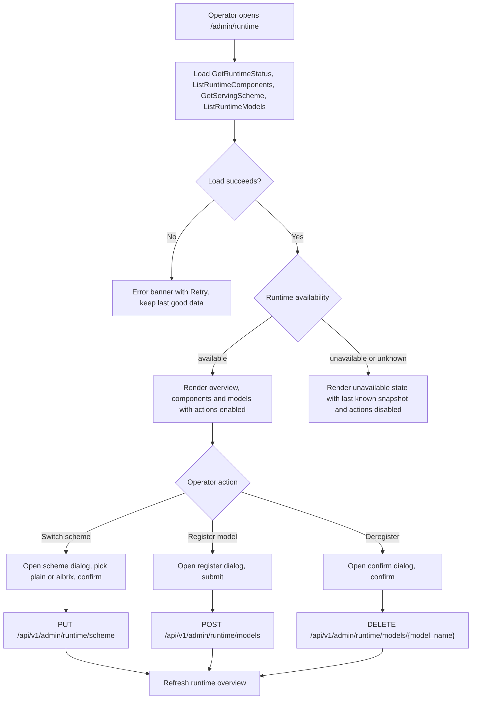
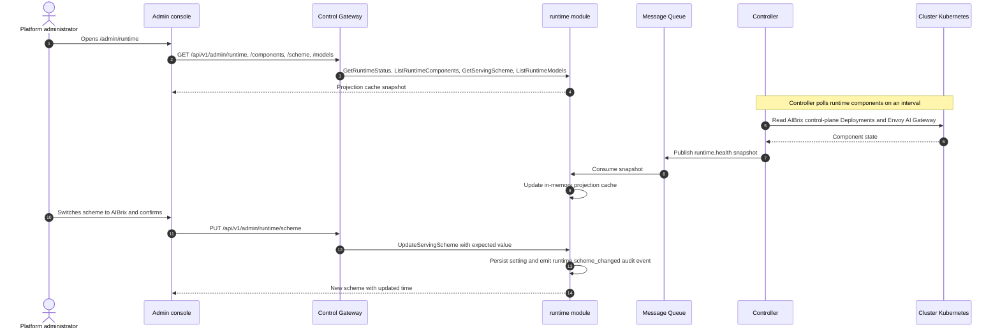
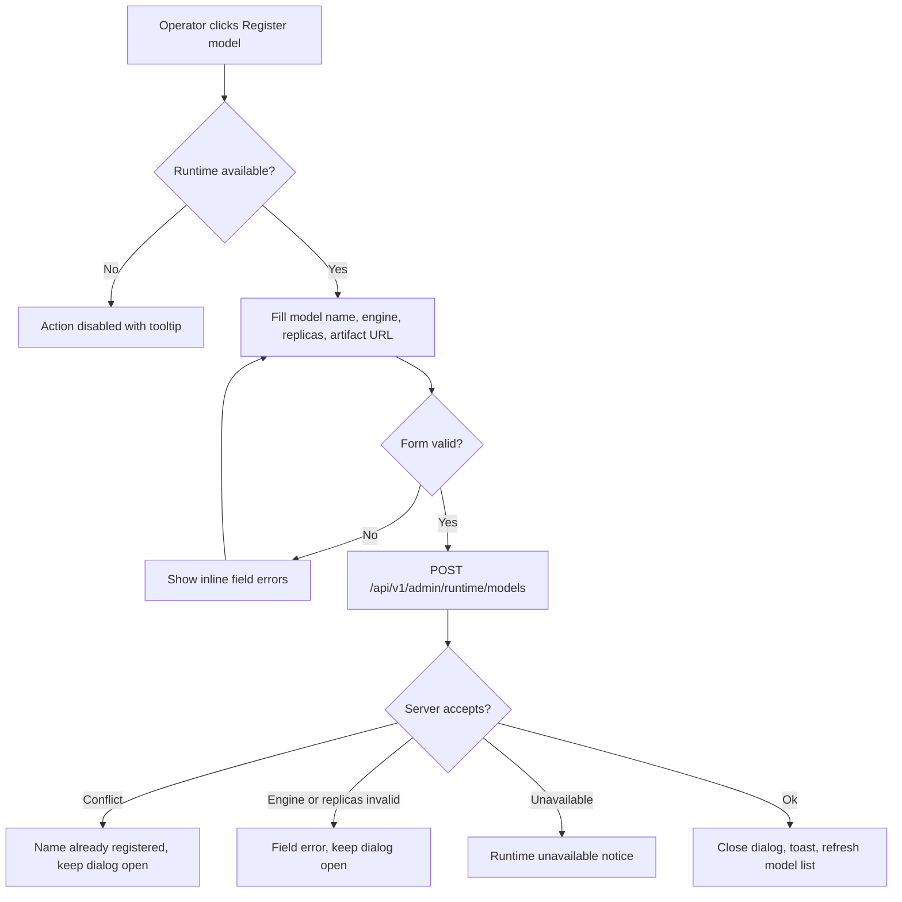

# Distributed Inference Runtime (AIBrix Integration) — Requirement Analysis and UI/UX Design

| Attribute | Content |
| --- | --- |
| Feature point | Distributed inference runtime — let a platform operator see the installed serving runtime and its health, choose the platform serving scheme, and manage the models registered with the runtime (backlog row 47) |
| Document scope | Requirement analysis, competitive research and the AIBrix / llm-d / KServe decision, the admin-surface page `/admin/runtime` (runtime overview, component health, serving-scheme switcher, registered-model table, register/deregister flows), the page → API surface table, and numbered acceptance criteria |
| Owning modules | `runtime` (new — owns the serving-scheme setting and the runtime-health and registered-model projections), `controller` (read-only: AIBrix control-plane health collection and `ModelClaim` projection publish), `infer` (read-only: the inference-service reconciliation path that the scheme selects), `audit` (scheme changes), `pkg/server` gateway (admin-prefix bindings), `web` admin console (`RuntimePage`) |
| Related documents | [Architecture Design](./architecture.md) — §1.1 control/data-plane separation, §2.4 `infer`, §2.7 Controller, §3.2 data plane (Envoy + Wasm) · [Inference Autoscaling & Scale-to-Zero](./inference-autoscaling.md) — the HPA/KEDA path that the plain scheme uses · [Model Catalog & One-Click Deployment](./model-catalog-deployment.md) — the inference-service lifecycle the scheme drives · [Accelerator Inventory & Health](./accelerator-inventory.md) — the Controller → MQ → service projection pattern this feature reuses · [Multi-Cluster Management](./multi-cluster-management.md) — the registered cluster the runtime control plane lives in · [System Health & Service Status](./system-health-status.md) — the component-health conventions this feature extends to the runtime · [Console Surface Separation](./console-surface-separation.md) — the two surfaces, the `AdminShell` conventions, the masked-projection rule |
| Status | Design complete, handed to the Architect agent |

---

## 1. Background and Competitive Research

### 1.1 Why a Distributed Inference Runtime Comes Now

go-taas's Controller today creates a **plain `apps/v1 Deployment` + a ClusterIP Service** per inference service — labelled `app.kubernetes.io/managed-by: taas-controller` — running `vllm.entrypoints.openai.api_server` against weights on a JuiceFS PVC, and creates a Kubernetes `HorizontalPodAutoscaler` (HPA) when autoscaling is enabled (feature #16). That path is fully sufficient for single-replica or simply replicated serving, but it has no KV-cache-aware routing, no prefill/decode disaggregation, and no multi-LoRA adapter management. Those are precisely the capabilities a distributed inference runtime provides.

The feature adds a **runtime-backed serving path**: the operator selects a platform-level *serving scheme*, and when the **AIBrix** scheme is selected the Controller additionally registers each model with AIBrix's control plane as a `ModelClaim` and uses AIBrix's `PodAutoscaler` instead of a plain HPA, so AIBrix supplies KV-cache-aware routing, LoRA adapters and distributed topologies. The console gains one page that shows the installed runtime and its health, switches the scheme, and manages the `ModelClaim` resources.

### 1.2 Runtime Decision: AIBrix vs llm-d vs KServe

The product owner has already run the research and chosen **AIBrix** as the distributed inference scheme. This section records the decision and its rationale.

| Candidate | What it is | Fit with go-taas | Verdict |
| --- | --- | --- | --- |
| **AIBrix** (`github.com/vllm-project/aibrix`) | A Kubernetes-native distributed inference runtime from the vLLM project: a control plane (`aibrix-controller-manager`, `aibrix-gateway-plugins`, `aibrix-gpu-optimizer`, `aibrix-metadata-service`, `aibrix-redis-master`) plus an Envoy AI Gateway data plane. Ships the CRDs a distributed-inference feature consumes: `ModelClaim` (declarative model registration — engine `vllm` / `sglang`, `artifactURL`, `replicas`, `podSelector`, `engineConfig.args`), `StormService` / `RoleSet` (prefill/decode disaggregation), `PodAutoscaler`, `KVCache`, and `ModelAdapter` (multi-LoRA). | **Already deployed on go-taas's target cluster `sd4090`** (`aibrix-system` namespace, Envoy AI Gateway `envoy-aibrix-system-aibrix-eg`). Apache-2.0, from the vLLM project — go-taas's primary inference engine is `ghcr.io/go-taas/vllm:v0.6.3`. Its control-plane / data-plane split mirrors go-taas (control gateway + controller + MQ, data plane Envoy + Wasm). Zero integration friction. | **Adopt** |
| **llm-d** | Gateway API Inference Extension (EPP) plus Helm charts, Kubernetes-only. | Heavy GAIE CRD dependency, Kubernetes-only with **no compose path**, and no hosted control plane reaching the dev laptop's compose stack. | Reject |
| **KServe** | `InferenceService` on Knative / Istio. | Very large dependency footprint (Knative Serving + Istio); it is a model-serving *platform* rather than a lightweight runtime control plane, and it would replace go-taas's own deployment model. | Reject |

**Adopted** (AIBrix): the CRDs (`ModelClaim` for declarative registration, `PodAutoscaler` for autoscaling), the control-plane/data-plane split, and the vLLM-project lineage. Because AIBrix is already installed on `sd4090`, the feature ships as a thin control surface over an existing runtime rather than a new runtime installation.

**Rejected** (llm-d, KServe): heavy additional dependencies (GAIE CRDs; Knative + Istio) that duplicate go-taas's own deployment and autoscaling control loop, and no path for the compose stack. go-taas keeps its Controller as the single reconciler and treats AIBrix as the optional distributed serving backend.

### 1.3 Comparable-Product Interaction Patterns

| Product | Runtime / serving configuration pattern | go-taas decision |
| --- | --- | --- |
| **OpenAI Platform** | A curated platform: operators choose an internal serving stack; tenants never see it; model availability is the only visible contract. | Adopt invisibility for tenants — the runtime is an admin-surface concern only (D1). |
| **Anthropic Console** | Internal runtime not exposed; model-level status is surfaced as availability, not as infrastructure. | Adopt — the admin page shows runtime health, tenants see only model availability. |
| **Together AI** | Cluster/endpoint operations are platform-internal; a console exposes endpoints and models, not the serving engine. | Adopt the endpoint/model view; go-taas additionally exposes runtime *health* to operators (D4). |
| **Volcengine Ark / Aliyun Bailian** | An endpoint is bound to a serving engine and replica count; autoscaling is a platform setting. | Adopt the engine (`vllm` / `sglang`) and replica fields on registered models (FR4). |
| **KServe / llm-d consoles** | Operator-facing infrastructure objects (`InferenceService`, `EndpointPickerConfig`) leak into the UI. | Reject leaking raw CRD/pod internals — the console shows a **masked** projection of runtime components and registered models (D6). |

### 1.4 Decisions and Scope

| # | Decision | Rationale |
| --- | --- | --- |
| D1 | **The feature is admin-only**: `/admin/runtime` + `/api/v1/admin/runtime/*`. There is **no end-user surface** — runtime components, serving scheme and `ModelClaim` registration are operator-orchestration (feature #17's masked-projection rule). Tenants consume models through the gateway and see only model availability | Runtime internals are operator-orchestration, consistent with the admin-only accelerator inventory (#18), system status (#30) and multi-cluster (#40) surfaces |
| D2 | **A new `runtime` module** (`services/runtime`) owns the serving-scheme setting and the runtime-health and registered-model projections, with its own error block **129xx**. `infer` still owns inference services, and the Controller still owns Kubernetes reconciliation | The runtime is a distinct concern (a platform-level scheme plus a control-plane projection) with its own registry and setting; a dedicated module keeps it separate from the per-tenant inference lifecycle |
| D3 | **AIBrix is the distributed serving scheme**, chosen over llm-d and KServe (§1.2). The serving scheme is a **platform-level setting** with values `plain` (Plain Deployment, default) and `aibrix` | AIBrix is already deployed on `sd4090`, is Apache-2.0 from the vLLM project, mirrors go-taas's control/data-plane split, and ships the CRDs this feature consumes |
| D4 | **Runtime component health is a projection of the cluster's Kubernetes state, collected by the Controller and served through the `runtime` module** — the Controller polls the AIBrix control-plane Deployments in `aibrix-system` (`aibrix-controller-manager`, `aibrix-gateway-plugins`, `aibrix-gpu-optimizer`, `aibrix-metadata-service`, `aibrix-redis-master`) and the Envoy AI Gateway (`envoy-aibrix-system-aibrix-eg`), and publishes a full snapshot to a new `runtime.health` MQ subject; the `runtime` module maintains an in-memory projection cache (the accelerator-inventory AD1 pattern) | The Controller is the only component with Kubernetes clients (accelerator-inventory AD1, service-logs AD2); the projection pattern keeps the health view dependency-light and self-healing (a removed component disappears from the next snapshot) |
| D5 | **Switching the serving scheme is a persisted platform setting** and is audited as `runtime.scheme_changed` with actor, before/after and timestamp. Switching **does not tear down existing services**; it applies to newly created or next-updated inference services | Scheme changes are consequential platform configuration that must be attributable; not tearing down running services keeps the switch safe and reversible, and bounds the increment (no in-place migration engine) |
| D6 | **The registered-model list is the `ModelClaim` projection, masked** — model name, engine, replicas, ready candidates, conditions and age. Raw pod names, endpoint secrets and container args are never shown | The console shows the operator-relevant model identity and status, not raw CRD internals (the §1.3 rejection) |
| D7 | **Registration validates engine ∈ {`vllm`, `sglang`} and `replicas ≥ 0`** (`0` = registered but scaled to zero), plus a required model name and artifact URL. The Controller translates the registration into an AIBrix `ModelClaim` (and `PodAutoscaler` when autoscaling applies) | Matches the AIBrix `ModelClaim` contract (engine, `artifactURL`, `replicas`, `podSelector`, `engineConfig.args`) and keeps the form the smallest implementing surface |
| D8 | **Explicit failure semantics**: a **user-realm** session calling `/api/v1/admin/runtime/*` is rejected with **10038 `CodeRealmMismatch`**; a session without the required role receives **10036 `CodeForbidden`**; when the **runtime is unavailable** (cluster unreachable or AIBrix not installed) reads return a degraded/`unknown` projection and the page shows a clear **runtime-unavailable** state with the last-known snapshot and reason — **it never crashes**, and register/deregister/scheme-switch are disabled | Realm separation is a hard product invariant; a cluster outage must degrade a read-only page gracefully instead of failing it |
| D9 | **New error codes in a runtime block (12901–12999)**, the next free block after prompt-evaluation's 128xx: **12901 `CodeRuntimeUnavailable`**, **12902 `CodeRuntimeSchemeInvalid`**, **12903 `CodeRuntimeModelNotFound`**, **12904 `CodeRuntimeModelExists`**, **12905 `CodeRuntimeEngineUnsupported`**, **12906 `CodeRuntimeReplicasInvalid`**, **12907 `CodeRuntimeModelNameInvalid`**. Unknown inference service reuses **10301** | A new module (D2) gets a fresh code block; distinct codes keep each failure mode actionable |
| D10 | **Read-only introspection works in both schemes** — when the scheme is `plain` the page shows the plain-Deployment fallback components (the Controller and the Kubernetes API) and an explanatory empty registered-model table; the AIBrix component list appears only when AIBrix is installed/observed | The operator must be able to see the *current* runtime regardless of scheme; the plain path must not look broken, and the AIBrix-only sections must explain their empty state |

**In scope**: one admin page (`/admin/runtime`) with the runtime overview, component-health table, serving-scheme switcher, registered-model table, register-model dialog and deregister confirmation; the `runtime` module RPCs; the Controller → MQ → `runtime` health and model projections; the audited scheme change.

**Out of scope** (tracked elsewhere or deliberately excluded): installation or upgrade of AIBrix itself (go-taas observes an already-installed runtime), per-service runtime selection (the scheme is platform-level in this increment), in-place migration of running services when the scheme changes (the next update applies the scheme), LoRA-adapter and prefill/decode topology configuration (AIBrix ships them; this increment only registers `ModelClaim` models), GPU/card inventory (#18), per-cluster placement (#40), and any end-user runtime surface (deliberately absent, D1).

---

## 2. User Roles

| Role | Description | Interaction with the inference runtime |
| --- | --- | --- |
| **Platform administrator** | The operator who runs the go-taas platform and its inference fleet | Views runtime components and health, chooses the serving scheme, and registers/deregisters models with the runtime |
| **Tenant administrator** | Administers an organization and grants it models | No runtime surface: grants models via the existing admin model authorization (#13); never sees components, the scheme or `ModelClaim` resources |
| **Agent / SDK** | The programmatic consumer that calls `/v1/chat/completions` | Never touches the runtime; consumes an authorized model through the gateway with an API Key |

> Terminology: the consumer-side caller is called an **Agent** (English) / 「智能体」(Chinese), consistent with the repo convention. This feature is admin-only, so the consumer-side terminology does not apply to a tenant surface.

---

## 3. User Stories

| # | As a… | I want to… | So that… |
| --- | --- | --- | --- |
| US1 | Platform administrator | see which inference runtime is installed and whether each control-plane component and the Envoy gateway is ready | I can tell at a glance whether distributed serving is healthy |
| US2 | Platform administrator | see the current serving scheme and switch between Plain Deployment and AIBrix | I can turn on AIBrix-backed serving when I need KV-cache-aware routing and distributed topologies |
| US3 | Platform administrator | list the models registered with the runtime, with engine, replicas, ready candidates and conditions | I can track what the runtime is actually serving |
| US4 | Platform administrator | register a model with the runtime (name, engine `vllm`/`sglang`, replicas, artifact URL) | AIBrix can serve it through its control plane |
| US5 | Platform administrator | deregister a model from the runtime after a confirmation | I can stop the runtime serving a model without touching the model catalog |
| US6 | Platform administrator | see a clear degraded state when the cluster or runtime is unreachable | I understand an outage instead of facing a broken page |
| US7 | Agent / SDK | call an authorized model through the gateway | I get completions without knowing which runtime serves the model |

---

## 4. Functional Requirements

### FR1 — Runtime overview and component health

- **FR1.1** `GetRuntimeStatus` (`GET /api/v1/admin/runtime`) returns the runtime overview: `scheme` (`plain` / `aibrix`), `availability` (`available` / `degraded` / `unavailable` / `unknown`), `runtime_name` (`plain` / `aibrix`), `runtime_version` (optional, reported by AIBrix), `cluster_name`, `last_checked_at`, and a `components[]` array (FR1.2).
- **FR1.2** `ListRuntimeComponents` (`GET /api/v1/admin/runtime/components`) returns the runtime components, each with `component_id`, `name`, `kind` (`control_plane` / `gateway` / `fallback`), `namespace`, `status` (`ready` / `progressing` / `degraded` / `unavailable` / `unknown`), `ready_replicas`, `desired_replicas`, and `last_checked_at`. When the scheme is `aibrix`, the AIBrix control-plane components and the Envoy AI Gateway are returned; when the scheme is `plain`, the plain-Deployment fallback components (the go-taas Controller and the Kubernetes API) are returned (D10).
- **FR1.3** The Controller polls the runtime components on an interval (default 30 s) and publishes a full snapshot to the `runtime.health` MQ subject; the `runtime` module maintains an in-memory projection cache (D4). A component removed from the cluster disappears from the next snapshot.
- **FR1.4** When the cluster is unreachable or the runtime is not installed, the reads return `availability=unavailable`/`unknown` with the last-known component snapshot and a `reason` string; they never return an error that breaks the page (D8).

### FR2 — Serving scheme

- **FR2.1** `GetServingScheme` (`GET /api/v1/admin/runtime/scheme`) returns the current platform serving scheme: `scheme` (`plain` / `aibrix`), `updated_at`, `updated_by`, and the scheme descriptions.
- **FR2.2** `UpdateServingScheme` (`PUT /api/v1/admin/runtime/scheme`) sets the scheme to `plain` or `aibrix`. A value other than those two returns **12902 `CodeRuntimeSchemeInvalid`**.
- **FR2.3** Switching the scheme persists the setting and emits a `runtime.scheme_changed` audit event with `actor`, `before`, `after` and `timestamp`; it is idempotent (setting the current scheme is a no-op success) and creates no audit event when unchanged (D5).
- **FR2.4** Switching the scheme does **not** tear down existing inference services; existing services keep running, and the scheme applies to newly created or next-updated services (D5).
- **FR2.5** Selecting `aibrix` when the runtime is `unavailable` is rejected with **12901 `CodeRuntimeUnavailable`** (an operator cannot switch to a runtime that is not observed).

### FR3 — Registered models

- **FR3.1** `ListRuntimeModels` (`GET /api/v1/admin/runtime/models`) returns the models registered with the runtime (the `ModelClaim` projection, D6), each with `model_name`, `engine` (`vllm` / `sglang`), `replicas` (desired), `ready_replicas`, `ready_candidates`, `conditions[]`, `status` (`ready` / `progressing` / `degraded` / `failed` / `unknown`), and `age`/`created_at`. It supports `page_size` / `page_token` pagination, a `name` search, and `engine` / `status` filters.
- **FR3.2** An unknown `model_name` returns **12903 `CodeRuntimeModelNotFound`**.

### FR4 — Register and deregister a model

- **FR4.1** `RegisterRuntimeModel` (`POST /api/v1/admin/runtime/models`) registers a model with the runtime with **Model name** (required, 1–128 chars, pattern `^[a-z0-9][a-z0-9._-]*$`), **Engine** (required, one of `vllm` / `sglang`), **Replicas** (required integer, `0`–`32`, default `1`), **Artifact URL** (required, 1–512 chars — the weights location), an optional **Pod selector**, and optional **Engine args**. It returns the created registration.
- **FR4.2** Validation: a missing or empty **Model name** returns **12907 `CodeRuntimeModelNameInvalid`**; a duplicate **Model name** returns **12904 `CodeRuntimeModelExists`**; an engine outside `{vllm, sglang}` returns **12905 `CodeRuntimeEngineUnsupported`**; `replicas < 0` or `> 32` returns **12906 `CodeRuntimeReplicasInvalid`**; a missing **Artifact URL** is rejected as a required-field error (12907-family field validation, the exact field code chosen by the Architect). `replicas = 0` is valid (registered but scaled to zero).
- **FR4.3** Registering a model when the runtime is `unavailable` returns **12901 `CodeRuntimeUnavailable`** and the UI disables the action (D8).
- **FR4.4** `DeregisterRuntimeModel` (`DELETE /api/v1/admin/runtime/models/{model_name}`) removes the `ModelClaim` and returns success; deregistering the runtime's running pods is AIBrix's responsibility. It is idempotent-safe: an unknown `model_name` returns **12903**. Deregistering does **not** delete the model from the catalog (feature #2).
- **FR4.5** Register/deregister and the scheme change are audited (`runtime.model_registered`, `runtime.model_deregistered`, `runtime.scheme_changed`) with the acting operator.

### FR5 — Surface, realm and API binding

- **FR5.1** The runtime page lives on the **admin surface**: route `/admin/runtime`, API prefix `/api/v1/admin/runtime/*`. It is added to the `AdminShell` navigation (feature #17) under the **Operations** group as **Runtime**.
- **FR5.2** There is **no end-user surface** for the runtime (D1): tenants never see components, the scheme or registered models. The admin page calls only `/api/v1/admin/runtime/*` routes and contains no `/api/v1/*` string (feature #17, D1).
- **FR5.3** A valid **user-realm** session token sent to any `/api/v1/admin/runtime/*` route is rejected with **10038 `CodeRealmMismatch`**; a session without the required role receives **10036 `CodeForbidden`** (D8). The runtime page requires the admin session realm (`/admin/login`).

---

## 5. Page and Flow Design

### 5.1 Surface Assignment

| Feature | Surface | Web route | API prefix |
| --- | --- | --- | --- |
| Runtime overview + component health | admin | `/admin/runtime` | `/api/v1/admin/runtime`, `/api/v1/admin/runtime/components` |
| Serving scheme (read/switch) | admin | `/admin/runtime` | `/api/v1/admin/runtime/scheme` |
| Registered-model list | admin | `/admin/runtime` | `/api/v1/admin/runtime/models` |
| Register model | admin | `/admin/runtime` (register dialog) | `/api/v1/admin/runtime/models` |
| Deregister model | admin | `/admin/runtime` (deregister confirmation) | `/api/v1/admin/runtime/models/{model_name}` |

Every page and API call above is on the **admin surface**; there is no end-user surface (D1). The admin page never calls a `/api/v1/*` route, and the admin session realm is used throughout.

### 5.2 Page Map

| Page / component | Purpose |
| --- | --- |
| **Runtime page** (`/admin/runtime`) | Runtime overview (scheme + availability), component-health table, registered-model table, scheme switcher, register-model dialog, deregister confirmation |

There is one page; the scheme switcher, register dialog and deregister confirmation are components on it, not separate routes.

### 5.3 Page: `/admin/runtime` — Inference Runtime (admin)

**Purpose**: give the platform administrator a single surface to see the installed inference runtime and its health, choose the serving scheme, and manage the models registered with the runtime.

**Surface**: admin — route `/admin/runtime`, API `/api/v1/admin/runtime/*`.

**Navigation placement**: `AdminShell` sidebar, **Operations** group, item **Runtime** (between **Clusters** and **Status**).

**Layout**: rendered inside `AdminShell` (feature #17). A page header ("Inference runtime", subtitle "Serving scheme, runtime components and registered models") with a **Refresh** action (secondary) and a **Switch scheme** action (primary). Below, three regions:

1. **Overview card** — a status band with the current **Serving scheme** badge (`Plain Deployment` / `AIBrix`), the **Runtime availability** badge (`Available` / `Degraded` / `Unavailable` / `Unknown`), the runtime name and version when reported, the reachable cluster name, and the **Last checked** time. When `availability` is not `available`, a prominent inline notice explains the state (e.g. "AIBrix control plane is not reachable. Showing the last known component snapshot.") with a **Retry** action (D8).
2. **Components card** — a table of runtime components with columns: **Component**, **Kind** (badge: `Control plane` / `Gateway` / `Fallback`), **Namespace**, **Status** (badge), **Ready** (`ready/desired` replicas), **Last checked**. Sortable by Component, Kind, Status; filterable by Status; no pagination (the component set is small). Row action **—** (read-only).
3. **Registered models card** — a table of the models registered with the runtime with columns: **Model** (name), **Engine** (badge `vllm` / `sglang`), **Replicas** (`desired`), **Ready candidates** (`ready_replicas / desired`), **Status** (badge), **Age**, **Actions** (**Deregister**, danger, secondary). Sortable by Model, Engine, Replicas, Age; filterable by Engine and Status; searchable by model name; paginated (20 per page). Header action **Register model** (primary).

**Interactive states**:

| State | Behaviour |
| --- | --- |
| Default | The overview card, component table and registered-model table render from the first successful load |
| Loading | Skeleton cards and rows; Refresh, Switch scheme and Register model are disabled |
| Empty (no components) | "No runtime components reported yet." with a hint that components appear after the first health snapshot; the header stays visible (D10) |
| Empty (no registered models) | When `scheme=plain`: "No models are registered with the runtime. The platform is using Plain Deployment." with a note to switch the scheme. When `scheme=aibrix`: "No models registered with AIBrix yet." with a **Register model** action |
| Error (load failed) | An error banner "Could not load the inference runtime." with a **Retry** button; the page keeps its last good data with a "Showing stale data" banner |
| Runtime unavailable | `availability=unavailable`/`unknown`: the overview shows the unavailable badge and reason, the component table shows the last-known snapshot (or the empty state), and **Switch scheme**, **Register model**, and **Deregister** are disabled with explanatory tooltips. The page never crashes (D8) |
| Disabled | Refresh, Switch scheme, Register model are disabled while a load is in flight; Register model and Deregister are additionally disabled when the runtime is unavailable (D8) |
| Permission-denied | A session without the required role receives **10036** and the page shows the standard permission-denied state (feature #17) with a link back to `/admin` |

**Overview badges**: Serving scheme — `Plain Deployment` (neutral) / `AIBrix` (info). Runtime availability — `Available` (green) / `Degraded` (amber) / `Unavailable` (red) / `Unknown` (grey). Component/model status badges — `Ready` (green) / `Progressing` (blue) / `Degraded` (amber) / `Unavailable`|`Failed` (red) / `Unknown` (grey).

**Scheme switcher**: a segmented control (radio group) in a dialog opened by the **Switch scheme** header action, with two options:

- **Plain Deployment** (default) — "go-taas creates a Kubernetes Deployment and Service (and an HPA for autoscaling) per inference service."
- **AIBrix** — "go-taas registers each model as an AIBrix ModelClaim and uses AIBrix's PodAutoscaler. AIBrix provides KV-cache-aware routing, LoRA adapters and distributed topologies."

Selecting a non-current option enables **Apply**. Applying opens a confirmation dialog: "Switch serving scheme to `<scheme>`? New and updated inference services will be served through `<scheme>`. Existing services keep running until they are next updated." with **Switch** (primary) and **Cancel**. Confirming calls `UpdateServingScheme` and shows a toast "Serving scheme updated."; the overview badge updates. Selecting `AIBrix` while the runtime is `unavailable` keeps **Apply** disabled with the tooltip "AIBrix is not available. Select it after the runtime is reachable." (FR2.5, D8).

**Register-model dialog** (fields, validation rules and error copy):

| Field | Type | Required | Validation | Error copy |
| --- | --- | --- | --- | --- |
| Model name | text | yes | 1–128 chars, `^[a-z0-9][a-z0-9._-]*$`, unique among registered models | "Enter a lowercase model name (letters, digits, `.`, `_`, `-`)." / "A model with this name is already registered." (12904) / "Enter a valid model name." (12907) |
| Engine | select (`vllm`, `sglang`) | yes | must be one of the two | "Select a supported engine (vllm or sglang)." (12905) |
| Replicas | integer stepper | yes | `0`–`32`, default `1` | "Enter a whole number between 0 and 32." (12906) |
| Artifact URL | text | yes | 1–512 chars | "Enter the model weights location." |
| Pod selector | key/value list | no | each key `^[a-z0-9A-Z._/-]+$`, each value ≤ 253 chars | "Enter selector labels as key=value." |
| Engine args | key/value list or JSON | no | well-formed | "Engine args must be valid key=value pairs." |

The dialog footer has **Cancel** (secondary) and **Register model** (primary, disabled until valid). When the runtime is `unavailable` the dialog cannot open and the header action is disabled (D8).

**Deregister confirmation**: "Deregister `<model>`? AIBrix will stop serving this model and the running pods will be terminated. This does not delete the model from the catalog." with **Deregister** (danger) and **Cancel**. Confirming calls `DeregisterRuntimeModel` and shows a toast "Model deregistered."; the row disappears after a refresh.

### 5.4 Flows

---

## 6. API Surface Implications

The runtime RPCs belong to the **`runtime` module** (D2), served as HTTP via the Control Gateway on the **admin prefix** `/api/v1/admin/runtime/*`. The Controller polls the runtime components and publishes health snapshots through the MQ (D4). The `infer` module keeps owning inference services and applies the platform scheme to new/updated services (D5). There is **no user-prefix binding** (D1).

| RPC | Route | Prefix | Status | Purpose |
| --- | --- | --- | --- | --- |
| `GetRuntimeStatus` (new `taas.runtime.v1`) | `GET /api/v1/admin/runtime` | admin | **new** | Runtime overview: scheme, availability, runtime name/version, cluster, last checked, reason |
| `ListRuntimeComponents` | `GET /api/v1/admin/runtime/components` | admin | **new** | Runtime components with kind, namespace, status, ready/desired replicas |
| `GetServingScheme` | `GET /api/v1/admin/runtime/scheme` | admin | **new** | Current platform serving scheme with update metadata |
| `UpdateServingScheme` | `PUT /api/v1/admin/runtime/scheme` | admin | **new** | Set the scheme to `plain` or `aibrix`, audited, idempotent |
| `ListRuntimeModels` | `GET /api/v1/admin/runtime/models` | admin | **new** | Registered models (`ModelClaim` projection) with pagination, search and filters |
| `RegisterRuntimeModel` | `POST /api/v1/admin/runtime/models` | admin | **new** | Register a model (name, engine, replicas, artifact URL, pod selector, engine args) |
| `DeregisterRuntimeModel` | `DELETE /api/v1/admin/runtime/models/{model_name}` | admin | **new** | Remove a model registration |

**Contract notes for the Architect agent**:

1. `GetRuntimeStatus` and `ListRuntimeComponents` are reads over the `runtime` module's in-memory projection cache; they never fail with a transport error when the cluster is unreachable — they return `availability=unavailable`/`unknown` with the last-known snapshot and a `reason` (FR1.4, D8).
2. `UpdateServingScheme` accepts `scheme` ∈ `{plain, aibrix}` and rejects any other value with **12902**; switching to `aibrix` while the runtime is `unavailable` returns **12901**; setting the current scheme is a no-op success with no audit event (FR2.2–FR2.5).
3. `RegisterRuntimeModel` takes `model_name`, `engine`, `replicas`, `artifact_url`, optional `pod_selector` and `engine_args`; validation codes 12904–12907 apply (FR4.2). `replicas = 0` is valid (FR4.1).
4. `DeregisterRuntimeModel` removes the `ModelClaim`; an unknown `model_name` returns **12903** and it does not touch the model catalog (FR4.4).
5. The Controller translates a runtime registration into an AIBrix `ModelClaim` (engine `vllm`/`sglang`, `artifactURL`, `replicas`, `podSelector`, `engineConfig.args`) and uses AIBrix's `PodAutoscaler` in place of a plain HPA when autoscaling applies (D3, D7). The plain scheme keeps today's Deployment + Service + HPA path unchanged.
6. Schema/wire conventions unchanged: HTTP 200 on success, business errors as `{"code": <int>, "message": "..."}`, int64 fields serialized as JSON strings.

Error codes (`pkg/errors/codes.go`):

| Condition | Code | Constant | Notes |
| --- | --- | --- | --- |
| Runtime unavailable (cluster unreachable / AIBrix not installed) | 12901 | `CodeRuntimeUnavailable` | **New** (D9) |
| Invalid serving scheme | 12902 | `CodeRuntimeSchemeInvalid` | **New** (D9) |
| Unknown registered model | 12903 | `CodeRuntimeModelNotFound` | **New** (D9) |
| Duplicate registered model | 12904 | `CodeRuntimeModelExists` | **New** (D9) |
| Unsupported engine | 12905 | `CodeRuntimeEngineUnsupported` | **New** (D9) |
| Invalid replicas | 12906 | `CodeRuntimeReplicasInvalid` | **New** (D9) |
| Invalid model name | 12907 | `CodeRuntimeModelNameInvalid` | **New** (D9) |
| User-realm session on an admin route | 10038 | `CodeRealmMismatch` | Reused — realm separation (FR5.3, D8) |
| Session without the required role | 10036 | `CodeForbidden` | Reused — permission denial (FR5.3, D8) |

---

## 7. Acceptance Criteria

| # | Criterion | Level |
| --- | --- | --- |
| AC1 | `/admin/runtime` renders from the first successful load with the overview card (serving scheme + availability badges), the component table and the registered-model table | Nightwatch E2E |
| AC2 | The component table lists the AIBrix control-plane components (`aibrix-controller-manager`, `aibrix-gateway-plugins`, `aibrix-gpu-optimizer`, `aibrix-metadata-service`, `aibrix-redis-master`) and the Envoy AI Gateway (`envoy-aibrix-system-aibrix-eg`) with Kind/Namespace/Status/Ready columns and status badges when the scheme is `aibrix` | Nightwatch E2E |
| AC3 | The scheme switcher shows the current scheme and switching to the other scheme requires the confirmation dialog; applying updates the overview badge; the change is idempotent when the same scheme is reapplied | Nightwatch E2E |
| AC4 | The registered-model table shows Model, Engine (vllm/sglang badge), Replicas, Ready candidates, Status, Age; it supports sorting, engine/status filtering, name search and pagination | Nightwatch E2E |
| AC5 | The register-model dialog validates the model name (pattern + uniqueness), engine ∈ {vllm, sglang}, replicas 0–32 and a required artifact URL, showing the specified error copy; a valid submission adds a row | Nightwatch E2E |
| AC6 | Deregister asks for confirmation with the specified copy; confirming removes the row and shows a toast; the catalog model is not deleted | Nightwatch E2E |
| AC7 | When the runtime is unavailable (cluster unreachable), the page shows the unavailable badge with the last-known component snapshot, the Retry action works, and Switch scheme / Register model / Deregister are disabled — the page does not crash | Nightwatch E2E |
| AC8 | **Negative realm separation**: a valid user-realm session token sent to `GET /api/v1/admin/runtime` is rejected with code **10038**; the end-user console has no `/runtime` route or runtime API; the admin page contains no `/api/v1/*` call | FVT + Nightwatch E2E |
| AC9 | A session without the required role receives **10036** and the page shows the standard permission-denied state with a link back to `/admin` | Nightwatch E2E |
| AC10 | A scheme change emits a `runtime.scheme_changed` audit event with actor, before and after; register/deregister emit `runtime.model_registered` / `runtime.model_deregistered` | FVT |
| AC11 | The plain scheme shows the fallback components and an explanatory empty registered-model state; switching to `aibrix` while the runtime is unavailable returns **12901** and is blocked in the UI | Nightwatch E2E + FVT |
| AC12 | The page provides loading, empty, stale-error, disabled and permission-denied states as specified in §5.3 | Nightwatch E2E |

---

## 8. Out of Scope (tracked elsewhere)

| Item | Where |
| --- | --- |
| Installing, upgrading or configuring AIBrix itself | go-taas observes an already-installed runtime |
| Per-service runtime selection | The scheme is platform-level in this increment |
| In-place migration of running services on a scheme change | The next service update applies the scheme (D5) |
| LoRA-adapter and prefill/decode topology configuration | AIBrix ships them; this increment registers `ModelClaim` models only |
| The accelerator inventory | Feature #18 accelerator inventory |
| Per-cluster placement and the cluster registry | Feature #40 multi-cluster management |
| The model catalog and one-click deployment | Feature #2 model catalog & deployment |
| An end-user runtime surface | Deliberately absent (D1) — tenants consume models, not runtimes |
