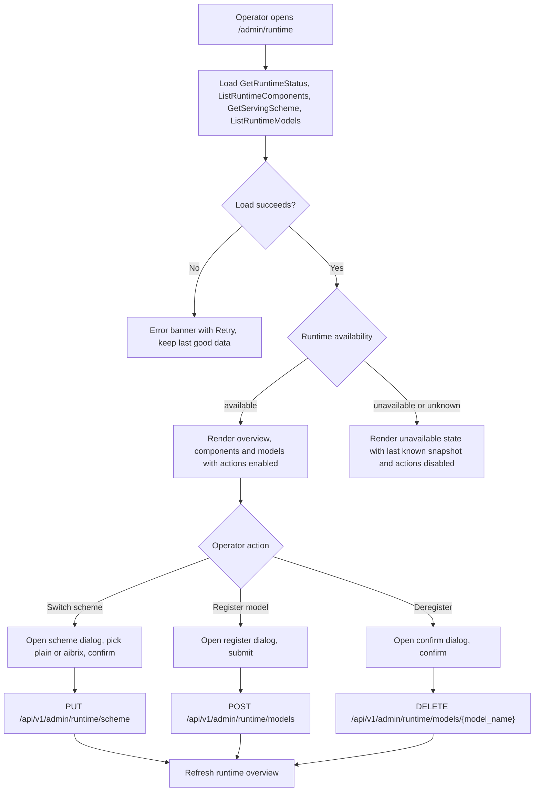
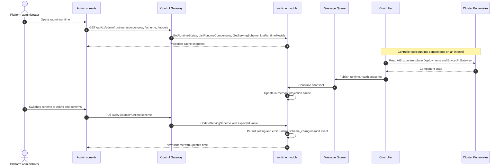
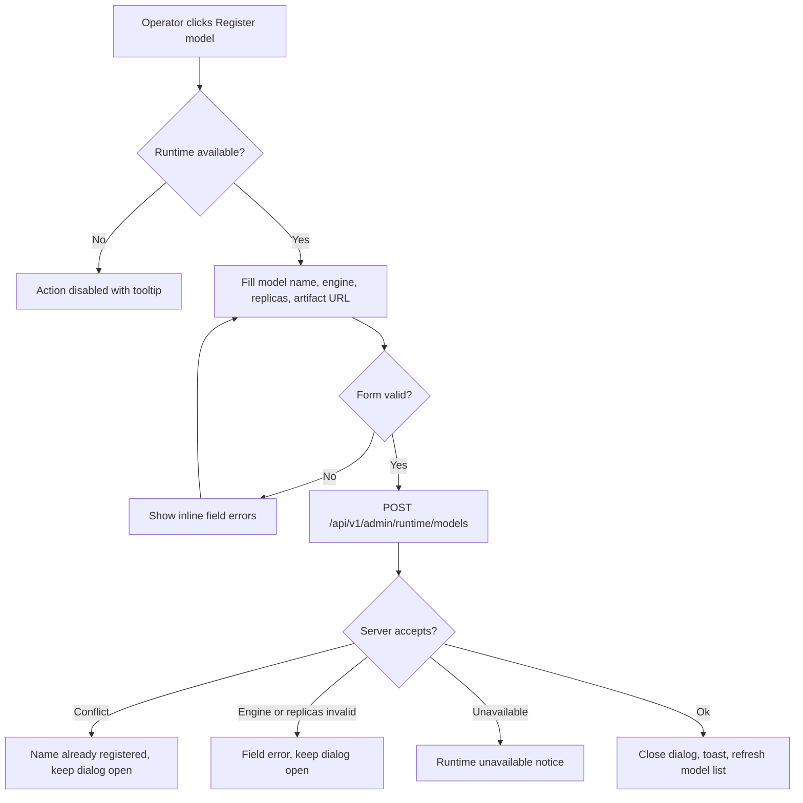

# 分布式推理运行时（AIBrix 集成） — 需求分析与 UI/UX 设计

| 属性 | 内容 |
| --- | --- |
| 特性点 | 分布式推理运行时 — 让平台运营者查看已安装的推理运行时及其健康、选择平台服务方案、并管理与运行时注册的模型（backlog 第 47 行） |
| 文档范围 | 需求分析、竞品调研与 AIBrix / llm-d / KServe 决策、管理面页面 `/admin/runtime`（运行时概览、组件健康、服务方案切换器、已注册模型表、注册/注销流程）、页面 → API 面映射表，以及编号验收标准 |
| 归属模块 | `runtime`（新增 — 拥有服务方案设置与运行时健康及已注册模型投影）、`controller`（只读：AIBrix 控制面健康采集与 `ModelClaim` 投影发布）、`infer`（只读：方案所选择的推理服务调和路径）、`audit`（方案变更）、`pkg/server` 网关（管理前缀绑定）、`web` 管理控制台（`RuntimePage`） |
| 相关文档 | [架构设计](./architecture.md) — 第 1.1 节控制/数据面分离、第 2.4 节 `infer`、第 2.7 节 Controller、第 3.2 节数据面（Envoy + Wasm） · [推理自动扩缩容与缩容至零](./inference-autoscaling.md) — 朴素方案所用的 HPA/KEDA 路径 · [模型目录与一键部署](./model-catalog-deployment.md) — 方案所驱动的推理服务生命周期 · [加速器清单与健康](./accelerator-inventory.md) — 本特性复用的 Controller → MQ → 服务投影模式 · [多集群管理](./multi-cluster-management.md) — 运行时控制面所在的已注册集群 · [系统健康与服务状态](./system-health-status.md) — 本特性扩展到运行时的组件健康约定 · [控制台面分离](./console-surface-separation.md) — 两个面、`AdminShell` 约定、掩码投影规则 |
| 状态 | 设计完成，已移交架构师代理 |

---

## 1. 背景与竞品调研

### 1.1 为什么现在做分布式推理运行时

go-taas 的 Controller 今天为每个推理服务创建**朴素的 `apps/v1 Deployment` + ClusterIP Service** — 标签为 `app.kubernetes.io/managed-by: taas-controller` — 对 JuiceFS PVC 上的权重运行 `vllm.entrypoints.openai.api_server`，并在启用自动扩缩容时（特性 #16）创建 Kubernetes `HorizontalPodAutoscaler`（HPA）。该路径对单副本或简单复制服务完全够用，但没有 KV-cache 感知路由、没有 prefill/decode 解耦、也没有多 LoRA 适配器管理。这些正是分布式推理运行时提供的能力。

本特性新增**运行时支撑的服务路径**：运营者选择平台级*服务方案*，当选择 **AIBrix** 方案时，Controller 额外把每个模型作为 `ModelClaim` 注册到 AIBrix 控制面，并使用 AIBrix 的 `PodAutoscaler` 取代朴素 HPA，从而由 AIBrix 提供 KV-cache 感知路由、LoRA 适配器与分布式拓扑。控制台新增一个页面，展示已安装运行时及其健康、切换方案并管理 `ModelClaim` 资源。

### 1.2 运行时决策：AIBrix vs llm-d vs KServe

产品负责人已完成调研并选择 **AIBrix** 作为分布式推理方案。本节记录该决策及其依据。

| 候选 | 是什么 | 与 go-taas 的契合度 | 结论 |
| --- | --- | --- | --- |
| **AIBrix**（`github.com/vllm-project/aibrix`） | 来自 vLLM 项目的 Kubernetes 原生分布式推理运行时：控制面（`aibrix-controller-manager`、`aibrix-gateway-plugins`、`aibrix-gpu-optimizer`、`aibrix-metadata-service`、`aibrix-redis-master`）加 Envoy AI Gateway 数据面。提供分布式推理特性所需的 CRD：`ModelClaim`（声明式模型注册 — 引擎 `vllm` / `sglang`、`artifactURL`、`replicas`、`podSelector`、`engineConfig.args`）、`StormService` / `RoleSet`（prefill/decode 解耦）、`PodAutoscaler`、`KVCache`、`ModelAdapter`（多 LoRA）。 | **已部署在 go-taas 的目标集群 `sd4090`**（`aibrix-system` 命名空间，Envoy AI Gateway `envoy-aibrix-system-aibrix-eg`）。Apache-2.0，来自 vLLM 项目 — go-taas 的主推理引擎是 `ghcr.io/go-taas/vllm:v0.6.3`。其控制面/数据面拆分与 go-taas 镜像（控制网关 + controller + MQ，数据面 Envoy + Wasm）。零集成摩擦。 | **采纳** |
| **llm-d** | Gateway API Inference Extension（EPP）加 Helm chart，仅 Kubernetes。 | 繁重的 GAIE CRD 依赖，**仅 Kubernetes 且无 compose 路径**，没有托管控制面能触达开发笔记本的 compose 栈。 | 拒绝 |
| **KServe** | 基于 Knative / Istio 的 `InferenceService`。 | 依赖体积非常大（Knative Serving + Istio）；它是模型服务*平台*而非轻量运行时控制面，并且会取代 go-taas 自身的部署模型。 | 拒绝 |

**采纳**（AIBrix）：CRD（用于声明式注册的 `ModelClaim`、用于自动扩缩容的 `PodAutoscaler`）、控制面/数据面拆分，以及 vLLM 项目血统。由于 AIBrix 已安装在 `sd4090`，本特性作为对既有运行时的薄控制面交付，而非安装新运行时。

**拒绝**（llm-d、KServe）：沉重的额外依赖（GAIE CRD；Knative + Istio），它们重复 go-taas 自身的部署与自动扩缩容控制回路，且无 compose 栈路径。go-taas 保持 Controller 为唯一 reconciler，把 AIBrix 作为可选的分布式服务后端。

### 1.3 竞品交互模式

| 产品 | 运行时 / 服务配置模式 | go-taas 决策 |
| --- | --- | --- |
| **OpenAI Platform** | 精选平台：运营者选择内部服务栈；租户从不看到它；模型可用性是唯一可见契约。 | 采纳租户不可见 — 运行时仅为管理面关注点（D1）。 |
| **Anthropic Console** | 内部运行时不暴露；模型级状态以可用性呈现，而非基础设施。 | 采纳 — 管理页展示运行时健康，租户只见模型可用性。 |
| **Together AI** | 集群/端点运维为平台内部；控制台暴露端点与模型，而非服务引擎。 | 采纳端点/模型视图；go-taas 额外向运营者暴露运行时*健康*（D4）。 |
| **火山方舟 / 阿里云百炼** | 端点绑定服务引擎与副本数；自动扩缩容是平台设置。 | 采纳引擎（`vllm` / `sglang`）与副本字段作为已注册模型属性（FR4）。 |
| **KServe / llm-d 控制台** | 运营者面基础设施对象（`InferenceService`、`EndpointPickerConfig`）泄漏进 UI。 | 拒绝泄漏原始 CRD/Pod 内部信息 — 控制台展示运行时组件与已注册模型的**掩码**投影（D6）。 |

### 1.4 决策与范围

| # | 决策 | 依据 |
| --- | --- | --- |
| D1 | **本特性仅管理面**：`/admin/runtime` + `/api/v1/admin/runtime/*`。**无终端用户面** — 运行时组件、服务方案与 `ModelClaim` 注册是运营者编排（特性 #17 的掩码投影规则）。租户经网关消费模型，仅看到模型可用性 | 运行时内部信息是运营者编排，与仅管理面的加速器清单（#18）、系统状态（#30）、多集群（#40）面一致 |
| D2 | **新增 `runtime` 模块**（`services/runtime`）拥有服务方案设置以及运行时健康与已注册模型投影，带自有错误块 **129xx**。`infer` 仍拥有推理服务，Controller 仍拥有 Kubernetes 调和 | 运行时是独立关注点（平台级方案加控制面投影），有自己的注册表与设置；专用模块把它与按租户的推理生命周期分离 |
| D3 | **AIBrix 是分布式服务方案**，优于 llm-d 与 KServe（§1.2）。服务方案是**平台级设置**，取值 `plain`（朴素部署，默认）与 `aibrix` | AIBrix 已部署在 `sd4090`，是 vLLM 项目的 Apache-2.0 成果，镜像 go-taas 的控制/数据面拆分，并自带本特性所需的 CRD |
| D4 | **运行时组件健康是集群 Kubernetes 状态的投影，由 Controller 采集并经 `runtime` 模块提供** — Controller 轮询 `aibrix-system` 中 AIBrix 控制面 Deployment（`aibrix-controller-manager`、`aibrix-gateway-plugins`、`aibrix-gpu-optimizer`、`aibrix-metadata-service`、`aibrix-redis-master`）与 Envoy AI Gateway（`envoy-aibrix-system-aibrix-eg`），并向新 `runtime.health` MQ subject 发布完整快照；`runtime` 模块维护内存投影缓存（accelerator-inventory AD1 模式） | Controller 是唯一持有 Kubernetes 客户端的组件（accelerator-inventory AD1、service-logs AD2）；投影模式保持健康视图依赖精简且自愈（移除的组件从下一快照消失） |
| D5 | **切换服务方案是持久化的平台设置**，并作为 `runtime.scheme_changed` 审计，带 actor、before/after 与时间戳。切换**不拆除既有服务**；它应用于新建或下次更新的推理服务 | 方案变更是重大平台配置，必须可归因；不拆除运行中服务使切换安全可逆，并限定增量范围（无就地迁移引擎） |
| D6 | **已注册模型列表是 `ModelClaim` 投影，掩码呈现** — 模型名、引擎、副本、就绪候选、conditions 与 age。从不展示原始 Pod 名、端点密钥与容器参数 | 控制台展示运营者相关的模型标识与状态，而非原始 CRD 内部信息（§1.3 的拒绝项） |
| D7 | **注册校验引擎 ∈ {`vllm`、`sglang`} 且 `replicas ≥ 0`**（`0` = 已注册但缩容至零），另需必填模型名与 artifact URL。Controller 把注册翻译为 AIBrix `ModelClaim`（自动扩缩容适用时加 `PodAutoscaler`） | 匹配 AIBrix `ModelClaim` 契约（engine、`artifactURL`、`replicas`、`podSelector`、`engineConfig.args`），并保持表单为实现面最小 |
| D8 | **显式失败语义**：**用户域**会话调用 `/api/v1/admin/runtime/*` 以 **10038 `CodeRealmMismatch`** 拒绝；缺少所需角色的会话收到 **10036 `CodeForbidden`**；当**运行时不可用**（集群不可达或 AIBrix 未安装）时读取返回降级/`unknown` 投影，页面展示清晰的**运行时不可用**状态并附最后已知快照与原因 — **绝不崩溃**，注册/注销/方案切换被禁用 | 域分离是硬性产品不变式；集群中断必须优雅降级只读页面而非令其失败 |
| D9 | **新增运行时错误块（12901–12999）**，即 prompt-evaluation 的 128xx 之后的下一个空闲块：**12901 `CodeRuntimeUnavailable`**、**12902 `CodeRuntimeSchemeInvalid`**、**12903 `CodeRuntimeModelNotFound`**、**12904 `CodeRuntimeModelExists`**、**12905 `CodeRuntimeEngineUnsupported`**、**12906 `CodeRuntimeReplicasInvalid`**、**12907 `CodeRuntimeModelNameInvalid`**。未知推理服务复用 **10301** | 新模块（D2）获得新代码块；独立代码让每个失败模式可操作 |
| D10 | **只读探查在两种方案下均可用** — 当方案为 `plain` 时页面展示朴素部署回退组件（Controller 与 Kubernetes API）及带说明的空已注册模型表；AIBrix 组件列表仅在 AIBrix 已安装/被观测时出现 | 运营者必须能查看*当前*运行时而不论方案；朴素路径不应显得损坏，AIBrix 专属区块须解释其空态 |

**范围内**：一个管理页（`/admin/runtime`），含运行时概览、组件健康表、服务方案切换器、已注册模型表、注册模型对话框与注销确认；`runtime` 模块 RPC；Controller → MQ → `runtime` 健康与模型投影；经审计的方案变更。

**范围外**（由其他特性跟踪或刻意排除）：AIBrix 本身的安装或升级（go-taas 观测已安装运行时）、按服务的运行时选择（本增量方案为平台级）、方案变更时运行中服务的就地迁移（下次更新应用方案）、LoRA 适配器与 prefill/decode 拓扑配置（AIBrix 自带；本增量仅注册 `ModelClaim` 模型）、GPU/卡清单（#18）、按集群放置（#40）、以及任何终端用户运行时面（刻意缺失，D1）。

---

## 2. 用户角色

| 角色 | 描述 | 与推理运行时的交互 |
| --- | --- | --- |
| **平台管理员** | 运行 go-taas 平台及其推理集群的运营者 | 查看运行时组件与健康、选择服务方案、并向运行时注册/注销模型 |
| **租户管理员** | 管理组织并授予其模型 | 无运行时面：经既有管理面模型授权（#13）授予模型；从不看到组件、方案或 `ModelClaim` 资源 |
| **智能体 / SDK** | 调用 `/v1/chat/completions` 的程序化消费者 | 从不接触运行时；经网关用 API Key 消费已授权模型 |

> 术语：消费侧调用方称为 **Agent**（英文）/「智能体」（中文），与仓库约定一致。本特性仅管理面，因此消费侧术语不适用于租户面。

---

## 3. 用户故事

| # | 作为… | 我想要… | 以便… |
| --- | --- | --- | --- |
| US1 | 平台管理员 | 查看安装了哪个推理运行时，以及每个控制面组件与 Envoy 网关是否就绪 | 一眼判断分布式服务是否健康 |
| US2 | 平台管理员 | 查看当前服务方案并在朴素部署与 AIBrix 之间切换 | 在需要 KV-cache 感知路由与分布式拓扑时启用 AIBrix 服务 |
| US3 | 平台管理员 | 列出与运行时注册的模型，含引擎、副本、就绪候选与 conditions | 跟踪运行时实际在服务什么 |
| US4 | 平台管理员 | 向运行时注册模型（名称、引擎 `vllm`/`sglang`、副本、artifact URL） | AIBrix 可经其控制面服务它 |
| US5 | 平台管理员 | 在确认后从运行时注销模型 | 在不触碰模型目录的情况下停止运行时服务某模型 |
| US6 | 平台管理员 | 在集群或运行时不可达时看到清晰的降级状态 | 理解一次中断，而不是面对损坏页面 |
| US7 | 智能体 / SDK | 经网关调用已授权模型 | 无需知道哪个运行时服务该模型即可获得补全 |

---

## 4. 功能需求

### FR1 — 运行时概览与组件健康

- **FR1.1** `GetRuntimeStatus`（`GET /api/v1/admin/runtime`）返回运行时概览：`scheme`（`plain` / `aibrix`）、`availability`（`available` / `degraded` / `unavailable` / `unknown`）、`runtime_name`（`plain` / `aibrix`）、`runtime_version`（可选，由 AIBrix 上报）、`cluster_name`、`last_checked_at`，以及 `components[]` 数组（FR1.2）。
- **FR1.2** `ListRuntimeComponents`（`GET /api/v1/admin/runtime/components`）返回运行时组件，每个含 `component_id`、`name`、`kind`（`control_plane` / `gateway` / `fallback`）、`namespace`、`status`（`ready` / `progressing` / `degraded` / `unavailable` / `unknown`）、`ready_replicas`、`desired_replicas` 与 `last_checked_at`。当方案为 `aibrix` 时返回 AIBrix 控制面组件与 Envoy AI Gateway；当方案为 `plain` 时返回朴素部署回退组件（go-taas Controller 与 Kubernetes API）（D10）。
- **FR1.3** Controller 按间隔（默认 30 秒）轮询运行时组件并向 `runtime.health` MQ subject 发布完整快照；`runtime` 模块维护内存投影缓存（D4）。从集群移除的组件从下一快照消失。
- **FR1.4** 当集群不可达或运行时未安装时，读取返回 `availability=unavailable`/`unknown`，附最后已知组件快照与 `reason` 字符串；绝不返回使页面崩溃的错误（D8）。

### FR2 — 服务方案

- **FR2.1** `GetServingScheme`（`GET /api/v1/admin/runtime/scheme`）返回当前平台服务方案：`scheme`（`plain` / `aibrix`）、`updated_at`、`updated_by` 与方案描述。
- **FR2.2** `UpdateServingScheme`（`PUT /api/v1/admin/runtime/scheme`）把方案设为 `plain` 或 `aibrix`。其他值返回 **12902 `CodeRuntimeSchemeInvalid`**。
- **FR2.3** 切换方案持久化设置并发出 `runtime.scheme_changed` 审计事件，含 `actor`、`before`、`after` 与 `timestamp`；它幂等（设为当前方案为无操作成功），未变化时不创建审计事件（D5）。
- **FR2.4** 切换方案**不**拆除既有推理服务；既有服务继续运行，方案应用于新建或下次更新的服务（D5）。
- **FR2.5** 当运行时 `unavailable` 时选择 `aibrix` 以 **12901 `CodeRuntimeUnavailable`** 拒绝（运营者不能切换到未被观测到的运行时）。

### FR3 — 已注册模型

- **FR3.1** `ListRuntimeModels`（`GET /api/v1/admin/runtime/models`）返回与运行时注册的模型（`ModelClaim` 投影，D6），每个含 `model_name`、`engine`（`vllm` / `sglang`）、`replicas`（期望）、`ready_replicas`、`ready_candidates`、`conditions[]`、`status`（`ready` / `progressing` / `degraded` / `failed` / `unknown`）与 `age`/`created_at`。它支持 `page_size` / `page_token` 分页、`name` 搜索与 `engine` / `status` 过滤。
- **FR3.2** 未知 `model_name` 返回 **12903 `CodeRuntimeModelNotFound`**。

### FR4 — 注册与注销模型

- **FR4.1** `RegisterRuntimeModel`（`POST /api/v1/admin/runtime/models`）向运行时注册模型，含**模型名**（必填，1–128 字符，模式 `^[a-z0-9][a-z0-9._-]*$`）、**引擎**（必填，`vllm` / `sglang` 之一）、**副本**（必填整数，`0`–`32`，默认 `1`）、**Artifact URL**（必填，1–512 字符 — 权重位置）、可选 **Pod selector** 与可选 **Engine args**。它返回创建的注册。
- **FR4.2** 校验：**模型名**缺失或为空返回 **12907 `CodeRuntimeModelNameInvalid`**；重复**模型名**返回 **12904 `CodeRuntimeModelExists`**；`{vllm, sglang}` 之外的引擎返回 **12905 `CodeRuntimeEngineUnsupported`**；`replicas < 0` 或 `> 32` 返回 **12906 `CodeRuntimeReplicasInvalid`**；**Artifact URL** 缺失作为必填字段错误拒绝（12907 系字段校验，精确字段码由架构师选择）。`replicas = 0` 有效（已注册但缩容至零）。
- **FR4.3** 当运行时 `unavailable` 时注册模型返回 **12901 `CodeRuntimeUnavailable`** 且 UI 禁用该操作（D8）。
- **FR4.4** `DeregisterRuntimeModel`（`DELETE /api/v1/admin/runtime/models/{model_name}`）移除 `ModelClaim` 并返回成功；注销时运行中的 Pod 由 AIBrix 负责。它幂等安全：未知 `model_name` 返回 **12903**。注销**不**从模型目录（特性 #2）删除模型。
- **FR4.5** 注册/注销与方案变更均被审计（`runtime.model_registered`、`runtime.model_deregistered`、`runtime.scheme_changed`），记录操作运营者。

### FR5 — 面、域与 API 绑定

- **FR5.1** 运行时页面位于**管理面**：路由 `/admin/runtime`，API 前缀 `/api/v1/admin/runtime/*`。它作为 **Runtime** 加入 `AdminShell` 导航（特性 #17）的 **Operations** 组。
- **FR5.2** 运行时**无终端用户面**（D1）：租户从不看到组件、方案或已注册模型。管理页仅调用 `/api/v1/admin/runtime/*` 路由，且不含任何 `/api/v1/*` 字符串（特性 #17，D1）。
- **FR5.3** 把有效**用户域**会话令牌发送到任何 `/api/v1/admin/runtime/*` 路由以 **10038 `CodeRealmMismatch`** 拒绝；缺少所需角色的会话收到 **10036 `CodeForbidden`**（D8）。运行时页面要求管理会话域（`/admin/login`）。

---

## 5. 页面与流程设计

### 5.1 面分配

| 特性 | 面 | Web 路由 | API 前缀 |
| --- | --- | --- | --- |
| 运行时概览 + 组件健康 | admin | `/admin/runtime` | `/api/v1/admin/runtime`、`/api/v1/admin/runtime/components` |
| 服务方案（读取/切换） | admin | `/admin/runtime` | `/api/v1/admin/runtime/scheme` |
| 已注册模型列表 | admin | `/admin/runtime` | `/api/v1/admin/runtime/models` |
| 注册模型 | admin | `/admin/runtime`（注册对话框） | `/api/v1/admin/runtime/models` |
| 注销模型 | admin | `/admin/runtime`（注销确认） | `/api/v1/admin/runtime/models/{model_name}` |

以上每个页面与 API 调用都位于**管理面**；无终端用户面（D1）。管理页从不调用 `/api/v1/*` 路由，全程使用管理会话域。

### 5.2 页面地图

| 页面 / 组件 | 用途 |
| --- | --- |
| **运行时页**（`/admin/runtime`） | 运行时概览（方案 + 可用性）、组件健康表、已注册模型表、方案切换器、注册模型对话框、注销确认 |

仅有一个页面；方案切换器、注册对话框与注销确认是其上的组件，而非独立路由。

### 5.3 页面：`/admin/runtime` — 推理运行时（admin）

**用途**：给平台管理员一个单一界面，用于查看已安装推理运行时及其健康、选择服务方案、并管理与运行时注册的模型。

**面**：admin — 路由 `/admin/runtime`，API `/api/v1/admin/runtime/*`。

**导航位置**：`AdminShell` 侧边栏，**Operations** 组，条目 **Runtime**（位于 **Clusters** 与 **Status** 之间）。

**布局**：渲染于 `AdminShell` 内（特性 #17）。页面页眉（"Inference runtime"，副标题 "Serving scheme, runtime components and registered models"）带 **Refresh**（次要）与 **Switch scheme**（主要）操作。其下三个区域：

1. **概览卡片** — 状态带，含当前**服务方案**徽标（`Plain Deployment` / `AIBrix`）、**运行时可用性**徽标（`Available` / `Degraded` / `Unavailable` / `Unknown`）、上报时的运行时名与版本、可达集群名与**最后检查**时间。当 `availability` 非 `available` 时，显著的行内提示解释状态（如 "AIBrix control plane is not reachable. Showing the last known component snapshot."），带 **Retry** 操作（D8）。
2. **组件卡片** — 运行时组件表，列为：**Component**、**Kind**（徽标：`Control plane` / `Gateway` / `Fallback`）、**Namespace**、**Status**（徽标）、**Ready**（`ready/desired` 副本）、**Last checked**。可按 Component、Kind、Status 排序；可按 Status 过滤；无分页（组件集很小）。行操作 **—**（只读）。
3. **已注册模型卡片** — 与运行时注册的模型表，列为：**Model**（名称）、**Engine**（徽标 `vllm` / `sglang`）、**Replicas**（期望）、**Ready candidates**（`ready_replicas / desired`）、**Status**（徽标）、**Age**、**Actions**（**Deregister**，危险，次要）。可按 Model、Engine、Replicas、Age 排序；可按 Engine 与 Status 过滤；可按模型名搜索；分页（每页 20）。页眉操作 **Register model**（主要）。

**交互状态**：

| 状态 | 行为 |
| --- | --- |
| 默认 | 概览卡片、组件表与已注册模型表在首次成功加载后渲染 |
| 加载中 | 骨架卡片与行；Refresh、Switch scheme 与 Register model 禁用 |
| 空（无组件） | "No runtime components reported yet." 并提示组件在首次健康快照后出现；页眉保持可见（D10） |
| 空（无已注册模型） | 当 `scheme=plain`："No models are registered with the runtime. The platform is using Plain Deployment." 并提示切换方案。当 `scheme=aibrix`："No models registered with AIBrix yet." 带 **Register model** 操作 |
| 错误（加载失败） | 错误横幅 "Could not load the inference runtime." 带 **Retry** 按钮；页面保留最后可用数据并显示 "Showing stale data" 横幅 |
| 运行时不可用 | `availability=unavailable`/`unknown`：概览显示不可用徽标与原因，组件表显示最后已知快照（或空态），**Switch scheme**、**Register model** 与 **Deregister** 禁用并附解释性 tooltip。页面绝不崩溃（D8） |
| 禁用 | Refresh、Switch scheme、Register model 在加载中禁用；运行时不可用时 Register model 与 Deregister 额外禁用（D8） |
| 无权限 | 缺少所需角色的会话收到 **10036**，页面显示标准无权限状态（特性 #17）并附返回 `/admin` 的链接 |

**概览徽标**：服务方案 — `Plain Deployment`（中性）/ `AIBrix`（信息）。运行时可用性 — `Available`（绿）/ `Degraded`（琥珀）/ `Unavailable`（红）/ `Unknown`（灰）。组件/模型状态徽标 — `Ready`（绿）/ `Progressing`（蓝）/ `Degraded`（琥珀）/ `Unavailable`|`Failed`（红）/ `Unknown`（灰）。

**方案切换器**：由页眉 **Switch scheme** 操作打开的对话框中的分段控件（单选组），含两个选项：

- **Plain Deployment**（默认）— "go-taas creates a Kubernetes Deployment and Service (and an HPA for autoscaling) per inference service."
- **AIBrix** — "go-taas registers each model as an AIBrix ModelClaim and uses AIBrix's PodAutoscaler. AIBrix provides KV-cache-aware routing, LoRA adapters and distributed topologies."

选择非当前选项使 **Apply** 可用。应用时打开确认对话框："Switch serving scheme to `<scheme>`? New and updated inference services will be served through `<scheme>`. Existing services keep running until they are next updated."，带 **Switch**（主要）与 **Cancel**。确认后调用 `UpdateServingScheme` 并显示 toast "Serving scheme updated."；概览徽标更新。运行时 `unavailable` 时选择 `AIBrix` 保持 **Apply** 禁用并附 tooltip "AIBrix is not available. Select it after the runtime is reachable."（FR2.5，D8）。

**注册模型对话框**（字段、校验规则与错误文案）：

| 字段 | 类型 | 必填 | 校验 | 错误文案 |
| --- | --- | --- | --- | --- |
| Model name | 文本 | 是 | 1–128 字符，`^[a-z0-9][a-z0-9._-]*$`，已注册模型中唯一 | "Enter a lowercase model name (letters, digits, `.`, `_`, `-`)." / "A model with this name is already registered."（12904）/ "Enter a valid model name."（12907） |
| Engine | 选择（`vllm`、`sglang`） | 是 | 必须为二者之一 | "Select a supported engine (vllm or sglang)."（12905） |
| Replicas | 整数步进器 | 是 | `0`–`32`，默认 `1` | "Enter a whole number between 0 and 32."（12906） |
| Artifact URL | 文本 | 是 | 1–512 字符 | "Enter the model weights location." |
| Pod selector | 键/值列表 | 否 | 每个键 `^[a-z0-9A-Z._/-]+$`，每个值 ≤ 253 字符 | "Enter selector labels as key=value." |
| Engine args | 键/值列表或 JSON | 否 | 格式良好 | "Engine args must be valid key=value pairs." |

对话框页脚含 **Cancel**（次要）与 **Register model**（主要，有效前禁用）。运行时 `unavailable` 时无法打开对话框且页眉操作禁用（D8）。

**注销确认**："Deregister `<model>`? AIBrix will stop serving this model and the running pods will be terminated. This does not delete the model from the catalog."，带 **Deregister**（危险）与 **Cancel**。确认后调用 `DeregisterRuntimeModel` 并显示 toast "Model deregistered."；刷新后该行消失。

### 5.4 流程

---

## 6. API 面影响

运行时 RPC 属于 **`runtime` 模块**（D2），经控制网关以 HTTP 暴露于**管理前缀** `/api/v1/admin/runtime/*`。Controller 轮询运行时组件并经 MQ 发布健康快照（D4）。`infer` 模块继续拥有推理服务并对新建/更新服务应用平台方案（D5）。**无用户前缀绑定**（D1）。

| RPC | 路由 | 前缀 | 状态 | 用途 |
| --- | --- | --- | --- | --- |
| `GetRuntimeStatus`（新 `taas.runtime.v1`） | `GET /api/v1/admin/runtime` | admin | **新增** | 运行时概览：方案、可用性、运行时名/版本、集群、最后检查、原因 |
| `ListRuntimeComponents` | `GET /api/v1/admin/runtime/components` | admin | **新增** | 运行时组件，含 kind、namespace、status、ready/desired 副本 |
| `GetServingScheme` | `GET /api/v1/admin/runtime/scheme` | admin | **新增** | 当前平台服务方案及更新元数据 |
| `UpdateServingScheme` | `PUT /api/v1/admin/runtime/scheme` | admin | **新增** | 把方案设为 `plain` 或 `aibrix`，经审计、幂等 |
| `ListRuntimeModels` | `GET /api/v1/admin/runtime/models` | admin | **新增** | 已注册模型（`ModelClaim` 投影），含分页、搜索与过滤 |
| `RegisterRuntimeModel` | `POST /api/v1/admin/runtime/models` | admin | **新增** | 注册模型（名称、引擎、副本、artifact URL、pod selector、engine args） |
| `DeregisterRuntimeModel` | `DELETE /api/v1/admin/runtime/models/{model_name}` | admin | **新增** | 移除模型注册 |

**给架构师代理的契约说明**：

1. `GetRuntimeStatus` 与 `ListRuntimeComponents` 是对 `runtime` 模块内存投影缓存的读取；当集群不可达时它们绝不返回传输错误 — 而是返回 `availability=unavailable`/`unknown`，附最后已知快照与 `reason`（FR1.4，D8）。
2. `UpdateServingScheme` 接受 `scheme` ∈ `{plain, aibrix}`，其他值以 **12902** 拒绝；运行时 `unavailable` 时切换到 `aibrix` 返回 **12901**；设为当前方案是无操作成功且无审计事件（FR2.2–FR2.5）。
3. `RegisterRuntimeModel` 接受 `model_name`、`engine`、`replicas`、`artifact_url`、可选 `pod_selector` 与 `engine_args`；校验码 12904–12907 适用（FR4.2）。`replicas = 0` 有效（FR4.1）。
4. `DeregisterRuntimeModel` 移除 `ModelClaim`；未知 `model_name` 返回 **12903**，且不触碰模型目录（FR4.4）。
5. Controller 把运行时注册翻译为 AIBrix `ModelClaim`（engine `vllm`/`sglang`、`artifactURL`、`replicas`、`podSelector`、`engineConfig.args`），并在自动扩缩容适用时用 AIBrix `PodAutoscaler` 取代朴素 HPA（D3，D7）。朴素方案保持今日的 Deployment + Service + HPA 路径不变。
6. schema/wire 约定不变：成功 HTTP 200，业务错误为 `{"code": <int>, "message": "..."}`，int64 字段序列化为 JSON 字符串。

错误码（`pkg/errors/codes.go`）：

| 条件 | 码 | 常量 | 备注 |
| --- | --- | --- | --- |
| 运行时不可用（集群不可达 / AIBrix 未安装） | 12901 | `CodeRuntimeUnavailable` | **新增**（D9） |
| 无效服务方案 | 12902 | `CodeRuntimeSchemeInvalid` | **新增**（D9） |
| 未知已注册模型 | 12903 | `CodeRuntimeModelNotFound` | **新增**（D9） |
| 重复已注册模型 | 12904 | `CodeRuntimeModelExists` | **新增**（D9） |
| 不支持的引擎 | 12905 | `CodeRuntimeEngineUnsupported` | **新增**（D9） |
| 无效副本 | 12906 | `CodeRuntimeReplicasInvalid` | **新增**（D9） |
| 无效模型名 | 12907 | `CodeRuntimeModelNameInvalid` | **新增**（D9） |
| 管理路由上的用户域会话 | 10038 | `CodeRealmMismatch` | 复用 — 域分离（FR5.3，D8） |
| 缺少所需角色的会话 | 10036 | `CodeForbidden` | 复用 — 无权限拒绝（FR5.3，D8） |

---

## 7. 验收标准

| # | 标准 | 级别 |
| --- | --- | --- |
| AC1 | `/admin/runtime` 在首次成功加载后渲染概览卡片（服务方案 + 可用性徽标）、组件表与已注册模型表 | Nightwatch E2E |
| AC2 | 当方案为 `aibrix` 时，组件表列出 AIBrix 控制面组件（`aibrix-controller-manager`、`aibrix-gateway-plugins`、`aibrix-gpu-optimizer`、`aibrix-metadata-service`、`aibrix-redis-master`）与 Envoy AI Gateway（`envoy-aibrix-system-aibrix-eg`），含 Kind/Namespace/Status/Ready 列与状态徽标 | Nightwatch E2E |
| AC3 | 方案切换器显示当前方案，切换到另一方案需确认对话框；应用后更新概览徽标；重新应用相同方案时幂等 | Nightwatch E2E |
| AC4 | 已注册模型表显示 Model、Engine（vllm/sglang 徽标）、Replicas、Ready candidates、Status、Age；支持排序、引擎/状态过滤、名称搜索与分页 | Nightwatch E2E |
| AC5 | 注册模型对话框校验模型名（模式 + 唯一性）、引擎 ∈ {vllm, sglang}、副本 0–32 与必填 artifact URL，显示指定错误文案；有效提交新增一行 | Nightwatch E2E |
| AC6 | 注销以指定文案请求确认；确认后移除该行并显示 toast；目录模型不被删除 | Nightwatch E2E |
| AC7 | 当运行时不可用（集群不可达）时，页面显示不可用徽标与最后已知组件快照，Retry 操作可用，Switch scheme / Register model / Deregister 禁用 — 页面不崩溃 | Nightwatch E2E |
| AC8 | **负向域分离**：把有效用户域会话令牌发送到 `GET /api/v1/admin/runtime` 以 **10038** 拒绝；终端用户控制台无 `/runtime` 路由或运行时 API；管理页不含任何 `/api/v1/*` 调用 | FVT + Nightwatch E2E |
| AC9 | 缺少所需角色的会话收到 **10036**，页面显示标准无权限状态并附返回 `/admin` 的链接 | Nightwatch E2E |
| AC10 | 方案变更发出 `runtime.scheme_changed` 审计事件，含 actor、before 与 after；注册/注销发出 `runtime.model_registered` / `runtime.model_deregistered` | FVT |
| AC11 | 朴素方案显示回退组件与带说明的空已注册模型态；运行时不可用时切换到 `aibrix` 返回 **12901** 且 UI 阻止 | Nightwatch E2E + FVT |
| AC12 | 页面按 §5.3 规定提供加载、空、陈旧错误、禁用与无权限状态 | Nightwatch E2E |

---

## 8. 范围外（由其他处跟踪）

| 项 | 位置 |
| --- | --- |
| AIBrix 本身的安装、升级或配置 | go-taas 观测已安装的运行时 |
| 按服务的运行时选择 | 本增量方案为平台级 |
| 方案变更时运行中服务的就地迁移 | 下次服务更新应用方案（D5） |
| LoRA 适配器与 prefill/decode 拓扑配置 | AIBrix 自带；本增量仅注册 `ModelClaim` 模型 |
| 加速器清单 | 特性 #18 加速器清单 |
| 按集群放置与集群注册表 | 特性 #40 多集群管理 |
| 模型目录与一键部署 | 特性 #2 模型目录与部署 |
| 终端用户运行时面 | 刻意缺失（D1）— 租户消费模型，而非运行时 |
