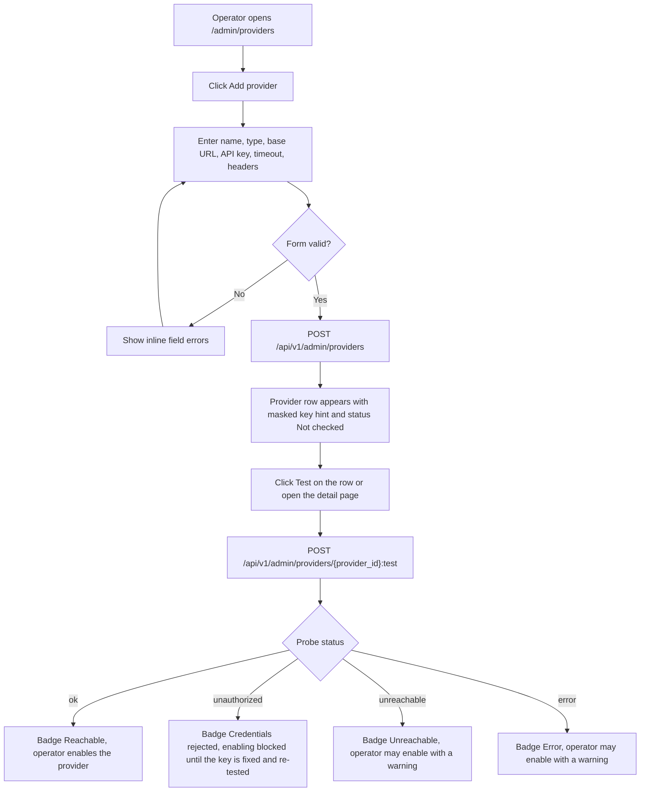
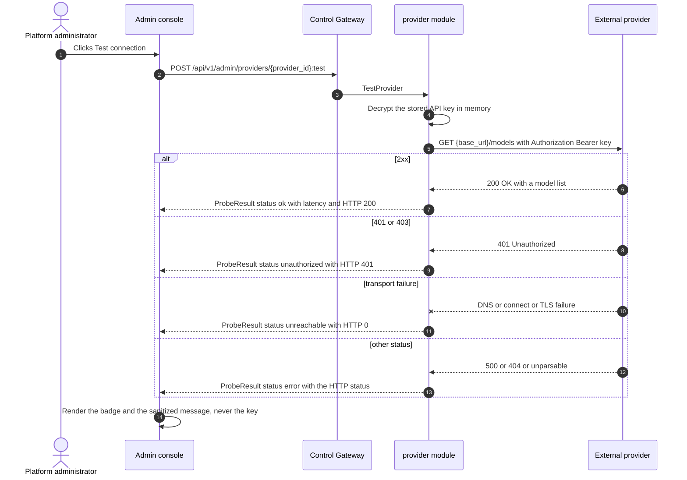
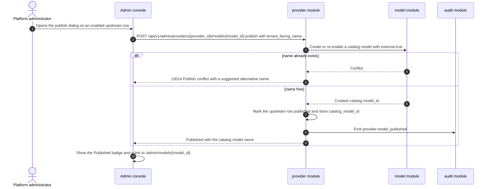
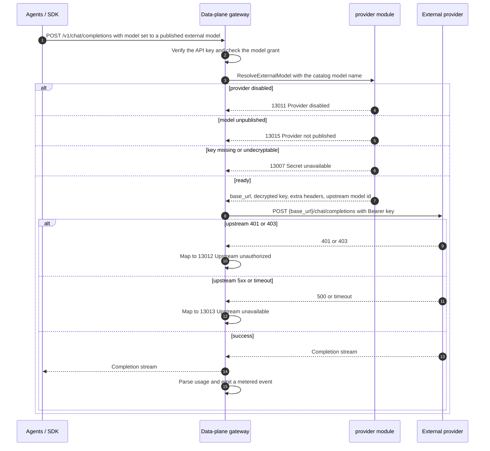

# External Model Providers — Requirement Analysis and UI/UX Design

| Attribute | Content |
| --- | --- |
| Feature point | External model providers — let a platform operator register third-party LLM providers (DeepSeek, OpenAI, and any OpenAI-compatible endpoint), verify connectivity, curate the upstream models they expose, and publish them so tenant organizations consume them exactly like self-hosted models (backlog row 48) |
| Document scope | Requirement analysis, competitive research and the registry-vs-passthrough decision, the admin-surface pages `/admin/providers` and `/admin/providers/:providerId` (provider table, create/edit dialog, connectivity-test panel, upstream-model table, publish/unpublish and delete flows), the tenant-facing change to the existing catalog/playground, the page → API surface table, and numbered acceptance criteria |
| Owning modules | `provider` (new — owns the external-provider registry, encrypted API keys, upstream-model curation, publishing and the connectivity-probe worker), `model` (publish delegates into the existing catalog and extends its admin and user projections with an external marker), `infer` / data-plane gateway (routes published external models to the provider with the decrypted key, on the same metered path), `audit` (provider and publish changes), `pkg/server` gateway (admin-prefix bindings), `web` admin + end-user console |
| Related documents | [Architecture Design](./architecture.md) — §2.2 `model`, §2.4 `infer`, §3.1 Control Gateway, §3.2 data plane (Envoy + Wasm), §4.3 inference request and billing loop · [Model Catalog & One-Click Deployment](./model-catalog-deployment.md) — the catalog this feature publishes into · [Per-Tenant Model Authorization](./model-authorization.md) — the grant path external models reuse unchanged · [API Key Usage Analytics](./api-key-usage-analytics.md) / [Metering](./metering.md) — the metered path external inference shares · [Webhook Notifications](./webhook-notifications.md) — the AES-256-GCM secret pattern this feature reuses · [Console Surface Separation](./console-surface-separation.md) — the two surfaces, `AdminShell` conventions, the masked-projection rule |
| Status | Design complete, handed to the Architect agent |

---

## 1. Background and Competitive Research

### 1.1 Why External Model Providers Come Now

go-taas's catalog today describes **only self-hosted models**. `RegisterModelRequest` (`proto/taas/model/v1/model.proto`) carries `name`, `version`, `weight_path`, `description`, `source` and `source_model_id`, and `source` holds values like `modelscope` / `huggingface` — a *download hub* for weights, not a *serving endpoint*. Every catalog model is therefore assumed to be served by a vLLM pod on the cluster through an inference service (feature #2) and routed by the data-plane gateway.

This leaves a real product gap: frontier and specialty models that an operator does **not** want to (or cannot) self-host — DeepSeek, OpenAI, or any private OpenAI-compatible endpoint — have no path into the platform. Today a tenant cannot consume them at all, and if the operator bolted them on out of band there would be no grants, no metering, no billing and no playground.

The feature closes the gap by letting the operator **register a provider, verify it, curate its upstream models and publish the ones that should be tenant-visible**. Published models enter the existing catalog so that **grants (feature #13), the user catalog, the playground and the metered/billed `/v1` gateway all work unchanged** — the tenant cannot tell an externally hosted model from a self-hosted one except for an "External" marker.

### 1.2 Access Pattern: Registry + Curation + Publish vs the Alternatives

| Pattern | What it is | Why we adopt / reject it |
| --- | --- | --- |
| **Registry + curation + publish** (adopted) | The operator registers a provider once (base URL + encrypted key), curates which upstream model ids are exposed, and explicitly publishes selected models into the catalog as first-class models. | The only pattern that reuses go-taas's existing grant, metering, billing and playground machinery unchanged. Visibility is an explicit operator decision, so an upstream model id is never accidentally exposed, and the tenant contract stays stable even when the provider renames or retires a model. |
| Per-key passthrough | Each tenant API key is mapped to an upstream provider key and calls are forwarded verbatim. | Rejected: it leaks provider tenancy into the key model, bypasses the platform catalog and grants, and makes metering/billing attribution ambiguous. |
| Proxy-only | The platform exposes a single generic proxy endpoint and the tenant names the provider and upstream model per request. | Rejected: the tenant would have to know provider internals, and there is no curation, no grant enforcement and no stable model identity to price, meter or audit. |
| Auto-discovery | The platform mirrors the provider's entire `/models` list into the tenant catalog automatically. | Rejected: it removes operator control over what is exposed and priced, creates unstable tenant-visible names, and would publish models the operator has not approved. Curation stays manual; auto-discovery is only used *inside* the provider detail view to help the operator add rows. |

### 1.3 Comparable-Product Interaction Patterns

| Product | Third-party / external model access pattern | go-taas decision |
| --- | --- | --- |
| **OpenAI Platform** | Projects and API keys are first-class platform objects with a curated model list; keys are shown once at creation and never again | Adopt the curated model list and the write-only key (shown once, masked afterwards) |
| **Anthropic Console** | Workspace-level keys with scoped permissions; model availability is the only visible contract | Adopt key-scoping on a per-credential basis and an availability-only tenant contract |
| **Together AI** | A *model endpoint* registry: the operator registers an upstream endpoint, chooses the model, and the platform exposes an OpenAI-compatible inference path | Adopt the endpoint registry + OpenAI-compatible serving path (FR6); go-taas adds explicit publish control |
| **Azure OpenAI** | Model *deployments* bind a base model to a named deployment with its own quota; the deployment name is the tenant contract, decoupled from the upstream model id | Adopt the decoupling of the tenant-facing name from the upstream id (FR5) |
| **Google Vertex AI** | A model *garden* curates first-party and partner models and exposes only the curated set to the project | Adopt curated exposure; go-taas keeps curation fully operator-driven, not catalog-driven |
| **Aliyun Bailian / Volcengine Ark** | Third-party model access with provisioned throughput and explicit enable/disable of a model per account | Adopt explicit enable/disable and per-model publishing; reject provisioned-throughput quotas (out of scope) |
| **LiteLLM / OpenRouter** | A provider + upstream-model registry with model aliasing, health status and fallback | Adopt the provider + upstream-model registry, model aliasing (tenant-facing name) and health status; **reject** cross-provider fallback routing (see D7) |

### 1.4 The Connectivity Signal

Third-party endpoints fail in **two very different ways** that operators must be able to tell apart, and the reconnaissance on 2026-10-12 makes this concrete:

- `api.deepseek.com` is **reachable** from the platform host — an unauthenticated `GET /models` returns **HTTP 401**.
- `api.openai.com` is **not reachable** from the platform host — the connection fails outright.

A single "healthy / unhealthy" flag would collapse "the credentials are wrong" into "the network is down", which is exactly the distinction an operator needs. The probe therefore produces one of **five** states — `unknown`, `ok`, `unauthorized`, `unreachable`, `error` — and the DeepSeek 401 case must render as **`unauthorized` ("reachable, credentials rejected"), never `unreachable`**. This distinction is a core acceptance criterion (AC4), not an afterthought.

### 1.5 Decisions and Scope

| # | Decision | Rationale |
| --- | --- | --- |
| D1 | **The feature is admin-only for management**: `/admin/providers` + `/api/v1/admin/providers/*`. There is **no new end-user page** — tenant consumption reuses the existing end-user surfaces (catalog, model detail, playground, `/v1` gateway), which gain only an "External" marker | Provider registration, keys, upstream curation and publishing are operator-orchestration (feature #17's masked-projection rule), consistent with the admin-only runtime (#47), accelerator (#18) and webhook (#23) surfaces |
| D2 | **A new `provider` module** (`services/provider`) owns the provider registry, the encrypted keys, upstream-model curation, the publish mapping and the connectivity-probe worker, with its own error block **130xx**. `model` still owns the catalog, and the data-plane gateway still owns inference routing | A provider is a distinct concern (an external endpoint plus its credential) with its own registry and background probe; a dedicated module keeps it out of the self-hosted model lifecycle |
| D3 | **API keys are write-only and encrypted at rest (AES-256-GCM)**, reusing the webhook pattern (`services/webhook/secret.go` `EncryptSecret`/`DecryptSecret`; master key from `Provider.SecretEncryptionKey` / `PROVIDER_SECRET_ENCRYPTION_KEY`). No read RPC ever returns a key — only a masked hint (last 4 characters) | Provider keys are high-value secrets; the repo already ships a reviewed encryption pattern, and write-only semantics prevent accidental disclosure through the API, logs or the console |
| D4 | **Publishing enters the existing catalog**: publishing an upstream model creates (or re-enables) a catalog model with `external=true`, `provider_id` and `upstream_model_id`. Grants (#13), the user catalog and the playground then work **unchanged** | Reusing the catalog reuses the whole grant/authorization/playground path and avoids a parallel, divergent model-identity system. The tenant contract stays the catalog model id, not the provider's id (Azure deployment pattern, §1.3) |
| D5 | **Connectivity is a first-class five-state signal** (`unknown` / `ok` / `unauthorized` / `unreachable` / `error`), produced by a **real HTTP probe** of the provider on demand and on a schedule, and persisted with latency, HTTP status, a sanitized message and checked-at | §1.4 — collapsing credentials failure into network failure would mislead the operator; the operator needs to see "reachable but rejected" for DeepSeek |
| D6 | **Guard rails are explicit**: a provider whose last probe is `unauthorized` **cannot be enabled** (13012); a non-`https` base URL shows a `Non-HTTPS endpoint` warning; a provider with published models **cannot be deleted** until they are unpublished (13016); secrets are never returned by any RPC | Misconfiguration of an external dependency must be loud, not silent; the guards are cheap, testable and prevent the most damaging operator errors |
| D7 | **No cross-provider fallback, no automatic mirroring, no per-tenant provider keys** in this increment. Requests for a published external model go to exactly one provider; a failure maps to a distinct code (13012 credentials, 13013 upstream 5xx/timeout) rather than silently failing over | Bounded, auditable behavior: fallback would make billing, routing-policy (#45) semantics and trace attribution ambiguous. Fallback stays a routing-policy concern for a later increment |
| D8 | **Explicit failure semantics**: a **user-realm** session calling `/api/v1/admin/providers/*` is rejected with **10038 `CodeRealmMismatch`**; a session without the required role receives **10036 `CodeForbidden`**; a request for a model whose provider is disabled fails closed with **13011**, whose model is unpublished with **13015**, and whose key is missing/undecryptable with **13007**; the provider list/detail page degrades gracefully when the module is unavailable | Realm separation is a hard product invariant, and an external dependency outage must produce actionable codes, not a generic 500 |
| D9 | **New error codes in a provider block (13001–13099)**, the next free block after runtime's 129xx: **13001 `CodeProviderNotFound`**, **13002 `CodeProviderNameConflict`**, **13003 `CodeProviderNameInvalid`**, **13004 `CodeProviderBaseURLInvalid`**, **13005 `CodeProviderTypeInvalid`**, **13006 `CodeProviderAPIKeyRequired`**, **13007 `CodeProviderSecretUnavailable`**, **13008 `CodeProviderModelNotFound`**, **13009 `CodeProviderModelExists`**, **13010 `CodeProviderModelInvalid`**, **13011 `CodeProviderDisabled`**, **13012 `CodeProviderUpstreamUnauthorized`**, **13013 `CodeProviderUpstreamUnavailable`**, **13014 `CodeProviderPublishConflict`**, **13015 `CodeProviderNotPublished`**, **13016 `CodeProviderInUse`** | A new module (D2) gets a fresh code block; distinct codes keep each failure mode actionable and let the gateway map upstream failures without guessing |
| D10 | **Provider records are platform-global** (no `X-Organization-Id`), like the catalog and SSO providers; the tenant only ever sees the published catalog model | Credentials and endpoints are platform assets; tenant isolation is enforced on the model grant (feature #13), not on the provider record |
| D11 | **The probe is server-side** (the `provider` module issues the HTTP request), never in the browser | The browser must never receive the provider key, and the probe result must be the platform's view of reachability, not the operator's workstation's |

**In scope**: two admin pages (`/admin/providers` list with create/edit/delete and test actions, `/admin/providers/:providerId` detail with the connectivity panel and the upstream-model table with add/edit/remove and publish/unpublish); the `provider` module RPCs and its connectivity-probe worker; the publish delegation into the `model` catalog bound to grants (#13); the "External" marker on the existing catalog/playground pages; the gateway enforcement that proxies a published external model to its provider on the metered path.

**Out of scope** (tracked elsewhere or deliberately excluded): cross-provider / cross-model fallback and weighted routing (routing policies, #45), automatic mirroring of a provider's full model list, per-tenant or per-key provider credentials, provisioned-throughput or quota management on the provider, fine-tuning or dataset operations on external models, self-hosted model deployment (#2), and LLM-as-judge or evaluation of external outputs (#44 defines evaluations separately).

---

## 2. User Roles

| Role | Description | Interaction with external providers |
| --- | --- | --- |
| **Platform administrator** | The operator who runs the go-taas platform | Registers providers, enters and rotates API keys, runs connectivity tests, curates upstream models, and publishes/unpublishes them into the catalog |
| **Tenant administrator** | Administers an organization and grants it models | Never sees a provider, a base URL, a key or an upstream id; grants a **published external catalog model** exactly like a self-hosted one (feature #13) |
| **Agent / SDK** | The programmatic consumer that calls `/v1/chat/completions` | Calls a published external model through the same OpenAI-compatible gateway and API key as any other model, unaware of the upstream provider |

> Terminology: the consumer-side caller is called an **Agent** (English) / 「智能体」(Chinese), consistent with the repo convention. Provider management is admin-only, so a tenant never sees provider terminology.

---

## 3. User Stories

| # | As a… | I want to… | So that… |
| --- | --- | --- | --- |
| US1 | Platform administrator | register an external provider (name, type, base URL, API key, timeout, extra headers) | the platform can reach a third-party LLM endpoint |
| US2 | Platform administrator | have the API key stored encrypted and never shown again (only a masked hint), and be able to rotate it | credentials are safe and rotation is a normal operation |
| US3 | Platform administrator | test a provider's connectivity on demand and see a status that distinguishes "reachable but credentials rejected" from "unreachable" | I can tell a wrong key apart from a firewall problem |
| US4 | Platform administrator | curate the upstream model ids a provider exposes (add, edit, enable/disable, remove) | only the models I intend to offer are candidates for publishing |
| US5 | Platform administrator | publish a curated upstream model into the catalog under a tenant-facing name | tenants can be granted and can consume it like any self-hosted model |
| US6 | Platform administrator | unpublish a model and see clearly what happens to grants and routing | I can retire an external model without surprises |
| US7 | Platform administrator | be blocked from enabling a provider whose credentials were rejected, and warned about a non-HTTPS endpoint | I cannot silently ship a broken or insecure provider |
| US8 | Tenant administrator | grant a published external model to my organization | my team can use a third-party model without knowing it is external |
| US9 | Agent / SDK | call a published external model through the same OpenAI-compatible endpoint | I get completions with the same key, metering and billing as a self-hosted model |

---

## 4. Functional Requirements

### FR1 — Provider registry

- **FR1.1** `ListProviders` (`GET /api/v1/admin/providers`) returns the registered providers, each with `provider_id`, `name`, `type` (`deepseek` / `openai` / `openai_compatible`), `base_url`, `enabled`, `request_timeout_seconds`, `extra_header_names[]` (names only), `api_key_hint` (masked, e.g. `••••3f9a`), `last_probe` (FR3.5), `upstream_model_count`, `published_model_count`, and `created_at` / `updated_at`. It supports `page_size` / `page_token` pagination, a `name` search, and `type` / `enabled` / `probe_status` filters.
- **FR1.2** `CreateProvider` (`POST /api/v1/admin/providers`) creates a provider with **Name** (required), **Type** (required, ∈ `{deepseek, openai, openai_compatible}`), **Base URL** (required), **API key** (required on create), **Enabled** (optional, default `false`), **Request timeout** (optional, seconds, default `10`, range `1`–`120`), and optional **Extra headers** (a string map). It returns the created provider (with a masked hint, never the key).
- **FR1.3** `GetProvider` (`GET /api/v1/admin/providers/{provider_id}`) returns one provider with the same masked fields as FR1.1. An unknown id returns **13001 `CodeProviderNotFound`**.
- **FR1.4** `UpdateProvider` (`PATCH /api/v1/admin/providers/{provider_id}`) edits mutable fields (**Name**, **Type**, **Base URL**, **Enabled**, **Request timeout**, **Extra headers**). The **API key is optional**: an omitted or empty key means **keep the existing credential**; a non-empty key **rotates** it (FR2.3).
- **FR1.5** `DeleteProvider` (`DELETE /api/v1/admin/providers/{provider_id}`) removes the provider and its curated upstream models. It is **blocked while any of its models is published** — the call returns **13016 `CodeProviderInUse`** and the UI disables the action (FR7.4).
- **FR1.6** Validation: **Name** is required, 1–64 chars, pattern `^[a-z0-9][a-z0-9-]*$`, and unique across providers — a bad value returns **13003 `CodeProviderNameInvalid`**, a duplicate returns **13002 `CodeProviderNameConflict`**. **Type** outside the three values returns **13005 `CodeProviderTypeInvalid`**. **Base URL** must be an absolute `http(s)` URL with a host — otherwise **13004 `CodeProviderBaseURLInvalid`**. **Request timeout** outside `1`–`120` returns **13010 `CodeProviderModelInvalid`** (generic field-validation code reused for non-key scalar fields; the exact per-field code is the Architect's choice). A missing **API key** on create returns **13006 `CodeProviderAPIKeyRequired`**.
- **FR1.7** All provider mutations are audited (`provider.created`, `provider.updated`, `provider.deleted`, `provider.key_rotated`, `provider.enabled`, `provider.disabled`) with the acting operator. The API key is never written to any audit record.

### FR2 — API-key handling

- **FR2.1** The API key is **write-only**: it is accepted on create and on update, and **no read RPC ever returns it**. Reads return only `api_key_hint` — the last 4 characters prefixed with a fixed mask (e.g. `••••3f9a`); when the key is shorter than 8 characters the hint is fully masked (`••••••••`).
- **FR2.2** The key is stored **encrypted at rest (AES-256-GCM)** with the master key from `Provider.SecretEncryptionKey` / `PROVIDER_SECRET_ENCRYPTION_KEY` (D3). When the master key is not configured, create/update with a key returns **13007 `CodeProviderSecretUnavailable`** and the UI explains the misconfiguration.
- **FR2.3** Updating with a non-empty key **rotates** the credential: the new key is encrypted and replaced, a `provider.key_rotated` audit event is emitted, and the masked hint changes. The old key is not retained.
- **FR2.4** The key is **never logged**: the `provider` module and the gateway must not include the key (or the decrypted value, or the `Authorization` header) in logs, error messages, traces or probe results. Probe error messages are sanitized (FR3.4).
- **FR2.5** The gateway decrypts the key only at request time, in memory, and never persists or caches it in plaintext beyond the request.

### FR3 — Connectivity test

- **FR3.1** `TestProvider` (`POST /api/v1/admin/providers/{provider_id}:test`) runs a **synchronous probe** (D11) and returns the same `ProbeResult` the scheduled worker persists (FR3.5). An unknown id returns **13001**.
- **FR3.2** The probe is a real HTTP request **`GET {base_url}/models`** (the base URL with any trailing slash removed, then `/models`) with the header **`Authorization: Bearer <decrypted key>`** plus the provider's configured **extra headers**, under the provider's **request timeout**. This is the OpenAI-compatible model-listing call that all three provider types expose.
- **FR3.3** The probe classifies the outcome into exactly one status:
  - **`ok`** — the response status is `2xx`.
  - **`unauthorized`** — the response status is `401` or `403`: the endpoint is **reachable but the credentials were rejected**.
  - **`unreachable`** — a transport-level failure: DNS resolution failure, connection refused/timeout, or a TLS handshake failure.
  - **`error`** — any other bounded failure: a non-`2xx`/`401`/`403` HTTP status (e.g. `404`, `429`, `5xx`) or an unparsable response.
  - **`unknown`** — before the first probe has ever run.
  **FR3.3.1** The DeepSeek `GET /models` returning `401` **must** be classified as **`unauthorized`**, never as `unreachable` (D5, §1.4). A transport failure to `api.openai.com` **must** be classified as **`unreachable`**.
- **FR3.4** Every probe result records `latency_ms`, `http_status` (`0` when no response was received), a **sanitized** `message`, and `checked_at`. The sanitized message states the category and, at most, the HTTP status and reason phrase (e.g. "HTTP 401 Unauthorized — credentials rejected", "Connection timed out after 10s"); it **never** contains the key, the `Authorization` header, or the provider's response body.
- **FR3.5** A `ProbeResult` is `{ status, latency_ms, http_status, message, checked_at }`.
- **FR3.6** The `provider` module runs the probe **on a schedule** for every **enabled** provider (default interval 60 s) and persists the latest `ProbeResult` on the provider (`last_probe`); a probe failure never disables the provider automatically (the operator decides), but it is visible in the list and detail (FR7.1).
- **FR3.7** A probe is always allowed (including for a disabled provider) so an operator can verify before enabling; the result is still persisted as `last_probe`.

### FR4 — Upstream model curation

- **FR4.1** `ListProviderModels` (`GET /api/v1/admin/providers/{provider_id}/models`) returns the curated upstream models, each with `model_id` (the platform's row id), `upstream_model_id`, `display_name`, `context_window`, `enabled`, `published`, `catalog_model_id`, `catalog_model_name`, and `created_at` / `updated_at`. It supports pagination, an `upstream_model_id` search, and `enabled` / `published` filters. An unknown provider returns **13001**.
- **FR4.2** `AddProviderModel` (`POST /api/v1/admin/providers/{provider_id}/models`) adds a row with **Upstream model id** (required, 1–128 chars), **Display name** (optional, ≤ 128 chars), **Context window** (optional integer, `0`–`10 000 000`; `0` = unknown), and **Enabled** (optional, default `true`). It returns the created row. A missing/empty upstream id returns **13010 `CodeProviderModelInvalid`**; a duplicate upstream id within the provider returns **13009 `CodeProviderModelExists`**.
- **FR4.3** `UpdateProviderModel` (`PATCH /api/v1/admin/providers/{provider_id}/models/{model_id}`) edits **Display name**, **Context window** and **Enabled**. An unknown row returns **13008 `CodeProviderModelNotFound`**; validation failures return **13010**. Upstream ids are **immutable** — changing the id means removing and re-adding the row.
- **FR4.4** `RemoveProviderModel` (`DELETE /api/v1/admin/providers/{provider_id}/models/{model_id}`) removes a curated row. Removing a **published** row is **blocked** — **13015 `CodeProviderNotPublished`**-family behavior is expressed as a guard: the UI disables removal while published, and the API rejects it with **13016 `CodeProviderInUse`**. An unknown row returns **13008**.
- **FR4.5** A curated row may be `enabled=false` (kept but not offered). An enabled-but-unpublished row is a candidate for publishing; a disabled row cannot be published (publishing a disabled row returns **13010**).
- **FR4.6** Curation mutations are audited (`provider.model_added`, `provider.model_updated`, `provider.model_removed`) with the acting operator.

### FR5 — Publishing into the catalog

- **FR5.1** `PublishProviderModel` (`POST /api/v1/admin/providers/{provider_id}/models/{model_id}:publish`) publishes a curated, enabled row as a catalog model (D4). The request carries an optional **tenant-facing name** (default: `display_name`, else `upstream_model_id`; 1–128 chars, pattern `^[a-z0-9][a-z0-9._-]*$`). It returns the catalog `model_id` and `name` and marks the row `published`.
- **FR5.2** Publishing creates (or re-enables) a catalog model with `external=true`, `provider_id` and `upstream_model_id`, so grants (#13), the user catalog (FR5.5) and the playground work unchanged. It emits a `provider.model_published` audit event.
- **FR5.3** The **duplicate-name rule**: if a *live* catalog model already has the requested tenant-facing name, publishing returns **13014 `CodeProviderPublishConflict`** and the UI suggests an alternative name (e.g. `<name>-<provider>`). Publishing with the same name as the row's own already-published catalog model is a no-op success.
- **FR5.4** `UnpublishProviderModel` (`POST /api/v1/admin/providers/{provider_id}/models/{model_id}:unpublish`) marks the catalog model **unpublished** so it disappears from the tenant catalog and cannot be called. Publishing/unpublishing is **idempotent** (re-publishing a published row or unpublishing an unpublished row is a no-op success) and emits `provider.model_unpublished`.
- **FR5.5** **Unpublish semantics**: (a) the catalog model becomes `unpublished`; (b) existing tenant grant rows (#13) are **retained** so re-publishing restores access without re-granting, but they are **inert** while unpublished; (c) requests to the model (gateway) fail closed with **13015 `CodeProviderNotPublished`**; (d) there is no routing to tear down because an external model has **no inference service** and no Deployment.
- **FR5.6** A published external model exposes the external marker to both surfaces: the admin catalog (`ListModels` / `GetModel`) and the user catalog (`ListAvailableModels` / `GetAvailableModel`) gain `external` (bool), `provider_name`, and (admin only) `provider_id` / `upstream_model_id`. The **masked user projection never carries the base URL, the key, the key hint or the provider id** (D1, D4).

### FR6 — Enforcement at the gateway

- **FR6.1** A request for a published external model (e.g. `POST /v1/chat/completions` with `model=<catalog model name>`) is authenticated and metered exactly like a self-hosted model (feature #1 API keys, feature #4 metering, billing) and is then **proxied to the provider**: `POST {base_url}/chat/completions` with `Authorization: Bearer <decrypted key>` and the provider's extra headers, preserving streaming (SSE) pass-through.
- **FR6.2** The gateway **fails closed** with a distinct code before any upstream call when: the provider is **disabled** (**13011 `CodeProviderDisabled`**), the model is **unpublished** (**13015 `CodeProviderNotPublished`**), or the key is **missing/undecryptable** (**13007 `CodeProviderSecretUnavailable`**).
- **FR6.3** An **upstream authentication failure** (`401` / `403` from the provider) maps to **13012 `CodeProviderUpstreamUnauthorized`** — distinct from an **upstream `5xx`, timeout or connection failure**, which maps to **13013 `CodeProviderUpstreamUnavailable`** (D7). Streaming responses that fail after the first byte are reported through the metered error path (feature #27 tracing, #31 error analysis) with the same distinction.
- **FR6.4** A metered event is emitted on success and on failure exactly as for a self-hosted model, so cost attribution, per-key usage analytics (#28) and error analysis (#31) cover external models unchanged.
- **FR6.5** The gateway never logs the provider key and never returns the base URL or the upstream error body to the tenant; the tenant receives a stable platform error message.

### FR7 — Guard rails

- **FR7.1** **A provider whose last probe status is `unauthorized` cannot be enabled.** The enable transition (`UpdateProvider` setting `enabled=true`, or the console switch) returns **13012 `CodeProviderUpstreamUnauthorized`**, and the UI blocks the switch with an inline warning ("Credentials were rejected — fix or rotate the API key, then test again.") and a **Test now** action. Enabling when the last probe is `unreachable`, `error` or `unknown` is **allowed** but shows a warning ("Not yet verified." / "Last check failed.").
- **FR7.2** A **Base URL whose scheme is not `https`** shows a persistent warning badge `Non-HTTPS endpoint` in the list and detail ("The provider is contacted over plain HTTP. Credentials may be exposed."). The value is still accepted (local/dev endpoints), but the warning is always visible.
- **FR7.3** **Secrets are never returned by any RPC** (FR2.1). This is enforced by construction: no provider message has a plaintext key field, and the extra-header **values** are masked in every read (only names are returned).
- **FR7.4** A provider with **published models cannot be deleted** (**13016 `CodeProviderInUse`**); the UI disables **Delete** with the tooltip "Unpublish all models before deleting this provider." Likewise a **published upstream row cannot be removed** (FR4.4).
- **FR7.5** Disabling a provider is always allowed (it fails closed at the gateway with **13011**), including when a probe is failing — disabling is the escape hatch.

### FR8 — Surface, realm and API binding

- **FR8.1** The provider pages live on the **admin surface**: `/admin/providers` (list) and `/admin/providers/:providerId` (detail), API prefix `/api/v1/admin/providers/*`. They are added to the `AdminShell` navigation (feature #17) under the **Operations** group as **Providers** (adjacent to **Runtime**, **Accelerators** and **Compatibility**).
- **FR8.2** There is **no new end-user page** (D1). Tenant consumption reuses the existing end-user surfaces `/models`, `/models/:modelId`, `/playground` and the `/v1` gateway; those pages gain only the external marker (FR5.6, §5.5). Existing admin catalog pages `/admin/models` and `/admin/models/:modelId` gain the external marker plus the provider and upstream id.
- **FR8.3** Every admin provider call uses the exact prefix `/api/v1/admin/providers/*`; the admin pages contain **no `/api/v1/*` call**. The pages require the admin session realm (`/admin/login`).
- **FR8.4** A valid **user-realm** session token sent to any `/api/v1/admin/providers/*` route is rejected with **10038 `CodeRealmMismatch`**; a session without the required role receives **10036 `CodeForbidden`** (D8).
- **FR8.5** Every interactive control carries a `data-testid` in the console's `kebab-case` style (`provider-list`, `provider-add`, `provider-row-{provider_id}`, `provider-test-{provider_id}`, `provider-form-name`, `provider-form-base-url`, `provider-form-api-key`, `provider-detail`, `provider-test-panel`, `provider-model-table`, `provider-model-publish-{model_id}`, …).

---

## 5. Page and Flow Design

### 5.1 Surface Assignment

| Feature | Surface | Web route | API prefix |
| --- | --- | --- | --- |
| Provider list (search/sort/filter) | admin | `/admin/providers` | `/api/v1/admin/providers` |
| Create / edit provider | admin | `/admin/providers` (dialog) | `/api/v1/admin/providers`, `/api/v1/admin/providers/{provider_id}` |
| Delete provider | admin | `/admin/providers` (confirmation) | `/api/v1/admin/providers/{provider_id}` |
| Connectivity test | admin | `/admin/providers`, `/admin/providers/:providerId` | `/api/v1/admin/providers/{provider_id}:test` |
| Provider detail + upstream models | admin | `/admin/providers/:providerId` | `/api/v1/admin/providers/{provider_id}`, `/api/v1/admin/providers/{provider_id}/models` |
| Publish / unpublish upstream model | admin | `/admin/providers/:providerId` (dialog / confirmation) | `/api/v1/admin/providers/{provider_id}/models/{model_id}:publish` / `:unpublish` |
| External marker in the admin catalog | admin | `/admin/models`, `/admin/models/:modelId` (existing pages, changed) | `/api/v1/admin/models`, `/api/v1/admin/models/{model_id}` (existing, changed) |
| **Tenant** model catalog (existing) | user | `/models`, `/models/:modelId` (existing pages, changed) | `/api/v1/models`, `/api/v1/models/{model_id}` (existing, changed) |
| **Tenant** playground (existing) | user | `/playground` (existing page, unchanged interaction) | `/api/v1/models/{model_id}:playground`, `/v1/chat/completions` (existing) |

Management is entirely on the **admin surface**. Tenant consumption is entirely on the **end-user surface** and reuses existing pages; no new end-user route is created (D1). The admin pages never call a `/api/v1/*` route, and the end-user pages never call a `/api/v1/admin/*` route.

### 5.2 Page Map

| Page / component | Purpose |
| --- | --- |
| **Providers page** (`/admin/providers`) | Provider table; create/edit dialog; delete confirmation; quick connectivity test |
| **Provider detail page** (`/admin/providers/:providerId`) | Provider overview (masked key, base URL, timeout, warnings), connectivity panel with the on-demand test, and the upstream-model table with add/edit/remove and publish/unpublish |
| **Tenant catalog/detail/playground** (existing) | Surface published external models with an "External" marker; consume unchanged |

### 5.3 Page: `/admin/providers` — Model Providers (admin)

**Purpose**: let the platform administrator register, verify and manage third-party LLM providers, and see at a glance which are reachable and how many models are published.

**Surface**: admin — route `/admin/providers`, API `/api/v1/admin/providers/*`.

**Navigation placement**: `AdminShell` sidebar, **Operations** group, item **Providers** (between **Runtime** and **Accelerators**).

**Layout**: rendered inside `AdminShell` (feature #17). A page header ("Model providers", subtitle "Third-party LLM providers and their published models") with an **Add provider** action (primary) and a **Refresh** action (secondary). Below, one region:

1. **Providers card** — a toolbar (search by name; **Type** filter; **Status** filter; **Enabled** filter) and a table with columns: **Name**, **Type** (badge `DeepSeek` / `OpenAI` / `OpenAI-compatible`), **Base URL** (mono, truncated with a title tooltip), **Status** (probe badge, FR3.5), **Enabled** (badge + switch), **Models** (`published / curated`), **Last checked**, **Actions** (**View**, **Test**, **Edit**, **Delete**).
   - Always shows a `Non-HTTPS endpoint` warning chip next to a non-`https` base URL (FR7.2).
   - Sorting: Name, Type, Status, Last checked. Filtering: Type, Status, Enabled. Pagination: 20 per page.

**Probe status badges** (used in the list and detail): `Reachable` (green, `ok`) / `Credentials rejected` (amber, `unauthorized`) / `Unreachable` (red, `unreachable`) / `Error` (red, `error`) / `Not checked` (grey, `unknown`). The badge carries the `checked_at` in a tooltip.

**Interactive states**:

| State | Behaviour |
| --- | --- |
| Default | The provider table renders from the first successful load |
| Loading | Skeleton rows; **Add provider**, **Refresh**, **Test**, **Edit**, **Delete** are disabled |
| Empty (no providers) | "No providers yet. Register a third-party LLM provider to publish external models." with an **Add provider** action |
| Error (load failed) | An error banner "Could not load providers." with a **Retry** button; on a failed poll the last good rows are kept with a "Showing stale data" banner |
| Disabled | Row actions are disabled while an action is in flight; **Delete** is disabled when `published_model_count > 0`, with the tooltip "Unpublish all models before deleting this provider." (FR7.4) |
| Permission-denied | A session without the required role receives **10036** and the page shows the standard permission-denied state (feature #17) with a link back to `/admin` |

**Create/Edit provider dialog** (fields, validation rules and error copy):

| Field | Type | Required | Validation | Error copy |
| --- | --- | --- | --- | --- |
| Name | text | yes | 1–64 chars, `^[a-z0-9][a-z0-9-]*$`, unique | "Enter a lowercase name (letters, digits, `-`)." (13003) / "A provider with this name already exists." (13002) |
| Type | select (`deepseek`, `openai`, `openai_compatible`) | yes | one of the three | "Select a supported provider type." (13005) |
| Base URL | text | yes | absolute `http(s)` URL with a host | "Enter a valid absolute URL (https://…)." (13004) |
| API key | password (write-only) | yes on create, no on edit | non-empty on create | "Enter the provider API key." (13006) |
| Enabled | toggle | no | — | Probe warning: "Credentials were rejected — fix or rotate the key, then test again." (blocks enabling, FR7.1) |
| Request timeout | integer (seconds) | no | `1`–`120`, default `10` | "Enter a timeout between 1 and 120 seconds." (13010) |
| Extra headers | key/value list | no | each name `^[A-Za-z0-9-]+$`, value ≤ 1024 chars, names unique | "Header names must be unique letters, digits and `-`." |

**Write-only key field behaviour**: on **create** the field is empty and required. On **edit** the field is empty and shows the current masked hint (`••••3f9a`) with the label "API key" and the hint "Leave blank to keep the current key"; a **Replace key** checkbox (or simply typing) reveals the input, and the footer action becomes "Save". The key is sent only when non-empty. The key is never re-displayed after saving; the dialog always re-masks.

**Delete confirmation**: "Delete provider `<name>`? This removes the provider and its curated models. It cannot be deleted while any model is published." — if `published_model_count > 0` the dialog is not reachable and the action is disabled (FR7.4). Otherwise the footer has **Delete** (danger) and **Cancel**; confirming calls `DeleteProvider` and shows a toast "Provider deleted."

**Quick test action**: the row **Test** action calls `TestProvider`, shows an inline spinner on the row, then updates the **Status** badge and a transient inline result line ("`ok` · 142 ms · HTTP 200 · just now", or the sanitized failure message). A failing test shows the badge and an inline message, never a page-level error.

### 5.4 Page: `/admin/providers/:providerId` — Provider Detail (admin)

**Purpose**: inspect one provider's configuration and connectivity, and curate/publish its upstream models.

**Surface**: admin — route `/admin/providers/:providerId`, API `/api/v1/admin/providers/*`.

**Navigation placement**: reached from the providers table **View** action; breadcrumb "Model providers / `<name>`".

**Layout**: page header (provider **Name** + **Type** badge + **Enabled** badge + `Non-HTTPS endpoint` chip when applicable) with actions **Test connection** (primary), **Edit** (secondary), **Delete** (danger, disabled with tooltip while models are published). Below, three regions:

1. **Overview card** — a detail grid: **Type**, **Base URL** (mono), **Enabled** (badge), **Request timeout** (`10 s`), **API key** (`••••3f9a`, with a "Replace key" affordance that opens the edit dialog), **Extra headers** (header **names** only, with a note "values hidden"), **Created** / **Updated**.
2. **Connectivity card** — the last `ProbeResult`: a large status badge (five states), **Latency** (`142 ms`), **HTTP status** (`200` or `—`), **Checked at**, and the sanitized **Message**; a **Test now** action (primary/secondary) runs `TestProvider` and updates the panel inline; a schedule note ("Checked automatically every 60 s."). When `status=unauthorized` a prominent inline notice reads "The endpoint is reachable but the credentials were rejected. Fix or rotate the API key, then test again." (FR3.3.1, FR7.1). When `unreachable` the notice reads "The endpoint could not be reached (network or DNS failure)."
3. **Upstream models card** — a toolbar (search by upstream id; **Enabled** filter; **Published** filter) and a table with columns: **Upstream id** (mono), **Display name**, **Context window**, **Enabled** (badge), **Published** (badge; when published also the catalog model name linking to `/admin/models/{model_id}`), **Updated**, **Actions** (**Edit**, **Publish** / **Unpublish**, **Remove**). Header action **Add model** (primary).
   - **Remove** is disabled while the row is published, with the tooltip "Unpublish this model before removing it." (FR4.4).
   - **Publish** is disabled when the row is disabled, with the tooltip "Enable this model before publishing." (FR4.5).
   - Pagination: 20 per page.

**Interactive states**: default / loading (skeletons, actions disabled) / empty (upstream models: "No upstream models curated yet. Add the model ids this provider exposes." with an **Add model** action) / error (banner + **Retry**, keeping last good data) / disabled (actions disabled in flight; guarded actions disabled per FR4.4/FR4.5/FR7.4) / permission-denied (10036 state with a link back to `/admin`).

**Add/Edit upstream model dialog**:

| Field | Type | Required | Validation | Error copy |
| --- | --- | --- | --- | --- |
| Upstream model id | text | yes | 1–128 chars; unique within the provider; immutable on edit | "Enter the upstream model id." (13010) / "This upstream model is already curated." (13009) |
| Display name | text | no | ≤ 128 chars | "Display name is too long." |
| Context window | integer | no | `0`–`10 000 000` (`0` = unknown) | "Enter a context window in tokens (0 for unknown)." (13010) |
| Enabled | toggle | no | default on | — |

The dialog footer has **Cancel** and **Save model** (disabled until valid).

**Publish dialog**: opened by a row's **Publish** action. Fields: **Tenant-facing name** (default `display_name` or `upstream_model_id`; pattern `^[a-z0-9][a-z0-9._-]*$`). A callout states "Tenants will see and call this model under this name, exactly like a self-hosted model. It enters the model catalog where you grant it to organizations." If the name already exists, an inline warning "A model with this name already exists." with a suggested alternative and the action blocked (FR5.3, **13014**). Confirm publishes and shows a toast "Model published." with a link to `/admin/models/{model_id}`.

**Unpublish confirmation**: "Unpublish `<name>`? Tenants will no longer see or be able to call this model. Existing organization grants are kept and become active again if you re-publish. In-flight requests fail closed." with **Unpublish** (danger) and **Cancel**. Confirming calls `UnpublishProviderModel` and shows a toast "Model unpublished."

### 5.5 Tenant-Facing Change (existing pages, changed)

| Page | Surface / route | Change |
| --- | --- | --- |
| Model catalog | user — `/models` | An external model appears under its **tenant-facing name** with an **External** badge; it is distinguishable from a self-hosted model but otherwise identical. No new route, no provider data. (`GET /api/v1/models`) |
| Model detail | user — `/models/:modelId` | Shows an **External** marker and "Provided by `<provider name>` (external)" — **never** the base URL, the key, the key hint or the upstream id. Operator-only sections that do not apply to an external model (serving autoscaling, compatibility matrix, load tests) are hidden or shown as "Not applicable". (`GET /api/v1/models/{model_id}`) |
| Playground | user — `/playground` | The model selector includes published external models; sending a request works unchanged through the metered gateway (`POST /api/v1/models/{model_id}:playground` / `/v1/chat/completions`). |
| Admin catalog | admin — `/admin/models`, `/admin/models/:modelId` | Shows the **External** badge plus `provider_name`, `provider_id` and `upstream_model_id` (admin-only fields). |

### 5.6 Flows

---

## 6. API Surface Implications

The provider RPCs belong to the **`provider` module** (D2), served as HTTP via the Control Gateway on the **admin prefix** `/api/v1/admin/providers/*`. The `provider` module delegates publishing into the existing `model` catalog (D4), the end-user catalog projections gain the external marker (FR5.6), and the data-plane gateway calls the `provider` module to resolve and afterwards enforce an external model (FR6). There is **no new user-prefix binding** (D1).

| RPC | Route | Prefix | Status | Purpose |
| --- | --- | --- | --- | --- |
| `ListProviders` (new `taas.provider.v1`) | `GET /api/v1/admin/providers` | admin | **new** | Providers with masked key hint, probe result and model counts; pagination, search, filters |
| `CreateProvider` | `POST /api/v1/admin/providers` | admin | **new** | Create a provider (name, type, base URL, key, enabled, timeout, headers) |
| `GetProvider` | `GET /api/v1/admin/providers/{provider_id}` | admin | **new** | One provider, masked; unknown id → 13001 |
| `UpdateProvider` | `PATCH /api/v1/admin/providers/{provider_id}` | admin | **new** | Edit mutable fields; empty key keeps the credential; non-empty rotates it |
| `DeleteProvider` | `DELETE /api/v1/admin/providers/{provider_id}` | admin | **new** | Remove a provider; blocked while models are published (13016) |
| `TestProvider` | `POST /api/v1/admin/providers/{provider_id}:test` | admin | **new** | Synchronous connectivity probe; returns a five-state `ProbeResult` |
| `ListProviderModels` | `GET /api/v1/admin/providers/{provider_id}/models` | admin | **new** | Curated upstream models with published/catalog binding; pagination, search, filters |
| `AddProviderModel` | `POST /api/v1/admin/providers/{provider_id}/models` | admin | **new** | Add a curated upstream model row |
| `UpdateProviderModel` | `PATCH /api/v1/admin/providers/{provider_id}/models/{model_id}` | admin | **new** | Edit display name, context window, enabled |
| `RemoveProviderModel` | `DELETE /api/v1/admin/providers/{provider_id}/models/{model_id}` | admin | **new** | Remove a curated row; blocked while published (13016) |
| `PublishProviderModel` | `POST /api/v1/admin/providers/{provider_id}/models/{model_id}:publish` | admin | **new** | Publish a curated row as a catalog model; name conflict → 13014 |
| `UnpublishProviderModel` | `POST /api/v1/admin/providers/{provider_id}/models/{model_id}:unpublish` | admin | **new** | Unpublish; idempotent; grants retained but inert |
| `ResolveExternalModel` | internal (gateway → `provider`) | n/a | **new** | Resolve a catalog model name to its provider, decrypted key and upstream model id, or a fail-closed code |
| `ListAvailableModels` / `GetAvailableModel` | `GET /api/v1/models`, `/api/v1/models/{model_id}` | user | **changed** | Gain `external`, `provider_name` (masked; no base URL/key/hint/provider id) |
| `ListModels` / `GetModel` | `GET /api/v1/admin/models`, `/api/v1/admin/models/{model_id}` | admin | **changed** | Gain `external`, `provider_name`, `provider_id`, `upstream_model_id` |

**Contract notes for the Architect agent**:

1. `provider` messages never contain a plaintext key field; reads carry only `api_key_hint` and `extra_header_names` (D3, FR2.1, FR7.3).
2. `CreateProvider`/`UpdateProvider` accept the key out of band from reads; empty on update = keep, non-empty = rotate (FR1.4, FR2.3).
3. `TestProvider` is synchronous and returns a `ProbeResult` of exactly `{status, latency_ms, http_status, message, checked_at}` with `status ∈ {ok, unauthorized, unreachable, error}` (before the first probe the stored state is `unknown`) (FR3.3, FR3.5). A `401`/`403` **must** be `unauthorized`; a transport failure **must** be `unreachable` (FR3.3.1).
4. `PublishProviderModel` takes an optional `tenant_facing_name` and creates a catalog model with `external=true`, `provider_id`, `upstream_model_id`; a live name conflict returns **13014** (FR5.1–FR5.3). `UnpublishProviderModel` is idempotent and keeps grants inert (FR5.4–FR5.5).
5. Serialization conventions unchanged: HTTP 200 on success, business errors as `{"code": <int>, "message": "..."}`, int64 fields serialized as JSON strings.
6. The gateway must emit metered events for external model success **and** failure, and must never log or return the key or the base URL (FR6.4, FR6.5).

Error codes (`pkg/errors/codes.go`):

| Condition | Code | Constant | Notes |
| --- | --- | --- | --- |
| Unknown provider | 13001 | `CodeProviderNotFound` | **New** (D9) |
| Duplicate provider name | 13002 | `CodeProviderNameConflict` | **New** (D9) |
| Invalid provider name | 13003 | `CodeProviderNameInvalid` | **New** (D9) |
| Invalid base URL | 13004 | `CodeProviderBaseURLInvalid` | **New** (D9) |
| Unsupported provider type | 13005 | `CodeProviderTypeInvalid` | **New** (D9) |
| API key required on create | 13006 | `CodeProviderAPIKeyRequired` | **New** (D9) |
| Secret unavailable (no master key / undecryptable) | 13007 | `CodeProviderSecretUnavailable` | **New** (D9) |
| Unknown upstream model row | 13008 | `CodeProviderModelNotFound` | **New** (D9) |
| Duplicate upstream model id | 13009 | `CodeProviderModelExists` | **New** (D9) |
| Invalid upstream model field | 13010 | `CodeProviderModelInvalid` | **New** (D9) |
| Provider disabled | 13011 | `CodeProviderDisabled` | **New** (D9) |
| Upstream authentication rejected | 13012 | `CodeProviderUpstreamUnauthorized` | **New** (D9) — also blocks enabling (FR7.1) |
| Upstream 5xx / timeout / connection failure | 13013 | `CodeProviderUpstreamUnavailable` | **New** (D9) |
| Publish name conflict | 13014 | `CodeProviderPublishConflict` | **New** (D9) |
| Model not published | 13015 | `CodeProviderNotPublished` | **New** (D9) |
| Provider in use (has published models) | 13016 | `CodeProviderInUse` | **New** (D9) — delete/remove guard |
| User-realm session on an admin route | 10038 | `CodeRealmMismatch` | Reused — realm separation (FR8.4) |
| Session without the required role | 10036 | `CodeForbidden` | Reused — permission denial (FR8.4) |

---

## 7. Acceptance Criteria

| # | Criterion | Level |
| --- | --- | --- |
| AC1 | `/admin/providers` renders the provider table with Name, Type, Base URL, Status, Enabled, Models and Last checked columns, plus search, Type/Status/Enabled filters, sorting and pagination | Nightwatch E2E |
| AC2 | The create dialog validates name format + uniqueness, type, an absolute base URL, a required API key, the timeout range and header names, showing the specified error copy; a valid submission adds a row with a masked key hint and status **Not checked** | Nightwatch E2E |
| AC3 | The API key is write-only: after creation and after a rotation the key is never returned or displayed — only the masked hint (`••••xxxx`) is shown; editing with an empty key keeps the credential and does not change the hint | FVT + Nightwatch E2E |
| AC4 | **Probe statuses**: testing a provider whose endpoint is reachable but rejects credentials (a real DeepSeek endpoint, or a mock that returns `401`) renders **`Credentials rejected`** (`unauthorized`) with HTTP 401 — **never** `Unreachable`. A working OpenAI-compatible endpoint renders **`Reachable`** (`ok`) with HTTP 200 and a latency. A provider pointed at an unroutable host renders **`Unreachable`** (`unreachable`) with HTTP 0. `TestProvider` on a provider that was never tested stores `unknown` | FVT + Nightwatch E2E |
| AC5 | The upstream-model table supports add (validated upstream id required, unique, and context window bounds), edit and remove; a duplicate upstream id is rejected with the specified copy; a **published** row cannot be removed (action disabled + API rejects with **13016**) | Nightwatch E2E + FVT |
| AC6 | Publishing an enabled upstream model asks for a tenant-facing name, creates a catalog model marked **External**, and shows the **Published** badge with a link to `/admin/models/{model_id}`; publishing with a name that already exists is rejected with **13014** and a suggested alternative, and the action is blocked | Nightwatch E2E + FVT |
| AC7 | Unpublishing asks for confirmation with the specified copy, hides the model from the tenant catalog, fails closed with **13015** for a tenant request, and **keeps** the organization grant rows (they become inert and re-activate on re-publish) | FVT + Nightwatch E2E |
| AC8 | **Guard rails**: enabling a provider whose last probe is `unauthorized` is blocked in the UI and rejected with **13012**; enabling when `unreachable`/`error`/`unknown` is allowed with a warning; a non-`https` base URL shows the `Non-HTTPS endpoint` chip; deleting a provider with published models is disabled and rejected with **13016** | FVT + Nightwatch E2E |
| AC9 | **End-to-end external consumption with metering**: a tenant granted a published external model calls `POST /v1/chat/completions` through the platform API key and gets a completion; the request is metered (usage and cost appear for the key/org) and the model is attributed to the external catalog model | FVT + Nightwatch E2E |
| AC10 | Enforcement fail-closed: a request for a model on a **disabled** provider returns **13011**; a request for an **unpublished** model returns **13015**; an **upstream 401/403** maps to **13012** and an **upstream 5xx/timeout** maps to **13013** — all distinct from each other | FVT |
| AC11 | **Tenant-facing marker**: the user catalog `/models` and detail `/models/:modelId` show an **External** badge and "Provided by `<provider>` (external)" and expose **no** base URL, key, key hint or provider id; the playground lists the external model and can send a request | Nightwatch E2E |
| AC12 | **Negative realm separation**: a valid user-realm session token sent to `GET /api/v1/admin/providers` is rejected with **10038**; the end-user console has no `/providers` route and no provider API; the admin pages contain no `/api/v1/*` call | FVT + Nightwatch E2E |
| AC13 | A session without the required role receives **10036** and both provider pages show the standard permission-denied state with a link back to `/admin` | Nightwatch E2E |
| AC14 | Provider create/update/enable/disable/delete and upstream add/update/remove/publish/unpublish emit the specified audit events with the acting operator, and **no** audit record contains the API key | FVT |
| AC15 | The provider list and detail provide loading, empty, stale-error, disabled/guarded and permission-denied states as specified in §5.3–§5.4 | Nightwatch E2E |

---

## 8. Out of Scope (tracked elsewhere)

| Item | Where |
| --- | --- |
| Cross-provider / cross-model fallback and weighted routing | Feature #45 inference routing policies |
| Automatic mirroring of a provider's full model list | Deliberately excluded (§1.2) — curation is operator-driven |
| Per-tenant or per-key provider credentials | Deliberately excluded (D7) — credentials are platform assets |
| Provisioned throughput / quota management on the provider | A later increment if required |
| Fine-tuning or dataset operations on external models | Out of product scope (token-as-a-service) |
| Self-hosted model deployment and serving scheme | Feature #2 catalog/deployment, feature #47 distributed runtime |
| The metering/billing/analytics pipeline itself | Features #4, #25, #28, #29 (reused unchanged) |
| An end-user provider page | Deliberately absent (D1) — tenants consume models, not providers |
