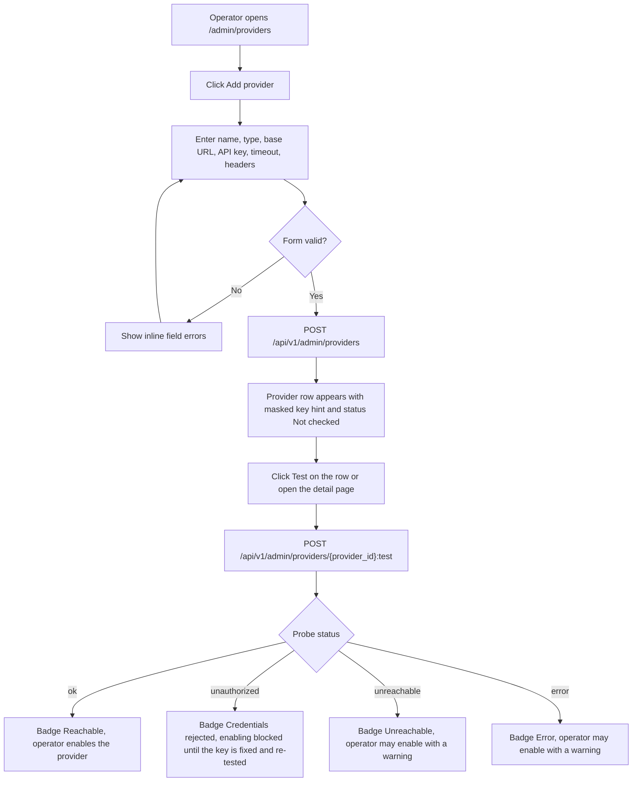
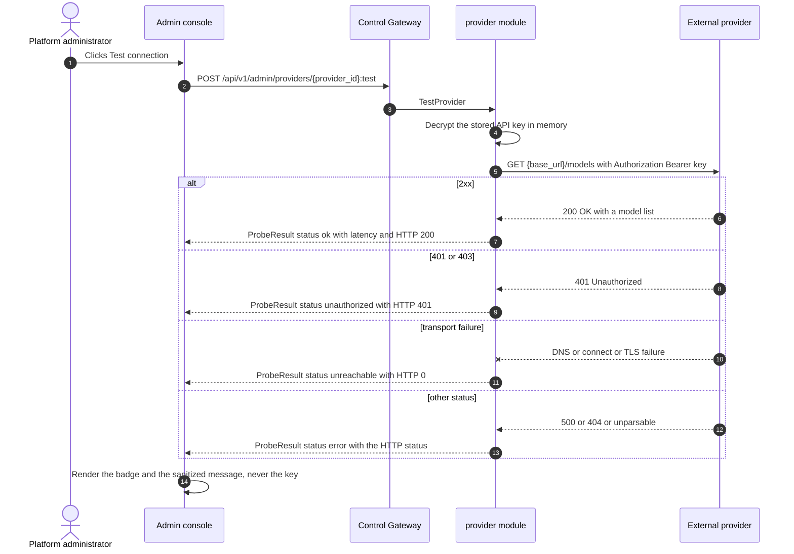
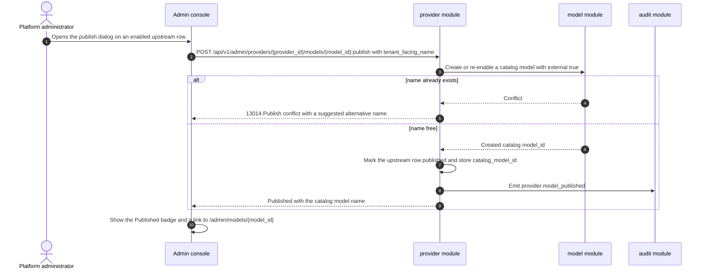
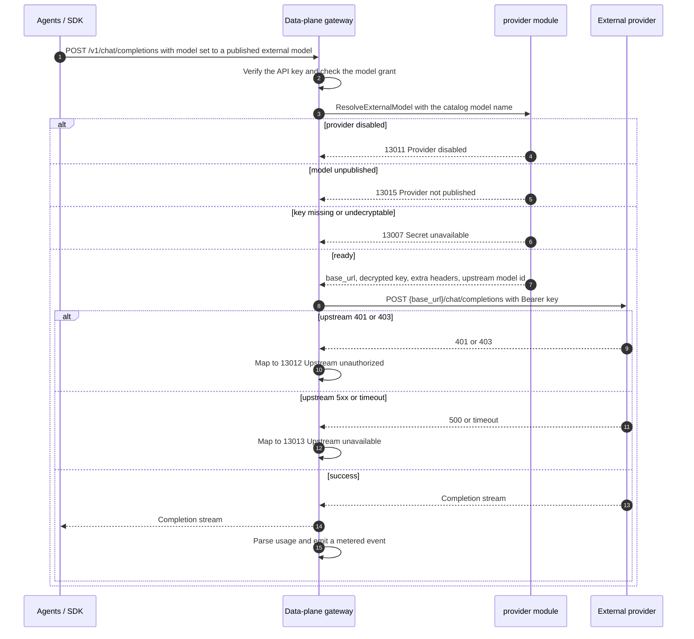

# 外部模型提供方 — 需求分析与 UI/UX 设计

| 属性 | 内容 |
| --- | --- |
| 特性点 | 外部模型提供方 — 让平台运营者注册第三方大模型提供方（DeepSeek、OpenAI 以及任意 OpenAI 兼容端点）、验证连通性、策展其暴露的上游模型，并将其发布，使租户组织可以像使用自托管模型一样消费它们（backlog 第 48 行） |
| 文档范围 | 需求分析、竞品调研与「注册表 vs 透传」决策、管理面页面 `/admin/providers` 与 `/admin/providers/:providerId`（提供方表、创建/编辑对话框、连通性测试面板、上游模型表、发布/取消发布与删除流程）、对既有目录/Playground 的租户侧变更、页面 → API 面映射表，以及编号验收标准 |
| 归属模块 | `provider`（新增 — 拥有外部提供方注册表、加密的 API Key、上游模型策展、发布与连通性探测工作器）、`model`（发布委托到既有目录，并在其管理面与用户面投影中扩展外部标记）、`infer` / 数据面网关（用解密后的 Key 把已发布的外部模型路由到提供方，走同一条计量路径）、`audit`（提供方与发布变更）、`pkg/server` 网关（管理前缀绑定）、`web` 管理控制台与终端用户控制台 |
| 相关文档 | [架构设计](./architecture.md) — 第 2.2 节 `model`、第 2.4 节 `infer`、第 3.1 节控制网关、第 3.2 节数据面（Envoy + Wasm）、第 4.3 节推理请求与计费回路 · [模型目录与一键部署](./model-catalog-deployment.md) — 本特性发布进入的目录 · [按租户模型授权](./model-authorization.md) — 外部模型原样复用的授权路径 · [API Key 用量分析](./api-key-usage-analytics.md) / [计量](./metering.md) — 外部推理共享的计量路径 · [Webhook 通知](./webhook-notifications.md) — 本特性复用的 AES-256-GCM 密钥模式 · [控制台面分离](./console-surface-separation.md) — 两个面、`AdminShell` 约定、掩码投影规则 |
| 状态 | 设计完成，已移交架构师代理 |

---

## 1. 背景与竞品调研

### 1.1 为什么现在做外部模型提供方

go-taas 的目录今天**只描述自托管模型**。`RegisterModelRequest`（`proto/taas/model/v1/model.proto`）携带 `name`、`version`、`weight_path`、`description`、`source` 与 `source_model_id`，其中 `source` 取值为 `modelscope` / `huggingface` 之类 —— 那是*下载权重的中枢*，而非*服务端点*。因此每个目录模型都被假定为由集群上的 vLLM Pod 通过推理服务（特性 #2）提供服务，并由数据面网关路由。

这留下一个真实的产品缺口：运营者**不想**（或无法）自托管的前沿与专用模型 —— DeepSeek、OpenAI，或任意私有 OpenAI 兼容端点 —— 没有进入平台的路径。今天租户完全无法消费它们，而如果运营者带外接入，则没有授权、没有计量、没有计费、也没有 Playground。

本特性通过让运营者**注册提供方、验证它、策展其上游模型并发布应当对租户可见的模型**来填补缺口。已发布模型进入既有目录，从而**授权（特性 #13）、用户目录、Playground 以及计量/计费的 `/v1` 网关全部原样可用** —— 除了一个「External」标记外，租户无法分辨外部托管模型与自托管模型。

### 1.2 访问模式：「注册表 + 策展 + 发布」与替代方案

| 模式 | 是什么 | 采纳 / 拒绝的理由 |
| --- | --- | --- |
| **注册表 + 策展 + 发布**（采纳） | 运营者一次注册提供方（base URL + 加密 Key），策展哪些上游模型 id 被暴露，并显式把选定模型作为一等模型发布进目录。 | 唯一能原样复用 go-taas 既有授权、计量、计费与 Playground 机制的模式。可见性是运营者的显式决策，因此上游模型 id 绝不会被意外暴露，且即使提供方重命名或下线某模型，租户契约仍保持稳定。 |
| 按 Key 透传 | 每个租户 API Key 被映射到一个上游提供方 Key，调用被原样转发。 | 拒绝：它把提供方租户关系泄漏进 Key 模型，绕过平台目录与授权，并使计量/计费归因变得含糊。 |
| 纯代理 | 平台暴露一个通用代理端点，租户在每次请求中指定提供方与上游模型。 | 拒绝：租户必须了解提供方内部信息，且没有策展、没有授权强制、也没有可定价/计量/审计的稳定模型标识。 |
| 自动发现 | 平台把提供方的整个 `/models` 列表自动镜像进租户目录。 | 拒绝：它移除了运营者对暴露内容与定价的控制，产生不稳定的租户可见名称，并会发布运营者尚未批准的模型。策展保持手动；自动发现仅在提供方详情视图*内部*用于帮助运营者添加行。 |

### 1.3 竞品交互模式

| 产品 | 第三方 / 外部模型访问模式 | go-taas 决策 |
| --- | --- | --- |
| **OpenAI Platform** | 项目与 API Key 是一等平台对象，配精选模型列表；Key 在创建时显示一次，之后永不再现 | 采纳精选模型列表与只写 Key（创建时显示一次，之后掩码） |
| **Anthropic Console** | 工作区级 Key 带作用域权限；模型可用性是唯一可见契约 | 采纳按凭据的 Key 作用域与仅可用性的租户契约 |
| **Together AI** | *模型端点*注册表：运营者注册上游端点、选择模型，平台暴露 OpenAI 兼容推理路径 | 采纳端点注册表 + OpenAI 兼容服务路径（FR6）；go-taas 增加显式发布控制 |
| **Azure OpenAI** | 模型*部署*把基础模型绑定到具名部署，部署名即租户契约，与上游模型 id 解耦 | 采纳租户可见名与上游 id 解耦（FR5） |
| **Google Vertex AI** | 模型 *garden* 策展一方与伙伴模型，仅向项目暴露精选集合 | 采纳精选暴露；go-taas 保持策展完全由运营者驱动，而非由目录驱动 |
| **阿里云百炼 / 火山方舟** | 第三方模型访问带预留吞吐，并按账户显式启用/禁用某模型 | 采纳显式启用/禁用与按模型发布；拒绝预留吞吐配额（范围外） |
| **LiteLLM / OpenRouter** | 提供方 + 上游模型注册表，带模型别名、健康状态与回退 | 采纳提供方 + 上游模型注册表、模型别名（租户可见名）与健康状态；**拒绝**跨提供方回退路由（见 D7） |

### 1.4 连通性信号

第三方端点以**两种截然不同**的方式失败，运营者必须能区分，而 2026-10-12 的侦察使这一点具体化：

- `api.deepseek.com` 从平台主机**可达** —— 未认证的 `GET /models` 返回 **HTTP 401**。
- `api.openai.com` 从平台主机**不可达** —— 连接直接失败。

单一的「健康 / 不健康」标志会把「凭据错误」坍缩进「网络中断」，而这正是运营者需要区分的。因此探测器产生**五种**状态之一 —— `unknown`、`ok`、`unauthorized`、`unreachable`、`error` —— 且 DeepSeek 401 情形必须渲染为 **`unauthorized`（「可达，凭据被拒」），绝不渲染为 `unreachable`**。这一区分是核心验收标准（AC4），而非事后补充。

### 1.5 决策与范围

| # | 决策 | 依据 |
| --- | --- | --- |
| D1 | **管理面仅限管理**：`/admin/providers` + `/api/v1/admin/providers/*`。**无新增终端用户页面** — 租户消费复用既有终端用户面（目录、模型详情、Playground、`/v1` 网关），它们仅新增一个「External」标记 | 提供方注册、Key、上游策展与发布是运营者编排（特性 #17 的掩码投影规则），与仅管理面的运行时（#47）、加速器（#18）、Webhook（#23）面一致 |
| D2 | **新增 `provider` 模块**（`services/provider`）拥有提供方注册表、加密 Key、上游模型策展、发布映射与连通性探测工作器，带自有错误块 **130xx**。`model` 仍拥有目录，数据面网关仍拥有推理路由 | 提供方是独立关注点（外部端点加其凭据），有自己的注册表与后台探测；专用模块使其脱离自托管模型生命周期 |
| D3 | **API Key 只写且静态加密（AES-256-GCM）**，复用 Webhook 模式（`services/webhook/secret.go` 的 `EncryptSecret`/`DecryptSecret`；主密钥来自 `Provider.SecretEncryptionKey` / `PROVIDER_SECRET_ENCRYPTION_KEY`）。任何读 RPC 都不返回 Key — 只返回掩码提示（后 4 位） | 提供方 Key 是高价值密钥；仓库已交付经审查的加密模式，且只写语义防止经 API、日志或控制台意外泄露 |
| D4 | **发布进入既有目录**：发布上游模型会创建（或重新启用）一个目录模型，带 `external=true`、`provider_id` 与 `upstream_model_id`。授权（#13）、用户目录与 Playground 随后**原样可用** | 复用目录即复用整套授权/鉴权/Playground 路径，避免并行且易分叉的模型标识体系。租户契约保持目录模型 id，而非提供方 id（Azure 部署模式，§1.3） |
| D5 | **连通性是一等五态信号**（`unknown` / `ok` / `unauthorized` / `unreachable` / `error`），由对提供方的**真实 HTTP 探测**按需与按计划产生，持久化延迟、HTTP 状态、脱敏消息与检查时间 | §1.4 — 把凭据失败坍缩进网络失败会误导运营者；运营者需要看到 DeepSeek 的「可达但被拒」 |
| D6 | **护栏显式**：最近探测为 `unauthorized` 的提供方**不得启用**（13012）；非 `https` 的 base URL 显示 `Non-HTTPS endpoint` 警告；有已发布模型的提供方**不得删除**，除非先取消发布（13016）；任何 RPC 都不返回密钥 | 外部依赖的错误配置必须响亮而非静默；护栏成本低、可测试，并防止最具破坏性的运营者错误 |
| D7 | 本增量**无跨提供方回退、无自动镜像、无按租户提供方 Key**。针对已发布外部模型的请求精确发往一个提供方；失败映射为独立代码（13012 凭据、13013 上游 5xx/超时）而非静默回退 | 有界且可审计的行为：回退会使计费、路由策略（#45）语义与链路归因含糊。回退留作后续增量的路由策略关注点 |
| D8 | **显式失败语义**：**用户域**会话调用 `/api/v1/admin/providers/*` 以 **10038 `CodeRealmMismatch`** 拒绝；缺少所需角色的会话收到 **10036 `CodeForbidden`**；对提供方已禁用模型的请求以 **13011** 失败关闭，对模型未发布的请求以 **13015**，对 Key 缺失/无法解密的请求以 **13007**；提供方列表/详情页在模块不可用时优雅降级 | 域分离是硬性产品不变式，且外部依赖中断必须产生可操作的代码，而非泛化 500 |
| D9 | **新增提供方错误块（13001–13099）**，即 runtime 的 129xx 之后的下一个空闲块：**13001 `CodeProviderNotFound`**、**13002 `CodeProviderNameConflict`**、**13003 `CodeProviderNameInvalid`**、**13004 `CodeProviderBaseURLInvalid`**、**13005 `CodeProviderTypeInvalid`**、**13006 `CodeProviderAPIKeyRequired`**、**13007 `CodeProviderSecretUnavailable`**、**13008 `CodeProviderModelNotFound`**、**13009 `CodeProviderModelExists`**、**13010 `CodeProviderModelInvalid`**、**13011 `CodeProviderDisabled`**、**13012 `CodeProviderUpstreamUnauthorized`**、**13013 `CodeProviderUpstreamUnavailable`**、**13014 `CodeProviderPublishConflict`**、**13015 `CodeProviderNotPublished`**、**13016 `CodeProviderInUse`** | 新模块（D2）获得新代码块；独立代码让每个失败模式可操作，并让网关无需猜测即可映射上游失败 |
| D10 | **提供方记录为平台全局**（无 `X-Organization-Id`），与目录和 SSO 提供方一致；租户只看到已发布的目录模型 | 凭据与端点是平台资产；租户隔离在模型授权（特性 #13）上强制，而非在提供方记录上 |
| D11 | **探测在服务端**（`provider` 模块发出 HTTP 请求），绝不在浏览器中 | 浏览器绝不能收到提供方 Key，且探测结果必须是平台视角的可达性，而非运营者工作站视角 |

**范围内**：两个管理页（`/admin/providers` 列表，含创建/编辑/删除与测试操作；`/admin/providers/:providerId` 详情，含连通性面板与上游模型表，支持添加/编辑/移除与发布/取消发布）；`provider` 模块 RPC 及其连通性探测工作器；发布委托到 `model` 目录并绑定到授权（#13）；既有目录/Playground 页面上的「External」标记；网关强制把已发布外部模型代理到其提供方并走计量路径。

**范围外**（由其他特性跟踪或刻意排除）：跨提供方 / 跨模型回退与加权路由（路由策略，#45）、自动镜像提供方的完整模型列表、按租户或按 Key 的提供方凭据、提供方上的预留吞吐或配额管理、对外部模型的微调或数据集操作、自托管模型部署（#2）、以及对外部输出的 LLM-as-judge 或评测（#44 单独定义评测）。

---

## 2. 用户角色

| 角色 | 描述 | 与外部提供方的交互 |
| --- | --- | --- |
| **平台管理员** | 运行 go-taas 平台的运营者 | 注册提供方、录入并轮换 API Key、运行连通性测试、策展上游模型，并把它们发布/取消发布到目录 |
| **租户管理员** | 管理组织并授予其模型 | 从不看到提供方、base URL、Key 或上游 id；像对自托管模型一样授予**已发布的外部目录模型**（特性 #13） |
| **智能体 / SDK** | 调用 `/v1/chat/completions` 的程序化消费者 | 通过与其他模型相同的 OpenAI 兼容网关与 API Key 调用已发布的外部模型，不感知上游提供方 |

> 术语：消费侧调用方称为 **Agent**（英文）/「智能体」（中文），与仓库约定一致。提供方管理仅管理面，因此租户从不接触提供方术语。

---

## 3. 用户故事

| # | 作为… | 我想要… | 以便… |
| --- | --- | --- | --- |
| US1 | 平台管理员 | 注册一个外部提供方（名称、类型、base URL、API Key、超时、额外请求头） | 平台能够触达第三方大模型端点 |
| US2 | 平台管理员 | 让 API Key 加密存储且永不再现（仅掩码提示），并能够轮换 | 凭据安全，轮换是常规操作 |
| US3 | 平台管理员 | 按需测试提供方连通性，并看到区分「可达但凭据被拒」与「不可达」的状态 | 我能区分 Key 错误与防火墙问题 |
| US4 | 平台管理员 | 策展提供方暴露的上游模型 id（添加、编辑、启用/禁用、移除） | 只有我打算提供的模型才成为发布候选 |
| US5 | 平台管理员 | 用租户可见名把一个已策展上游模型发布进目录 | 租户可被授权并像自托管模型一样消费它 |
| US6 | 平台管理员 | 取消发布一个模型，并清楚看到授权与路由会发生什么 | 我能无意外地下线一个外部模型 |
| US7 | 平台管理员 | 在凭据被拒时被阻止启用提供方，并对非 HTTPS 端点得到警告 | 我不能静默上线损坏或不安全的提供方 |
| US8 | 租户管理员 | 把已发布的外部模型授予我的组织 | 我的团队能在不知其为外部的情况下使用第三方模型 |
| US9 | 智能体 / SDK | 通过相同的 OpenAI 兼容端点调用已发布的外部模型 | 我用相同的 Key、计量与计费获得补全，如同自托管模型 |

---

## 4. 功能需求

### FR1 — 提供方注册表

- **FR1.1** `ListProviders`（`GET /api/v1/admin/providers`）返回已注册提供方，每个带 `provider_id`、`name`、`type`（`deepseek` / `openai` / `openai_compatible`）、`base_url`、`enabled`、`request_timeout_seconds`、`extra_header_names[]`（仅名称）、`api_key_hint`（掩码，如 `••••3f9a`）、`last_probe`（FR3.5）、`upstream_model_count`、`published_model_count` 与 `created_at` / `updated_at`。支持 `page_size` / `page_token` 分页、`name` 搜索，以及 `type` / `enabled` / `probe_status` 过滤。
- **FR1.2** `CreateProvider`（`POST /api/v1/admin/providers`）创建提供方，字段为 **名称**（必填）、**类型**（必填，∈ `{deepseek, openai, openai_compatible}`）、**Base URL**（必填）、**API Key**（创建时必填）、**启用**（可选，默认 `false`）、**请求超时**（可选，秒，默认 `10`，范围 `1`–`120`），以及可选 **额外请求头**（字符串 map）。返回创建的提供方（带掩码提示，绝不返回 Key）。
- **FR1.3** `GetProvider`（`GET /api/v1/admin/providers/{provider_id}`）返回一个提供方，掩码字段同 FR1.1。未知 id 返回 **13001 `CodeProviderNotFound`**。
- **FR1.4** `UpdateProvider`（`PATCH /api/v1/admin/providers/{provider_id}`）编辑可变字段（**名称**、**类型**、**Base URL**、**启用**、**请求超时**、**额外请求头**）。**API Key 可选**：省略或为空表示**保留既有凭据**；非空则**轮换**它（FR2.3）。
- **FR1.5** `DeleteProvider`（`DELETE /api/v1/admin/providers/{provider_id}`）移除提供方及其策展的上游模型。当任一模型已发布时**被阻止** —— 调用返回 **13016 `CodeProviderInUse`**，且 UI 禁用该操作（FR7.4）。
- **FR1.6** 校验：**名称**必填，1–64 字符，模式 `^[a-z0-9][a-z0-9-]*$`，且在提供方间唯一 —— 非法值返回 **13003 `CodeProviderNameInvalid`**，重复返回 **13002 `CodeProviderNameConflict`**。**类型**超出三个取值返回 **13005 `CodeProviderTypeInvalid`**。**Base URL** 必须是带 host 的绝对 `http(s)` URL —— 否则 **13004 `CodeProviderBaseURLInvalid`**。**请求超时**超出 `1`–`120` 返回 **13010 `CodeProviderModelInvalid`**（非 Key 标量字段复用通用字段校验码；逐字段精确代码由架构师选择）。创建时缺失 **API Key** 返回 **13006 `CodeProviderAPIKeyRequired`**。
- **FR1.7** 所有提供方变更均审计（`provider.created`、`provider.updated`、`provider.deleted`、`provider.key_rotated`、`provider.enabled`、`provider.disabled`），带操作者。API Key 绝不写入任何审计记录。

### FR2 — API Key 处理

- **FR2.1** API Key **只写**：创建与更新时接受，**任何读 RPC 都不返回它**。读仅返回 `api_key_hint` —— 后 4 位前缀固定掩码（如 `••••3f9a`）；当 Key 短于 8 字符时提示为全掩码（`••••••••`）。
- **FR2.2** Key 使用主密钥来自 `Provider.SecretEncryptionKey` / `PROVIDER_SECRET_ENCRYPTION_KEY` 的 **AES-256-GCM 静态加密**（D3）。当主密钥未配置时，带 Key 的创建/更新返回 **13007 `CodeProviderSecretUnavailable`**，UI 解释该配置错误。
- **FR2.3** 带非空 Key 的更新**轮换**凭据：新 Key 被加密并替换，发出 `provider.key_rotated` 审计事件，掩码提示变化。旧 Key 不保留。
- **FR2.4** Key **绝不记录日志**：`provider` 模块与网关不得把 Key（或解密值，或 `Authorization` 头）写入日志、错误消息、链路或探测结果。探测错误消息被脱敏（FR3.4）。
- **FR2.5** 网关仅在请求时在内存中解密 Key，且除请求本身外永不持久化或缓存明文。

### FR3 — 连通性测试

- **FR3.1** `TestProvider`（`POST /api/v1/admin/providers/{provider_id}:test`）运行**同步探测**（D11），返回与计划工作器持久化的相同 `ProbeResult`（FR3.5）。未知 id 返回 **13001**。
- **FR3.2** 探测是对 **`GET {base_url}/models`** 的真实 HTTP 请求（去除 base URL 尾部斜杠后加 `/models`），带头 **`Authorization: Bearer <解密后的 Key>`** 及提供方配置的**额外请求头**，受提供方**请求超时**约束。这是三种提供方类型都暴露的 OpenAI 兼容模型列表调用。
- **FR3.3** 探测把结果归类为恰好一种状态：
  - **`ok`** — 响应状态为 `2xx`。
  - **`unauthorized`** — 响应状态为 `401` 或 `403`：端点**可达但凭据被拒**。
  - **`unreachable`** — 传输级失败：DNS 解析失败、连接被拒/超时，或 TLS 握手失败。
  - **`error`** — 任何其他有界失败：非 `2xx`/`401`/`403` 的 HTTP 状态（如 `404`、`429`、`5xx`）或不可解析的响应。
  - **`unknown`** — 首次探测之前。
  **FR3.3.1** DeepSeek 的 `GET /models` 返回 `401` **必须**归类为 **`unauthorized`**，绝不归类为 `unreachable`（D5，§1.4）。到 `api.openai.com` 的传输失败**必须**归类为 **`unreachable`**。
- **FR3.4** 每个探测结果记录 `latency_ms`、`http_status`（未收到响应时为 `0`）、**脱敏**的 `message` 与 `checked_at`。脱敏消息陈述类别，至多带 HTTP 状态与原因短语（如 "HTTP 401 Unauthorized — credentials rejected"、"Connection timed out after 10s"）；它**绝不**包含 Key、`Authorization` 头或提供方响应体。
- **FR3.5** `ProbeResult` 为 `{ status, latency_ms, http_status, message, checked_at }`。
- **FR3.6** `provider` 模块对每个**已启用**提供方**按计划**运行探测（默认间隔 60 秒），并把最新 `ProbeResult` 持久化到提供方（`last_probe`）；探测失败绝不自动禁用提供方（由运营者决定），但会在列表与详情中可见（FR7.1）。
- **FR3.7** 探测始终允许（包括对已禁用提供方），以便运营者在启用前验证；结果仍持久化为 `last_probe`。

### FR4 — 上游模型策展

- **FR4.1** `ListProviderModels`（`GET /api/v1/admin/providers/{provider_id}/models`）返回已策展上游模型，每个带 `model_id`（平台的行 id）、`upstream_model_id`、`display_name`、`context_window`、`enabled`、`published`、`catalog_model_id`、`catalog_model_name` 与 `created_at` / `updated_at`。支持分页、`upstream_model_id` 搜索，以及 `enabled` / `published` 过滤。未知提供方返回 **13001**。
- **FR4.2** `AddProviderModel`（`POST /api/v1/admin/providers/{provider_id}/models`）添加一行，字段为 **上游模型 id**（必填，1–128 字符）、**显示名**（可选，≤ 128 字符）、**上下文窗口**（可选整数，`0`–`10 000 000`；`0` = 未知）与 **启用**（可选，默认 `true`）。返回创建的行。缺失/空上游 id 返回 **13010 `CodeProviderModelInvalid`**；提供方内重复上游 id 返回 **13009 `CodeProviderModelExists`**。
- **FR4.3** `UpdateProviderModel`（`PATCH /api/v1/admin/providers/{provider_id}/models/{model_id}`）编辑**显示名**、**上下文窗口**与**启用**。未知行返回 **13008 `CodeProviderModelNotFound`**；校验失败返回 **13010**。上游 id **不可变** —— 改变 id 意味着移除并重新添加该行。
- **FR4.4** `RemoveProviderModel`（`DELETE /api/v1/admin/providers/{provider_id}/models/{model_id}`）移除一个策展行。移除**已发布**行**被阻止** —— UI 在已发布时禁用移除，且 API 以 **13016 `CodeProviderInUse`** 拒绝。未知行返回 **13008**。
- **FR4.5** 策展行可为 `enabled=false`（保留但不提供）。已启用但未发布的行是发布候选；已禁用行不可发布（发布已禁用行返回 **13010**）。
- **FR4.6** 策展变更均审计（`provider.model_added`、`provider.model_updated`、`provider.model_removed`），带操作者。

### FR5 — 发布进目录

- **FR5.1** `PublishProviderModel`（`POST /api/v1/admin/providers/{provider_id}/models/{model_id}:publish`）把一个已策展、已启用行发布为目录模型（D4）。请求带可选 **租户可见名**（默认：`display_name`，否则 `upstream_model_id`；1–128 字符，模式 `^[a-z0-9][a-z0-9._-]*$`）。返回目录 `model_id` 与 `name`，并把该行标记为 `published`。
- **FR5.2** 发布创建（或重新启用）一个带 `external=true`、`provider_id` 与 `upstream_model_id` 的目录模型，从而授权（#13）、用户目录（FR5.5）与 Playground 原样可用。它发出 `provider.model_published` 审计事件。
- **FR5.3** **重名规则**：若某个*存活*目录模型已使用所请求的租户可见名，发布返回 **13014 `CodeProviderPublishConflict`**，UI 建议一个替代名（如 `<name>-<provider>`）。用该行自己已发布的目录模型同名发布为幂等成功。
- **FR5.4** `UnpublishProviderModel`（`POST /api/v1/admin/providers/{provider_id}/models/{model_id}:unpublish`）把目录模型标记为**未发布**，使其从租户目录消失且不可调用。发布/取消发布**幂等**（对已发布行再次发布、对未发布行取消发布均为幂等成功），并发出 `provider.model_unpublished`。
- **FR5.5** **取消发布语义**：(a) 目录模型变为 `unpublished`；(b) 既有租户授权行（#13）**保留**，因此重新发布无需再授权即可恢复访问，但在未发布期间它们**失效**；(c) 对模型的请求（网关）以 **13015 `CodeProviderNotPublished`** 失败关闭；(d) 无需拆除路由，因为外部模型**没有推理服务**、没有 Deployment。
- **FR5.6** 已发布外部模型向两个面暴露外部标记：管理面目录（`ListModels` / `GetModel`）与用户目录（`ListAvailableModels` / `GetAvailableModel`）新增 `external`（bool）、`provider_name`，以及（仅管理面）`provider_id` / `upstream_model_id`。**掩码用户投影绝不携带 base URL、Key、Key 提示或提供方 id**（D1、D4）。

### FR6 — 网关强制

- **FR6.1** 对已发布外部模型的请求（如 `model=<目录模型名>` 的 `POST /v1/chat/completions`）与自托管模型完全一样地被认证、计量（特性 #1 API Key、特性 #4 计量、计费），随后**代理到提供方**：`POST {base_url}/chat/completions`，带 `Authorization: Bearer <解密后的 Key>` 与提供方额外请求头，保留流式（SSE）透传。
- **FR6.2** 网关在任何上游调用**之前**以独立代码**失败关闭**：提供方**已禁用**（**13011 `CodeProviderDisabled`**）、模型**未发布**（**13015 `CodeProviderNotPublished`**），或 Key **缺失/无法解密**（**13007 `CodeProviderSecretUnavailable`**）。
- **FR6.3** **上游认证失败**（提供方返回 `401` / `403`）映射为 **13012 `CodeProviderUpstreamUnauthorized`** —— 区别于**上游 `5xx`、超时或连接失败**，后者映射为 **13013 `CodeProviderUpstreamUnavailable`**（D7）。首字节后失败的流式响应经计量错误路径（特性 #27 链路、#31 错误分析）以相同区分报告。
- **FR6.4** 成功与失败均按自托管模型一样发出计量事件，因此成本归因、按 Key 用量分析（#28）与错误分析（#31）原样覆盖外部模型。
- **FR6.5** 网关绝不记录提供方 Key，且绝不向租户返回 base URL 或上游错误体；租户收到稳定的平台错误消息。

### FR7 — 护栏

- **FR7.1** **最近探测状态为 `unauthorized` 的提供方不得启用。** 启用转换（`UpdateProvider` 设 `enabled=true`，或控制台开关）返回 **13012 `CodeProviderUpstreamUnauthorized`**，UI 以行内警告（"Credentials were rejected — fix or rotate the API key, then test again."）与 **Test now** 操作阻止开关。最近探测为 `unreachable`、`error` 或 `unknown` 时启用**允许**但显示警告（"Not yet verified." / "Last check failed."）。
- **FR7.2** **方案非 `https` 的 Base URL** 在列表与详情中显示持续警告徽标 `Non-HTTPS endpoint`（"The provider is contacted over plain HTTP. Credentials may be exposed."）。该值仍被接受（本地/开发端点），但警告始终可见。
- **FR7.3** **任何 RPC 都不返回密钥**（FR2.1）。这由构造强制：任何提供方消息都没有明文字段 Key，且额外请求头的**值**在每次读取中掩码（仅返回名称）。
- **FR7.4** 有**已发布模型**的提供方**不得删除**（**13016 `CodeProviderInUse`**）；UI 以工具提示 "Unpublish all models before deleting this provider." 禁用 **Delete**。同样，**已发布上游行不得移除**（FR4.4）。
- **FR7.5** 禁用提供方始终允许（它在网关以 **13011** 失败关闭），包括探测失败时 —— 禁用是逃生通道。

### FR8 — 面、域与 API 绑定

- **FR8.1** 提供方页面位于**管理面**：`/admin/providers`（列表）与 `/admin/providers/:providerId`（详情），API 前缀 `/api/v1/admin/providers/*`。它们加入 `AdminShell` 导航（特性 #17）的 **Operations** 分组，项名 **Providers**（紧邻 **Runtime**、**Accelerators** 与 **Compatibility**）。
- **FR8.2** **无新增终端用户页面**（D1）。租户消费复用既有终端用户面 `/models`、`/models/:modelId`、`/playground` 与 `/v1` 网关；这些页面仅新增外部标记（FR5.6，§5.5）。既有管理面目录页 `/admin/models` 与 `/admin/models/:modelId` 新增外部标记及提供方与上游 id。
- **FR8.3** 每个管理面提供方调用使用精确前缀 `/api/v1/admin/providers/*`；管理页**不含 `/api/v1/*` 调用**。页面要求管理会话域（`/admin/login`）。
- **FR8.4** 有效的**用户域**会话令牌发往任何 `/api/v1/admin/providers/*` 路由，以 **10038 `CodeRealmMismatch`** 拒绝；缺少所需角色的会话收到 **10036 `CodeForbidden`**（D8）。
- **FR8.5** 每个交互控件携带控制台 `kebab-case` 风格的 `data-testid`（`provider-list`、`provider-add`、`provider-row-{provider_id}`、`provider-test-{provider_id}`、`provider-form-name`、`provider-form-base-url`、`provider-form-api-key`、`provider-detail`、`provider-test-panel`、`provider-model-table`、`provider-model-publish-{model_id}` 等）。

---

## 5. 页面与流程设计

### 5.1 面分配

| 特性 | 面 | Web 路由 | API 前缀 |
| --- | --- | --- | --- |
| 提供方列表（搜索/排序/过滤） | admin | `/admin/providers` | `/api/v1/admin/providers` |
| 创建 / 编辑提供方 | admin | `/admin/providers`（对话框） | `/api/v1/admin/providers`、`/api/v1/admin/providers/{provider_id}` |
| 删除提供方 | admin | `/admin/providers`（确认） | `/api/v1/admin/providers/{provider_id}` |
| 连通性测试 | admin | `/admin/providers`、`/admin/providers/:providerId` | `/api/v1/admin/providers/{provider_id}:test` |
| 提供方详情 + 上游模型 | admin | `/admin/providers/:providerId` | `/api/v1/admin/providers/{provider_id}`、`/api/v1/admin/providers/{provider_id}/models` |
| 发布 / 取消发布上游模型 | admin | `/admin/providers/:providerId`（对话框 / 确认） | `/api/v1/admin/providers/{provider_id}/models/{model_id}:publish` / `:unpublish` |
| 管理面目录中的外部标记 | admin | `/admin/models`、`/admin/models/:modelId`（既有页，变更） | `/api/v1/admin/models`、`/api/v1/admin/models/{model_id}`（既有，变更） |
| **租户**模型目录（既有） | user | `/models`、`/models/:modelId`（既有页，变更） | `/api/v1/models`、`/api/v1/models/{model_id}`（既有，变更） |
| **租户**Playground（既有） | user | `/playground`（既有页，交互不变） | `/api/v1/models/{model_id}:playground`、`/v1/chat/completions`（既有） |

管理完全位于**管理面**。租户消费完全位于**终端用户面**并复用既有页面；不创建新的终端用户路由（D1）。管理页绝不调用 `/api/v1/*` 路由，终端用户页绝不调用 `/api/v1/admin/*` 路由。

### 5.2 页面地图

| 页面 / 组件 | 用途 |
| --- | --- |
| **提供方页**（`/admin/providers`） | 提供方表；创建/编辑对话框；删除确认；快速连通性测试 |
| **提供方详情页**（`/admin/providers/:providerId`） | 提供方概览（掩码 Key、base URL、超时、警告）、含按需测试的连通性面板，以及上游模型表（添加/编辑/移除与发布/取消发布） |
| **租户目录/详情/Playground**（既有） | 以「External」标记呈现已发布外部模型；消费方式不变 |

### 5.3 页面：`/admin/providers` — 模型提供方（管理面）

**用途**：让平台管理员注册、验证与管理第三方大模型提供方，并一眼看清哪些可达、发布了多少模型。

**面**：admin — 路由 `/admin/providers`，API `/api/v1/admin/providers/*`。

**导航位置**：`AdminShell` 侧栏，**Operations** 分组，项 **Providers**（位于 **Runtime** 与 **Accelerators** 之间）。

**布局**：渲染在 `AdminShell` 内（特性 #17）。页面头部（"Model providers"，副标题 "Third-party LLM providers and their published models"），带 **Add provider** 操作（主要）与 **Refresh** 操作（次要）。下方一个区域：

1. **提供方卡片** — 工具栏（按名称搜索；**类型**过滤；**状态**过滤；**启用**过滤）与表格，列：**名称**、**类型**（徽标 `DeepSeek` / `OpenAI` / `OpenAI-compatible`）、**Base URL**（mono，截断并带标题工具提示）、**状态**（探测徽标，FR3.5）、**启用**（徽标 + 开关）、**模型**（`published / curated`）、**最近检查**、**操作**（**View**、**Test**、**Edit**、**Delete**）。
   - 非 `https` base URL 旁边始终显示 `Non-HTTPS endpoint` 警告小片（FR7.2）。
   - 排序：名称、类型、状态、最近检查。过滤：类型、状态、启用。分页：每页 20。

**探测状态徽标**（列表与详情共用）：`Reachable`（绿色，`ok`）/ `Credentials rejected`（琥珀色，`unauthorized`）/ `Unreachable`（红色，`unreachable`）/ `Error`（红色，`error`）/ `Not checked`（灰色，`unknown`）。徽标在工具提示中带上 `checked_at`。

**交互状态**：

| 状态 | 行为 |
| --- | --- |
| 默认 | 提供方表从首次成功加载渲染 |
| 加载中 | 骨架行；**Add provider**、**Refresh**、**Test**、**Edit**、**Delete** 禁用 |
| 空（无提供方） | "No providers yet. Register a third-party LLM provider to publish external models." 带 **Add provider** 操作 |
| 错误（加载失败） | 错误横幅 "Could not load providers." 带 **Retry** 按钮；轮询失败时保留最后良好行并显示 "Showing stale data" 横幅 |
| 禁用 | 操作进行中时行操作禁用；`published_model_count > 0` 时 **Delete** 禁用，工具提示 "Unpublish all models before deleting this provider."（FR7.4） |
| 权限拒绝 | 缺少所需角色的会话收到 **10036**，页面显示标准权限拒绝态（特性 #17）并带返回 `/admin` 的链接 |

**创建/编辑提供方对话框**（字段、校验规则与错误文案）：

| 字段 | 类型 | 必填 | 校验 | 错误文案 |
| --- | --- | --- | --- | --- |
| 名称 | 文本 | 是 | 1–64 字符，`^[a-z0-9][a-z0-9-]*$`，唯一 | "Enter a lowercase name (letters, digits, `-`)." (13003) / "A provider with this name already exists." (13002) |
| 类型 | 选择（`deepseek`、`openai`、`openai_compatible`） | 是 | 三者之一 | "Select a supported provider type." (13005) |
| Base URL | 文本 | 是 | 带 host 的绝对 `http(s)` URL | "Enter a valid absolute URL (https://…)." (13004) |
| API Key | 密码（只写） | 创建时是，编辑时否 | 创建时非空 | "Enter the provider API key." (13006) |
| 启用 | 开关 | 否 | — | 探测警告："Credentials were rejected — fix or rotate the key, then test again."（阻止启用，FR7.1） |
| 请求超时 | 整数（秒） | 否 | `1`–`120`，默认 `10` | "Enter a timeout between 1 and 120 seconds." (13010) |
| 额外请求头 | 键/值列表 | 否 | 名称 `^[A-Za-z0-9-]+$`，值 ≤ 1024 字符，名称唯一 | "Header names must be unique letters, digits and `-`." |

**只写 Key 字段行为**：**创建**时字段为空且必填。**编辑**时字段为空并显示当前掩码提示（`••••3f9a`），标签为 "API key"，提示 "Leave blank to keep the current key"；**Replace key** 复选框（或直接输入）揭示输入框，页脚操作变为 "Save"。仅当非空时才发送 Key。保存后 Key 永不再次显示；对话框始终重新掩码。

**删除确认**："Delete provider `<name>`? This removes the provider and its curated models. It cannot be deleted while any model is published." —— 若 `published_model_count > 0` 则对话框不可达且操作禁用（FR7.4）。否则页脚有 **Delete**（危险）与 **Cancel**；确认调用 `DeleteProvider` 并显示 toast "Provider deleted."

**快速测试操作**：行的 **Test** 操作调用 `TestProvider`，在该行显示行内 spinner，随后更新**状态**徽标与一条瞬时行内结果行（"`ok` · 142 ms · HTTP 200 · just now"，或脱敏失败消息）。失败测试显示徽标与行内消息，绝不显示页面级错误。

### 5.4 页面：`/admin/providers/:providerId` — 提供方详情（管理面）

**用途**：检视一个提供方的配置与连通性，并策展/发布其上游模型。

**面**：admin — 路由 `/admin/providers/:providerId`，API `/api/v1/admin/providers/*`。

**导航位置**：从提供方表 **View** 操作进入；面包屑 "Model providers / `<name>`"。

**布局**：页面头部（提供方 **名称** + **类型**徽标 + **启用**徽标 + 适用时的 `Non-HTTPS endpoint` 小片），操作 **Test connection**（主要）、**Edit**（次要）、**Delete**（危险，模型已发布时禁用并带工具提示）。下方三个区域：

1. **概览卡片** — 详情网格：**类型**、**Base URL**（mono）、**启用**（徽标）、**请求超时**（`10 s`）、**API Key**（`••••3f9a`，带 "Replace key" 入口打开编辑对话框）、**额外请求头**（仅请求头**名称**，带注释 "values hidden"）、**创建** / **更新**。
2. **连通性卡片** — 最近 `ProbeResult`：大号状态徽标（五态）、**延迟**（`142 ms`）、**HTTP 状态**（`200` 或 `—`）、**检查时间**，以及脱敏**消息**；**Test now** 操作（主要/次要）运行 `TestProvider` 并原地更新面板；计划注释（"Checked automatically every 60 s."）。`status=unauthorized` 时显著行内提示 "The endpoint is reachable but the credentials were rejected. Fix or rotate the API key, then test again."（FR3.3.1、FR7.1）。`unreachable` 时提示 "The endpoint could not be reached (network or DNS failure)."
3. **上游模型卡片** — 工具栏（按上游 id 搜索；**启用**过滤；**发布**过滤）与表格，列：**上游 id**（mono）、**显示名**、**上下文窗口**、**启用**（徽标）、**已发布**（徽标；已发布时也显示链接到 `/admin/models/{model_id}` 的目录模型名）、**更新**、**操作**（**Edit**、**Publish** / **Unpublish**、**Remove**）。头部操作 **Add model**（主要）。
   - 行已发布时 **Remove** 禁用，工具提示 "Unpublish this model before removing it."（FR4.4）。
   - 行已禁用时 **Publish** 禁用，工具提示 "Enable this model before publishing."（FR4.5）。
   - 分页：每页 20。

**交互状态**：默认 / 加载中（骨架，操作禁用）/ 空（上游模型："No upstream models curated yet. Add the model ids this provider exposes." 带 **Add model** 操作）/ 错误（横幅 + **Retry**，保留最后良好数据）/ 禁用（进行中操作禁用；受保护操作按 FR4.4/FR4.5/FR7.4 禁用）/ 权限拒绝（10036 态，带返回 `/admin` 链接）。

**添加/编辑上游模型对话框**：

| 字段 | 类型 | 必填 | 校验 | 错误文案 |
| --- | --- | --- | --- | --- |
| 上游模型 id | 文本 | 是 | 1–128 字符；提供方内唯一；编辑时不可变 | "Enter the upstream model id." (13010) / "This upstream model is already curated." (13009) |
| 显示名 | 文本 | 否 | ≤ 128 字符 | "Display name is too long." |
| 上下文窗口 | 整数 | 否 | `0`–`10 000 000`（`0` = 未知） | "Enter a context window in tokens (0 for unknown)." (13010) |
| 启用 | 开关 | 否 | 默认开启 | — |

对话框页脚有 **Cancel** 与 **Save model**（合法前禁用）。

**发布对话框**：由行的 **Publish** 操作打开。字段：**租户可见名**（默认 `display_name` 或 `upstream_model_id`；模式 `^[a-z0-9][a-z0-9._-]*$`）。一条提示说明 "Tenants will see and call this model under this name, exactly like a self-hosted model. It enters the model catalog where you grant it to organizations." 若名称已存在，行内警告 "A model with this name already exists." 带建议替代名，且操作被阻止（FR5.3，**13014**）。确认后发布并显示 toast "Model published."，带链接到 `/admin/models/{model_id}`。

**取消发布确认**："Unpublish `<name>`? Tenants will no longer see or be able to call this model. Existing organization grants are kept and become active again if you re-publish. In-flight requests fail closed." 带 **Unpublish**（危险）与 **Cancel**。确认调用 `UnpublishProviderModel` 并显示 toast "Model unpublished."

### 5.5 租户侧变更（既有页，变更）

| 页面 | 面 / 路由 | 变更 |
| --- | --- | --- |
| 模型目录 | user — `/models` | 外部模型以其**租户可见名**出现，带 **External** 徽标；与自托管模型可区分但其余相同。无新路由、无提供方数据。（`GET /api/v1/models`） |
| 模型详情 | user — `/models/:modelId` | 显示 **External** 标记与 "Provided by `<provider name>` (external)" —— **绝不**显示 base URL、Key、Key 提示或上游 id。不适用于外部模型的运营者专属区块（服务自动扩缩容、兼容性矩阵、负载测试）隐藏或显示为 "Not applicable"。（`GET /api/v1/models/{model_id}`） |
| Playground | user — `/playground` | 模型选择器包含已发布外部模型；经计量网关发送请求不变（`POST /api/v1/models/{model_id}:playground` / `/v1/chat/completions`）。 |
| 管理面目录 | admin — `/admin/models`、`/admin/models/:modelId` | 显示 **External** 徽标以及 `provider_name`、`provider_id` 与 `upstream_model_id`（仅管理面字段）。 |

### 5.6 流程

---

## 6. API 面影响

提供方 RPC 属于 **`provider` 模块**（D2），经控制网关在**管理前缀** `/api/v1/admin/providers/*` 以 HTTP 提供。`provider` 模块把发布委托到既有 `model` 目录（D4），终端用户目录投影新增外部标记（FR5.6），数据面网关调用 `provider` 模块解析并随后强制外部模型（FR6）。**无新增用户前缀绑定**（D1）。

| RPC | 路由 | 前缀 | 状态 | 用途 |
| --- | --- | --- | --- | --- |
| `ListProviders`（新增 `taas.provider.v1`） | `GET /api/v1/admin/providers` | admin | **新增** | 提供方，带掩码 Key 提示、探测结果与模型计数；分页、搜索、过滤 |
| `CreateProvider` | `POST /api/v1/admin/providers` | admin | **新增** | 创建提供方（名称、类型、base URL、Key、启用、超时、请求头） |
| `GetProvider` | `GET /api/v1/admin/providers/{provider_id}` | admin | **新增** | 一个提供方，掩码；未知 id → 13001 |
| `UpdateProvider` | `PATCH /api/v1/admin/providers/{provider_id}` | admin | **新增** | 编辑可变字段；空 Key 保留凭据；非空轮换它 |
| `DeleteProvider` | `DELETE /api/v1/admin/providers/{provider_id}` | admin | **新增** | 移除提供方；模型已发布时阻止（13016） |
| `TestProvider` | `POST /api/v1/admin/providers/{provider_id}:test` | admin | **新增** | 同步连通性探测；返回五态 `ProbeResult` |
| `ListProviderModels` | `GET /api/v1/admin/providers/{provider_id}/models` | admin | **新增** | 已策展上游模型，含发布/目录绑定；分页、搜索、过滤 |
| `AddProviderModel` | `POST /api/v1/admin/providers/{provider_id}/models` | admin | **新增** | 添加一个策展上游模型行 |
| `UpdateProviderModel` | `PATCH /api/v1/admin/providers/{provider_id}/models/{model_id}` | admin | **新增** | 编辑显示名、上下文窗口、启用 |
| `RemoveProviderModel` | `DELETE /api/v1/admin/providers/{provider_id}/models/{model_id}` | admin | **新增** | 移除策展行；已发布时阻止（13016） |
| `PublishProviderModel` | `POST /api/v1/admin/providers/{provider_id}/models/{model_id}:publish` | admin | **新增** | 把策展行发布为目录模型；名称冲突 → 13014 |
| `UnpublishProviderModel` | `POST /api/v1/admin/providers/{provider_id}/models/{model_id}:unpublish` | admin | **新增** | 取消发布；幂等；授权保留但失效 |
| `ResolveExternalModel` | 内部（网关 → `provider`） | 不适用 | **新增** | 把目录模型名解析为其提供方、解密 Key 与上游模型 id，或返回失败关闭代码 |
| `ListAvailableModels` / `GetAvailableModel` | `GET /api/v1/models`、`/api/v1/models/{model_id}` | user | **变更** | 新增 `external`、`provider_name`（掩码；无 base URL/Key/提示/提供方 id） |
| `ListModels` / `GetModel` | `GET /api/v1/admin/models`、`/api/v1/admin/models/{model_id}` | admin | **变更** | 新增 `external`、`provider_name`、`provider_id`、`upstream_model_id` |

**给架构师代理的契约要点**：

1. `provider` 消息绝不含明文字段 Key；读取只携带 `api_key_hint` 与 `extra_header_names`（D3、FR2.1、FR7.3）。
2. `CreateProvider`/`UpdateProvider` 在读取之外接受 Key；更新时为空 = 保留，非空 = 轮换（FR1.4、FR2.3）。
3. `TestProvider` 同步，返回 `{status, latency_ms, http_status, message, checked_at}` 的 `ProbeResult`，`status ∈ {ok, unauthorized, unreachable, error}`（首次探测前存储态为 `unknown`）（FR3.3、FR3.5）。`401`/`403` **必须**为 `unauthorized`；传输失败**必须**为 `unreachable`（FR3.3.1）。
4. `PublishProviderModel` 带可选 `tenant_facing_name`，创建带 `external=true`、`provider_id`、`upstream_model_id` 的目录模型；存活名称冲突返回 **13014**（FR5.1–FR5.3）。`UnpublishProviderModel` 幂等并保持授权失效（FR5.4–FR5.5）。
5. 序列化约定不变：成功 HTTP 200，业务错误为 `{"code": <int>, "message": "..."}`，int64 字段序列化为 JSON 字符串。
6. 网关必须为外部模型成功**与**失败发出计量事件，且绝不记录或返回 Key 或 base URL（FR6.4、FR6.5）。

错误代码（`pkg/errors/codes.go`）：

| 条件 | 代码 | 常量 | 说明 |
| --- | --- | --- | --- |
| 未知提供方 | 13001 | `CodeProviderNotFound` | **新增**（D9） |
| 提供方名称重复 | 13002 | `CodeProviderNameConflict` | **新增**（D9） |
| 提供方名称非法 | 13003 | `CodeProviderNameInvalid` | **新增**（D9） |
| base URL 非法 | 13004 | `CodeProviderBaseURLInvalid` | **新增**（D9） |
| 提供方类型不支持 | 13005 | `CodeProviderTypeInvalid` | **新增**（D9） |
| 创建时缺少 API Key | 13006 | `CodeProviderAPIKeyRequired` | **新增**（D9） |
| 密钥不可用（无主密钥 / 无法解密） | 13007 | `CodeProviderSecretUnavailable` | **新增**（D9） |
| 未知上游模型行 | 13008 | `CodeProviderModelNotFound` | **新增**（D9） |
| 上游模型 id 重复 | 13009 | `CodeProviderModelExists` | **新增**（D9） |
| 上游模型字段非法 | 13010 | `CodeProviderModelInvalid` | **新增**（D9） |
| 提供方已禁用 | 13011 | `CodeProviderDisabled` | **新增**（D9） |
| 上游认证被拒 | 13012 | `CodeProviderUpstreamUnauthorized` | **新增**（D9）— 也阻止启用（FR7.1） |
| 上游 5xx / 超时 / 连接失败 | 13013 | `CodeProviderUpstreamUnavailable` | **新增**（D9） |
| 发布名称冲突 | 13014 | `CodeProviderPublishConflict` | **新增**（D9） |
| 模型未发布 | 13015 | `CodeProviderNotPublished` | **新增**（D9） |
| 提供方使用中（有已发布模型） | 13016 | `CodeProviderInUse` | **新增**（D9）— 删除/移除护栏 |
| 用户域会话访问管理路由 | 10038 | `CodeRealmMismatch` | 复用 — 域分离（FR8.4） |
| 缺少所需角色 | 10036 | `CodeForbidden` | 复用 — 权限拒绝（FR8.4） |

---

## 7. 验收标准

| # | 标准 | 层级 |
| --- | --- | --- |
| AC1 | `/admin/providers` 渲染提供方表，含名称、类型、Base URL、状态、启用、模型与最近检查列，并支持搜索、类型/状态/启用过滤、排序与分页 | Nightwatch E2E |
| AC2 | 创建对话框校验名称格式 + 唯一性、类型、绝对 base URL、必填 API Key、超时范围与请求头名称，显示指定错误文案；合法提交新增一行，带掩码 Key 提示与状态 **Not checked** | Nightwatch E2E |
| AC3 | API Key 只写：创建后与轮换后 Key 从不返回或显示 —— 只显示掩码提示（`••••xxxx`）；以空 Key 编辑保留凭据且提示不变 | FVT + Nightwatch E2E |
| AC4 | **探测状态**：测试一个可达但拒绝凭据的端点（真实 DeepSeek 端点，或返回 `401` 的 mock）渲染 **`Credentials rejected`**（`unauthorized`）与 HTTP 401 —— **绝不** 为 `Unreachable`。可用的 OpenAI 兼容端点渲染 **`Reachable`**（`ok`）与 HTTP 200 及延迟。指向不可路由主机的提供方渲染 **`Unreachable`**（`unreachable`）与 HTTP 0。对从未测试过的提供方调用 `TestProvider` 存储 `unknown` | FVT + Nightwatch E2E |
| AC5 | 上游模型表支持添加（校验上游 id 必填、唯一与上下文窗口边界）、编辑与移除；重复上游 id 以指定文案拒绝；**已发布**行不可移除（操作禁用 + API 以 **13016** 拒绝） | Nightwatch E2E + FVT |
| AC6 | 发布已启用上游模型要求租户可见名，创建标记为 **External** 的目录模型，并显示 **Published** 徽标与链接到 `/admin/models/{model_id}`；用已存在名称发布以 **13014** 拒绝并建议替代名，操作被阻止 | Nightwatch E2E + FVT |
| AC7 | 取消发布以指定文案请求确认，把模型从租户目录隐藏，对租户请求以 **13015** 失败关闭，并**保留**组织授权行（它们失效并在重新发布时重新激活） | FVT + Nightwatch E2E |
| AC8 | **护栏**：最近探测为 `unauthorized` 的提供方启用被 UI 阻止且以 **13012** 拒绝；`unreachable`/`error`/`unknown` 时启用允许但带警告；非 `https` base URL 显示 `Non-HTTPS endpoint` 小片；删除有已发布模型的提供方被禁用并以 **13016** 拒绝 | FVT + Nightwatch E2E |
| AC9 | **外部消费端到端带计量**：被授予已发布外部模型的租户经平台 API Key 调用 `POST /v1/chat/completions` 并获得补全；请求被计量（用量与成本出现在该 Key/组织下），且模型归因到该外部目录模型 | FVT + Nightwatch E2E |
| AC10 | 强制失败关闭：对**已禁用**提供方模型的请求返回 **13011**；对**未发布**模型的请求返回 **13015**；**上游 401/403** 映射为 **13012**，**上游 5xx/超时** 映射为 **13013** —— 三者彼此独立 | FVT |
| AC11 | **租户侧标记**：用户目录 `/models` 与详情 `/models/:modelId` 显示 **External** 徽标与 "Provided by `<provider>` (external)"，且**不**暴露 base URL、Key、Key 提示或提供方 id；Playground 列出外部模型且可发送请求 | Nightwatch E2E |
| AC12 | **负向域分离**：有效的用户域会话令牌发往 `GET /api/v1/admin/providers` 以 **10038** 拒绝；终端用户控制台无 `/providers` 路由与提供方 API；管理页不含 `/api/v1/*` 调用 | FVT + Nightwatch E2E |
| AC13 | 缺少所需角色的会话收到 **10036**，两个提供方页面显示标准权限拒绝态并带返回 `/admin` 的链接 | Nightwatch E2E |
| AC14 | 提供方创建/更新/启用/禁用/删除与上游添加/更新/移除/发布/取消发布发出指定审计事件，带操作者，且**任何**审计记录都不含 API Key | FVT |
| AC15 | 提供方列表与详情提供 §5.3–§5.4 指定的加载、空、陈旧错误、禁用/受保护与权限拒绝态 | Nightwatch E2E |

---

## 8. 范围外（由其他特性跟踪）

| 项 | 位置 |
| --- | --- |
| 跨提供方 / 跨模型回退与加权路由 | 特性 #45 推理路由策略 |
| 自动镜像提供方完整模型列表 | 刻意排除（§1.2）— 策展由运营者驱动 |
| 按租户或按 Key 的提供方凭据 | 刻意排除（D7）— 凭据是平台资产 |
| 提供方上的预留吞吐 / 配额管理 | 如需要，后续增量 |
| 对外部模型的微调或数据集操作 | 产品范围外（Token 即服务） |
| 自托管模型部署与服务方案 | 特性 #2 目录/部署、特性 #47 分布式运行时 |
| 计量/计费/分析流水线本身 | 特性 #4、#25、#28、#29（原样复用） |
| 终端用户提供方页面 | 刻意缺失（D1）— 租户消费模型，而非提供方 |
