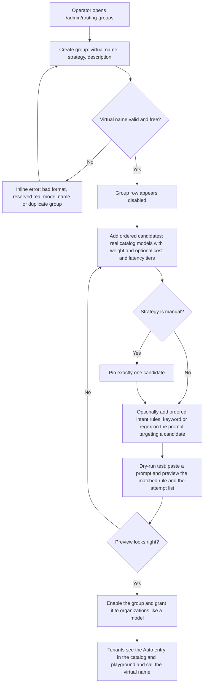
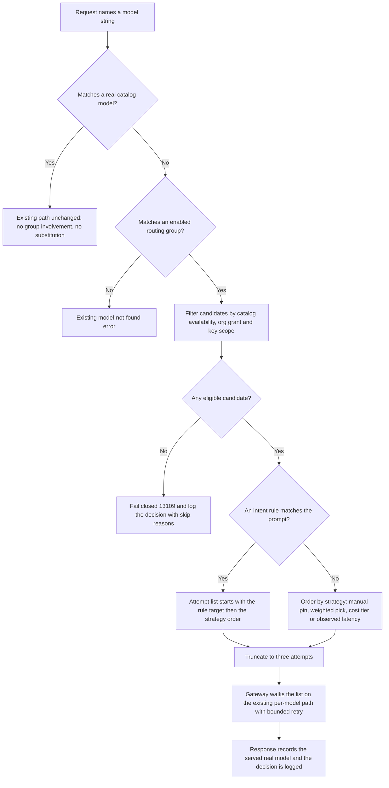
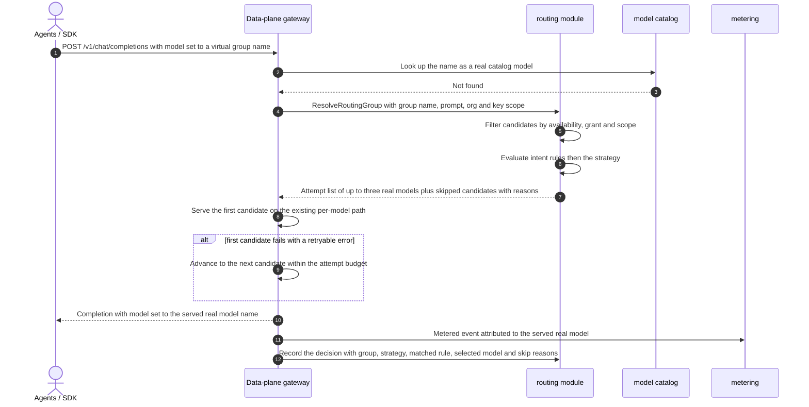
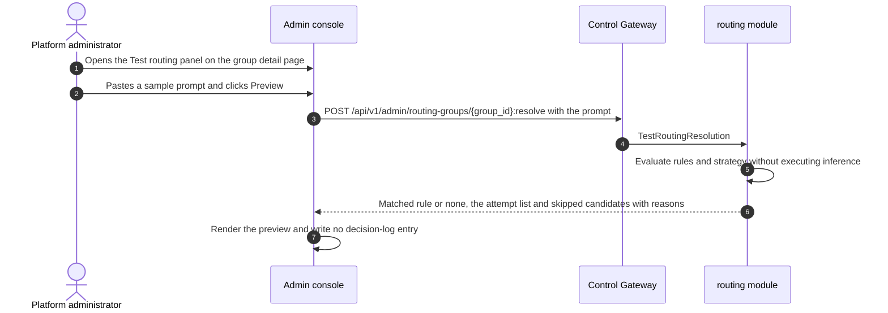

# Intelligent Model Routing — Requirement Analysis and UI/UX Design

| Attribute | Content |
| --- | --- |
| Feature point | Intelligent model routing — routing groups (virtual models): an operator creates a group under a virtual model name (e.g. `auto-chat`) holding an ordered candidate list of real catalog models (self-hosted or published external), each with a weight and optional cost/latency tier annotations; callers request the virtual name and the platform selects one candidate per request via a bounded, auditable strategy (`manual`, `weighted`, `cost-priority`, `latency-priority`) optionally overridden by explicit keyword/regex intent rules, with every decision logged (backlog row 49) |
| Document scope | Requirement analysis, competitive research and the virtual-name routing-group decision, the no-silent-substitution invariant, the admin-surface pages `/admin/routing-groups`, `/admin/routing-groups/:groupId` and `/admin/routing-groups/decisions` (group table, create dialog, candidate editor, strategy configuration, intent-rule editor, dry-run test panel, decision log with filters), the tenant-facing changes to the existing catalog/playground, the page → API surface table, and numbered acceptance criteria |
| Owning modules | `routing` (new — owns the routing-group registry, candidate lists, intent rules, request-time resolution and the decision log), `infer` / data-plane gateway (virtual-name resolution hook and bounded candidate failover reusing the #45 retry categories), `model` (catalog lookups; the grant-able list gains routing groups), `auth` (key model-scope filter gains group names), `metering` (attribution to the served real model), `audit` (group and rule changes), `pkg/server` gateway (admin-prefix bindings), `web` admin + end-user console |
| Related documents | [Architecture Design](./architecture.md) — §2.4 `infer`, §3.1 Control Gateway, §3.2 data plane, §4.3 inference request and billing loop · [Inference Routing Policies](./inference-routing-policies.md) — the same-model deployment failover and no-substitution invariant this feature builds on · [External Model Providers](./external-model-providers.md) — published external models as candidates · [Per-Tenant Model Authorization](./model-authorization.md) — the grant path routing groups reuse · [API Key Model Scoping](./api-key-model-scoping.md) — the key-scope filter applied to candidates · [Metering](./metering.md) — the attribution rule · [Console Surface Separation](./console-surface-separation.md) — the two surfaces, `AdminShell` conventions, the masked-projection rule |
| Status | Design complete, handed to the Architect agent |

---

## 1. Background and Competitive Research

### 1.1 Why Intelligent Model Routing Comes Now

Feature #45 gave go-taas **same-model** routing: an ordered list of inference-service deployments serving one exact catalog model and version, with bounded retry. Its out-of-scope list explicitly deferred "cross-model/version fallback, weighted/cost/latency routing" — and the platform has since gained everything needed to make that deferral safe: published external models (#48) sit beside self-hosted ones in one catalog, per-tenant grants (#13) and per-key model scopes (#46) define exactly who may call what, and the metered `/v1` gateway already attributes every request to a model.

What is still missing is the **caller-facing** capability every comparable platform has: request **one stable name** and let the platform pick the actual serving model per request — cheapest for simple prompts, fastest under load, a specialist model when the prompt asks for it — without the caller rewriting its client when the operator re-balances the fleet. Today a go-taas caller must hard-code a real model id, and an operator who wants to swap models must coordinate every tenant.

This feature adds **routing groups (virtual models)**: an operator creates a group under a virtual name (e.g. `auto-chat`) holding an ordered candidate list of **real catalog models** — self-hosted or published external — each with a weight and optional cost/latency tier annotations. Callers request the virtual name; the platform selects one candidate per request via a bounded, explicit strategy, optionally overridden by auditable keyword/regex intent rules; every decision is logged and inspectable.

### 1.2 Access Pattern: Virtual-Name Routing Group vs the Alternatives

| Pattern | What it is | Why we adopt / reject it |
| --- | --- | --- |
| **Virtual-name routing group in the platform control plane** (adopted) | The operator owns a group object (virtual name + ordered real-model candidates + strategy + rules) in the admin console; callers request the virtual name through the existing gateway; the platform resolves and records every decision. | The only pattern that keeps routing **platform-managed, bounded and auditable** while reusing go-taas's grants, key scopes, metering, billing, playground and OpenAI-compatible gateway unchanged. The tenant contract is one stable virtual name; the operator rebalances freely. |
| Caller-controlled per-request routing knobs | The caller passes routing parameters (sort by price/latency, fallback lists, provider order) in each request body, as OpenRouter's `models[]`/`provider.sort` and LiteLLM's per-request strategy override do. | Rejected: go-taas routing is a **platform** concern. Per-request knobs move pricing and availability decisions to each caller, make billing attribution ambiguous, and bypass the operator's curation. |
| Hidden optimizer router | A third-party service (Unify- or Martian-style) intercepts requests and picks "the best" model with an opaque quality/cost optimizer. | Rejected: an unauditable hidden judge silently substitutes models — exactly what the no-silent-substitution invariant (§1.4) forbids. go-taas's selection is explicit, configured and logged. |
| Embedding / bandit auto-routing | Semantic embedding classifiers (AIBrix `domain` rules, LiteLLM `auto_router`) or Thompson-sampling bandits (LiteLLM `adaptive_router`) choose the model. | Rejected for v1: embedding classifiers add ~100–500 ms and an unexplainable decision; bandits change behavior without an operator-visible cause. go-taas adopts only **explicit keyword/regex intent rules** whose match is human-readable and logged (D4). |
| Extending `/admin/routing-policies` | Fold cross-model routing into the #45 policy object. | Rejected: #45 orders **deployments within one real model** (same model id and version); a routing group is a **catalog-level object** mapping a virtual name to many real models. Different resource axis, different failure semantics, different audience contract — a separate page, registry and API keep both inspectable (D1). |

### 1.3 Comparable-Product Interaction Patterns

| Product | Routing pattern | go-taas decision |
| --- | --- | --- |
| **OpenRouter** | Price-weighted load balancing by default; `provider.sort` = price / throughput / latency; `:nitro` / `:floor` slug variants; `models[]` fallback list with percentile thresholds (p50/p90/p99 over a rolling window) | Adopt explicit sort dimensions (cost, latency) and a cross-model fallback list walked in order; **reject** caller-controlled knobs and hidden price-scraping defaults — cost tiers in go-taas are operator-declared annotations, not scraped prices |
| **LiteLLM Router** | Strategies `simple-shuffle` (weighted random), `least-busy`, `latency-based-routing` (sliding-window latency), `cost-based-routing`, `usage-based-routing`; `routing_groups` config (group name, models, strategy, priorities); per-request strategy override; `complexity_router` = rule-based keyword scoring under 1 ms | Adopt the strategy taxonomy (weighted / cost / latency) and the rule-based explicit classifier; **reject** per-request overrides, bandits and embedding judges (§1.2) |
| **Portkey AI Gateway** | JSON config with weighted load balancing, fallbacks on specified error codes, conditional routing; config supplied per request | Adopt weighted load-balance + explicit fallback config shape and error-code-scoped failover; **reject** config-in-request-body — go-taas groups are console-managed resources |
| **AIBrix semantic router** | Envoy ext_proc filter rewrites the request `model` field: client calls a virtual name ("Model of Models"); prompt classification (embedding domain classifier **or** keyword scanner) → highest-priority matching decision → model rewrite; priority-ordered rules with a catch-all; debug classification API; Prometheus metrics | Adopt the **virtual-model-name pattern**, the keyword rule type, priority-ordered explicit rules, decision transparency and the debug/preview API; **reject** the embedding classifier and request rewriting (system-prompt injection) — go-taas implements explicit keyword/regex intent rules in its own control plane, auditable, no hidden judge (D4) |
| **Unify AI / Martian** | "Model router" category: route by claimed quality/cost/latency with a hidden optimizer | Mentioned only as the category go-taas rejects: hidden, unauditable model substitution (§1.2) |

### 1.4 The No-Silent-Substitution Invariant

Feature #45 established the invariant for deployments; this feature extends it to the catalog level and makes it the **core product rule** of intelligent routing:

1. A request naming a **real catalog model id** always goes to that model — the existing path, unchanged. No group ever intercepts, wraps or substitutes a real model request, even if a group lists that model as a candidate.
2. Intelligent routing applies **only** when the caller explicitly requests a **routing-group virtual name**. By calling the virtual name the caller has *opted into* platform selection — that is the contract of the name.
3. The response **records which real model served the request**: the OpenAI-compatible response `model` field carries the served real model's name, and the playground shows "Served by `<real model>`". A caller can always verify what answered.
4. Every selection is **logged** (group, strategy, matched rule, selected model, candidates considered, timestamp) and inspectable by the operator — there is no hidden substitution anywhere in the path.

### 1.5 Decisions and Scope

| # | Decision | Rationale |
| --- | --- | --- |
| D1 | **A new admin section** `/admin/routing-groups` (list), `/admin/routing-groups/:groupId` (detail) and `/admin/routing-groups/decisions` (decision log), API prefix `/api/v1/admin/routing-groups/*` — **not** an extension of `/admin/routing-policies` | #45 orders deployments *within* one real model; a routing group is a new catalog-level object (virtual name → many real models). Separate page, registry and API keep both axes inspectable (§1.2) |
| D2 | **A new `routing` module** (`services/routing`) owns the group registry, candidate lists, intent rules, request-time resolution and the decision log, with its own error block **131xx**. The data-plane gateway consults it for virtual-name resolution; `model` still owns the catalog; the gateway still owns per-model serving | Routing groups are a distinct concern (virtual names, selection strategies, decision history) with their own registry and read path; a dedicated module keeps it out of the catalog and the #45 policy engine |
| D3 | **Four bounded strategies**: `manual` (one pinned candidate — alias behavior, no failover), `weighted` (random selection by weight), `cost-priority` (cheapest declared cost tier first, failover down the ordered list), `latency-priority` (fastest recent observed latency first, declared latency tier as the no-sample fallback). Cost tiers are **operator-declared annotations (1–5)**, never scraped prices; observed latency comes from the existing request/metering path | Bounded, auditable, deterministic-when-configured: every selection is explainable from operator-visible configuration plus platform-observed latency. No bandits, no embeddings, no hidden judges (§1.2) |
| D4 | **Intent rules are explicit, ordered keyword/regex classifiers on the prompt** that override the strategy when they match; the first matching rule in declared order wins; the matched rule is recorded in the decision log. A dry-run **test panel** previews rule matching and the attempt list without executing inference | Mirrors AIBrix's semantic-router sample (prompt classification → model selection) but implemented in go-taas's own control plane with explicit, auditable rules — **not** a hidden LLM judge. The dry-run panel makes rules verifiable before they go live |
| D5 | **No silent substitution** (§1.4): real model id → existing path unchanged; virtual name → group resolution; the response records the served real model (`model` field + playground "Served by") | The binding invariant inherited from #45, extended to the catalog level; a caller must always be able to see what answered |
| D6 | **A routing group is granted to organizations exactly like a model** (feature #13) and is listable in a key's model scope (feature #46). At request time each candidate must **independently** satisfy catalog availability, the org grant and the key scope; ineligible candidates are skipped with a recorded reason; if none remain the request fails closed with **13109** | Reuses the whole grant/scope machinery unchanged; the group is the *entry* permission, the candidate is the *serving* permission — both are enforced, and the skip reasons make misconfiguration visible in the decision log |
| D7 | **Bounded failover down the ordered candidate list** on the #45 retryable categories (connection/timeout before response, HTTP 429, HTTP 5xx), at most **3 total attempts**; `manual` is an alias — exactly one attempt, no failover | Reuses #45's bounded retry semantics; caps latency and duplicate-work risk; alias behavior stays predictable |
| D8 | **Metering and billing attribute to the served real model** (its real price matrix); the group is recorded in the decision log, and request logs show the real served model. The decision log is the group-attribution view | Billing truth is the model that actually computed the tokens; group attribution is an operational view layered on top |
| D9 | **Every routing decision is logged**: `{decision_id, request_id, group, strategy, matched rule, selected model, candidates considered with per-candidate outcome and skip reason, api key, org, timestamp}`, exposed in an admin view with filters, with bounded retention (default 7 days, configurable) | Decision transparency is the acceptance condition for platform-managed selection; bounded retention keeps the log operational |
| D10 | **Virtual names are reserved-validated**: pattern `^[a-z][a-z0-9-]{2,63}$`, must not collide with a real catalog model name (**13113**) nor another group (**13102**) | A virtual name and a real model name share one namespace at the gateway; collisions would create silent substitution or ambiguous resolution |
| D11 | **Realm and surface binding**: management is admin-only (`/admin/routing-groups*` + `/api/v1/admin/routing-groups/*`); tenant consumption reuses the existing end-user surfaces (`/models`, `/playground`, `/v1` gateway) with a masked projection — the tenant sees the virtual name, an "Auto" marker and the served model, never the candidates, strategy or rules. A user-realm session on an admin route gets **10038**; a session without the role gets **10036** | Consistent with the console-surface separation and the masked-projection rule (feature #17); routing internals are operator knowledge |
| D12 | **New error codes in a routing block (13101–13199)**, the next free block after provider's 130xx: **13101 `CodeRoutingGroupNotFound`**, **13102 `CodeRoutingGroupNameConflict`**, **13103 `CodeRoutingGroupNameInvalid`**, **13104 `CodeRoutingGroupCandidateInvalid`**, **13106 `CodeRoutingGroupCandidateExists`**, **13107 `CodeRoutingGroupStrategyInvalid`**, **13108 `CodeRoutingGroupRuleInvalid`**, **13109 `CodeRoutingGroupNoEligibleCandidate`**, **13110 `CodeRoutingGroupDisabled`**, **13111 `CodeRoutingGroupInUse`**, **13112 `CodeRoutingGroupRuleExists`**, **13113 `CodeRoutingGroupNameReserved`** | A new module (D2) gets a fresh code block; distinct codes keep each failure mode actionable and let the gateway fail closed precisely |

**In scope**: three admin pages (group list with create/delete/enable, group detail with the candidate editor, strategy configuration, intent-rule editor and dry-run test panel, decision log with filters and a row drawer); the `routing` module RPCs and the gateway resolution hook; the grant-able/scope-list integration (#13/#46); the "Auto" marker and served-model display on the existing tenant catalog/playground; the decision log with bounded retention.

**Out of scope** (tracked elsewhere or deliberately excluded): same-model deployment ordering and retries (feature #45, reused unchanged), embedding/semantic classifiers and bandit/adaptive routing (deliberately excluded, §1.2), caller-controlled per-request routing knobs (deliberately excluded), live price scraping or automatic tier discovery (deliberately excluded — tiers are operator-declared), canary/percentage traffic splitting, per-tenant or per-org group overrides, automatic candidate health eviction (the gateway's existing health routing and #45 handle readiness), and AIBrix-side routing configuration (feature #47 stays a runtime projection).

---

## 2. User Roles

| Role | Description | Interaction with routing groups |
| --- | --- | --- |
| **Platform administrator** | The operator who runs the go-taas platform | Creates groups under virtual names, curates ordered candidate lists with weights and cost/latency tiers, chooses the strategy, writes intent rules, dry-runs them, enables/disables groups, and inspects the decision log |
| **Tenant administrator** | Administers an organization and grants it models | Grants a routing group to the organization exactly like a model (feature #13); never sees candidates, strategy or rules |
| **Agent / SDK** | The programmatic consumer that calls `/v1/chat/completions` | Requests the virtual name with the same API key and OpenAI-compatible contract; reads the served real model from the response `model` field |
| **Platform auditor** | Reviews operational and billing attribution | Reads the decision log to attribute virtual-name traffic to the real models that served it |

> Terminology: the consumer-side caller is called an **Agent** (English) / 「智能体」(Chinese), consistent with the repo convention. Group management is admin-only; a tenant never sees strategy or rule terminology — only an "Auto" marker and the served model.

---

## 3. User Stories

| # | As a… | I want to… | So that… |
| --- | --- | --- | --- |
| US1 | Platform administrator | create a routing group under a virtual name with a strategy and an ordered candidate list of real catalog models | callers get one stable name while I rebalance the serving fleet behind it |
| US2 | Platform administrator | annotate each candidate with a weight and optional cost/latency tiers | weighted, cost-priority and latency-priority selection reflects my intent, using values I declared and can audit |
| US3 | Platform administrator | pin one candidate (manual strategy) for alias behavior | a virtual name can simply point at one model today, with no failover surprises |
| US4 | Platform administrator | write ordered keyword/regex intent rules that override the strategy when they match, and dry-run them against sample prompts | specialist prompts go to specialist models by explicit, verifiable rules — never a hidden judge |
| US5 | Platform administrator | see every routing decision (group, strategy, matched rule, selected model, candidates considered, skip reasons) in a filterable view | platform-managed selection is fully auditable and misconfiguration is visible |
| US6 | Platform administrator | be blocked from enabling an empty group, from deleting a granted group, and from choosing a virtual name that collides with a real model | the virtual namespace stays unambiguous and grants never dangle |
| US7 | Tenant administrator | grant a routing group to my organization like any model | my team calls one virtual name and the platform picks the serving model |
| US8 | Agent / SDK | request the virtual name through the same OpenAI-compatible endpoint and see which real model served | I opt into platform selection knowingly and can verify what answered |
| US9 | Platform auditor | attribute virtual-name traffic to real models for cost review | billing truth (the served model) and group attribution (the decision log) are both available |

---

## 4. Functional Requirements

### FR1 — Routing group registry

- **FR1.1** `ListRoutingGroups` (`GET /api/v1/admin/routing-groups`) returns the groups, each with `group_id`, `name` (the virtual name), `description`, `strategy` (`manual` / `weighted` / `cost_priority` / `latency_priority`), `enabled`, `candidate_count`, `rule_count`, `request_count_24h` (from the decision log), `created_at` / `updated_at`. It supports `page_size` / `page_token` pagination, a `name` search, and `strategy` / `enabled` filters.
- **FR1.2** `CreateRoutingGroup` (`POST /api/v1/admin/routing-groups`) creates a **disabled** group with **Name** (required), **Description** (optional, ≤ 256 chars) and **Strategy** (required, default `weighted`). Candidates and rules are configured afterwards on the detail page (FR2, FR4). It returns the created group.
- **FR1.3** `GetRoutingGroup` (`GET /api/v1/admin/routing-groups/{group_id}`) returns one group with its full configuration: the ordered candidate list (FR2.1) and the ordered rule list (FR4.1). An unknown id returns **13101 `CodeRoutingGroupNotFound`**.
- **FR1.4** `UpdateRoutingGroup` (`PATCH /api/v1/admin/routing-groups/{group_id}`) edits **Name**, **Description**, **Strategy** and **Enabled**. Enabling requires ≥ 1 candidate; enabling a `manual` group requires exactly one pinned candidate — otherwise **13107 `CodeRoutingGroupStrategyInvalid`**. A name change re-validates D10.
- **FR1.5** `DeleteRoutingGroup` (`DELETE /api/v1/admin/routing-groups/{group_id}`) removes the group. It is **blocked while any organization grant references the group** — the call returns **13111 `CodeRoutingGroupInUse`** and the UI disables the action with the tooltip "Remove the organization grants before deleting this group." Decision-log entries survive deletion (they denormalize the group name).
- **FR1.6** Validation: **Name** is required, 3–64 chars, pattern `^[a-z][a-z0-9-]{2,63}$` — a bad value returns **13103 `CodeRoutingGroupNameInvalid`**; a duplicate group name returns **13102 `CodeRoutingGroupNameConflict`**; a name that collides with a **real catalog model name** returns **13113 `CodeRoutingGroupNameReserved`**. **Strategy** outside the four values returns **13107**.
- **FR1.7** All group mutations are audited (`routing.group_created`, `routing.group_updated`, `routing.group_enabled`, `routing.group_disabled`, `routing.group_deleted`, `routing.candidates_updated`, `routing.rules_updated`) with the acting operator.

### FR2 — Candidate list

- **FR2.1** A candidate is `{candidate_id, model_id, model_name, weight, cost_tier, latency_tier, pinned, position}`. `weight` is an integer 1–100 (default 10). `cost_tier` and `latency_tier` are optional integers 1–5 (cost: 1 = lowest cost, 5 = highest; latency: 1 = fastest, 5 = slowest). `pinned` marks the manual-strategy alias target. `position` is the declared order (0-based).
- **FR2.2** `ReplaceRoutingGroupCandidates` (`PUT /api/v1/admin/routing-groups/{group_id}/candidates`) **atomically replaces** the ordered list (1–20 entries), mirroring the #45 policy-save pattern. Each entry references a **real catalog model** (self-hosted or published external, #48); a reference to another routing group or an unknown model returns **13104 `CodeRoutingGroupCandidateInvalid`**; a duplicate `model_id` within the list returns **13106 `CodeRoutingGroupCandidateExists`**; a weight or tier outside range returns **13104**.
- **FR2.3** Exactly **one** candidate may be `pinned`, and only when the strategy is `manual`; a `manual` group with no pinned candidate cannot be enabled (**13107**). A pinned candidate on a non-manual group is rejected (**13104**).
- **FR2.4** Candidate mutations emit `routing.candidates_updated` with the before/after list (FR1.7).

### FR3 — Selection strategies

- **FR3.1** `manual` — the pinned candidate is the **only** attempt (alias behavior, no failover, D7). If it is ineligible at request time the request fails closed (**13109**).
- **FR3.2** `weighted` — one candidate is drawn at random with probability proportional to `weight` among eligible candidates; the remaining eligible candidates follow in descending weight order (ties → declared order) as the failover tail.
- **FR3.3** `cost_priority` — eligible candidates are ordered by `cost_tier` ascending (a missing tier sorts as 6, i.e. last; ties → declared order); selection starts at the cheapest and fails over down the list.
- **FR3.4** `latency_priority` — eligible candidates are ordered by **observed p50 latency over the recent window** (default 15 minutes, from the existing request/metering path) ascending; candidates **without samples** fall back to their declared `latency_tier` ascending (missing tier = 6, ties → declared order) and sort after candidates with samples; selection starts at the fastest and fails over down the list.
- **FR3.5** The resolution produces an **attempt list of at most 3 candidates** (D7): the strategy order (or the rule target first, FR4.4) truncated to 3. The gateway walks it on the existing per-model path; a retryable failure (connection/timeout before response, HTTP 429, HTTP 5xx — the #45 categories) advances to the next candidate within the 3-attempt budget. When every attempt fails, the caller receives the last attempt's existing error and the decision log records `failed_retryable` per candidate.
- **FR3.6** **Eligibility** at resolution time: a candidate is eligible iff (a) it resolves to a real catalog model that is available (an external candidate must be published, #48), (b) the requesting organization holds a grant for it (#13), and (c) when the API key is model-scoped (#46), it is in the key's scope. Ineligible candidates are **skipped with a recorded reason** (`skipped_unavailable` / `skipped_unauthorized`); if no candidate remains the request fails closed with **13109 `CodeRoutingGroupNoEligibleCandidate`** (D6).

### FR4 — Intent rules

- **FR4.1** A rule is `{rule_id, name, match_type, pattern, target_model_id, enabled, position}`. `match_type` ∈ `{keyword, regex}`; `target_model_id` must be a candidate of the same group.
- **FR4.2** `ReplaceRoutingGroupRules` (`PUT /api/v1/admin/routing-groups/{group_id}/rules`) atomically replaces the ordered list (0–50 entries). Validation: **Name** required, 1–64 chars, unique within the group — a duplicate returns **13112 `CodeRoutingGroupRuleExists`**; a **keyword** pattern is 1–256 chars matched as a **case-insensitive substring** of the prompt; a **regex** pattern is 1–256 chars in **RE2 syntax** and must compile — an invalid regex returns **13108 `CodeRoutingGroupRuleInvalid`**; a target that is not a candidate of the group returns **13108**.
- **FR4.3** Rules are evaluated **in declared order**; the **first matching enabled rule wins** and its target becomes the first attempt. Evaluation is bounded: keyword matching is a case-insensitive substring test; regex matching uses RE2 (linear time) — no arbitrary backtracking engines.
- **FR4.4** When a rule matches, the attempt list starts with the rule's target, followed by the remaining eligible candidates in strategy order, truncated to 3 (FR3.5). When no rule matches, the strategy order alone applies. The matched rule (id + name) is recorded in the decision log; `none` when no rule matched.
- **FR4.5** `TestRoutingResolution` (`POST /api/v1/admin/routing-groups/{group_id}:resolve`) is a **dry run**: given `{prompt}`, it returns the matched rule (or none), the attempt list and the skipped candidates with reasons — **without executing inference and without writing a decision-log entry**. This is the AIBrix-style debug classification API, in go-taas's own control plane.
- **FR4.6** Rule mutations emit `routing.rules_updated` with the acting operator (FR1.7).

### FR5 — Request-time resolution and the no-silent-substitution invariant

- **FR5.1** For a request naming a **real catalog model**, the gateway behaves exactly as today — no group is consulted, no substitution occurs, no decision-log entry is created (§1.4 rule 1).
- **FR5.2** For a request naming an **enabled group's virtual name** (playground `POST /api/v1/models/{model_id}:playground` or `/v1/chat/completions`), the gateway calls the `routing` module's `ResolveRoutingGroup` with the group name, the prompt, the org and the key scope, receives the attempt list plus skipped candidates, and serves the first candidate on the existing per-model path (self-hosted or external) with bounded failover (FR3.5).
- **FR5.3** A request naming a **disabled** group fails closed with **13110 `CodeRoutingGroupDisabled`**. A name that is neither a real model nor a group returns the existing model-not-found error (no new code).
- **FR5.4** **Response transparency**: the OpenAI-compatible response `model` field carries the **served real model's name** (never the virtual name); the playground response gains `servedModel` and the UI shows "Served by `<real model>`" whenever it differs from the requested name (§1.4 rule 3).
- **FR5.5** Every resolution — success or fail-closed — writes a decision-log entry (FR7) before the response is committed.

### FR6 — Authorization and metering integration

- **FR6.1** A routing group appears in the **grant-able list** of the model-authorization surface (feature #13) marked "Auto" and is granted to organizations exactly like a model. The masked user catalog (`GET /api/v1/models`) then includes the granted group as a virtual entry (FR8.4).
- **FR6.2** A granted group name is listable in a key's model scope (feature #46); a scoped key calling a group outside its scope is rejected by the existing scoping enforcement. At resolution time the candidates are additionally filtered by the key's scope (FR3.6c).
- **FR6.3** **Metering and billing attribute to the served real model** (its price matrix), exactly as a direct request to that model; request logs show the real served model. The group attribution lives in the decision log (D8).

### FR7 — Decision log

- **FR7.1** A decision entry is `{decision_id, request_id, group_id, group_name, strategy, matched_rule {rule_id, name} or none, selected_model {model_id, name} or none, candidates_considered [{model_id, model_name, outcome, detail}], api_key_id, org_id, created_at}`. `outcome` ∈ `{served, skipped_unavailable, skipped_unauthorized, failed_retryable, not_attempted}`.
- **FR7.2** `ListRoutingDecisions` (`GET /api/v1/admin/routing-groups/decisions`) supports pagination and filters: `group`, `strategy`, `matched_rule` (name search), `selected_model`, `outcome` and a time range (`1h` / `24h` / `7d` presets). `GetRoutingDecision` (`GET /api/v1/admin/routing-groups/decisions/{decision_id}`) returns one entry.
- **FR7.3** Retention is bounded: entries older than the configured retention (default **7 days**, `Routing.DecisionRetentionDays`) are purged. Dry runs (FR4.5) are never logged.
- **FR7.4** Entries denormalize the group name and candidate names, so the log stays readable after a group or candidate is deleted.

### FR8 — Surface, realm and API binding

- **FR8.1** The routing-group pages live on the **admin surface**: `/admin/routing-groups` (list), `/admin/routing-groups/:groupId` (detail) and `/admin/routing-groups/decisions` (log), API prefix `/api/v1/admin/routing-groups/*`. They are added to the `AdminShell` navigation (feature #17) in the **Operations** group as **Routing groups** (icon `Shuffle`), directly after **Routing policies**. The static `decisions` route is registered before the `:groupId` route.
- **FR8.2** There is **no new end-user page**. Tenant consumption reuses `/models`, `/models/:modelId`, `/playground` and the `/v1` gateway, which gain the "Auto" marker and the served-model display (§5.6). The admin grant panel on `/admin/models/:modelId` (#13) and the key-scope editor on `/api-keys` (#46) list granted groups marked "Auto".
- **FR8.3** Every admin routing call uses the exact prefix `/api/v1/admin/routing-groups/*`; the admin pages contain **no `/api/v1/*` call**. The pages require the admin session realm (`/admin/login`).
- **FR8.4** A valid **user-realm** session token sent to any `/api/v1/admin/routing-groups/*` route is rejected with **10038 `CodeRealmMismatch`**; a session without the required role receives **10036 `CodeForbidden`** (D11).
- **FR8.5** The masked user projection of a group carries only `model_id` (the virtual name), `name`, `description`, `virtual: true` — **never** candidates, weights, tiers, strategy or rules (D11).
- **FR8.6** Every interactive control carries a `data-testid` in the console's `kebab-case` style (`routing-groups-table`, `routing-group-row-{group_id}`, `routing-groups-add`, `routing-group-candidate-list`, `routing-group-candidate-row-{model_id}`, `routing-group-rule-row-{rule_id}`, `routing-group-test-prompt`, `routing-group-test-result`, `routing-decisions-table`, `routing-decision-row-{decision_id}`, `models-auto-badge`, `playground-served-model`, …).

---

## 5. Page and Flow Design

### 5.1 Surface Assignment

| Feature | Surface | Web route | API prefix |
| --- | --- | --- | --- |
| Group list (search/filter/sort) | admin | `/admin/routing-groups` | `/api/v1/admin/routing-groups` |
| Create group | admin | `/admin/routing-groups` (dialog) | `/api/v1/admin/routing-groups` |
| Enable / disable / delete group | admin | `/admin/routing-groups`, `/admin/routing-groups/:groupId` | `/api/v1/admin/routing-groups/{group_id}` |
| Group detail: overview, candidates, strategy, intent rules | admin | `/admin/routing-groups/:groupId` | `/api/v1/admin/routing-groups/{group_id}`, `/api/v1/admin/routing-groups/{group_id}/candidates`, `/api/v1/admin/routing-groups/{group_id}/rules` |
| Dry-run test panel | admin | `/admin/routing-groups/:groupId` | `/api/v1/admin/routing-groups/{group_id}:resolve` |
| Routing decisions log | admin | `/admin/routing-groups/decisions` | `/api/v1/admin/routing-groups/decisions`, `/api/v1/admin/routing-groups/decisions/{decision_id}` |
| Grant panel lists groups | admin | `/admin/models/:modelId` (existing page, changed) | `/api/v1/admin/models/{model_id}:grant` / `:revoke` / `/authorizations` (existing, changed) |
| Key-scope editor lists groups | user | `/api-keys` (existing page, changed) | `/api/v1/auth/api-keys/{key_id}/scope` (existing, changed) |
| **Tenant** catalog (existing, changed) | user | `/models`, `/models/:modelId` | `/api/v1/models`, `/api/v1/models/{model_id}` (changed) |
| **Tenant** playground (existing, changed) | user | `/playground` | `/api/v1/models/{model_id}:playground`, `/v1/chat/completions` (changed) |

Management is entirely on the **admin surface**. Tenant consumption is entirely on the **end-user surface** and reuses existing pages; no new end-user route is created. The admin pages never call a `/api/v1/*` route, and the end-user pages never call a `/api/v1/admin/*` route.

### 5.2 Page Map

| Page / component | Purpose |
| --- | --- |
| **Routing groups page** (`/admin/routing-groups`) | Group table; create dialog; enable/disable; delete confirmation |
| **Routing group detail page** (`/admin/routing-groups/:groupId`) | Overview form (name, description, strategy, enabled), ordered candidate editor, intent-rule editor, dry-run test panel |
| **Routing decisions page** (`/admin/routing-groups/decisions`) | Filterable decision log with a per-decision drawer |
| **Tenant catalog/detail/playground** (existing, changed) | "Auto" marker on virtual entries; "Served by" display in the playground |

### 5.3 Page: `/admin/routing-groups` — Routing Groups (admin)

**Purpose**: let the platform administrator create, inspect and manage routing groups, and see at a glance which are enabled and how much traffic they take.

**Surface**: admin — route `/admin/routing-groups`, API `/api/v1/admin/routing-groups/*`.

**Navigation placement**: `AdminShell` sidebar, **Operations** group, item **Routing groups** (directly after **Routing policies**).

**Layout**: rendered inside `AdminShell` (feature #17). A page header ("Routing groups", subtitle "Virtual model names the platform resolves to a real serving model per request") with a **Create group** action (primary), a **View decisions** action (secondary, navigates to `/admin/routing-groups/decisions`) and a **Refresh** action. Below, one region:

1. **Groups card** — a toolbar (search by name; **Strategy** filter; **Enabled** filter) and a table with columns: **Name** (mono, with an `Auto` badge), **Strategy** (badge `Manual` / `Weighted` / `Cost priority` / `Latency priority`), **Candidates** (count), **Rules** (count), **Requests 24h**, **Enabled** (badge + toggle), **Updated**, **Actions** (**View**, **Delete**).
   - Sorting: Name, Strategy, Requests 24h, Updated. Filtering: Strategy, Enabled. Pagination: 20 per page.
   - The **Enabled** toggle is disabled while an enable/disable request is in flight; enabling an invalid group (no candidates, or `manual` without a pin) surfaces the **13107** message inline.

**Interactive states**:

| State | Behaviour |
| --- | --- |
| Default | The group table renders from the first successful load |
| Loading | Skeleton rows; **Create group**, **View decisions**, **Refresh**, toggles and **Delete** are disabled |
| Empty (no groups) | "No routing groups yet. Create a virtual model name and add real models as candidates." with a **Create group** action |
| Error (load failed) | An error banner "Could not load routing groups." with a **Retry** button; on a failed poll the last good rows are kept with a "Showing stale data" banner |
| Disabled | Row actions are disabled while an action is in flight; **Delete** is disabled while organization grants reference the group, with the tooltip "Remove the organization grants before deleting this group." (FR1.5); the **Enabled** toggle is disabled when the group fails enable validation (FR1.4) |
| Permission-denied | A session without the required role receives **10036** and the page shows the standard permission-denied state (feature #17) with a link back to `/admin` |

**Create group dialog** (fields, validation rules and error copy):

| Field | Type | Required | Validation | Error copy |
| --- | --- | --- | --- | --- |
| Name | text | yes | 3–64 chars, `^[a-z][a-z0-9-]{2,63}$`, not a real catalog model name, unique among groups | "Enter a lowercase virtual name (letter first, then letters, digits, `-`)." (13103) / "A routing group with this name already exists." (13102) / "This name is reserved by a real model. Choose a different virtual name." (13113) |
| Description | text | no | ≤ 256 chars | "Description is too long." |
| Strategy | select (`weighted` default, `manual`, `cost_priority`, `latency_priority`) | no | one of the four | "Select a strategy." (13107) |

The dialog footer has **Cancel** and **Create group** (disabled until valid). A callout states: "The group is created disabled. Add candidates on the detail page, then enable it." Confirming calls `CreateRoutingGroup`, shows a toast "Routing group created." and navigates to `/admin/routing-groups/{group_id}`.

**Delete confirmation**: "Delete routing group `<name>`? Tenants can no longer call this virtual name. Recorded routing decisions are kept. The group cannot be deleted while an organization grant references it." — if grants reference the group the dialog is not reachable and the action is disabled (FR1.5). Otherwise the footer has **Delete** (danger) and **Cancel**; confirming calls `DeleteRoutingGroup` and shows a toast "Routing group deleted."

**Disable confirmation** (toggle off): "Disable `<name>`? New requests for this virtual name fail closed. In-flight requests that already resolved continue." with **Disable** (danger) and **Cancel**.

### 5.4 Page: `/admin/routing-groups/:groupId` — Group Detail (admin)

**Purpose**: configure one group — its identity and strategy, its ordered candidate list, its intent rules — and dry-run the resolution before enabling it.

**Surface**: admin — route `/admin/routing-groups/:groupId`, API `/api/v1/admin/routing-groups/*`.

**Navigation placement**: reached from the groups table **View** action; breadcrumb "Routing groups / `<name>`".

**Layout**: page header (group **Name** mono + `Auto` badge + **Strategy** badge + **Enabled** badge) with actions **View decisions** (secondary, navigates to `/admin/routing-groups/decisions?group=<group_id>`) and **Delete group** (danger, guarded per FR1.5). Below, four regions:

1. **Overview card** — an editable form: **Name** (text, validation per FR1.6), **Description** (text, ≤ 256 chars), **Strategy** (select; switching away from `manual` clears the pin with a notice), **Enabled** (toggle; enabling validates FR1.4). Footer action **Save changes** (primary, disabled until dirty and valid). Changing the strategy shows an inline explanation of the new strategy's semantics (one sentence per strategy).
2. **Candidates card** — header action **Add candidate**; an ordered table with columns: **#** (position), **Model** (name, mono, linking to `/admin/models/{model_id}`; external candidates show the `External` badge), **Weight** (1–100), **Cost tier** (1–5 or `—`), **Latency tier** (1–5 or `—`), **Pinned** (badge, manual strategy only), **Actions** (**Up**, **Down**, **Remove**). Footer action **Save candidates** (primary) — one atomic `PUT` (FR2.2). A hint reads "Cost tier: 1 = lowest cost, 5 = highest. Latency tier: 1 = fastest, 5 = slowest. Tiers are your declared annotations — the platform never scrapes prices."
3. **Intent rules card** — header action **Add rule**; an ordered table with columns: **#** (position), **Name**, **Type** (badge `Keyword` / `Regex`), **Pattern** (mono, truncated with a title tooltip), **Target model** (the candidate's model name), **Enabled** (toggle), **Actions** (**Up**, **Down**, **Remove**). Footer action **Save rules** (primary) — one atomic `PUT` (FR4.2). A hint reads "Rules are evaluated top-down. The first matching rule overrides the strategy. Every match is recorded in the decision log."
4. **Test routing card** (dry run) — a **Prompt** textarea, a **Preview** action (primary), and a result panel: **Matched rule** (`none` or the rule name), the **Attempt list** (ordered model names, ≤ 3), and **Skipped candidates** with reasons (`unavailable` / `unauthorized`). A note reads "Dry run — no inference is executed and no decision is logged." (FR4.5)

**Interactive states**: default / loading (skeletons, all actions disabled) / empty (candidates: "No candidates yet. Add at least one real catalog model." with an **Add candidate** action; rules: "No intent rules. The strategy alone decides." with an **Add rule** action) / error (banner + **Retry**, keeping last good data) / disabled (actions disabled in flight; **Save candidates** disabled while the list is empty or invalid; **Save rules** disabled while a rule is invalid; **Delete group** guarded per FR1.5; the **Enabled** toggle disabled while the group fails enable validation) / permission-denied (**10036** state with a link back to `/admin`).

**Add candidate row** (fields, validation rules and error copy):

| Field | Type | Required | Validation | Error copy |
| --- | --- | --- | --- | --- |
| Model | select (real catalog models; groups excluded) | yes | must exist, no duplicate in the list | "Select a real catalog model." (13104) / "This model is already a candidate." (13106) |
| Weight | integer | no | 1–100, default 10 | "Enter a weight between 1 and 100." (13104) |
| Cost tier | integer | no | 1–5 or empty | "Enter a cost tier between 1 (lowest cost) and 5." (13104) |
| Latency tier | integer | no | 1–5 or empty | "Enter a latency tier between 1 (fastest) and 5." (13104) |
| Pinned | toggle | no | only with `manual` strategy, at most one | "Only the manual strategy uses a pinned candidate, and only one." (13104) |

**Add rule row** (fields, validation rules and error copy):

| Field | Type | Required | Validation | Error copy |
| --- | --- | --- | --- | --- |
| Name | text | yes | 1–64 chars, unique within the group | "Enter a rule name." / "A rule with this name already exists." (13112) |
| Type | select (`keyword`, `regex`) | yes | one of the two | "Select a match type." (13108) |
| Pattern | text | yes | 1–256 chars; `regex` must compile in RE2 | "Enter a pattern." / "The regex does not compile." (13108) |
| Target model | select (the group's candidates) | yes | must be a candidate | "Select a candidate model." (13108) |
| Enabled | toggle | no | default on | — |

### 5.5 Page: `/admin/routing-groups/decisions` — Routing Decisions (admin)

**Purpose**: make every routing decision inspectable — who called which group, which rule matched, which real model served, and why other candidates were skipped.

**Surface**: admin — route `/admin/routing-groups/decisions`, API `/api/v1/admin/routing-groups/*`.

**Navigation placement**: **View decisions** action on the groups list and on the group detail page; the URL accepts `?group=<group_id>` to pre-filter.

**Layout**: a page header ("Routing decisions", subtitle "Every virtual-name resolution, with the selected model and the candidates considered") with a **Refresh** action. Below, one region:

1. **Decisions card** — a toolbar: **Group** select, **Strategy** select, **Matched rule** text search, **Selected model** text search, **Outcome** select (`served` / `failed`), **Range** presets (`1h` / `24h` / `7d`, default `24h`); and a table with columns: **Time**, **Group** (name, mono), **Strategy**, **Matched rule** (name or `—`), **Selected model** (name, mono; `—` when failed), **Outcome** (badge `Served` green / `Failed` red), **Request** (id, mono, truncated). Row click opens a **decision drawer**. Pagination: 20 per page.

**Decision drawer**: the full entry (FR7.1) — **Group**, **Strategy**, **Matched rule**, **Selected model**, **API key** (id), **Organization** (id), **Request** (id), **Created at**, and a **Candidates considered** table: **Model**, **Outcome** (`served` / `skipped_unavailable` / `skipped_unauthorized` / `failed_retryable` / `not_attempted`), **Detail** (e.g. "org not granted", "not in key scope", "upstream 5xx").

**Interactive states**:

| State | Behaviour |
| --- | --- |
| Default | The decisions table renders from the first successful load, newest first |
| Loading | Skeleton rows; filters and **Refresh** disabled |
| Empty (no decisions in range) | "No routing decisions in this range. Decisions appear when a virtual name is requested." |
| Error (load failed) | An error banner "Could not load routing decisions." with a **Retry** button |
| Disabled | Filters and **Refresh** disabled while a request is in flight |
| Permission-denied | **10036** state with a link back to `/admin` |

### 5.6 Tenant-Facing Change (existing pages, changed)

| Page | Surface / route | Change |
| --- | --- | --- |
| Model catalog | user — `/models` | A granted group appears under its **virtual name** with an **Auto** badge; the version column shows `—`. No candidates, strategy or rules are exposed. (`GET /api/v1/models`) |
| Model detail | user — `/models/:modelId` | Shows the **Auto** marker and "A platform-managed model group — the platform selects the serving model for each request." Operator-only sections that do not apply (autoscaling, compatibility, load tests) are hidden or shown as "Not applicable". (`GET /api/v1/models/{model_id}`) |
| Playground | user — `/playground` | The model selector includes granted groups (option label "`<name>` (Auto)"); sending a request works unchanged through the metered gateway, and the response panel shows **"Served by `<real model>`"** whenever the served model differs from the requested name. (`POST /api/v1/models/{model_id}:playground`) |
| Admin grant panel (#13) | admin — `/admin/models/:modelId` (existing, changed) | The Authorized organizations panel lists routing groups marked **Auto**, grantable exactly like a model. |
| Key-scope editor (#46) | user — `/api-keys` | A granted group name is listable in a key's model scope. |

### 5.7 Flows

---

## 6. API Surface Implications

The routing RPCs belong to the new **`routing` module** (D2), served as HTTP via the Control Gateway on the **admin prefix** `/api/v1/admin/routing-groups/*`. The data-plane gateway calls `ResolveRoutingGroup` for virtual-name requests (FR5.2); the end-user catalog and playground projections gain the masked virtual entry and the served-model field (FR8.4, FR5.4). There is **no new user-prefix binding** — tenant consumption reuses the existing routes.

| RPC | Route | Prefix | Status | Purpose |
| --- | --- | --- | --- | --- |
| `ListRoutingGroups` (new `taas.routing.v1`) | `GET /api/v1/admin/routing-groups` | admin | **new** | Groups with strategy, counts and 24h request count; pagination, search, filters |
| `CreateRoutingGroup` | `POST /api/v1/admin/routing-groups` | admin | **new** | Create a disabled group (name, description, strategy) |
| `GetRoutingGroup` | `GET /api/v1/admin/routing-groups/{group_id}` | admin | **new** | One group with its candidates and rules; unknown id → 13101 |
| `UpdateRoutingGroup` | `PATCH /api/v1/admin/routing-groups/{group_id}` | admin | **new** | Edit name, description, strategy, enabled; enable validates FR1.4 |
| `DeleteRoutingGroup` | `DELETE /api/v1/admin/routing-groups/{group_id}` | admin | **new** | Remove a group; blocked while granted (13111) |
| `ReplaceRoutingGroupCandidates` | `PUT /api/v1/admin/routing-groups/{group_id}/candidates` | admin | **new** | Atomically replace the ordered candidate list (1–20) |
| `ReplaceRoutingGroupRules` | `PUT /api/v1/admin/routing-groups/{group_id}/rules` | admin | **new** | Atomically replace the ordered rule list (0–50) |
| `TestRoutingResolution` | `POST /api/v1/admin/routing-groups/{group_id}:resolve` | admin | **new** | Dry-run resolution: matched rule, attempt list, skipped with reasons; no execution, no log |
| `ListRoutingDecisions` | `GET /api/v1/admin/routing-groups/decisions` | admin | **new** | Decision log; pagination + group/strategy/rule/model/outcome/range filters |
| `GetRoutingDecision` | `GET /api/v1/admin/routing-groups/decisions/{decision_id}` | admin | **new** | One decision with candidates considered |
| `ResolveRoutingGroup` | internal (gateway → `routing`) | n/a | **new** | Resolve a virtual name to an ordered attempt list + skipped candidates, or a fail-closed code |
| `ListAvailableModels` / `GetAvailableModel` | `GET /api/v1/models`, `/api/v1/models/{model_id}` | user | **changed** | Gain granted groups as masked virtual entries (`virtual: true`; no candidates/strategy/rules) |
| `PlaygroundInfer` | `POST /api/v1/models/{model_id}:playground` | user | **changed** | Accepts a group name; response gains `servedModel` |
| `ChatCompletions` | `POST /v1/chat/completions` | user | **changed** | Accepts a group name; response `model` = the served real model's name |
| `GrantModelAccess` / `RevokeModelAccess` / `ListModelAuthorizations` (#13) | `POST /api/v1/admin/models/{model_id}:grant` / `:revoke`, `GET /api/v1/admin/models/{model_id}/authorizations` | admin | **changed** | The grant-able object list accepts routing-group names |
| `UpdateApiKeyScope` (#46) | `PUT /api/v1/auth/api-keys/{key_id}/scope` | user | **changed** | The scope list accepts granted routing-group names |

**Contract notes for the Architect agent**:

1. The virtual name and real model names share one resolution namespace at the gateway: a real-model match always wins (FR5.1), and create/update reject reserved names with **13113** (D10).
2. `ResolveRoutingGroup` takes `{group_name, prompt, org_id, api_key_id}` and returns `{attempt_list[{model_id, model_name}] (≤ 3), skipped[{model_id, model_name, reason}]}` or a fail-closed code (**13109** no eligible candidate, **13110** disabled group, **13101** unknown). The gateway then serves each attempt on the existing per-model path and records the decision (FR7.1) with the final outcome.
3. Candidate and rule lists are **atomically replaced** (PUT), mirroring the #45 policy-save pattern; there is no per-row CRUD (FR2.2, FR4.2).
4. Regex rules use **RE2** syntax (linear time, no backtracking); keyword rules are case-insensitive substring matches (FR4.3).
5. `latency_priority` reads observed p50 latency from the existing request/metering path over a 15-minute window; candidates without samples fall back to the declared `latency_tier` (FR3.4). The window source is the Architect's choice; the fallback order is binding.
6. Serialization conventions unchanged: HTTP 200 on success, business errors as `{"code": <int>, "message": "..."}`, int64 fields serialized as JSON strings.
7. Decision-log retention defaults to 7 days (`Routing.DecisionRetentionDays`); dry runs are never logged (FR7.3).

Error codes (`pkg/errors/codes.go`):

| Condition | Code | Constant | Notes |
| --- | --- | --- | --- |
| Unknown routing group | 13101 | `CodeRoutingGroupNotFound` | **New** (D12) |
| Duplicate group name | 13102 | `CodeRoutingGroupNameConflict` | **New** (D12) |
| Invalid group name | 13103 | `CodeRoutingGroupNameInvalid` | **New** (D12) |
| Invalid candidate field (weight/tier/pin/model reference) | 13104 | `CodeRoutingGroupCandidateInvalid` | **New** (D12) |
| Duplicate candidate model in a group | 13106 | `CodeRoutingGroupCandidateExists` | **New** (D12) |
| Invalid strategy or strategy config (manual without a pin) | 13107 | `CodeRoutingGroupStrategyInvalid` | **New** (D12) |
| Invalid intent rule (pattern, regex compile, target) | 13108 | `CodeRoutingGroupRuleInvalid` | **New** (D12) |
| No eligible candidate at request time | 13109 | `CodeRoutingGroupNoEligibleCandidate` | **New** (D12) — fail closed |
| Request for a disabled group | 13110 | `CodeRoutingGroupDisabled` | **New** (D12) — fail closed |
| Group in use (organization grants reference it) | 13111 | `CodeRoutingGroupInUse` | **New** (D12) — delete guard |
| Duplicate rule name within a group | 13112 | `CodeRoutingGroupRuleExists` | **New** (D12) |
| Virtual name reserved by a real catalog model | 13113 | `CodeRoutingGroupNameReserved` | **New** (D12) |
| User-realm session on an admin route | 10038 | `CodeRealmMismatch` | Reused — realm separation (FR8.4) |
| Session without the required role | 10036 | `CodeForbidden` | Reused — permission denial (FR8.4) |

---

## 7. Acceptance Criteria

| # | Criterion | Level |
| --- | --- | --- |
| AC1 | `/admin/routing-groups` renders the group table with Name, Strategy, Candidates, Rules, Requests 24h, Enabled and Updated columns, plus search, Strategy/Enabled filters, sorting and pagination | Nightwatch E2E |
| AC2 | The create dialog validates the virtual name (format **13103**, duplicate group **13102**, reserved real-model name **13113**), description length and strategy, showing the specified error copy; a valid submission creates a **disabled** group and navigates to its detail page | Nightwatch E2E |
| AC3 | The candidate editor adds, reorders (Up/Down) and removes candidates; a duplicate model is rejected (**13106**), a non-catalog reference is rejected (**13104**), weights stay within 1–100 and tiers within 1–5 with the specified copy; **Save candidates** persists the order atomically | Nightwatch E2E |
| AC4 | Strategy configuration: switching to `manual` requires exactly one pinned candidate — enabling without a pin is blocked with **13107**; enabling a group with zero candidates is blocked; `weighted`, `cost_priority` and `latency_priority` save and display their badges | Nightwatch E2E + FVT |
| AC5 | The intent-rule editor adds keyword and regex rules; an invalid regex is rejected (**13108**), a target outside the candidate list is rejected (**13108**), a duplicate rule name is rejected (**13112**); rules evaluate top-down and the first match wins | Nightwatch E2E + FVT |
| AC6 | The dry-run **Test routing** panel: pasting a prompt returns the matched rule (or none), the attempt list (≤ 3 models) and skipped candidates with reasons; no inference is executed and no decision-log entry appears | Nightwatch E2E |
| AC7 | **No silent substitution**: a request for a **real model id** is served by that model with the response `model` equal to the requested name and **no** decision-log entry created; a request for a **virtual name** is served by a real candidate with the response `model` equal to the **served** model's name, different from the virtual name | FVT + Nightwatch E2E |
| AC8 | **End-to-end virtual consumption with metering**: an organization granted a group (and its candidates) calls the virtual name through the playground and gets a completion with **"Served by `<real model>`"**; the request is metered and attributed to the **real served model** | FVT + Nightwatch E2E |
| AC9 | **Intent-rule override**: with a keyword rule targeting candidate B and a strategy that would pick A, a prompt containing the keyword is served by B (visible in the playground served-by line and the decision log); a non-matching prompt is served by A | Nightwatch E2E |
| AC10 | **Strategy behavior**: `manual` always serves the pinned candidate; `weighted` with two 50/50 candidates serves both across 20 requests; `cost_priority` serves the lowest cost tier first; `latency_priority` with no samples serves the lowest declared latency tier first | FVT + Nightwatch E2E |
| AC11 | **Authorization fail-closed**: a candidate not granted to the org is skipped (`skipped_unauthorized` in the decision log); a group whose candidates are all ungranted fails closed with **13109**; a key scoped away from the selected candidate skips it; a disabled group fails closed with **13110** | FVT |
| AC12 | The **decisions page** lists decisions with Time, Group, Strategy, Matched rule, Selected model, Outcome and Request columns; the Group/Strategy/Outcome/Range filters work; the row drawer shows candidates considered with per-candidate outcomes and skip reasons | Nightwatch E2E |
| AC13 | **Negative realm separation**: a valid user-realm session token sent to `GET /api/v1/admin/routing-groups` is rejected with **10038**; the end-user console has no routing-group management route; the admin pages contain no `/api/v1/*` call and the user pages no `/api/v1/admin/*` call | FVT + Nightwatch E2E |
| AC14 | A session without the required role receives **10036** and all three admin pages show the standard permission-denied state with a link back to `/admin` | Nightwatch E2E |
| AC15 | **Tenant-facing marker**: the user catalog `/models` shows granted groups with an **Auto** badge and `—` version, exposing no candidates, strategy or rules; the playground selector includes the virtual entry labeled "`<name>` (Auto)"; the admin grant panel and key-scope editor list the group | Nightwatch E2E |
| AC16 | **Guards and states**: deleting a granted group is disabled and rejected with **13111**; the three admin pages provide loading, empty, stale-error, disabled/guarded and permission-denied states as specified in §5.3–§5.5 | FVT + Nightwatch E2E |

---

## 8. Out of Scope (tracked elsewhere)

| Item | Where |
| --- | --- |
| Same-model deployment ordering and bounded retries | Feature #45 inference routing policies (reused unchanged) |
| Embedding / semantic classifiers, bandit and adaptive routing | Deliberately excluded (§1.2) — explicit keyword/regex rules only |
| Caller-controlled per-request routing knobs | Deliberately excluded (§1.2) — routing is platform-managed |
| Live price scraping or automatic cost/latency tier discovery | Deliberately excluded (D3) — tiers are operator-declared annotations |
| Canary / percentage traffic splitting and per-org group overrides | A later increment if required |
| Automatic candidate health eviction | The gateway's existing health routing and #45 handle readiness |
| AIBrix-side routing configuration | Feature #47 stays a runtime projection |
| The metering/billing pipeline itself | Features #4, #25, #28 (reused unchanged; attribution rule in FR6.3) |
| An end-user routing-group management page | Deliberately absent (D11) — tenants consume virtual names, they do not manage them |
