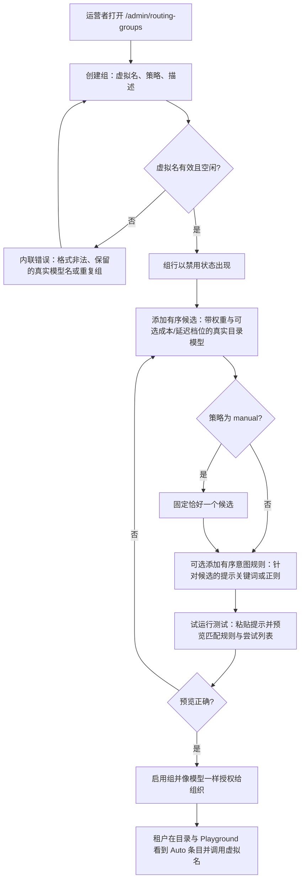
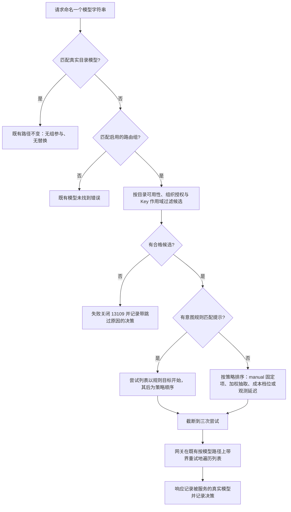
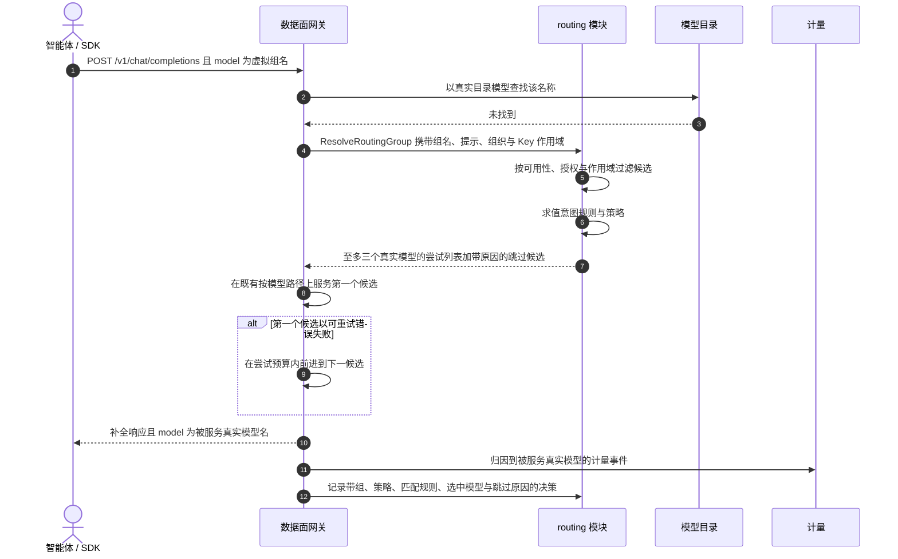
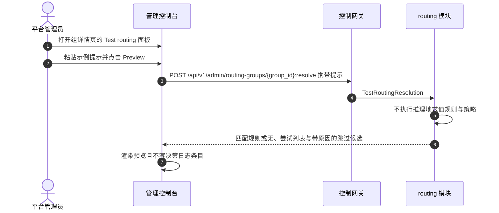

# 智能模型路由 — 需求分析与 UI/UX 设计

| 属性 | 内容 |
| --- | --- |
| 特性点 | 智能模型路由 — 路由组（虚拟模型）：运营者以一个虚拟模型名（如 `auto-chat`）创建路由组，持有真实目录模型（自托管或已发布外部模型）的有序候选列表，每个候选带权重与可选的成本/延迟档位标注；调用方请求虚拟名，平台按有界、可审计的策略（`manual`、`weighted`、`cost-priority`、`latency-priority`）为每个请求选择一个候选，可被显式关键词/正则意图规则覆盖，且每个决策都被记录（backlog 第 49 行） |
| 文档范围 | 需求分析、竞品调研与虚拟名路由组决策、无静默替换不变式、管理面页面 `/admin/routing-groups`、`/admin/routing-groups/:groupId` 与 `/admin/routing-groups/decisions`（组表、创建对话框、候选编辑器、策略配置、意图规则编辑器、试运行测试面板、带过滤的决策日志）、对既有目录/Playground 的租户侧变更、页面 → API 面映射表，以及编号验收标准 |
| 归属模块 | `routing`（新增 — 拥有路由组注册表、候选列表、意图规则、请求时解析与决策日志）、`infer` / 数据面网关（虚拟名解析钩子与复用 #45 重试类别的有界候选故障转移）、`model`（目录查询；可授权列表纳入路由组）、`auth`（Key 模型作用域过滤纳入组名）、`metering`（归因到实际服务的真实模型）、`audit`（组与规则变更）、`pkg/server` 网关（管理前缀绑定）、`web` 管理控制台与终端用户控制台 |
| 相关文档 | [架构设计](./architecture.md) — 第 2.4 节 `infer`、第 3.1 节控制网关、第 3.2 节数据面、第 4.3 节推理请求与计费回路 · [推理路由策略](./inference-routing-policies.md) — 本特性构建其上的同模型部署故障转移与无替换不变式 · [外部模型提供方](./external-model-providers.md) — 已发布外部模型作为候选 · [按租户模型授权](./model-authorization.md) — 路由组复用的授权路径 · [API Key 模型作用域](./api-key-model-scoping.md) — 应用于候选的 Key 作用域过滤 · [计量](./metering.md) — 归因规则 · [控制台面分离](./console-surface-separation.md) — 两个面、`AdminShell` 约定、掩码投影规则 |
| 状态 | 设计完成，已移交架构师代理 |

---

## 1. 背景与竞品调研

### 1.1 为什么现在做智能模型路由

特性 #45 给了 go-taas **同模型**路由：服务同一个确切目录模型与版本的推理服务部署有序列表，带边界重试。它的范围外清单明确推迟了「跨模型/版本回退、加权/成本/延迟路由」——而平台此后已具备让这一推迟变得安全的一切：已发布外部模型（#48）与自托管模型并列于同一目录，按租户授权（#13）与按 Key 模型作用域（#46）精确定义了谁可以调用什么，计量 `/v1` 网关也已把每个请求归因到模型。

仍然缺失的是每个可比平台都具备的**调用方侧**能力：请求**一个稳定名称**，让平台按请求选择实际服务的模型 —— 简单提示走最便宜、高负载走最快、特定提示走专用模型 —— 而调用方无需在运营者重新平衡机群时改写客户端。今天 go-taas 调用方必须硬编码真实模型 id，想换模型的运营者必须协调每个租户。

本特性新增**路由组（虚拟模型）**：运营者以虚拟名（如 `auto-chat`）创建组，持有**真实目录模型**的有序候选列表 —— 自托管或已发布外部模型 —— 每个候选带权重与可选的成本/延迟档位标注。调用方请求虚拟名；平台按有界、显式的策略为每个请求选择一个候选，可被可审计的关键词/正则意图规则覆盖；每个决策都被记录并可检查。

### 1.2 访问模式：「平台控制面内的虚拟名路由组」与替代方案

| 模式 | 是什么 | 采纳 / 拒绝的理由 |
| --- | --- | --- |
| **平台控制面内的虚拟名路由组**（采纳） | 运营者在管理控制台拥有组对象（虚拟名 + 有序真实模型候选 + 策略 + 规则）；调用方通过既有网关请求虚拟名；平台解析并记录每个决策。 | 唯一能让路由保持**平台管理、有界且可审计**、同时原样复用 go-taas 授权、Key 作用域、计量、计费、Playground 与 OpenAI 兼容网关的模式。租户契约是一个稳定的虚拟名；运营者自由重新平衡。 |
| 调用方按请求控制路由 | 调用方在每个请求体中传路由参数（按价格/延迟排序、回退列表、提供方顺序），如 OpenRouter 的 `models[]`/`provider.sort` 与 LiteLLM 的按请求策略覆盖。 | 拒绝：go-taas 路由是**平台**关注点。按请求的旋钮把定价与可用性决策转移给每个调用方，使计费归因含糊，并绕过运营者的策展。 |
| 隐藏优化器路由 | 第三方服务（Unify、Martian 风格）拦截请求并用不透明的质量/成本优化器挑选「最佳」模型。 | 拒绝：不可审计的隐藏判别器会静默替换模型 —— 恰是无静默替换不变式（§1.4）所禁止的。go-taas 的选择是显式、可配置且被记录的。 |
| 嵌入 / 老虎机自动路由 | 语义嵌入分类器（AIBrix `domain` 规则、LiteLLM `auto_router`）或 Thompson 采样老虎机（LiteLLM `adaptive_router`）选择模型。 | v1 拒绝：嵌入分类器增加约 100–500 毫秒且决策不可解释；老虎机在无运营者可见原因的情况下改变行为。go-taas 只采纳**显式关键词/正则意图规则**，其匹配人类可读且被记录（D4）。 |
| 扩展 `/admin/routing-policies` | 把跨模型路由折叠进 #45 的策略对象。 | 拒绝：#45 排序**一个真实模型内部**的部署（相同模型 id 与版本）；路由组是映射虚拟名到多个真实模型的**目录级对象**。不同的资源轴、不同的失败语义、不同的受众契约 —— 独立的页面、注册表与 API 让两者都可检查（D1）。 |

### 1.3 竞品交互模式

| 产品 | 路由模式 | go-taas 决策 |
| --- | --- | --- |
| **OpenRouter** | 默认按价格加权负载均衡；`provider.sort` = 价格 / 吞吐 / 延迟；`:nitro` / `:floor` 别名变体；`models[]` 回退列表带百分位阈值（滚动窗口上的 p50/p90/p99） | 采纳显式排序维度（成本、延迟）与按序遍历的跨模型回退列表；**拒绝**调用方控制旋钮与隐藏的价格抓取默认值 —— go-taas 的成本档位是运营者声明的标注，而非抓取的价格 |
| **LiteLLM Router** | 策略 `simple-shuffle`（加权随机）、`least-busy`、`latency-based-routing`（滑动窗口延迟）、`cost-based-routing`、`usage-based-routing`；`routing_groups` 配置（组名、模型、策略、优先级）；按请求策略覆盖；`complexity_router` = 低于 1 毫秒的基于规则的关键词打分 | 采纳策略分类法（加权 / 成本 / 延迟）与基于规则的显式分类器；**拒绝**按请求覆盖、老虎机与嵌入判别器（§1.2） |
| **Portkey AI Gateway** | JSON 配置带加权负载均衡、按指定错误码回退、条件路由；配置随请求提供 | 采纳加权负载均衡 + 显式回退配置形状与按错误码的故障转移；**拒绝**请求体内配置 —— go-taas 的组是控制台管理的资源 |
| **AIBrix semantic router** | Envoy ext_proc 过滤器改写请求 `model` 字段：客户端调用虚拟名（「Model of Models」）；提示分类（嵌入领域分类器**或**关键词扫描器）→ 最高优先级匹配决策 → 模型改写；优先级排序规则带兜底；调试分类 API；Prometheus 指标 | 采纳**虚拟模型名模式**、关键词规则类型、优先级排序的显式规则、决策透明性与调试/预览 API；**拒绝**嵌入分类器与请求改写（系统提示注入）—— go-taas 在自己的控制面实现显式关键词/正则意图规则，可审计，无隐藏判别器（D4） |
| **Unify AI / Martian** | 「模型路由器」类别：以隐藏优化器按宣称的质量/成本/延迟路由 | 仅作为 go-taas 拒绝的类别提及：隐藏、不可审计的模型替换（§1.2） |

### 1.4 无静默替换不变式

特性 #45 为部署确立了不变式；本特性把它扩展到目录级，并使之成为智能路由的**核心产品规则**：

1. 命名**真实目录模型 id** 的请求总是发往该模型 —— 既有路径原样不变。任何组都不会拦截、包裹或替换真实模型请求，即使某组把该模型列为候选。
2. 智能路由**仅**在调用方显式请求**路由组虚拟名**时生效。调用虚拟名即调用方*选择加入*平台选择 —— 这就是该名称的契约。
3. 响应**记录实际服务的真实模型**：OpenAI 兼容响应的 `model` 字段携带被服务真实模型的名称，Playground 显示「Served by `<真实模型>`」。调用方总能验证是什么在回答。
4. 每次选择都被**记录**（组、策略、匹配规则、选中模型、考虑过的候选、时间戳）并可被运营者检查 —— 路径中任何地方都没有隐藏替换。

### 1.5 决策与范围

| # | 决策 | 依据 |
| --- | --- | --- |
| D1 | **新增管理面分区** `/admin/routing-groups`（列表）、`/admin/routing-groups/:groupId`（详情）与 `/admin/routing-groups/decisions`（决策日志），API 前缀 `/api/v1/admin/routing-groups/*` —— **不是**扩展 `/admin/routing-policies` | #45 排序*一个真实模型内部*的部署；路由组是新的目录级对象（虚拟名 → 多个真实模型）。独立的页面、注册表与 API 让两个轴都可检查（§1.2） |
| D2 | **新增 `routing` 模块**（`services/routing`）拥有组注册表、候选列表、意图规则、请求时解析与决策日志，带自有错误块 **131xx**。数据面网关为虚拟名解析咨询它；`model` 仍拥有目录；网关仍拥有按模型服务 | 路由组是独立关注点（虚拟名、选择策略、决策历史），有自己的注册表与读取路径；专用模块使其不进入目录与 #45 策略引擎 |
| D3 | **四个有界策略**：`manual`（固定单候选 —— 别名行为，无故障转移）、`weighted`（按权重随机）、`cost-priority`（最便宜声明成本档位优先，沿有序列表故障转移）、`latency-priority`（近期观测延迟最快优先，无样本时回退声明延迟档位）。成本档位是**运营者声明的标注（1–5）**，绝非抓取的价格；观测延迟来自既有请求/计量路径 | 有界、可审计、配置即确定：每次选择都可由运营者可见的配置加平台观测延迟解释。无老虎机、无嵌入、无隐藏判别器（§1.2） |
| D4 | **意图规则是对提示的显式、有序关键词/正则分类器**，匹配时覆盖策略；声明顺序中第一条匹配的规则胜出；匹配的规则被记录在决策日志中。试运行**测试面板**在不执行推理的情况下预览规则匹配与尝试列表 | 镜像 AIBrix 的 semantic-router 样例（提示分类 → 模型选择），但在 go-taas 自己的控制面以显式、可审计的规则实现 —— **不是**隐藏的 LLM 判别器。试运行面板让规则在生效前可验证 |
| D5 | **无静默替换**（§1.4）：真实模型 id → 既有路径不变；虚拟名 → 组解析；响应记录实际服务的真实模型（`model` 字段 + Playground「Served by」） | 继承自 #45 的绑定不变式，扩展到目录级；调用方必须总能看到是什么在回答 |
| D6 | **路由组像模型一样被授权给组织**（特性 #13），并可列入 Key 的模型作用域（特性 #46）。请求时每个候选必须**独立**满足目录可用性、组织授权与 Key 作用域；不合格候选被跳过并记录原因；若一个不剩则请求以 **13109** 失败关闭 | 原样复用整套授权/作用域机制；组是*入口*权限，候选是*服务*权限 —— 两者都被强制，且跳过原因让配置错误在决策日志中可见 |
| D7 | **沿有序候选列表的有界故障转移**，复用 #45 的可重试类别（响应前连接/超时、HTTP 429、HTTP 5xx），至多 **3 次总尝试**；`manual` 是别名 —— 恰好一次尝试，无故障转移 | 复用 #45 的有界重试语义；限制延迟与重复执行风险；别名行为保持可预测 |
| D8 | **计量与计费归因到实际服务的真实模型**（其真实价格矩阵）；组被记录在决策日志中，请求日志显示真实服务模型。决策日志是组归因视图 | 计费真相是实际计算 token 的模型；组归因是叠加其上的运营视图 |
| D9 | **每个路由决策都被记录**：`{decision_id, request_id, group, strategy, matched rule, selected model, candidates considered with per-candidate outcome and skip reason, api key, org, timestamp}`，在带过滤的管理面视图中暴露，保留有界（默认 7 天，可配置） | 决策透明是平台管理选择的验收条件；有界保留让日志保持运营性 |
| D10 | **虚拟名保留校验**：模式 `^[a-z][a-z0-9-]{2,63}$`，不得与真实目录模型名冲突（**13113**）也不得与其他组冲突（**13102**） | 虚拟名与真实模型名在网关共享一个命名空间；冲突会造成静默替换或歧义解析 |
| D11 | **域与面绑定**：管理仅限管理面（`/admin/routing-groups*` + `/api/v1/admin/routing-groups/*`）；租户消费复用既有终端用户面（`/models`、`/playground`、`/v1` 网关）并带掩码投影 —— 租户看到虚拟名、「Auto」标记与被服务模型，绝不看到候选、策略或规则。用户域会话访问管理路由得到 **10038**；缺少角色的会话得到 **10036** | 与控制台面分离及掩码投影规则（特性 #17）一致；路由内部是运营者知识 |
| D12 | **新增路由错误块（13101–13199）**，即 provider 的 130xx 之后的下一个空闲块：**13101 `CodeRoutingGroupNotFound`**、**13102 `CodeRoutingGroupNameConflict`**、**13103 `CodeRoutingGroupNameInvalid`**、**13104 `CodeRoutingGroupCandidateInvalid`**、**13106 `CodeRoutingGroupCandidateExists`**、**13107 `CodeRoutingGroupStrategyInvalid`**、**13108 `CodeRoutingGroupRuleInvalid`**、**13109 `CodeRoutingGroupNoEligibleCandidate`**、**13110 `CodeRoutingGroupDisabled`**、**13111 `CodeRoutingGroupInUse`**、**13112 `CodeRoutingGroupRuleExists`**、**13113 `CodeRoutingGroupNameReserved`** | 新模块（D2）获得新代码块；独立代码让每个失败模式可操作，并让网关精确失败关闭 |

**范围内**：三个管理页（带创建/删除/启停的组列表、带候选编辑器/策略配置/意图规则编辑器/试运行测试面板的组详情、带过滤与行抽屉的决策日志）；`routing` 模块 RPC 与网关解析钩子；可授权/作用域列表集成（#13/#46）；既有租户目录/Playground 上的「Auto」标记与被服务模型显示；带界保留的决策日志。

**范围外**（由其他特性跟踪或刻意排除）：同模型部署排序与重试（特性 #45，原样复用）、嵌入/语义分类器与老虎机/自适应路由（刻意排除，§1.2）、调用方按请求路由旋钮（刻意排除）、实时价格抓取或自动档位发现（刻意排除 —— 档位是运营者声明的）、金丝雀/百分比流量切分、按租户或按组织组覆盖、自动候选健康驱逐（网关既有健康路由与 #45 处理就绪状态）、以及 AIBrix 侧路由配置（特性 #47 保持运行时投影）。

---

## 2. 用户角色

| 角色 | 描述 | 与路由组的交互 |
| --- | --- | --- |
| **平台管理员** | 运行 go-taas 平台的运营者 | 以虚拟名创建组、策展带权重与成本/延迟档位的有序候选列表、选择策略、编写意图规则、试运行、启停组，并检查决策日志 |
| **租户管理员** | 管理组织并授予其模型 | 像模型一样把路由组授予组织（特性 #13）；绝不看到候选、策略或规则 |
| **智能体 / SDK** | 调用 `/v1/chat/completions` 的程序化消费方 | 以相同 API Key 与 OpenAI 兼容契约请求虚拟名；从响应 `model` 字段读取实际服务的真实模型 |
| **平台审计员** | 审查运营与计费归因 | 阅读决策日志，把虚拟名流量归因到实际服务它的真实模型 |

> 术语：消费侧调用方称为 **Agent**（英文）/「智能体」（中文），与仓库约定一致。组管理仅限管理面；租户绝不看到策略或规则术语 —— 只有「Auto」标记与被服务模型。

---

## 3. 用户故事

| # | 作为… | 我想要… | 以便… |
| --- | --- | --- | --- |
| US1 | 平台管理员 | 以虚拟名创建路由组，带策略与真实目录模型的有序候选列表 | 调用方获得一个稳定名称，而我在其后重新平衡服务机群 |
| US2 | 平台管理员 | 为每个候选标注权重与可选成本/延迟档位 | 加权、成本优先与延迟优先的选择反映我的意图，使用我声明且可审计的值 |
| US3 | 平台管理员 | 固定单候选（manual 策略）实现别名行为 | 虚拟名今天可以简单地指向一个模型，没有故障转移意外 |
| US4 | 平台管理员 | 编写匹配时覆盖策略的有序关键词/正则意图规则，并针对示例提示试运行 | 专用提示按显式、可验证的规则进入专用模型 —— 绝无隐藏判别器 |
| US5 | 平台管理员 | 在可过滤视图中看到每个路由决策（组、策略、匹配规则、选中模型、考虑过的候选、跳过原因） | 平台管理的选择完全可审计，配置错误可见 |
| US6 | 平台管理员 | 被阻止启用空组、删除被授权的组、选择与真实模型冲突的虚拟名 | 虚拟命名空间保持无歧义，授权绝不悬空 |
| US7 | 租户管理员 | 像任何模型一样把路由组授予我的组织 | 我的团队调用一个虚拟名，平台挑选服务模型 |
| US8 | 智能体 / SDK | 通过相同 OpenAI 兼容端点请求虚拟名，并看到哪个真实模型服务了我 | 我知情地选择加入平台选择，并能验证是什么在回答 |
| US9 | 平台审计员 | 为成本审查把虚拟名流量归因到真实模型 | 计费真相（被服务模型）与组归因（决策日志）都可用 |

---

## 4. 功能需求

### FR1 — 路由组注册表

- **FR1.1** `ListRoutingGroups`（`GET /api/v1/admin/routing-groups`）返回组列表，每组带 `group_id`、`name`（虚拟名）、`description`、`strategy`（`manual` / `weighted` / `cost_priority` / `latency_priority`）、`enabled`、`candidate_count`、`rule_count`、`request_count_24h`（来自决策日志）、`created_at` / `updated_at`。支持 `page_size` / `page_token` 分页、`name` 搜索与 `strategy` / `enabled` 过滤。
- **FR1.2** `CreateRoutingGroup`（`POST /api/v1/admin/routing-groups`）创建**禁用**的组，带 **Name**（必填）、**Description**（可选，≤ 256 字符）与 **Strategy**（必填，默认 `weighted`）。候选与规则随后在详情页配置（FR2、FR4）。返回创建的组。
- **FR1.3** `GetRoutingGroup`（`GET /api/v1/admin/routing-groups/{group_id}`）返回一个组及其完整配置：有序候选列表（FR2.1）与有序规则列表（FR4.1）。未知 id 返回 **13101 `CodeRoutingGroupNotFound`**。
- **FR1.4** `UpdateRoutingGroup`（`PATCH /api/v1/admin/routing-groups/{group_id}`）编辑 **Name**、**Description**、**Strategy** 与 **Enabled**。启用要求 ≥ 1 个候选；启用 `manual` 组要求恰好一个固定候选 —— 否则 **13107 `CodeRoutingGroupStrategyInvalid`**。名称变更重新校验 D10。
- **FR1.5** `DeleteRoutingGroup`（`DELETE /api/v1/admin/routing-groups/{group_id}`）删除组。**当任何组织授权引用该组时被阻止** —— 调用返回 **13111 `CodeRoutingGroupInUse`**，UI 以提示「Remove the organization grants before deleting this group.」禁用该操作。决策日志条目在删除后保留（它们反规范化组名）。
- **FR1.6** 校验：**Name** 必填，3–64 字符，模式 `^[a-z][a-z0-9-]{2,63}$` —— 非法值返回 **13103 `CodeRoutingGroupNameInvalid`**；重复组名返回 **13102 `CodeRoutingGroupNameConflict`**；与**真实目录模型名**冲突的名称返回 **13113 `CodeRoutingGroupNameReserved`**。**Strategy** 超出四个取值返回 **13107**。
- **FR1.7** 所有组变更被审计（`routing.group_created`、`routing.group_updated`、`routing.group_enabled`、`routing.group_disabled`、`routing.group_deleted`、`routing.candidates_updated`、`routing.rules_updated`），带操作运营者。

### FR2 — 候选列表

- **FR2.1** 候选为 `{candidate_id, model_id, model_name, weight, cost_tier, latency_tier, pinned, position}`。`weight` 为 1–100 整数（默认 10）。`cost_tier` 与 `latency_tier` 为可选 1–5 整数（成本：1 = 最低成本，5 = 最高；延迟：1 = 最快，5 = 最慢）。`pinned` 标记 manual 策略的别名目标。`position` 为声明顺序（0 起）。
- **FR2.2** `ReplaceRoutingGroupCandidates`（`PUT /api/v1/admin/routing-groups/{group_id}/candidates`）**原子性替换**有序列表（1–20 项），镜像 #45 的策略保存模式。每项引用**真实目录模型**（自托管或已发布外部模型，#48）；引用另一个路由组或未知模型返回 **13104 `CodeRoutingGroupCandidateInvalid`**；列表内重复 `model_id` 返回 **13106 `CodeRoutingGroupCandidateExists`**；权重或档位超范围返回 **13104**。
- **FR2.3** 恰好**一个**候选可为 `pinned`，且仅当策略为 `manual`；无固定候选的 `manual` 组不能启用（**13107**）。非 manual 组上的固定候选被拒绝（**13104**）。
- **FR2.4** 候选变更发出带前后列表的 `routing.candidates_updated`（FR1.7）。

### FR3 — 选择策略

- **FR3.1** `manual` —— 固定候选是**唯一**尝试（别名行为，无故障转移，D7）。若请求时不合格，请求失败关闭（**13109**）。
- **FR3.2** `weighted` —— 在合格候选中按 `weight` 成比例随机抽取一个；其余合格候选按权重降序（平局 → 声明顺序）作为故障转移尾队。
- **FR3.3** `cost_priority` —— 合格候选按 `cost_tier` 升序排列（缺失档位排为 6，即最后；平局 → 声明顺序）；选择从最便宜开始并沿列表故障转移。
- **FR3.4** `latency_priority` —— 合格候选按**近期窗口观测 p50 延迟**（默认 15 分钟，来自既有请求/计量路径）升序排列；**无样本**的候选回退其声明 `latency_tier` 升序（缺失档位 = 6，平局 → 声明顺序）并排在有样本候选之后；选择从最快开始并沿列表故障转移。
- **FR3.5** 解析产生**至多 3 个候选的尝试列表**（D7）：策略顺序（或规则目标在前，FR4.4）截断到 3。网关在既有按模型路径上遍历它；可重试失败（响应前连接/超时、HTTP 429、HTTP 5xx —— #45 类别）在 3 次尝试预算内前进到下一候选。当每次尝试都失败时，调用方收到最后一次尝试的既有错误，决策日志为每个候选记录 `failed_retryable`。
- **FR3.6** 解析时的**合格性**：候选合格当且仅当 (a) 它解析到可用的真实目录模型（外部候选必须已发布，#48），(b) 请求组织持有对它的授权（#13），且 (c) 当 API Key 有模型作用域（#46）时它在 Key 作用域内。不合格候选被**跳过并记录原因**（`skipped_unavailable` / `skipped_unauthorized`）；若无候选剩余，请求以 **13109 `CodeRoutingGroupNoEligibleCandidate`** 失败关闭（D6）。

### FR4 — 意图规则

- **FR4.1** 规则为 `{rule_id, name, match_type, pattern, target_model_id, enabled, position}`。`match_type` ∈ `{keyword, regex}`；`target_model_id` 必须是同组的候选。
- **FR4.2** `ReplaceRoutingGroupRules`（`PUT /api/v1/admin/routing-groups/{group_id}/rules`）原子性替换有序列表（0–50 项）。校验：**Name** 必填，1–64 字符，组内唯一 —— 重复返回 **13112 `CodeRoutingGroupRuleExists`**；**keyword** 模式为 1–256 字符，作为提示的**大小写不敏感子串**匹配；**regex** 模式为 1–256 字符的 **RE2 语法**且必须可编译 —— 非法正则返回 **13108 `CodeRoutingGroupRuleInvalid`**；目标不是组候选返回 **13108**。
- **FR4.3** 规则按**声明顺序**求值；**第一条匹配的启用规则胜出**，其目标成为第一次尝试。求值有界：关键词匹配为大小写不敏感子串测试；正则匹配使用 RE2（线性时间）—— 不允许任意回溯引擎。
- **FR4.4** 规则匹配时，尝试列表以规则目标开始，其后是策略顺序中的其余合格候选，截断到 3（FR3.5）。无规则匹配时仅适用策略顺序。匹配的规则（id + 名称）记录在决策日志中；无匹配时为 `none`。
- **FR4.5** `TestRoutingResolution`（`POST /api/v1/admin/routing-groups/{group_id}:resolve`）是**试运行**：给定 `{prompt}`，返回匹配规则（或无）、尝试列表与带原因的跳过候选 —— **不执行推理且不写决策日志条目**。这是 AIBrix 风格的调试分类 API，在 go-taas 自己的控制面中。
- **FR4.6** 规则变更发出带操作运营者的 `routing.rules_updated`（FR1.7）。

### FR5 — 请求时解析与无静默替换不变式

- **FR5.1** 命名**真实目录模型**的请求，网关行为与今天完全一致 —— 不咨询任何组、不发生替换、不创建决策日志条目（§1.4 规则 1）。
- **FR5.2** 命名**启用组虚拟名**的请求（Playground `POST /api/v1/models/{model_id}:playground` 或 `/v1/chat/completions`），网关以组名、提示、组织与 Key 作用域调用 `routing` 模块的 `ResolveRoutingGroup`，接收尝试列表加跳过候选，并在既有按模型路径（自托管或外部）上带界故障转移地服务第一个候选（FR3.5）。
- **FR5.3** 命名**禁用**组的请求以 **13110 `CodeRoutingGroupDisabled`** 失败关闭。既非真实模型也非组的名称返回既有模型未找到错误（无新代码）。
- **FR5.4** **响应透明**：OpenAI 兼容响应的 `model` 字段携带**被服务真实模型的名称**（绝非虚拟名）；Playground 响应新增 `servedModel`，当被服务模型与请求名不同时 UI 显示「Served by `<真实模型>`」（§1.4 规则 3）。
- **FR5.5** 每次解析 —— 成功或失败关闭 —— 在响应提交前写一条决策日志条目（FR7）。

### FR6 — 授权与计量集成

- **FR6.1** 路由组出现在模型授权面的**可授权列表**（特性 #13）中并标记「Auto」，像模型一样被授予组织。掩码用户目录（`GET /api/v1/models`）随后把被授权的组作为虚拟条目纳入（FR8.4）。
- **FR6.2** 被授权的组名可列入 Key 的模型作用域（特性 #46）；作用域外的组调用被既有作用域强制拒绝。解析时候选额外被 Key 作用域过滤（FR3.6c）。
- **FR6.3** **计量与计费归因到被服务的真实模型**（其价格矩阵），与直接请求该模型完全一致；请求日志显示真实服务模型。组归因存在于决策日志中（D8）。

### FR7 — 决策日志

- **FR7.1** 决策条目为 `{decision_id, request_id, group_id, group_name, strategy, matched_rule {rule_id, name} 或 none, selected_model {model_id, name} 或 none, candidates_considered [{model_id, model_name, outcome, detail}], api_key_id, org_id, created_at}`。`outcome` ∈ `{served, skipped_unavailable, skipped_unauthorized, failed_retryable, not_attempted}`。
- **FR7.2** `ListRoutingDecisions`（`GET /api/v1/admin/routing-groups/decisions`）支持分页与过滤：`group`、`strategy`、`matched_rule`（名称搜索）、`selected_model`、`outcome` 与时间范围（`1h` / `24h` / `7d` 预设）。`GetRoutingDecision`（`GET /api/v1/admin/routing-groups/decisions/{decision_id}`）返回单条。
- **FR7.3** 保留有界：超过配置保留期（默认 **7 天**，`Routing.DecisionRetentionDays`）的条目被清除。试运行（FR4.5）绝不记录。
- **FR7.4** 条目反规范化组名与候选名，因此日志在组或候选被删除后仍可读。

### FR8 — 面、域与 API 绑定

- **FR8.1** 路由组页面位于**管理面**：`/admin/routing-groups`（列表）、`/admin/routing-groups/:groupId`（详情）与 `/admin/routing-groups/decisions`（日志），API 前缀 `/api/v1/admin/routing-groups/*`。它们加入 `AdminShell` 导航（特性 #17）的 **Operations** 组，条目 **Routing groups**（图标 `Shuffle`），紧随 **Routing policies** 之后。静态 `decisions` 路由注册在 `:groupId` 路由之前。
- **FR8.2** **无新增终端用户页面**。租户消费复用 `/models`、`/models/:modelId`、`/playground` 与 `/v1` 网关，它们新增「Auto」标记与被服务模型显示（§5.6）。`/admin/models/:modelId` 上的管理授权面板（#13）与 `/api-keys` 上的 Key 作用域编辑器（#46）列出被授权的组并标记「Auto」。
- **FR8.3** 每个管理路由调用使用确切前缀 `/api/v1/admin/routing-groups/*`；管理页面**不含任何 `/api/v1/*` 调用**。页面要求管理会话域（`/admin/login`）。
- **FR8.4** 有效**用户域**会话令牌发送到任何 `/api/v1/admin/routing-groups/*` 路由被 **10038 `CodeRealmMismatch`** 拒绝；缺少所需角色的会话收到 **10036 `CodeForbidden`**（D11）。
- **FR8.5** 组的掩码用户投影仅携带 `model_id`（虚拟名）、`name`、`description`、`virtual: true` —— **绝不**携带候选、权重、档位、策略或规则（D11）。
- **FR8.6** 每个交互控件按控制台的 `kebab-case` 风格携带 `data-testid`（`routing-groups-table`、`routing-group-row-{group_id}`、`routing-groups-add`、`routing-group-candidate-list`、`routing-group-candidate-row-{model_id}`、`routing-group-rule-row-{rule_id}`、`routing-group-test-prompt`、`routing-group-test-result`、`routing-decisions-table`、`routing-decision-row-{decision_id}`、`models-auto-badge`、`playground-served-model` 等）。

---

## 5. 页面与流程设计

### 5.1 面分配

| 特性 | 面 | Web 路由 | API 前缀 |
| --- | --- | --- | --- |
| 组列表（搜索/过滤/排序） | admin | `/admin/routing-groups` | `/api/v1/admin/routing-groups` |
| 创建组 | admin | `/admin/routing-groups`（对话框） | `/api/v1/admin/routing-groups` |
| 启用 / 禁用 / 删除组 | admin | `/admin/routing-groups`、`/admin/routing-groups/:groupId` | `/api/v1/admin/routing-groups/{group_id}` |
| 组详情：概览、候选、策略、意图规则 | admin | `/admin/routing-groups/:groupId` | `/api/v1/admin/routing-groups/{group_id}`、`/api/v1/admin/routing-groups/{group_id}/candidates`、`/api/v1/admin/routing-groups/{group_id}/rules` |
| 试运行测试面板 | admin | `/admin/routing-groups/:groupId` | `/api/v1/admin/routing-groups/{group_id}:resolve` |
| 路由决策日志 | admin | `/admin/routing-groups/decisions` | `/api/v1/admin/routing-groups/decisions`、`/api/v1/admin/routing-groups/decisions/{decision_id}` |
| 授权面板列出组 | admin | `/admin/models/:modelId`（既有页面，变更） | `/api/v1/admin/models/{model_id}:grant` / `:revoke` / `/authorizations`（既有，变更） |
| Key 作用域编辑器列出组 | user | `/api-keys`（既有页面，变更） | `/api/v1/auth/api-keys/{key_id}/scope`（既有，变更） |
| **租户**目录（既有，变更） | user | `/models`、`/models/:modelId` | `/api/v1/models`、`/api/v1/models/{model_id}`（变更） |
| **租户**Playground（既有，变更） | user | `/playground` | `/api/v1/models/{model_id}:playground`、`/v1/chat/completions`（变更） |

管理完全位于**管理面**。租户消费完全位于**终端用户面**并复用既有页面；不创建新的终端用户路由。管理页面绝不调用 `/api/v1/*` 路由，终端用户页面绝不调用 `/api/v1/admin/*` 路由。

### 5.2 页面地图

| 页面 / 组件 | 用途 |
| --- | --- |
| **路由组页面**（`/admin/routing-groups`） | 组表、创建对话框、启停、删除确认 |
| **路由组详情页**（`/admin/routing-groups/:groupId`） | 概览表单（名称、描述、策略、启用）、有序候选编辑器、意图规则编辑器、试运行测试面板 |
| **路由决策页面**（`/admin/routing-groups/decisions`） | 带每决策抽屉的可过滤决策日志 |
| **租户目录/详情/Playground**（既有，变更） | 虚拟条目上的「Auto」标记；Playground 中的「Served by」显示 |

### 5.3 页面：`/admin/routing-groups` — 路由组（管理面）

**用途**：让平台管理员创建、检查与管理路由组，并一目了然地看到哪些已启用及其流量。

**面**：admin — 路由 `/admin/routing-groups`，API `/api/v1/admin/routing-groups/*`。

**导航位置**：`AdminShell` 侧边栏，**Operations** 组，条目 **Routing groups**（紧随 **Routing policies** 之后）。

**布局**：渲染于 `AdminShell`（特性 #17）内。页面标题（「Routing groups」，副标题「Virtual model names the platform resolves to a real serving model per request」）带 **Create group** 操作（主）、**View decisions** 操作（次，导航到 `/admin/routing-groups/decisions`）与 **Refresh** 操作。下方一个区域：

1. **Groups 卡片** —— 工具栏（按名称搜索；**Strategy** 过滤；**Enabled** 过滤）与表格，列：**Name**（等宽字体，带 `Auto` 徽章）、**Strategy**（徽章 `Manual` / `Weighted` / `Cost priority` / `Latency priority`）、**Candidates**（计数）、**Rules**（计数）、**Requests 24h**、**Enabled**（徽章 + 开关）、**Updated**、**Actions**（**View**、**Delete**）。
   - 排序：Name、Strategy、Requests 24h、Updated。过滤：Strategy、Enabled。分页：每页 20。
   - **Enabled** 开关在启停请求进行中禁用；启用无效组（无候选，或 `manual` 无固定项）内联显示 **13107** 消息。

**交互状态**：

| 状态 | 行为 |
| --- | --- |
| 默认 | 组表从首次成功加载渲染 |
| 加载中 | 骨架行；**Create group**、**View decisions**、**Refresh**、开关与 **Delete** 禁用 |
| 空态（无组） | 「No routing groups yet. Create a virtual model name and add real models as candidates.」带 **Create group** 操作 |
| 错误（加载失败） | 错误横幅「Could not load routing groups.」带 **Retry** 按钮；轮询失败时保留最后良好行并显示「Showing stale data」横幅 |
| 禁用 | 操作进行中行操作禁用；组织授权引用组时 **Delete** 禁用，提示「Remove the organization grants before deleting this group.」（FR1.5）；组未通过启用校验时 **Enabled** 开关禁用（FR1.4） |
| 无权限 | 缺少所需角色的会话收到 **10036**，页面显示标准无权限状态（特性 #17）并带返回 `/admin` 的链接 |

**创建组对话框**（字段、校验规则与错误文案）：

| 字段 | 类型 | 必填 | 校验 | 错误文案 |
| --- | --- | --- | --- | --- |
| Name | 文本 | 是 | 3–64 字符，`^[a-z][a-z0-9-]{2,63}$`，非真实目录模型名，组间唯一 | 「Enter a lowercase virtual name (letter first, then letters, digits, `-`).」（13103）/「A routing group with this name already exists.」（13102）/「This name is reserved by a real model. Choose a different virtual name.」（13113） |
| Description | 文本 | 否 | ≤ 256 字符 | 「Description is too long.」 |
| Strategy | 选择（默认 `weighted`，`manual`、`cost_priority`、`latency_priority`） | 否 | 四者之一 | 「Select a strategy.」（13107） |

对话框底部为 **Cancel** 与 **Create group**（有效前禁用）。标注说明：「The group is created disabled. Add candidates on the detail page, then enable it.」确认调用 `CreateRoutingGroup`，显示 toast「Routing group created.」并导航到 `/admin/routing-groups/{group_id}`。

**删除确认**：「Delete routing group `<name>`? Tenants can no longer call this virtual name. Recorded routing decisions are kept. The group cannot be deleted while an organization grant references it.」—— 若授权引用组则对话框不可达且操作禁用（FR1.5）。否则底部为 **Delete**（危险）与 **Cancel**；确认调用 `DeleteRoutingGroup` 并显示 toast「Routing group deleted.」

**禁用确认**（开关关闭）：「Disable `<name>`? New requests for this virtual name fail closed. In-flight requests that already resolved continue.」带 **Disable**（危险）与 **Cancel**。

### 5.4 页面：`/admin/routing-groups/:groupId` — 组详情（管理面）

**用途**：配置一个组 —— 其身份与策略、有序候选列表、意图规则 —— 并在启用前试运行解析。

**面**：admin — 路由 `/admin/routing-groups/:groupId`，API `/api/v1/admin/routing-groups/*`。

**导航位置**：从组表 **View** 操作进入；面包屑「Routing groups / `<name>`」。

**布局**：页面标题（组 **Name** 等宽 + `Auto` 徽章 + **Strategy** 徽章 + **Enabled** 徽章）带操作 **View decisions**（次，导航到 `/admin/routing-groups/decisions?group=<group_id>`）与 **Delete group**（危险，按 FR1.5 守护）。下方四个区域：

1. **Overview 卡片** —— 可编辑表单：**Name**（文本，校验按 FR1.6）、**Description**（文本，≤ 256 字符）、**Strategy**（选择；从 `manual` 切走时清除固定项并提示）、**Enabled**（开关；启用校验 FR1.4）。底部操作 **Save changes**（主，脏且有效前禁用）。切换策略时内联显示新策略语义的一句话说明。
2. **Candidates 卡片** —— 头部操作 **Add candidate**；有序表格，列：**#**（位置）、**Model**（名称，等宽，链接到 `/admin/models/{model_id}`；外部候选显示 `External` 徽章）、**Weight**（1–100）、**Cost tier**（1–5 或 `—`）、**Latency tier**（1–5 或 `—`）、**Pinned**（徽章，仅 manual 策略）、**Actions**（**Up**、**Down**、**Remove**）。底部操作 **Save candidates**（主）—— 一次原子 `PUT`（FR2.2）。提示语：「Cost tier: 1 = lowest cost, 5 = highest. Latency tier: 1 = fastest, 5 = slowest. Tiers are your declared annotations — the platform never scrapes prices.」
3. **Intent rules 卡片** —— 头部操作 **Add rule**；有序表格，列：**#**（位置）、**Name**、**Type**（徽章 `Keyword` / `Regex`）、**Pattern**（等宽，截断带 title 提示）、**Target model**（候选模型名）、**Enabled**（开关）、**Actions**（**Up**、**Down**、**Remove**）。底部操作 **Save rules**（主）—— 一次原子 `PUT`（FR4.2）。提示语：「Rules are evaluated top-down. The first matching rule overrides the strategy. Every match is recorded in the decision log.」
4. **Test routing 卡片**（试运行）—— **Prompt** 文本域、**Preview** 操作（主）与结果面板：**Matched rule**（`none` 或规则名）、**Attempt list**（有序模型名，≤ 3）与带原因的 **Skipped candidates**（`unavailable` / `unauthorized`）。注释：「Dry run — no inference is executed and no decision is logged.」（FR4.5）

**交互状态**：默认 / 加载中（骨架，所有操作禁用）/ 空态（候选：「No candidates yet. Add at least one real catalog model.」带 **Add candidate** 操作；规则：「No intent rules. The strategy alone decides.」带 **Add rule** 操作）/ 错误（横幅 + **Retry**，保留最后良好数据）/ 禁用（操作进行中禁用；列表为空或无效时 **Save candidates** 禁用；规则无效时 **Save rules** 禁用；**Delete group** 按 FR1.5 守护；组未通过启用校验时 **Enabled** 开关禁用）/ 无权限（**10036** 状态并带返回 `/admin` 的链接）。

**添加候选行**（字段、校验规则与错误文案）：

| 字段 | 类型 | 必填 | 校验 | 错误文案 |
| --- | --- | --- | --- | --- |
| Model | 选择（真实目录模型；排除组） | 是 | 必须存在，列表内无重复 | 「Select a real catalog model.」（13104）/「This model is already a candidate.」（13106） |
| Weight | 整数 | 否 | 1–100，默认 10 | 「Enter a weight between 1 and 100.」（13104） |
| Cost tier | 整数 | 否 | 1–5 或留空 | 「Enter a cost tier between 1 (lowest cost) and 5.」（13104） |
| Latency tier | 整数 | 否 | 1–5 或留空 | 「Enter a latency tier between 1 (fastest) and 5.」（13104） |
| Pinned | 开关 | 否 | 仅 `manual` 策略，至多一个 | 「Only the manual strategy uses a pinned candidate, and only one.」（13104） |

**添加规则行**（字段、校验规则与错误文案）：

| 字段 | 类型 | 必填 | 校验 | 错误文案 |
| --- | --- | --- | --- | --- |
| Name | 文本 | 是 | 1–64 字符，组内唯一 | 「Enter a rule name.」/「A rule with this name already exists.」（13112） |
| Type | 选择（`keyword`、`regex`） | 是 | 二者之一 | 「Select a match type.」（13108） |
| Pattern | 文本 | 是 | 1–256 字符；`regex` 必须以 RE2 编译 | 「Enter a pattern.」/「The regex does not compile.」（13108） |
| Target model | 选择（组的候选） | 是 | 必须是候选 | 「Select a candidate model.」（13108） |
| Enabled | 开关 | 否 | 默认开 | — |

### 5.5 页面：`/admin/routing-groups/decisions` — 路由决策（管理面）

**用途**：让每个路由决策可检查 —— 谁调用了哪个组、哪条规则匹配、哪个真实模型服务、其他候选为何被跳过。

**面**：admin — 路由 `/admin/routing-groups/decisions`，API `/api/v1/admin/routing-groups/*`。

**导航位置**：组列表与组详情页的 **View decisions** 操作；URL 接受 `?group=<group_id>` 预过滤。

**布局**：页面标题（「Routing decisions」，副标题「Every virtual-name resolution, with the selected model and the candidates considered」）带 **Refresh** 操作。下方一个区域：

1. **Decisions 卡片** —— 工具栏：**Group** 选择、**Strategy** 选择、**Matched rule** 文本搜索、**Selected model** 文本搜索、**Outcome** 选择（`served` / `failed`）、**Range** 预设（`1h` / `24h` / `7d`，默认 `24h`）；表格列：**Time**、**Group**（名称，等宽）、**Strategy**、**Matched rule**（名称或 `—`）、**Selected model**（名称，等宽；失败时 `—`）、**Outcome**（徽章 `Served` 绿 / `Failed` 红）、**Request**（id，等宽，截断）。行点击打开**决策抽屉**。分页：每页 20。

**决策抽屉**：完整条目（FR7.1）—— **Group**、**Strategy**、**Matched rule**、**Selected model**、**API key**（id）、**Organization**（id）、**Request**（id）、**Created at**，以及 **Candidates considered** 表：**Model**、**Outcome**（`served` / `skipped_unavailable` / `skipped_unauthorized` / `failed_retryable` / `not_attempted`）、**Detail**（如「org not granted」「not in key scope」「upstream 5xx」）。

**交互状态**：

| 状态 | 行为 |
| --- | --- |
| 默认 | 决策表从首次成功加载渲染，最新在前 |
| 加载中 | 骨架行；过滤与 **Refresh** 禁用 |
| 空态（范围内无决策） | 「No routing decisions in this range. Decisions appear when a virtual name is requested.」 |
| 错误（加载失败） | 错误横幅「Could not load routing decisions.」带 **Retry** 按钮 |
| 禁用 | 请求进行中过滤与 **Refresh** 禁用 |
| 无权限 | **10036** 状态并带返回 `/admin` 的链接 |

### 5.6 租户侧变更（既有页面，变更）

| 页面 | 面 / 路由 | 变更 |
| --- | --- | --- |
| 模型目录 | user — `/models` | 被授权的组以**虚拟名**出现并带 **Auto** 徽章；版本列显示 `—`。不暴露候选、策略或规则。（`GET /api/v1/models`） |
| 模型详情 | user — `/models/:modelId` | 显示 **Auto** 标记与「A platform-managed model group — the platform selects the serving model for each request.」。不适用的运营者专属分区（自动伸缩、兼容性、负载测试）隐藏或显示「Not applicable」。（`GET /api/v1/models/{model_id}`） |
| Playground | user — `/playground` | 模型选择器纳入被授权的组（选项标签「`<name>` (Auto)」）；通过计量网关原样发送请求，且当被服务模型与请求名不同时响应面板显示**「Served by `<真实模型>`」**。（`POST /api/v1/models/{model_id}:playground`） |
| 管理授权面板（#13） | admin — `/admin/models/:modelId`（既有，变更） | Authorized organizations 面板列出标记 **Auto** 的路由组，像模型一样可授权。 |
| Key 作用域编辑器（#46） | user — `/api-keys` | 被授权的组名可列入 Key 的模型作用域。 |

### 5.7 流程

---

## 6. API 面影响

路由 RPC 属于新 **`routing` 模块**（D2），经控制网关以 HTTP 服务于**管理前缀** `/api/v1/admin/routing-groups/*`。数据面网关为虚拟名请求调用 `ResolveRoutingGroup`（FR5.2）；终端用户目录与 Playground 投影新增掩码虚拟条目与被服务模型字段（FR8.4、FR5.4）。**无新增用户前缀绑定** —— 租户消费复用既有路由。

| RPC | 路由 | 前缀 | 状态 | 用途 |
| --- | --- | --- | --- | --- |
| `ListRoutingGroups`（新 `taas.routing.v1`） | `GET /api/v1/admin/routing-groups` | admin | **新增** | 带策略、计数与 24 小时请求数的组；分页、搜索、过滤 |
| `CreateRoutingGroup` | `POST /api/v1/admin/routing-groups` | admin | **新增** | 创建禁用组（名称、描述、策略） |
| `GetRoutingGroup` | `GET /api/v1/admin/routing-groups/{group_id}` | admin | **新增** | 带候选与规则的单个组；未知 id → 13101 |
| `UpdateRoutingGroup` | `PATCH /api/v1/admin/routing-groups/{group_id}` | admin | **新增** | 编辑名称、描述、策略、启用；启用校验 FR1.4 |
| `DeleteRoutingGroup` | `DELETE /api/v1/admin/routing-groups/{group_id}` | admin | **新增** | 删除组；被授权时阻止（13111） |
| `ReplaceRoutingGroupCandidates` | `PUT /api/v1/admin/routing-groups/{group_id}/candidates` | admin | **新增** | 原子性替换有序候选列表（1–20） |
| `ReplaceRoutingGroupRules` | `PUT /api/v1/admin/routing-groups/{group_id}/rules` | admin | **新增** | 原子性替换有序规则列表（0–50） |
| `TestRoutingResolution` | `POST /api/v1/admin/routing-groups/{group_id}:resolve` | admin | **新增** | 试运行解析：匹配规则、尝试列表、带原因的跳过；不执行、不记录 |
| `ListRoutingDecisions` | `GET /api/v1/admin/routing-groups/decisions` | admin | **新增** | 决策日志；分页 + 组/策略/规则/模型/结果/范围过滤 |
| `GetRoutingDecision` | `GET /api/v1/admin/routing-groups/decisions/{decision_id}` | admin | **新增** | 带考虑候选的单条决策 |
| `ResolveRoutingGroup` | 内部（网关 → `routing`） | 无 | **新增** | 把虚拟名解析为有序尝试列表 + 跳过候选，或失败关闭代码 |
| `ListAvailableModels` / `GetAvailableModel` | `GET /api/v1/models`、`/api/v1/models/{model_id}` | user | **变更** | 新增被授权组作为掩码虚拟条目（`virtual: true`；无候选/策略/规则） |
| `PlaygroundInfer` | `POST /api/v1/models/{model_id}:playground` | user | **变更** | 接受组名；响应新增 `servedModel` |
| `ChatCompletions` | `POST /v1/chat/completions` | user | **变更** | 接受组名；响应 `model` = 被服务真实模型名 |
| `GrantModelAccess` / `RevokeModelAccess` / `ListModelAuthorizations`（#13） | `POST /api/v1/admin/models/{model_id}:grant` / `:revoke`、`GET /api/v1/admin/models/{model_id}/authorizations` | admin | **变更** | 可授权对象列表接受路由组名 |
| `UpdateApiKeyScope`（#46） | `PUT /api/v1/auth/api-keys/{key_id}/scope` | user | **变更** | 作用域列表接受被授权的路由组名 |

**给架构师代理的契约说明**：

1. 虚拟名与真实模型名在网关共享一个解析命名空间：真实模型匹配总是胜出（FR5.1），创建/更新以 **13113** 拒绝保留名（D10）。
2. `ResolveRoutingGroup` 接受 `{group_name, prompt, org_id, api_key_id}` 并返回 `{attempt_list[{model_id, model_name}]（≤ 3）, skipped[{model_id, model_name, reason}]}` 或失败关闭代码（**13109** 无合格候选、**13110** 禁用组、**13101** 未知）。网关随后在既有按模型路径上服务每次尝试，并以最终结果记录决策（FR7.1）。
3. 候选与规则列表被**原子性替换**（PUT），镜像 #45 的策略保存模式；无逐行 CRUD（FR2.2、FR4.2）。
4. 正则规则使用 **RE2** 语法（线性时间，无回溯）；关键词规则为大小写不敏感子串匹配（FR4.3）。
5. `latency_priority` 从既有请求/计量路径读取 15 分钟窗口的观测 p50 延迟；无样本候选回退声明 `latency_tier`（FR3.4）。窗口来源由架构师选择；回退顺序是绑定的。
6. 序列化约定不变：成功 HTTP 200，业务错误为 `{"code": <int>, "message": "..."}`，int64 字段序列化为 JSON 字符串。
7. 决策日志保留默认 7 天（`Routing.DecisionRetentionDays`）；试运行绝不记录（FR7.3）。

错误码（`pkg/errors/codes.go`）：

| 条件 | 代码 | 常量 | 说明 |
| --- | --- | --- | --- |
| 未知路由组 | 13101 | `CodeRoutingGroupNotFound` | **新增**（D12） |
| 重复组名 | 13102 | `CodeRoutingGroupNameConflict` | **新增**（D12） |
| 非法组名 | 13103 | `CodeRoutingGroupNameInvalid` | **新增**（D12） |
| 非法候选字段（权重/档位/固定项/模型引用） | 13104 | `CodeRoutingGroupCandidateInvalid` | **新增**（D12） |
| 组内重复候选模型 | 13106 | `CodeRoutingGroupCandidateExists` | **新增**（D12） |
| 非法策略或策略配置（manual 无固定项） | 13107 | `CodeRoutingGroupStrategyInvalid` | **新增**（D12） |
| 非法意图规则（模式、正则编译、目标） | 13108 | `CodeRoutingGroupRuleInvalid` | **新增**（D12） |
| 请求时无合格候选 | 13109 | `CodeRoutingGroupNoEligibleCandidate` | **新增**（D12）—— 失败关闭 |
| 请求禁用组 | 13110 | `CodeRoutingGroupDisabled` | **新增**（D12）—— 失败关闭 |
| 组被使用（组织授权引用） | 13111 | `CodeRoutingGroupInUse` | **新增**（D12）—— 删除守护 |
| 组内重复规则名 | 13112 | `CodeRoutingGroupRuleExists` | **新增**（D12） |
| 虚拟名被真实目录模型保留 | 13113 | `CodeRoutingGroupNameReserved` | **新增**（D12） |
| 用户域会话访问管理路由 | 10038 | `CodeRealmMismatch` | 复用 —— 域分离（FR8.4） |
| 缺少所需角色的会话 | 10036 | `CodeForbidden` | 复用 —— 权限拒绝（FR8.4） |

---

## 7. 验收标准

| # | 标准 | 层级 |
| --- | --- | --- |
| AC1 | `/admin/routing-groups` 渲染组表，含 Name、Strategy、Candidates、Rules、Requests 24h、Enabled 与 Updated 列，加搜索、Strategy/Enabled 过滤、排序与分页 | Nightwatch E2E |
| AC2 | 创建对话框校验虚拟名（格式 **13103**、重复组 **13102**、保留真实模型名 **13113**）、描述长度与策略，显示指定错误文案；有效提交创建**禁用**组并导航到其详情页 | Nightwatch E2E |
| AC3 | 候选编辑器添加、重排（Up/Down）与移除候选；重复模型被拒绝（**13106**），非目录引用被拒绝（**13104**），权重保持 1–100、档位 1–5 并显示指定文案；**Save candidates** 原子持久化顺序 | Nightwatch E2E |
| AC4 | 策略配置：切换到 `manual` 要求恰好一个固定候选 —— 无固定项启用被 **13107** 阻止；零候选的组启用被阻止；`weighted`、`cost_priority` 与 `latency_priority` 保存并显示其徽章 | Nightwatch E2E + FVT |
| AC5 | 意图规则编辑器添加关键词与正则规则；非法正则被拒绝（**13108**），候选列表之外的目标被拒绝（**13108**），重复规则名被拒绝（**13112**）；规则自上而下求值且首条匹配胜出 | Nightwatch E2E + FVT |
| AC6 | 试运行 **Test routing** 面板：粘贴提示返回匹配规则（或无）、尝试列表（≤ 3 个模型）与带原因的跳过候选；不执行推理且不出现决策日志条目 | Nightwatch E2E |
| AC7 | **无静默替换**：对**真实模型 id** 的请求由该模型服务，响应 `model` 等于请求名且**不**创建决策日志条目；对**虚拟名**的请求由真实候选服务，响应 `model` 等于**被服务**模型名，与虚拟名不同 | FVT + Nightwatch E2E |
| AC8 | **带计量的端到端虚拟消费**：被授权组（及其候选）的组织通过 Playground 调用虚拟名并获得带**「Served by `<真实模型>`」**的补全；请求被计量并归因到**真实被服务模型** | FVT + Nightwatch E2E |
| AC9 | **意图规则覆盖**：以指向候选 B 的关键词规则与会选择 A 的策略，包含关键词的提示由 B 服务（在 Playground served-by 行与决策日志中可见）；不匹配的提示由 A 服务 | Nightwatch E2E |
| AC10 | **策略行为**：`manual` 总是服务固定候选；两个 50/50 候选的 `weighted` 在 20 次请求中两者都被服务；`cost_priority` 优先服务最低成本档位；无样本的 `latency_priority` 优先服务最低声明延迟档位 | FVT + Nightwatch E2E |
| AC11 | **授权失败关闭**：未授权给组织的候选被跳过（决策日志中 `skipped_unauthorized`）；候选全部未授权的组以 **13109** 失败关闭；作用域排除所选候选的 Key 跳过它；禁用组以 **13110** 失败关闭 | FVT |
| AC12 | **决策页面**列出带 Time、Group、Strategy、Matched rule、Selected model、Outcome 与 Request 列的决策；Group/Strategy/Outcome/Range 过滤生效；行抽屉显示带每候选结果与跳过原因的考虑候选 | Nightwatch E2E |
| AC13 | **负向域分离**：有效用户域会话令牌发送到 `GET /api/v1/admin/routing-groups` 被 **10038** 拒绝；终端用户控制台无路由组管理路由；管理页面不含 `/api/v1/*` 调用且用户页面无 `/api/v1/admin/*` 调用 | FVT + Nightwatch E2E |
| AC14 | 缺少所需角色的会话收到 **10036**，三个管理页面均显示带返回 `/admin` 链接的标准无权限状态 | Nightwatch E2E |
| AC15 | **租户侧标记**：用户目录 `/models` 显示带 **Auto** 徽章与 `—` 版本的被授权组，不暴露候选、策略或规则；Playground 选择器包含标签为「`<name>` (Auto)」的虚拟条目；管理授权面板与 Key 作用域编辑器列出该组 | Nightwatch E2E |
| AC16 | **守护与状态**：删除被授权的组被禁用并以 **13111** 拒绝；三个管理页面按 §5.3–§5.5 提供加载、空态、过期错误、禁用/守护与无权限状态 | FVT + Nightwatch E2E |

---

## 8. 范围外（由其他特性跟踪）

| 条目 | 去向 |
| --- | --- |
| 同模型部署排序与有界重试 | 特性 #45 推理路由策略（原样复用） |
| 嵌入 / 语义分类器、老虎机与自适应路由 | 刻意排除（§1.2）—— 仅显式关键词/正则规则 |
| 调用方按请求路由旋钮 | 刻意排除（§1.2）—— 路由为平台管理 |
| 实时价格抓取或自动成本/延迟档位发现 | 刻意排除（D3）—— 档位为运营者声明标注 |
| 金丝雀 / 百分比流量切分与按组织组覆盖 | 如有需要留待后续增量 |
| 自动候选健康驱逐 | 网关既有健康路由与 #45 处理就绪状态 |
| AIBrix 侧路由配置 | 特性 #47 保持运行时投影 |
| 计量/计费管线本身 | 特性 #4、#25、#28（原样复用；归因规则见 FR6.3） |
| 终端用户路由组管理页面 | 刻意缺席（D11）—— 租户消费虚拟名，不管理它们 |
