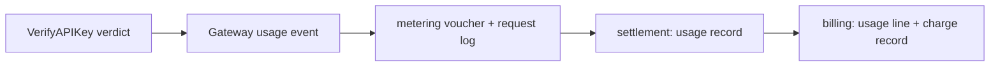

# API Key Ownership and Three-Level Quotas — Architecture and Detailed Design

| Attribute | Content |
| --- | --- |
| Feature point | API key ownership: a key belongs to a person inside an organization and optionally a project, with organization / project / personal rate limits, metering, billing and analytics |
| Document scope | Ownership model, schema changes, authorization matrix, three-level quota resolution, metering and billing attribution, API surface, console surfaces, migration, and validation |
| Owning modules | `auth` (key ownership), `tenancy` (three-level quota resolution), `metering` (usage attribution), `billing` (charge attribution and spend gate), `wasm/gateway` (verdict and usage propagation) |
| Supersedes | The organization-only ownership described in [API Key Management](./api-key-management.md) and the organization-only quotas in [Service Quota Management](./service-quota-management.md) |
| Status | Implemented |

---

## 1. Problem

API keys used to be organization-shared credentials: `api_keys` carried only
`organization_id`, every member of an organization could list and revoke every
key, metering aggregated per `(organization_id, api_key_id)`, and the only
enforced quota was the organization's.

That model cannot answer "how much did this person spend" and cannot give one
person a smaller budget than their tenant. This feature makes a key belong to a
person while keeping the organization as the tenant, authorization and billing
boundary.

## 2. Ownership model

`api_keys` gains two nullable columns:

| Column | Meaning |
| --- | --- |
| `owner_user_id` | The key's personal owner. `NULL` means the key is organization-shared and keeps the pre-ownership behavior. |
| `project_id` | The key's optional project inside the same organization. `NULL` means the key belongs to the organization directly. |

`organization_id` stays required. It remains the anchor for tenant isolation,
model authorization and the billing account. A personal key never moves to
another organization.

### 2.1 Authorization matrix

| Action | Key owner | Organization owner/admin | Platform admin | Session-less (transitional) |
| --- | --- | --- | --- | --- |
| Create own key | yes | yes | yes | yes (shared) |
| Create shared key | no | yes | yes | yes |
| Assign another owner | no | yes | yes | yes |
| List own keys | yes | yes | yes | yes |
| List organization keys (`scope=all`) | no | yes | yes | yes |
| Revoke / delete / edit own key | yes | yes | yes | yes |
| Revoke / delete / edit another member's key | no | yes | yes | yes |
| Transfer ownership / project | no | yes | yes | yes |

A denied key answers `10007 API_KEY_NOT_FOUND`, not `10036`: a member must not
learn that another member's key exists. Requesting `scope=all` as a non-admin is
rejected with `10036`, because that request itself reveals the intent to browse.

Project rules:

- The project must exist and belong to the key's organization.
- A member may only place a key in a project they belong to; an administrator
  may choose any project of the organization.

## 3. Three-level quotas

Every limit exists at three tiers; each tier is optional and `0` means
unlimited. The effective value is the minimum of the non-zero values:

```text
effective(dim) = minNonZero(org[dim], project[dim], user[dim])
```

A tier can therefore tighten the tenant budget but never loosen it.

| Dimension | Organization | Project | Personal |
| --- | --- | --- | --- |
| `max_concurrent_requests` | `organizations` | `projects` | `user_quotas` |
| `max_inference_services` | `organizations` | `projects` | `user_quotas` |
| `max_batch_jobs_per_day` | `organizations` | `projects` | `user_quotas` |
| `max_output_tokens_per_request` | `organizations` | `projects` | `user_quotas` |
| `monthly_spend_limit_cents` | `billing_accounts` | `projects` | `user_quotas` |

`user_quotas` is keyed by `(organization_id, user_id)`; a person carries one
budget per tenant.

### 3.1 Enforcement points

| Dimension | Enforced at | Mechanism |
| --- | --- | --- |
| Concurrent requests | Data plane | `VerifyAPIKey` returns the effective cap; the Wasm plugin rejects locally |
| Output tokens per request | Data plane | Same verdict field; the plugin clamps the request |
| Inference services | Control plane | `CreateInferenceService` compares the effective count cap |
| Batch jobs per day | Control plane | `CreateBatchJob` compares the effective daily cap |
| Monthly spend | Control plane (`CheckFunds`) | Effective spend cap compared against the scoped charge total |

The two data-plane caps ride the Redis verdict cache, so their propagation
bound is the cache TTL (default 30s). The quota resolver runs only on a cache
miss. Inference services and batch jobs carry no project, so their create-time
checks combine the organization and personal tiers only.

A quota read failure degrades that tier to unlimited and logs a warning: an
authorization outage must not stop inference.

### 3.2 Personal budgets replace per-project member budgets

`project_members` used to carry per-member quota columns that nothing enforced.
Those limits are folded into `user_quotas` at startup (idempotent: an existing
row wins) using the strictest non-zero value per dimension, and the retired
console page is removed. Project-level budgets live on `projects`; personal
budgets live on `user_quotas`.

## 4. Metering and billing attribution

Attribution is a snapshot, not a join: a key transfer or deletion must not
rewrite history.

| Table | Added columns |
| --- | --- |
| `vouchers` | `owner_user_id`, `project_id` |
| `request_logs` | `owner_user_id`, `project_id` |
| `usage_records` | `owner_user_id`, `project_id` |
| `usage_lines` | `owner_user_id`, `project_id` |
| `charge_records` | `owner_user_id`, `project_id` + two spend indexes |

Propagation chain (no control-plane lookup per request):



Analytics dimensions: usage supports `group_by=api_key|model|user|project` and
`owner_user_id`/`project_id` filters; cost analytics supports the `user` and
`project` dimensions.

## 5. API surface

### auth

- `ListAPIKeys` gains `scope` (`mine` default / `shared` / `all`),
  `project_id` and `owner_user_id` filters; `APIKeySummary` gains
  `organization_id`, `owner_user_id`, `owner_display_name`, `project_id`,
  `project_display_name` and `shared`.
- `CreateAPIKey` gains `project_id`, `owner_user_id` and `shared`.
- New `UpdateAPIKeyOwnership`
  (`PUT /api/v1/admin/auth/api-keys/{key_id}/ownership`).
- `VerifyAPIKeyResponse` gains `owner_user_id`, `project_id`, and its two caps
  now carry the effective (three-level) values.

### tenancy

- New `ListUserQuotas`, `GetUserQuota`, `UpdateUserQuota`
  (`/api/v1/admin/tenancy/user-quotas...`), requiring organization
  owner/admin or platform admin.
- `GetMyQuota` gains `personal_quota` and `effective_quota`.
- `ProjectQuota` gains `monthly_spend_limit_cents`.

### metering / billing

- Voucher, usage record and charge summaries carry the ownership ids.
- `CheckFunds` accepts `owner_user_id`/`project_id` and reports the effective
  spend limit plus the scoped totals.

## 6. Errors

| Situation | Code |
| --- | --- |
| Manage another member's key, or a shared key as a member | `10007` |
| `scope=all` as a non-admin, or a project the member does not belong to | `10036` |
| Project of another organization, or malformed ownership request | `10008` |
| Owner is not an organization member | `10003` |
| Quota out of range (including negative spend limit) | `13305` |
| Quota RPC on an unknown organization | `13306` |

## 7. Migration

The schema is owned by each service's `Migrate` (`AutoMigrate`); there are no
hand-written init-SQL scripts. The upgrade is additive:

1. `api_keys.owner_user_id` / `project_id`, `user_quotas`, and
   `projects.monthly_spend_limit_cents` are created (or updated) idempotently.
2. Metering/billing attribution columns and indexes are created idempotently.
3. `MigrateProjectMemberQuotas` copies the retired per-member limits into
   `user_quotas` once; an existing personal row is never overwritten.
4. The gateway verdict cache prefix moves to `taas:auth:apikey:v2:`, so an old
   entry is a cold cache instead of a misread.

Historical keys keep `owner_user_id = NULL` (organization-shared) because the
old table carried no `created_by` to recover the creator.

## 8. Validation

- FVT: `test/fvt/apikey_ownership_fvt_test.go` (create/list/manage matrix,
  project validation, transfer, verdict ownership and three-level caps) and
  `test/fvt/user_quota_fvt_test.go` (user-quota CRUD, role gate, effective
  value, `GetMyQuota`, project-member migration).
- Unit: combination rule, repository round-trips, ownership authorization,
  verdict merging, spend gate, metering/billing propagation, gateway cache and
  usage body.
