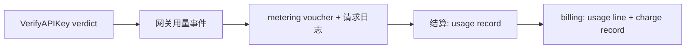

# API Key 归属与三级配额 — 架构与详细设计

| 属性 | 内容 |
| --- | --- |
| 特性点 | API Key 归属：Key 属于组织内的某个人，并可选归属项目；组织 / 项目 / 个人三级限流、计量、计费与统计 |
| 文档范围 | 归属模型、表结构变更、权限矩阵、三级配额解析、计量与计费归因、API 面、控制台、迁移与验证 |
| 归属模块 | `auth`（Key 归属）、`tenancy`（三级配额解析）、`metering`（用量归因）、`billing`（费用归因与消费闸门）、`wasm/gateway`（verdict 与用量透传） |
| 取代 | [API Key 管理](./api-key-management.zh-cn.md) 中"仅组织归属"的设计，以及 [服务配额管理](./service-quota-management.zh-cn.md) 中"仅组织配额"的设计 |
| 状态 | 已实现 |

---

## 1. 问题

过去 API Key 是组织共享凭证：`api_keys` 只有 `organization_id`，组织内任意成员都能查看和撤销所有 Key，计量按 `(organization_id, api_key_id)` 聚合，真正执行的配额只有组织级。

这种模型无法回答"某个人花了多少"，也无法让某个人拥有比租户更小的预算。本特性让 Key 归属于个人，同时保留组织作为租户、授权与计费边界。

## 2. 归属模型

`api_keys` 新增两个可空列：

| 列 | 含义 |
| --- | --- |
| `owner_user_id` | Key 的个人属主。`NULL` 表示组织共享 Key，保持旧行为。 |
| `project_id` | Key 可选归属到同一组织下的项目。`NULL` 表示直接归属组织。 |

`organization_id` 仍然必填，继续作为租户隔离、模型授权与计费账户的锚点。个人 Key 不会迁移到其他组织。

### 2.1 权限矩阵

| 操作 | Key 属主 | 组织 owner/admin | 平台管理员 | 无会话过渡调用 |
| --- | --- | --- | --- | --- |
| 创建自己的 Key | 是 | 是 | 是 | 是（共享） |
| 创建共享 Key | 否 | 是 | 是 | 是 |
| 指定其他属主 | 否 | 是 | 是 | 是 |
| 查看自己的 Key | 是 | 是 | 是 | 是 |
| 查看组织全部 Key（`scope=all`） | 否 | 是 | 是 | 是 |
| 撤销/删除/编辑自己的 Key | 是 | 是 | 是 | 是 |
| 撤销/删除/编辑他人 Key | 否 | 是 | 是 | 是 |
| 转让属主/项目 | 否 | 是 | 是 | 是 |

被拒绝的 Key 返回 `10007 API_KEY_NOT_FOUND` 而非 `10036`：成员不应得知他人 Key 是否存在。非管理员请求 `scope=all` 返回 `10036`，因为该请求本身就暴露了浏览意图。

项目规则：

- 项目必须存在且属于该 Key 的组织。
- 普通成员只能把 Key 放进自己所属的项目；管理员可选择组织内任意项目。

## 3. 三级配额

每个维度都有三层；每层可选，`0` 表示不限。生效值取非零值中的最小值：

```text
effective(dim) = minNonZero(org[dim], project[dim], user[dim])
```

因此任一层只能收紧、不能放宽上层预算。

| 维度 | 组织 | 项目 | 个人 |
| --- | --- | --- | --- |
| `max_concurrent_requests` | `organizations` | `projects` | `user_quotas` |
| `max_inference_services` | `organizations` | `projects` | `user_quotas` |
| `max_batch_jobs_per_day` | `organizations` | `projects` | `user_quotas` |
| `max_output_tokens_per_request` | `organizations` | `projects` | `user_quotas` |
| `monthly_spend_limit_cents` | `billing_accounts` | `projects` | `user_quotas` |

`user_quotas` 以 `(organization_id, user_id)` 为主键：一个人在同一个租户下只有一份预算。

### 3.1 执行点

| 维度 | 执行位置 | 机制 |
| --- | --- | --- |
| 并发请求 | 数据面 | `VerifyAPIKey` 返回生效上限，Wasm 插件本地拒绝 |
| 单请求输出 token | 数据面 | 同一 verdict 字段，插件截断请求 |
| 推理服务数 | 控制面 | `CreateInferenceService` 比较生效数量上限 |
| 每日批任务 | 控制面 | `CreateBatchJob` 比较生效每日上限 |
| 月度消费 | 控制面（`CheckFunds`） | 生效消费上限与作用域内费用总额比较 |

两个数据面上限随 Redis verdict 缓存下发，传播边界为缓存 TTL（默认 30 秒）。配额解析只在缓存未命中时执行。

配额读取失败时该层降级为不限并记录告警：授权侧故障不应中断推理。

### 3.2 个人预算取代项目成员预算

`project_members` 曾带有从未执行的按成员配额列。这些限制在启动时合并进 `user_quotas`（幂等：已存在的行优先），每个维度取最严格非零值；旧控制台页面已移除。项目级预算保留在 `projects`，个人预算归 `user_quotas`。

## 4. 计量与计费归因

归因是快照而非 join：Key 转让或删除不能改写历史。

| 表 | 新增列 |
| --- | --- |
| `vouchers` | `owner_user_id`、`project_id` |
| `request_logs` | `owner_user_id`、`project_id` |
| `usage_records` | `owner_user_id`、`project_id` |
| `usage_lines` | `owner_user_id`、`project_id` |
| `charge_records` | `owner_user_id`、`project_id`，并新增两个费用索引 |

传递链路（每请求无需控制面查询）：



统计维度：用量支持 `group_by=api_key|model|user|project` 及 `owner_user_id`/`project_id` 过滤；成本分析支持 `user`、`project` 维度。

## 5. API 面

### auth

- `ListAPIKeys` 新增 `scope`（默认 `mine` / `shared` / `all`）、`project_id`、`owner_user_id` 过滤；`APIKeySummary` 新增组织、属主、项目与 `shared` 字段。
- `CreateAPIKey` 新增 `project_id`、`owner_user_id`、`shared`。
- 新增 `UpdateAPIKeyOwnership`（`PUT /api/v1/admin/auth/api-keys/{key_id}/ownership`）。
- `VerifyAPIKeyResponse` 新增 `owner_user_id`、`project_id`，两个上限字段改为三级生效值。

### tenancy

- 新增 `ListUserQuotas`、`GetUserQuota`、`UpdateUserQuota`（`/api/v1/admin/tenancy/user-quotas...`），要求组织 owner/admin 或平台管理员。
- `GetMyQuota` 新增 `personal_quota` 与 `effective_quota`。
- `ProjectQuota` 新增 `monthly_spend_limit_cents`。

### metering / billing

- Voucher、usage record、charge 摘要携带归属 id。
- `CheckFunds` 接受 `owner_user_id`/`project_id`，返回生效消费上限与作用域内总额。

## 6. 错误码

| 场景 | 错误码 |
| --- | --- |
| 操作他人 Key，或普通成员操作共享 Key | `10007` |
| 非管理员请求 `scope=all`，或成员使用未加入的项目 | `10036` |
| 跨组织项目，或归属请求格式错误 | `10008` |
| 属主不是组织成员 | `10003` |
| 配额越界（含负消费上限） | `13305` |
| 配额 RPC 组织不存在 | `13306` |

## 7. 迁移

表结构由各服务 `Migrate` 的 `AutoMigrate` 拥有，没有手写 init-SQL。升级为增量：

1. 幂等创建/更新 `api_keys.owner_user_id`/`project_id`、`user_quotas`、`projects.monthly_spend_limit_cents`。
2. 幂等创建计量/计费归因列与索引。
3. `MigrateProjectMemberQuotas` 一次性把旧的成员配额合并进 `user_quotas`，已存在的个人行不会被覆盖。
4. 网关 verdict 缓存前缀升级为 `taas:auth:apikey:v2:`，旧条目变为缓存未命中而非误读。

历史 Key 保持 `owner_user_id = NULL`（组织共享），因为旧表没有 `created_by` 可供还原。

## 8. 验证

- FVT：`test/fvt/apikey_ownership_fvt_test.go`（创建/列表/管理矩阵、项目校验、转让、verdict 归属与三级上限）与 `test/fvt/user_quota_fvt_test.go`（用户配额 CRUD、角色闸门、生效值、`GetMyQuota`、成员配额迁移）。
- 单元测试：组合规则、仓储往返、归属鉴权、verdict 合并、消费闸门、计量/计费传递、网关缓存与用量报文。
