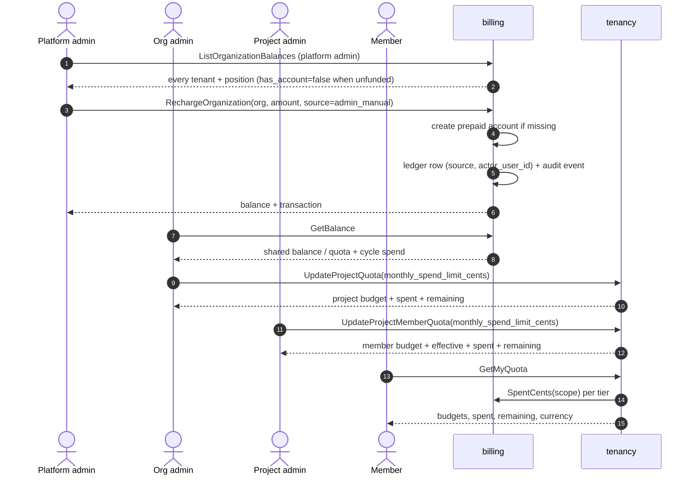
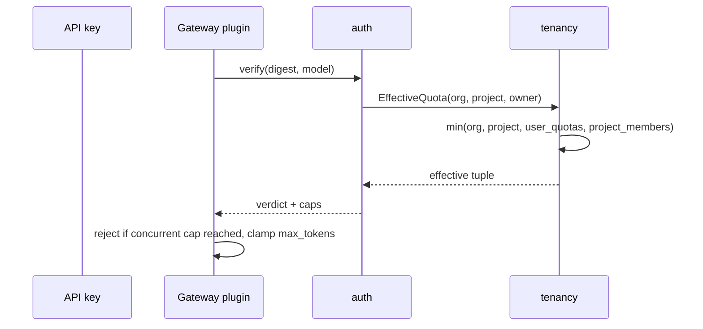

# Balance, Account and Quota Hierarchy — Architecture and Detailed Design

| Attribute | Content |
| --- | --- |
| Feature point | One shared organization account, with a quota ladder from organization to project to the person in that project |
| Document scope | The account model, the quota ladder, enforcement points, the console surfaces, the API surface, the upgrade path, and the validation rules |
| Owning modules | `tenancy` (organization / project / member / personal budgets), `billing` (account, balance and the spend gate), `auth` (verdict propagation to the data plane), `wasm/gateway` (local enforcement) |
| Extends | [Balance (Prepaid) & Quota (Postpaid) Account Modes](./balance-quota.md), [Service Quota Management](./service-quota-management.md), [API Key Ownership and Three-Level Quotas](./api-key-ownership.md) |
| Status | Implemented |

---

## 1. Problem

Three questions kept being answered in the code but not in one place:

1. **Where does the money live?** An organization has one billing account —
   prepaid balance or postpaid quota — and its members spend from it. A person
   does not have their own wallet, and should not: a tenant buys credit once and
   distributes it with budgets.
2. **Who can be capped?** The organization (the tenant default), a project (a
   team's share), and one person inside a project (a member's share).
3. **What does the data plane actually enforce?** The minimum of the non-zero
   values on the ladder, resolved per API key from the key's organization,
   project and owner.

This document is the single reference for those three answers.

## 2. Architecture decisions

| # | Decision | Rationale |
| --- | --- | --- |
| AD1 | **The account belongs to the organization; members share it.** There is no per-user balance. | A tenant recharges once. Per-user wallets would need per-user payments, refunds and reconciliation, and would fragment the credit a team actually shares. |
| AD2 | **The quota ladder is organization → project → user**, evaluated per dimension as the minimum of the non-zero values. | Every tier can only tighten. An organization budget of 100 requests cannot be raised to 200 by a project budget of 200. |
| AD3 | **The user tier has two sources: the org-wide personal budget (`user_quotas`) and the member budget (`project_members`). Both apply.** | A person is one spend subject across the tenant, and also one member inside each project. Taking the stricter of the two keeps both promises: an org-wide cap cannot be bypassed by joining a project, and a project cap cannot be loosened by the org-wide one. |
| AD4 | **`0` means unlimited at every tier.** | It is the only value that can mean "no limit" without inventing a sentinel, and it keeps an unset tier neutral in the minimum. |
| AD5 | **The member budget lives on the membership row.** | The budget is scoped to `(project, user)`; dropping the membership must drop the budget, and the same person can hold a different budget per project. |
| AD6 | **The spend gate evaluates the same ladder the request gate does.** | Two gates that disagree are worse than one: a key rejected for concurrency but allowed to overspend (or the reverse) is unexplainable to a tenant. |
| AD7 | **A read failure degrades that tier to unlimited and logs a warning.** | An authorization or tenancy outage must not stop inference; the remaining tiers still apply. |
| AD8 | **Every change is audited and attributed.** | `quota_updated_by` / `quota_updated_at` on each row, plus an audit event per edit, so "who raised this budget" is answerable. |

## 3. The model

### 3.1 Account (money)

| Concern | Table | Scope | Meaning |
| --- | --- | --- | --- |
| Prepaid balance | `accounts.balance_cents` | one row per organization | Shared funds; settlement deducts from it |
| Postpaid quota | `accounts.monthly_quota_cents` | one row per organization | Monthly cap; `used_this_cycle_cents` accumulates |
| Cross-mode spend cap | `accounts.monthly_spend_limit_cents` | one row per organization | Caps both modes together |
| Ledger | `transactions` | one row per movement | Append-only: recharge, deduction, refund |

All four are organization-level. A member's `GetBalance` reads the same row as
every other member of their tenant: what differs per person is the budget they
are allowed to consume, never the wallet they consume it from.

### 3.1.1 Who moved the money

Every ledger row names its **source** and, for an operator-set movement, the
**administrator** who performed it:

| `source` | Written by | Meaning |
| --- | --- | --- |
| `admin_manual` | platform administrator | A recharge made by hand |
| `admin_correction` | platform administrator | An accounting adjustment (also used for a debit) |
| `payment` | payment intent | A paid invoice/checkout |
| `auto_recharge` | auto-recharge rule | An automated top-up |
| `opening` | account creation | The opening balance of a new account |
| `settlement` | settlement | A usage deduction |
| `system` | platform | Anything the rows above do not name |

`transactions.actor_user_id` carries the administrator behind
`admin_manual` / `admin_correction`; it is taken from the session, never from a
request field, so a caller cannot attribute its own action to somebody else.
`ListTransactions` resolves the actor to a display name, and each manual
movement also writes an audit event with the amount, source and reason. That is
what makes the ledger answer *who credited this tenant, when and why* without
cross-reading the audit log.

Only the two operator sources may be chosen by a caller
(`RechargeRequest.source`, `RefundRequest.source`,
`RechargeOrganizationRequest.source`, `DebitOrganizationRequest.source`): a
caller cannot claim a movement was a payment or a settlement.

### 3.2 Quota ladder (limits)

```text
             organizations                 (tenant default)
                    │
                 projects                     (team share)
                    │
    ┌───────────────┴────────────────┐
 user_quotas                    project_members
 (org-wide personal)            (this project, this person)
    └───────────────┬────────────────┘
                    ▼
        effective = minNonZero(each tier, per dimension)
```

| Dimension | `organizations` | `projects` | `user_quotas` | `project_members` |
| --- | --- | --- | --- | --- |
| concurrent requests | ✓ | ✓ | ✓ | ✓ |
| batch jobs per day | ✓ | ✓ | ✓ | ✓ |
| output tokens per request | ✓ | ✓ | ✓ | ✓ |
| monthly spend (cents) | `accounts` | ✓ | ✓ | ✓ |

Resolution rules:

- A missing row reads as unlimited, never as an error.
- An empty project id or user id skips that tier (a key with no project, a key
  with no owner).
- The personal tiers are read only when the scope supplies both an organization
  and a user; the member tier additionally needs the project.
- Batch jobs carry no project, so their create-time check uses the organization
  and personal tiers.

### 3.3 Enforcement points

| Dimension | Enforced at | Mechanism |
| --- | --- | --- |
| Concurrent requests | Data plane | `VerifyAPIKey` returns the effective cap; the Wasm plugin rejects locally |
| Output tokens per request | Data plane | Same verdict field; the plugin clamps `max_tokens` |
| Batch jobs per day | Control plane | `CreateBatchJob` compares the effective daily cap |
| Monthly spend | Control plane (`CheckFunds`) | Each tier's cap against that tier's scoped charge total |

Each tier also *reports* what it has consumed, so a console can show a budget
next to its usage rather than a bare number:

| Surface | Fields |
| --- | --- |
| `ProjectQuota` | `spent_this_cycle_cents`, `remaining_cents` |
| `ProjectMemberQuota` | `spent_this_cycle_cents`, `remaining_cents` |
| `UserQuota` | `spent_this_cycle_cents`, `remaining_cents` |
| `GetMyQuotaResponse` | `personal_spent_this_cycle_cents`, `personal_remaining_cents`, and per project `spent_this_cycle_cents` / `remaining_cents` |

`remaining_cents` is `cap - spent`, floored at 0; it is **0 when the cap is 0
(unlimited)**, so a console compares it against the cap to tell "nothing left"
from "no limit". A tier that sets no cap of its own inherits the value the
ladder resolves, so a console renders the remaining column against that
resolved cap (the `effective` tuple on a member quota, the `effective` limits on
`MyProjectQuota`) instead of calling the tier unlimited — the budget is
enforced even though this row did not set it. The spend is read from the settled ledger through the billing
module's `SpendReader` seam over the same UTC cycle the gate uses — a second
window would explain the wrong number. A ledger read failure degrades the
figures to 0 and never fails the quota read.

The spend gate checks three scopes, because each cap is about a different
question:

| Tier | Cap read from | Compared against |
| --- | --- | --- |
| Organization | `accounts.monthly_spend_limit_cents` | `accounts.spent_this_cycle_cents` |
| Project | `projects.monthly_spend_limit_cents` | the project's cycle charges |
| Personal (org-wide) | `user_quotas.monthly_spend_limit_cents` | the owner's cycle charges across the tenant |
| Member | `project_members.monthly_spend_limit_cents` | the owner's cycle charges **in that project** |

The member scope is the reason a teammate's usage cannot consume another
member's budget: it is the same owner and the same project, not the project
total.

## 4. Console surfaces

| Page | Route | Who | What it edits |
| --- | --- | --- | --- |
| Organization balances | `/admin/billing/balances` | platform administrator | fund or debit a tenant; read every tenant's position and ledger |
| Balance & budgets | `/admin/budgets` | org owner/admin | read the shared balance; set each project's monthly budget |
| Organization quotas | `/admin/quotas` | platform administrator | the tenant defaults |
| Project quotas | `/admin/projects` → Quota | org owner/admin, project admin | the project share |
| User quotas | `/admin/user-quotas` | org owner/admin, platform administrator | the org-wide personal budget |
| Project members | project console → Members → Quota | project admin, org owner/admin | the member budget in that project |
| My quotas | `/quotas` | any member | read-only: the org quotas, the personal budget, the per-project budgets and the effective value for each |
| Usage / Balance | `/usage`, `/billing` | any member | read-only: the shared balance, the cycle spend |
| My quotas | `/quotas` | any member | read-only: budgets and what is left (personal and per project) |

Every editor shows the stored value and, next to it, the effective value:
"stored 40, effective 9" is the console telling the operator that the personal
budget is the binding limit.

## 5. API surface

### tenancy (admin surface unless marked)

| RPC | HTTP | Notes |
| --- | --- | --- |
| `GetOrganizationQuota` / `UpdateOrganizationQuota` | `/api/v1/admin/tenancy/quota` | tenant defaults |
| `GetProjectQuota` / `UpdateProjectQuota` | `/api/v1/admin/tenancy/projects/{id}/quota` | project share, includes spend |
| `ListUserQuotas` / `GetUserQuota` / `UpdateUserQuota` | `/api/v1/admin/tenancy/user-quotas[/{user_id}]` | org-wide personal budget |
| `ListProjectMemberQuotas` | `/api/v1/admin/tenancy/projects/{id}/member-quotas` | roster with each member budget and its effective value |
| `UpdateProjectMemberQuota` | `PATCH /api/v1/admin/tenancy/projects/{id}/member-quotas/{user_id}` | member budget; omitted fields unchanged, `0` = unlimited |
| `GetMyQuota` | `GET /api/v1/quotas` | user surface: org quotas, personal budget, `project_member_quotas[]` with per-project effective values |

### billing

| RPC | HTTP | Notes |
| --- | --- | --- |
| `GetBalance` | `GET /api/v1/billing/balance` | the shared account of the caller's tenant, with cycle start and cycle spend; a tenant that was never funded answers `has_account=false` with a zero balance instead of failing, so the console can render the unfunded card before the first top-up |
| `ListOrganizationBalances` | `GET /api/v1/admin/billing/organization-balances` | platform administrator: every tenant with its position; tenants without an account are listed with `has_account=false` |
| `RechargeOrganization` | `POST /api/v1/admin/billing/organizations/{org_id}/recharge` | platform administrator: credit a tenant, creating a prepaid account when it has none |
| `DebitOrganization` | `POST /api/v1/admin/billing/organizations/{org_id}/debit` | platform administrator: take credit back; a reason is required and the amount may not exceed the balance |
| `ListTransactions` | `GET /api/v1/admin/billing/transactions` | the ledger, each row naming its source and acting administrator |
| `CheckFunds` | internal | returns the effective spend cap, each tier's spent amount, and the allowed verdict |

The organization-level funding RPCs require the **platform administrator** role:
they are the one place in the money model with no tenant to scope by, so the role
is the boundary. They also accept only an active organization (a disabled tenant
is listed but cannot be funded), are idempotent on the caller's key, and record
the actor from the session.

A tenant that already runs postpaid is credited **in place**: switching modes is
the account editor's decision, and flipping it as a side effect of a top-up would
silently change how the tenant is billed.

## 6. Upgrade path

No SQL migration script is required: the schema is owned by each module's
`Migrate` (GORM `AutoMigrate`), which adds `project_members.monthly_spend_limit_cents`
with `NOT NULL DEFAULT 0` — existing members start unlimited, and the tier is
neutral in the minimum until an administrator sets a value.

The retired fold that copied member budgets into `user_quotas` is removed. Rows
it already wrote stay: they are valid org-wide personal budgets, and the two
tiers now combine instead of one replacing the other.

`transactions` gains `source` (`NOT NULL DEFAULT ''`) and `actor_user_id`
(nullable). Rows written before this change carry an empty source, which the
console renders as "—" rather than guessing: attribution cannot be
reconstructed after the fact, and inventing one would be worse than admitting
it is missing.

## 7. Validation

| Rule | Failure |
| --- | --- |
| A quota value is `>= 0` and inside the documented range | `13305` quota invalid |
| The user in a personal or member budget belongs to the organization / project | `10003` user not found |
| A member budget is set only for an existing membership | `10003` user not found |
| Editing a quota needs the matching role (project admin for a member budget, org owner/admin or platform administrator above it) | `10036` forbidden |
| The organization exists | `10005` organization not found |
| A funding write is performed by a platform administrator | `10036` forbidden |
| The funded organization is active | `10017` organization disabled |
| The source of a manual movement is an operator source | `10510` transaction invalid |
| A recharge/debit amount is positive and the idempotency key is present | `10510` transaction invalid |
| A debit carries a reason | `10510` transaction invalid |
| A debit does not exceed the prepaid balance | `10502` insufficient funds |
| A debit targets an account that exists | `10503` account not found |
| A balance read carries a tenant scope (session organization, or the `X-Organization-Id` header for a platform administrator) | `10503` account not found |

## 8. Sequence: funding a tenant and spending the budget



## 9. Sequence: a member's key is verified



## 10. Open questions

- **Should the member tier replace the org-wide personal tier once every key is
  project-bound?** Not today: a tenant can run keys outside any project, and the
  org-wide budget is the only personal cap those keys have.
- **Should the spend gate reserve (hold) rather than observe?** It compares
  settled charges, so a burst inside one settlement window can overshoot by one
  hour's usage. A hold-based gate is a separate feature (see
  [Balance & Quota](./balance-quota.md) §6.3).
