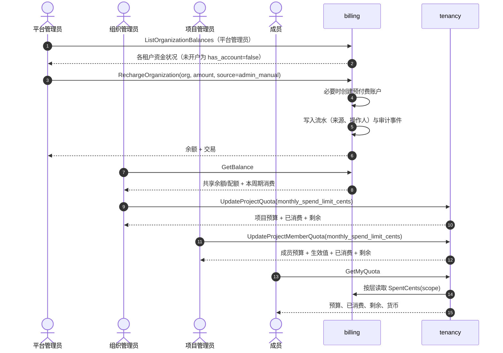
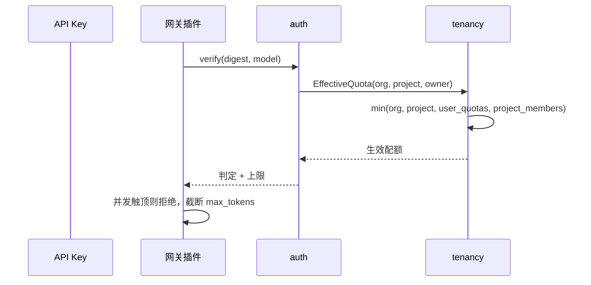

# 余额、账户与配额层级 — 架构与详细设计

| 属性 | 内容 |
| --- | --- |
| 特性点 | 组织共用一个账户，配额按 组织 → 项目 → 项目内用户 的层级逐级收紧 |
| 文档范围 | 账户模型、配额层级、执行点、控制台页面、API 面、升级路径与校验规则 |
| 归属模块 | `tenancy`（组织/项目/成员/个人预算）、`billing`（账户、余额与消费闸门）、`auth`（把判定下发给数据面）、`wasm/gateway`（本地执行） |
| 扩展 | [余额（预付费）与配额（后付费）账户模式](./balance-quota.zh-cn.md) · [服务配额管理](./service-quota-management.zh-cn.md) · [API Key 归属与三级配额](./api-key-ownership.zh-cn.md) |
| 状态 | 已实现 |

---

## 1. 问题

有三个问题在代码里各有答案，但从未集中说明：

1. **钱在哪里？** 组织只有一个计费账户 —— 预付费余额或后付费配额 —— 所有成员共用。个人没有独立钱包，也不应该有：租户充值一次，再用预算把额度分配到人。
2. **谁可以被限制？** 组织（租户默认）、项目（团队份额）、项目内的某个成员（个人份额）。
3. **数据面到底执行了什么？** 按 API Key 解析出的 组织 / 项目 / 归属人 各层级中，每个维度的**最小非零值**。

本文是这三个答案的唯一依据。

## 2. 架构决策

| # | 决策 | 理由 |
| --- | --- | --- |
| AD1 | **账户归属组织，成员共用。** 不存在按用户的余额。 | 租户只充值一次。按用户的钱包意味着按用户的支付、退款与对账，也会把团队本来就共享的额度切碎。 |
| AD2 | **配额层级为 组织 → 项目 → 用户**，每个维度取非零值中的最小值。 | 每一层只能收紧。组织预算 100 并发不会被项目预算 200 放宽。 |
| AD3 | **用户层有两个来源：组织级个人预算（`user_quotas`）与项目成员预算（`project_members`），两者同时生效。** | 一个人既是整个租户下的消费主体，也是每个项目内的成员。取两者中较小者，两个承诺都成立：加入项目不能绕过组织级个人上限，项目上限也不能突破个人上限。 |
| AD4 | **每一层的 `0` 都表示不限。** | 这是唯一不需要哨兵值就能表达「无上限」的取值，也让未设置的层在最小值计算中保持中立。 |
| AD5 | **成员预算存放在成员关系行上。** | 预算的作用域是 `(project, user)`；移除成员必须同时移除预算，且同一个人在不同项目可以有不同的预算。 |
| AD6 | **消费闸门与请求闸门使用同一套层级。** | 两个闸门口径不一致比只有一个更糟：并发被拒却可以超支（或反之）对租户无法解释。 |
| AD7 | **某一层读取失败时降级为不限并记录告警。** | 鉴权或租户服务故障不能阻断推理；其余层仍然生效。 |
| AD8 | **每次修改都审计并留痕。** | 每行带 `quota_updated_by` / `quota_updated_at`，并写入审计事件，「谁调高了这份预算」可查。 |

## 3. 模型

### 3.1 账户（钱）

| 关注点 | 表 | 作用域 | 含义 |
| --- | --- | --- | --- |
| 预付费余额 | `accounts.balance_cents` | 每个组织一行 | 共享资金；结算时扣减 |
| 后付费配额 | `accounts.monthly_quota_cents` | 每个组织一行 | 月度上限；`used_this_cycle_cents` 累加 |
| 跨模式消费上限 | `accounts.monthly_spend_limit_cents` | 每个组织一行 | 同时约束两种模式 |
| 流水账本 | `transactions` | 每次资金变动一行 | 只追加：充值、扣减、退款 |

四项都属于组织层。同一组织的成员读取的是同一行 `GetBalance`：因人而异的是他被允许消耗的**预算**，而不是消耗的**钱包**。

### 3.1.1 资金由谁操作

每一行流水都记录**来源类型**；由管理员操作的变动额外记录**操作人**：

| `source` | 写入方 | 含义 |
| --- | --- | --- |
| `admin_manual` | 平台管理员 | 手工充值 |
| `admin_correction` | 平台管理员 | 账务调整（扣减也用它） |
| `payment` | 支付单 | 已支付的账单/收银台 |
| `auto_recharge` | 自动充值规则 | 自动充值 |
| `opening` | 开户 | 新账户的开户余额 |
| `settlement` | 结算 | 用量扣费 |
| `system` | 平台 | 以上未命名的平台行为 |

`transactions.actor_user_id` 记录 `admin_manual` / `admin_correction` 背后的管理员；它取自会话而不是请求字段，调用方无法把自己的操作记到别人头上。`ListTransactions` 会把操作人解析为显示名，每次手工变动还会写入一条包含金额、来源与原因的审计事件 —— 因此流水本身就能回答「谁在什么时候为什么给这个租户充值」，不必再交叉查询审计日志。

调用方可选择的只有两个管理员来源（`RechargeRequest.source`、`RefundRequest.source`、`RechargeOrganizationRequest.source`、`DebitOrganizationRequest.source`）：不能把一次手工变动声称为支付或结算。

### 3.2 配额层级（限制）

```text
             organizations                 （租户默认）
                    │
                 projects                     （团队份额）
                    │
    ┌───────────────┴────────────────┐
 user_quotas                    project_members
 （组织级个人）                  （该项目内、该成员）
    └───────────────┬────────────────┘
                    ▼
        effective = minNonZero(各层，逐维度)
```

| 维度 | `organizations` | `projects` | `user_quotas` | `project_members` |
| --- | --- | --- | --- | --- |
| 并发请求数 | ✓ | ✓ | ✓ | ✓ |
| 每日批处理任务数 | ✓ | ✓ | ✓ | ✓ |
| 单次输出词元上限 | ✓ | ✓ | ✓ | ✓ |
| 每月消费（分） | `accounts` | ✓ | ✓ | ✓ |

解析规则：

- 行不存在视为不限，绝不视为错误。
- 项目 id 或用户 id 为空时跳过对应层（不挂项目的 Key、无归属人的 Key）。
- 只有在同时给出组织与用户时才读取个人层；成员层额外需要项目。
- 批处理任务不挂项目，其创建期校验使用组织层与个人层。

### 3.3 执行点

| 维度 | 执行位置 | 机制 |
| --- | --- | --- |
| 并发请求数 | 数据面 | `VerifyAPIKey` 返回生效上限，Wasm 插件本地拒绝 |
| 单次输出词元上限 | 数据面 | 同一判定字段，插件截断 `max_tokens` |
| 每日批处理任务数 | 控制面 | `CreateBatchJob` 比较生效的每日上限 |
| 每月消费 | 控制面（`CheckFunds`） | 每层的上限对照该层范围内的已结算费用 |

每一层还会**上报**自己的已消费额，使控制台能把预算与用量并列展示，而不是只显示一个数字：

| 接口 | 字段 |
| --- | --- |
| `ProjectQuota` | `spent_this_cycle_cents`、`remaining_cents` |
| `ProjectMemberQuota` | `spent_this_cycle_cents`、`remaining_cents` |
| `UserQuota` | `spent_this_cycle_cents`、`remaining_cents` |
| `GetMyQuotaResponse` | `personal_spent_this_cycle_cents`、`personal_remaining_cents`，以及每个项目的 `spent_this_cycle_cents` / `remaining_cents` |

`remaining_cents` 等于「上限 − 已消费」，下限为 0；当上限为 0（不限）时它也返回 **0**，控制台通过对比上限来区分「已用完」与「无上限」。已消费额通过 billing 模块的 `SpendReader` 接缝读取已结算流水，且与消费闸门使用同一个 UTC 周期 —— 换一个时间窗口就会解释出错误的数字。流水读取失败时这些数值降级为 0，绝不让配额读取失败。

消费闸门检查三个范围，因为每个上限回答的是不同问题：

| 层 | 上限来源 | 对照的消费额 |
| --- | --- | --- |
| 组织 | `accounts.monthly_spend_limit_cents` | `accounts.spent_this_cycle_cents` |
| 项目 | `projects.monthly_spend_limit_cents` | 该项目的周期内计费 |
| 个人（组织级） | `user_quotas.monthly_spend_limit_cents` | 该归属人在租户内的周期内计费 |
| 成员 | `project_members.monthly_spend_limit_cents` | 该归属人**在该项目内**的周期内计费 |

成员范围正是「同事的用量不会吃掉我的预算」的原因：范围是同一个归属人 + 同一个项目，而不是项目总额。

## 4. 控制台页面

| 页面 | 路由 | 谁 | 编辑什么 |
| --- | --- | --- | --- |
| 组织余额 | `/admin/billing/balances` | 平台管理员 | 为租户充值/扣减；查看各租户余额与流水 |
| 余额与预算 | `/admin/budgets` | 组织 owner/admin | 查看共享余额；设置各项目月度预算 |
| 组织配额 | `/admin/quotas` | 平台管理员 | 租户默认值 |
| 项目配额 | `/admin/projects` → 配额 | 组织 owner/admin、项目管理员 | 项目份额 |
| 用户配额 | `/admin/user-quotas` | 组织 owner/admin、平台管理员 | 组织级个人预算 |
| 项目成员 | 项目控制台 → 成员 → 配额 | 项目管理员、组织 owner/admin | 该项目内的成员预算 |
| 我的配额 | `/quotas` | 任意成员 | 只读：组织配额、个人预算、各项目预算及其生效值 |
| 用量 / 计费 | `/usage`、`/billing` | 任意成员 | 只读：共享余额、周期消费 |
| 我的配额 | `/quotas` | 任意成员 | 只读：个人与各项目预算、已消费与剩余 |

每个编辑页同时显示「已存值」与「生效值」：「已存 40，生效 9」就是在告诉管理员，真正起作用的是个人预算。

## 5. API 面

### tenancy（除特别说明外均为管理端）

| RPC | HTTP | 说明 |
| --- | --- | --- |
| `GetOrganizationQuota` / `UpdateOrganizationQuota` | `/api/v1/admin/tenancy/quota` | 租户默认值 |
| `GetProjectQuota` / `UpdateProjectQuota` | `/api/v1/admin/tenancy/projects/{id}/quota` | 项目份额（含消费上限） |
| `ListUserQuotas` / `GetUserQuota` / `UpdateUserQuota` | `/api/v1/admin/tenancy/user-quotas[/{user_id}]` | 组织级个人预算 |
| `ListProjectMemberQuotas` | `/api/v1/admin/tenancy/projects/{id}/member-quotas` | 成员名册，含各自预算与生效值 |
| `UpdateProjectMemberQuota` | `PATCH /api/v1/admin/tenancy/projects/{id}/member-quotas/{user_id}` | 成员预算；省略字段保持不变，`0` 表示不限 |
| `GetMyQuota` | `GET /api/v1/quotas` | 用户端：组织配额、个人预算、`project_member_quotas[]` 及按项目的生效值 |

### billing

| RPC | HTTP | 说明 |
| --- | --- | --- |
| `GetBalance` | `GET /api/v1/billing/balance` | 调用方所在租户的共享账户，含周期起点与本周期消费 |
| `ListOrganizationBalances` | `GET /api/v1/admin/billing/organization-balances` | 平台管理员：所有租户的资金状况；未开户的租户以 `has_account=false` 列出 |
| `RechargeOrganization` | `POST /api/v1/admin/billing/organizations/{org_id}/recharge` | 平台管理员：为租户充值，未开户时创建预付费账户 |
| `DebitOrganization` | `POST /api/v1/admin/billing/organizations/{org_id}/debit` | 平台管理员：扣回资金；必须填写原因，且金额不得超过余额 |
| `ListTransactions` | `GET /api/v1/admin/billing/transactions` | 流水，每行包含来源与操作人 |
| `CheckFunds` | 内部 | 返回生效消费上限、各层已消费额与放行结论 |

组织级资金接口要求**平台管理员**角色：这是资金模型中唯一没有租户可用来限定范围的地方，因此角色本身就是边界。它们只接受活跃组织（已停用的租户仍会列出，但不能充值），以调用方提供的幂等键去重，并从会话记录操作人。

已是后付费的租户会被**就地充值**：切换计费模式属于账户编辑器的决定，若在一次充值里顺带切换，会悄悄改变该租户的计费方式。

## 6. 升级路径

无需 SQL 迁移脚本：表结构由各模块的 `Migrate`（GORM `AutoMigrate`）维护，会为 `project_members` 增加 `monthly_spend_limit_cents`（`NOT NULL DEFAULT 0`）—— 既有成员初始为不限，在该层被设置之前对最小值计算保持中立。

已退役的「把成员预算折叠进 `user_quotas`」迁移已被移除。它写过的行保留：那些行是合法的组织级个人预算，而现在两层是叠加而非替代关系。

`transactions` 新增 `source`（`NOT NULL DEFAULT ''`）与 `actor_user_id`（可空）。此前的历史行来源为空，控制台显示为「—」而不是猜测：归属信息无法事后重建，编造一个比承认缺失更糟。

## 7. 校验

| 规则 | 失败码 |
| --- | --- |
| 配额值 `>= 0` 且在文档范围内 | `13305` 配额不合法 |
| 个人/成员预算中的用户属于该组织 / 该项目 | `10003` 用户不存在 |
| 只能为已存在的成员关系设置成员预算 | `10003` 用户不存在 |
| 编辑配额需要对应角色（成员预算需项目管理员；更上层需组织 owner/admin 或平台管理员） | `10036` 禁止 |
| 组织必须存在 | `10005` 组织不存在 |
| 资金写入需由平台管理员发起 | `10036` 禁止 |
| 被充值的组织处于活跃状态 | `10017` 组织已停用 |
| 手工变动的来源必须是管理员来源 | `10510` 交易不合法 |
| 充值/扣减金额为正且提供幂等键 | `10510` 交易不合法 |
| 扣减必须填写原因 | `10510` 交易不合法 |
| 扣减金额不得超过预付费余额 | `10502` 余额不足 |
| 扣减目标账户必须存在 | `10503` 账户不存在 |

## 8. 时序：为租户充值并使用预算



## 9. 时序：校验一个成员的 Key



## 10. 待决问题

- **当所有 Key 都挂项目后，成员层是否应取代组织级个人层？** 目前不取代：租户仍可能有不挂项目的 Key，组织级个人预算是这些 Key 唯一的个人上限。
- **消费闸门是否应改为预扣（hold）而非观测？** 它对照的是已结算费用，因此一个结算窗口内的突发可以超出约一小时的用量。基于预扣的闸门属于独立特性（见[余额与配额](./balance-quota.zh-cn.md) §6.3）。
