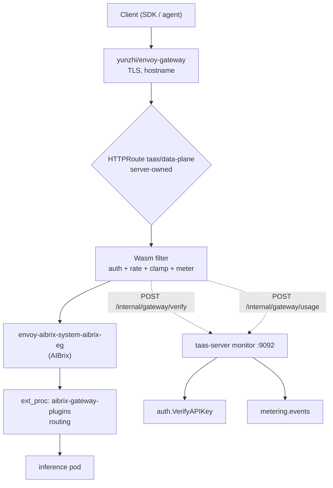
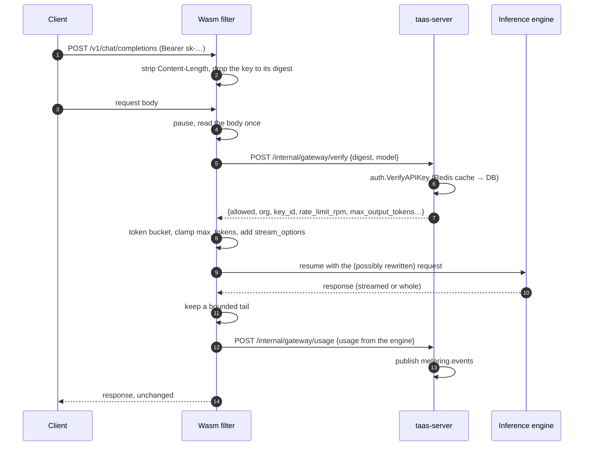

# Data-Plane Gateway Plugin — Architecture and Detailed Design

| Attribute | Content |
| --- | --- |
| Feature point | The Wasm filter that authenticates and meters inference traffic at the inference gateway (architecture §3.2 pipeline steps 01 Auth and 04 Meter) |
| Document scope | Architecture and detailed design for the data-plane gateway plugin: the Wasm filter, its two internal API endpoints, the token-based isolation between them, the error mapping to OpenAI-compatible responses, the per-worker caches, the artifact packaging and the `EnvoyExtensionPolicy` that loads it |
| Owning modules | `wasm/gateway` (the filter, a separate Go module built with TinyGo), `pkg/server` (the internal gateway API on the monitor mux), `services/auth` (verification, delegated to `VerifyAPIKey`), `services/metering` (event publication), `deploy/helm/go-taas` (the policy, the internal route, the shared token) |
| Related documents | [Architecture Design](../design/architecture.md) §3.2 (the pipeline), §3.2.1 (the ordered steps), §3.3 (the authentication chain), §3.4 (metering discipline) · [Token Metering Vouchers](./metering.md) (the ledger the events feed) · [API Key Management](./api-key-management.md) (the key format and verification) · [Service Resource Metrics](./service-resource-metrics.md) (the monitoring panels that read the same Prometheus) |
| Status | Implemented and verified against a live cluster |

---

## 1. Overview and Goals

The architecture places authentication and metering on the inference data plane, inside the gateway, so that inference traffic never passes through a business process (§3.2). The design doc names the carrier honestly: a Wasm filter is the target, an `ext_proc` plugin is a fallback, and either way the contract is fixed — verify the caller's API key, report token usage, and never become a forwarding bottleneck.

For a long time only the *contract* existed. `auth.VerifyAPIKey` was implemented (Redis-cached, with its comment already saying it "is called per request by the gateway's Wasm plugin"), `auth.KeyDigest` documented itself as "the contract shared with the data-plane Wasm plugin", and `metering` had an idempotent event consumer. **The caller was never built**, and the consequence was observable: the inference gateway accepted any bearer token — absent, garbage and valid all returned 200 — and no metering event had ever been produced by real traffic.

This feature builds the missing component.

**Goals**:

- A Wasm filter on the inference gateway that verifies the API key of every protected request, rejecting invalid, revoked, expired and out-of-scope keys before the request reaches an inference pod.
- Token metering from the engine's own `usage`, published to the queue and settled by the existing ledger.
- The two limits whose contracts already promise gateway enforcement: per-key request rate (`rate_limit_rpm`) and the per-request output cap (`max_output_tokens_per_request`).
- Fail closed on authentication, fail open on metering.
- One artifact per release, shipped with the server image.

**Non-goals** (deferred, §8): cross-worker concurrency leases, token-per-minute limits, trace injection, result caching, degrade buffering, and replacing AIBrix's routing.

### 1.1 Reading order of this document

Section 2 records the architecture decisions (AD1–AD9). Section 3 is the placement in the request path. Section 4 is the internal API contract. Sections 5–6 are the data model (there is none — nothing is stored) and the error map. Section 7 is the request and response flows. Sections 8–11 are deferred work, configuration, security and rollout. Section 12 is the verification record, and section 13 the function-level design.

---

## 2. Architecture Decisions

| # | Decision | Rationale |
| --- | --- | --- |
| AD1 | **The filter is a proxy-wasm HTTP filter built with TinyGo from a nested Go module (`wasm/gateway`)** | The repository is Go; a separate module keeps TinyGo's Go ceiling out of the main module (which tracks a newer release) and makes `go test ./...` and `golangci-lint run` at the root skip it automatically, since nested modules are not walked. Rust would add a second toolchain for one component |
| AD2 | **The plugin decides nothing; it calls the platform.** Two cluster-internal endpoints on the monitor mux delegate to `VerifyAPIKey` and to the metering publisher **in-process** | Architecture §3.3 and §3.2.1 forbid the plugin from touching the database and forbid duplicating business rules. Reusing the RPCs in-process means one implementation of verification and one of ingestion, so the gateway cannot drift from the control plane — and drift here would be a security bug, not a cosmetic one. Wasm cannot speak to RabbitMQ, so metering needs a carrier in any case |
| AD3 | **The internal API is isolated by a shared token, compared in constant time (12910)** | An unauthenticated verification endpoint would let anyone probe keys. Constant-time comparison keeps the token unguessable by timing |
| AD4 | **Fail closed on authentication, fail open on metering** | A verdict derived from a timeout is a guess, and guessing "allow" is an open door. Metering is the opposite: §3.2.1 states that a metering failure must never block inference, because refusing service when billing is down widens the blast radius from "the bill is off" to "everything is down". A dropped event is counted and logged so it is never silent |
| AD5 | **Verification happens at the request-body phase, for `/v1/` paths only** | The model allow-list is part of the `VerifyAPIKey` contract, and the model name exists only in the body. Non-`/v1/` paths (health, discovery) stay open so Kubernetes probes work. The trade-off — the outer Envoy buffers request bodies — costs nothing because inference requests are not streamed upwards |
| AD6 | **The plugin always observes the response tail and asks the engine for usage on a stream** | §3.4 makes the engine authoritative: a gateway tokenizer drifts under chat templates, tool-call framing and multimodal input. Reading the engine's `usage` is the only accurate count, and an OpenAI-compatible engine omits it from a stream unless the caller sets `stream_options.include_usage`. Only a bounded tail is retained, so a long generation costs a fixed amount of memory |
| AD7 | **The verdict cache and the token bucket live in per-worker memory with a 30 s TTL** | Envoy gives a Wasm filter no state shared across worker threads. The cache is therefore per worker: with N workers the platform sees up to N verifications per TTL, which its own Redis cache makes cheap. This is an approximation and is documented as one rather than presented as a guarantee |
| AD8 | **The artifact is built in the server's Docker image and served by the server, then loaded over HTTP** | One release produces exactly one plugin version, with no second image and no registry credentials for Envoy. The coupling is real — if the server is down when an Envoy pod starts, the filter cannot load — but it is the same availability the filter already has, since every cache miss calls the server. The digest pin is opt-in, because Helm applies the policy before the new pods serve the new artifact |
| AD9 | **The policy attaches to the server-owned data-plane HTTPRoute, not to the AIBrix gateway** | It is the only Envoy in the chain that go-taas owns; a policy in `aibrix-system` belongs to another release and would be overwritten. Being first in the chain also means an unauthenticated request is rejected before the second proxy or a model pod sees it, and AIBrix's `ext_proc` router keeps working unchanged |

---

## 3. Placement in the request path



The policy attaches to `taas/data-plane` because:

- it is the only Envoy in the chain go-taas owns (AD9);
- it sees each request before AIBrix buffers it, so the earliest possible rejection is the cheapest one;
- the route name is stable while the hostname is an operator setting, so the policy is Helm-owned without competing for the route's `spec.hostnames` — the conflict that previously made a Helm upgrade and a console save disagree.

The filter reaches the platform through an HTTPRoute of its own (`taas-go-taas-internal-api`) on a hostname that is in no DNS zone and no certificate. Envoy requires a configured cluster for a Wasm HTTP call and creates one cluster per route rule, so the route is what gives the filter an upstream; the internal hostname is unreachable from the internet by construction, only addressable by cluster name from inside the proxy.

---

## 4. Internal API contract

All three endpoints are on the monitor mux (cluster-internal, never on the public gateway port). The two JSON endpoints require `X-Gateway-Token`; the artifact does not, because Envoy's Wasm code source cannot send a header and the artifact is the filter binary, not a secret.

### 4.1 `POST /internal/gateway/verify`

```json
{"key_digest": "<64 lowercase hex>", "model": "qwen2.5-0.5b", "source_ip": "10.0.0.9"}
```

The digest is the contract: the plaintext key never leaves the gateway (`auth.KeyDigest`). Response:

```json
{"allowed": true, "organization_id": "org-1", "key_id": "key-1", "role": "agent",
 "rate_limit_rpm": 60, "rate_limit_tpm": 0,
 "max_concurrent_requests": 200, "max_output_tokens_per_request": 16384}
```

A rejected key is a **200 with `allowed: false`** plus the business code and message. Only "the platform could not answer" is a non-200, so the plugin can distinguish *the key is bad* (reject) from *the platform is unavailable* (fail closed) — the two need different reactions.

### 4.2 `POST /internal/gateway/usage`

```json
{"request_id": "…", "organization_id": "org-1", "api_key_id": "key-1",
 "model": "qwen2.5-0.5b",
 "usage": {"prompt_tokens": 34, "completion_tokens": 3, "cached_tokens": 0, "reasoning_tokens": 0},
 "completed_at": 1792946186, "latency_ms": 206, "ttft_ms": 0, "generation_ms": 0,
 "status": "success", "error": ""}
```

`model` is the **served name**, not a UUID: the plugin only knows what the caller typed. The server resolves it to the catalog id (and to the inference service that serves it), so identity resolution stays server-side and the plugin stays replaceable. A publish failure answers 503 and increments `taas_gateway_plugin_usage_dropped_total`; the plugin never retries, because the request has already been served and the gap is attributable by `request_id`.

### 4.3 `GET /internal/gateway/plugin.wasm`

The artifact, served with `Content-Type: application/wasm`. A build without it answers 404 with a clear message so the rest of the platform keeps working.

---

## 5. Data model

None. The plugin stores nothing: verdicts live in per-worker memory for 30 s (AD7), and usage becomes a metering event on the queue, which the existing ledger persists. This is the point of the design — the data plane keeps no state that would need replicating, backing up or reconciling.

Two Prometheus counters describe the plugin's own behaviour:

| Metric | Meaning |
| --- | --- |
| `taas_gateway_plugin_verify_total{result}` | Verifications by outcome (`allowed`, `rejected`, `error`) |
| `taas_gateway_plugin_usage_total` | Usage events recorded |
| `taas_gateway_plugin_usage_dropped_total` | Usage events the platform could not record |

A flat `usage_total` while inference traffic flows is the signal that the filter stopped reporting — nothing else would show it.

---

## 6. Error mapping

The caller is an OpenAI SDK or an agent, so the status code has to be what its retry logic reads and the body has to be what its error handling shows:

| Business code | Meaning | HTTP | `type` | `code` |
| --- | --- | --- | --- | --- |
| 10007 | `API_KEY_NOT_FOUND` | 401 | `invalid_request_error` | `invalid_api_key` |
| 10008 | `API_KEY_INVALID` | 401 | `invalid_request_error` | `invalid_api_key` |
| 10009 | `API_KEY_REVOKED` | 401 | `invalid_request_error` | `api_key_revoked` |
| 10010 | `API_KEY_EXPIRED` | 401 | `invalid_request_error` | `api_key_expired` |
| 10036 / 10039 / 10101 / 10105 | forbidden, key scope, unknown or ungranted model | 403 | `permission_error` | `model_not_allowed` |
| 10037 | `RATE_LIMIT_EXCEEDED` | 429 | `rate_limit_error` | `rate_limit_exceeded` |
| 13304 | `QUOTA_OUTPUT_TOKENS_EXCEEDED` | 400 | `invalid_request_error` | `max_tokens_exceeded` |
| anything else | platform-side | 503 | `server_error` | `service_unavailable` |

Only caller-attributable codes become a verdict; everything else becomes an error so the plugin fails closed. `10036` deserves a note: on this path it means the platform could not resolve the caller's organization state, which is a platform fault the gateway must not report as a bad key.

---

## 7. Flows

### 7.1 An authenticated request



### 7.2 A rejected request

The plugin answers locally, so the request never reaches AIBrix or a model pod: no upstream connection, no container CPU, and the rejection costs one digest hash — or, when the credential is not even shaped like a key, nothing at all.

### 7.3 Why the pause is where it is

Two placements are wrong, and both were observed:

- **Pausing at the headers and again at the body** leaves the request stopped: Envoy resumes only the phase it last stopped in, so the caller times out with no response at all.
- **Pausing only at the headers** never buffers the body, so the body cannot be read and the request also never completes.

The working arrangement is: continue at the headers (removing `Content-Length`, so a longer rewritten body is not truncated), then pause once at the body and read it in a single call. Reading per frame duplicates the earlier frames, because a paused stream's host buffer already holds every byte received so far — the duplication parses as garbage, the rewrites silently stop applying, and a "rewritten" body reaches the engine malformed.

---

## 8. Deferred work

| Item | Why it is deferred |
| --- | --- |
| Concurrency lease (`max_concurrent_requests`) | Needs state shared across Envoy workers, i.e. Redis |
| Token-per-minute limits (`rate_limit_tpm`) | Same: a counter shared across workers |
| `traceparent` injection, latency phase marks | Orthogonal to auth and metering |
| Result cache, prefix affinity | Changes billing semantics; needs its own decision |
| Degrade + compensating replay | Today a dropped event is counted and logged; a replay queue is the follow-up |
| Immediate revocation | A revocation is effective within the cache TTL (30 s). A control channel into Envoy is not worth it for that window |

---

## 9. Configuration

`gatewayPlugin` (server side, `pkg/config`):

| Key | Default | Meaning |
| --- | --- | --- |
| `enabled` | `false` | Serve the internal API. Off by default: enabling it makes the gateway start rejecting unverified traffic, a behaviour change an install must opt into |
| `token` | `""` | Shared secret; empty disables the endpoints even when enabled |
| `cacheTTL` | `30s` | Verdict lifetime (per worker) |
| `verifyTimeout` | `500ms` | Budget for one filter → server call |
| `protectedPrefixes` | `["/v1/"]` | Paths that require a key |
| `failOpen` | `false` | Passed to the policy |
| `pluginPath` | `gateway-plugin.wasm` next to the binary | Artifact location |

Chart (`values.yaml` → `gatewayPlugin`): the same values plus `internalHostname` (the internal route's hostname), `maxBodyBytes`, and an optional `pluginSha256`.

---

## 10. Security considerations

- **The plaintext key never leaves the gateway.** Only its SHA-256 is sent, and it is never logged. A test asserts the digest is forwarded, the plaintext is not, and no log line contains it.
- **The internal API is not reachable from the internet**: it is on the monitor mux, and its route's hostname is in no DNS zone and no certificate.
- **The token is generated once** into the release Secret and reaches both sides from the same helper; the server reads it from the environment so it never appears in the rendered ConfigMap.
- **A missing or wrong token leaks nothing**: the response does not echo the digest and the verifier is never consulted, so a token failure cannot be used to probe keys.
- **A filter that cannot configure itself does not start** (`OnPluginStartStatusFailed`), and a request on a protected path with no configuration is refused rather than admitted — the fail-open bug this feature's own tests caught.
- **Body inspection is bounded** by `maxBodyBytes`; a larger body is still authenticated, but the model scope and the token cap cannot apply. That degradation is a warning, not a silent pass.

---

## 11. Rollout

1. `gatewayPlugin.enabled=false` (default): nothing changes; the internal endpoints are not registered.
2. Enable with a token: the policy and the internal route are created. The artifact is fetched from the server's own image; the policy is accepted once the serving pod is up, so a fresh rollout may need one reconcile.
3. Restarting the Envoy deployment is what makes a changed artifact take effect: Envoy caches the Wasm VM per worker. On a fresh install this is automatic.
4. The rollout is safe in either order: while the filter is not loaded the gateway behaves as before (no verification), and once it loads the platform either answers (allow/reject) or is unavailable (fail closed).

---

## 12. Verification record

Against a live cluster (`llm.sudoinfotech.com`, vLLM 0.28.0, one replica):

| Check | Result |
| --- | --- |
| No `Authorization` header | **401** `invalid_api_key`, OpenAI-shaped body (was 200) |
| Garbage key | **401**, `API key not found` |
| Valid key, non-streaming | **200**, real completion |
| Valid key, streaming | **200**, SSE flushes incrementally |
| Metering, non-streaming | one voucher per request (5 requests → 5 vouchers) |
| Metering, streaming | one voucher with the engine's counts (`prompt_tokens` 32, `completion_tokens` 15) |
| Rate limit `rate_limit_rpm=2` | 200, 200, **429**, 429 |
| Revocation | **401** `api_key_revoked` within the cache window |
| Platform unavailable + cache expired | **503** `service_unavailable` (fail closed, not fail open) |
| Unprotected paths (`/healthz`) | pass through |

Two platform defects were found and fixed by this verification, and both predated it:

- **Model authorization compared a served name to a UUID column**, a SQL type error that turned every verified request into a 503. The shipped gateway never verified tokens, so the path had never run.
- **`metering` and `billing` shared one queue** for `metering.events`, so the broker split the stream: about half of all usage events produced a voucher and the other half only a billing line. The same applied to `accelerator.inventory`.

---

## 13. Function-level design

| File | Responsibility |
| --- | --- |
| `wasm/gateway/plugin.go` | The HTTP filter: request headers (digest, `Content-Length` removal, local rejection of a non-key), body (single read, model extraction), callout handling, `applyVerdict`, the response tail, usage emission, rate limiting |
| `wasm/gateway/auth.go` | Bearer parsing, digest, key shape, the code → status table, `errorBody`, verdict parsing |
| `wasm/gateway/usage.go` | Usage extraction from JSON and from an SSE tail, `requestIdentity`, `clampMaxTokens`, `ensureStreamUsage`, `usageBody` |
| `wasm/gateway/ratelimit.go` | Token bucket and its serialization |
| `wasm/gateway/verdict_cache.go` | Verdict encoding for per-worker memory |
| `wasm/gateway/config.go` | Policy config parsing with safe defaults |
| `wasm/gateway/jsonlite.go` | A minimal JSON reader: `encoding/json` costs hundreds of kilobytes in a filter that runs per request |
| `wasm/gateway/time.go` | The coarse clock, driven by Envoy's tick; shared-data writes with a CAS token |
| `wasm/gateway/verify-wasm.sh` | Post-build ABI check: a build can succeed and still drop the host functions |
| `pkg/server/gateway_api.go` | The internal endpoints, the token guard, the verifier/sink seams, the counters |
| `services/auth/gateway_verifier.go` | `VerifyGatewayKey` delegating to `VerifyAPIKey`, and the verdict-code boundary |
| `services/metering/gateway_sink.go` | `RecordGatewayUsage`: served-name resolution and publication |
| `deploy/helm/go-taas/templates/envoyextensionpolicy-dataplane.yaml` | The policy and the internal route |
