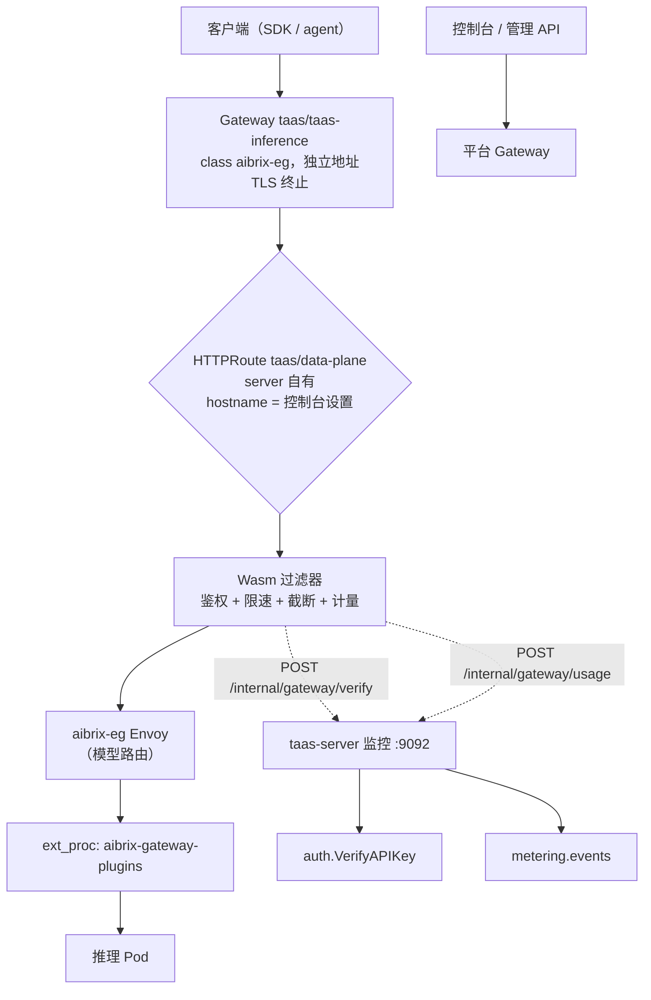
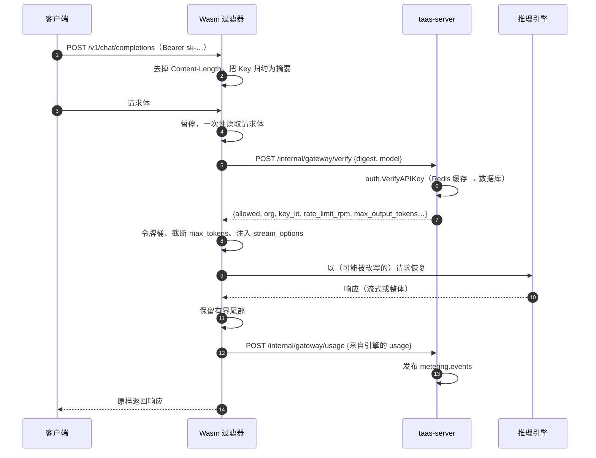

# 数据面网关插件 —— 架构与详细设计

| 属性 | 内容 |
| --- | --- |
| 特性点 | 在推理网关上做鉴权与计量的 Wasm 过滤器（架构 §3.2 流水线第 01 步 Auth 与第 04 步 Meter） |
| 文档范围 | 数据面网关插件的架构与详细设计：Wasm 过滤器、它的两个内部 API 端点、端点之间的令牌隔离、到 OpenAI 兼容响应的错误映射、按 worker 的缓存、产物打包以及加载它的 `EnvoyExtensionPolicy` |
| 归属模块 | `wasm/gateway`（过滤器，使用 TinyGo 构建的独立 Go 模块）、`pkg/server`（监控端口上的内部网关 API）、`services/auth`（校验，委托给 `VerifyAPIKey`）、`services/metering`（事件发布）、`deploy/helm/go-taas`（策略、内部路由、共享令牌） |
| 相关文档 | [架构设计](../design/architecture.zh-cn.md) §3.2（流水线）、§3.2.1（有序步骤）、§3.3（鉴权链）、§3.4（计量纪律） · [Token 计量凭证](./metering.zh-cn.md)（事件写入的账本） · [API Key 管理](./api-key-management.zh-cn.md)（Key 格式与校验） · [服务资源指标](./service-resource-metrics.zh-cn.md)（读取同一 Prometheus 的监控面板） |
| 状态 | 已实现并在真实集群上验证 |

---

## 1. 概述与目标

架构把鉴权与计量放在推理数据面上、放进网关内部，使推理流量永不经过业务进程（§3.2）。设计文档诚实地点明了载体：Wasm 过滤器是目标形态，`ext_proc` 插件是备选，但无论哪种，契约是固定的 —— 校验调用方的 API Key、上报 token 用量、且永不成为转发瓶颈。

很长一段时间里只有*契约*存在。`auth.VerifyAPIKey` 已实现（带 Redis 缓存，其注释已经写着"由网关的 Wasm 插件每请求调用"），`auth.KeyDigest` 自称是"与数据面 Wasm 插件共享的契约"，`metering` 也有幂等的事件消费者。**调用方从未被实现**，后果是可观测的：推理网关接受任意 bearer token —— 缺失、乱码、有效全部返回 200 —— 且真实流量从未产生过任何计量事件。

本特性补上缺失的组件。

**目标**：

- 推理网关上的 Wasm 过滤器，对每个受保护请求校验 API Key，在请求到达推理 Pod 之前拒绝无效、已吊销、已过期与超出作用域的 Key。
- 从引擎自身的 `usage` 计量 token，发布到队列并由既有账本结算。
- 两项契约本就承诺由网关执行的限制：按 Key 的请求速率（`rate_limit_rpm`）与每请求输出上限（`max_output_tokens_per_request`）。
- 鉴权失败即关闭，计量失败不阻塞。
- 每个 release 一个产物，随 server 镜像发布。

**非目标**（延后，§8）：跨 worker 的并发租约、每分钟 token 限制、追踪注入、结果缓存、降级缓冲，以及取代 AIBrix 的路由。

### 1.1 本文阅读顺序

第 2 节记录架构决策（AD1–AD9）。第 3 节是请求路径中的位置。第 4 节是内部 API 契约。第 5–6 节是数据模型（没有 —— 插件不存储任何东西）与错误映射。第 7 节是请求与响应流程。第 8–11 节是延后工作、配置、安全与发布。第 12 节是验证记录，第 13 节是函数级设计。

---

## 2. 架构决策

| # | 决策 | 理由 |
| --- | --- | --- |
| AD1 | **过滤器是用 TinyGo 从嵌套 Go 模块（`wasm/gateway`）构建的 proxy-wasm HTTP 过滤器** | 仓库是 Go；独立模块把 TinyGo 的 Go 版本上限隔离在主模块（跟随更新的版本）之外，并让根目录的 `go test ./...` 与 `golangci-lint run` 自动跳过它（嵌套模块不会被遍历）。为一个组件引入 Rust 会多一套工具链 |
| AD2 | **插件不做任何决策，只调用平台。** 监控端口上的两个集群内端点**同进程**委托给 `VerifyAPIKey` 与计量发布器 | 架构 §3.3 与 §3.2.1 禁止插件直接访问数据库，也禁止重复业务规则。同进程复用 RPC 意味着校验只有一份实现、摄入只有一份实现，网关无法与控制面漂移 —— 而这里的漂移是安全缺陷，不是外观问题。另外 Wasm 无法直接连 RabbitMQ，计量无论如何都需要一个承载者 |
| AD3 | **内部 API 由共享令牌隔离，常量时间比较（12910）** | 无鉴权的校验端点会让任何人探测 Key。常量时间比较让令牌无法被时序攻击猜出 |
| AD4 | **鉴权失败即关闭，计量失败即放行** | 由超时推导出的裁决只是猜测，而猜"允许"就是敞开大门。计量相反：§3.2.1 明确计量故障绝不能阻塞推理，因为计费故障时拒绝服务会把影响面从"账单略有偏差"扩大到"全线不可用"。被丢弃的事件会被计数并记录日志，因此绝不静默 |
| AD5 | **校验发生在请求体阶段，仅针对 `/v1/` 路径** | 模型白名单是 `VerifyAPIKey` 契约的一部分，而模型名只存在于请求体中。非 `/v1/` 路径（健康检查、发现）保持开放，Kubernetes 探针才能工作。代价是外层 Envoy 会缓冲请求体 —— 但推理请求本来就是向上不流式的，因此没有实际成本 |
| AD6 | **插件始终观察响应尾部，并在流式响应上向引擎索取 usage** | §3.4 规定引擎是权威：网关自行分词会受 chat template、tool-call 框架与多模态输入影响而漂移。读取引擎的 `usage` 是唯一准确的计数方式，而 OpenAI 兼容引擎在流式响应中除非调用方设置 `stream_options.include_usage` 否则不会输出 usage。只保留有界尾部，因此长文本生成的内存开销是固定的 |
| AD7 | **裁决缓存与令牌桶放在按 worker 的内存中，TTL 30 秒** | Envoy 不给 Wasm 过滤器任何跨 worker 线程的共享状态。因此缓存是按 worker 的：N 个 worker 在每个 TTL 内最多让平台看到 N 次校验，而其下的 Redis 缓存让每次都很便宜。这是近似，文档如实说明为近似，而不是包装成保证 |
| AD8 | **产物在 server 的 Docker 镜像中构建、由 server 提供下载，再经 HTTP 加载** | 一个 release 只产生一个插件版本，不需要第二个镜像，也不需要 Envoy 的仓库凭据。耦合是真实存在的 —— 如果 Envoy Pod 启动时 server 不可用，过滤器无法加载 —— 但这与过滤器本身的可用性相同（每次缓存未命中都要调用 server）。摘要锁定是可选的，因为 Helm 会在新 Pod 提供新产物之前就应用策略 |
| AD9 | **策略挂到 server 自有的数据面 HTTPRoute，而不是 AIBrix 网关** | 它是整条链路上唯一由 go-taas 拥有的 Envoy；`aibrix-system` 中的策略属于另一个 release，会被覆盖。位于链路最前也意味着未鉴权请求在第二个代理或模型 Pod 看到它之前就被拒绝，同时 AIBrix 的 `ext_proc` 路由保持不动 |

---

## 3. 请求路径中的位置

### 3.1 两个网关，而非一个

两个平面不共用代理：

| | 控制面 | 数据面 |
| --- | --- | --- |
| Gateway | 平台自带（平台命名空间里的 `envoy-gateway`） | `taas-inference`，由本 chart 创建 |
| 服务内容 | `taas.<domain>`（控制台 + 管理 API）以及平台其它域名 | 仅推理域名 |
| Envoy | 与平台站点共用 | 独立 Deployment、独立地址 |
| HTTP 过滤器 | 无 | Wasm 插件 |
| 故障域 | 控制台/API | 推理 |

最初它们是同一个代理：推理流量从平台网关进入，再转发到 AIBrix 网关，因此推理流量高峰会给控制台所在的代理加压，而该代理的一次 reload 或配置错误也会同时打断推理。现在数据面有自己的 Gateway —— 同一个 `aibrix-eg` 类，因此继承的是面向推理的 Envoy 调优而非平台的，并且有自己的生命周期。



策略挂在 `taas/data-plane` 上的原因：

- 它是整条链路上唯一由 go-taas 拥有的 Envoy（AD9），现在也是推理链路上唯一的代理；
- 它在 AIBrix 缓冲请求之前就看到每一个请求，因此最早的拒绝也是最便宜的拒绝；
- 路由名是稳定的，而主机名是运维设置项，因此策略可以由 Helm 拥有，而不去争夺路由的 `spec.hostnames` —— 那正是过去让 Helm 升级与控制台保存互相矛盾的冲突。

两个监听器细节很重要：

- **HTTPS 监听器不声明 hostname。** 主机名是控制台设置、由路由承载；写死在 Gateway 里会让每次控制台改动都需要一次 Helm 升级，而两者不一致会静默停止服务。
- **第二个监听器只为插件自身的回调存在。** Envoy 的 Wasm HTTP 调用需要一个已配置的集群，而集群与路由规则一一对应，因此 `taas-go-taas-internal-api` 挂在一条固定主机名的监听器上，该主机名不在任何 DNS 区域与证书中。过滤器按集群名访问服务端；这个监听器无法服务其它任何东西，因为它上面的其它 `Host` 请求会被拒绝。

### 3.2 运维需要提供什么

| 项目 | 原因 |
| --- | --- |
| release 命名空间里覆盖推理域名的 TLS Secret | 监听器要终止 TLS。chart 不拥有它：证书比 release 活得久，且通常由拥有 DNS 的人轮换。通配证书是常见选择，Secret 名由 `dataPlane.gateway.tlsSecretName` 指定 |
| 指向数据面 Gateway 地址的推理域名 DNS 记录 | 它与控制台是不同的地址。指向旧地址会返回 404，因为推理在那里已经没有路由了 |

---

## 4. 内部 API 契约

三个端点都在监控端口上（集群内，从不暴露在公共网关端口）。两个 JSON 端点要求 `X-Gateway-Token`；产物端点不要求，因为 Envoy 的 Wasm 代码源无法发送请求头，而产物是过滤器二进制本身、不是机密。

### 4.1 `POST /internal/gateway/verify`

```json
{"key_digest": "<64 位小写 hex>", "model": "qwen2.5-0.5b", "source_ip": "10.0.0.9"}
```

摘要就是契约：明文 Key 永不离开网关（`auth.KeyDigest`）。响应：

```json
{"allowed": true, "organization_id": "org-1", "key_id": "key-1", "role": "agent",
 "rate_limit_rpm": 60, "rate_limit_tpm": 0,
 "max_concurrent_requests": 200, "max_output_tokens_per_request": 16384}
```

被拒绝的 Key 是 **200 + `allowed: false`** 加业务码与消息。只有"平台无法回答"才是非 200，这样插件才能区分*Key 是坏的*（拒绝）与*平台不可用*（失败即关闭）—— 两者需要不同的反应。

### 4.2 `POST /internal/gateway/usage`

```json
{"request_id": "…", "organization_id": "org-1", "api_key_id": "key-1",
 "model": "qwen2.5-0.5b",
 "usage": {"prompt_tokens": 34, "completion_tokens": 3, "cached_tokens": 0, "reasoning_tokens": 0},
 "completed_at": 1792946186, "latency_ms": 206, "ttft_ms": 0, "generation_ms": 0,
 "status": "success", "error": ""}
```

`model` 是**服务名**，不是 UUID：插件只知道调用方写了什么。服务端把它解析为目录 id（以及承载它的推理服务），因此身份解析留在服务端，插件保持可替换。发布失败返回 503 并递增 `taas_gateway_plugin_usage_dropped_total`；插件从不重试，因为请求已经被服务完毕，缺口可以通过 `request_id` 归因。

### 4.3 `GET /internal/gateway/plugin.wasm`

产物，以 `Content-Type: application/wasm` 提供。缺少该产物的构建返回 404 与明确消息，平台其余部分继续工作。

---

## 5. 数据模型

没有。插件不存储任何东西：裁决在按 worker 的内存中存活 30 秒（AD7），用量变成队列上的计量事件，由既有账本持久化。这正是设计的要点 —— 数据面不保留任何需要复制、备份或核对的状态。

两个 Prometheus 计数器描述插件自身行为：

| 指标 | 含义 |
| --- | --- |
| `taas_gateway_plugin_verify_total{result}` | 按结果的校验次数（`allowed`、`rejected`、`error`） |
| `taas_gateway_plugin_usage_total` | 已记录的用量事件 |
| `taas_gateway_plugin_usage_dropped_total` | 平台未能记录的用量事件 |

推理流量持续而 `usage_total` 不动，就是过滤器停止上报的信号 —— 没有别的指标会显示这一点。

---

## 6. 错误映射

调用方是 OpenAI SDK 或 agent，因此状态码必须是它重试逻辑读取的东西，响应体必须是它错误处理展示的东西：

| 业务码 | 含义 | HTTP | `type` | `code` |
| --- | --- | --- | --- | --- |
| 10007 | `API_KEY_NOT_FOUND` | 401 | `invalid_request_error` | `invalid_api_key` |
| 10008 | `API_KEY_INVALID` | 401 | `invalid_request_error` | `invalid_api_key` |
| 10009 | `API_KEY_REVOKED` | 401 | `invalid_request_error` | `api_key_revoked` |
| 10010 | `API_KEY_EXPIRED` | 401 | `invalid_request_error` | `api_key_expired` |
| 10036 / 10039 / 10101 / 10105 | 禁止、Key 作用域、未知或未授权模型 | 403 | `permission_error` | `model_not_allowed` |
| 10037 | `RATE_LIMIT_EXCEEDED` | 429 | `rate_limit_error` | `rate_limit_exceeded` |
| 13304 | `QUOTA_OUTPUT_TOKENS_EXCEEDED` | 400 | `invalid_request_error` | `max_tokens_exceeded` |
| 其他 | 平台侧 | 503 | `server_error` | `service_unavailable` |

只有可归因于调用方的码才成为裁决；其余都成为错误，使插件失败即关闭。`10036` 值得说明：在这条路径上它意味着平台无法解析调用方的组织状态，那是平台故障，网关绝不能把它报告成"Key 是坏的"。

---

## 7. 流程

### 7.1 一个已鉴权请求



### 7.2 一个被拒绝的请求

插件本地应答，因此请求永远到不了 AIBrix 或模型 Pod：没有上游连接、没有容器 CPU，拒绝的代价只是一次摘要哈希 —— 而当凭据连 Key 的形状都不具备时，代价为零。

### 7.3 为什么暂停在这个位置

有两种放置方式是错的，且都被实际观察到：

- **在请求头暂停、又在请求体暂停**会让请求停住：Envoy 只恢复它最后停住的阶段，因此调用方超时、完全收不到响应。
- **只在请求头暂停**不会缓冲请求体，因此无法读取请求体，请求同样永不完成。

可行的组合是：请求头阶段继续（移除 `Content-Length`，使变长的改写体不被截断），随后在请求体阶段暂停一次并一次性读取。按帧读取会重复此前的帧，因为暂停流的宿主缓冲区已经保存了迄今收到的所有字节 —— 重复内容会被解析成垃圾，改写静默失效，而"改写后"的请求体以畸形形式到达引擎。

---

## 8. 延后工作

| 项目 | 延后原因 |
| --- | --- |
| 并发租约（`max_concurrent_requests`） | 需要跨 Envoy worker 的共享状态，即 Redis |
| 每分钟 token 限制（`rate_limit_tpm`） | 同上：跨 worker 的计数器 |
| `traceparent` 注入、延迟阶段标记 | 与鉴权和计量正交 |
| 结果缓存、前缀亲和 | 改变计费语义，需要独立决策 |
| 降级 + 补偿重放 | 目前被丢弃的事件会被计数并记录；重放队列是后续工作 |
| 立即吊销 | 吊销在缓存 TTL（30 秒）内生效。为此建立通往 Envoy 的控制通道不值得 |

---

## 9. 配置

`gatewayPlugin`（服务端，`pkg/config`）：

| 键 | 默认值 | 含义 |
| --- | --- | --- |
| `enabled` | `false` | 提供内部 API。默认关闭：启用后网关会开始拒绝未校验流量，这是必须由安装方主动选择的行为变更 |
| `token` | `""` | 共享机密；为空时即使启用也不提供端点 |
| `cacheTTL` | `30s` | 裁决存活时间（按 worker） |
| `verifyTimeout` | `500ms` | 过滤器 → 服务端单次调用预算 |
| `protectedPrefixes` | `["/v1/"]` | 需要 Key 的路径 |
| `failOpen` | `false` | 传给策略 |
| `pluginPath` | 二进制旁的 `gateway-plugin.wasm` | 产物位置 |

Chart（`values.yaml` → `gatewayPlugin`）：同样的值，外加 `internalHostname`（内部路由的主机名）、`maxBodyBytes` 与可选的 `pluginSha256`。

---

## 10. 安全考量

- **明文 Key 永不离开网关。** 只发送其 SHA-256，且从不记录。有测试断言摘要被转发、明文未被转发、且任何日志都不含明文。
- **内部 API 无法从互联网访问**：它在监控端口上，其路由主机名不在任何 DNS 区域与证书中。
- **令牌只生成一次**，写入 release Secret，两侧由同一个 helper 取值；服务端从环境变量读取，因此绝不进入渲染后的 ConfigMap。
- **缺失或错误的令牌不泄露任何信息**：响应不回显摘要，校验器也不会被调用，因此令牌失败无法被用来探测 Key。
- **无法完成自身配置的过滤器不会启动**（`OnPluginStartStatusFailed`），且受保护路径上未配置的请求会被拒绝而非放行 —— 这正是本特性的测试抓到的那次 fail-open 缺陷。
- **请求体检查是有界的**（`maxBodyBytes`）；更大的请求体仍会被鉴权，但模型作用域与 token 上限无法执行。这种降级是警告，不是静默放行。

---

## 11. 发布

1. `gatewayPlugin.enabled=false`（默认）：无任何变化；内部端点不会被注册。
2. 带令牌启用：策略与内部路由被创建。产物从 server 自己的镜像获取；一旦服务中的 Pod 就绪，策略即被接受，因此全新发布可能需要一次 reconcile。
3. 重启 Envoy Deployment 才能让变更后的产物生效：Envoy 按 worker 缓存 Wasm VM。全新安装时这一步自动完成。
4. 无论何种顺序发布都是安全的：过滤器未加载时网关行为与之前相同（不校验）；一旦加载，平台要么给出答案（放行/拒绝），要么不可用（失败即关闭）。

---

## 12. 验证记录

在真实集群上（`llm.sudoinfotech.com`、vLLM 0.28.0、单副本）：

| 检查 | 结果 |
| --- | --- |
| 无 `Authorization` 头 | **401** `invalid_api_key`，OpenAI 形状响应体（此前为 200） |
| 乱码 Key | **401**，`API key not found` |
| 有效 Key、非流式 | **200**，真实补全 |
| 有效 Key、流式 | **200**，SSE 增量刷新 |
| 计量、非流式 | 每请求一张凭证（5 个请求 → 5 张凭证） |
| 计量、流式 | 一张凭证，携带引擎计数（`prompt_tokens` 32、`completion_tokens` 15） |
| 限速 `rate_limit_rpm=2` | 200、200、**429**、429 |
| 吊销 | 缓存窗口内 **401** `api_key_revoked` |
| 平台不可用且缓存过期 | **503** `service_unavailable`（失败即关闭，而非放行） |
| 未受保护路径（`/healthz`） | 放行 |

本次验证发现并修复了两个平台缺陷，两者都早于本特性存在：

- **模型授权把服务名与 UUID 列比较**，一个 SQL 类型错误把每个已校验请求变成 503。随附的网关从不校验 token，因此该路径从未被执行过。
- **`metering` 与 `billing` 对 `metering.events` 共用一个队列**，于是 broker 把消息流切开：大约一半的用量事件产生凭证，另一半只产生计费行。`accelerator.inventory` 同样如此。

---

## 13. 函数级设计

| 文件 | 职责 |
| --- | --- |
| `wasm/gateway/plugin.go` | HTTP 过滤器：请求头（摘要、移除 `Content-Length`、本地拒绝非 Key）、请求体（一次性读取、提取模型名）、callout 处理、`applyVerdict`、响应尾部、用量上报、限速 |
| `wasm/gateway/auth.go` | Bearer 解析、摘要、Key 形状、码 → 状态表、`errorBody`、裁决解析 |
| `wasm/gateway/usage.go` | 从 JSON 与 SSE 尾部提取 usage、`requestIdentity`、`clampMaxTokens`、`ensureStreamUsage`、`usageBody` |
| `wasm/gateway/ratelimit.go` | 令牌桶及其序列化 |
| `wasm/gateway/verdict_cache.go` | 裁决在按 worker 内存中的编码 |
| `wasm/gateway/config.go` | 策略配置解析，带安全默认值 |
| `wasm/gateway/jsonlite.go` | 极简 JSON 读取器：在每请求都运行的过滤器里，`encoding/json` 会带来数百 KB 开销 |
| `wasm/gateway/time.go` | 由 Envoy tick 驱动的粗粒度时钟；带 CAS 令牌的共享数据写入 |
| `wasm/gateway/verify-wasm.sh` | 构建后 ABI 检查：构建可以成功却丢掉宿主函数 |
| `pkg/server/gateway_api.go` | 内部端点、令牌守卫、校验器/接收器接缝、计数器 |
| `services/auth/gateway_verifier.go` | `VerifyGatewayKey` 委托给 `VerifyAPIKey`，以及裁决码边界 |
| `services/metering/gateway_sink.go` | `RecordGatewayUsage`：服务名解析与发布 |
| `deploy/helm/go-taas/templates/envoyextensionpolicy-dataplane.yaml` | 策略与内部路由 |
