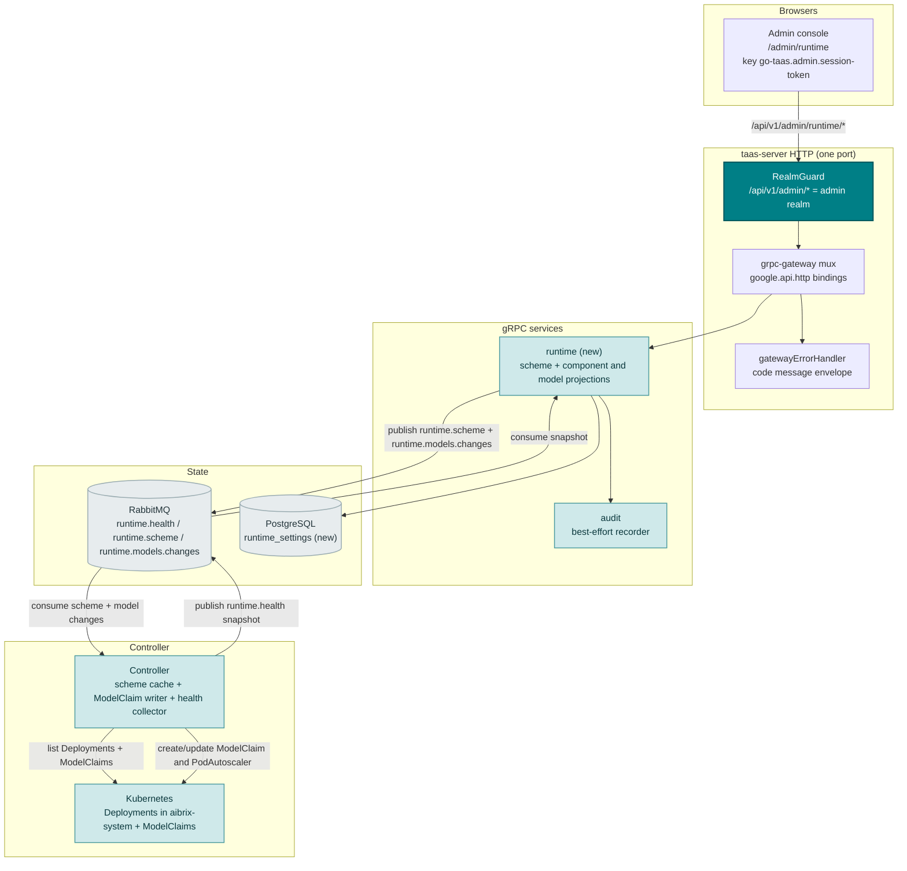
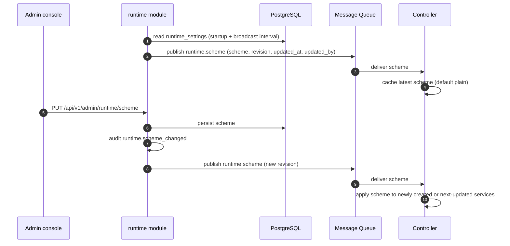
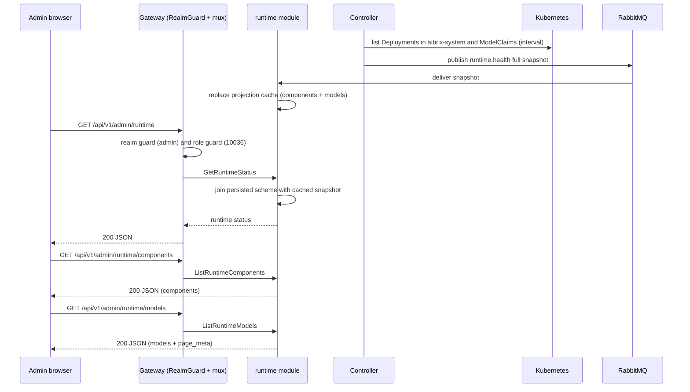
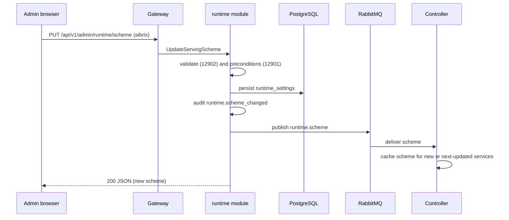
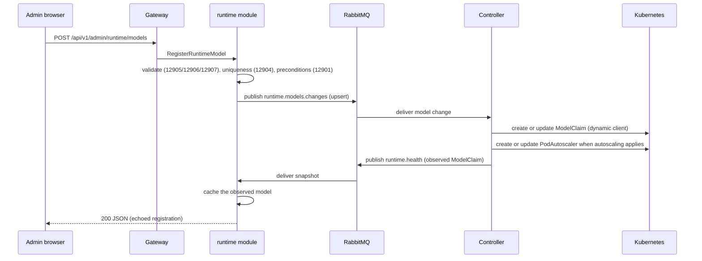
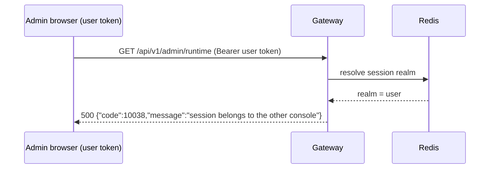

# Distributed Inference Runtime (AIBrix Integration) — Architecture and Detailed Design

| Attribute | Content |
| --- | --- |
| Feature point | Distributed inference runtime — a platform operator sees the installed serving runtime and its health, chooses the platform serving scheme, and manages the models registered with the runtime (backlog row 47) |
| Document scope | Architecture and detailed design for feature-47: a new `runtime` module owning the serving-scheme setting and the runtime-health and registered-model projections; the `taas.runtime.v1.RuntimeService` proto with seven RPCs bound only under `/api/v1/admin/runtime/*`; the `runtime_settings` table and the in-memory projection cache; the Controller's scheme consumption, `ModelClaim` reconciliation, component-health collection and snapshot publish; the `RuntimePage` on the admin console; error handling (129xx plus 10038/10036/10027); configuration, security, rollout, and a function-level task list per layer |
| Owning modules | New `runtime` module (`services/runtime`): the serving-scheme setting, the component projection, and the registered-model projection; `internal/controller` (scheme consumer, `ModelClaim` writer, component collector, model projector); `infer` (read-only: the reconciliation path the scheme selects); `audit` (scheme-change and model-registration events); `pkg/k8s` (existing clientset + dynamic client seam); `pkg/mq` (new subjects); `pkg/errors` (129xx block); `pkg/config` (runtime section); `web` admin console (`RuntimePage`) |
| Related documents | [Requirement Analysis and UI/UX Design](../design/distributed-inference-runtime.md) · [Architecture Design](../design/architecture.md) §1.1 control/data-plane separation, §1.2 MQ decoupling, §2.4 `infer`, §2.7 Controller, §3.2 data plane (Envoy + Wasm) · [Accelerator Inventory & Health](./accelerator-inventory.md) (the Controller → MQ → service projection pattern and in-memory cache this feature reuses) · [Multi-Cluster Management](./multi-cluster-management.md) (the registry + projection module shape and the `cluster.health` snapshot this feature mirrors) · [Inference Autoscaling](./inference-autoscaling.md) (the HPA path the plain scheme keeps) · [Model Catalog & One-Click Deployment](./model-catalog-deployment.md) (the inference-service reconciliation path the scheme selects) · [Console Surface Separation](./console-surface-separation.md) (the two surfaces, the `AdminShell`, the masked-projection rule) |
| Status | Architecture complete, handed to the Developer agent |

---

## 1. Overview and Goals

go-taas's Controller today reconciles one **plain `apps/v1 Deployment` + a ClusterIP Service** per inference service (`internal/controller/reconciler.go`, `buildDeployment` / `buildService`), running `python3 -m vllm.entrypoints.openai.api_server` against weights on the JuiceFS PVC mounted at `r.weights.MountPath`, and creates a Kubernetes `HorizontalPodAutoscaler` when autoscaling is enabled (`buildHPA`). That path has no KV-cache-aware routing, no prefill/decode disaggregation and no multi-LoRA adapter management.

This feature adds a **runtime-backed serving path**. The operator selects a platform-level *serving scheme* (`plain`, the default, or `aibrix`), and when the **AIBrix** scheme is selected the Controller additionally registers each model with AIBrix's control plane as a `modelclaims.model.aibrix.ai` resource — written through the dynamic client because there is no vendored AIBrix Go client — and uses an AIBrix `PodAutoscaler` instead of a plain HPA when autoscaling applies. The admin console gains one page that shows the installed runtime and its health, switches the scheme, and manages the `ModelClaim` resources.

AIBrix is already installed on the target cluster `sd4090` in the `aibrix-system` namespace (`aibrix-controller-manager`, `aibrix-gateway-plugins`, `aibrix-gpu-optimizer`, `aibrix-metadata-service`, `aibrix-redis-master`) alongside the Envoy AI Gateway Deployment `envoy-aibrix-system-aibrix-eg`. The feature is therefore a thin control surface over an existing runtime, not a runtime installation.

**Goals**:

- One admin page `/admin/runtime` (`RuntimePage`) inside `AdminShell` with the runtime overview, the component-health table, the serving-scheme switcher, the registered-model table, the register-model dialog and the deregister confirmation (design §5.3).
- A new `runtime` module owning the persisted serving-scheme setting and the in-memory component + registered-model projections, with its own error block **129xx** (design D2, D9).
- The exact admin-prefix bindings for seven RPCs on a new `taas.runtime.v1.RuntimeService` (design §6).
- The Controller's scheme consumer, `ModelClaim` reconciliation (derived from the inference-service event and from explicit runtime registrations), `PodAutoscaler` fallback path, component-health collection and full-snapshot publish.
- Per-page interactive states, including the runtime-unavailable degradation that never crashes the page (design D8), and the negative realm-separation contract (10038).
- Numbered acceptance criteria (AC1–AC12) testable in Nightwatch against the compose stack.

**Non-goals** (from the design, restated): installing, upgrading or configuring AIBrix itself (go-taas observes an already-installed runtime); per-service runtime selection (the scheme is platform-level in this increment); in-place migration of running services on a scheme change (the next service update applies the scheme, design D5); LoRA-adapter and prefill/decode topology configuration (AIBrix ships them; this increment registers `ModelClaim` models only); the accelerator inventory (feature #18); per-cluster placement and the cluster registry (feature #40); the model catalog and one-click deployment (feature #2); and any end-user runtime surface (deliberately absent, design D1).

### 1.1 Reading order of this document

Section 2 records the architecture decisions (AD1–AD13; AD12–AD13 are refinements the architecture adds, marked as such). Sections 3–5 are the component view, the data model, and the API design. Section 6 is the frontend architecture (page → route → API-prefix table, navigation, shared components, auth guard). Sections 7–8 are the sequence diagrams and error handling. Sections 9–11 are configuration, security and rollout. Section 12 is the acceptance-criteria traceability. Sections 13–15 are the function-level detailed design (including the exact `ModelClaim` object and the component-health source), the ordered implementation task list, and the deferred items.

---

## 2. Architecture Decisions

AD1–AD11 restate the UI/UX design's decisions (D1–D10) as implementation-level rules. **AD12 and AD13 are refinements** the architecture adds; each is marked with the design decision it refines and preserves that decision's intent so the Developer and Test agents implement one reading.

| # | Decision | Rationale |
| --- | --- | --- |
| AD1 | **The feature is admin-surface only**: route `/admin/runtime`, API prefix `/api/v1/admin/runtime/*`. There is **no end-user binding** and no `/runtime` route on the user surface | Design D1. Runtime components, the serving scheme and `ModelClaim` registration are operator-orchestration (feature-17 masked-projection rule); tenants consume models through the gateway and see only model availability. Consistent with the admin-only accelerator inventory (#18), system status (#30) and multi-cluster (#40) surfaces |
| AD2 | **A new `runtime` module** (`services/runtime`) owns the persisted serving-scheme setting and the runtime-health and registered-model projections, with its own error block **129xx**. `infer` still owns inference services; the Controller still owns Kubernetes reconciliation | Design D2. The runtime is a distinct concern (a platform-level scheme plus a control-plane projection) with its own setting and projections; a dedicated module keeps it separate from the per-tenant inference lifecycle |
| AD3 | **AIBrix is the distributed serving scheme** with values `plain` (default) and `aibrix`; the scheme is a **platform-level setting** (AD6). AIBrix is already installed on `sd4090`, Apache-2.0, vLLM-project lineage, control/data-plane split mirroring go-taas | Design D3. Zero integration friction; the rejected alternatives (llm-d: GAIE CRDs, Kubernetes-only; KServe: Knative + Istio footprint) duplicate go-taas's own control loop |
| AD4 | **Component health is a projection of cluster Kubernetes state, collected by the Controller and served through the `runtime` module**: the Controller polls the AIBrix control-plane Deployments in `aibrix-system` and the Envoy AI Gateway Deployment through the existing typed clientset seam, maps Ready replicas → status, and publishes a **full snapshot** to a new `runtime.health` MQ subject; the `runtime` module keeps an in-memory projection cache (the accelerator-inventory AD1/AD11 pattern) | Design D4. The Controller is the only component with Kubernetes clients (accelerator AD1, service-logs AD2); the projection keeps the health view dependency-light and self-healing (a removed component disappears from the next snapshot). A read-only page must never fail because the cluster is unreachable (design D8) |
| AD5 | **The registered-model list is a projection of the cluster's `ModelClaim` resources, served from the controller's snapshot; registration/deregistration are desired-state changes published to the Controller.** No `runtime_models` table — the cluster is the source of truth (AD11). `RegisterRuntimeModel` publishes an upsert to a new `runtime.models.changes` subject; `DeregisterRuntimeModel` publishes a delete; the Controller reconciles the `ModelClaim` and its next `runtime.health` snapshot carries the observed projection | Design D6, D7. The AIBrix `ModelClaim` is the authoritative registration; a projection avoids a second source of truth that drifts from the cluster (the accelerator-inventory AD11 reading), and the "registered with the runtime" list is exactly what the runtime serves |
| AD6 | **The serving scheme is persisted in a new single-row `runtime_settings` table** (`scheme`, `updated_by`, `updated_at`), owned by the `runtime` module and created by GORM `AutoMigrate`. Because the Controller has no database, the `runtime` module **broadcasts the scheme to the Controller over a new `runtime.scheme` MQ subject** on startup, on every change, and on a periodic interval (`runtime.schemeBroadcastInterval`, default 30 s); the Controller caches the latest scheme and defaults to `plain` until it receives one | Design D5. A persisted setting is attributable and survives restarts; an MQ broadcast is the only channel the DB-less Controller consumes (architecture §1.2). Defaulting to `plain` means a restarted or schemeless Controller keeps today's behavior unchanged |
| AD7 | **Switching the scheme is audited** as `runtime.scheme_changed` (actor, before, after) and is **idempotent**: setting the current scheme is a no-op success with no audit event. It does **not** tear down existing services; it applies to newly created or next-updated services | Design D5. A consequential platform setting must be attributable; not tearing down running services keeps the switch safe and reversible |
| AD8 | **Registration validates** `model_name` (pattern `^[a-z0-9][a-z0-9._-]*$`, unique among the observed `ModelClaims`), `engine ∈ {vllm, sglang}`, `replicas ∈ [0, 32]`, and a non-empty `artifact_url`. `replicas = 0` is valid (registered but scaled to zero). Duplicate → **12904**; unsupported engine → **12905**; invalid replicas → **12906**; missing/invalid name → **12907**; missing `artifact_url` → **12907**-family (the `artifact_url` field reuses **12907** with the field name in the message) | Design D7, FR4.2. Distinct codes keep each failure mode actionable; the artifacts URL is part of the same required-field family |
| AD9 | **New error codes in a runtime block (12901–12907)**, the next free block after prompt-evaluation's 128xx: **12901 `CodeRuntimeUnavailable`**, **12902 `CodeRuntimeSchemeInvalid`**, **12903 `CodeRuntimeModelNotFound`**, **12904 `CodeRuntimeModelExists`**, **12905 `CodeRuntimeEngineUnsupported`**, **12906 `CodeRuntimeReplicasInvalid`**, **12907 `CodeRuntimeModelNameInvalid`**. Realm failures reuse **10038 `CodeRealmMismatch`** and role failures reuse **10036 `CodeForbidden`** | Design D9. A new module (AD2) gets a fresh block; the surface-separation failures reuse the platform-wide codes |
| AD10 | **The runtime RPCs are platform-scoped admin RPCs**: they require the admin session realm and the admin role (`tenancy.RoleGuard`, 10036) but no `X-Organization-Id`; the fleet and the runtime are operator-internal, like images and the accelerator inventory | Mirrors the accelerator-inventory AD10 and image-management D9. The runtime is not tenant-scoped |
| AD11 | **The component and registered-model projections are in-memory caches in the `runtime` service, refreshed by the Controller's periodic full-snapshot publish, not database tables.** The serving scheme alone is persisted (`runtime_settings`, AD6). The caches are `sync.RWMutex`-guarded and replaced wholesale on each snapshot | Design D4, D6. The cluster is the source of truth for components and `ModelClaims`; a projection avoids a drifting second source. Accepted trade-offs: the caches are ephemeral (a service restart shows an empty/`unknown` view until the next snapshot, bounded by `runtime.collectInterval`); each replica holds its own copy but the pub/sub snapshot converges them within one interval; there is no history (the page is a point-in-time snapshot by design) |
| AD12 | **REFINEMENT of design D7/D10 — the modes that need a live runtime (register, deregister, and switching to `aibrix`) require the `aibrix` scheme with `availability = available`.** Under the `plain` scheme the page disables **Register model** and **Deregister** with the explanatory tooltip "Switch to the AIBrix scheme to register models with the runtime." (matching the design's plain-scheme empty-state note), and a direct API call under `plain` returns **12901 `CodeRuntimeUnavailable`** ("the AIBrix runtime that accepts registrations is not active") | The design's plain-scheme empty state and its note to switch the scheme (D10, §5.3) presuppose that no models are registered while `plain`. Silently accepting a registration that the Controller cannot materialize under `plain` would be a dead-end no-op; rejecting it with an explicit code keeps the write path coherent, requires no new error code, and needs no new UI branch (the UI already disables writes on an inactive runtime). Rejected alternative: adding a new `12908` code — the UI/UX design specifies no branch for it, so it would not be implementable in this iteration |
| AD13 | **REFINEMENT of design D3/D7 — the AIBrix write path is best-effort and never blocks the plain serving path.** The Controller writes the `ModelClaim` through the dynamic client and, when `scheme=aibrix` and autoscaling is enabled, creates an AIBrix `PodAutoscaler` in place of the Kubernetes HPA. If the AIBrix CRDs are absent or the write fails, the Controller logs the failure and **falls back to the plain path** (no `ModelClaim`; Kubernetes HPA) so serving is never blocked | Design D3 ("AIBrix is the optional distributed serving backend") and §1.2 ("go-taas keeps its Controller as the single reconciler"). A missing or mis-versioned AIBrix CRD must degrade, not fail, the inference-service reconcile — the same "read-only introspection works in both schemes" posture as D10 |

---

## 3. Component View

### 3.1 Ownership

| Layer / component | Owns | Changes in this feature |
| --- | --- | --- |
| **Static bundle (SPA)** | One Vite bundle (`web/dist`) embedded into `taas-server`; served by the gateway's SPA fallback | One new admin page (`RuntimePage`), one nav item, the route registration in `App.tsx`, and i18n keys |
| **Gateway (`pkg/server`)** | HTTP composition: `RealmGuard` → `withConsole` → `runtime.ServeMux`; the unified error renderer; the SPA fallback | No change — the new RPCs bind under `/api/v1/admin/runtime/*` and the realm guard already treats that prefix as the admin surface |
| **grpc-gateway mux** | Path → RPC routing from `google.api.http` annotations | New bindings for the seven new RPCs (Section 5) |
| **`runtime` (new)** | The persisted serving scheme, the in-memory component + registered-model projection caches, the `runtime.health` snapshot consumer, the scheme broadcaster, and the seven admin RPCs | New service: `services/runtime` |
| **`internal/controller`** | Kubernetes reconciliation; scheme consumption, `ModelClaim` reconciliation, `PodAutoscaler` path, component health collection and snapshot publish | New `runtime.go`: scheme cache + consumer, `ModelClaim` writer, component collector, model projector |
| **`infer`** | Inference services and their reconciliation path | No code change; the Controller's existing `applyUpsert` gains the Aibrix branch (AD5, AD13) |
| **`pkg/k8s`** | The typed clientset and the dynamic client | No change — the Controller uses `Clientset()` for health collection and `Dynamic()` for `ModelClaim` / `PodAutoscaler` writes (both already exist) |
| **`audit`** | Best-effort audit recorder | Reused: the runtime module calls `Recorder.Record` for `runtime.scheme_changed`, `runtime.model_registered`, `runtime.model_deregistered` |
| **`pkg/mq`** | The canonical subjects | Three new subjects: `RuntimeHealth`, `RuntimeScheme`, `RuntimeModelChanges` |
| **`pkg/errors`** | Code blocks per module | One new runtime block: **12901–12907** |
| **`pkg/config`** | The merged configuration tree | New `runtime` section (collect interval, scheme broadcast interval, consumer switches, AIBrix namespace/gateway) |

### 3.2 Runtime component view



### 3.3 Request identity chain

The runtime RPCs are **admin-surface, admin-role, platform-scoped** (AD1, AD10). The chain is:

1. `RealmGuard` (HTTP, `pkg/server/realm.go`) — the path prefix `/api/v1/admin/runtime/*` decides the expected realm `admin`. With no `Authorization` header: pass through (transitional, feature-17 AD4). With a header: resolve the session realm from Redis; mismatch → **10038**; unknown/expired/realm-less → **10027**.
2. grpc-gateway mux — routes by the annotated path and forwards `authorization`.
3. `runtime` handler — resolves the actor (`SessionUserResolver`) and gates writes on the admin role via `tenancy.RoleGuard` (10036). Reads (`GetRuntimeStatus`, `ListRuntimeComponents`, `GetServingScheme`, `ListRuntimeModels`) require only the admin realm and role; writes (`UpdateServingScheme`, `RegisterRuntimeModel`, `DeregisterRuntimeModel`) additionally require the admin role. No `X-Organization-Id` is required or honored (AD10).

A user-realm session presented on any `/api/v1/admin/runtime/*` route is rejected with **10038 `CodeRealmMismatch`** (design FR5.3, AC8). A session lacking the required role receives **10036 `CodeForbidden`** (AC9).

### 3.4 Serving-scheme propagation

The scheme has exactly one writer (the admin `UpdateServingScheme` RPC, which persists `runtime_settings`) and one consumer that matters for serving (the Controller):



---

## 4. Data Model

The runtime feature has **one persisted table** (the serving scheme) and **two in-memory projection caches** (components and registered models); the cluster is the source of truth for the latter two (AD4, AD5, AD11).

### 4.1 `runtime_settings` (persisted, single row)

| Column | Type | Notes |
| --- | --- | --- |
| `id` | string (PK) | Fixed singleton key `"runtime"` so there is exactly one row |
| `scheme` | string | `plain` / `aibrix`; default `plain` |
| `updated_by` | string | The acting admin user id (empty if unresolved, transitional) |
| `updated_at` | timestamp | Last change time |
| `created_at` | timestamp | Row creation time |

`RuntimeSetting` is a GORM model in `services/runtime/runtime_model.go`; the table is the single source of truth for the schema (created by `AutoMigrate`, no hand-written DDL — the repo's convention). The repository seeds the singleton row lazily: `GetScheme` returns `plain` when no row exists, and the first `UpdateScheme` inserts or updates the singleton.

### 4.2 Projection caches (in-memory)

```go
// Component is one runtime component's projection.
type Component struct {
    ComponentID    string
    Name           string
    Kind           string // control_plane | gateway | fallback
    Namespace      string
    Status         string // ready | progressing | degraded | unavailable | unknown
    ReadyReplicas  int64
    DesiredReplicas int64
    LastCheckedAt  time.Time
}

// RegisteredModel is one ModelClaim's projection.
type RegisteredModel struct {
    ModelName      string
    Engine         string // vllm | sglang
    Replicas       int64  // desired
    ReadyReplicas  int64
    ReadyCandidates int64
    Conditions     []ModelCondition
    Status         string // ready | progressing | degraded | failed | unknown
    CreatedAt      time.Time
    Origin         string // service | registration
}

// ModelCondition mirrors an AIBrix ModelClaim status condition.
type ModelCondition struct {
    Type               string
    Status             string
    Reason             string
    Message            string
    LastTransitionTime time.Time
}

// ProjectionCache holds the latest controller snapshot.
type ProjectionCache struct {
    mu          sync.RWMutex
    availability string // available | degraded | unavailable | unknown
    runtimeName  string // plain | aibrix
    runtimeVersion string
    clusterName  string
    reason       string
    components  []Component
    models      []RegisteredModel
    reportedAt  time.Time
}
```

The scheme is not in the cache — it is read from `runtime_settings` (AD6) and joined at response time, so the page always reflects the persisted setting even before a snapshot arrives.

### 4.3 Wire messages

`runtime.health` (Controller → runtime module), a **full snapshot**:

```json
{
  "scheme": "aibrix",
  "availability": "available",
  "runtime_name": "aibrix",
  "runtime_version": "0.2.0",
  "cluster_name": "sd4090",
  "reason": "",
  "components": [
    {"component_id":"aibrix-controller-manager","name":"aibrix-controller-manager","kind":"control_plane",
     "namespace":"aibrix-system","status":"ready","ready_replicas":1,"desired_replicas":1,"last_checked_at":"..."}
  ],
  "models": [
    {"model_name":"qwen2-5-0-5b","engine":"vllm","replicas":1,"ready_replicas":1,"ready_candidates":1,
     "conditions":[{"type":"Ready","status":"True","reason":"Ready","message":"","last_transition_time":"..."}],
     "status":"ready","created_at":"...","origin":"registration"}
  ],
  "reported_at": "..."
}
```

`runtime.scheme` (runtime module → Controller):

```json
{"scheme":"aibrix","revision":3,"updated_at":"...","updated_by":"..."}
```

`runtime.models.changes` (runtime module → Controller):

```json
{"event_type":"upsert","model_name":"qwen2-5-0-5b","engine":"vllm","replicas":1,
 "artifact_url":"/data/weights/Qwen__Qwen2.5-0.5B-Instruct/",
 "pod_selector":{"app":"qwen2-5-0-5b"},"engine_args":{"max-model-len":"8192"}}
```

```json
{"event_type":"delete","model_name":"qwen2-5-0-5b"}
```

### 4.4 Migration and init-SQL upgrade path

This repository does **not** use hand-written init-SQL scripts: every table's schema is the GORM model created by the owning service's `Migrate` via `db.AutoMigrate(...)` (e.g. `services/cluster/service.go` `Migrate` → `AutoMigrate(&Cluster{})`). There are no `.sql` files under `deploy/` and no `docker-entrypoint-initdb.d` mount in the compose stack. The upgrade path for this feature is therefore:

1. Add `RuntimeSetting` to `services/runtime/runtime_model.go`.
2. `runtime.Service.Migrate(ctx)` returns `db.AutoMigrate(&RuntimeSetting{})`.
3. `apps/taas-server/main.go` registers the `runtime` service in the migrate order, so the singleton table is created on server startup.
4. No init-SQL edit, no manual DDL, no data backfill. The table starts empty; `GetScheme` defaults to `plain` until the first admin write, so an existing deployment upgrades with unchanged behavior.

The component and model projections need **no migration** (AD11).

---

## 5. API Design

### 5.1 Surface mapping

Every RPC is bound **only** on the admin prefix `/api/v1/admin/runtime/*`. There is no user-prefix binding (AD1).

| RPC | HTTP method + path | Surface | Status |
| --- | --- | --- | --- |
| `GetRuntimeStatus` | `GET /api/v1/admin/runtime` | admin | new |
| `ListRuntimeComponents` | `GET /api/v1/admin/runtime/components` | admin | new |
| `GetServingScheme` | `GET /api/v1/admin/runtime/scheme` | admin | new |
| `UpdateServingScheme` | `PUT /api/v1/admin/runtime/scheme` | admin | new |
| `ListRuntimeModels` | `GET /api/v1/admin/runtime/models` | admin | new |
| `RegisterRuntimeModel` | `POST /api/v1/admin/runtime/models` | admin | new |
| `DeregisterRuntimeModel` | `DELETE /api/v1/admin/runtime/models/{model_name}` | admin | new |

### 5.2 Proto contract (`proto/taas/runtime/v1/runtime.proto`, new)

```proto
syntax = "proto3";

package taas.runtime.v1;

import "google/api/annotations.proto";
import "taas/common/v1/common.proto";

option go_package = "github.com/go-taas/go-taas/proto/taas/runtime/v1;runtimev1";

// RuntimeService serves the platform serving scheme, the installed
// runtime component health, and the models registered with the runtime
// (feature #47). Admin-surface API: served under /api/v1/admin/runtime.
service RuntimeService {
  // GetRuntimeStatus returns the runtime overview: scheme, availability,
  // runtime name/version, cluster, last checked, reason, and components.
  rpc GetRuntimeStatus(GetRuntimeStatusRequest) returns (GetRuntimeStatusResponse) {
    option (google.api.http) = {get: "/api/v1/admin/runtime"};
  }

  // ListRuntimeComponents returns the runtime components (AIBrix control
  // plane + Envoy AI Gateway under the aibrix scheme, the Controller +
  // Kubernetes API fallback under the plain scheme).
  rpc ListRuntimeComponents(ListRuntimeComponentsRequest) returns (ListRuntimeComponentsResponse) {
    option (google.api.http) = {get: "/api/v1/admin/runtime/components"};
  }

  // GetServingScheme returns the persisted platform serving scheme.
  rpc GetServingScheme(GetServingSchemeRequest) returns (GetServingSchemeResponse) {
    option (google.api.http) = {get: "/api/v1/admin/runtime/scheme"};
  }

  // UpdateServingScheme sets the scheme to plain or aibrix. It is audited
  // and idempotent; a non-{plain,aibrix} value returns 12902.
  rpc UpdateServingScheme(UpdateServingSchemeRequest) returns (UpdateServingSchemeResponse) {
    option (google.api.http) = {put: "/api/v1/admin/runtime/scheme" body: "*"};
  }

  // ListRuntimeModels returns the ModelClaim projection with pagination,
  // name search, and engine/status filters.
  rpc ListRuntimeModels(ListRuntimeModelsRequest) returns (ListRuntimeModelsResponse) {
    option (google.api.http) = {get: "/api/v1/admin/runtime/models"};
  }

  // RegisterRuntimeModel registers a model with the runtime (publishes a
  // desired-state change the Controller reconciles into a ModelClaim).
  rpc RegisterRuntimeModel(RegisterRuntimeModelRequest) returns (RegisterRuntimeModelResponse) {
    option (google.api.http) = {post: "/api/v1/admin/runtime/models" body: "*"};
  }

  // DeregisterRuntimeModel removes a model registration (deletes the
  // ModelClaim). An unknown model_name returns 12903.
  rpc DeregisterRuntimeModel(DeregisterRuntimeModelRequest) returns (DeregisterRuntimeModelResponse) {
    option (google.api.http) = {delete: "/api/v1/admin/runtime/models/{model_name}"};
  }
}

message GetRuntimeStatusRequest {}

message GetRuntimeStatusResponse {
  taas.common.v1.Response response = 1;
  RuntimeStatus runtime = 2;
}

message RuntimeStatus {
  string scheme = 1;          // plain | aibrix
  string availability = 2;    // available | degraded | unavailable | unknown
  string runtime_name = 3;    // plain | aibrix
  string runtime_version = 4; // optional, reported by AIBrix
  string cluster_name = 5;
  int64 last_checked_at = 6;
  string reason = 7;
  repeated RuntimeComponent components = 8;
}

message ListRuntimeComponentsRequest {}

message ListRuntimeComponentsResponse {
  taas.common.v1.Response response = 1;
  repeated RuntimeComponent components = 2;
}

message RuntimeComponent {
  string component_id = 1;
  string name = 2;
  string kind = 3;       // control_plane | gateway | fallback
  string namespace = 4;
  string status = 5;     // ready | progressing | degraded | unavailable | unknown
  int64 ready_replicas = 6;
  int64 desired_replicas = 7;
  int64 last_checked_at = 8;
}

message GetServingSchemeRequest {}

message GetServingSchemeResponse {
  taas.common.v1.Response response = 1;
  ServingScheme scheme = 2;
}

message ServingScheme {
  string scheme = 1;   // plain | aibrix
  int64 updated_at = 2;
  string updated_by = 3;
}

message UpdateServingSchemeRequest {
  string scheme = 1;   // plain | aibrix
}

message UpdateServingSchemeResponse {
  taas.common.v1.Response response = 1;
  ServingScheme scheme = 2;
}

message ListRuntimeModelsRequest {
  taas.common.v1.PageRequest page = 1;
  string name = 2;     // model-name substring search
  string engine = 3;   // vllm | sglang
  string status = 4;   // ready | progressing | degraded | failed | unknown
}

message ListRuntimeModelsResponse {
  taas.common.v1.Response response = 1;
  repeated RegisteredModel models = 2;
  taas.common.v1.PageMeta page_meta = 3;
}

message RegisteredModel {
  string model_name = 1;
  string engine = 2;
  int64 replicas = 3;
  int64 ready_replicas = 4;
  int64 ready_candidates = 5;
  repeated ModelCondition conditions = 6;
  string status = 7;
  int64 created_at = 8;
  int64 age_seconds = 9;
}

message ModelCondition {
  string type = 1;
  string status = 2;
  string reason = 3;
  string message = 4;
  int64 last_transition_time = 5;
}

message RegisterRuntimeModelRequest {
  string model_name = 1;
  string engine = 2;       // vllm | sglang
  int64 replicas = 3;      // 0..32
  string artifact_url = 4;
  map<string, string> pod_selector = 5;
  map<string, string> engine_args = 6;
}

message RegisterRuntimeModelResponse {
  taas.common.v1.Response response = 1;
  RegisteredModel model = 2;
}

message DeregisterRuntimeModelRequest {
  string model_name = 1;
}

message DeregisterRuntimeModelResponse {
  taas.common.v1.Response response = 1;
}
```

Wire conventions are unchanged: HTTP 200 on success, business errors as `{"code": <int>, "message": "..."}`, int64 fields serialized as JSON strings (`json_name` conventions inherited from the platform).

### 5.3 Gateway routing

`RuntimeService` adds `RegisterRuntimeServiceHandler` / `RegisterRuntimeServiceHandlerFromEndpoint` at codegen. The service implements `server.ServiceWithGateway` and returns the generated `RegisterRuntimeServiceHandler` from `GetServiceHandlerRegisterFn`, exactly like `cluster` and `accelerator`. Because every annotated path starts with `/api/v1/admin/runtime`, the existing `RealmGuard` assigns them the admin realm with no guard change (Section 3.3).

### 5.4 Validation contract

| Field | Rule | Failure code |
| --- | --- | --- |
| `model_name` | non-empty, `^[a-z0-9][a-z0-9._-]*$`, ≤ 128, unique among observed models | **12907** (invalid) / **12904** (duplicate) |
| `engine` | `vllm` or `sglang` | **12905** |
| `replicas` | `0`–`32` | **12906** |
| `artifact_url` | non-empty, ≤ 512 | **12907** (required-field family, message names the field) |
| `pod_selector` keys | `^[a-z0-9A-Z._/-]+$`, values ≤ 253 | **12907** (invalid) |
| `scheme` | `plain` or `aibrix` | **12902** |

---

## 6. Frontend Architecture

### 6.1 Page → route → API prefix

| Page / component | Route | Surface | API prefix (exact calls) |
| --- | --- | --- | --- |
| `RuntimePage` (overview + component table) | `/admin/runtime` | admin | `GET /api/v1/admin/runtime`, `GET /api/v1/admin/runtime/components` |
| Serving-scheme switcher | `/admin/runtime` (dialog) | admin | `GET /api/v1/admin/runtime/scheme`, `PUT /api/v1/admin/runtime/scheme` |
| Registered-model table | `/admin/runtime` | admin | `GET /api/v1/admin/runtime/models?page.offset=…&page.limit=…&name=…&engine=…&status=…` |
| Register-model dialog | `/admin/runtime` (dialog) | admin | `POST /api/v1/admin/runtime/models` |
| Deregister confirmation | `/admin/runtime` (confirmation) | admin | `DELETE /api/v1/admin/runtime/models/{model_name}` |

There is **one page**; the switcher, dialog and confirmation are components on it. The page calls **only** `/api/v1/admin/runtime/*` routes and contains no `/api/v1/*` (user-prefix) string (design FR5.2, AC8). The realm-scoped API client (`useApi()`) enforces this at runtime (feature-17 AD1).

### 6.2 Navigation placement

`RuntimePage` is registered in the admin console's **Operations** group. In `web/src/shells/AdminShell.tsx`, add one `ADMIN_NAV_ITEMS` entry adjacent to the clusters entry (the Operations group):

```tsx
{ path: '/admin/runtime', labelKey: 'nav.runtime', testid: 'nav-runtime', icon: Pulse },
```

An i18n key `nav.runtime` ("Runtime" / 「运行时」) is added to `web/src/i18n.js`. The route is registered inside the `AdminSurface` `<Routes>` in `web/src/App.tsx`:

```tsx
<Route path="/admin/runtime" element={<RuntimePage />} />
```

### 6.3 Shared components and state to reuse

- `AdminShell` (feature #17) — page frame, nav, admin realm provider.
- The status-badge and inline-notice components used by `AcceleratorsPage` and `SystemStatusPage` (Ready/Progressing/Degraded/Unavailable/Unknown badges; the "Showing stale data" banner and Retry action).
- The data-table component with server-side sort/filter/pagination used by `AcceleratorsPage` (20 rows/page for the model table).
- `usePolling` (the accelerator-inventory/`SystemStatusPage` polling hook) for the 30 s refresh of `GetRuntimeStatus` + `ListRuntimeComponents` + `ListRuntimeModels`; a failed poll keeps the last good data and shows the stale banner (AC7, AC12).
- The confirm-dialog and form-field components used by the inference-service and image pages for the scheme confirmation, the register dialog and the deregister confirmation.

### 6.4 Per-surface auth guard

`RuntimePage` inherits the `AdminShell` guard (feature-17 §7.5): on boot the shell reads `go-taas.admin.session-token`; empty → transitional mode; present → `GET /api/v1/admin/auth/session`; 10027/10038 → clear the admin token and redirect to `/admin/login?next=/admin/runtime&reason=…`. The page never reads the user realm's keys. The runtime RPCs are admin-role gated (AD10): a 10036 renders the standard permission-denied state with a link back to `/admin` (AC9).

### 6.5 `data-testid` hooks the Test agent can drive

- Shell/nav: `nav-runtime`.
- Page: `runtime-page`, `runtime-refresh`, `runtime-switch-scheme`, `runtime-overview`, `runtime-scheme-badge`, `runtime-availability-badge`, `runtime-last-checked`, `runtime-unavailable-notice`, `runtime-retry`, `runtime-stale-banner`, `runtime-error`.
- Components: `runtime-components-table`, `runtime-component-{component_id}`, `runtime-components-empty`, `runtime-component-status-filter`.
- Scheme: `runtime-scheme-dialog`, `runtime-scheme-option-plain`, `runtime-scheme-option-aibrix`, `runtime-scheme-apply`, `runtime-scheme-confirm`, `runtime-scheme-confirm-switch`.
- Models: `runtime-models-table`, `runtime-model-{model_name}`, `runtime-models-empty`, `runtime-register-model`, `runtime-model-search`, `runtime-engine-filter`, `runtime-status-filter`, `runtime-models-pagination`, `runtime-register-dialog`, `runtime-register-field-name`, `runtime-register-field-engine`, `runtime-register-field-replicas`, `runtime-register-field-artifact`, `runtime-register-submit`, `runtime-deregister-confirm`, `runtime-deregister-submit`, `runtime-permission-denied`.

---

## 7. Sequence Diagrams

### 7.1 Page load and poll



### 7.2 Scheme switch



### 7.3 Register a model



### 7.4 Wrong-realm rejection



---

## 8. Error Handling

| Code | Constant | Message | When |
| --- | --- | --- | --- |
| 12901 | `CodeRuntimeUnavailable` | runtime unavailable | reads report it as the availability state; `UpdateServingScheme` to `aibrix` while unavailable (FR2.5); `RegisterRuntimeModel` / `DeregisterRuntimeModel` while unavailable or under the `plain` scheme (AD12) |
| 12902 | `CodeRuntimeSchemeInvalid` | invalid serving scheme | `UpdateServingScheme` with a value other than `plain` / `aibrix` (FR2.2) |
| 12903 | `CodeRuntimeModelNotFound` | registered model not found | `DeregisterRuntimeModel` with a `model_name` absent from the projection (FR3.2, FR4.4) |
| 12904 | `CodeRuntimeModelExists` | model already registered | `RegisterRuntimeModel` with a `model_name` already present in the projection (FR4.2) |
| 12905 | `CodeRuntimeEngineUnsupported` | unsupported inference engine | `RegisterRuntimeModel` with an engine outside `{vllm, sglang}` (FR4.2) |
| 12906 | `CodeRuntimeReplicasInvalid` | invalid replica count | `RegisterRuntimeModel` with `replicas < 0` or `> 32` (FR4.2) |
| 12907 | `CodeRuntimeModelNameInvalid` | invalid model name | `RegisterRuntimeModel` with an empty/invalid `model_name` or a missing `artifact_url` (FR4.1, FR4.2) |
| 10038 | `CodeRealmMismatch` | session belongs to the other console | a user-realm session on `/api/v1/admin/runtime/*` (FR5.3, AC8) |
| 10036 | `CodeForbidden` | forbidden | a session without the admin role (FR5.3, AC9) |
| 10027 | `CodeSessionInvalid` | session invalid | an unknown/expired/realm-less session on the admin prefix (feature-17) |

The HTTP status is `500` and the `code` lives in the body, matching every other business error in the platform (feature-17 §4.3). Clients branch on the body `code`, never on the status.

**Runtime-unavailable degradation (never 500 the page)**: `GetRuntimeStatus`, `ListRuntimeComponents`, `GetServingScheme` and `ListRuntimeModels` are reads over the projection cache and the persisted scheme; they **never** return a transport error when the cluster is unreachable. The Controller's collector catches the list/poll error and publishes `availability = unavailable` (or `unknown` before the first snapshot) with `reason` and the last-known components; the runtime module serves that snapshot and the page renders the unavailable badge, the last-known component snapshot, the Retry action, and disables Switch scheme / Register model / Deregister with explanatory tooltips (design §5.3, AC7, AC11).

---

## 9. Configuration

New `runtime` section in `pkg/config/api.go` and `configs/config.yaml`:

```yaml
runtime:
  # collectInterval is the Controller's runtime-component and ModelClaim
  # collection period; the full snapshot is published on this interval.
  collectInterval: 30s
  # schemeBroadcastInterval is how often the runtime module re-broadcasts
  # the persisted scheme so a restarted Controller reconverges.
  schemeBroadcastInterval: 30s
  # schemeConsumer configures the Controller's scheme consumer.
  schemeConsumer:
    enabled: true
  # healthConsumer configures the runtime service's snapshot consumer.
  healthConsumer:
    enabled: true
    workers: 1
  # modelChangeConsumer configures the Controller's model-change consumer.
  modelChangeConsumer:
    enabled: true
  # aibrix names the installed AIBrix control plane's namespace and the
  # Envoy AI Gateway Deployment observed for health.
  aibrix:
    namespace: aibrix-system
    gateway: envoy-aibrix-system-aibrix-eg
```

`RuntimeConfig` (Go), validated in `pkg/config/configuration.go`, with defaults:

```go
type RuntimeConfig struct {
    CollectInterval         time.Duration          `mapstructure:"collectInterval"`
    SchemeBroadcastInterval time.Duration          `mapstructure:"schemeBroadcastInterval"`
    SchemeConsumer          RuntimeConsumerConfig  `mapstructure:"schemeConsumer"`
    HealthConsumer          RuntimeHealthConsumerConfig `mapstructure:"healthConsumer"`
    ModelChangeConsumer     RuntimeConsumerConfig  `mapstructure:"modelChangeConsumer"`
    AIBrix                  RuntimeAIBrixConfig    `mapstructure:"aibrix"`
}

type RuntimeConsumerConfig struct {
    Enabled bool `mapstructure:"enabled"`
}

type RuntimeHealthConsumerConfig struct {
    Enabled bool `mapstructure:"enabled"`
    Workers int  `mapstructure:"workers"`
}

type RuntimeAIBrixConfig struct {
    Namespace string `mapstructure:"namespace"`
    Gateway   string `mapstructure:"gateway"`
}
```

Defaults: `collectInterval` 30 s, `schemeBroadcastInterval` 30 s, all consumers enabled, `healthConsumer.workers` 1, `aibrix.namespace` `aibrix-system`, `aibrix.gateway` `envoy-aibrix-system-aibrix-eg`. Negative intervals fail validation (`FieldError`), mirroring `accelerator.collectInterval`. All values are overridable by the platform's `CONFIG_` environment override (the existing viper path), so the compose stack can set e.g. `CONFIG_RUNTIME_AIBRIX__NAMESPACE`. The compose `docker-compose.yaml` needs no new environment variable for the default path; operators who run a differently-named AIBrix namespace set it explicitly.

---

## 10. Security

- **Surface separation**: all seven RPCs bind under `/api/v1/admin/runtime/*` and are reachable only through the admin realm guard (AD1, AD10). A user-realm session is rejected with 10038; a session without the admin role with 10036. The user console has no `/runtime` route and no runtime API binding.
- **Platform-scoped**: no `X-Organization-Id` is required or honored; the runtime is operator-internal state (AD10).
- **Masked projection**: the component table shows names, kinds, namespaces, status and replica counts; the model table shows name, engine, replicas, ready candidates, conditions and age. Raw pod names, endpoint secrets and container args from the cluster are never surfaced (design D6).
- **Writes are audited and role-gated**: `UpdateServingScheme` → `runtime.scheme_changed`; `RegisterRuntimeModel` → `runtime.model_registered`; `DeregisterRuntimeModel` → `runtime.model_deregistered`; all carry the acting operator (FR4.5, AC10). Registration does not touch the model catalog (feature #2).
- **No secrets in transit or at rest**: the `runtime_settings` table stores a scheme string and an actor id; the MQ snapshots carry no credentials. The Controller writes `ModelClaim` and `PodAutoscaler` objects with no embedded secrets (`artifactURL` is a weights path, not a credential).
- **Least privilege for the Controller's dynamic writes**: the `ModelClaim` / `PodAutoscaler` writes are scoped to the controller namespace and the AIBrix CRD group/version; the collector's reads are namespace-scoped to `aibrix-system` and the controller namespace.

---

## 11. Rollout / Upgrade Notes

- **Proto**: additive — seven new RPCs on a new service. No existing RPC or message changes. Regenerate with `buf generate`.
- **Schema**: one additive table (`runtime_settings`) created by `AutoMigrate` (Section 4.4); no init-SQL edit, no backfill, no destructive change. An existing deployment upgrades with `scheme = plain` (unchanged behavior).
- **New service registration** (`apps/taas-server/main.go`): construct the `runtime` service (`runtime.New(srv.Components())`), register it, wire the audit recorder, and add the `runtime.health` snapshot consumer Runner sharing the **same** `*ProjectionCache` instance the RPCs read (the accelerator-inventory BUG-ACCEL-001 lesson), plus the scheme broadcaster Runner. The gateway picks up the handler register function automatically.
- **Controller** (`apps/controller/main.go`): the Controller already holds the `*k8s.Client` (typed + dynamic) and the publish-capable `mq.Client`; wire `ctrl.SetRuntimeCollector(controller.NewRuntimeCollector(k8sClient, mqClient, cfg.Runtime))` and the scheme/model-change consumers, started in `Controller.Run` alongside the existing goroutines.
- **Independence**: the Controller and `taas-server` upgrade independently (architecture §2.7). A new `taas-server` with an old Controller leaves the component/model caches `unknown` until the Controller ships (the page shows the degraded state); a new Controller with an old `taas-server` is harmless — the Controller updates its scheme cache and writes `ModelClaim`s, but no consumer reads the `runtime.health` subject until the new server ships.
- **Scheme change is non-destructive**: switching updates `runtime_settings` and the Controller's cache; running Deployments are untouched and the scheme applies to newly created or next-updated services (AD7, design D5).
- **AIBrix absence is safe**: if the CRDs are absent, `ModelClaim` / `PodAutoscaler` writes fail, are logged, and the Controller falls back to the plain path (AD13); the component collector reports `unavailable`, and switching to `aibrix` is rejected with 12901.
- **Backward compatibility**: no existing API, page, or test changes. The new nav item and page are additive to the admin console.

---

## 12. Acceptance Criteria Coverage

| AC | Addressed by | Verification hook |
| --- | --- | --- |
| AC1 — `/admin/runtime` renders overview, components and models from the first load | Section 6.1, 6.3 | E2E |
| AC2 — component table lists the five AIBrix components + the Envoy gateway with Kind/Namespace/Status/Ready | Section 13.5 (collector), Section 4.2 | E2E |
| AC3 — scheme switcher requires confirmation, updates the badge, and is idempotent | Section 7.2, AD7 | E2E + FVT |
| AC4 — model table shows Model/Engine/Replicas/Ready candidates/Status/Age with sort, filter, search, pagination | Section 5.2 (`ListRuntimeModels`), Section 6.3 | E2E |
| AC5 — register dialog validates name/engine/replicas/artifact URL and adds a row | Section 5.4, AD8 | E2E |
| AC6 — deregister confirms, removes the row, does not delete the catalog model | Section 5.1, AD5 | E2E + FVT |
| AC7 — runtime unavailable degrades without crashing, Retry works, writes disabled | Section 8 (degradation), Section 13.5 | E2E |
| AC8 — negative realm separation: user token → 10038, no user runtime route/API, page has no `/api/v1/*` call | Section 3.3, AD1 | FVT + E2E |
| AC9 — no required role → 10036 + permission-denied state | Section 3.3, AD10 | E2E |
| AC10 — scheme/register/deregister audit events with actor/before/after | Section 10, AD7 | FVT |
| AC11 — plain scheme shows fallback components + explanatory empty model state; switching to aibrix while unavailable → 12901 | AD12, Section 4.2, Section 13.5 | E2E + FVT |
| AC12 — loading, empty, stale-error, disabled and permission-denied states | Section 6.3, Section 8 | E2E |

---

## 13. Detailed Design

### 13.1 File layout

| Module | File | Contents |
| --- | --- | --- |
| `proto/taas/runtime/v1` | `runtime.proto` (new) | `RuntimeService` + messages (Section 5.2) |
| `services/runtime` | `runtime_model.go` (new) | `RuntimeSetting` GORM model + table name |
| | `runtime_repository.go` (new) | `GetScheme`, `UpdateScheme` (singleton upsert) |
| | `projection.go` (new) | `Component`, `RegisteredModel`, `ModelCondition`, `ProjectionCache` (`Replace`, `Components`, `Models`, `Snapshot`) |
| | `health_consumer.go` (new) | `HealthConsumer` (`server.Runner`): subscribe to `runtime.health`, parse, `cache.Replace` |
| | `scheme_broadcaster.go` (new) | `SchemeBroadcaster` (`server.Runner`): publish `runtime.scheme` on startup/interval/change |
| | `service.go` (new) | `Service` (`server.Service` + `server.ServiceWithGateway`): the seven RPCs, validation, audit, scheme broadcast on write |
| | `mq.go` (new) | the `runtime.models.changes` / `runtime.scheme` payload structs shared by producer and consumer |
| `internal/controller` | `runtime.go` (new) | `RuntimeCollector` (component + ModelClaim collection, snapshot publish), `RuntimeSchemeConsumer`, `RuntimeModelChangeConsumer` |
| | `modelclaim.go` (new) | `buildModelClaim` (from a change event and from a runtime registration), `modelClaimName`, `applyModelClaim`, `deleteModelClaim`, `applyPodAutoscaler`, `deletePodAutoscaler` (dynamic client) |
| | `reconciler.go` (additive) | the `applyUpsert` Aibrix branch (write/delete the `ModelClaim`; PodAutoscaler vs HPA) and the `dynamic` client field |
| | `controller.go` (additive) | start the runtime collector + scheme/model-change consumers in `Run`; `SetRuntimeCollector` |
| `pkg/mq` | `mq.go` | `RuntimeHealth`, `RuntimeScheme`, `RuntimeModelChanges` subjects + defaults |
| `pkg/errors` | `codes.go`, `messages.go` | `CodeRuntimeUnavailable` … `CodeRuntimeModelNameInvalid` + messages |
| `pkg/config` | `api.go`, `configuration.go` | `RuntimeConfig` + defaults + validation |
| `apps/taas-server` | `main.go` | register `runtime.New(...)`, wire the audit recorder, add the health consumer and scheme broadcaster Runners over the shared cache |
| `apps/controller` | `main.go` | wire the runtime collector and scheme/model-change consumers from `cfg.Runtime` |
| `configs` | `config.yaml` | the `runtime` section |
| `web/src` | `App.tsx`, `shells/AdminShell.tsx`, `i18n.js` | route, nav item, `nav.runtime` key |
| | `pages/RuntimePage.tsx` (new) | the page and its three cards, switcher, dialog and confirmation |

### 13.2 `runtime` module

`runtime_repository.go`:

```go
// GetScheme returns the persisted scheme, defaulting to plain when no
// singleton row exists.
func (r *RuntimeRepository) GetScheme(ctx context.Context) (*RuntimeSetting, error)
// UpdateScheme upserts the singleton row and returns it.
func (r *RuntimeRepository) UpdateScheme(ctx context.Context, scheme, updatedBy string) (*RuntimeSetting, error)
```

`projection.go`:

```go
func NewProjectionCache() *ProjectionCache
func (c *ProjectionCache) Replace(snapshot *HealthSnapshot)   // wholesale, write lock
func (c *ProjectionCache) Snapshot() *HealthSnapshot          // read lock copy
func (c *ProjectionCache) Components(kind, status string) []Component   // filter
func (c *ProjectionCache) Models(name, engine, status string, offset, limit int) ([]RegisteredModel, int64)
func (c *ProjectionCache) FindModel(name string) (*RegisteredModel, bool)
```

`health_consumer.go`:

- `HealthConsumer` implements `server.Runner`: `Run(ctx)` subscribes to `subjects.RuntimeHealth`; `handle` unmarshals the snapshot, logs and skips a malformed one (never retried), and calls `cache.Replace(snapshot)`.
- `NewHealthConsumerRunner(components, cache)` returns nil when disabled or the components are unavailable (the accelerator/image pattern). The caller passes the **same** `*ProjectionCache` the service reads (AD11).

`scheme_broadcaster.go`:

- `SchemeBroadcaster` implements `server.Runner`: on `Run` it reads the persisted scheme and publishes `runtime.scheme` immediately, then re-publishes on `runtime.schemeBroadcastInterval` (default 30 s). `Notifier.Notify()` (called by `UpdateServingScheme`) triggers an immediate publish so a scheme change converges without waiting for the interval.

`service.go`:

- `Service` implements `server.Service` (`AttachToServer`, `ServiceName`) and `server.ServiceWithGateway` (`GetServiceHandlerRegisterFn` → `RegisterRuntimeServiceHandler`).
- `Migrate(ctx)` → `db.AutoMigrate(&RuntimeSetting{})`.
- `GetRuntimeStatus`: join the persisted scheme with `cache.Snapshot()`; when no snapshot has arrived, return `availability = unknown` with empty components (never an error).
- `ListRuntimeComponents`: `cache.Components(...)`; return the fallback set when the snapshot's scheme was `plain`.
- `GetServingScheme`: `repo.GetScheme`; `updated_at`/`updated_by` from the row.
- `UpdateServingScheme`: reject a non-{plain,aibrix} value with 12902; reject `aibrix` when the current availability is `unavailable`/`unknown` with 12901 (FR2.5); idempotent when unchanged (no audit, no broadcast); otherwise persist, call `audit.Recorder.Record(ctx, &audit.AuditEvent{Action: "runtime.scheme_changed", ResourceType: "runtime", Before: old, After: new, Actor: actor})`, and `broadcaster.Notify()`.
- `ListRuntimeModels`: `cache.Models(name, engine, status, offset, limit)`; map to `RegisteredModel` with `age_seconds`.
- `RegisterRuntimeModel`: validate (12905/12906/12907); when scheme ≠ aibrix or availability ≠ available → 12901 (AD12); when `cache.FindModel(model_name)` hits → 12904; publish `runtime.models.changes` upsert; audit `runtime.model_registered`; echo the desired registration.
- `DeregisterRuntimeModel`: when scheme ≠ aibrix or availability ≠ available → 12901; `cache.FindModel` miss → 12903; publish a delete; audit `runtime.model_deregistered`.

Constructor/injection seams mirror `cluster`: `New(components)`, `NewForFVT(db)`, `MigrateSchemaForFVT(db)`, `SetAuditRecorder`, `SetSchemeBroadcaster`, `SetSessionUserResolver`, `SetRoleGuard`.

### 13.3 `internal/controller` — scheme cache and consumption

- The `k8sReconciler` gains a `scheme string` field (guarded by an atomic or a mutex) defaulting to `plain`, a `dynamic dynamic.Interface` field, and the runtime config (AIBrix namespace/gateway).
- `RuntimeSchemeConsumer` subscribes to `subjects.RuntimeScheme`; on each message it stores the scheme and revision. `ApplyInferServiceChange`'s `applyUpsert` reads the current scheme at reconcile time, so a change applies to the next reconcile (design D5).
- `Run` starts the scheme consumer, the model-change consumer and the runtime collector as independent goroutines, cancelled with the Controller's context.

### 13.4 `internal/controller` — `ModelClaim` writes (dynamic client)

There are **two producers** of `ModelClaim` objects; both share `modelclaim.go`. The dynamic client is obtained from the existing `pkg/k8s` seam (`k8sClient.Dynamic()`); `NewK8sReconciler` already receives the `*k8s.Client`, so it stores `client.Dynamic()` alongside `client.Clientset()`. Tests inject a fake dynamic client through `newReconcilerWithClientset` (extended to accept a `dynamic.Interface`).

GVRs:

```go
var modelClaimGVR = schema.GroupVersionResource{Group: "model.aibrix.ai", Version: "v1alpha1", Resource: "modelclaims"}
var podAutoscalerGVR = schema.GroupVersionResource{Group: "autoscaling.aibrix.ai", Version: "v1alpha1", Resource: "podautoscalers"}
```

`buildModelClaim` from an **inference-service change event** (`applyUpsert`, `scheme=aibrix`):

```yaml
apiVersion: model.aibrix.ai/v1alpha1
kind: ModelClaim
metadata:
  name: mc-<sanitized evt.Name>          # modelClaimName(evt.Name)
  namespace: <controller namespace>       # r.namespace (e.g. taas-infer)
  labels:
    app.kubernetes.io/managed-by: taas-controller
    go-taas.com/service-id: <evt.ServiceID>
    go-taas.com/model-id: <evt.Model.ModelID>
    go-taas.com/origin: service
spec:
  modelName: <evt.Name>
  engine: <evt.Image.Engine>              # vllm | sglang
  artifactURL: <modelDir(r.weights.MountPath, evt.Model.WeightPath)>   # e.g. /data/weights/Qwen__Qwen2.5-0.5B-Instruct/
  replicas: <clampReplicas(evt.Replicas)>
  podSelector:
    matchLabels: <resourceLabels(evt)>    # the same labels as the Deployment/Service selector
```

`buildModelClaim` from a **runtime registration** (`runtime.models.changes` upsert):

```yaml
apiVersion: model.aibrix.ai/v1alpha1
kind: ModelClaim
metadata:
  name: mc-<model_name>                   # modelClaimName(model_name)
  namespace: <controller namespace>
  labels:
    app.kubernetes.io/managed-by: taas-controller
    go-taas.com/origin: registration
spec:
  modelName: <model_name>
  engine: <engine>
  artifactURL: <artifact_url>
  replicas: <replicas>
  podSelector:
    matchLabels: <pod_selector>            # user-supplied, else {go-taas.com/model: <model_name>}
  engineConfig:
    args: <engine_args>                    # omitted when empty
```

`applyModelClaim` does a dynamic `Get` then `Create` or `Update` (idempotent); `deleteModelClaim` deletes by name ignoring `NotFound`. `modelClaimName` sanitizes to a DNS-1123 subdomain and prefixes `mc-` so no collision with AIBrix-owned names. Every write failure is logged and the reconcile **continues on the plain path** (AD13): the Deployment/Service/HPA are always reconciled, and the `ModelClaim` is best-effort.

### 13.5 `internal/controller` — autoscaler path and component collection

**Autoscaler (AD13)**: in `applyUpsert`, when `scheme=aibrix` and autoscaling is enabled, the Controller creates or updates an AIBrix `PodAutoscaler` (dynamic client, GVR `podautoscalers.autoscaling.aibrix.ai/v1alpha1`, namespace = controller namespace, `spec.scaleTargetRef` → the Deployment, `spec.minReplicas` / `spec.maxReplicas` from the effective autoscaling policy) and **does not** create the Kubernetes HPA. When the `PodAutoscaler` write fails (CRD absent), it logs and falls back to `buildHPA` (the plain path). When `scheme=plain`, `applyUpsert` is unchanged (Kubernetes HPA). Deletion of autoscaling (`deleteHPA`) also deletes the `PodAutoscaler` when present.

**Component collection** (`RuntimeCollector`, on `runtime.collectInterval`, default 30 s):

1. Read the current scheme from the in-process scheme cache.
2. `scheme=aibrix`:
   - List Deployments in `cfg.Runtime.AIBrix.Namespace` (`aibrix-system`). For each of the five known control-plane Deployment names, map `status.readyReplicas` / `spec.replicas` → `status`: all ready → `ready`; some ready (0 < ready < desired) → `progressing`; none ready but desired > 0 → `degraded`; absent → `unavailable`.
   - Read the Envoy AI Gateway Deployment `cfg.Runtime.AIBrix.Gateway` (`envoy-aibrix-system-aibrix-eg`) as a `gateway` component, same mapping.
   - `runtime_version` from the `aibrix-controller-manager` Deployment's image tag (best-effort, empty when unavailable).
   - `availability`: `available` when every expected component is `ready`; `degraded` when at least one is `progressing`/`degraded`/`unavailable` but at least one is `ready`; `unavailable` when none is `ready`.
   - List `ModelClaim`s (dynamic client, the controller namespace and, when configured, the AIBrix namespace) and project each into a `RegisteredModel`: `engine` from `spec.engine`; `replicas` from `spec.replicas`; `ready_candidates` from `status.candidates`; `status`/`conditions` from `status.conditions` (Ready=True → `ready`; Ready=False with a failure reason → `failed`; no Ready condition but candidates > 0 → `progressing`; otherwise `degraded`/`unknown`); `created_at` from `metadata.creationTimestamp`; `origin` from the `go-taas.com/origin` label.
3. `scheme=plain`: publish the fallback components — `go-taas-controller` (`fallback`, `ready` when the Controller is running, i.e. always when this snapshot is produced) and `kubernetes-api` (`fallback`, `ready` when the list call succeeded) — with an empty `models` array and `availability=available`.
4. On a list/poll error: publish `availability=unavailable` (or `unknown` before the first successful snapshot), keep the **last-known** components and models in the Controller's memory, set `reason` to a short message, and continue on the next tick — **never** abort the loop.
5. Publish the full snapshot to `subjects.RuntimeHealth` as JSON.

The runtime module's `HealthConsumer` replaces its cache with the snapshot; the RPCs read the cache. Because the snapshot is full and self-healing, a component or `ModelClaim` removed from the cluster disappears from the next snapshot.

### 13.6 `pkg/mq`

```go
// RuntimeHealth carries the Controller's runtime component + ModelClaim
// snapshot (feature #47, AD4). The runtime service consumes it to
// maintain its in-memory projection cache.
RuntimeHealth string
// RuntimeScheme carries the persisted serving scheme broadcast so the
// DB-less Controller reconverges after a restart (AD6).
RuntimeScheme string
// RuntimeModelChanges carries runtime model registration desired-state
// changes the Controller reconciles into AIBrix ModelClaims (AD5).
RuntimeModelChanges string
```

Defaults: `runtime.health`, `runtime.scheme`, `runtime.models.changes`.

### 13.7 `pkg/errors`

Add the runtime block and messages:

```go
const (
    CodeRuntimeUnavailable        Code = 12901 // RUNTIME_UNAVAILABLE
    CodeRuntimeSchemeInvalid      Code = 12902 // RUNTIME_SCHEME_INVALID
    CodeRuntimeModelNotFound      Code = 12903 // RUNTIME_MODEL_NOT_FOUND
    CodeRuntimeModelExists        Code = 12904 // RUNTIME_MODEL_EXISTS
    CodeRuntimeEngineUnsupported  Code = 12905 // RUNTIME_ENGINE_UNSUPPORTED
    CodeRuntimeReplicasInvalid    Code = 12906 // RUNTIME_REPLICAS_INVALID
    CodeRuntimeModelNameInvalid   Code = 12907 // RUNTIME_MODEL_NAME_INVALID
)
```

Messages: `"runtime unavailable"`, `"invalid serving scheme"`, `"registered model not found"`, `"model already registered"`, `"unsupported inference engine"`, `"invalid replica count"`, `"invalid model name"`.

### 13.8 Configuration wiring

`pkg/config`: add `RuntimeConfig` to `Config`, `SetDefaults` (`collectInterval` 30 s, `schemeBroadcastInterval` 30 s, consumers enabled, `workers` 1, AIBrix namespace/gateway), and `Validate` (non-negative intervals → `FieldError`). `configs/config.yaml`: append the `runtime` section (Section 9). Both binaries read the same section; the controller binary consumes `collectInterval`, the consumers, and `aibrix`, while the server binary consumes the server-side consumers.

### 13.9 Console (contract summary)

`RuntimePage` (`/admin/runtime`) is the single console deliverable; this design pins its contract:

- **Header**: "Inference runtime" + subtitle, a **Refresh** action and a **Switch scheme** action.
- **Overview card**: serving-scheme badge (`Plain Deployment` neutral / `AIBrix` info), availability badge (`Available` green / `Degraded` amber / `Unavailable` red / `Unknown` grey), runtime name/version, cluster name, last checked. When availability ≠ `available`, the inline notice with the `reason` and a **Retry** action.
- **Components card**: Component, Kind badge, Namespace, Status badge, Ready (`ready/desired`), Last checked; sortable by Component/Kind/Status; status filter; no pagination.
- **Registered-models card**: Model, Engine badge, Replicas, Ready candidates, Status badge, Age, Actions (Deregister); sortable; engine/status filters; name search; 20/page pagination; header **Register model** action.
- **Scheme switcher dialog**: the two options with their descriptions; selecting a non-current option enables **Apply**; applying opens the confirmation dialog; confirming calls `UpdateServingScheme` and shows the toast. Selecting `AIBrix` while unavailable keeps **Apply** disabled with the tooltip.
- **Register dialog**: the fields, validation and error copy of design §5.3; the footer **Register model** is disabled until valid and while the runtime is not the active `aibrix` runtime (AD12).
- **Deregister confirmation**: the design §5.3 copy; confirming calls `DeregisterRuntimeModel` and shows the toast.
- **States**: loading (skeletons, actions disabled), empty components, empty models (scheme-specific copy), stale-error (banner + last good data), runtime-unavailable (badge + last-known snapshot + disabled writes), permission-denied (10036 state + link to `/admin`).

---

## 14. Ordered Implementation Task List

1. `pkg/errors`: add the 12901–12907 codes + messages.
2. `pkg/mq`: add the `RuntimeHealth`, `RuntimeScheme`, `RuntimeModelChanges` subjects + defaults.
3. `pkg/config`: add `RuntimeConfig`, defaults and validation; add the `runtime` section to `configs/config.yaml`.
4. `proto/taas/runtime/v1/runtime.proto`: the service + messages; `buf generate`.
5. `services/runtime`: `runtime_model.go`, `runtime_repository.go`, `projection.go`, `health_consumer.go`, `scheme_broadcaster.go`, `mq.go`, `service.go`.
6. `internal/controller/modelclaim.go`: GVRs, `modelClaimName`, `buildModelClaim` (service + registration), `applyModelClaim`, `deleteModelClaim`, `applyPodAutoscaler`, `deletePodAutoscaler`.
7. `internal/controller/reconciler.go`: add the `dynamic` client field + `scheme` field; the `applyUpsert` Aibrix branch (ModelClaim write/delete; PodAutoscaler vs HPA) with the AD13 fallback.
8. `internal/controller/runtime.go`: `RuntimeCollector` (component + ModelClaim collection, availability, full-snapshot publish, last-known retention), `RuntimeSchemeConsumer`, `RuntimeModelChangeConsumer`.
9. `internal/controller/controller.go`: `SetRuntimeCollector`; start the collector + consumers in `Run`.
10. `apps/taas-server/main.go`: register `runtime.New(...)`, wire the audit recorder, add the health consumer + scheme broadcaster Runners over the shared cache.
11. `apps/controller/main.go`: wire the runtime collector + consumers from `cfg.Runtime`.
12. `web/src`: nav item in `AdminShell`, route in `App.tsx`, `nav.runtime` i18n key, `RuntimePage.tsx`.
13. Unit tests: validation codes (12902–12907), scheme idempotency + audit, availability mapping, `ModelClaim` build (service + registration), projection filter/paginate.
14. FVT: the seven RPCs against a fake snapshot + a fake dynamic client (AC2–AC6, AC10, AC11); realm/role negatives (AC8, AC9).
15. E2E: `/admin/runtime` render, tables, switcher, register/deregister, unavailable degradation, surface separation (AC1–AC12).

---

## 15. Deferred Items

| Item | Deferred to |
| --- | --- |
| Installing, upgrading or configuring AIBrix itself | Operations; go-taas observes an already-installed runtime |
| Per-service runtime selection | Future increment (the scheme is platform-level here) |
| In-place migration of running services on a scheme change | The next service update applies the scheme (AD7) |
| LoRA-adapter and prefill/decode topology configuration | AIBrix ships `ModelAdapter` / `StormService`; a future increment exposes them |
| Durable / historical component and model projections | Follow-up if durability or history is required (AD11) |
| Automatic ModelClaim reconciliation on a scheme switch | Future increment (a scheme switch does not retroactively materialize `plain` services) |
| GPU/card inventory | Feature #18 (accelerator inventory) |
| Per-cluster placement and the cluster registry | Feature #40 (multi-cluster management) |
| The model catalog and one-click deployment | Feature #2 (model catalog & deployment) |
| An end-user runtime surface | Deliberately absent (design D1) |
