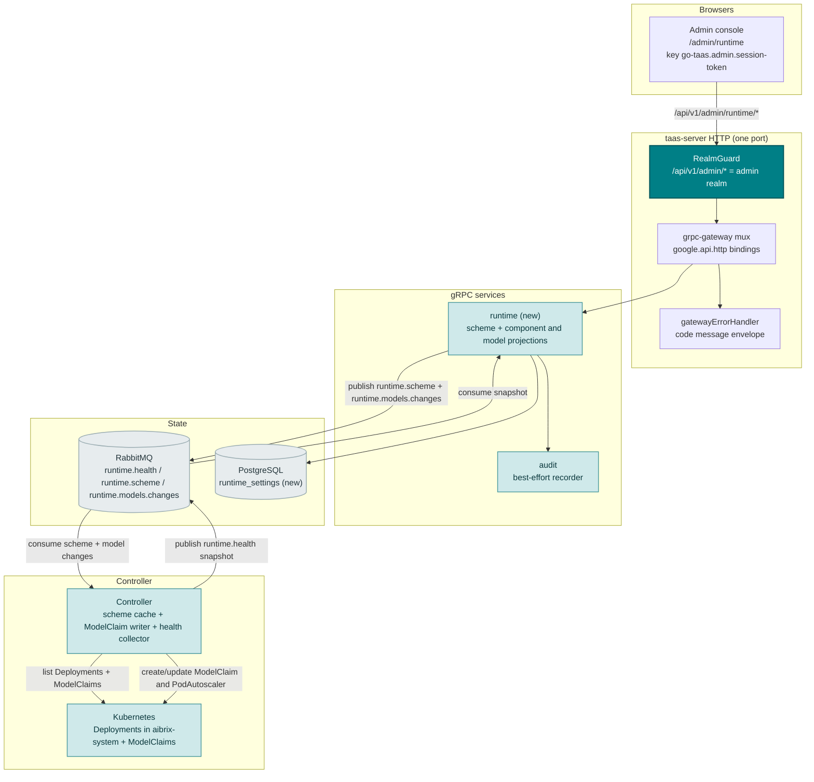
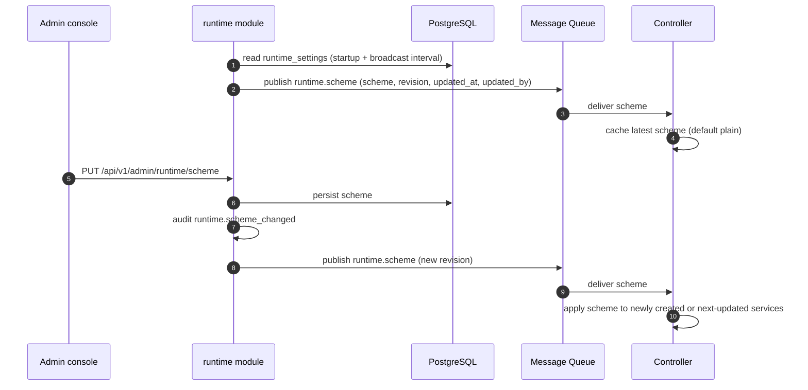
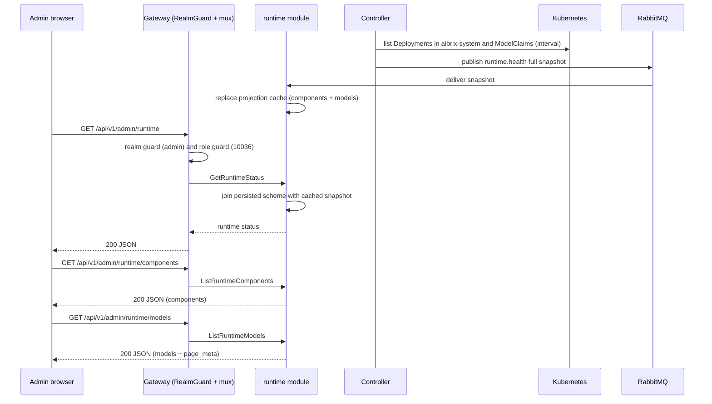
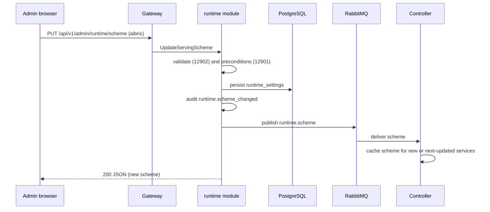
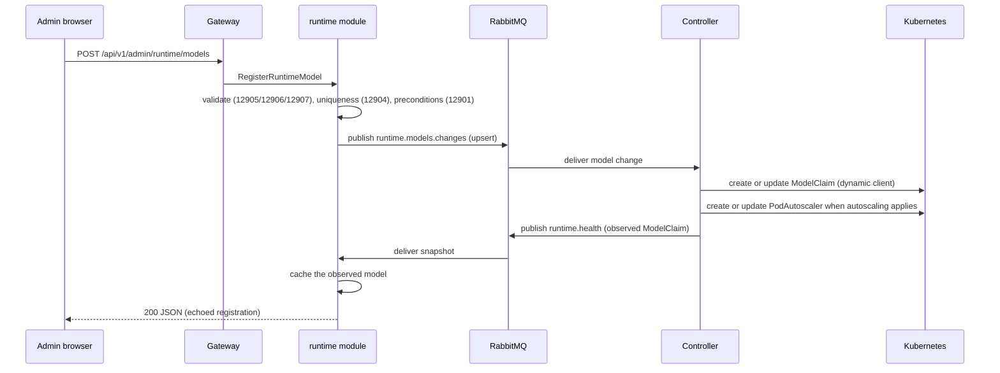
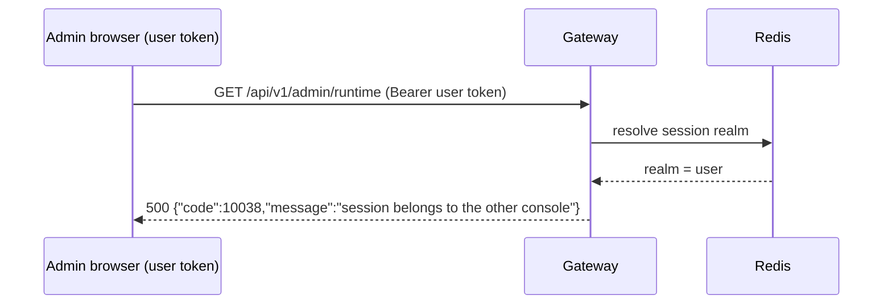

# 分布式推理运行时（AIBrix 集成） — 架构与详细设计

| 属性 | 内容 |
| --- | --- |
| 特性点 | 分布式推理运行时 — 平台运营者查看已安装的推理运行时及其健康、选择平台服务方案、并管理与运行时注册的模型（backlog 第 47 行） |
| 文档范围 | 特性 47 的架构与详细设计：新增 `runtime` 模块拥有服务方案设置以及运行时健康与已注册模型投影；`taas.runtime.v1.RuntimeService` proto 含七个仅绑定于 `/api/v1/admin/runtime/*` 的 RPC；`runtime_settings` 表与内存投影缓存；Controller 的方案消费、`ModelClaim` 调和、组件健康采集与快照发布；管理控制台 `RuntimePage`；错误处理（129xx 加上 10038/10036/10027）；配置、安全、发布，以及每层的函数级任务清单 |
| 归属模块 | 新增 `runtime` 模块（`services/runtime`）：服务方案设置、组件投影与已注册模型投影；`internal/controller`（方案消费者、`ModelClaim` 写入器、组件采集器、模型投影器）；`infer`（只读：方案所选择的调和路径）；`audit`（方案变更与模型注册事件）；`pkg/k8s`（既有 clientset 加 dynamic client 接缝）；`pkg/mq`（新增 subject）；`pkg/errors`（129xx 块）；`pkg/config`（runtime 段）；`web` 管理控制台（`RuntimePage`） |
| 相关文档 | [需求分析与 UI/UX 设计](../design/distributed-inference-runtime.md) · [架构设计](../design/architecture.md) 第 1.1 节控制/数据面分离、第 1.2 节 MQ 解耦、第 2.4 节 `infer`、第 2.7 节 Controller、第 3.2 节数据面（Envoy + Wasm） · [加速器清单与健康](./accelerator-inventory.md)（本特性复用的 Controller → MQ → 服务投影模式与内存缓存） · [多集群管理](./multi-cluster-management.md)（本特性镜像的注册表加投影模块形态与 `cluster.health` 快照） · [推理自动扩缩容](./inference-autoscaling.md)（朴素方案保留的 HPA 路径） · [模型目录与一键部署](./model-catalog-deployment.md)（方案所选择的推理服务调和路径） · [控制台面分离](./console-surface-separation.md)（两个面、`AdminShell`、掩码投影规则） |
| 状态 | 架构完成，已移交开发者代理 |

---

## 1. 概述与目标

go-taas 的 Controller 今天为每个推理服务调和**朴素的 `apps/v1 Deployment` + ClusterIP Service**（`internal/controller/reconciler.go` 的 `buildDeployment` / `buildService`），对挂载于 `r.weights.MountPath` 的 JuiceFS PVC 上的权重运行 `python3 -m vllm.entrypoints.openai.api_server`，并在启用自动扩缩容时创建 Kubernetes `HorizontalPodAutoscaler`（`buildHPA`）。该路径没有 KV-cache 感知路由、没有 prefill/decode 解耦、也没有多 LoRA 适配器管理。

本特性新增**运行时支撑的服务路径**。运营者选择平台级*服务方案*（`plain`，默认，或 `aibrix`），当选择 **AIBrix** 方案时，Controller 额外把每个模型作为 `modelclaims.model.aibrix.ai` 资源注册到 AIBrix 控制面 — 经 dynamic client 写入，因为没有 vendored 的 AIBrix Go client — 并在自动扩缩容适用时使用 AIBrix `PodAutoscaler` 取代朴素 HPA。管理控制台新增一个页面，展示已安装运行时及其健康、切换方案并管理 `ModelClaim` 资源。

AIBrix 已安装在目标集群 `sd4090` 的 `aibrix-system` 命名空间（`aibrix-controller-manager`、`aibrix-gateway-plugins`、`aibrix-gpu-optimizer`、`aibrix-metadata-service`、`aibrix-redis-master`），以及 Envoy AI Gateway Deployment `envoy-aibrix-system-aibrix-eg`。因此本特性是对既有运行时的薄控制面，而非运行时安装。

**目标**：

- 一个管理页 `/admin/runtime`（`RuntimePage`），位于 `AdminShell` 内，含运行时概览、组件健康表、服务方案切换器、已注册模型表、注册模型对话框与注销确认（设计 §5.3）。
- 新增 `runtime` 模块拥有持久化服务方案设置以及内存组件与已注册模型投影，带自有错误块 **129xx**（设计 D2、D9）。
- 新 `taas.runtime.v1.RuntimeService` 上七个 RPC 的精确管理前缀绑定（设计 §6）。
- Controller 的方案消费者、`ModelClaim` 调和（源自推理服务事件及显式运行时注册）、`PodAutoscaler` 回退路径、组件健康采集与全量快照发布。
- 页面交互状态，包括绝不崩溃页面的运行时不可用降级（设计 D8），以及负向域分离契约（10038）。
- 可在 compose 栈上以 Nightwatch 测试的编号验收标准（AC1–AC12）。

**范围外**（设计原文重述）：AIBrix 本身的安装、升级或配置（go-taas 观测已安装运行时）；按服务的运行时选择（本增量方案为平台级）；方案变更时运行中服务的就地迁移（下次服务更新应用方案，设计 D5）；LoRA 适配器与 prefill/decode 拓扑配置（AIBrix 自带；本增量仅注册 `ModelClaim` 模型）；加速器清单（特性 #18）；按集群放置与集群注册表（特性 #40）；模型目录与一键部署（特性 #2）；以及任何终端用户运行时面（刻意缺失，设计 D1）。

### 1.1 本文档阅读顺序

第 2 节记录架构决策（AD1–AD13；AD12–AD13 是架构新增的细化，已标注）。第 3–5 节是组件视图、数据模型与 API 设计。第 6 节是前端架构（页面 → 路由 → API 前缀表、导航、共享组件、认证守卫）。第 7–8 节是时序图与错误处理。第 9–11 节是配置、安全与发布。第 12 节是验收标准可追溯性。第 13–15 节是函数级详细设计（含精确的 `ModelClaim` 对象与组件健康来源）、有序实现任务清单与延期项。

---

## 2. 架构决策

AD1–AD11 把 UI/UX 设计的决策（D1–D10）重述为实现级规则。**AD12 与 AD13 是架构新增的细化**；每项都标注其细化的设计决策并保持该决策意图，使开发者与测试代理按单一读法实现。

| # | 决策 | 依据 |
| --- | --- | --- |
| AD1 | **本特性仅管理面**：路由 `/admin/runtime`，API 前缀 `/api/v1/admin/runtime/*`。**无终端用户绑定**，用户面无 `/runtime` 路由 | 设计 D1。运行时组件、服务方案与 `ModelClaim` 注册是运营者编排（特性 #17 掩码投影规则）；租户经网关消费模型，仅看到模型可用性。与仅管理面的加速器清单（#18）、系统状态（#30）、多集群（#40）面一致 |
| AD2 | **新增 `runtime` 模块**（`services/runtime`）拥有持久化服务方案设置与运行时健康及已注册模型投影，带自有错误块 **129xx**。`infer` 仍拥有推理服务；Controller 仍拥有 Kubernetes 调和 | 设计 D2。运行时是独立关注点（平台级方案加控制面投影），有自己的设置与投影；专用模块把它与按租户的推理生命周期分离 |
| AD3 | **AIBrix 是分布式服务方案**，取值 `plain`（默认）与 `aibrix`；方案是**平台级设置**（AD6）。AIBrix 已安装在 `sd4090`，Apache-2.0，vLLM 项目血统，控制/数据面拆分镜像 go-taas | 设计 D3。零集成摩擦；被拒的替代（llm-d：GAIE CRD，仅 Kubernetes；KServe：Knative + Istio 体量）重复 go-taas 自身控制回路 |
| AD4 | **组件健康是集群 Kubernetes 状态的投影，由 Controller 采集并经 `runtime` 模块提供**：Controller 通过既有 typed clientset 接缝轮询 `aibrix-system` 中 AIBrix 控制面 Deployment 与 Envoy AI Gateway Deployment，把 Ready 副本数映射为状态，并向新 `runtime.health` MQ subject 发布**全量快照**；`runtime` 模块维护内存投影缓存（accelerator-inventory AD1/AD11 模式） | 设计 D4。Controller 是唯一持有 Kubernetes 客户端的组件（accelerator AD1、service-logs AD2）；投影使健康视图依赖精简且自愈（移除的组件从下一快照消失）。只读页面绝不能因集群不可达而失败（设计 D8） |
| AD5 | **已注册模型列表是集群 `ModelClaim` 资源的投影，由控制器快照提供；注册/注销是发布给 Controller 的期望态变更。** 无 `runtime_models` 表 — 集群是唯一真相源（AD11）。`RegisterRuntimeModel` 向新 `runtime.models.changes` subject 发布 upsert；`DeregisterRuntimeModel` 发布 delete；Controller 调和 `ModelClaim`，其下一次 `runtime.health` 快照携带观测投影 | 设计 D6、D7。AIBrix `ModelClaim` 是权威注册；投影避免与集群漂移的第二真相源（accelerator-inventory AD11 读法），且「与运行时注册」列表正是运行时实际在服务的内容 |
| AD6 | **服务方案持久化于新增单行 `runtime_settings` 表**（`scheme`、`updated_by`、`updated_at`），由 `runtime` 模块拥有并经 GORM `AutoMigrate` 创建。因 Controller 无数据库，`runtime` 模块**经新 `runtime.scheme` MQ subject 向 Controller 广播方案** — 启动时、每次变更时以及按周期间隔（`runtime.schemeBroadcastInterval`，默认 30 秒）；Controller 缓存最新方案，在收到前默认 `plain` | 设计 D5。持久化设置可归因并跨重启存活；MQ 广播是无数据库 Controller 唯一消费的通道（架构 §1.2）。默认 `plain` 使重启或无方案的 Controller 保持今日行为不变 |
| AD7 | **切换方案被审计**为 `runtime.scheme_changed`（actor、before、after）且**幂等**：设为当前方案为无操作成功且无审计事件。它**不**拆除既有服务；应用于新建或下次更新的服务 | 设计 D5。重大平台设置必须可归因；不拆除运行中服务使切换安全可逆 |
| AD8 | **注册校验** `model_name`（模式 `^[a-z0-9][a-z0-9._-]*$`，在观测到的 `ModelClaim` 中唯一）、`engine ∈ {vllm, sglang}`、`replicas ∈ [0, 32]` 与非空 `artifact_url`。`replicas = 0` 有效（已注册但缩容至零）。重复 → **12904**；不支持引擎 → **12905**；无效副本 → **12906**；缺失/无效名称 → **12907**；缺失 `artifact_url` → **12907** 系（`artifact_url` 字段复用 **12907**，消息中带字段名） | 设计 D7、FR4.2。独立代码让每个失败模式可操作；artifact URL 属于同一必填字段族 |
| AD9 | **新增运行时错误块（12901–12907）**，即 prompt-evaluation 的 128xx 之后的下一个空闲块：**12901 `CodeRuntimeUnavailable`**、**12902 `CodeRuntimeSchemeInvalid`**、**12903 `CodeRuntimeModelNotFound`**、**12904 `CodeRuntimeModelExists`**、**12905 `CodeRuntimeEngineUnsupported`**、**12906 `CodeRuntimeReplicasInvalid`**、**12907 `CodeRuntimeModelNameInvalid`**。域失败复用 **10038 `CodeRealmMismatch`**，角色失败复用 **10036 `CodeForbidden`** | 设计 D9。新模块（AD2）获得新块；面分离失败复用平台级代码 |
| AD10 | **运行时 RPC 是平台级管理 RPC**：要求管理会话域与管理角色（`tenancy.RoleGuard`，10036），但不要求 `X-Organization-Id`；运行时是运营者内部状态，如同镜像与加速器清单 | 镜像 accelerator-inventory AD10 与 image-management D9。运行时非租户级 |
| AD11 | **组件与已注册模型投影是 `runtime` 服务中的内存缓存，由 Controller 的周期全量快照发布刷新，而非数据库表。** 仅服务方案被持久化（`runtime_settings`，AD6）。缓存由 `sync.RWMutex` 守护，每次快照整体替换 | 设计 D4、D6。集群是组件与 `ModelClaim` 的唯一真相源；投影避免漂移的第二真相源。接受的取舍：缓存是易失的（服务重启直到下一快照显示空/`unknown` 视图，受 `runtime.collectInterval` 约束）；每个副本各持一份，但 pub/sub 快照在一个间隔内收敛；无历史（页面按设计是时间点快照） |
| AD12 | **对设计 D7/D10 的细化 — 需要活跃运行时的模式（注册、注销、切换到 `aibrix`）要求 `aibrix` 方案且 `availability = available`。** 在 `plain` 方案下页面禁用 **Register model** 与 **Deregister**，附解释性 tooltip "Switch to the AIBrix scheme to register models with the runtime."（匹配设计朴素方案空态说明），且在 `plain` 下的直接 API 调用返回 **12901 `CodeRuntimeUnavailable`**（「接受注册的 AIBrix 运行时未激活」） | 设计的朴素方案空态与其切换方案说明（D10、§5.3）预设 `plain` 时无模型注册。静默接受 Controller 在 `plain` 下无法物化的注册会是死端无操作；以显式代码拒绝保持写路径连贯，无需新错误码，也无需新 UI 分支（UI 已在非活跃运行时禁用写）。被拒替代：新增 `12908` 码 — UI/UX 设计未为其规定分支，将无法在本迭代实现 |
| AD13 | **对设计 D3/D7 的细化 — AIBrix 写路径是尽力而为，绝不阻断朴素服务路径。** Controller 经 dynamic client 写 `ModelClaim`，并在 `scheme=aibrix` 且启用自动扩缩容时创建 AIBrix `PodAutoscaler` 取代 Kubernetes HPA。若 AIBrix CRD 缺失或写入失败，Controller 记录失败并**回退到朴素路径**（无 `ModelClaim`；Kubernetes HPA），使服务绝不被阻断 | 设计 D3（「AIBrix 是可选分布式服务后端」）与 §1.2（「go-taas 保持 Controller 为唯一 reconciler」）。缺失或版本不符的 AIBrix CRD 必须降级而非令推理服务调和失败 — 与 D10 的「只读探查在两种方案下均可用」一致 |

---

## 3. 组件视图

### 3.1 归属

| 层 / 组件 | 拥有 | 本特性的变更 |
| --- | --- | --- |
| **静态包（SPA）** | 一个 Vite 包（`web/dist`）嵌入 `taas-server`；由网关 SPA 回退提供 | 一个新增管理页（`RuntimePage`）、一个导航项、`App.tsx` 中的路由注册与 i18n 键 |
| **网关（`pkg/server`）** | HTTP 组合：`RealmGuard` → `withConsole` → `runtime.ServeMux`；统一错误渲染器；SPA 回退 | 无变更 — 新 RPC 绑定于 `/api/v1/admin/runtime/*`，域守卫已把该前缀视作管理面 |
| **grpc-gateway mux** | 依据 `google.api.http` 注解的路径 → RPC 路由 | 七个新 RPC 的新绑定（第 5 节） |
| **`runtime`（新增）** | 持久化服务方案、内存组件与已注册模型投影缓存、`runtime.health` 快照消费者、方案广播器与七个管理 RPC | 新服务：`services/runtime` |
| **`internal/controller`** | Kubernetes 调和；方案消费、`ModelClaim` 调和、`PodAutoscaler` 路径、组件健康采集与快照发布 | 新增 `runtime.go`：方案缓存与消费者、`ModelClaim` 写入器、组件采集器、模型投影器 |
| **`infer`** | 推理服务及其调和路径 | 无代码变更；Controller 既有 `applyUpsert` 增加 Aibrix 分支（AD5、AD13） |
| **`pkg/k8s`** | typed clientset 与 dynamic client | 无变更 — Controller 用 `Clientset()` 采集健康、用 `Dynamic()` 写 `ModelClaim` / `PodAutoscaler`（二者已存在） |
| **`audit`** | 尽力而为审计记录器 | 复用：runtime 模块为 `runtime.scheme_changed`、`runtime.model_registered`、`runtime.model_deregistered` 调用 `Recorder.Record` |
| **`pkg/mq`** | 规范 subject | 三个新 subject：`RuntimeHealth`、`RuntimeScheme`、`RuntimeModelChanges` |
| **`pkg/errors`** | 各模块代码块 | 一个新运行时块：**12901–12907** |
| **`pkg/config`** | 合并配置树 | 新 `runtime` 段（采集间隔、方案广播间隔、消费者开关、AIBrix 命名空间/网关） |

### 3.2 运行时组件视图



### 3.3 请求身份链

运行时 RPC 是**管理面、管理角色、平台级**（AD1、AD10）。链路为：

1. `RealmGuard`（HTTP，`pkg/server/realm.go`）— 路径前缀 `/api/v1/admin/runtime/*` 决定期望域 `admin`。无 `Authorization` 头：放行（过渡期，特性 17 AD4）。有头：从 Redis 解析会话域；不匹配 → **10038**；未知/过期/无域 → **10027**。
2. grpc-gateway mux — 按注解路径路由并转发 `authorization`。
3. `runtime` 处理器 — 解析操作者（`SessionUserResolver`）并经 `tenancy.RoleGuard` 以管理角色约束写（10036）。读（`GetRuntimeStatus`、`ListRuntimeComponents`、`GetServingScheme`、`ListRuntimeModels`）仅要求管理域与角色；写（`UpdateServingScheme`、`RegisterRuntimeModel`、`DeregisterRuntimeModel`）额外要求管理角色。不要求也不处理 `X-Organization-Id`（AD10）。

在任一 `/api/v1/admin/runtime/*` 路由上呈现用户域会话以 **10038 `CodeRealmMismatch`** 拒绝（设计 FR5.3，AC8）。缺少所需角色的会话收到 **10036 `CodeForbidden`**（AC9）。

### 3.4 服务方案传播

方案恰好有一个写入者（管理 `UpdateServingScheme` RPC，持久化 `runtime_settings`）与一个对服务重要的消费者（Controller）：



---

## 4. 数据模型

运行时特性有**一张持久化表**（服务方案）与**两个内存投影缓存**（组件与已注册模型）；后者以集群为唯一真相源（AD4、AD5、AD11）。

### 4.1 `runtime_settings`（持久化，单行）

| 列 | 类型 | 说明 |
| --- | --- | --- |
| `id` | string（PK） | 固定单例键 `"runtime"`，保证恰有一行 |
| `scheme` | string | `plain` / `aibrix`；默认 `plain` |
| `updated_by` | string | 操作的管理用户 id（过渡期未解析时为空） |
| `updated_at` | timestamp | 最后变更时间 |
| `created_at` | timestamp | 行创建时间 |

`RuntimeSetting` 是 `services/runtime/runtime_model.go` 中的 GORM 模型；表是 schema 的唯一真相源（由 `AutoMigrate` 创建，无手写 DDL — 仓库约定）。仓库惰性播种单例行：无行时 `GetScheme` 返回 `plain`，首次 `UpdateScheme` 插入或更新单例行。

### 4.2 投影缓存（内存）

```go
// Component is one runtime component's projection.
type Component struct {
    ComponentID    string
    Name           string
    Kind           string // control_plane | gateway | fallback
    Namespace      string
    Status         string // ready | progressing | degraded | unavailable | unknown
    ReadyReplicas  int64
    DesiredReplicas int64
    LastCheckedAt  time.Time
}

// RegisteredModel is one ModelClaim's projection.
type RegisteredModel struct {
    ModelName      string
    Engine         string // vllm | sglang
    Replicas       int64  // desired
    ReadyReplicas  int64
    ReadyCandidates int64
    Conditions     []ModelCondition
    Status         string // ready | progressing | degraded | failed | unknown
    CreatedAt      time.Time
    Origin         string // service | registration
}

// ModelCondition mirrors an AIBrix ModelClaim status condition.
type ModelCondition struct {
    Type               string
    Status             string
    Reason             string
    Message            string
    LastTransitionTime time.Time
}

// ProjectionCache holds the latest controller snapshot.
type ProjectionCache struct {
    mu          sync.RWMutex
    availability string // available | degraded | unavailable | unknown
    runtimeName  string // plain | aibrix
    runtimeVersion string
    clusterName  string
    reason       string
    components  []Component
    models      []RegisteredModel
    reportedAt  time.Time
}
```

方案不在缓存中 — 它从 `runtime_settings` 读取（AD6）并在响应时拼接，因此即使快照尚未到达，页面也始终反映持久化设置。

### 4.3 线消息

`runtime.health`（Controller → runtime 模块），**全量快照**：

```json
{
  "scheme": "aibrix",
  "availability": "available",
  "runtime_name": "aibrix",
  "runtime_version": "0.2.0",
  "cluster_name": "sd4090",
  "reason": "",
  "components": [
    {"component_id":"aibrix-controller-manager","name":"aibrix-controller-manager","kind":"control_plane",
     "namespace":"aibrix-system","status":"ready","ready_replicas":1,"desired_replicas":1,"last_checked_at":"..."}
  ],
  "models": [
    {"model_name":"qwen2-5-0-5b","engine":"vllm","replicas":1,"ready_replicas":1,"ready_candidates":1,
     "conditions":[{"type":"Ready","status":"True","reason":"Ready","message":"","last_transition_time":"..."}],
     "status":"ready","created_at":"...","origin":"registration"}
  ],
  "reported_at": "..."
}
```

`runtime.scheme`（runtime 模块 → Controller）：

```json
{"scheme":"aibrix","revision":3,"updated_at":"...","updated_by":"..."}
```

`runtime.models.changes`（runtime 模块 → Controller）：

```json
{"event_type":"upsert","model_name":"qwen2-5-0-5b","engine":"vllm","replicas":1,
 "artifact_url":"/data/weights/Qwen__Qwen2.5-0.5B-Instruct/",
 "pod_selector":{"app":"qwen2-5-0-5b"},"engine_args":{"max-model-len":"8192"}}
```

```json
{"event_type":"delete","model_name":"qwen2-5-0-5b"}
```

### 4.4 迁移与 init-SQL 升级路径

本仓库**不使用**手写 init-SQL 脚本：每张表的 schema 都是归属服务 `Migrate` 中经 `db.AutoMigrate(...)` 创建的 GORM 模型（如 `services/cluster/service.go` 的 `Migrate` → `AutoMigrate(&Cluster{})`）。`deploy/` 下没有 `.sql` 文件，compose 栈也没有 `docker-entrypoint-initdb.d` 挂载。因此本特性的升级路径为：

1. 在 `services/runtime/runtime_model.go` 添加 `RuntimeSetting`。
2. `runtime.Service.Migrate(ctx)` 返回 `db.AutoMigrate(&RuntimeSetting{})`。
3. `apps/taas-server/main.go` 在迁移顺序中注册 `runtime` 服务，使单例表在服务器启动时创建。
4. 无需 init-SQL 改动、无手工 DDL、无数据回填。表起初为空；首次管理写入前 `GetScheme` 默认 `plain`，因此既有部署升级后行为不变。

组件与模型投影**无需迁移**（AD11）。

---

## 5. API 设计

### 5.1 面映射

每个 RPC **仅**绑定于管理前缀 `/api/v1/admin/runtime/*`。无用户前缀绑定（AD1）。

| RPC | HTTP 方法 + 路径 | 面 | 状态 |
| --- | --- | --- | --- |
| `GetRuntimeStatus` | `GET /api/v1/admin/runtime` | admin | 新增 |
| `ListRuntimeComponents` | `GET /api/v1/admin/runtime/components` | admin | 新增 |
| `GetServingScheme` | `GET /api/v1/admin/runtime/scheme` | admin | 新增 |
| `UpdateServingScheme` | `PUT /api/v1/admin/runtime/scheme` | admin | 新增 |
| `ListRuntimeModels` | `GET /api/v1/admin/runtime/models` | admin | 新增 |
| `RegisterRuntimeModel` | `POST /api/v1/admin/runtime/models` | admin | 新增 |
| `DeregisterRuntimeModel` | `DELETE /api/v1/admin/runtime/models/{model_name}` | admin | 新增 |

### 5.2 Proto 契约（`proto/taas/runtime/v1/runtime.proto`，新增）

```proto
syntax = "proto3";

package taas.runtime.v1;

import "google/api/annotations.proto";
import "taas/common/v1/common.proto";

option go_package = "github.com/go-taas/go-taas/proto/taas/runtime/v1;runtimev1";

// RuntimeService serves the platform serving scheme, the installed
// runtime component health, and the models registered with the runtime
// (feature #47). Admin-surface API: served under /api/v1/admin/runtime.
service RuntimeService {
  // GetRuntimeStatus returns the runtime overview: scheme, availability,
  // runtime name/version, cluster, last checked, reason, and components.
  rpc GetRuntimeStatus(GetRuntimeStatusRequest) returns (GetRuntimeStatusResponse) {
    option (google.api.http) = {get: "/api/v1/admin/runtime"};
  }

  // ListRuntimeComponents returns the runtime components (AIBrix control
  // plane + Envoy AI Gateway under the aibrix scheme, the Controller +
  // Kubernetes API fallback under the plain scheme).
  rpc ListRuntimeComponents(ListRuntimeComponentsRequest) returns (ListRuntimeComponentsResponse) {
    option (google.api.http) = {get: "/api/v1/admin/runtime/components"};
  }

  // GetServingScheme returns the persisted platform serving scheme.
  rpc GetServingScheme(GetServingSchemeRequest) returns (GetServingSchemeResponse) {
    option (google.api.http) = {get: "/api/v1/admin/runtime/scheme"};
  }

  // UpdateServingScheme sets the scheme to plain or aibrix. It is audited
  // and idempotent; a non-{plain,aibrix} value returns 12902.
  rpc UpdateServingScheme(UpdateServingSchemeRequest) returns (UpdateServingSchemeResponse) {
    option (google.api.http) = {put: "/api/v1/admin/runtime/scheme" body: "*"};
  }

  // ListRuntimeModels returns the ModelClaim projection with pagination,
  // name search, and engine/status filters.
  rpc ListRuntimeModels(ListRuntimeModelsRequest) returns (ListRuntimeModelsResponse) {
    option (google.api.http) = {get: "/api/v1/admin/runtime/models"};
  }

  // RegisterRuntimeModel registers a model with the runtime (publishes a
  // desired-state change the Controller reconciles into a ModelClaim).
  rpc RegisterRuntimeModel(RegisterRuntimeModelRequest) returns (RegisterRuntimeModelResponse) {
    option (google.api.http) = {post: "/api/v1/admin/runtime/models" body: "*"};
  }

  // DeregisterRuntimeModel removes a model registration (deletes the
  // ModelClaim). An unknown model_name returns 12903.
  rpc DeregisterRuntimeModel(DeregisterRuntimeModelRequest) returns (DeregisterRuntimeModelResponse) {
    option (google.api.http) = {delete: "/api/v1/admin/runtime/models/{model_name}"};
  }
}

message GetRuntimeStatusRequest {}

message GetRuntimeStatusResponse {
  taas.common.v1.Response response = 1;
  RuntimeStatus runtime = 2;
}

message RuntimeStatus {
  string scheme = 1;          // plain | aibrix
  string availability = 2;    // available | degraded | unavailable | unknown
  string runtime_name = 3;    // plain | aibrix
  string runtime_version = 4; // optional, reported by AIBrix
  string cluster_name = 5;
  int64 last_checked_at = 6;
  string reason = 7;
  repeated RuntimeComponent components = 8;
}

message ListRuntimeComponentsRequest {}

message ListRuntimeComponentsResponse {
  taas.common.v1.Response response = 1;
  repeated RuntimeComponent components = 2;
}

message RuntimeComponent {
  string component_id = 1;
  string name = 2;
  string kind = 3;       // control_plane | gateway | fallback
  string namespace = 4;
  string status = 5;     // ready | progressing | degraded | unavailable | unknown
  int64 ready_replicas = 6;
  int64 desired_replicas = 7;
  int64 last_checked_at = 8;
}

message GetServingSchemeRequest {}

message GetServingSchemeResponse {
  taas.common.v1.Response response = 1;
  ServingScheme scheme = 2;
}

message ServingScheme {
  string scheme = 1;   // plain | aibrix
  int64 updated_at = 2;
  string updated_by = 3;
}

message UpdateServingSchemeRequest {
  string scheme = 1;   // plain | aibrix
}

message UpdateServingSchemeResponse {
  taas.common.v1.Response response = 1;
  ServingScheme scheme = 2;
}

message ListRuntimeModelsRequest {
  taas.common.v1.PageRequest page = 1;
  string name = 2;     // model-name substring search
  string engine = 3;   // vllm | sglang
  string status = 4;   // ready | progressing | degraded | failed | unknown
}

message ListRuntimeModelsResponse {
  taas.common.v1.Response response = 1;
  repeated RegisteredModel models = 2;
  taas.common.v1.PageMeta page_meta = 3;
}

message RegisteredModel {
  string model_name = 1;
  string engine = 2;
  int64 replicas = 3;
  int64 ready_replicas = 4;
  int64 ready_candidates = 5;
  repeated ModelCondition conditions = 6;
  string status = 7;
  int64 created_at = 8;
  int64 age_seconds = 9;
}

message ModelCondition {
  string type = 1;
  string status = 2;
  string reason = 3;
  string message = 4;
  int64 last_transition_time = 5;
}

message RegisterRuntimeModelRequest {
  string model_name = 1;
  string engine = 2;       // vllm | sglang
  int64 replicas = 3;      // 0..32
  string artifact_url = 4;
  map<string, string> pod_selector = 5;
  map<string, string> engine_args = 6;
}

message RegisterRuntimeModelResponse {
  taas.common.v1.Response response = 1;
  RegisteredModel model = 2;
}

message DeregisterRuntimeModelRequest {
  string model_name = 1;
}

message DeregisterRuntimeModelResponse {
  taas.common.v1.Response response = 1;
}
```

线约定不变：成功 HTTP 200，业务错误为 `{"code": <int>, "message": "..."}`，int64 字段序列化为 JSON 字符串（沿用平台 `json_name` 约定）。

### 5.3 网关路由

`RuntimeService` 在 codegen 中新增 `RegisterRuntimeServiceHandler` / `RegisterRuntimeServiceHandlerFromEndpoint`。服务实现 `server.ServiceWithGateway`，从 `GetServiceHandlerRegisterFn` 返回生成的 `RegisterRuntimeServiceHandler`，与 `cluster`、`accelerator` 一致。由于每个注解路径都以 `/api/v1/admin/runtime` 开头，既有 `RealmGuard` 无需改动即为它们分配管理域（第 3.3 节）。

### 5.4 校验契约

| 字段 | 规则 | 失败码 |
| --- | --- | --- |
| `model_name` | 非空，`^[a-z0-9][a-z0-9._-]*$`，≤ 128，在观测模型中唯一 | **12907**（无效）/ **12904**（重复） |
| `engine` | `vllm` 或 `sglang` | **12905** |
| `replicas` | `0`–`32` | **12906** |
| `artifact_url` | 非空，≤ 512 | **12907**（必填字段族，消息带字段名） |
| `pod_selector` 键 | `^[a-z0-9A-Z._/-]+$`，值 ≤ 253 | **12907**（无效） |
| `scheme` | `plain` 或 `aibrix` | **12902** |

---

## 6. 前端架构

### 6.1 页面 → 路由 → API 前缀

| 页面 / 组件 | 路由 | 面 | API 前缀（精确调用） |
| --- | --- | --- | --- |
| `RuntimePage`（概览 + 组件表） | `/admin/runtime` | admin | `GET /api/v1/admin/runtime`、`GET /api/v1/admin/runtime/components` |
| 服务方案切换器 | `/admin/runtime`（对话框） | admin | `GET /api/v1/admin/runtime/scheme`、`PUT /api/v1/admin/runtime/scheme` |
| 已注册模型表 | `/admin/runtime` | admin | `GET /api/v1/admin/runtime/models?page.offset=…&page.limit=…&name=…&engine=…&status=…` |
| 注册模型对话框 | `/admin/runtime`（对话框） | admin | `POST /api/v1/admin/runtime/models` |
| 注销确认 | `/admin/runtime`（确认框） | admin | `DELETE /api/v1/admin/runtime/models/{model_name}` |

只有**一个页面**；切换器、对话框与确认框是其上的组件。页面**仅**调用 `/api/v1/admin/runtime/*` 路由，且不含任何 `/api/v1/*`（用户前缀）字符串（设计 FR5.2，AC8）。域范围 API 客户端（`useApi()`）在运行时强制这一点（特性 17 AD1）。

### 6.2 导航位置

`RuntimePage` 注册于管理控制台的 **Operations** 组。在 `web/src/shells/AdminShell.tsx` 中，于 clusters 条目（Operations 组）旁添加一个 `ADMIN_NAV_ITEMS` 条目：

```tsx
{ path: '/admin/runtime', labelKey: 'nav.runtime', testid: 'nav-runtime', icon: Pulse },
```

在 `web/src/i18n.js` 添加 i18n 键 `nav.runtime`（"Runtime" / 「运行时」）。路由注册于 `web/src/App.tsx` 的 `AdminSurface` `<Routes>` 内：

```tsx
<Route path="/admin/runtime" element={<RuntimePage />} />
```

### 6.3 复用的共享组件与状态

- `AdminShell`（特性 #17）— 页面框架、导航、管理域 provider。
- `AcceleratorsPage` 与 `SystemStatusPage` 使用的状态徽标与行内提示组件（Ready/Progressing/Degraded/Unavailable/Unknown 徽标；"Showing stale data" 横幅与 Retry 操作）。
- `AcceleratorsPage` 使用的服务端排序/过滤/分页数据表组件（模型表每页 20 行）。
- `usePolling`（accelerator-inventory/`SystemStatusPage` 轮询钩子），用于 30 秒刷新 `GetRuntimeStatus` + `ListRuntimeComponents` + `ListRuntimeModels`；失败轮询保留最后可用数据并显示陈旧横幅（AC7、AC12）。
- 推理服务与镜像页使用的确认对话框与表单字段组件，用于方案确认、注册对话框与注销确认。

### 6.4 按面的认证守卫

`RuntimePage` 继承 `AdminShell` 守卫（特性 17 §7.5）：启动时 shell 读取 `go-taas.admin.session-token`；为空 → 过渡模式；存在 → `GET /api/v1/admin/auth/session`；10027/10038 → 清除管理令牌并重定向到 `/admin/login?next=/admin/runtime&reason=…`。页面从不读取用户域的键。运行时 RPC 受管理角色约束（AD10）：10036 渲染标准无权限状态并附返回 `/admin` 的链接（AC9）。

### 6.5 测试代理可驱动的 `data-testid`

- Shell/导航：`nav-runtime`。
- 页面：`runtime-page`、`runtime-refresh`、`runtime-switch-scheme`、`runtime-overview`、`runtime-scheme-badge`、`runtime-availability-badge`、`runtime-last-checked`、`runtime-unavailable-notice`、`runtime-retry`、`runtime-stale-banner`、`runtime-error`。
- 组件：`runtime-components-table`、`runtime-component-{component_id}`、`runtime-components-empty`、`runtime-component-status-filter`。
- 方案：`runtime-scheme-dialog`、`runtime-scheme-option-plain`、`runtime-scheme-option-aibrix`、`runtime-scheme-apply`、`runtime-scheme-confirm`、`runtime-scheme-confirm-switch`。
- 模型：`runtime-models-table`、`runtime-model-{model_name}`、`runtime-models-empty`、`runtime-register-model`、`runtime-model-search`、`runtime-engine-filter`、`runtime-status-filter`、`runtime-models-pagination`、`runtime-register-dialog`、`runtime-register-field-name`、`runtime-register-field-engine`、`runtime-register-field-replicas`、`runtime-register-field-artifact`、`runtime-register-submit`、`runtime-deregister-confirm`、`runtime-deregister-submit`、`runtime-permission-denied`。

---

## 7. 时序图

### 7.1 页面加载与轮询



### 7.2 方案切换



### 7.3 注册模型



### 7.4 错误域拒绝



---

## 8. 错误处理

| 码 | 常量 | 消息 | 何时 |
| --- | --- | --- | --- |
| 12901 | `CodeRuntimeUnavailable` | runtime unavailable | 读以可用性状态报告它；运行时不可用时 `UpdateServingScheme` 切换到 `aibrix`（FR2.5）；运行时不可用时或 `plain` 方案下 `RegisterRuntimeModel` / `DeregisterRuntimeModel`（AD12） |
| 12902 | `CodeRuntimeSchemeInvalid` | invalid serving scheme | `UpdateServingScheme` 值非 `plain` / `aibrix`（FR2.2） |
| 12903 | `CodeRuntimeModelNotFound` | registered model not found | `DeregisterRuntimeModel` 的 `model_name` 不在投影中（FR3.2、FR4.4） |
| 12904 | `CodeRuntimeModelExists` | model already registered | `RegisterRuntimeModel` 的 `model_name` 已在投影中（FR4.2） |
| 12905 | `CodeRuntimeEngineUnsupported` | unsupported inference engine | `RegisterRuntimeModel` 引擎不在 `{vllm, sglang}`（FR4.2） |
| 12906 | `CodeRuntimeReplicasInvalid` | invalid replica count | `RegisterRuntimeModel` 的 `replicas < 0` 或 `> 32`（FR4.2） |
| 12907 | `CodeRuntimeModelNameInvalid` | invalid model name | `RegisterRuntimeModel` 的 `model_name` 为空/无效，或缺失 `artifact_url`（FR4.1、FR4.2） |
| 10038 | `CodeRealmMismatch` | session belongs to the other console | 在 `/api/v1/admin/runtime/*` 上的用户域会话（FR5.3，AC8） |
| 10036 | `CodeForbidden` | forbidden | 缺少管理角色的会话（FR5.3，AC9） |
| 10027 | `CodeSessionInvalid` | session invalid | 管理前缀上未知/过期/无域会话（特性 17） |

HTTP 状态为 `500`，`code` 在响应体中，与平台其他业务错误一致（特性 17 §4.3）。客户端依据响应体 `code` 分支，从不依据状态。

**运行时不可用降级（绝不 500 页面）**：`GetRuntimeStatus`、`ListRuntimeComponents`、`GetServingScheme` 与 `ListRuntimeModels` 是对投影缓存与持久化方案的读；集群不可达时它们**绝不**返回传输错误。Controller 采集器捕获列表/轮询错误并发布 `availability = unavailable`（或首快照前的 `unknown`），附 `reason` 与最后已知组件；runtime 模块提供该快照，页面渲染不可用徽标、最后已知组件快照、Retry 操作，并禁用 Switch scheme / Register model / Deregister 附解释性 tooltip（设计 §5.3，AC7、AC11）。

---

## 9. 配置

`pkg/config/api.go` 与 `configs/config.yaml` 中新增 `runtime` 段：

```yaml
runtime:
  # collectInterval is the Controller's runtime-component and ModelClaim
  # collection period; the full snapshot is published on this interval.
  collectInterval: 30s
  # schemeBroadcastInterval is how often the runtime module re-broadcasts
  # the persisted scheme so a restarted Controller reconverges.
  schemeBroadcastInterval: 30s
  # schemeConsumer configures the Controller's scheme consumer.
  schemeConsumer:
    enabled: true
  # healthConsumer configures the runtime service's snapshot consumer.
  healthConsumer:
    enabled: true
    workers: 1
  # modelChangeConsumer configures the Controller's model-change consumer.
  modelChangeConsumer:
    enabled: true
  # aibrix names the installed AIBrix control plane's namespace and the
  # Envoy AI Gateway Deployment observed for health.
  aibrix:
    namespace: aibrix-system
    gateway: envoy-aibrix-system-aibrix-eg
```

`RuntimeConfig`（Go），在 `pkg/config/configuration.go` 中校验，带默认值：

```go
type RuntimeConfig struct {
    CollectInterval         time.Duration          `mapstructure:"collectInterval"`
    SchemeBroadcastInterval time.Duration          `mapstructure:"schemeBroadcastInterval"`
    SchemeConsumer          RuntimeConsumerConfig  `mapstructure:"schemeConsumer"`
    HealthConsumer          RuntimeHealthConsumerConfig `mapstructure:"healthConsumer"`
    ModelChangeConsumer     RuntimeConsumerConfig  `mapstructure:"modelChangeConsumer"`
    AIBrix                  RuntimeAIBrixConfig    `mapstructure:"aibrix"`
}

type RuntimeConsumerConfig struct {
    Enabled bool `mapstructure:"enabled"`
}

type RuntimeHealthConsumerConfig struct {
    Enabled bool `mapstructure:"enabled"`
    Workers int  `mapstructure:"workers"`
}

type RuntimeAIBrixConfig struct {
    Namespace string `mapstructure:"namespace"`
    Gateway   string `mapstructure:"gateway"`
}
```

默认值：`collectInterval` 30 秒，`schemeBroadcastInterval` 30 秒，所有消费者启用，`healthConsumer.workers` 1，`aibrix.namespace` `aibrix-system`，`aibrix.gateway` `envoy-aibrix-system-aibrix-eg`。负间隔校验失败（`FieldError`），镜像 `accelerator.collectInterval`。所有值均可由平台 `CONFIG_` 环境覆盖（既有 viper 路径）覆盖，使 compose 栈可设置如 `CONFIG_RUNTIME_AIBRIX__NAMESPACE`。compose `docker-compose.yaml` 对默认路径无需新环境变量；运行不同名 AIBrix 命名空间的运营者显式设置它。

---

## 10. 安全

- **面分离**：七个 RPC 全绑定于 `/api/v1/admin/runtime/*`，仅经管理域守卫可达（AD1、AD10）。用户域会话以 10038 拒绝；缺少管理角色的会话以 10036 拒绝。用户控制台无 `/runtime` 路由与运行时 API 绑定。
- **平台级**：不要求也不处理 `X-Organization-Id`；运行时是运营者内部状态（AD10）。
- **掩码投影**：组件表展示名称、种类、命名空间、状态与副本数；模型表展示名称、引擎、副本、就绪候选、conditions 与 age。来自集群的原始 Pod 名、端点密钥与容器参数从不暴露（设计 D6）。
- **写经审计且受角色约束**：`UpdateServingScheme` → `runtime.scheme_changed`；`RegisterRuntimeModel` → `runtime.model_registered`；`DeregisterRuntimeModel` → `runtime.model_deregistered`；均记录操作运营者（FR4.5，AC10）。注册不触碰模型目录（特性 #2）。
- **传输与静态无密钥**：`runtime_settings` 表存方案字符串与操作者 id；MQ 快照不携带凭据。Controller 写入的 `ModelClaim` 与 `PodAutoscaler` 对象内嵌无密钥（`artifactURL` 是权重路径，非凭据）。
- **Controller 动态写的最小权限**：`ModelClaim` / `PodAutoscaler` 写入限定于控制器命名空间与 AIBrix CRD 组/版本；采集器读取限定于 `aibrix-system` 与控制器命名空间。

---

## 11. 发布 / 升级说明

- **Proto**：增量 — 新服务上七个新 RPC。无既有 RPC 或消息变更。用 `buf generate` 重新生成。
- **Schema**：一张增量表（`runtime_settings`），由 `AutoMigrate` 创建（第 4.4 节）；无 init-SQL 改动、无回填、无破坏性变更。既有部署以 `scheme = plain`（行为不变）升级。
- **新服务注册**（`apps/taas-server/main.go`）：构造 `runtime` 服务（`runtime.New(srv.Components())`），注册它，接审计记录器，并添加 `runtime.health` 快照消费者 Runner，与 RPC 读取的**同一** `*ProjectionCache` 实例共享（accelerator-inventory BUG-ACCEL-001 教训），再加方案广播器 Runner。网关自动拾取处理器注册函数。
- **Controller**（`apps/controller/main.go`）：Controller 已持有 `*k8s.Client`（typed + dynamic）与可发布的 `mq.Client`；接线 `ctrl.SetRuntimeCollector(controller.NewRuntimeCollector(k8sClient, mqClient, cfg.Runtime))` 及方案/模型变更消费者，与既有 goroutine 一同在 `Controller.Run` 启动。
- **独立性**：Controller 与 `taas-server` 独立升级（架构 §2.7）。新 `taas-server` 配旧 Controller 时组件/模型缓存为 `unknown` 直到 Controller 发布（页面显示降级态）；新 Controller 配旧 `taas-server` 无害 — Controller 更新其方案缓存并写 `ModelClaim`，但在新服务器发布前无消费者读取 `runtime.health` subject。
- **方案变更非破坏性**：切换更新 `runtime_settings` 与 Controller 缓存；运行中的 Deployment 不受影响，方案应用于新建或下次更新的服务（AD7，设计 D5）。
- **AIBrix 缺失安全**：若 CRD 缺失，`ModelClaim` / `PodAutoscaler` 写入失败、被记录，Controller 回退到朴素路径（AD13）；组件采集器报告 `unavailable`，切换到 `aibrix` 以 12901 拒绝。
- **向后兼容**：无既有 API、页面或测试变更。新导航项与页面是管理控制台的增量。

---

## 12. 验收标准覆盖

| AC | 由…满足 | 验证钩子 |
| --- | --- | --- |
| AC1 — `/admin/runtime` 首次加载即渲染概览、组件与模型 | 第 6.1、6.3 节 | E2E |
| AC2 — 组件表列出五个 AIBrix 组件 + Envoy 网关，含 Kind/Namespace/Status/Ready | 第 13.5 节（采集器）、第 4.2 节 | E2E |
| AC3 — 方案切换器需确认、更新徽标且幂等 | 第 7.2 节、AD7 | E2E + FVT |
| AC4 — 模型表展示 Model/Engine/Replicas/Ready candidates/Status/Age 并支持排序、过滤、搜索、分页 | 第 5.2 节（`ListRuntimeModels`）、第 6.3 节 | E2E |
| AC5 — 注册对话框校验名称/引擎/副本/artifact URL 并新增一行 | 第 5.4 节、AD8 | E2E |
| AC6 — 注销需确认、移除该行且不删除目录模型 | 第 5.1 节、AD5 | E2E + FVT |
| AC7 — 运行时不可用时不崩溃、Retry 可用、写禁用 | 第 8 节（降级）、第 13.5 节 | E2E |
| AC8 — 负向域分离：用户令牌 → 10038，用户面无运行时路由/API，页面无 `/api/v1/*` 调用 | 第 3.3 节、AD1 | FVT + E2E |
| AC9 — 缺少所需角色 → 10036 + 无权限状态 | 第 3.3 节、AD10 | E2E |
| AC10 — 方案/注册/注销审计事件含 actor/before/after | 第 10 节、AD7 | FVT |
| AC11 — 朴素方案显示回退组件 + 带说明的空模型态；运行时不可用时切换到 aibrix → 12901 | AD12、第 4.2 节、第 13.5 节 | E2E + FVT |
| AC12 — 加载、空、陈旧错误、禁用与无权限状态 | 第 6.3、8 节 | E2E |

---

## 13. 详细设计

### 13.1 文件布局

| 模块 | 文件 | 内容 |
| --- | --- | --- |
| `proto/taas/runtime/v1` | `runtime.proto`（新） | `RuntimeService` + 消息（第 5.2 节） |
| `services/runtime` | `runtime_model.go`（新） | `RuntimeSetting` GORM 模型 + 表名 |
| | `runtime_repository.go`（新） | `GetScheme`、`UpdateScheme`（单例 upsert） |
| | `projection.go`（新） | `Component`、`RegisteredModel`、`ModelCondition`、`ProjectionCache`（`Replace`、`Components`、`Models`、`Snapshot`） |
| | `health_consumer.go`（新） | `HealthConsumer`（`server.Runner`）：订阅 `runtime.health`，解析，`cache.Replace` |
| | `scheme_broadcaster.go`（新） | `SchemeBroadcaster`（`server.Runner`）：启动/间隔/变更时发布 `runtime.scheme` |
| | `service.go`（新） | `Service`（`server.Service` + `server.ServiceWithGateway`）：七个 RPC、校验、审计、写时广播方案 |
| | `mq.go`（新） | 生产者与消费者共享的 `runtime.models.changes` / `runtime.scheme` 载荷结构 |
| `internal/controller` | `runtime.go`（新） | `RuntimeCollector`（组件 + ModelClaim 采集、快照发布）、`RuntimeSchemeConsumer`、`RuntimeModelChangeConsumer` |
| | `modelclaim.go`（新） | `buildModelClaim`（源自变更事件与源自运行时注册）、`modelClaimName`、`applyModelClaim`、`deleteModelClaim`、`applyPodAutoscaler`、`deletePodAutoscaler`（dynamic client） |
| | `aibrix_routing.go`（新） | `servedModelName`、`routingLabels`、`routingAnnotations`、`modelRouteName`、`buildModelHTTPRoute`、`buildModelReferenceGrant`、`applyModelRoute`、`deleteModelRoute`（dynamic client） |
| | `reconciler.go`（增量） | `applyUpsert` 的 Aibrix 分支（写/删 `ModelClaim`；PodAutoscaler 对 HPA）与 `dynamic` client 字段 |
| | `controller.go`（增量） | 在 `Run` 启动运行时采集器 + 方案/模型变更消费者；`SetRuntimeCollector` |
| `pkg/mq` | `mq.go` | `RuntimeHealth`、`RuntimeScheme`、`RuntimeModelChanges` subject + 默认值 |
| `pkg/errors` | `codes.go`、`messages.go` | `CodeRuntimeUnavailable` … `CodeRuntimeModelNameInvalid` + 消息 |
| `pkg/config` | `api.go`、`configuration.go` | `RuntimeConfig` + 默认值 + 校验 |
| `apps/taas-server` | `main.go` | 注册 `runtime.New(...)`，接审计记录器，在共享缓存上添加健康消费者与方案广播器 Runner |
| `apps/controller` | `main.go` | 从 `cfg.Runtime` 接运行时采集器与方案/模型变更消费者 |
| `configs` | `config.yaml` | `runtime` 段 |
| `web/src` | `App.tsx`、`shells/AdminShell.tsx`、`i18n.js` | 路由、导航项、`nav.runtime` 键 |
| | `pages/RuntimePage.tsx`（新） | 页面及其三个卡片、切换器、对话框与确认框 |

### 13.2 `runtime` 模块

`runtime_repository.go`：

```go
// GetScheme returns the persisted scheme, defaulting to plain when no
// singleton row exists.
func (r *RuntimeRepository) GetScheme(ctx context.Context) (*RuntimeSetting, error)
// UpdateScheme upserts the singleton row and returns it.
func (r *RuntimeRepository) UpdateScheme(ctx context.Context, scheme, updatedBy string) (*RuntimeSetting, error)
```

`projection.go`：

```go
func NewProjectionCache() *ProjectionCache
func (c *ProjectionCache) Replace(snapshot *HealthSnapshot)   // wholesale, write lock
func (c *ProjectionCache) Snapshot() *HealthSnapshot          // read lock copy
func (c *ProjectionCache) Components(kind, status string) []Component   // filter
func (c *ProjectionCache) Models(name, engine, status string, offset, limit int) ([]RegisteredModel, int64)
func (c *ProjectionCache) FindModel(name string) (*RegisteredModel, bool)
```

`health_consumer.go`：

- `HealthConsumer` 实现 `server.Runner`：`Run(ctx)` 订阅 `subjects.RuntimeHealth`；`handle` 反序列化快照，格式错误则记录并跳过（从不重试），并调用 `cache.Replace(snapshot)`。
- `NewHealthConsumerRunner(components, cache)` 在禁用或组件不可用时返回 nil（accelerator/image 模式）。调用方传入服务读取的**同一** `*ProjectionCache`（AD11）。

`scheme_broadcaster.go`：

- `SchemeBroadcaster` 实现 `server.Runner`：`Run` 时读取持久化方案并立即发布 `runtime.scheme`，然后按 `runtime.schemeBroadcastInterval`（默认 30 秒）重新发布。`Notifier.Notify()`（由 `UpdateServingScheme` 调用）触发立即发布，使方案变更无需等待间隔即收敛。

`service.go`：

- `Service` 实现 `server.Service`（`AttachToServer`、`ServiceName`）与 `server.ServiceWithGateway`（`GetServiceHandlerRegisterFn` → `RegisterRuntimeServiceHandler`）。
- `Migrate(ctx)` → `db.AutoMigrate(&RuntimeSetting{})`。
- `GetRuntimeStatus`：将持久化方案与 `cache.Snapshot()` 拼接；无快照时返回 `availability = unknown` 与空组件（绝不错误）。
- `ListRuntimeComponents`：`cache.Components(...)`；当快照的方案为 `plain` 时返回回退集。
- `GetServingScheme`：`repo.GetScheme`；`updated_at`/`updated_by` 取自该行。
- `UpdateServingScheme`：非 {plain,aibrix} 值以 12902 拒绝；当前可用性为 `unavailable`/`unknown` 时切 `aibrix` 以 12901 拒绝（FR2.5）；未变化时幂等（无审计、无广播）；否则持久化，调用 `audit.Recorder.Record(ctx, &audit.AuditEvent{Action: "runtime.scheme_changed", ResourceType: "runtime", Before: old, After: new, Actor: actor})`，并 `broadcaster.Notify()`。
- `ListRuntimeModels`：`cache.Models(name, engine, status, offset, limit)`；映射为 `RegisteredModel` 并带 `age_seconds`。
- `RegisterRuntimeModel`：校验（12905/12906/12907）；方案 ≠ aibrix 或可用性 ≠ available → 12901（AD12）；`cache.FindModel(model_name)` 命中 → 12904；发布 `runtime.models.changes` upsert；审计 `runtime.model_registered`；回显期望注册。
- `DeregisterRuntimeModel`：方案 ≠ aibrix 或可用性 ≠ available → 12901；`cache.FindModel` 未命中 → 12903；发布 delete；审计 `runtime.model_deregistered`。

构造/注入接缝镜像 `cluster`：`New(components)`、`NewForFVT(db)`、`MigrateSchemaForFVT(db)`、`SetAuditRecorder`、`SetSchemeBroadcaster`、`SetSessionUserResolver`、`SetRoleGuard`。

### 13.3 `internal/controller` — 方案缓存与消费

- `k8sReconciler` 新增 `scheme string` 字段（由 atomic 或 mutex 守护）默认 `plain`、`dynamic dynamic.Interface` 字段与运行时配置（AIBrix 命名空间/网关）。
- `RuntimeSchemeConsumer` 订阅 `subjects.RuntimeScheme`；每条消息存储方案与 revision。`ApplyInferServiceChange` 的 `applyUpsert` 在调和时读取当前方案，因此变更应用于下一次调和（设计 D5）。
- `Run` 将方案消费者、模型变更消费者与运行时采集器作为独立 goroutine 启动，随 Controller 上下文取消。

### 13.4 `internal/controller` — `ModelClaim` 写入（dynamic client）

`ModelClaim` 对象有**两个生产者**；二者共享 `modelclaim.go`。dynamic client 取自既有 `pkg/k8s` 接缝（`k8sClient.Dynamic()`）；`NewK8sReconciler` 已接收 `*k8s.Client`，因此它在 `client.Clientset()` 旁存储 `client.Dynamic()`。测试经 `newReconcilerWithClientset`（扩展为接受 `dynamic.Interface`）注入假 dynamic client。

GVR：

```go
var modelClaimGVR = schema.GroupVersionResource{Group: "model.aibrix.ai", Version: "v1alpha1", Resource: "modelclaims"}
var podAutoscalerGVR = schema.GroupVersionResource{Group: "autoscaling.aibrix.ai", Version: "v1alpha1", Resource: "podautoscalers"}
```

`buildModelClaim` 源自**推理服务变更事件**（`applyUpsert`，`scheme=aibrix`）：

```yaml
apiVersion: model.aibrix.ai/v1alpha1
kind: ModelClaim
metadata:
  name: mc-<sanitized evt.Name>          # modelClaimName(evt.Name)
  namespace: <controller namespace>       # r.namespace (e.g. taas-infer)
  labels:
    app.kubernetes.io/managed-by: taas-controller
    go-taas.com/service-id: <evt.ServiceID>
    go-taas.com/model-id: <evt.Model.ModelID>
    go-taas.com/origin: service
spec:
  modelName: <evt.Name>
  engine: <evt.Image.Engine>              # vllm | sglang
  artifactURL: <modelDir(r.weights.MountPath, evt.Model.WeightPath)>   # e.g. /data/weights/Qwen__Qwen2.5-0.5B-Instruct/
  replicas: <clampReplicas(evt.Replicas)>
  podSelector:
    matchLabels: <resourceLabels(evt)>    # the same labels as the Deployment/Service selector
```

`buildModelClaim` 源自**运行时注册**（`runtime.models.changes` upsert）：

```yaml
apiVersion: model.aibrix.ai/v1alpha1
kind: ModelClaim
metadata:
  name: mc-<model_name>                   # modelClaimName(model_name)
  namespace: <controller namespace>
  labels:
    app.kubernetes.io/managed-by: taas-controller
    go-taas.com/origin: registration
spec:
  modelName: <model_name>
  engine: <engine>
  artifactURL: <artifact_url>
  replicas: <replicas>
  podSelector:
    matchLabels: <pod_selector>            # user-supplied, else {go-taas.com/model: <model_name>}
  engineConfig:
    args: <engine_args>                    # omitted when empty
```

`applyModelClaim` 先 dynamic `Get` 再 `Create` 或 `Update`（幂等）；`deleteModelClaim` 按名删除并忽略 `NotFound`。`modelClaimName` 消毒为 DNS-1123 子域并加前缀 `mc-`，避免与 AIBrix 自有名称冲突。每次写失败均记录，且调和**继续朴素路径**（AD13）：Deployment/Service/HPA 始终调和，`ModelClaim` 为尽力而为。

### 13.4b `internal/controller` — 服务网关路由契约

仅写 `ModelClaim` 并不能让模型可被访问。AIBrix 的放置控制器只把**热池 Pod**
视为候选，而热池 Pod 必须带 `claim.model.aibrix.ai/enabled=true` 并运行 AIBrix
的 runtime sidecar。普通引擎 Deployment 永远不会成为候选，其 claim 会一直停在
`Pending`，原因为 `no available candidate warm pod for model`。

普通 Deployment 的路由由**元数据驱动**：

* extproc 网关根据 Pod 自身的 `model.aibrix.ai/name`（标签；当名称不是合法标签
  值时改用注解，例如包含 `/` 的 hub id `MiniMax/MiniMax-M3`）与
  `model.aibrix.ai/port` 标签建立"模型 → Pod"表；未见过的模型一律返回
  `model <name> does not exist`；
* 随后按 `<model>-router` 在网关命名空间中查找 HTTPRoute；路由缺失即返回 503
  `httproutes.gateway.networking.k8s.io "<model>-router" not found`；
* 该路由的后端是一个 Service，按引擎端口访问；跨命名空间的后端还需要在
  Service 所在命名空间中存在 `ReferenceGrant`。

因此控制器在每次 upsert 时写入（`aibrix_routing.go`）：

| 对象 | 命名空间 | 内容 |
| --- | --- | --- |
| Deployment 与 Pod 模板 | `controller.namespace` | `model.aibrix.ai/name`、`model.aibrix.ai/port`、`model.aibrix.ai/service-name` 标签/注解；引擎命令追加 `--served-model-name <模型名>` |
| Service | `controller.namespace` | 原有 `http`（80）端口，另加 8000 的 `engine` 端口（路由使用的端口） |
| HTTPRoute `<model>-router` | `runtime.aibrix.namespace` | parentRef 为 `runtime.aibrix.gatewayName`；每个模型路径一条带 `model: <名称>` 头匹配的规则；backendRef 为 `Service/<名称>-svc:<引擎端口>` |
| ReferenceGrant | `controller.namespace` | `from` 网关命名空间的 HTTPRoutes，`to` Services |

引擎还必须以目录中的模型名对外提供服务（`--served-model-name`）：客户端发送的是
该名称，而引擎默认只认启动时传入的权重目录。

`modelRouteName` 复刻 AIBrix 的命名规则（常规为 `<model>-router`；非 DNS 子域的
名称改用小写哈希形式），因此即使集群**同时**运行了 AIBrix 的 model router，
双方也会收敛到同一个对象，而不会各建一份。删除服务时一并删除路由；
`ReferenceGrant` 保留，因为它是命名空间级、被该命名空间所有模型共用。
与 `ModelClaim` 一样，两处写入均为尽力而为并记录日志。

### 13.5 `internal/controller` — 自动扩缩容路径与组件采集

**自动扩缩容（AD13）**：在 `applyUpsert` 中，当 `scheme=aibrix` 且启用自动扩缩容时，Controller 创建或更新 AIBrix `PodAutoscaler`（dynamic client，GVR `podautoscalers.autoscaling.aibrix.ai/v1alpha1`，命名空间 = 控制器命名空间，`spec.scaleTargetRef` → Deployment，`spec.minReplicas` / `spec.maxReplicas` 取自有效自动扩缩容策略）且**不**创建 Kubernetes HPA。`PodAutoscaler` 写失败（CRD 缺失）时记录并回退 `buildHPA`（朴素路径）。`scheme=plain` 时 `applyUpsert` 不变（Kubernetes HPA）。删除自动扩缩容（`deleteHPA`）在存在时也删除 `PodAutoscaler`。

**组件采集**（`RuntimeCollector`，按 `runtime.collectInterval`，默认 30 秒）：

1. 从进程内方案缓存读取当前方案。
2. `scheme=aibrix`：
   - 列出 `cfg.Runtime.AIBrix.Namespace`（`aibrix-system`）中的 Deployment。对五个已知控制面 Deployment 名，把 `status.readyReplicas` / `spec.replicas` 映射为 `status`：全部就绪 → `ready`；部分就绪（0 < ready < desired）→ `progressing`；无一就绪但 desired > 0 → `degraded`；缺失 → `unavailable`。
   - 读取 Envoy AI Gateway Deployment `cfg.Runtime.AIBrix.Gateway`（`envoy-aibrix-system-aibrix-eg`）作为 `gateway` 组件，同一映射。
   - `runtime_version` 取自 `aibrix-controller-manager` Deployment 的镜像 tag（尽力而为，不可用时为空）。
   - `availability`：每个期望组件都 `ready` 时 `available`；至少一个为 `progressing`/`degraded`/`unavailable` 但至少一个 `ready` 时 `degraded`；无一 `ready` 时 `unavailable`。
   - 列出 `ModelClaim`（dynamic client，控制器命名空间，以及配置时的 AIBrix 命名空间）并把每个投影为 `RegisteredModel`：`engine` 取自 `spec.engine`；`replicas` 取自 `spec.replicas`；`ready_candidates` 取自 `status.candidates`；`status`/`conditions` 取自 `status.conditions`（Ready=True → `ready`；Ready=False 带失败原因 → `failed`；无 Ready condition 但 candidates > 0 → `progressing`；否则 `degraded`/`unknown`）；`created_at` 取自 `metadata.creationTimestamp`；`origin` 取自 `go-taas.com/origin` 标签。
3. `scheme=plain`：发布回退组件 — `go-taas-controller`（`fallback`，Controller 运行时 `ready`，即产生此快照时总是）与 `kubernetes-api`（`fallback`，列表调用成功时 `ready`）— 空 `models` 数组与 `availability=available`。
4. 列表/轮询错误时：发布 `availability=unavailable`（或首个成功快照前的 `unknown`），在 Controller 内存中保留**最后已知**组件与模型，把 `reason` 设为简短消息，并在下一 tick 继续 — **绝不**中止循环。
5. 把全量快照以 JSON 发布到 `subjects.RuntimeHealth`。

runtime 模块的 `HealthConsumer` 以该快照替换其缓存；RPC 读取缓存。由于快照是全量且自愈的，从集群移除的组件或 `ModelClaim` 从下一快照消失。

### 13.6 `pkg/mq`

```go
// RuntimeHealth carries the Controller's runtime component + ModelClaim
// snapshot (feature #47, AD4). The runtime service consumes it to
// maintain its in-memory projection cache.
RuntimeHealth string
// RuntimeScheme carries the persisted serving scheme broadcast so the
// DB-less Controller reconverges after a restart (AD6).
RuntimeScheme string
// RuntimeModelChanges carries runtime model registration desired-state
// changes the Controller reconciles into AIBrix ModelClaims (AD5).
RuntimeModelChanges string
```

默认值：`runtime.health`、`runtime.scheme`、`runtime.models.changes`。

### 13.7 `pkg/errors`

添加运行时块与消息：

```go
const (
    CodeRuntimeUnavailable        Code = 12901 // RUNTIME_UNAVAILABLE
    CodeRuntimeSchemeInvalid      Code = 12902 // RUNTIME_SCHEME_INVALID
    CodeRuntimeModelNotFound      Code = 12903 // RUNTIME_MODEL_NOT_FOUND
    CodeRuntimeModelExists        Code = 12904 // RUNTIME_MODEL_EXISTS
    CodeRuntimeEngineUnsupported  Code = 12905 // RUNTIME_ENGINE_UNSUPPORTED
    CodeRuntimeReplicasInvalid    Code = 12906 // RUNTIME_REPLICAS_INVALID
    CodeRuntimeModelNameInvalid   Code = 12907 // RUNTIME_MODEL_NAME_INVALID
)
```

消息：`"runtime unavailable"`、`"invalid serving scheme"`、`"registered model not found"`、`"model already registered"`、`"unsupported inference engine"`、`"invalid replica count"`、`"invalid model name"`。

### 13.8 配置接线

`pkg/config`：在 `Config` 添加 `RuntimeConfig`，`SetDefaults`（`collectInterval` 30 秒、`schemeBroadcastInterval` 30 秒、消费者启用、`workers` 1、AIBrix 命名空间/网关）与 `Validate`（负间隔 → `FieldError`）。`configs/config.yaml`：追加 `runtime` 段（第 9 节）。两个二进制读取同段；controller 二进制消费 `collectInterval`、消费者与 `aibrix`，server 二进制消费服务端消费者。

### 13.9 控制台（契约摘要）

`RuntimePage`（`/admin/runtime`）是唯一的控制台交付物；本设计钉住其契约：

- **页眉**："Inference runtime" + 副标题，**Refresh** 与 **Switch scheme** 操作。
- **概览卡片**：服务方案徽标（`Plain Deployment` 中性 / `AIBrix` 信息）、可用性徽标（`Available` 绿 / `Degraded` 琥珀 / `Unavailable` 红 / `Unknown` 灰）、运行时名/版本、集群名、最后检查。可用性 ≠ `available` 时，带 `reason` 的行内提示与 **Retry** 操作。
- **组件卡片**：Component、Kind 徽标、Namespace、Status 徽标、Ready（`ready/desired`）、Last checked；可按 Component/Kind/Status 排序；状态过滤；无分页。
- **已注册模型卡片**：Model、Engine 徽标、Replicas、Ready candidates、Status 徽标、Age、Actions（Deregister）；可排序；引擎/状态过滤；名称搜索；每页 20 分页；页眉 **Register model** 操作。
- **方案切换器对话框**：两个选项及其说明；选择非当前选项使 **Apply** 可用；应用打开确认对话框；确认调用 `UpdateServingScheme` 并显示 toast。不可用时选择 `AIBrix` 保持 **Apply** 禁用并附 tooltip。
- **注册对话框**：设计 §5.3 的字段、校验与错误文案；页脚 **Register model** 在有效前且运行时非活跃 `aibrix` 运行时（AD12）前禁用。
- **注销确认**：设计 §5.3 文案；确认调用 `DeregisterRuntimeModel` 并显示 toast。
- **状态**：加载（骨架、操作禁用）、空组件、空模型（按方案文案）、陈旧错误（横幅 + 最后可用数据）、运行时不可用（徽标 + 最后已知快照 + 写禁用）、无权限（10036 状态 + 返回 `/admin` 链接）。

---

## 14. 有序实现任务清单

1. `pkg/errors`：添加 12901–12907 码 + 消息。
2. `pkg/mq`：添加 `RuntimeHealth`、`RuntimeScheme`、`RuntimeModelChanges` subject + 默认值。
3. `pkg/config`：添加 `RuntimeConfig`、默认值与校验；在 `configs/config.yaml` 添加 `runtime` 段。
4. `proto/taas/runtime/v1/runtime.proto`：服务 + 消息；`buf generate`。
5. `services/runtime`：`runtime_model.go`、`runtime_repository.go`、`projection.go`、`health_consumer.go`、`scheme_broadcaster.go`、`mq.go`、`service.go`。
6. `internal/controller/modelclaim.go`：GVR、`modelClaimName`、`buildModelClaim`（服务 + 注册）、`applyModelClaim`、`deleteModelClaim`、`applyPodAutoscaler`、`deletePodAutoscaler`。
7. `internal/controller/reconciler.go`：添加 `dynamic` client 字段 + `scheme` 字段；`applyUpsert` Aibrix 分支（ModelClaim 写/删；PodAutoscaler 对 HPA）与 AD13 回退。
8. `internal/controller/runtime.go`：`RuntimeCollector`（组件 + ModelClaim 采集、可用性、全量快照发布、最后已知保留）、`RuntimeSchemeConsumer`、`RuntimeModelChangeConsumer`。
9. `internal/controller/controller.go`：`SetRuntimeCollector`；在 `Run` 启动采集器 + 消费者。
10. `apps/taas-server/main.go`：注册 `runtime.New(...)`，接审计记录器，在共享缓存上添加健康消费者 + 方案广播器 Runner。
11. `apps/controller/main.go`：从 `cfg.Runtime` 接运行时采集器 + 消费者。
12. `web/src`：`AdminShell` 导航项、`App.tsx` 路由、`nav.runtime` i18n 键、`RuntimePage.tsx`。
13. 单元测试：校验码（12902–12907）、方案幂等 + 审计、可用性映射、`ModelClaim` 构建（服务 + 注册）、投影过滤/分页。
14. FVT：七个 RPC 对假快照 + 假 dynamic client（AC2–AC6、AC10、AC11）；域/角色负例（AC8、AC9）。
15. E2E：`/admin/runtime` 渲染、表格、切换器、注册/注销、不可用降级、面分离（AC1–AC12）。

---

## 15. 延期项

| 项 | 延期至 |
| --- | --- |
| AIBrix 本身的安装、升级或配置 | 运维；go-taas 观测已安装的运行时 |
| 按服务的运行时选择 | 未来增量（此处方案为平台级） |
| 方案变更时运行中服务的就地迁移 | 下次服务更新应用方案（AD7） |
| LoRA 适配器与 prefill/decode 拓扑配置 | AIBrix 自带 `ModelAdapter` / `StormService`；未来增量暴露它们 |
| 持久化 / 历史组件与模型投影 | 若需持久化或历史则为后续（AD11） |
| 方案切换时自动调和 ModelClaim | 未来增量（方案切换不会回溯物化 `plain` 服务） |
| GPU/卡清单 | 特性 #18（加速器清单） |
| 按集群放置与集群注册表 | 特性 #40（多集群管理） |
| 模型目录与一键部署 | 特性 #2（模型目录与部署） |
| 终端用户运行时面 | 刻意缺失（设计 D1） |
