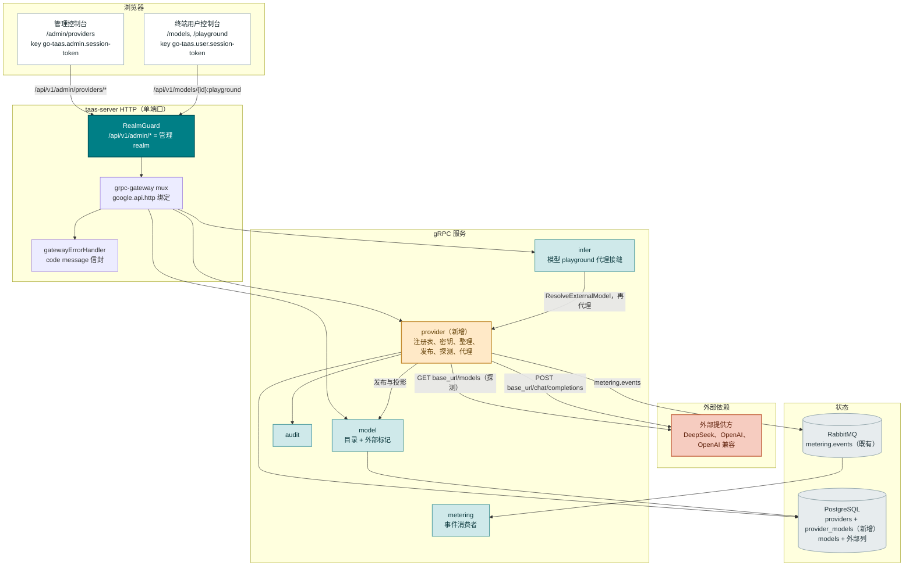
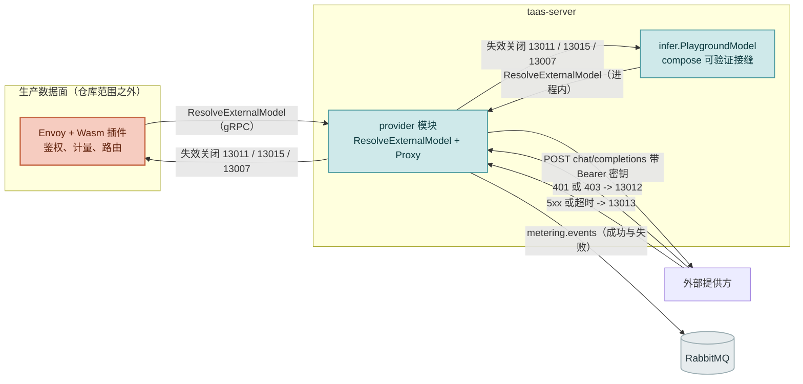
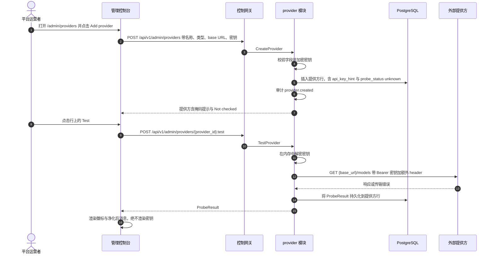
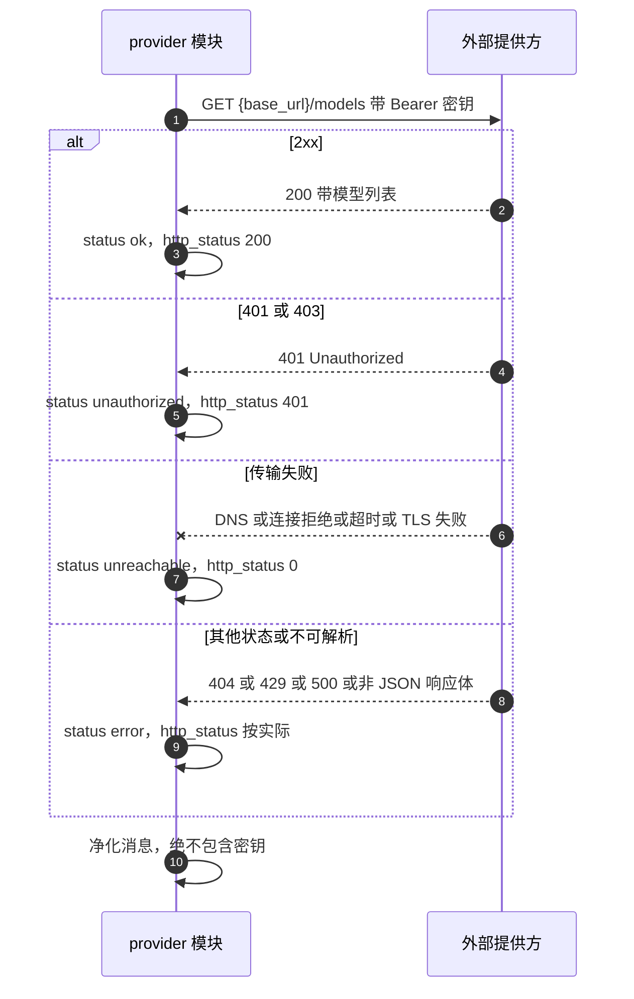
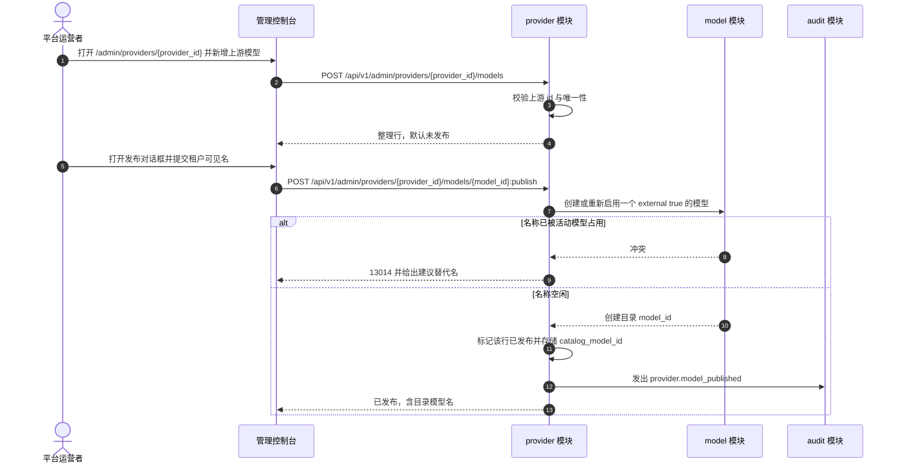
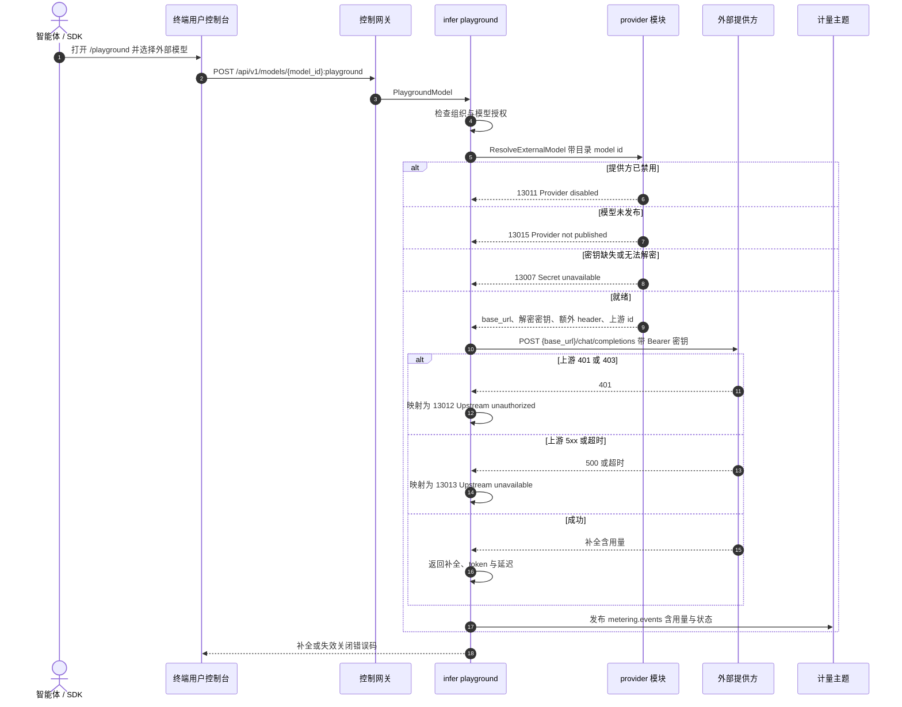
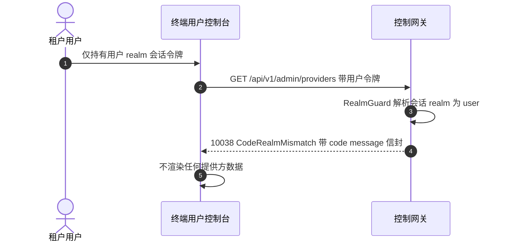

# 外部模型提供方 — 架构与详细设计

| 属性 | 内容 |
| --- | --- |
| 特性点 | 外部模型提供方 —— 平台运营者注册第三方 LLM 提供方（DeepSeek、OpenAI、任意 OpenAI 兼容端点），验证连通性，整理其暴露的上游模型，并将它们发布到既有模型目录，使租户组织像消费自托管模型一样消费它们（backlog 第 48 行） |
| 文档范围 | 特性 48 的架构与详细设计：新增 `provider` 模块，拥有提供方注册表、AES-256-GCM 只写密钥、上游模型整理、发布到 `model` 目录的绑定、连通性探测 worker 与外部模型代理；`taas.provider.v1.ProviderService` proto 含十二个仅在 `/api/v1/admin/providers/*` 下绑定的 RPC 外加一个内部 `ResolveExternalModel` RPC；`providers` 与 `provider_models` 表以及 `models` 表的增量列；五态连通性探测及其精确状态映射；在计量路径上代理已发布外部模型的执行接缝；错误处理（13001–13016 及 10038/10036）；配置、安全、发布，以及按层级的函数级任务清单 |
| 归属模块 | 新增 `provider` 模块（`services/provider`）：注册表、加密密钥、上游整理、发布、探测 worker 与外部对话代理；`model`（增量的外部列以及管理面与掩码用户面投影中的外部标记）；`infer`（模型化 playground 中 compose 可验证的外部模型代理接缝）；`audit`（提供方与发布事件）；`pkg/errors`（130xx 块）；`pkg/config`（provider 配置段）；`pkg/server`（管理面前缀绑定，realm 守卫不变）；`web` 管理控制台（`ProvidersPage`、`ProviderDetailPage`）以及既有目录/详情页上的外部标记 |
| 相关文档 | [需求分析与 UI/UX 设计](../design/external-model-providers.zh-cn.md) · [架构设计](../design/architecture.zh-cn.md) §2.2 `model`、§2.4 `infer`、§3.1 控制网关、§3.2 数据面（Envoy + Wasm）、§4.3 推理请求与计费闭环 · [模型目录与一键部署](./model-catalog-deployment.zh-cn.md)（本特性发布进入的目录）· [按租户模型授权](./model-authorization.zh-cn.md)（外部模型原样复用的授权路径）· [Webhook 通知](./webhook-notifications.zh-cn.md)（本特性复用的 AES-256-GCM 静态加密模式）· [控制台面分离](./console-surface-separation.zh-cn.md)（两个面、`AdminShell`、掩码投影规则）· [分布式推理运行时](./distributed-inference-runtime.zh-cn.md)（本特性镜像的同族管理面专属注册表模块） |
| 状态 | 架构完成，已交付开发者智能体 |

---

## 1. 概述与目标

go-taas 今天的目录**只描述自托管模型**。`RegisterModelRequest`（`proto/taas/model/v1/model.proto`）携带 `name`、`version`、`weight_path`、`description`、`source` 与 `source_model_id`，且每个目录模型都被假定为由集群上的 vLLM Pod 通过推理服务提供服务、由数据面网关路由。`source`（`modelscope` / `huggingface`）是**权重托管站**，不是服务端点，且 `models` / `model_versions` 不持久化任何 base URL、端点或凭据。

本特性弥合一个真实的产品缺口：运营者**不想**或**无法**自托管的前沿与专用模型 —— DeepSeek、OpenAI、任意私有 OpenAI 兼容端点 —— 没有进入平台的路径。运营者**注册提供方**（base URL 加只写加密密钥），**验证连通性**，**整理**应被提供的上游模型 id，并将选定模型**发布**到既有目录。已发布模型成为一等的目录模型并标记 `external=true`，因此**授权（特性 #13）、掩码用户目录、playground 与计量/计费路径全部原样可用**，租户除了 External 标记外无法区分外部托管模型与自托管模型。

**目标**：

- 两个管理面页面，`/admin/providers`（`ProvidersPage`）与 `/admin/providers/:providerId`（`ProviderDetailPage`），位于 `AdminShell` 内，含提供方表格、创建/编辑对话框、连通性面板与上游模型表格（设计 §5.3–§5.4）。
- 新增 `provider` 模块，拥有注册表、加密只写密钥、上游整理、发布映射、定时探测 worker 与外部对话代理，并拥有自己的错误块 **130xx**（设计 D2、D9）。
- 在新增 `taas.provider.v1.ProviderService` 上精确绑定十二个管理面前缀 RPC，外加一个内部 `ResolveExternalModel` RPC（设计 §6）。
- **五态连通性探测**（`unknown` / `ok` / `unauthorized` / `unreachable` / `error`）及其精确状态映射、持久化的 `ProbeResult`，并保证真实 DeepSeek `401` 渲染为 `unauthorized` 而非 `unreachable`（设计 D5、FR3.3.1）。
- 通过增量列发布进既有 `models` 目录，使特性 #13/#12/#4/#5 原样复用（设计 D4）。
- 执行接缝：以失效关闭语义解析并代理已发布外部模型，并在成功**与**失败时发出计量事件，在 compose 栈中可端到端验证（设计 D8、FR6）。
- 编号验收标准（AC1–AC15），可在 Nightwatch 与 FVT 中针对 compose 栈测试。

**非目标**（源自设计，重述）：跨提供方或跨模型回退与加权路由（特性 #45 路由策略）；自动镜像提供方完整 `/models` 列表（整理由运营者驱动）；每租户或每密钥提供方凭据（凭据是平台资产）；提供方上的预置吞吐或配额管理；外部模型的微调或数据集操作；自托管模型部署（特性 #2）与分布式运行时（特性 #47）；计量/计费/分析流水线本身（特性 #4/#25/#28/#29，原样复用）；以及任何新的终端用户页面（设计 D1 —— 租户消费模型，而非提供方）。

### 1.1 本文档阅读顺序

第 2 节记录架构决策（AD1–AD14；其中 AD12–AD14 为架构新增的细化，已标注）。第 3–5 节为组件视图、数据模型与 API 设计。第 6 节为前端架构（页面 → 路由 → API 前缀表、导航、共享组件、认证守卫）。第 7–8 节为时序图与错误处理。第 9–11 节为配置、安全与发布。第 12 节为验收标准可追溯性。第 13–15 节为函数级详细设计（含精确探测状态映射、密钥处理算法与发布语义）、有序实现任务清单，以及延期项。

---

## 2. 架构决策

AD1–AD11 将 UI/UX 设计的决策（D1–D11）重述为实现级规则。**AD12–AD14 是架构新增的细化**；每个都标注了它细化的设计决策，并保留该决策的意图，使开发者与测试智能体按同一读法实现。

| # | 决策 | 理由 |
| --- | --- | --- |
| AD1 | **本特性仅限管理面**：路由 `/admin/providers` 与 `/admin/providers/:providerId`，API 前缀 `/api/v1/admin/providers/*`。**无 `/api/v1/*` 绑定**，无新终端用户页面 | 设计 D1。提供方注册、密钥、整理与发布是运营者编排（特性 #17 掩码投影规则）；租户经既有用户面消费模型。与特性 #47 运行时、#18 加速器、#23 webhook 的管理面专属形态一致 |
| AD2 | **新增 `provider` 模块**（`services/provider`）拥有注册表、加密密钥、上游整理、发布映射、定时探测 worker 与外部对话代理，并拥有自己的错误块 **13001–13016**。`model` 仍拥有目录，`infer` 仍拥有推理服务，数据面网关仍拥有路由 | 设计 D2。提供方是一个独立关注点（一个外部端点加一个凭据），有自己的注册表与后台探测；专用模块使其脱离自托管模型生命周期 |
| AD3 | **API Key 为只写且静态加密（AES-256-GCM）**，复用 `services/webhook/secret.go` 中经审查的密码学实现（`EncryptSecret` / `DecryptSecret`）—— **不引入第二条密码学路径**。主密钥解析与 webhook 完全一致：`provider.secretEncryptionKey`、环境变量 `CONFIG_PROVIDER_SECRETENCRYPTIONKEY`，否则回退到仅开发的 `"dev-provider-key-" + mq.namespace`。任何读取 RPC 都不返回明文或密文 —— 只返回掩码提示 | 设计 D3。仓库已提供经审查的加密模式；复用可保持单一受审计密码学路径，只写语义防止通过 API、日志或控制台泄露（AD12 解决开发回退与 13007 的交互） |
| AD4 | **发布进入既有目录**：发布创建（或重新启用）一行 `models`，带 `external=true`、`provider_id`、`upstream_model_id`，使用**增量列**。不创建 `model_versions` 行 —— 外部模型没有权重工件（AD13）。授权（#13）、用户目录与 playground 于是原样可用，租户契约保持为目录模型 id | 设计 D4。复用目录即复用整条授权/鉴权/playground 路径，避免平行而分叉的模型标识系统（Azure「部署名与上游 id 解耦」模式） |
| AD5 | **连通性是一等五态信号**（`unknown` / `ok` / `unauthorized` / `unreachable` / `error`），由对提供方的**真实 HTTP 探测**按需与定时产生（AD7），并持久化在提供方行上，含延迟、HTTP 状态、净化后消息与检查时间 | 设计 D5。把凭据失败并入网络失败会误导运营者；API 返回的正是页面渲染的状态 |
| AD6 | **护栏显式**：最后探测为 `unauthorized` 的提供方不能被启用（13012）；非 `https` base URL 携带持久 `Non-HTTPS endpoint` 警告；有已发布模型的提供方不能被删除（13016），已发布的上游行不能被移除（13016）；任何 RPC 都不返回密钥；禁用提供方始终允许 | 设计 D6。外部依赖的误配置必须响亮而非静默；这些护栏廉价、可测，并防止最具破坏性的运营者错误 |
| AD7 | **探测是真实的 HTTP `GET {base_url}/models`，带 `Authorization: Bearer <解密后密钥>` 加提供方的额外 header，按提供方请求超时**。探测在 `provider` 模块**服务端**运行，绝不在浏览器 | 设计 D11、FR3.2。每个 OpenAI 兼容提供方都暴露 `/models`；服务端探测代表平台对可达性的视角而非运营者工作站的，且浏览器永不接触密钥 |
| AD8 | **显式失败语义**：用户 realm 会话访问 `/api/v1/admin/providers/*` 被拒为 **10038 `CodeRealmMismatch`**；缺少所需角色的会话收到 **10036 `CodeForbidden`**；对提供方已禁用的模型请求失效关闭为 **13011**，模型未发布为 **13015**，密钥缺失/无法解密为 **13007**；上游 `401`/`403` 映射为 **13012**，上游 `5xx`/超时/连接失败映射为 **13013** | 设计 D8、D7。realm 分离是硬性产品不变量，外部依赖故障必须产生可执行错误码而非通用 500 |
| AD9 | **provider 块新错误码（13001–13016）**，紧随 runtime 129xx 之后的下一个空闲块：**13001 `CodeProviderNotFound`**、**13002 `CodeProviderNameConflict`**、**13003 `CodeProviderNameInvalid`**、**13004 `CodeProviderBaseURLInvalid`**、**13005 `CodeProviderTypeInvalid`**、**13006 `CodeProviderAPIKeyRequired`**、**13007 `CodeProviderSecretUnavailable`**、**13008 `CodeProviderModelNotFound`**、**13009 `CodeProviderModelExists`**、**13010 `CodeProviderModelInvalid`**、**13011 `CodeProviderDisabled`**、**13012 `CodeProviderUpstreamUnauthorized`**、**13013 `CodeProviderUpstreamUnavailable`**、**13014 `CodeProviderPublishConflict`**、**13015 `CodeProviderNotPublished`**、**13016 `CodeProviderInUse`**。realm 失败复用 **10038**，角色失败复用 **10036** | 设计 D9。新模块（AD2）获得新块；不同错误码使每种失败模式可执行，并让代理无需猜测地映射上游失败 |
| AD10 | **提供方记录是平台全局的**（无 `X-Organization-Id`）；租户只看到已发布的目录模型 | 设计 D10。凭据与端点是平台资产；租户隔离仍落在模型授权（特性 #13）上，而非提供方记录 |
| AD11 | **上游模型整理是真实表**（`provider_models`），而非提供方 `/models` 列表的镜像；探测结果**持久化**在提供方行上而非页面加载时计算 | 设计 D5/FR4/FR3.6。整理是运营者的显式行为；持久化 `ProbeResult` 让页面无需实时调用即可展示最近已知状态，定时 worker 保持其新鲜 |
| AD12 | **对设计 D3/D8 的细化 —— 主密钥解析与 webhook 完全一致。** 设置了显式 `provider.secretEncryptionKey` 时使用它；否则模块回退到 `"dev-provider-key-" + mq.namespace`，使创建/轮换在未配置密钥的 compose 栈中可用。**13007 `CodeProviderSecretUnavailable`** 在存储密文无法用解析出的密钥解密时返回（主密钥变更、行被篡改、既有提供方密文为空），或完全无法解析任何密钥材料时返回 —— **而非**仅因 `provider.secretEncryptionKey` 为空 | 设计 FR2.2 的措辞（「主密钥未配置时 create/update 返回 13007」）会破坏 compose/e2e 流程 —— 该流程未预置提供方密钥，而 webhook 密钥已通过同一开发回退可用。复用 webhook 回退（AD3）保持「单一密码学路径、单密钥解析规则」，并把 13007 变为真正的解密失败。生产环境设置该密钥（第 10/11 节） |
| AD13 | **对设计 D4/FR5 的细化 —— 外部目录模型没有 `model_versions` 行。** 发布只写入 `models` 行；外部模型在所有投影（管理面与用户面）中 `latest_version` 为空，管理/用户目录将该版本渲染为「—」。发布/取消发布从不触碰 `model_versions`，`weight_path` 保持为空 | 外部模型没有权重工件，也没有版本历史；伪造版本行会创建一个控制器可能尝试部署的幻影工件（自托管路径读取 `model_versions.weight_path`）。保持外部模型无版本使 `model` 模块的部署路径自然不适用，并保持差异为增量。设计只要求 `external=true`、`provider_id`、`upstream_model_id`（FR5.2） |
| AD14 | **对设计 FR6/D7 的细化 —— 执行接缝是一个内部 `ResolveExternalModel` RPC 加一个 `provider.Proxy`，并在仓库内由模型化 playground 行使。** 生产数据面网关（Envoy + Wasm，仓库范围之外）调用 `ResolveExternalModel` 并代理。由于仓库没有服务端 `/v1/*` 处理器且 compose 栈没有 Envoy，同一解析器 + 代理被接入 `infer.PlaygroundModel`（`POST /api/v1/models/{model_id}:playground`，用户面），它对提供方执行**真实的服务端 OpenAI 兼容调用**并发出 `metering.events` 事件 —— 使 AC9/AC10/AC11 可在 compose 中针对 `mock-infer` 夹具端到端验证。管理面 `PlaygroundInfer`（基于服务）不变，因为外部模型没有推理服务 | 设计固定了数据面契约，但仓库必须能在没有 Envoy 的情况下验证。模型化 playground 是仓库内唯一租户可达的推理调用，且已携带 `model_id` + `api_key_id` + 组织；在那里接入外部代理复用授权检查与计量主题，不新增租户路由，并精确固定生产数据面将调用的契约。无跨提供方回退（设计 D7） |

---

## 3. 组件视图

### 3.1 归属

| 层级 / 组件 | 拥有 | 本特性的变更 |
| --- | --- | --- |
| **静态包（SPA）** | 一个 Vite 包（`web/dist`）内嵌进 `taas-server`，由网关 SPA 回退提供 | 两个新管理面页面（`ProvidersPage`、`ProviderDetailPage`）、一个导航项、`App.tsx` 中的路由注册、i18n 键，以及既有目录/详情页上的 External 徽标 |
| **网关（`pkg/server`）** | HTTP 组合：`RealmGuard` → `withConsole` → grpc-gateway mux；统一错误渲染器；SPA 回退 | 无变更 —— 新 RPC 绑定在 `/api/v1/admin/providers/*` 下，`RealmGuard` 已将其归类为管理面 |
| **grpc-gateway mux** | 依据 `google.api.http` 注记完成路径 → RPC 路由 | 十二个提供方 RPC 的新绑定（第 5 节）。`ResolveExternalModel` **无** HTTP 注记，仅内部 gRPC |
| **`provider`（新增）** | `providers` 与 `provider_models` 表、加密密钥、上游整理、发布映射、探测 worker、外部对话代理与十二个管理面 RPC | 新服务：`services/provider` |
| **`model`** | 目录（`models`、`model_versions`、`model_authorizations`）以及管理面/可用投影 | 增量列（`external`、`provider_id`、`upstream_model_id`、`published`）；`ListModels`/`GetModel` 与掩码 `ListAvailableModels`/`GetAvailableModel` 中的外部标记；用户投影中的 `published = true` 过滤 |
| **`infer`** | 推理服务与模型化 playground | `PlaygroundModel` 经注入的 `ExternalModelProxy` 解析外部模型并返回真实补全；新增 `SetExternalModelProxy` setter（`SetModelAuthorizer` 模式） |
| **`audit`** | 尽力而为的审计记录器 | 复用：provider 模块为 `provider.*` 事件调用 `Recorder.Record`（绝不含密钥） |
| **`pkg/mq`** | 规范主题 | **无新主题** —— 代理发布到既有 `metering.events` 主题 |
| **`pkg/errors`** | 按模块的错误码块 | 新增 provider 块：**13001–13016** |
| **`pkg/config`** | 合并后的配置树 | 新增 `provider` 段（密钥、探测间隔/worker、默认请求超时） |
| **`test/e2e/mock`** | compose 测试夹具 | **扩展 `mock_infer.py`**，新增 `GET /v1/models` 与错误前缀变体（明确为测试基础设施变更，第 9 节） |

### 3.2 组件视图



### 3.3 请求身份链

提供方 RPC 是**管理面、管理角色、平台作用域**（AD1、AD10）。链路为：

1. `RealmGuard`（HTTP，`pkg/server/realm.go`）—— 路径前缀 `/api/v1/admin/providers/*` 决定期望 realm 为 `admin`。无 `Authorization` 头：放行（过渡态，特性 #17 AD4）。有头：从 Redis 解析会话 realm；不匹配 → **10038**；未知/过期/无 realm → **10027**。
2. grpc-gateway mux —— 按注记路径路由并转发 `authorization`。
3. `provider` 处理器 —— 解析行为者（`SessionUserResolver`），并经 `tenancy.RoleGuard` 以管理角色门控每个 RPC（**10036**）。读取（`ListProviders`、`GetProvider`、`ListProviderModels`）与写入（创建/更新/删除/测试/发布/取消发布）都要求管理角色；不要求也不接受 `X-Organization-Id`（AD10）。

在任意 `/api/v1/admin/providers/*` 路由上出示用户 realm 会话被拒为 **10038 `CodeRealmMismatch`**（设计 FR8.4，AC12）。缺少所需角色的会话收到 **10036 `CodeForbidden`**（AC13）。

### 3.4 执行接缝

两个调用方共享一个解析契约（AD14）：



- **`ResolveExternalModel`** 是内部 gRPC RPC（`taas.provider.v1.ProviderService`，无 `google.api.http` 注记）。给定目录 `model_id`，它返回 `{provider_id, provider_name, base_url, api_key, extra_headers, upstream_model_id, request_timeout_seconds}` 或一个失效关闭错误码（13011/13015/13007/13008）。明文密钥仅在调用期间存在于内存（AD12）。
- **`provider.Proxy`** 执行 `POST {base_url}/chat/completions`，带 `Authorization: Bearer <密钥>` 加提供方额外 header，按提供方超时，为生产数据面保留流式行为。它将上游 `401`/`403` 映射为 **13012**，上游 `5xx`/超时/连接失败映射为 **13013**，并**始终**发出一个 `metering.events` 事件（成功或失败），携带解析出的用量。
- **compose 可验证路径**（AD14）：当目标模型 `external=true` 时，`infer.PlaygroundModel` 调用注入的 `ExternalModelProxy`（由 `provider.Service` 实现），将补全、token 与延迟返回控制台。`mock-infer` 扮演外部提供方。这为 AC9（端到端含计量）与 AC10（失效关闭映射）提供真实的仓库内执行路径。
- **无跨提供方回退**（设计 D7）：请求精确瞄准一个提供方；失败映射为不同错误码，绝不静默在别处重试。

---

## 4. 数据模型

本特性新增**两张表**（`providers`、`provider_models`）与既有 `models` 表上的**四个增量列**。所有 schema 均为拥有方服务 `Migrate` 中 `db.AutoMigrate(...)` 创建的 GORM 模型（第 4.4 节）。

### 4.1 `providers`

| 列 | 类型 | 说明 |
| --- | --- | --- |
| `id` | string（PK，uuid） | 服务端生成 UUID v4，暴露为 `provider_id` |
| `name` | string（64，唯一） | `^[a-z0-9][a-z0-9-]*$`，1–64 字符，经 `uniqueIndex` 唯一 |
| `type` | string（32） | `deepseek` / `openai` / `openai_compatible` |
| `base_url` | string（512） | 含 host 的绝对 `http(s)` URL；使用时去除尾斜杠 |
| `enabled` | bool | 创建时默认 `false` |
| `request_timeout_seconds` | int | 默认 `10`，范围 `1`–`120` |
| `extra_headers` | jsonb | `{ "<header 名>": "<值经 AES-256-GCM 加密后的 base64 密文>" }`；读取只暴露名字（AD3，安全） |
| `api_key_ciphertext` | bytea（可空） | 密钥的 AES-256-GCM `nonce || ciphertext`；绝不进入任何响应 |
| `api_key_hint` | string（16） | 掩码提示（`••••3f9a`），在创建/轮换时计算；读取返回它且从不解密 |
| `probe_status` | string（16） | `unknown` / `ok` / `unauthorized` / `unreachable` / `error`；默认 `unknown` |
| `probe_latency_ms` | int64 | 无响应时为 `0` |
| `probe_http_status` | int | 无响应时为 `0` |
| `probe_message` | string（256） | 净化后的消息（绝不含密钥，绝不含上游响应体） |
| `probe_checked_at` | timestamp（可空） | 首次探测前为 `NULL` |
| `created_by` / `updated_by` | string（64） | 行为管理用户 id（未解析时为空，过渡态） |
| `created_at` / `updated_at` | timestamp | UTC |

GORM 模型为 `services/provider/provider_model.go` 中的 `Provider`；`TableName()` 返回 `"providers"`。`api_key_hint` 被存储（而非派生），使任何读取路径都不需要主密钥（AD3）。

### 4.2 `provider_models`

| 列 | 类型 | 说明 |
| --- | --- | --- |
| `id` | string（PK，uuid） | 暴露为 `model_id`（平台行 id，区别于 `upstream_model_id`） |
| `provider_id` | string（uuid，索引） | 所属提供方 |
| `upstream_model_id` | string（128） | 提供方的模型 id；每提供方唯一 |
| `display_name` | string（128） | 可选，默认空 |
| `context_window` | int64 | `0` = 未知，范围 `0`–`10 000 000` |
| `enabled` | bool | 默认 `true` |
| `published` | bool | 默认 `false`；由发布设置 |
| `catalog_model_id` | string（uuid，可空） | 已发布的 `models.id`，由发布设置 |
| `created_at` / `updated_at` | timestamp | UTC |

GORM 模型为 `services/provider/provider_model.go` 中的 `ProviderModel`；`TableName()` 返回 `"provider_models"`。复合 `uniqueIndex:idx_provider_models_provider_upstream (provider_id, upstream_model_id)` 强制提供方内唯一（设计 FR4.2 → **13009**）。

### 4.3 `models`（增量列）

| 列 | 类型 | 说明 |
| --- | --- | --- |
| `external` | bool | `not null;default:false`；已发布外部模型为 true |
| `provider_id` | string（uuid） | `not null;default:''`；索引；发布时设置 |
| `upstream_model_id` | string（128） | `not null;default:''`；发布时设置 |
| `published` | bool | `not null;default:true`；未发布的外部模型从用户投影隐藏 |

`published` 默认为 `true`，使每个既有自托管模型保持今天的行为，**无需回填**。`external`、`provider_id`、`upstream_model_id` 对自托管模型为空/false。按 **AD13**，外部模型不创建 `model_versions` 行，因此 `models.name` 仍是唯一目录标识，`weight_path` 保持为空。

### 4.4 迁移与 init-SQL 升级路径

本仓库**不使用**手写 init-SQL 脚本：每个表的 schema 都是拥有方服务 `Migrate` 中 `db.AutoMigrate(...)` 创建的 GORM 模型（如 `services/cluster/service.go` `Migrate` → `AutoMigrate(&Cluster{})`），`deploy/` 下没有 `.sql` 文件。升级路径为：

1. 在 `services/provider/provider_model.go` 新增 `Provider` 与 `ProviderModel`。
2. `provider.Service.Migrate(ctx)` 返回 `db.AutoMigrate(&Provider{}, &ProviderModel{})`。
3. 在 `services/model/model_model.go` 的 `models.Model` 上新增四个列；`model.Service.Migrate` 已调用 `AutoMigrate(&Model{}, &Version{}, ...)`，除结构体外无需改动即可纳入。
4. `apps/taas-server/main.go` 在迁移顺序中注册 `provider` 服务（`model` 之后、`infer` 之前），使表与列在服务器启动时创建。
5. 无 init-SQL 编辑、无手工 DDL、无数据回填。表从空开始，新 `models` 列取默认值，因此既有部署升级后行为不变。

---

## 5. API 设计

### 5.1 面映射

除内部解析器外，每个 RPC **仅**绑定在管理面前缀 `/api/v1/admin/providers/*`（AD1、AD14）。

| RPC | HTTP 方法 + 路径 | 面 | 状态 |
| --- | --- | --- | --- |
| `ListProviders` | `GET /api/v1/admin/providers` | 管理 | 新增 |
| `CreateProvider` | `POST /api/v1/admin/providers` | 管理 | 新增 |
| `GetProvider` | `GET /api/v1/admin/providers/{provider_id}` | 管理 | 新增 |
| `UpdateProvider` | `PATCH /api/v1/admin/providers/{provider_id}` | 管理 | 新增 |
| `DeleteProvider` | `DELETE /api/v1/admin/providers/{provider_id}` | 管理 | 新增 |
| `TestProvider` | `POST /api/v1/admin/providers/{provider_id}:test` | 管理 | 新增 |
| `ListProviderModels` | `GET /api/v1/admin/providers/{provider_id}/models` | 管理 | 新增 |
| `AddProviderModel` | `POST /api/v1/admin/providers/{provider_id}/models` | 管理 | 新增 |
| `UpdateProviderModel` | `PATCH /api/v1/admin/providers/{provider_id}/models/{model_id}` | 管理 | 新增 |
| `RemoveProviderModel` | `DELETE /api/v1/admin/providers/{provider_id}/models/{model_id}` | 管理 | 新增 |
| `PublishProviderModel` | `POST /api/v1/admin/providers/{provider_id}/models/{model_id}:publish` | 管理 | 新增 |
| `UnpublishProviderModel` | `POST /api/v1/admin/providers/{provider_id}/models/{model_id}:unpublish` | 管理 | 新增 |
| `ResolveExternalModel` | 内部 gRPC（无 HTTP 注记） | 内部 | 新增 |
| `ListAvailableModels` / `GetAvailableModel` | `GET /api/v1/models`、`/api/v1/models/{model_id}` | 用户 | 变更（外部标记） |
| `ListModels` / `GetModel` | `GET /api/v1/admin/models`、`/api/v1/admin/models/{model_id}` | 管理 | 变更（外部标记 + 提供方字段） |

### 5.2 Proto 契约（`proto/taas/provider/v1/provider.proto`，新增）

```proto
syntax = "proto3";

package taas.provider.v1;

import "google/api/annotations.proto";
import "taas/common/v1/common.proto";

option go_package = "github.com/go-taas/go-taas/proto/taas/provider/v1;providerv1";

// ProviderService 提供外部模型提供方注册表、连通性探测与上游模型整理
// （特性 #48）。管理面 API：在 /api/v1/admin/providers 下提供。
service ProviderService {
  // ListProviders 返回已注册提供方，含掩码密钥提示、最近探测结果与模型
  // 计数。支持分页、名称检索与类型/启用/探测状态过滤。
  rpc ListProviders(ListProvidersRequest) returns (ListProvidersResponse) {
    option (google.api.http) = {get: "/api/v1/admin/providers"};
  }

  // CreateProvider 注册提供方。api_key 在创建时必填。
  rpc CreateProvider(CreateProviderRequest) returns (CreateProviderResponse) {
    option (google.api.http) = {post: "/api/v1/admin/providers" body: "*"};
  }

  // GetProvider 返回单个掩码提供方。未知 id -> 13001。
  rpc GetProvider(GetProviderRequest) returns (GetProviderResponse) {
    option (google.api.http) = {get: "/api/v1/admin/providers/{provider_id}"};
  }

  // UpdateProvider 编辑可变字段。api_key 省略或为空表示保留既有凭据，
  // 非空表示轮换。
  rpc UpdateProvider(UpdateProviderRequest) returns (UpdateProviderResponse) {
    option (google.api.http) = {patch: "/api/v1/admin/providers/{provider_id}" body: "*"};
  }

  // DeleteProvider 删除提供方及其整理模型。有任一整理模型已发布时被阻止
  // -> 13016。
  rpc DeleteProvider(DeleteProviderRequest) returns (DeleteProviderResponse) {
    option (google.api.http) = {delete: "/api/v1/admin/providers/{provider_id}"};
  }

  // TestProvider 运行同步连通性探测并返回持久化的五态 ProbeResult。
  // 探测始终允许。
  rpc TestProvider(TestProviderRequest) returns (TestProviderResponse) {
    option (google.api.http) = {post: "/api/v1/admin/providers/{provider_id}:test" body: "*"};
  }

  // ListProviderModels 返回整理的上游模型及其发布/目录绑定。
  rpc ListProviderModels(ListProviderModelsRequest) returns (ListProviderModelsResponse) {
    option (google.api.http) = {get: "/api/v1/admin/providers/{provider_id}/models"};
  }

  // AddProviderModel 新增一行整理的上游模型。
  rpc AddProviderModel(AddProviderModelRequest) returns (AddProviderModelResponse) {
    option (google.api.http) = {post: "/api/v1/admin/providers/{provider_id}/models" body: "*"};
  }

  // UpdateProviderModel 编辑展示名、上下文窗口与启用状态。上游 id 不可变。
  rpc UpdateProviderModel(UpdateProviderModelRequest) returns (UpdateProviderModelResponse) {
    option (google.api.http) = {patch: "/api/v1/admin/providers/{provider_id}/models/{model_id}" body: "*"};
  }

  // RemoveProviderModel 移除一行整理模型。已发布时被阻止 -> 13016。
  rpc RemoveProviderModel(RemoveProviderModelRequest) returns (RemoveProviderModelResponse) {
    option (google.api.http) = {delete: "/api/v1/admin/providers/{provider_id}/models/{model_id}"};
  }

  // PublishProviderModel 将一行整理且启用的模型发布为目录模型
  // （external=true）。活动名称冲突 -> 13014。幂等。
  rpc PublishProviderModel(PublishProviderModelRequest) returns (PublishProviderModelResponse) {
    option (google.api.http) = {post: "/api/v1/admin/providers/{provider_id}/models/{model_id}:publish" body: "*"};
  }

  // UnpublishProviderModel 将目录模型标记为未发布。授权被保留但失效。
  // 幂等。
  rpc UnpublishProviderModel(UnpublishProviderModelRequest) returns (UnpublishProviderModelResponse) {
    option (google.api.http) = {post: "/api/v1/admin/providers/{provider_id}/models/{model_id}:unpublish" body: "*"};
  }

  // ResolveExternalModel 将目录模型解析为其提供方、解密后的密钥与上游
  // 模型 id，或返回一个失效关闭错误码。这是内部 RPC：无 google.api.http
  // 注记，永不通过网关可达。它由数据面网关与 infer.PlaygroundModel 调用。
  rpc ResolveExternalModel(ResolveExternalModelRequest) returns (ResolveExternalModelResponse) {}
}

message Provider {
  string provider_id = 1;
  string name = 2;
  string type = 3;                 // deepseek | openai | openai_compatible
  string base_url = 4;
  bool enabled = 5;
  int64 request_timeout_seconds = 6;
  repeated string extra_header_names = 7; // 仅名字，绝不返回值
  string api_key_hint = 8;         // 掩码，例如 "••••3f9a"
  ProbeResult last_probe = 9;
  int64 upstream_model_count = 10;
  int64 published_model_count = 11;
  int64 created_at = 12;
  int64 updated_at = 13;
}

message ProbeResult {
  string status = 1;         // unknown | ok | unauthorized | unreachable | error
  int64 latency_ms = 2;
  int32 http_status = 3;     // 未收到响应时为 0
  string message = 4;        // 净化后，绝不含密钥或上游响应体
  int64 checked_at = 5;      // 首次探测前为 0
}

message ListProvidersRequest {
  taas.common.v1.PageRequest page = 1;
  string name = 2;           // 名称子串检索
  string type = 3;           // deepseek | openai | openai_compatible
  string enabled = 4;        // "" | "true" | "false"
  string probe_status = 5;   // unknown | ok | unauthorized | unreachable | error
}

message ListProvidersResponse {
  taas.common.v1.Response response = 1;
  repeated Provider providers = 2;
  taas.common.v1.PageMeta page_meta = 3;
}

message CreateProviderRequest {
  string name = 1;
  string type = 2;
  string base_url = 3;
  string api_key = 4;               // 只写，创建时必填
  bool enabled = 5;
  int64 request_timeout_seconds = 6; // 0 -> 默认 10
  map<string, string> extra_headers = 7;
}

message CreateProviderResponse {
  taas.common.v1.Response response = 1;
  Provider provider = 2;
}

message GetProviderRequest { string provider_id = 1; }

message GetProviderResponse {
  taas.common.v1.Response response = 1;
  Provider provider = 2;
}

message UpdateProviderRequest {
  string provider_id = 1;
  string name = 2;
  string type = 3;
  string base_url = 4;
  // api_key 可选：省略或为空保留既有凭据；非空表示轮换。任何读取都不
  // 返回它。
  string api_key = 5;
  bool enabled = 6;
  int64 request_timeout_seconds = 7;
  map<string, string> extra_headers = 8;
}

message UpdateProviderResponse {
  taas.common.v1.Response response = 1;
  Provider provider = 2;
}

message DeleteProviderRequest { string provider_id = 1; }
message DeleteProviderResponse { taas.common.v1.Response response = 1; }

message TestProviderRequest { string provider_id = 1; }

message TestProviderResponse {
  taas.common.v1.Response response = 1;
  ProbeResult probe = 2;
}

message ProviderModel {
  string model_id = 1;            // 平台的整理行 id
  string upstream_model_id = 2;
  string display_name = 3;
  int64 context_window = 4;       // 0 = 未知
  bool enabled = 5;
  bool published = 6;
  string catalog_model_id = 7;
  string catalog_model_name = 8;
  int64 created_at = 9;
  int64 updated_at = 10;
}

message ListProviderModelsRequest {
  string provider_id = 1;
  taas.common.v1.PageRequest page = 2;
  string upstream_model_id = 3;
  string enabled = 4;    // "" | "true" | "false"
  string published = 5;  // "" | "true" | "false"
}

message ListProviderModelsResponse {
  taas.common.v1.Response response = 1;
  repeated ProviderModel models = 2;
  taas.common.v1.PageMeta page_meta = 3;
}

message AddProviderModelRequest {
  string provider_id = 1;
  string upstream_model_id = 2;
  string display_name = 3;
  int64 context_window = 4;
  bool enabled = 5;
}

message AddProviderModelResponse {
  taas.common.v1.Response response = 1;
  ProviderModel model = 2;
}

message UpdateProviderModelRequest {
  string provider_id = 1;
  string model_id = 2;
  string display_name = 3;
  int64 context_window = 4;
  bool enabled = 5;
}

message UpdateProviderModelResponse {
  taas.common.v1.Response response = 1;
  ProviderModel model = 2;
}

message RemoveProviderModelRequest {
  string provider_id = 1;
  string model_id = 2;
}
message RemoveProviderModelResponse { taas.common.v1.Response response = 1; }

message PublishProviderModelRequest {
  string provider_id = 1;
  string model_id = 2;
  // tenant_facing_name 默认为 display_name，否则 upstream_model_id。
  string tenant_facing_name = 3;
}

message PublishProviderModelResponse {
  taas.common.v1.Response response = 1;
  string catalog_model_id = 2;
  string catalog_model_name = 3;
  ProviderModel model = 4;
}

message UnpublishProviderModelRequest {
  string provider_id = 1;
  string model_id = 2;
}
message UnpublishProviderModelResponse { taas.common.v1.Response response = 1; }

// ResolveExternalModel 是内部 RPC（无 HTTP 注记）。由数据面网关与
// infer.PlaygroundModel 调用。
message ResolveExternalModelRequest {
  string model_id = 1;    // 目录模型 id（首选）
  string model_name = 2;  // 目录模型名（回退）
}

message ResolvedExternalModel {
  string provider_id = 1;
  string provider_name = 2;
  string base_url = 3;
  string upstream_model_id = 4;
  int64 request_timeout_seconds = 5;
  // api_key 与 extra_headers 仅在此内部 RPC 上返回，且仅在请求期间
  // 存在于内存。任何管理面读取 RPC 都不携带它们。
  string api_key = 6;
  map<string, string> extra_headers = 7;
}

message ResolveExternalModelResponse {
  taas.common.v1.Response response = 1;
  ResolvedExternalModel model = 2;
}
```

`proto/taas/model/v1/model.proto` **增量**扩展：

```proto
// ModelSummary（管理面投影）新增：
bool external = 7;
string provider_name = 8;      // 非外部时为空
string provider_id = 9;        // 仅管理面
string upstream_model_id = 10; // 仅管理面
bool published = 11;           // 未发布的外部模型为 false

// AvailableModel（掩码用户面投影）仅新增：
bool external = 6;
string provider_name = 7;      // 掩码；用户面投影绝不携带 provider_id、
                               // upstream_model_id、base_url、密钥或密钥提示
```

### 5.3 网关路由

grpc-gateway mux 依上述 `google.api.http` 绑定路由十二个注记 RPC；自定义动词（`:test`、`:publish`、`:unpublish`）遵循既有 `{model_id}:grant` 约定（POST 上 `body: "*"`）。`ResolveExternalModel` 无注记，仅在内部 gRPC 端口可达。`RealmGuard` 无需变更：`/api/v1/admin/` 已映射到管理面。JSON 信封不变：成功 HTTP 200，业务错误为 `{"code": <int>, "message": "..."}`，int64 字段序列化为 JSON 字符串。

### 5.4 校验契约

| 字段 | 规则 | 错误码 |
| --- | --- | --- |
| `name` | 1–64 字符，`^[a-z0-9][a-z0-9-]*$` | 13003 `CodeProviderNameInvalid` |
| `name` | 提供方间唯一 | 13002 `CodeProviderNameConflict` |
| `type` | ∈ `{deepseek, openai, openai_compatible}` | 13005 `CodeProviderTypeInvalid` |
| `base_url` | 含 host 的绝对 `http(s)` URL | 13004 `CodeProviderBaseURLInvalid` |
| `api_key` | 创建时非空 | 13006 `CodeProviderAPIKeyRequired` |
| `request_timeout_seconds` | `1`–`120`（0 → 默认 10） | 13010 `CodeProviderModelInvalid`（通用标量字段码，设计 FR1.6） |
| `extra_headers` | 每名 `^[A-Za-z0-9-]+$`，名唯一，值 ≤ 1024 字符 | 13010 `CodeProviderModelInvalid` |
| `upstream_model_id` | 1–128 字符，提供方内唯一 | 13009 `CodeProviderModelExists`（重复）/ 13010（缺失/空） |
| `context_window` | `0`–`10 000 000` | 13010 `CodeProviderModelInvalid` |
| `tenant_facing_name` | 1–128 字符，`^[a-z0-9][a-z0-9._-]*$` | 13010 `CodeProviderModelInvalid` |

提供方行查找失败返回 **13001 `CodeProviderNotFound`**；整理行查找失败返回 **13008 `CodeProviderModelNotFound`**。

---

## 6. 前端架构

### 6.1 页面 → 路由 → API 前缀

| 功能 | 面 | Web 路由 | API 前缀 |
| --- | --- | --- | --- |
| 提供方列表（检索/排序/过滤） | 管理 | `/admin/providers` | `/api/v1/admin/providers` |
| 创建 / 编辑提供方 | 管理 | `/admin/providers`（对话框） | `/api/v1/admin/providers`、`/api/v1/admin/providers/{provider_id}` |
| 删除提供方 | 管理 | `/admin/providers`（确认） | `/api/v1/admin/providers/{provider_id}` |
| 连通性测试 | 管理 | `/admin/providers`、`/admin/providers/:providerId` | `/api/v1/admin/providers/{provider_id}:test` |
| 提供方详情 + 上游模型 | 管理 | `/admin/providers/:providerId` | `/api/v1/admin/providers/{provider_id}`、`/api/v1/admin/providers/{provider_id}/models` |
| 发布 / 取消发布 | 管理 | `/admin/providers/:providerId`（对话框 / 确认） | `/api/v1/admin/providers/{provider_id}/models/{model_id}:publish` / `:unpublish` |
| 外部标记（管理目录） | 管理 | `/admin/models`、`/admin/models/:id`（既有，变更） | `/api/v1/admin/models`、`/api/v1/admin/models/{model_id}`（既有，变更） |
| 租户目录 / 详情（既有） | 用户 | `/models`、`/models/:modelId`（既有，变更） | `/api/v1/models`、`/api/v1/models/{model_id}`（既有，变更） |
| 租户 playground（既有） | 用户 | `/playground`（既有，交互不变） | `/api/v1/models/{model_id}:playground`（既有，现代理外部模型） |

管理完全在**管理面**；租户消费完全在**终端用户面**并复用既有页面。不创建新终端用户路由（AD1）。管理面页面不含任何 `/api/v1/*` 调用，用户面页面不含任何 `/api/v1/admin/*` 调用。

### 6.2 导航位置

`AdminShell.ADMIN_NAV_ITEMS`（`web/src/shells/AdminShell.tsx`）当前是**扁平数组** —— 设计中的「Operations 组」是概念分组而非已实现分组（这与特性 #47 运行时的添加方式一致）。本特性在 `nav-runtime` 之后直接新增一项：

```ts
{ path: '/admin/providers', labelKey: 'nav.providers', testid: 'nav-providers', icon: Key },
```

两条路由注册在 `web/src/App.tsx` 的 `AdminRoutes` 中，紧邻既有 `/admin/models` 与 `/admin/runtime` 路由：

```tsx
<Route path="/admin/providers" element={<ProvidersPage />} />
<Route path="/admin/providers/:providerId" element={<ProviderDetailPage />} />
```

### 6.3 复用的共享组件与状态

| 需求 | 复用 |
| --- | --- |
| 按 realm 作用域的 HTTP 客户端 | `web/src/api.ts` `useApi()`（管理 realm：前缀 `/api/v1/admin/*`，令牌 `go-taas.admin.session-token`） |
| 状态徽标 | `web/src/components/StatusBadge.tsx`，用于探测徽标（`Reachable` / `Credentials rejected` / `Unreachable` / `Error` / `Not checked`）与启用/发布徽标 |
| 表格、分页、过滤 | 既有目录/运行时表格 + 工具栏模式（同一每页 20 条约定） |
| 对话框 / 确认 | 既有模态 + 确认模式（创建/编辑对话框、发布对话框、取消发布/删除确认） |
| Toast | 既有 toast 辅助，用于「Provider deleted.」/「Model published.」/「Model unpublished.」 |
| i18n | `web/src/locales/en.ts` + `zh.ts` 新增 `nav.providers`、页面文案与错误文案 |

不引入新的全局状态：每个页面拥有自己的列表状态，并在可见时轮询提供方列表（设计中的「Showing stale data」横幅在轮询失败时保留最近一次成功的行）。

### 6.4 按面的认证守卫

- **管理面页面**：当 `go-taas.admin.session-token` 为空时 `AdminShell` 重定向到 `/admin/login`；`/api/v1/admin/auth/session` 返回 `10038`/`10027` 时清除令牌并以 realm/过期原因重定向（既有行为）。提供方页面原样继承该守卫。
- **终端用户页面**：`UserShell` 拥有用户 realm；`/models` 上的外部标记与 playground 只调用 `/api/v1/*`。
- 两个面永不共享令牌；用户 realm 令牌访问 `/api/v1/admin/providers/*` 被网关拒为 **10038**（AC12）。

### 6.5 测试代理可驱动的 `data-testid`

提供方列表：`provider-list`、`provider-add`、`provider-refresh`、`provider-search`、`provider-filter-type`、`provider-filter-status`、`provider-filter-enabled`、`provider-row-{provider_id}`、`provider-status-{provider_id}`、`provider-enabled-{provider_id}`、`provider-test-{provider_id}`、`provider-view-{provider_id}`、`provider-edit-{provider_id}`、`provider-delete-{provider_id}`、`provider-nonhttps-chip-{provider_id}`。

创建/编辑对话框：`provider-dialog`、`provider-form-name`、`provider-form-type`、`provider-form-base-url`、`provider-form-api-key`、`provider-form-enabled`、`provider-form-timeout`、`provider-form-headers`、`provider-form-submit`、`provider-form-cancel`。

详情页：`provider-detail`、`provider-detail-name`、`provider-detail-base-url`、`provider-detail-key-hint`、`provider-detail-headers`、`provider-test-panel`、`provider-test-now`、`provider-test-message`、`provider-model-table`、`provider-model-add`、`provider-model-row-{model_id}`、`provider-model-publish-{model_id}`、`provider-model-unpublish-{model_id}`、`provider-model-remove-{model_id}`、`provider-publish-dialog`、`provider-publish-name`、`provider-publish-confirm`。

终端用户面：`models-external-badge`、`model-detail-external-marker`、`model-detail-provider-name`、`playground-model-select`（既有）。

---

## 7. 时序图

### 7.1 创建提供方并探测



### 7.2 五态探测映射



### 7.3 整理上游模型并发布



### 7.4 租户在计量路径上消费已发布外部模型



### 7.5 错误 realm 拒绝



---

## 8. 错误处理

| 条件 | 错误码 | 常量 | HTTP / 响应体 |
| --- | --- | --- | --- |
| 未知提供方 | 13001 | `CodeProviderNotFound` | 业务信封 |
| 提供方名称重复 | 13002 | `CodeProviderNameConflict` | 业务信封 |
| 提供方名称非法 | 13003 | `CodeProviderNameInvalid` | 业务信封 |
| base URL 非法 | 13004 | `CodeProviderBaseURLInvalid` | 业务信封 |
| 不支持的提供方类型 | 13005 | `CodeProviderTypeInvalid` | 业务信封 |
| 创建时缺少 API Key | 13006 | `CodeProviderAPIKeyRequired` | 业务信封 |
| 密钥不可用（无法解密 / 无密钥材料） | 13007 | `CodeProviderSecretUnavailable` | 解析时失效关闭 |
| 未知上游模型行 | 13008 | `CodeProviderModelNotFound` | 业务信封 |
| 上游模型 id 重复 | 13009 | `CodeProviderModelExists` | 业务信封 |
| 上游模型字段非法 | 13010 | `CodeProviderModelInvalid` | 业务信封 |
| 提供方已禁用 | 13011 | `CodeProviderDisabled` | 上游调用前失效关闭 |
| 上游鉴权被拒 | 13012 | `CodeProviderUpstreamUnauthorized` | 映射上游 401/403；同时阻止启用 |
| 上游 5xx / 超时 / 连接失败 | 13013 | `CodeProviderUpstreamUnavailable` | 映射上游 5xx/超时 |
| 发布名称冲突 | 13014 | `CodeProviderPublishConflict` | 业务信封 |
| 模型未发布 | 13015 | `CodeProviderNotPublished` | 上游调用前失效关闭 |
| 提供方使用中（有已发布模型） | 13016 | `CodeProviderInUse` | 删除 / 移除护栏 |
| 用户 realm 会话访问管理路由 | 10038 | `CodeRealmMismatch` | 复用 —— realm 分离 |
| 缺少所需角色的会话 | 10036 | `CodeForbidden` | 复用 —— 权限拒绝 |

130xx 消息加入 `pkg/errors/messages.go` 的规范表（如 `CodeProviderNotFound: "provider not found"`），错误码作为 runtime 129xx 之后新的 `provider` 块加入 `pkg/errors/codes.go`。无既有错误码改变含义。

---

## 9. 配置

在 `pkg/config/api.go` + `configs/config.yaml` 新增 `provider` 段，接入根 `Configuration`（`webhook`/`runtime` 模式）。所有键均支持 `CONFIG_` 环境变量覆盖。

| 键 | 默认 | 说明 |
| --- | --- | --- |
| `provider.secretEncryptionKey` | `""` | 密钥静态加密的 AES-256-GCM 主密钥。为空回退到 `"dev-provider-key-" + mq.namespace`（AD12）；生产必须设置 |
| `provider.probeInterval` | `60s` | 已启用提供方的定时探测周期（设计 FR3.6） |
| `provider.probeWorker.enabled` | `true` | 探测 worker runner 的开关 |
| `provider.probeWorker.workers` | `2` | 并发探测处理器数 |
| `provider.defaultRequestTimeoutSeconds` | `10` | 请求未指定时的默认每提供方请求超时（范围 1–120） |

`configs/config.yaml` 新增：

```yaml
provider:
  # secretEncryptionKey 是提供方密钥静态加密的 AES-256-GCM 主密钥。为空
  # 回退到从 MQ 命名空间派生的仅开发密钥；生产必须设置（与 webhook 规则
  # 一致）。
  secretEncryptionKey: ""
  # probeInterval 是已启用提供方的定时连通性探测周期。
  probeInterval: 60s
  probeWorker:
    enabled: true
    workers: 2
  # defaultRequestTimeoutSeconds 是默认的每提供方超时。
  defaultRequestTimeoutSeconds: 10
```

`deploy/compose/docker-compose.yaml` 在 `taas-server` 环境中新增（镜像 webhook 密钥行）：

```yaml
# 特性 #48：提供方静态加密密钥。从 .env 读取；为空回退到仅开发密钥。
CONFIG_PROVIDER_SECRETENCRYPTIONKEY: ${PROVIDER_SECRET_ENCRYPTION_KEY:-}
```

`.env.example` 新增 `PROVIDER_SECRET_ENCRYPTION_KEY=`，注释与 `WEBHOOK_SECRET_ENCRYPTION_KEY` 相同。

**测试夹具（明确为测试基础设施，依据环境事实）。** 扩展 `test/e2e/mock/mock_infer.py`，使 compose 栈**无需外部网络**即可行使全部五态探测与两种上游失败映射：

- `GET /v1/models` → `200` 带 `{"data":[{"id":"gpt-4o",...}]}`（探测 **`ok`**）。
- 前缀路径 `/unauthorized/...` 上的 `GET /v1/models`（即 base URL 以 `/unauthorized` 结尾的提供方）→ `401`（探测 **`unauthorized`**，无需真实 DeepSeek 主机即可验证 AC4 区分）。
- 前缀 `/unavailable/...` 上的 `GET /v1/models` → `503`（探测 **`error`**）。
- `POST /v1/chat/completions` 不变 → `200` 带确定性补全（被代理的外部调用，AC9）。
- `/unauthorized/...` 上的 `POST /v1/chat/completions` → `401`（上游 → **13012**）。
- `/unavailable/...` 上的 `POST /v1/chat/completions` → `503`（上游 → **13013**）。

指向不可路由主机（如 `http://127.0.0.1:1`）的提供方产生 **`unreachable`**。真实 `https://api.deepseek.com` 探测仍保留为仅在环境有出网时运行的 FVT（已记录，compose 不强制要求）。

---

## 10. 安全考量

- **只写密钥**：任何提供方 proto 消息都没有明文或密文密钥字段。读取只返回 `api_key_hint`（密钥 ≥ 8 字符取后 4 位，否则全掩码）。提示在创建/轮换时存储，因此没有读取路径会解密。唯一例外是**内部** `ResolveExternalModel`，仅在内部 gRPC 端口可达，且密钥仅在单个请求期间存在于内存（AD14）。
- **静态加密**：密钥与额外 header 值使用 `webhook.EncryptSecret`（AES-256-GCM，`nonce || ciphertext`）。密钥解析与 webhook 一致（AD3/AD12）。
- **不记录日志**：密钥、解密值、`Authorization` 头绝不记录、返回、进入 trace 或包含在探测结果中。探测消息净化到类别加至多 HTTP 状态与原因短语。
- **非 HTTPS 警告**：非 `https` base URL 被接受，但在列表与详情携带持久 `Non-HTTPS endpoint` 标记。
- **失效关闭**：提供方禁用 → 13011，模型未发布 → 13015，密钥无法解密/缺失 → 13007，全部在**任何上游调用之前**（设计 FR6.2）。
- **区分上游失败**：上游 401/403 → 13012，上游 5xx/超时/连接失败 → 13013；租户收到稳定的平台消息，绝不收到上游响应体、base URL 或密钥（设计 FR6.5）。
- **realm 分离**：用户 realm 会话访问 `/api/v1/admin/providers/*` → 10038；无角色会话 → 10036（AD8）。
- **掩码投影**：用户目录/详情绝不携带 `provider_id`、`upstream_model_id`、base URL、密钥或提示；只有 `external` 与 `provider_name`（设计 FR5.6）。
- **审计无密钥**：`provider.*` 审计事件携带行为运营者，不含任何密钥材料（设计 FR1.7）。

---

## 11. 发布 / 升级说明

- **纯增量**：两张新表加四个 `models` 列（带默认值）；无回填、无数据迁移。既有部署升级后行为不变（每个既有模型 `published=true`，`external=false`）。
- **提供方密钥**：生产必须在创建提供方前设置 `provider.secretEncryptionKey`（或 `PROVIDER_SECRET_ENCRYPTION_KEY`）。之后更改主密钥会使既有提供方密钥无法解密，并在使用时显现 **13007**；运营者需轮换密钥（AD12，第 10 节）。
- **探测 worker**：默认启用，60 s 间隔，且只探测**已启用**提供方；它是每提供方每间隔一次只读 `GET /models`。它绝不自动禁用提供方（由运营者决定，设计 FR3.6）。
- **控制台可见变更**（发布说明）：管理控制台导航新增 **Providers**；管理目录与终端用户目录/详情新增 **External** 徽标；用户 playground 现列出已发布外部模型。
- **执行**：生产数据面必须集成 `ResolveExternalModel`；在此之前，外部模型在仓库内只能经模型化 playground 到达（AD14）。这是数据面团队唯一的集成后续项，契约在第 5.2 节冻结。
- **无控制器参与**：外部模型没有 Kubernetes 资源与 Deployment，因此控制器不受影响（设计 §1.5）。

---

## 12. 验收标准覆盖

| # | 标准（设计 §7） | 落点 | 层级 |
| --- | --- | --- | --- |
| AC1 | 提供方表格列 + 检索/过滤/排序/分页 | §6.1、§6.5、§13.9 | E2E |
| AC2 | 创建对话框校验 + 掩码提示 + 状态 Not checked | §5.4、§7.1、§13.2 | E2E |
| AC3 | 只写密钥、仅提示、空编辑保留 | §10、§13.4 | FVT + E2E |
| AC4 | 五态探测映射，含 DeepSeek 401 = unauthorized | §7.2、§13.3、§9 | FVT + E2E |
| AC5 | 上游整理校验 + 已发布才禁止移除 | §5.4、§13.2 | E2E + FVT |
| AC6 | 发布 + External 目录模型 + 13014 冲突 | §7.3、§13.5 | E2E + FVT |
| AC7 | 取消发布隐藏、失效关闭 13015、授权失效 | §13.5、§7.4 | FVT + E2E |
| AC8 | 护栏（unauthorized 不可启用、非 HTTPS、删除 13016） | §2 AD6、§13.2 | FVT + E2E |
| AC9 | 端到端外部消费含计量 | §3.4、§7.4、§13.6 | FVT + E2E |
| AC10 | 失效关闭 13011/13015/13012/13013 相互区分 | §8、§13.6 | FVT |
| AC11 | 终端用户面 External 标记，不泄露内部信息 | §5.2、§6.5、§13.7 | E2E |
| AC12 | 负向 realm 分离 10038 | §3.3、§7.5 | FVT + E2E |
| AC13 | 权限拒绝 10036 | §3.3、§6.4 | E2E |
| AC14 | 审计事件不含密钥 | §10、§13.2 | FVT |
| AC15 | 页面状态（加载/空/过期/禁用/权限拒绝） | §6.3、§6.5 | E2E |

---

## 13. 详细设计

### 13.1 文件布局

| 模块 | 文件 | 内容 |
| --- | --- | --- |
| `proto/taas/provider/v1` | `provider.proto` | `ProviderService` + 消息（第 5.2 节） |
| `proto/taas/model/v1` | `model.proto` | 增量 `ModelSummary` / `AvailableModel` 字段 |
| `services/provider` | `provider_model.go` | GORM 模型 `Provider`、`ProviderModel`（第 4 节） |
| | `provider_repository.go` | CRUD + 查找 + 探测持久化 |
| | `provider_model_repository.go` | 整理行 CRUD + 发布绑定 |
| | `secret.go` | 复用 `webhook.EncryptSecret`/`DecryptSecret` 的密钥/提示辅助 |
| | `probe.go` | 探测客户端与状态映射（第 13.3 节） |
| | `probe_worker.go` | `server.Runner` 定时探测 |
| | `proxy.go` | `ResolveExternalModel` + 对话代理 + 计量发出 |
| | `service.go` | 十二个管理面 RPC、内部解析器、`Migrate`、setter |
| `services/model` | `model_model.go` | 增量 `external`/`provider_id`/`upstream_model_id`/`published` |
| | `service.go` | `ListModels`/`GetModel` 的外部标记；`ListAvailableModels`/`GetAvailableModel` 的 `published` 过滤与外部字段 |
| `services/infer` | `playground_model.go` | 调用 `ExternalModelProxy` 的外部模型分支 |
| | `service.go` | `ExternalModelProxy` 接口 + `SetExternalModelProxy` |
| `pkg/errors` | `codes.go`、`messages.go` | 13001–13016 块 + 消息 |
| `pkg/config` | `api.go`、`configuration.go` | `ProviderConfig` + 默认/校验 |
| `apps/taas-server` | `main.go` | 注册 `provider`，接线 `infer.SetExternalModelProxy(providerSvc)`，传入密钥 |
| `web/src` | `pages/ProvidersPage.tsx`、`pages/ProviderDetailPage.tsx`、`App.tsx`、`shells/AdminShell.tsx`、`api.ts`、`locales/en.ts`、`locales/zh.ts` | 第 6 节 |
| `test` | `fvt/provider_fvt_test.go`、`e2e/tests/provider.js`、`test/e2e/mock/mock_infer.py` | 第 9 节 |

### 13.2 `provider` 模块

- `Service.Migrate(ctx)` → `db.AutoMigrate(&Provider{}, &ProviderModel{})`。
- `CreateProvider`：校验（第 5.4 节）→ 解析主密钥 → `EncryptSecret(key, masterKey)` → 计算 `api_key_hint` → `Repository.Create` → 审计 `provider.created`。缺少密钥 → 13006；密钥/密码不可用 → 13007。
- `UpdateProvider`：校验；`api_key` 非空时重新加密、重新提示并审计 `provider.key_rotated`；`enabled` 转换时审计 `provider.enabled`/`provider.disabled`；**当 `probe_status == unauthorized` 时阻止启用** → 13012，即使请求试图设置 `enabled=true`（设计 FR7.1，AC8）；否则审计 `provider.updated`。
- `DeleteProvider`：当 `published_model_count > 0` 时以 **13016** 拒绝；否则在单个事务中删除提供方及其整理行并审计 `provider.deleted`。
- `AddProviderModel` / `UpdateProviderModel` / `RemoveProviderModel`：校验（13010/13009/13008）；移除 `published` 行为 → **13016**；审计 `provider.model_added`/`provider.model_updated`/`provider.model_removed`。
- `TestProvider`：加载提供方（13001），运行探测（第 13.3 节），持久化 `ProbeResult` 并返回。即使禁用也始终允许（设计 FR3.7）。
- 探测 worker（`probe_worker.go`）实现 `server.Runner`：每 `provider.probeInterval`，对每个**已启用**提供方运行探测并持久化。由 `provider.probeWorker.enabled` 门控，使用 `provider.probeWorker.workers` 个并发处理器。

### 13.3 探测客户端与状态映射

`probe.go` 暴露 `func (c *ProbeClient) Probe(ctx context.Context, p *Provider, key string) ProbeResult`：

1. `url := strings.TrimRight(p.BaseURL, "/") + "/models"`。
2. 构造带去 `Authorization: Bearer <密钥>` 与提供方**解密后**额外 header 的 `GET`；`ctx` 携带 `time.Duration(p.RequestTimeoutSeconds) * time.Second`。
3. `start := time.Now()`；`resp, err := c.httpClient.Do(req)`；`latency := time.Since(start).Milliseconds()`。
4. **若 `err != nil`** → `status = unreachable`，`http_status = 0`，消息由错误类别派生（`net.DNSError` → 「DNS resolution failed」；`context.DeadlineExceeded` → 「Connection timed out after <n>s」；TLS/`x509` 错误 → 「TLS handshake failed」；其他 → 「Connection failed」）。所有传输失败都映射为 `unreachable` —— 这是 AC4 测试的保证（DNS/连接/TLS/超时失败**绝不能**是 `unauthorized`）。
5. **否则检查 `resp.StatusCode`**：
   - `200 ≤ code < 300` → `status = ok`。
   - `code == 401 || code == 403` → `status = unauthorized`，消息「HTTP <code> <reason> — credentials rejected」。这是 DeepSeek 401 情形：**`unauthorized`，绝不是 `unreachable`**（设计 FR3.3.1，AC4）。
   - 其他状态码（`404`、`429`、`5xx`……）→ `status = error`，消息「HTTP <code> <reason>」。
6. `checked_at = time.Now()`；消息始终净化（类别 + 至多状态/原因短语），绝不含密钥、`Authorization` 头或上游响应体（设计 FR3.4）。
7. `TestProvider` 与 worker 都持久化 `{probe_status, probe_latency_ms, probe_http_status, probe_message, probe_checked_at}`；未探测的提供方保持 `probe_status = unknown`、`probe_checked_at = NULL`（设计 §5.3「Not checked」）。

### 13.4 密钥处理与轮换

- **创建**：用解析出的主密钥（AD3/AD12）加密 `api_key`；`api_key_hint = mask(key)`，其中 `len(k) ≥ 8` 时 `mask(k) = "••••" + k[len(k)-4:]`，否则 `"••••••••"`。
- **更新**：`api_key` 省略或为空时 `api_key_ciphertext` 与 `api_key_hint` 保持不变（设计 FR1.4 —— 「留空保留」）；`api_key` 非空时重新加密、重新提示并审计 `provider.key_rotated`；旧密文被覆盖（设计 FR2.3）。
- **读取**：`Provider` 消息只携带 `api_key_hint` 与 `extra_header_names`。任何管理面读取 RPC 都不解密任何内容。
- **使用**：`ResolveExternalModel` 在单个请求期间于内存中解密；明文绝不持久化、绝不在调用之后缓存、绝不记录（设计 FR2.5）。

### 13.5 发布与取消发布语义

- **发布**（`PublishProviderModel`）：加载提供方（13001）与行（13008）；行必须 `enabled`（禁用行 → 13010，设计 FR4.5）；解析 `tenant_facing_name`（默认 `display_name`，否则 `upstream_model_id`）并校验。然后：
  - 若行已有 `catalog_model_id` → 将该模型 `published=true`、`external=true` 并返回（**幂等无操作成功**，设计 FR5.4）。
  - 否则若**活动的**（已发布）目录模型已占用该名 → **13014** 并给出建议替代名。
  - 否则创建 `models{name, external=true, provider_id, upstream_model_id, published=true}`（**无版本行**，AD13），并设置该行的 `catalog_model_id`、`published=true`。
  - 审计 `provider.model_published`。
- **终端用户面目录条目**：`name = tenant_facing_name`，`latest_version = ""`（AD13），`external = true`，`provider_name`（掩码面）。`models` 上没有持久化的 `source` 列；「external」由 `external` 标志表达（设计 FR5.2 只要求 `external`/`provider_id`/`upstream_model_id`）。
- **取消发布**（`UnpublishProviderModel`）：将目录模型的 `published=false`（设计 FR5.5a）。既有授权行**被保留**并变为失效（FR5.5b）；请求失效关闭为 **13015**（FR5.5c）；**无需拆除路由**，因为外部模型没有推理服务与 Deployment（FR5.5d）。幂等；审计 `provider.model_unpublished`。
- **禁用 / 删除**：禁用提供方在解析时失效关闭为 **13011**；有任一已发布行时删除提供方被阻止（**13016**），已发布行不能被移除（**13016**）。
- **授权**：发布不创建授权；租户在既有默认允许规则下消费模型，运营者用特性 #13 像自托管模型一样授权它。

### 13.6 执行、代理与计量

- `ProviderService.ResolveExternalModel(ctx, req)`（内部）：按 id/名查找目录模型；要求 `external=true` 且 `published=true`（否则 **13015**）；加载提供方（未知 → 13008/13001）并要求 `enabled=true`（否则 **13011**）；解密密钥（无法解密/缺失 → **13007**）；返回 `ResolvedExternalModel`。
- `Proxy.ProxyChat(ctx, resolved, body)` 在 `resolved.RequestTimeoutSeconds` 下执行 `POST {base_url}/chat/completions`，带 `Authorization: Bearer <密钥>` 加解密后的额外 header。它将上游 `401`/`403` 映射为 **13012**，上游 `5xx`/超时/连接失败映射为 **13013**，其他上游错误映射为 **13013**（消息含类别）；成功返回上游响应体。
- **计量**：在**每个**结果上，代理在 `mq.DefaultSubjects().MeteringEvents` 上发布一个 `meteringEvent`（与 `services/metering/event_consumer.go` 中的结构体完全一致），携带 `{request_id, organization_id, api_key_id, model_id, usage, completed_at, latency_ms, status: success|error, error}`。既有 `metering.EventConsumer` 随后写入凭单，计费原样运行（设计 FR6.4）。
- **仓库内调用方**：`infer.Service` 定义
  ```go
  type ExternalModelProxy interface {
      ProxyExternalChat(ctx context.Context, modelID, orgID, apiKeyID string, body []byte) ([]byte, error)
  }
  func (s *Service) SetExternalModelProxy(p ExternalModelProxy) { s.externalProxy = p }
  ```
  `PlaygroundModel` 查找模型；当 `models.external == true` 时调用 `s.externalProxy.ProxyExternalChat(...)`（由 `provider.Service` 实现，它解析、代理、发出计量并返回 OpenAI 响应体），并将响应映射为 `PlaygroundModelResponse{completion, prompt_tokens, completion_tokens, latency_ms}`。代理未接线时，处理器对自托管模型保持今天的桩行为。
- **生产数据面**（仓库范围之外）：Envoy + Wasm 插件调用 `ResolveExternalModel` 并代理 `POST {base_url}/chat/completions`，以相同方式映射上游失败；Wasm → `metering.events` 路径不变。契约在第 5.2 节冻结。

### 13.7 模型投影

- `model.Repository.ListModels` / `GetModel`：包含 `external`、`provider_name`（经注入为 `providerNameResolver` 的查找从 `provider_id` 解析，或在发布时反规范化以便读取期连接）、`provider_id`、`upstream_model_id`、`published`。管理面可见未发布的外部模型（带「Unpublished」标记）。
- `model.Repository.ListAvailableModels`：新增 `WHERE published = true`（自托管默认 true，不变），仅填充 `external` + `provider_name`。`GetAvailableModel` 相同；外部模型返回无自动扩缩容摘要与空兼容性字符串（控制台渲染「Not applicable」）。
- 任何 `weight_path`、`provider_id`、`upstream_model_id`、base URL、密钥或提示都不进入用户投影。

### 13.8 配置接线

`ProviderConfig` 加入 `Configuration.Provider`（`mapstructure:"provider"`）；`applyDefaults` 设置 `probeInterval=60s`、`probeWorker.enabled=true`、`probeWorker.workers=2`、`defaultRequestTimeoutSeconds=10`；`Validate` 拒绝负的间隔/worker（webhook/runtime 模式）。`apps/taas-server/main.go`：构造 `providerSvc := provider.New(srv.Components())`，`providerSvc.SetSecretKey(resolveProviderKey(cfg))`，`providerSvc.SetDefaultTimeout(cfg.Provider.DefaultRequestTimeoutSeconds)`，`srv.RegisterService(providerSvc)`，经 `AddRunner` 加入其探测 worker，并在 `srv.Init()` 之后接线 `inferSvc.SetExternalModelProxy(providerSvc)` 与 `providerSvc.SetModelCatalog(modelSvc)`（发布委托，作为 `ModelCatalog` 接口注入 —— `SetModelAuthorizer` 模式）。

### 13.9 控制台

- `ProvidersPage`（`/admin/providers`）：工具栏（检索、类型/状态/启用过滤）、提供方表格（Name、Type、Base URL、Status 徽标、Enabled 开关、Models `published/curated`、Last checked、Actions）、带只写密钥字段的创建/编辑对话框、删除确认与行内快速测试。可见时轮询列表；轮询失败保留最近成功行（「Showing stale data」）。
- `ProviderDetailPage`（`/admin/providers/:providerId`）：概览卡片（掩码密钥提示、base URL、超时、额外 header 名）、连通性卡片（五态徽标、延迟、HTTP 状态、检查时间、净化消息、Test now、定时说明），以及带新增/编辑/移除 + 发布/取消发布的上游模型表格，含禁用/护栏状态（FR4.4/FR4.5/FR7.4）。
- 既有页面：`pages/ModelsPage.tsx` 与 `pages/ModelDetailPage.tsx`（管理）新增 External 徽标加 `provider_name`/`provider_id`/`upstream_model_id`；`pages/user/ModelsPage.tsx` 与 `pages/user/ModelDetailPage.tsx` 仅新增 External 徽标与「Provided by `<provider>` (external)」；`pages/user/PlaygroundPage.tsx` 列出已发布外部模型。

---

## 14. 有序实现任务清单

1. **错误**：向 `pkg/errors/codes.go` 加入 13001–13016 块，向 `pkg/errors/messages.go` 加入规范消息。
2. **配置**：`ProviderConfig` + 默认/校验 + `configs/config.yaml` + compose env + `.env.example`。
3. **Proto**：`proto/taas/provider/v1/provider.proto`；`model.proto` 的增量字段；重新生成（`buf generate`）。
4. **数据模型**：`Provider`/`ProviderModel` GORM 模型；`models` 增量列。
5. **provider 模块核心**：`secret.go`（复用 webhook 密码学）、`provider_repository.go`、`service.go` 的创建/更新/删除/列表/获取，含校验 + 审计 + 启用护栏。
6. **探测**：`probe.go`（第 13.3 节映射）+ `probe_worker.go`。
7. **整理**：`provider_model_repository.go` + 四个整理 RPC。
8. **发布**：发布/取消发布逻辑（第 13.5 节）+ `ModelCatalog` 接缝 + 模型投影变更（第 13.7 节）+ `published` 过滤。
9. **执行**：`ResolveExternalModel`（内部）+ `proxy.go` + 计量发出 + `infer.ExternalModelProxy` 接缝。
10. **接线**：`apps/taas-server/main.go`（注册、密钥、代理、目录）。
11. **控制台**：`ProvidersPage`、`ProviderDetailPage`、路由、导航、i18n，以及既有页面上的 External 徽标。
12. **测试**：FVT（`fvt/provider_fvt_test.go`）覆盖错误码/密钥处理/发布/代理/计量；扩展 `test/e2e/mock/mock_infer.py`；Nightwatch `e2e/tests/provider.js` 覆盖 AC1–AC15。
13. **文档**：实现期间如任何契约变更，保持本对文档同步。

---

## 15. 延期项

| 项 | 位置 / 原因 |
| --- | --- |
| 跨提供方 / 跨模型回退与加权路由 | 特性 #45；此处排除（设计 D7） |
| 自动镜像提供方完整 `/models` 列表 | 明确排除（设计 §1.2）—— 整理由运营者驱动；探测的 `/models` 响应不用于自动创建行 |
| 每租户或每密钥提供方凭据 | 明确排除（设计 D7）—— 凭据是平台资产 |
| 提供方上的预置吞吐 / 配额管理 | 如需要则后续增量 |
| compose 可验证 playground 路径中的流式（SSE）直通 | playground 非流式；SSE 直通为生产数据面规定（第 13.6 节），不进入 compose 路径 |
| 生产数据面集成 `ResolveExternalModel` | Envoy + Wasm 插件在仓库范围之外；契约已冻结（第 5.2 节），是唯一的数据面后续项 |
| 外部模型的微调 / 数据集操作 | 产品范围之外（token-as-a-service） |
| 终端用户提供方页面 | 明确缺失（设计 D1） |
