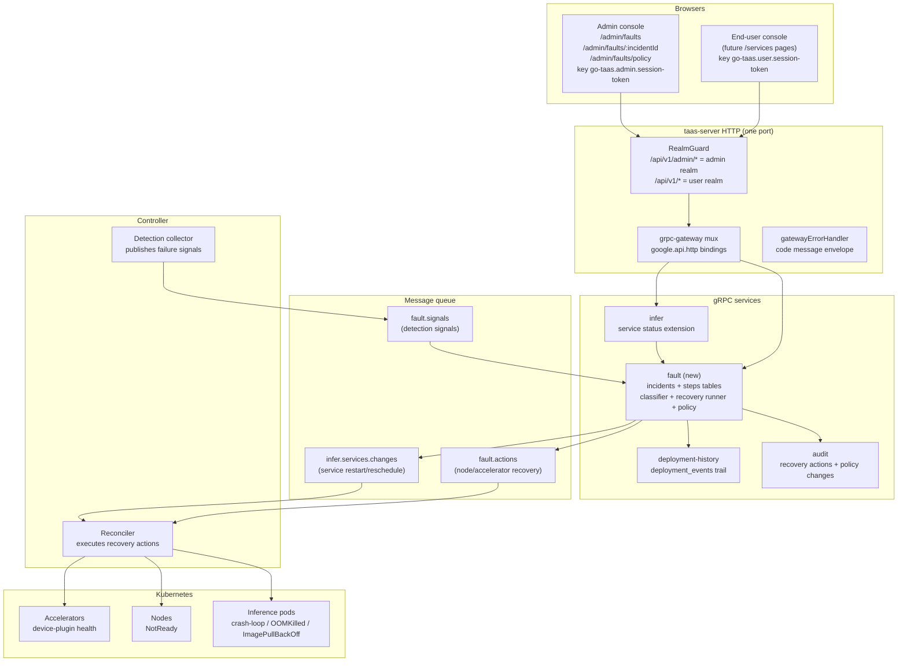
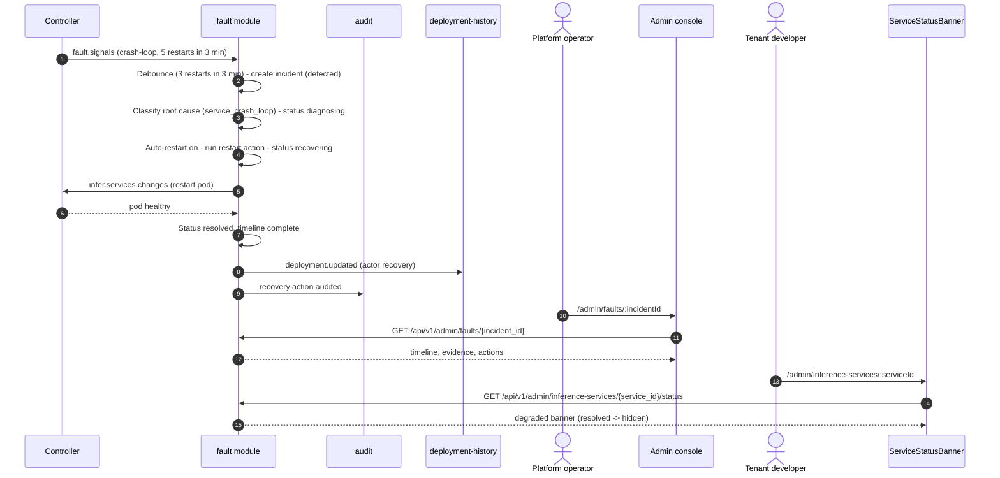
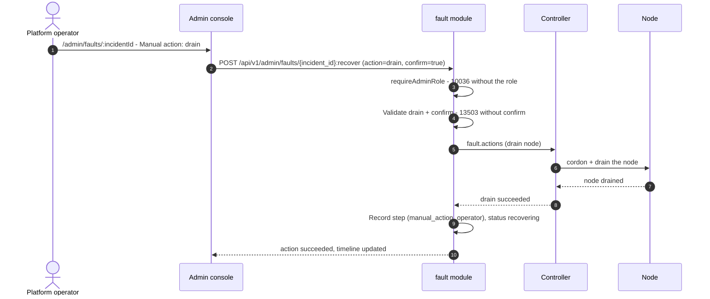

# Fault Diagnosis & Automatic Fault Tolerance — Architecture and Detailed Design

| Attribute | Content |
| --- | --- |
| Feature point | Fault diagnosis & automatic fault tolerance — detect inference-service / node / accelerator failures, diagnose root cause, and automatically recover (restart / reschedule / drain) with operator visibility (backlog row 53) |
| Document scope | Architecture and detailed design for feature-53: the new `fault` module (incident lifecycle, deterministic root-cause classifier, recovery actions, auto-recovery policy), the `infer` status extension (service status with the active incident), the Controller's detection-signal publication and recovery execution, the 135xx error block, the admin pages `/admin/faults`, `/admin/faults/:incidentId` and `/admin/faults/policy`, the tenant service-status / incident banner, configuration, security, rollout, and a function-level task list per layer |
| Owning modules | `fault` (new module — incident lifecycle, root-cause classifier, recovery actions, auto-recovery policy); `infer` (service status extension, incident banner data); `Controller` (detection signals, recovery execution); `k8s` (pod/node/accelerator state reads, restart/reschedule/drain actions); `audit` (recovery actions); `deployment-history` (recovery actions in the deployment trail); `pkg/server` gateway (admin + user prefix bindings); `pkg/errors` (the 135xx block); `pkg/config` (the `fault` section); `pkg/mq` (one new subject); `web` admin console (`FaultsPage`, `FaultDetailPage`, `FaultPolicyPage`, `ServiceStatusBanner`) |
| Related documents | [Requirement Analysis and UI/UX Design](../design/fault-diagnosis-auto-recovery.md) · [Architecture Design](../design/architecture.md) §2.4 `infer`, §2.7 Controller · [System Health & Service Status](./system-health-status.md) (the component-health surface this feature's incident management extends; its non-goals explicitly deferred incident management and incident timelines here) · [Error Analysis](./error-analysis.md) (the aggregate error surface this feature's per-incident diagnosis complements) · [Accelerator Inventory & Health](./accelerator-inventory.md) (the accelerator failure signals this feature consumes) · [Deployment History & Audit](./deployment-history-audit.md) (the change-event trail recovery actions are recorded in) · [Model Catalog & One-Click Deployment](./model-catalog-deployment.md) (the service lifecycle restart/reschedule targets) · [Inference Autoscaling](./inference-autoscaling.md) (why recovery reschedules rather than scales) · [Console Surface Separation](./console-surface-separation.md) (the two surfaces, the masked-projection rule) |
| Status | Architecture complete, handed to the Developer agent |

---

## 1. Overview and Goals

The platform's reliability story is **detection without response**. The system-health feature (#30) tells the operator *whether* a component is healthy, the accelerator inventory (#18) tells *whether* a GPU node is healthy, and error analysis (#31) aggregates *what* errors occur — but none of them **act**. When an inference service crash-loops, a node goes `NotReady`, or a GPU device plugin fails, the operator must notice the degraded state in one of these read-only surfaces, then manually restart the pod, reschedule the service, or drain the node using Kubernetes tooling. The platform has no incident lifecycle, no root-cause diagnosis, and no automatic recovery.

The system-health design explicitly deferred "incident management or incident timelines" to a later feature. This feature is that later feature: it closes the loop from **detection** (a failure signal) through **diagnosis** (a root-cause classifier) to **recovery** (an automatic action with operator override) and **resolution** (an incident timeline), all visible in the console.

The core invariants: a dedicated `fault` module and `/admin/faults` surface (D1); the incident lifecycle is detect → diagnose → recover → resolve (D2); the root-cause classifier is **deterministic rules over observed signals**, not an ML model (D3); automatic recovery is **bounded and operator-override-able** — restart/reschedule run automatically, drain requires operator confirmation (D4); recovery actions are recorded in the deployment-history trail and the audit trail (D5); the tenant surface shows a service status / incident banner (D6); predictive failure detection is out of scope (D7); and self-healing of the control plane itself is out of scope (D8).

**Goals**:

- Three admin pages: `/admin/faults` (`FaultsPage` — incident table with severity, status, root cause, target, auto-recovered, times; filters, search, pagination), `/admin/faults/:incidentId` (`FaultDetailPage` — diagnosis timeline, root-cause evidence, recovery actions, override/manual controls), and `/admin/faults/policy` (`FaultPolicyPage` — per-category auto-recovery toggles), per design §5.1–§5.4.
- The tenant service-status / incident banner (design §5.5): a compact degraded banner on the service list and detail pages when a service has an active incident.
- A new `fault` module owning the incident lifecycle, the deterministic root-cause classifier, and the recovery actions, with its own error block **135xx** (design §6).
- Six admin RPCs on `FaultService` bound under `/api/v1/admin/faults/*`, one user-surface `GetServiceStatus` on `InferService`, and its admin-surface twin `GetAdminServiceStatus` for the admin console's banner (design §6).
- The Controller's detection-signal publication (crash-loop, OOMKilled, ImagePullBackOff, node `NotReady`, device-plugin unhealthy) and recovery execution (restart = delete pod, reschedule = delete pod with a node-anti-affinity hint, drain = cordon + drain) (design §6 notes 2–3).
- Numbered acceptance criteria (AC1–AC13) testable in Nightwatch, FVT and unit tests; the fault contract verified synthetically (the established out-of-repository pattern).

**Non-goals** (from the design, restated): predictive failure detection (D7 — the classifier reacts to observed failures); self-healing of the control plane itself (D8 — system-health covers platform components); cross-cluster failover (future work — recovery is within a cluster); on-call / escalation / responder workflows (deliberately excluded — single-operator platform); user-authored metric alarms (deliberately excluded — detection is from cluster state); incident alerting / notifications (feature #26 consumes observability events); public / third-party status page (deliberately excluded — incidents are internal); and root-cause reclassification persistence (future work — the operator can reclassify an `unknown` incident, but the reclassification is not persisted as a learning signal).

### 1.1 Reading order of this document

Section 2 records the architecture decisions (AD1–AD16; AD11–AD16 are refinements the architecture adds, marked as such). Sections 3–5 are the component view, the data model and the API design (including the pinned fault contract). Section 6 is the frontend architecture (page → route → API-prefix table, navigation, shared components, auth guard). Sections 7–8 are the sequence diagrams and error handling. Sections 9–11 are configuration, security and rollout. Section 12 is the acceptance-criteria traceability. Sections 13–15 are the function-level detailed design, the ordered implementation task list, and the deferred items.

---

## 2. Architecture Decisions

AD1–AD10 restate the UI/UX design's decisions (D1–D8) as implementation-level rules; AD11–AD16 are refinements the architecture adds, marked as such.

| # | Decision | Rationale |
| --- | --- | --- |
| AD1 | **A dedicated `fault` module and `/admin/faults` surface.** Incidents are a stateful lifecycle with actions, distinct from the read-only system-health aggregation. The `fault` module owns the incident lifecycle, the deterministic root-cause classifier, and the recovery actions | Design D1. System-health is a read-only aggregation; incidents are a stateful lifecycle with actions. A dedicated module and surface keeps concerns separate |
| AD2 | **The incident lifecycle is detect → diagnose → recover → resolve.** Every incident has a status (`detected` → `diagnosing` → `recovering` → `resolved`, or `failed` if recovery fails) and a timeline of timestamped steps | Design D2. Mirrors the industry-standard incident lifecycle (Datadog, PagerDuty) and gives the operator a clear state machine |
| AD3 | **The root-cause classifier is deterministic rules over observed signals**, not an ML model. Categories: `service_crash_loop`, `node_not_ready`, `accelerator_device_plugin`, `oom`, `image_pull_failure`, `unknown` | Design D3. Auditable and testable; no hidden judge. Each category maps to a bounded recovery action |
| AD4 | **Automatic recovery is bounded and operator-override-able.** Restart and reschedule run automatically (with a per-category policy); drain requires operator confirmation. The operator can disable auto-recovery per category, override an in-flight action, or manually trigger one | Design D4. Restart/reschedule are low-risk and safe to automate; drain is disruptive and must be confirmed. Operator override prevents runaway automation |
| AD5 | **Recovery actions are recorded in the deployment-history trail** (`deployment.updated` with a `recovery` actor) and the audit trail | Design D5. Recovery is a deployment mutation; recording it in the existing trail (#17) keeps one source of truth for service changes |
| AD6 | **The tenant surface shows a service status / incident banner** — a compact banner on the service list and detail pages when a service is degraded or under recovery | Design D6. Tenants whose service is affected must see the degraded state; the banner is explicit, not hidden |
| AD7 | **Predictive failure detection is out of scope.** The classifier reacts to observed failures, not predicted ones | Design D7. Keeps the feature bounded and honest; prediction is future work |
| AD8 | **Self-healing of the control plane itself is out of scope.** The `fault` module recovers inference services, nodes, and accelerators — not the platform's own components | Design D8. The control plane's health is system-health's (#30) concern; this feature targets the inference data path |
| AD9 | **Incident management is admin-only; the service status / banner is surface-split.** Incident CRUD, diagnosis, recovery and policy are admin (`/admin/faults` + `/api/v1/admin/faults/*`); the service status is user-surface (`/api/v1/inference-services/{service_id}/status`) with an admin-surface twin for the admin console's banner (`/api/v1/admin/inference-services/{service_id}/status`). A user-realm session on an admin route gets **10038**; a session without the platform-admin role gets **10036** | Design FR6.1. Consistent with the console-surface separation; incident internals (fleet-wide diagnosis) are operator knowledge, the affected service's status is the tenant's |
| AD10 | **The tenant-visible `GetServiceStatus` enforces service scoping at the service layer.** The caller's org is resolved from the session, never from a client-supplied service id; it returns only the caller's own service's incident. The tenant surface exposes no incident mutation | Design FR5.3, §6 note 4. The banner must not leak another org's incident; the scoping check is server-side, never trusted from the client |
| AD11 | **REFINEMENT of design D2/FR1.1 — the incident is a database table; the timeline is a child table.** The `fault` module owns an `incidents` table (incident_id, severity, status, root_cause, target_type, target_name, started_at, resolved_at, auto_recovered) and an `incident_steps` table (the diagnosis timeline: step_id, incident_id, step_type, actor, detail, created_at). The timeline is a child table so each step is independently timestamped and queryable | The design pins "every incident has a timeline of timestamped steps" without pinning the storage. A parent `incidents` table + a child `incident_steps` table is the smallest faithful reading: the incident's aggregate state is one row, and the timeline is an ordered list of steps. This keeps the timeline queryable (the detail page reads it in order) and the incident row compact |
| AD12 | **REFINEMENT of design D3/FR2.1 — the classifier is a pure function over a structured signal.** The Controller publishes a structured failure signal (target_type, target_name, signal_type, detail, observed_at); the `fault` module's classifier maps `signal_type` to a root-cause category via a deterministic switch. The evidence is the signal's `detail` field, stored verbatim on the incident | The design says "the classifier maps a failure signal to a root-cause category" without pinning the signal shape. A structured signal (not free text) keeps the classifier a pure, testable function; the `detail` field is the evidence the detail page shows (FR2.2) |
| AD13 | **REFINEMENT of design D3/FR3.1 — detection signals ride a new `fault.signals` MQ subject.** The Controller publishes failure signals on `fault.signals`; the `fault` module consumes, debounces, and classifies them. The debounce window is per-signal-type (e.g. a crash-loop is reported after N restarts in a window, not on the first restart) | The design says "the Controller publishes failure signals to the `fault` module via the message queue" without pinning the subject. A dedicated `fault.signals` subject keeps the detection channel separate from the deployment/status channels; the debounce is the module's consumer-side logic (FR3.2) |
| AD14 | **REFINEMENT of design D4/FR4.1 — recovery actions ride the existing `infer.services.changes` subject for service targets and a new `fault.actions` subject for node/accelerator targets.** A restart/reschedule on a service is a deployment mutation (delete pod → ReplicaSet recreates) executed by the Controller via the existing change channel; a drain on a node is a node-level action executed by the Controller via `fault.actions`. The `fault` module records the action in the timeline and the deployment-history trail | The design says "the Controller executes them; the `fault` module records them" without pinning the transport. Service-target recovery reuses the existing change channel (the Controller already reconciles it); node/accelerator-target recovery needs a new action channel. This keeps one deployment channel and adds one node-action channel |
| AD15 | **REFINEMENT of design D4/FR4.2 — the auto-recovery policy is a single row with per-category toggles.** The policy is one `fault_policy` row (auto_restart per category, auto_reschedule per category, drain_always_confirm = true). It is read by the recovery runner and edited by the policy page; changes are audited | The design says "the auto-recovery policy is configurable per category" without pinning the storage. A single row with per-category toggles is the smallest faithful reading; the drain-always-confirm flag is a constant (always true) shown for transparency (FR4.4) |
| AD16 | **REFINEMENT of design D5/FR4.5 — recovery actions are recorded in the deployment-history trail via the existing `deployment_events` table.** A recovery action on a service writes a `deployment_events` row with `event_type = 'deployment.updated'` and `actor = 'recovery'` (plus the specific action in the detail); a node/accelerator recovery action writes an audit event. All recovery actions and policy changes are audited | The design says "recovery actions are recorded in the deployment-history trail (`deployment.updated`, actor `recovery`) and the audit trail". The existing `deployment_events` table (feature #34) is the trail; the `fault` module writes to it via the infer module's seam. Node/accelerator actions have no service row, so they are audit-only |

---

## 3. Component View

### 3.1 Ownership

| Layer / component | Owns | Changes in this feature |
| --- | --- | --- |
| **Static bundle (SPA)** | One Vite bundle (`web/dist`), embedded into `taas-server` at `pkg/server/console/`; served by the gateway's SPA fallback | Three new admin pages (`FaultsPage`, `FaultDetailPage`, `FaultPolicyPage`), the `ServiceStatusBanner` component, nav items, and the route registrations in `App.tsx` |
| **Gateway (`pkg/server`)** | HTTP composition: `RealmGuard` → `withConsole` → `runtime.ServeMux`; the unified error renderer; the SPA fallback | No change — the new RPCs bind under `/api/v1/admin/faults/*` (admin) and `/api/v1/inference-services/{service_id}/status` (user), and the realm guard already classifies those prefixes |
| **grpc-gateway mux** | Path → RPC routing from `google.api.http` annotations | New bindings for the seven new RPCs (Section 5) |
| **`fault` (new)** | The `incidents` + `incident_steps` tables, the incident lifecycle, the deterministic classifier, the recovery runner, the auto-recovery policy | New service: `services/fault` |
| **`infer`** | The service status extension, the incident banner data | `GetServiceStatus` (user surface) and `GetAdminServiceStatus` (admin surface) return the service's status with any active incident |
| **`internal/controller`** | Kubernetes reconciliation; detection-signal publication; recovery execution | Publishes failure signals on `fault.signals`; executes restart/reschedule/drain actions |
| **`pkg/k8s`** | The Kubernetes client (clientset + dynamic) | No change — the Controller uses the existing clientset |
| **`pkg/mq`** | The canonical subjects | Two new subjects: `fault.signals`, `fault.actions` |
| **`pkg/errors`** | Code blocks per module | A new **135xx** block after the vgpu block (134xx) |
| **`pkg/config`** | The merged configuration tree | A new `fault` section (debounce windows, retention, recovery defaults) |
| **`audit`** | The audit trail | Reused — recovery actions and policy changes |
| **`deployment-history`** | The `deployment_events` table | Reused — recovery actions on services write `deployment.updated` with actor `recovery` |

### 3.2 Runtime component view



---

## 4. Data Model

### 4.1 The `incidents` Table (new, owned by `fault`)

| Column | PostgreSQL type | Constraints | Description |
| --- | --- | --- | --- |
| `id` | `uuid` | PRIMARY KEY | Server-generated UUID v4, exposed as `incident_id` |
| `severity` | `varchar(16)` | NOT NULL | `critical` / `warning` / `info` |
| `status` | `varchar(16)` | NOT NULL DEFAULT 'detected' | `detected` / `diagnosing` / `recovering` / `resolved` / `failed` |
| `root_cause` | `varchar(32)` | NOT NULL | `service_crash_loop` / `node_not_ready` / `accelerator_device_plugin` / `oom` / `image_pull_failure` / `unknown` |
| `target_type` | `varchar(16)` | NOT NULL | `service` / `node` / `accelerator` |
| `target_name` | `varchar(128)` | NOT NULL | The affected service name / node name / accelerator id |
| `started_at` | `timestamptz` | NOT NULL | Detection time (UTC) |
| `resolved_at` | `timestamptz` | NULL | Resolution time; NULL while active |
| `auto_recovered` | `boolean` | NOT NULL DEFAULT false | Whether an automatic recovery action succeeded |
| `created_at` | `timestamptz` | NOT NULL | Creation time (UTC) |
| `updated_at` | `timestamptz` | NOT NULL | Last status change |

Indexes:

| Index | Definition | Purpose |
| --- | --- | --- |
| Primary key | `(id)` | Incident identity |
| Composite | `(status, started_at DESC)` | Status-filtered, newest-first paginated list |
| Composite | `(target_type, target_name)` | Look up incidents by target |

### 4.2 The `incident_steps` Table (new, owned by `fault`)

| Column | PostgreSQL type | Constraints | Description |
| --- | --- | --- | --- |
| `id` | `uuid` | PRIMARY KEY | Server-generated UUID v4 |
| `incident_id` | `uuid` | NOT NULL, FK → `incidents.id` | The parent incident |
| `step_type` | `varchar(16)` | NOT NULL | `detected` / `diagnosed` / `recovery_started` / `recovery_succeeded` / `recovery_failed` / `resolved` / `overridden` / `manual_action` |
| `actor` | `varchar(128)` | NOT NULL | `system` or an operator user id |
| `detail` | `varchar(512)` | NOT NULL | The step's detail (e.g. "container restarted 5 times in 3 minutes") |
| `created_at` | `timestamptz` | NOT NULL | Step time (UTC) |

Indexes:

| Index | Definition | Purpose |
| --- | --- | --- |
| Primary key | `(id)` | Step identity |
| Composite | `(incident_id, created_at)` | The ordered timeline for an incident |

### 4.3 The `fault_policy` Table (new, owned by `fault`)

| Column | PostgreSQL type | Constraints | Description |
| --- | --- | --- | --- |
| `id` | `int` | PRIMARY KEY DEFAULT 1 | Single-row policy (AD15) |
| `auto_restart` | `jsonb` | NOT NULL DEFAULT '{}' | Per-category auto-restart toggles: `{"service_crash_loop": true, "oom": true, "image_pull_failure": true}` |
| `auto_reschedule` | `jsonb` | NOT NULL DEFAULT '{}' | Per-category auto-reschedule toggles: `{"node_not_ready": true, "accelerator_device_plugin": true}` |
| `drain_always_confirm` | `boolean` | NOT NULL DEFAULT true | Always true (FR4.4); shown for transparency |
| `updated_at` | `timestamptz` | NOT NULL | Last change |

Design notes:

- **`auto_restart` / `auto_reschedule` as `jsonb`**: the per-category toggles are a bounded map; JSON keeps the schema flexible without a column per category. The toggle validation (FR4.2) runs at update time, so the stored JSON is always valid.
- **`drain_always_confirm` is a constant** (AD15): drain always requires operator confirmation (FR4.4); the flag is stored for transparency and shown on the policy page, never toggled off.
- **Retention** (FR1.4): incidents are retained for a bounded window (default 30 days) and then archived; a cleanup runner deletes incidents older than the retention window.

### 4.4 Migration and init-SQL upgrade path

This repository does **not** use hand-written init-SQL scripts: every schema change is the GORM model created/altered by the owning service's `Migrate` via `db.AutoMigrate(...)`, and there are no `.sql` files under `deploy/`. The upgrade path is:

1. Add the `Incident`, `IncidentStep` and `FaultPolicy` models in `services/fault/fault_model.go`; the new `fault` service's `Migrate` AutoMigrates them.
2. No data backfill: the tables are new. No manual DDL, no compose change.

---

## 5. API Design

### 5.1 Surface mapping

Seven RPCs are new (six admin, one user). No RPC is dual-bound: the admin RPCs are fleet-scoped management, the user RPC is the caller's own service's status.

| RPC | HTTP method + path | Surface | Status | Purpose |
| --- | --- | --- | --- | --- |
| `ListIncidents` (new `taas.fault.v1.FaultService`) | `GET /api/v1/admin/faults` | admin | **new** | Incident rows with severity, status, root cause, target, times; pagination, filters, search |
| `GetIncident` | `GET /api/v1/admin/faults/{incident_id}` | admin | **new** | One incident's timeline, evidence, actions; unknown → 13506 |
| `UpdateAutoRecoveryPolicy` | `PATCH /api/v1/admin/faults/policy` | admin | **new** | Per-category auto-recovery toggles; audited; 13502 on bad input |
| `GetAutoRecoveryPolicy` | `GET /api/v1/admin/faults/policy` | admin | **new** | Current policy for the policy page |
| `TriggerRecoveryAction` | `POST /api/v1/admin/faults/{incident_id}:recover` | admin | **new** | Manually trigger restart/reschedule/drain; drain requires a confirm flag; 13503 if invalid |
| `OverrideRecoveryAction` | `POST /api/v1/admin/faults/{incident_id}:override` | admin | **new** | Cancel an in-flight recovery action; 13504 if none in flight |
| `GetServiceStatus` (`taas.infer.v1`) | `GET /api/v1/inference-services/{service_id}/status` | user | **new** | Service status with any active incident (masked — own service only) |
| `GetAdminServiceStatus` (`taas.infer.v1`) | `GET /api/v1/admin/inference-services/{service_id}/status` | admin | **new** | Same projection for the admin console's banner (org-scoped) |

Gateway routing notes: `GET /api/v1/admin/faults` (collection root), `GET /api/v1/admin/faults/{incident_id}` and `GET /api/v1/admin/faults/policy` are distinct paths — no wildcard conflict (the `policy` literal is matched before the `{incident_id}` wildcard). The `:recover` and `:override` custom verbs follow the existing `:scale` / `:playground` convention on the same mux. The user-surface `GET /api/v1/inference-services/{service_id}/status` is a distinct user-prefix path, and its admin twin `GET /api/v1/admin/inference-services/{service_id}/status` a distinct admin-prefix path, so the realm guard classifies each to its own surface.

**Surface decision (recorded)**: the design doc's §4 table assigns the tenant banner to the end-user surface (`/services`, `/services/:serviceId`), but the existing service list/detail pages are admin-surface (`/admin/inference-services`, `/admin/inference-services/:id`). Consistent with the existing architecture, the `GetServiceStatus` RPC is a **new user-surface** RPC (as the design specifies, enforcing service scoping), and the banner extends the **existing admin** `InferenceServicesPage` and `ServiceDetailPage` via its admin-surface twin `GetAdminServiceStatus` (`GET /api/v1/admin/inference-services/{service_id}/status`, same projection and org scoping) so the admin pages never call a user-surface route. This preserves the design's intent (a degraded banner on the service pages) while keeping the service pages where they actually live and the two console surfaces strictly separated. The design's `/services` end-user routes are not created.

### 5.2 Proto contract

**New `proto/taas/fault/v1/fault.proto`** — the `FaultService` with six admin RPCs:

```proto
syntax = "proto3";
package taas.fault.v1;

import "google/api/annotations.proto";
import "taas/common/v1/common.proto";

option go_package = "github.com/go-taas/go-taas/proto/taas/fault/v1;faultv1";

// FaultService manages the incident lifecycle, root-cause diagnosis and
// automatic recovery (feature #53). All RPCs are admin-surface.
service FaultService {
  // ListIncidents returns incidents, newest first, with severity,
  // status, root cause, target and times (admin surface,
  // requireAdminRole).
  rpc ListIncidents(ListIncidentsRequest) returns (ListIncidentsResponse) {
    option (google.api.http) = {get: "/api/v1/admin/faults"};
  }

  // GetIncident returns one incident's full detail: the diagnosis
  // timeline, the root-cause evidence, and the recovery actions
  // (admin surface). An unknown incident returns 13506.
  rpc GetIncident(GetIncidentRequest) returns (GetIncidentResponse) {
    option (google.api.http) = {get: "/api/v1/admin/faults/{incident_id}"};
  }

  // UpdateAutoRecoveryPolicy sets the per-category auto-recovery
  // toggles (admin surface). Audited; 13502 on bad input.
  rpc UpdateAutoRecoveryPolicy(UpdateAutoRecoveryPolicyRequest) returns (UpdateAutoRecoveryPolicyResponse) {
    option (google.api.http) = {
      patch: "/api/v1/admin/faults/policy"
      body: "*"
    };
  }

  // GetAutoRecoveryPolicy returns the current policy (admin surface).
  rpc GetAutoRecoveryPolicy(GetAutoRecoveryPolicyRequest) returns (GetAutoRecoveryPolicyResponse) {
    option (google.api.http) = {get: "/api/v1/admin/faults/policy"};
  }

  // TriggerRecoveryAction manually triggers a restart/reschedule/drain
  // on an incident (admin surface). Drain requires a confirm flag;
  // 13503 if invalid.
  rpc TriggerRecoveryAction(TriggerRecoveryActionRequest) returns (TriggerRecoveryActionResponse) {
    option (google.api.http) = {
      post: "/api/v1/admin/faults/{incident_id}:recover"
      body: "*"
    };
  }

  // OverrideRecoveryAction cancels an in-flight recovery action (admin
  // surface). 13504 if none is in flight.
  rpc OverrideRecoveryAction(OverrideRecoveryActionRequest) returns (OverrideRecoveryActionResponse) {
    option (google.api.http) = {
      post: "/api/v1/admin/faults/{incident_id}:override"
      body: "*"
    };
  }
}

// Incident is the FR1.1 projection.
message Incident {
  string incident_id = 1;
  string severity = 2;    // critical | warning | info
  string status = 3;      // detected | diagnosing | recovering | resolved | failed
  string root_cause = 4;  // service_crash_loop | node_not_ready | accelerator_device_plugin | oom | image_pull_failure | unknown
  string target_type = 5; // service | node | accelerator
  string target_name = 6;
  int64 started_at = 7;   // unix seconds
  int64 resolved_at = 8;  // unix seconds, 0 = active
  bool auto_recovered = 9;
}

// IncidentStep is one diagnosis-timeline step (AD11).
message IncidentStep {
  string step_type = 1; // detected | diagnosed | recovery_started | recovery_succeeded | recovery_failed | resolved | overridden | manual_action
  string actor = 2;     // system or an operator user id
  string detail = 3;
  int64 created_at = 4; // unix seconds
}

// RecoveryAction is one recovery action taken or pending.
message RecoveryAction {
  string action = 1;    // restart | reschedule | drain
  string status = 2;    // pending | running | succeeded | failed | overridden
  string actor = 3;     // system or an operator user id
  int64 created_at = 4; // unix seconds
}

message ListIncidentsRequest {
  taas.common.v1.PageRequest page = 1;
  string status = 2;      // detected | diagnosing | recovering | resolved | failed | empty = all
  string severity = 3;    // critical | warning | info | empty = all
  string root_cause = 4;  // empty = all
  string target_type = 5; // service | node | accelerator | empty = all
  string search = 6;      // target-name substring search
}

message ListIncidentsResponse {
  taas.common.v1.Response response = 1;
  repeated Incident incidents = 2;
  taas.common.v1.PageMeta page_meta = 3;
}

message GetIncidentRequest {
  string incident_id = 1;
}

message GetIncidentResponse {
  taas.common.v1.Response response = 1;
  Incident incident = 2;
  repeated IncidentStep steps = 3;      // the diagnosis timeline, oldest first
  repeated RecoveryAction actions = 4;  // the recovery actions taken or pending
}

message UpdateAutoRecoveryPolicyRequest {
  // auto_restart / auto_reschedule are per-category toggles; absent
  // categories are unchanged.
  map<string, bool> auto_restart = 1;
  map<string, bool> auto_reschedule = 2;
}

message UpdateAutoRecoveryPolicyResponse {
  taas.common.v1.Response response = 1;
  AutoRecoveryPolicy policy = 2;
}

message GetAutoRecoveryPolicyRequest {}

message GetAutoRecoveryPolicyResponse {
  taas.common.v1.Response response = 1;
  AutoRecoveryPolicy policy = 2;
}

// AutoRecoveryPolicy is the per-category auto-recovery configuration
// (AD15).
message AutoRecoveryPolicy {
  map<string, bool> auto_restart = 1;
  map<string, bool> auto_reschedule = 2;
  bool drain_always_confirm = 3; // always true (FR4.4)
}

message TriggerRecoveryActionRequest {
  string incident_id = 1;
  string action = 2;    // restart | reschedule | drain
  bool confirm = 3;     // required for drain (FR4.4)
}

message TriggerRecoveryActionResponse {
  taas.common.v1.Response response = 1;
  RecoveryAction action = 2;
}

message OverrideRecoveryActionRequest {
  string incident_id = 1;
}

message OverrideRecoveryActionResponse {
  taas.common.v1.Response response = 1;
  RecoveryAction action = 2; // the overridden action
}
```

**Change to `proto/taas/infer/v1/infer.proto`** — a new `GetServiceStatus` RPC (user surface) and its admin-surface twin `GetAdminServiceStatus` (same projection, admin prefix, for the admin console's banner):

```proto
  // GetServiceStatus returns the service's status including any active
  // incident (user surface; the org is resolved from the session, never
  // from a client-supplied service id — only the caller's own service's
  // incident is returned, feature #53, AD10).
  rpc GetServiceStatus(GetServiceStatusRequest) returns (GetServiceStatusResponse) {
    option (google.api.http) = {get: "/api/v1/inference-services/{service_id}/status"};
  }

  // GetAdminServiceStatus returns the service's status including any
  // active incident for the admin console's degraded banner (feature
  // #53, AD10). Same projection as GetServiceStatus but served on the
  // admin surface so the admin pages never call the user-surface
  // route; the org is resolved from the session and the read is scoped
  // to the caller's organization.
  rpc GetAdminServiceStatus(GetAdminServiceStatusRequest) returns (GetAdminServiceStatusResponse) {
    option (google.api.http) = {get: "/api/v1/admin/inference-services/{service_id}/status"};
  }

message GetServiceStatusRequest {
  string service_id = 1;
}

message GetServiceStatusResponse {
  taas.common.v1.Response response = 1;
  string state = 2;      // pending | deploying | running | failed | terminated
  bool degraded = 3;     // true when an active incident exists
  ServiceIncident incident = 4; // null when healthy
}

// ServiceIncident is the masked incident projection for the tenant
// banner (AD10).
message ServiceIncident {
  string incident_id = 1;
  string severity = 2;
  string status = 3;
  string root_cause = 4;
  string message = 5; // plain-language banner copy
}
```

### 5.3 The pinned fault contract (data plane, out of repository scope)

The Controller is in this repository, but the detection/recovery contract below is binding for the data-plane track and is verified synthetically in FVT (the established pattern — the compose mock honors it for e2e). The contract, item by item:

1. **Detection signals** (FR3.1): the Controller watches inference-service pods (crash-loop, OOMKilled, ImagePullBackOff), nodes (`NotReady`), and accelerator device-plugin health (from #18), and publishes a structured failure signal on `fault.signals`: `{"target_type", "target_name", "signal_type", "detail", "observed_at"}` (AD12).
2. **Debounce** (FR3.2): a signal is debounced per signal-type — e.g. a crash-loop is reported after N restarts in a window (default 3 restarts in 3 minutes), not on the first restart. The debounce window is configurable (Section 9).
3. **Recovery execution** (FR4.1, §6 note 3): restart = delete the pod (the ReplicaSet recreates it); reschedule = delete the pod with a node-anti-affinity hint; drain = cordon + drain the node. Service-target recovery rides the existing `infer.services.changes` channel; node/accelerator-target recovery rides the new `fault.actions` channel (AD14).
4. **Drain requires confirmation** (FR4.4): a drain action never runs automatically; the server rejects a drain without the confirm flag (**13503**).
5. **Recording** (D5, AD16): every recovery action is recorded in the deployment-history trail (`deployment.updated`, actor `recovery`) for service targets and the audit trail for all targets.

The contract, item by item:

- **Detection is reactive** (D7): the module reacts to observed failures, never predicts them.
- **The fault contract is verified synthetically** in FVT (the compose mock honors it); the control plane never renders a raw Kubernetes error — a recovery failure surfaces as a `failed` incident with the failed step in the timeline.

### 5.4 Validation contract

| Field | Rule | Error |
| --- | --- | --- |
| `incident_id` (get/trigger/override) | must exist | 13506 |
| `status` / `severity` / `root_cause` / `target_type` filters | closed enums (empty = all) | 13502 |
| `auto_restart` / `auto_reschedule` keys | must be valid root-cause categories | 13502 |
| `action` (trigger) | `restart` / `reschedule` / `drain` | 13503 |
| `confirm` (drain) | must be true for a drain | 13503 |
| `OverrideRecoveryAction` | an action must be in flight | 13504 |
| `GetServiceStatus` org context | resolved from the session (transitional header fallback); empty → | 10005 |

Serialization conventions unchanged: HTTP 200 on success, business errors as `{"code": <int>, "message": "..."}`, int64 fields as JSON strings (the timestamps).

---

## 6. Frontend Architecture

### 6.1 Page → route → API-prefix table

| Page / component | Route | API prefix | Surface |
| --- | --- | --- | --- |
| `FaultsPage` (new, `web/src/pages/FaultsPage.tsx`) | `/admin/faults` | `/api/v1/admin/faults` | admin |
| `FaultDetailPage` (new, `web/src/pages/FaultDetailPage.tsx`) | `/admin/faults/:incidentId` | `/api/v1/admin/faults` | admin |
| `FaultPolicyPage` (new, `web/src/pages/FaultPolicyPage.tsx`) | `/admin/faults/policy` | `/api/v1/admin/faults` | admin |
| `ServiceStatusBanner` (new, `web/src/components/ServiceStatusBanner.tsx`) | `InferenceServicesPage`, `ServiceDetailPage` (existing) | `/api/v1/admin/inference-services/{service_id}/status` | admin |

The admin pages contain **no `/api/v1/*` call**; the banner component calls the admin-surface `GetAdminServiceStatus` (AC11). Per the console-surface separation, the admin pages and the banner are admin-realm sources (`web/src/pages/*.tsx`, `web/src/components/**`).

**Surface decision (recorded)**: the design doc's §4 table assigns the tenant banner to the end-user surface (`/services`, `/services/:serviceId`). Consistent with the existing architecture (the service list/detail are admin-surface today), the `ServiceStatusBanner` extends the **admin** `InferenceServicesPage` and `ServiceDetailPage`, calling the admin-surface `GetAdminServiceStatus` (`GET /api/v1/admin/inference-services/{service_id}/status`, same projection and org scoping as the user-surface read). The user-surface `GetServiceStatus` remains for future end-user service pages. This is the interpretation most consistent with the existing architecture and the console-surface separation; the design's `/services` end-user routes are not created.

### 6.2 Navigation placement

`AdminShell`'s `ADMIN_NAV_ITEMS` gains one item in the operations cluster (beside Status / Error Analysis):

```tsx
{ path: '/admin/faults', labelKey: 'nav.faults', testid: 'nav-faults', icon: ShieldAlert },
```

`App.tsx` registers the three routes in the admin block:

```tsx
<Route path="/admin/faults" element={<FaultsPage />} />
<Route path="/admin/faults/:incidentId" element={<FaultDetailPage />} />
<Route path="/admin/faults/policy" element={<FaultPolicyPage />} />
```

### 6.3 Shared components and state to reuse

- `Dialog` (the drain-confirm dialog and the manual-action dialog), the `data` table styles, `PageMeta` pagination, `usePolling` (`web/src/components.tsx`) for the incident list refresh and the banner, the badge/progress-bar classes, the timeline pattern from `DeploymentHistoryPage`/`AuditLogsPage` — all existing console conventions.
- **`IncidentTimeline`** (`web/src/pages/faults/IncidentTimeline.tsx`): the vertical diagnosis timeline (each step with timestamp, actor, detail; a `failed` step in red) used by `FaultDetailPage`.
- **`SeverityBadge`** (`web/src/pages/faults/SeverityBadge.tsx`): the severity badge (critical red / warning amber / info blue) used by the incident table and the detail header.
- **`ServiceStatusBanner`** (`web/src/components/ServiceStatusBanner.tsx`): the compact degraded banner (severity color, plain-language message, root-cause chip) used by `InferenceServicesPage` and `ServiceDetailPage`.

### 6.4 Auth guard per surface

- `FaultsPage`, `FaultDetailPage` and `FaultPolicyPage` render inside `AdminShell`, whose shell guard enforces the admin session realm (`/admin/login`, token `go-taas.admin.session-token`); a user-realm session on an admin route gets **10038** from the realm guard. A session without the platform-admin role receives **10036** from `requireAdminRole`; the page renders the standard permission-denied state with a link back to `/admin` (AC12).
- The `ServiceStatusBanner` calls the admin-surface `GET /api/v1/admin/inference-services/{service_id}/status`; the scoping is server-side (AD10) — the banner shows only the caller's own service's incident. The banner is informational and links to nothing on the user surface.

### 6.5 `data-testid` hooks (binding, kebab-case)

Admin: `nav-faults`, `fault-table`, `fault-row-{incident_id}`, `fault-severity-{incident_id}`, `fault-status-{incident_id}`, `fault-root-cause-{incident_id}`, `fault-target-{incident_id}`, `fault-auto-recovered-{incident_id}`, `fault-started-{incident_id}`, `fault-resolved-{incident_id}`, `fault-search`, `fault-filter-status`, `fault-filter-severity`, `fault-filter-root-cause`, `fault-filter-target-type`, `fault-pagination`, `fault-empty`, `fault-permission-denied`, `fault-timeline`, `fault-timeline-step-{index}`, `fault-evidence`, `fault-actions`, `fault-action-{action}`, `fault-override-{incident_id}`, `fault-manual-{action}`, `fault-drain-confirm-dialog`, `fault-drain-confirm`, `fault-resolved-banner`, `fault-policy-row-{category}`, `fault-policy-toggle-{category}-{action}`, `fault-policy-save`.

Banner: `service-status-banner`, `service-status-banner-severity`, `service-status-banner-message`, `service-status-banner-root-cause`.

---

## 7. Sequence Diagrams

### 7.1 A crash-loop incident is detected, diagnosed, and auto-recovered



### 7.2 The operator confirms a drain



---

## 8. Error Handling

| Condition | HTTP | Code | Constant | Notes |
| --- | --- | --- | --- | --- |
| Policy input invalid | 500 | 13502 | `CodeFaultPolicyInvalid` | Validation; the category is named |
| Recovery action invalid (e.g. drain without confirm, unknown action) | 500 | 13503 | `CodeFaultRecoveryInvalid` | Action rejected |
| No in-flight action to override | 500 | 13504 | `CodeFaultNoActionInFlight` | Override rejected |
| Unknown incident | 500 | 13506 | `CodeFaultNotFound` | |
| User-realm session on an admin route | 500 | 10038 | `CodeRealmMismatch` | Reused — realm separation (FR6.1) |
| Session without the required role | 500 | 10036 | `CodeForbidden` | Reused — permission denial (FR6.1) |
| No org context on `GetServiceStatus` | 500 | 10005 | `CodeOrganizationNotFound` | Reused — the org-guard convention |

Rendering split (binding for the Test agent): **all 135xx codes are control-plane business errors** through grpc-gateway with the unified `{"code": <int>, "message": "..."}` envelope and HTTP 500, the repo convention. The fault contract is verified synthetically (Section 5.3); a recovery failure surfaces as a `failed` incident with the failed step in the timeline, not a 135xx code.

---

## 9. Configuration

New `fault` section in `pkg/config` (`FaultConfig`, mapped `mapstructure:"fault"`), defaulted in `applyDefaults`, validated in `Validate`:

| Key | Type | Default | Notes |
| --- | --- | --- | --- |
| `fault.debounce.crashLoopRestarts` | int | `3` | Crash-loop reported after N restarts (FR3.2) |
| `fault.debounce.crashLoopWindow` | duration | `3m` | The crash-loop window |
| `fault.retention` | duration | `720h` | Incident retention window (30 days, FR1.4) |
| `fault.recovery.autoRestart` | map | `{"service_crash_loop": true, "oom": true, "image_pull_failure": true}` | Default auto-restart toggles (FR4.1) |
| `fault.recovery.autoReschedule` | map | `{"node_not_ready": true, "accelerator_device_plugin": true}` | Default auto-reschedule toggles (FR4.1) |
| `fault.signalsConsumer.enabled` | bool | `true` | The detection-signal consumer runner kill switch (AD13) |
| `fault.signalsConsumer.workers` | int | `2` | Concurrent signal handlers |

`pkg/mq` gains the subject constants `SubjectFaultSignals = "fault.signals"` and `SubjectFaultActions = "fault.actions"` (the canonical-subjects file).

`configs/config.yaml` gains:

```yaml
# Fault diagnosis & automatic fault tolerance (feature #53). The fault
# module owns the incident lifecycle, the deterministic root-cause
# classifier, and the recovery actions.
fault:
  # Debounce windows per signal type (FR3.2).
  debounce:
    crashLoopRestarts: 3
    crashLoopWindow: 3m
  # Incident retention window (FR1.4).
  retention: 720h
  recovery:
    # Default auto-recovery toggles (FR4.1); the policy page edits them.
    autoRestart:
      service_crash_loop: true
      oom: true
      image_pull_failure: true
    autoReschedule:
      node_not_ready: true
      accelerator_device_plugin: true
  signalsConsumer:
    enabled: true
    workers: 2
```

---

## 10. Security Considerations

1. **Realm separation** (FR6.1, AC11): incident management is admin-only (`/api/v1/admin/faults/*`); the service status is user-surface (`/api/v1/inference-services/{service_id}/status`) with an admin-surface twin for the admin console's banner (`/api/v1/admin/inference-services/{service_id}/status`). A user-realm session on an admin route gets **10038**; a session without the platform-admin role gets **10036**. The admin pages contain no `/api/v1/*` call and the user pages no `/api/v1/admin/*` call.
2. **Service scoping** (AD10, AC9): the tenant-visible `GetServiceStatus` enforces service scoping at the service layer — the caller's org is resolved from the session, never from a client-supplied service id. It returns only the caller's own service's incident; no other service's incident appears. The tenant surface has no incident mutation route.
3. **Operator override** (D4, AC6): automatic recovery is bounded and override-able. The operator can disable auto-recovery per category, override an in-flight action, or manually trigger one. Drain always requires operator confirmation (FR4.4).
4. **Audit** (D5, AC10): every recovery action and policy change is audited; recovery actions on services also appear in the deployment-history trail (`deployment.updated`, actor `recovery`). List/read RPCs are not audited, per the platform's read-path convention.
5. **Deterministic classifier** (D3): the root-cause classifier is deterministic rules over observed signals, not an ML model — auditable and testable, no hidden judge.
6. **Reactive detection** (D7): detection is reactive to observed failures, never predictive; the module never acts on predicted failures.

---

## 11. Rollout / Upgrade Notes

1. **Additive schema**: the `incidents`, `incident_steps` and `fault_policy` tables are new. No backfill, no manual DDL, no compose change.
2. **Backward compatibility**: existing services have no active incident; the banner is absent when healthy. The `GetServiceStatus` RPC is new and additive.
3. **Controller rollout**: the detection-signal publication and recovery execution are additive — the Controller can roll out before or after the `fault` service. A Controller without the detection collector simply publishes no signals.
4. **Recovery safety**: restart/reschedule are low-risk and safe to automate; drain always requires operator confirmation. The auto-recovery policy defaults are conservative (restart/reschedule on, drain always-confirm).
5. **Propagation windows**: detection is as fresh as the Controller's watch interval; the incident status is as fresh as the status report. Both are documented in the admin page copy.
6. **Rollback**: rolling the binary back leaves the three tables in place (harmless — nothing else reads them) and restores the pre-feature behavior completely (no incident management). Incident data survives a rollback and re-applies on re-upgrade.
7. **Load**: the incident list adds one COUNT per page row (best-effort, page-bounded); the detection consumer handles one small JSON message per signal (debounced); the cleanup runner deletes incidents older than the retention window on an interval.

---

## 12. Acceptance-Criteria Traceability

| AC | Design requirement | Architecture sections |
| --- | --- | --- |
| AC1 admin incident table (severity, status, root cause, target, auto-recovered, started, resolved) + filters + search + pagination | FR1.1, §5.3 | §5.1–5.2 (`ListIncidents`), §4.1, §6.1–6.3, §13.2–13.3, §13.8 |
| AC2 incident lifecycle (synthetic): crash-loop signal creates an incident that moves detected → diagnosing → recovering → resolved, each step timestamped; a failed recovery leaves `failed` | FR1.3, D2 | §5.3 (pinned contract), AD11, AD13, §7.1, §13.4–13.5 |
| AC3 root-cause classification: crash-loop → service_crash_loop, NotReady → node_not_ready, device-plugin → accelerator_device_plugin, OOMKilled → oom, ImagePullBackOff → image_pull_failure; evidence shown | FR2.1–FR2.2 | AD12, §13.4, §13.8 |
| AC4 automatic recovery: auto-restart on triggers a restart and records it in the timeline + deployment-history trail; auto-restart off offers a manual one | FR4.1, D4 | AD14, AD16, §13.5, §7.1 |
| AC5 drain requires confirmation: never automatic; confirm dialog names node + services; server rejects without confirm (13503) | FR4.4 | §5.4, §7.2, §13.5 |
| AC6 operator override and manual trigger: cancel an in-flight action (13504 if none), manually trigger restart/reschedule/drain; manual actions recorded with the operator | FR4.3 | §5.4, §13.5, §7.2 |
| AC7 policy page: per-category toggles; changing one persists, is audited, affects subsequent incidents | FR4.2 | AD15, §13.6, §13.8 |
| AC8 tenant banner: active incident shows the degraded banner with severity color, message, root-cause chip; hides when healthy | FR5.2, D6 | §6.1–6.3, §13.8 |
| AC9 tenant scoping: GetServiceStatus returns only the caller's own service's incident; no mutation route | FR5.3, §6 note 4 | AD10, §5.2, §10 |
| AC10 audit: every recovery action and policy change in the audit trail; recovery actions also in the deployment-history trail | FR4.5, D5 | AD16, §4.3, §7.1, §13.5 |
| AC11 negative realm separation (10038), no cross-surface calls | FR6.1 | §3.3, §6.1, §6.4, §10 |
| AC12 role denial (10036) + permission-denied state with the `/admin` link | FR6.1, §5.3 | §3.3, §6.4, §8 |
| AC13 states: loading, empty ("No incidents — the platform is healthy"), error, permission-denied on the admin pages; banner absent when healthy and hidden on a status-call error | FR6.2, §5.5 | §6.3, §13.8 |

---

## 13. Detailed Design

### 13.1 File layout

| Module | File | Responsibility |
| --- | --- | --- |
| `proto/taas/fault/v1` | `fault.proto` (new) | The `FaultService` + messages (Section 5.2); regenerate |
| `proto/taas/infer/v1` | `infer.proto` | The `GetServiceStatus` + `GetAdminServiceStatus` RPCs and messages; regenerate |
| `services/fault` | `fault_model.go` (new) | The `Incident`, `IncidentStep`, `FaultPolicy` GORM models (Section 4) |
| | `fault_repository.go` (new) | Incident CRUD, the timeline read, the policy read/update, the retention cleanup |
| | `classifier.go` (new) | The deterministic root-cause classifier (AD12) |
| | `fault_service.go` (new) | The six RPCs, `requireAdminRole`, the recovery runner |
| | `signal_consumer.go` (new) | The detection-signal consumer runner + the debounce logic (AD13) |
| | `recovery.go` (new) | The recovery-action execution and recording (AD14, AD16) |
| `services/infer` | `service.go`, the infer repository | The `GetServiceStatus` + `GetAdminServiceStatus` RPCs, the incident lookup |
| `internal/controller` | `fault_detection.go` (new) | The detection collector that publishes failure signals (AD13) |
| | `reconciler.go` | The recovery-action execution (restart/reschedule/drain) |
| `pkg/errors` | `codes.go`, `messages.go` | The 135xx block after the vgpu block |
| `pkg/config` | `api.go`, `configuration.go` | `FaultConfig` (+ `FaultDebounceConfig`, `FaultSignalsConsumerConfig`), defaults, validation |
| `pkg/mq` | the canonical-subjects file | `SubjectFaultSignals`, `SubjectFaultActions` |
| `apps/taas-server` | `main.go` | The `fault` service registration, the seam wiring (Section 13.9) |
| `web/src` | `pages/FaultsPage.tsx` (new) | The admin incident list: table, filter bar, pagination |
| | `pages/FaultDetailPage.tsx` (new) | The admin incident detail: timeline, evidence, actions, override/manual controls |
| | `pages/FaultPolicyPage.tsx` (new) | The admin policy page: per-category toggles |
| | `pages/faults/{IncidentTimeline,SeverityBadge}.tsx` (new) | The shared timeline and severity badge |
| | `components/ServiceStatusBanner.tsx` (new) | The tenant degraded banner |
| | `pages/InferenceServicesPage.tsx`, `pages/ServiceDetailPage.tsx` (changed) | The banner placement |
| | `shells/AdminShell.tsx`, `App.tsx` | Nav item, routes |
| | `api.ts`, `locales/en.ts`, `locales/zh.ts` | Types + i18n keys |
| `test/fvt` | `fault_fvt_test.go` (new) | The FVT suite (Section 14) |
| `test/e2e` | the Nightwatch suite | AC1–AC2, AC5, AC7–AC8, AC11–AC13's console surfaces |

### 13.2 `services/fault` — the fault service layer

`Service` (the new struct) holds: `repo *Repository`, `classifier *Classifier`, `recovery *RecoveryRunner`, `policy *PolicyStore`, `roleGuard`, `sessionResolver`, `auditRecorder`, and `deploymentTrail` (the infer module's deployment-history seam). `requireAdminRole(ctx)` mirrors the provider shape exactly: resolve the active org via `sessionOrgResolver` (tolerate `CodeSessionInvalid`), resolve the actor via `sessionResolver`, skip when either is absent (the admin realm guard is the boundary), else `roleGuard.RequireRole(ctx, orgID, userID, roleAdmin)` → **10036**.

Per-RPC responsibilities:

- **`ListIncidents`**: `requireAdminRole` → validate the filters (closed enums — **13502**) → `repo.ListIncidents(ctx, filter)` (incident rows) → `PageMeta`.
- **`GetIncident`**: `requireAdminRole` → `repo.GetIncident(ctx, incidentID)` (**13506** on unknown) → `repo.ListSteps(ctx, incidentID)` (the timeline, oldest first) → `repo.ListActions(ctx, incidentID)` (the recovery actions) → the full response.
- **`UpdateAutoRecoveryPolicy`**: `requireAdminRole` → validate the toggle keys (valid root-cause categories — **13502**) → `repo.UpdatePolicy(ctx, patch, actor, now)` → `recordAudit("fault.policy.updated", ...)` (best-effort) → the updated policy.
- **`GetAutoRecoveryPolicy`**: `requireAdminRole` → `repo.GetPolicy(ctx)` → the policy.
- **`TriggerRecoveryAction`**: `requireAdminRole` → load the incident (**13506**) → validate the action (`restart` / `reschedule` / `drain`; drain requires `confirm=true` — **13503**) → `recovery.Trigger(ctx, incident, action, actor)` → record the step (`manual_action`, operator) → the action.
- **`OverrideRecoveryAction`**: `requireAdminRole` → load the incident (**13506**) → `recovery.Override(ctx, incident)`; no action in flight → **13504** → record the step (`overridden`, operator) → the overridden action.

### 13.3 `services/fault` — the fault repository

`fault_repository.go` (the `database.Manager` pattern, same handle as the other services):

- `ListIncidents(ctx, filter)` — `SELECT` incident rows; `status`/`severity`/`root_cause`/`target_type` filter when non-empty; `search` matches `target_name ILIKE '%q%'`; ordered by `started_at DESC`, paginated with a total.
- `GetIncident(ctx, incidentID)` — one row or GORM `ErrRecordNotFound` → **13506**.
- `CreateIncident(ctx, incident)` — the INSERT (status `detected`).
- `UpdateIncidentStatus(ctx, incidentID, status, resolvedAt)` — the status transition.
- `ListSteps(ctx, incidentID)` — the timeline, ordered by `created_at ASC`.
- `AddStep(ctx, incidentID, step)` — one timeline step.
- `ListActions(ctx, incidentID)` — the recovery actions.
- `GetPolicy(ctx)` / `UpdatePolicy(ctx, patch, actor, now)` — the single-row policy (AD15).
- `CleanupExpired(ctx, before)` — delete incidents older than the retention window (FR1.4).

### 13.4 `services/fault` — the classifier and the signal consumer (AD12, AD13)

`classifier.go`:

- `Classify(signalType string) string` — a deterministic switch: `crash_loop` → `service_crash_loop`, `node_not_ready` → `node_not_ready`, `device_plugin_unhealthy` → `accelerator_device_plugin`, `oom_killed` → `oom`, `image_pull_backoff` → `image_pull_failure`, else `unknown`. The signal's `detail` field is the evidence, stored verbatim on the incident (FR2.2).

`signal_consumer.go`:

- `SignalConsumer` — holds `mu sync.RWMutex`, the debounce state per target, the components handle; implements the `server.Runner` interface (the notification-consumer shape): on `Start`, subscribe to `SubjectFaultSignals` with `workers` handlers — a **plain subscribe, no queue group** (every replica keeps its own debounce state; a queue group would leave the other replicas blind).
- Handler: decode the signal → debounce (e.g. a crash-loop is reported after `crashLoopRestarts` in `crashLoopWindow`, not on the first restart — FR3.2) → `repo.CreateIncident` (status `detected`) → `classifier.Classify` → `repo.UpdateIncidentStatus` (status `diagnosing`) → `recovery.Run` (the category's action).
- Gated by `fault.signalsConsumer.enabled`; a nil consumer (FVT, partial setups) does nothing.

### 13.5 `services/fault` — the recovery runner (AD14, AD16)

`recovery.go`:

- `RecoveryRunner` — holds the policy store, the MQ publisher, the deployment-trail seam, and the audit recorder.
- `Run(ctx, incident, category)` — read the policy; for `service_crash_loop` / `oom` / `image_pull_failure`, if `auto_restart[category]` is on, publish a restart on `infer.services.changes` (AD14); for `node_not_ready` / `accelerator_device_plugin`, if `auto_reschedule[category]` is on, publish a reschedule on `infer.services.changes` (service target) or `fault.actions` (node target); for `unknown`, offer a manual action (no auto action). Drain is never automatic (FR4.4).
- `Trigger(ctx, incident, action, actor)` — the manual-action path: validate the action, publish it, record the step.
- `Override(ctx, incident)` — cancel an in-flight action, record the step.
- Every action is recorded: `deploymentTrail.Record(ctx, serviceID, "deployment.updated", "recovery", detail)` for service targets (AD16) and `auditRecorder.Record(...)` for all targets.

### 13.6 `services/fault` — the policy store (AD15)

`policy.go`:

- `PolicyStore` — reads/writes the single-row `fault_policy` (AD15). `Get(ctx)` returns the current toggles; `Update(ctx, patch, actor, now)` merges the per-category toggles and stamps `updated_at`. `drain_always_confirm` is a constant (always true, FR4.4).
- The defaults come from `fault.recovery.autoRestart` / `fault.recovery.autoReschedule` (Section 9) when the row is first created.

### 13.7 Error-code placement

`pkg/errors/codes.go` gains the block after the vgpu block (134xx):

```go
// fault module error codes (feature #53, design D4). The block holds
// the incident-lifecycle failure modes; 13507-13599 are reserved for
// future fault codes. All 135xx codes surface through grpc-gateway as
// the unified envelope; the fault contract is verified synthetically.
CodeFaultPolicyInvalid     Code = 13502 // FAULT_POLICY_INVALID
CodeFaultRecoveryInvalid   Code = 13503 // FAULT_RECOVERY_INVALID
CodeFaultNoActionInFlight  Code = 13504 // FAULT_NO_ACTION_IN_FLIGHT
CodeFaultNotFound          Code = 13506 // FAULT_NOT_FOUND
```

`messages.go` gains the four messages, each naming the category/action where the design requires it ("invalid fault policy", "invalid recovery action", "no recovery action is in flight", "incident not found").

### 13.8 Frontend detailed design

- **`FaultsPage`** (`/admin/faults`): loads `GET /api/v1/admin/faults?{page, status, severity, root_cause, target_type, search}`; renders the incident table — Severity (badge: critical red / warning amber / info blue), Status (detected / diagnosing / recovering / resolved / failed), Root cause (category chip), Target ("service: chat-7b" / "node: node-a" / "accelerator: node-a GPU 0"), Auto-recovered (checkmark or dash), Started (relative), Resolved (relative or dash). Filter bar: status, severity, root-cause, target-type filters, search, pagination. Row click opens the detail. States: loading skeletons; empty ("No incidents — the platform is healthy"); error (stale with retry); permission-denied (10036, link to `/admin`).
- **`FaultDetailPage`** (`/admin/faults/:incidentId`): loads `GET /api/v1/admin/faults/{incident_id}`; renders the incident header (severity badge, status, root-cause category, target, started/resolved times, auto-recovered flag), the `IncidentTimeline` (vertical, each step with timestamp, actor, detail; a `failed` step in red), the root-cause evidence card (the classifier's inputs; for `unknown`, a note that no signal matched and a manual reclassify control), and the recovery-actions card (the action taken or pending, its status, and controls: **Override** to cancel an in-flight action and **Manual action** restart/reschedule/drain buttons). A drain button opens a confirm dialog naming the node and affected services. States: loading; error; permission-denied; a resolved incident shows a "Resolved" banner and no active action controls.
- **`FaultPolicyPage`** (`/admin/faults/policy`): loads `GET /api/v1/admin/faults/policy`; renders per-category rows — each root-cause category with its default action and toggles (Auto-restart on/off, Auto-reschedule on/off) and a global "Drain always requires confirmation" toggle (always on, shown for transparency). Changing a toggle → `PATCH /api/v1/admin/faults/policy`; a **13502** response highlights the offending category; success shows a toast and is audited. States: loading; error; permission-denied.
- **`ServiceStatusBanner`** (`InferenceServicesPage`, `ServiceDetailPage`): when a service has an active incident, a **degraded banner** appears at the top of the service row (list) or the service detail — a compact strip with the severity color, a plain-language message ("This service is being recovered — a failure was detected and the platform is restarting it"), and the root-cause category chip. It calls `GET /api/v1/admin/inference-services/{service_id}/status` (admin surface, AD10). The banner is informational and links to nothing on the user surface. It hides when the service is healthy; on a status-call error the banner is hidden and the service shows its normal state.
- **`api.ts`**: `Incident`, `IncidentStep`, `RecoveryAction`, `AutoRecoveryPolicy`, `ServiceStatus`, `ServiceIncident` types; the int64 fields typed as strings (the serialization convention).
- **i18n**: `nav.faults` and the `fault.*` keys (table, detail, timeline, evidence, actions, policy, banner, states) in `en.ts`/`zh.ts` (the `routingGroups.*` convention).

### 13.9 The integration seams and wiring (`apps/taas-server/main.go`)

In the post-`Init()` wiring block:

```go
// Feature #53: the fault-diagnosis seams. The fault module owns the
// incident lifecycle, the classifier and the recovery actions; the
// infer module exposes the tenant service status.
faultSvc := fault.New(srv.Components())
faultSvc.SetSessionOrgResolver(authSvc)
faultSvc.SetDeploymentTrail(inferSvc) // the deployment-history seam (AD16)
srv.AddService(faultSvc)
```

And the consumer runner (gated by `fault.signalsConsumer.enabled`):

```go
if runner := fault.NewSignalConsumer(srv.Components()); runner != nil {
    srv.AddRunner(runner)
}
```

Nil seams are safe everywhere: a nil deployment-trail seam skips the deployment-history recording (audit-only), and a nil consumer does nothing — the transitional shape every seam follows, so existing FVT setups and partial deployments behave as pre-feature.

---

## 14. Ordered Implementation Task List

1. **`pkg/errors`**: the 135xx block + messages (category/action named where required).
2. **`pkg/config`**: `FaultConfig` (+ `FaultDebounceConfig`, `FaultSignalsConsumerConfig`) + defaults + validation + the `configs/config.yaml` section.
3. **`pkg/mq`**: `SubjectFaultSignals`, `SubjectFaultActions`.
4. **`proto/taas/fault/v1/fault.proto`**: the `FaultService` + messages; **`proto/taas/infer/v1/infer.proto`**: the `GetServiceStatus` + `GetAdminServiceStatus` RPCs and messages; regenerate.
5. **`services/fault/fault_model.go`**: the `Incident`, `IncidentStep`, `FaultPolicy` GORM models.
6. **`services/fault/fault_repository.go`**: incident CRUD, the timeline read, the policy read/update, the retention cleanup.
7. **`services/fault/classifier.go`**: the deterministic root-cause classifier.
8. **`services/fault/fault_service.go`**: the six RPCs, `requireAdminRole`, the `sessionOrgResolver` seam.
9. **`services/fault/signal_consumer.go`**: the detection-signal consumer runner + the debounce logic.
10. **`services/fault/recovery.go`**: the recovery-action execution and recording.
11. **`services/infer`**: the `GetServiceStatus` RPC, the incident lookup.
12. **`internal/controller/fault_detection.go`**: the detection collector that publishes failure signals.
13. **`internal/controller/reconciler.go`**: the recovery-action execution (restart/reschedule/drain).
14. **`apps/taas-server/main.go`**: the `fault` service registration + the seam wiring + the consumer runner.
15. **`web/src/api.ts` + locales**: types and i18n keys.
16. **`web/src/pages/FaultsPage.tsx`** + `pages/faults/` components + nav + route (table, filter bar, pagination).
17. **`web/src/pages/FaultDetailPage.tsx`** + nav + route (timeline, evidence, actions, override/manual controls).
18. **`web/src/pages/FaultPolicyPage.tsx`** + nav + route (per-category toggles).
19. **`web/src/components/ServiceStatusBanner.tsx`** + the banner placement in `InferenceServicesPage` and `ServiceDetailPage`.
20. **Unit tests** (`services/fault`, `services/infer`, sqlite in-memory): the classifier mapping per signal type; the debounce logic (N restarts in a window); the incident lifecycle transitions; the policy validation (13502); the trigger validation (drain without confirm → 13503); the override (no action in flight → 13504); the recovery recording (deployment-history + audit); the `GetServiceStatus` scoping. Coverage ≥ 80% on the new files.
21. **`test/fvt/fault_fvt_test.go`**: the admin RPC matrix (list filters, get + timeline, policy update + audit + 13502, trigger + 13503, override + 13504); the synthetic fault-contract tests (AC2, AC3, AC4 — the lifecycle, the classifier, the auto-recovery); the tenant scoping (AC9); realm/role negatives (10038/10036, AC11/AC12).
22. **`test/e2e`**: the Nightwatch suite for AC1, AC2, AC5, AC7–AC8, AC11–AC13's console surfaces (the `routing-groups` suite's structure), with the compose mock honoring the pinned fault contract.

---

## 15. Deferred Items

| Item | Where |
| --- | --- |
| Predictive failure detection | Deliberately excluded (design §1.2, D7) — the classifier reacts to observed failures |
| Self-healing of the control plane itself | Deliberately excluded (D8) — system-health (#30) covers platform components |
| Cross-cluster failover | Future work — recovery is within a cluster |
| On-call / escalation / responder workflows | Deliberately excluded — single-operator platform (Datadog/PagerDuty pattern rejected) |
| User-authored metric alarms | Deliberately excluded — detection is from cluster state, not user alarms |
| Incident alerting / notifications | Feature #26 (notification center) consumes observability events — out of scope here |
| Public / third-party status page | Deliberately excluded — incidents are internal (admin + tenant-scoped) |
| Root-cause reclassification persistence | Future work — the operator can reclassify an `unknown` incident, but the reclassification is not persisted as a learning signal |
| A user-surface `/services` route | Not created — the service list/detail stay admin-surface (the design's §4 end-user assignment is superseded by the existing architecture; recorded in §5.1 and §6.1) |