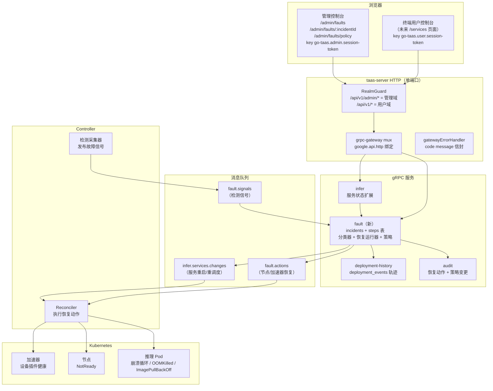
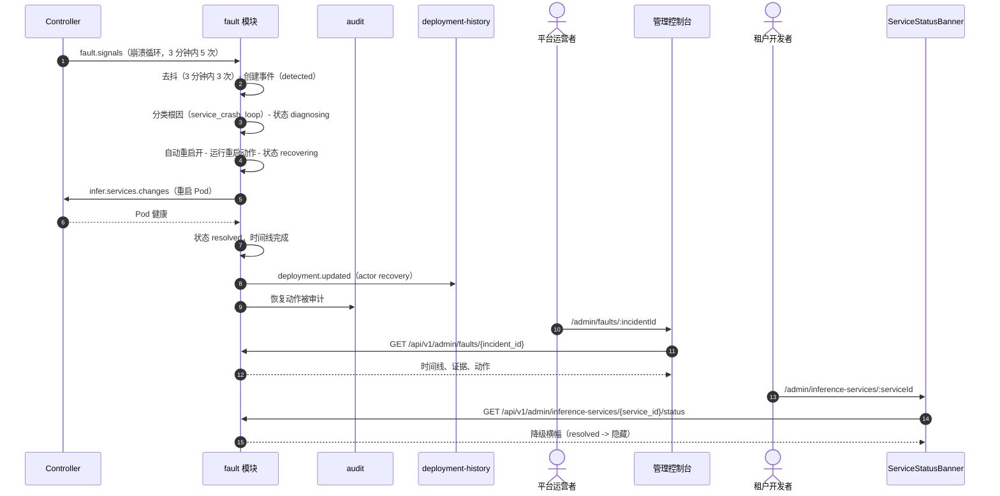
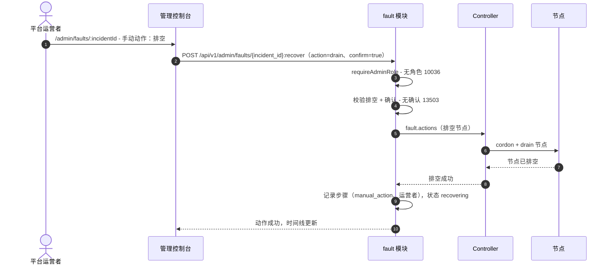

# 故障诊断与自动容错 — 架构与详细设计

| 属性 | 内容 |
| --- | --- |
| 功能点 | 故障诊断与自动容错 — 检测推理服务 / 节点 / 加速器故障、诊断根因、自动恢复（重启 / 重调度 / 排空）并带运营者可见性（backlog 第 53 行） |
| 文档范围 | 功能-53 的架构与详细设计：新 `fault` 模块（事件生命周期、确定性根因分类器、恢复动作、自动恢复策略）、`infer` 状态扩展（带活动事件的服务状态）、Controller 的检测信号发布与恢复执行、135xx 错误块、管理页面 `/admin/faults`、`/admin/faults/:incidentId` 与 `/admin/faults/policy`、租户服务状态 / 事件横幅、配置、安全、上线，以及按层的函数级任务清单 |
| 负责模块 | `fault`（新模块 — 事件生命周期、根因分类器、恢复动作、自动恢复策略）；`infer`（服务状态扩展、事件横幅数据）；`Controller`（检测信号、恢复执行）；`k8s`（Pod/节点/加速器状态读取、重启/重调度/排空动作）；`audit`（恢复动作）；`deployment-history`（部署轨迹中的恢复动作）；`pkg/server` 网关（管理 + 用户前缀绑定）；`pkg/errors`（135xx 块）；`pkg/config`（`fault` 段）；`pkg/mq`（一个新主题）；`web` 管理控制台（`FaultsPage`、`FaultDetailPage`、`FaultPolicyPage`、`ServiceStatusBanner`） |
| 相关文档 | [需求分析与 UI/UX 设计](../design/fault-diagnosis-auto-recovery.zh-cn.md) · [架构设计](../design/architecture.zh-cn.md) §2.4 `infer`、§2.7 Controller · [系统健康与服务状态](./system-health-status.zh-cn.md)（本功能事件管理所扩展的组件健康表面；其非目标明确把事件管理与事件时间线延迟到这里）· [错误分析](./error-analysis.zh-cn.md)（本功能按事件诊断所补充的聚合错误表面）· [加速器清单与健康](./accelerator-inventory.zh-cn.md)（本功能消费的加速器故障信号）· [部署历史与审计](./deployment-history-audit.zh-cn.md)（恢复动作记录其中的变更事件轨迹）· [模型目录与一键部署](./model-catalog-deployment.zh-cn.md)（重启/重调度的服务生命周期目标）· [推理弹性伸缩](./inference-autoscaling.zh-cn.md)（为何恢复重调度而非扩容）· [控制台表面分离](./console-surface-separation.zh-cn.md)（两个表面、脱敏投影规则） |
| 状态 | 架构完成，已移交开发者 agent |

---

## 1. 概述与目标

平台的可靠性故事是**只检测不响应**。系统健康功能（#30）告诉运营者组件*是否*健康，加速器清单（#18）告诉运营者 GPU 节点*是否*健康，错误分析（#31）聚合*发生什么*错误 — 但都不**行动**。当推理服务崩溃循环、节点进入 `NotReady`、或 GPU 设备插件失败时，运营者必须在一个只读表面注意到降级状态，然后用 Kubernetes 工具手动重启 Pod、重调度服务或排空节点。平台没有事件生命周期、没有根因诊断、没有自动恢复。

系统健康设计明确把"事件管理或事件时间线"延迟到后续功能。本功能就是那个后续功能：它把从**检测**（故障信号）经**诊断**（根因分类器）到**恢复**（带运营者覆盖的自动动作）与**解决**（事件时间线）的闭环补全，全部在控制台可见。

核心不变量：专用 `fault` 模块与 `/admin/faults` 表面（D1）；事件生命周期是检测 → 诊断 → 恢复 → 解决（D2）；根因分类器是**对观测信号的确定性规则**，而非 ML 模型（D3）；自动恢复**有界且可被运营者覆盖** — 重启/重调度自动运行，排空需运营者确认（D4）；恢复动作记录在部署历史轨迹与审计轨迹（D5）；租户表面显示服务状态 / 事件横幅（D6）；预测性故障检测超出范围（D7）；控制面自身的自愈超出范围（D8）。

**目标**：

- 三个管理页面：`/admin/faults`（`FaultsPage` — 带严重度、状态、根因、目标、自动恢复、时间的事件表格；过滤、搜索、分页）、`/admin/faults/:incidentId`（`FaultDetailPage` — 诊断时间线、根因证据、恢复动作、覆盖/手动控制）、`/admin/faults/policy`（`FaultPolicyPage` — 按类别自动恢复开关），按设计 §5.1–§5.4。
- 租户服务状态 / 事件横幅（设计 §5.5）：服务有活动事件时，服务列表与详情页顶部出现紧凑降级横幅。
- 新 `fault` 模块拥有事件生命周期、确定性根因分类器与恢复动作，带自己的错误块 **135xx**（设计 §6）。
- `FaultService` 上六个管理 RPC 绑定在 `/api/v1/admin/faults/*` 下，`InferService` 上一个用户面 `GetServiceStatus`，以及供管理控制台横幅使用的管理面孪生 `GetAdminServiceStatus`（设计 §6）。
- Controller 的检测信号发布（崩溃循环、OOMKilled、ImagePullBackOff、节点 `NotReady`、设备插件不健康）与恢复执行（重启 = 删除 Pod、重调度 = 带节点反亲和提示删除 Pod、排空 = cordon + drain 节点）（设计 §6 注 2–3）。
- 编号验收标准（AC1–AC13）可在 Nightwatch、FVT 与单元测试中测试；故障契约合成验证（既有的仓库外模式）。

**非目标**（来自设计，重述）：预测性故障检测（D7 — 分类器对观测故障反应）；控制面自身的自愈（D8 — 系统健康覆盖平台组件）；跨集群故障转移（后续工作 — 恢复在集群内）；值班 / 升级 / 响应者工作流（刻意排除 — 单运营者平台）；用户自建指标告警（刻意排除 — 检测来自集群状态）；事件告警 / 通知（功能 #26 消费可观测性事件）；公开 / 第三方状态页（刻意排除 — 事件是内部的）；根因重分类持久化（后续工作 — 运营者可重分类 `unknown` 事件，但重分类不作为学习信号持久化）。

### 1.1 本文档阅读顺序

第 2 节记录架构决策（AD1–AD16；AD11–AD16 是架构新增的细化，已标注）。第 3–5 节是组件视图、数据模型与 API 设计（含钉死的故障契约）。第 6 节是前端架构（页面 → 路由 → API 前缀表、导航、共享组件、认证守卫）。第 7–8 节是时序图与错误处理。第 9–11 节是配置、安全与上线。第 12 节是验收标准可追溯性。第 13–15 节是函数级详细设计、有序实现任务清单与延迟项。

---

## 2. 架构决策

AD1–AD10 把 UI/UX 设计的决策（D1–D8）重述为实现级规则；AD11–AD16 是架构新增的细化，已标注。

| # | 决策 | 理由 |
| --- | --- | --- |
| AD1 | **专用 `fault` 模块与 `/admin/faults` 表面。** 事件是带动作的有状态生命周期，区别于只读的系统健康聚合。`fault` 模块拥有事件生命周期、确定性根因分类器与恢复动作 | 设计 D1。系统健康是只读聚合；事件是带动作的有状态生命周期。专用模块与表面保持关注点分离 |
| AD2 | **事件生命周期是检测 → 诊断 → 恢复 → 解决。** 每个事件有状态（`detected` → `diagnosing` → `recovering` → `resolved`，或恢复失败时 `failed`）与带时间戳步骤的时间线 | 设计 D2。镜像行业标准事件生命周期（Datadog、PagerDuty），给运营者清晰状态机 |
| AD3 | **根因分类器是对观测信号的确定性规则**，而非 ML 模型。类别：`service_crash_loop`、`node_not_ready`、`accelerator_device_plugin_failure`、`oom`、`image_pull_failure`、`unknown` | 设计 D3。可审计可测试；无隐藏裁判。每类别映射到有界恢复动作 |
| AD4 | **自动恢复有界且可被运营者覆盖。** 重启与重调度自动运行（按类别策略）；排空需运营者确认。运营者可按类别禁用自动恢复、覆盖进行中的动作、或手动触发一个 | 设计 D4。重启/重调度低风险可安全自动化；排空有破坏性必须确认。运营者覆盖防止自动化失控 |
| AD5 | **恢复动作记录在部署历史轨迹**（`deployment.updated`，actor `recovery`）与审计轨迹 | 设计 D5。恢复是部署变更；记录在既有轨迹（#17）保持服务变更的单一真相源 |
| AD6 | **租户表面显示服务状态 / 事件横幅** — 服务降级或恢复中时，服务列表与详情页出现紧凑横幅 | 设计 D6。受影响服务的租户必须看到降级状态；横幅是显式的，不隐藏 |
| AD7 | **预测性故障检测超出范围。** 分类器对观测故障反应，不对预测故障反应 | 设计 D7。保持功能有界诚实；预测是后续工作 |
| AD8 | **控制面自身的自愈超出范围。** `fault` 模块恢复推理服务、节点与加速器 — 而非平台自身组件 | 设计 D8。控制面健康是系统健康（#30）的关注点；本功能针对推理数据路径 |
| AD9 | **事件管理仅限管理面；服务状态 / 横幅按表面分离。** 事件 CRUD、诊断、恢复与策略在管理面（`/admin/faults` + `/api/v1/admin/faults/*`）；服务状态在用户面（`/api/v1/inference-services/{service_id}/status`），并为管理控制台横幅提供管理面孪生（`/api/v1/admin/inference-services/{service_id}/status`）。用户域会话访问管理路由得到 **10038**；无平台管理员角色的会话得到 **10036** | 设计 FR6.1。与控制台表面分离一致；事件内部（机群诊断）是运营者知识，受影响服务的状态是租户的 |
| AD10 | **租户可见 `GetServiceStatus` 在服务层强制服务范围。** 调用者组织从会话解析，绝不从客户端提供的服务 id；只返回调用者自己服务的事件。租户表面无事件变更路由 | 设计 FR5.3、§6 注 4。横幅不得泄露另一组织的事件；范围检查在服务端，绝不信任客户端 |
| AD11 | **细化设计 D2/FR1.1 — 事件是数据库表；时间线是子表。** `fault` 模块拥有 `incidents` 表（incident_id、severity、status、root_cause、target_type、target_name、started_at、resolved_at、auto_recovered）与 `incident_steps` 表（诊断时间线：step_id、incident_id、step_type、actor、detail、created_at）。时间线是子表，因此每步独立带时间戳且可查询 | 设计钉死"每个事件有带时间戳步骤的时间线"而未钉死存储。父 `incidents` 表 + 子 `incident_steps` 表是最小忠实解读：事件的聚合状态是一行，时间线是有序步骤列表。这让时间线可查询（详情页按序读）且事件行紧凑 |
| AD12 | **细化设计 D3/FR2.1 — 分类器是对结构化信号的纯函数。** Controller 发布结构化故障信号（target_type、target_name、signal_type、detail、observed_at）；`fault` 模块的分类器经确定性 switch 把 `signal_type` 映射到根因类别。证据是信号的 `detail` 字段，原样存到事件 | 设计说"分类器把故障信号映射到根因类别"而未钉死信号形态。结构化信号（非自由文本）让分类器成为纯、可测试函数；`detail` 字段是详情页显示的证据（FR2.2） |
| AD13 | **细化设计 D3/FR3.1 — 检测信号搭乘新 `fault.signals` MQ 主题。** Controller 在 `fault.signals` 上发布故障信号；`fault` 模块消费、去抖、分类。去抖窗口按信号类型（如崩溃循环在窗口内 N 次重启后上报，而非首次重启） | 设计说"Controller 经消息队列把故障信号发布给 `fault` 模块"而未钉死主题。专用 `fault.signals` 主题让检测通道与部署/状态通道分离；去抖是模块的消费者侧逻辑（FR3.2） |
| AD14 | **细化设计 D4/FR4.1 — 服务目标的恢复动作搭乘既有 `infer.services.changes` 主题，节点/加速器目标搭乘新 `fault.actions` 主题。** 服务上的重启/重调度是部署变更（删除 Pod → ReplicaSet 重建），由 Controller 经既有变更通道执行；节点上的排空是节点级动作，由 Controller 经 `fault.actions` 执行。`fault` 模块把动作记录到时间线与部署历史轨迹 | 设计说"Controller 执行它们；`fault` 模块记录它们"而未钉死传输。服务目标恢复复用既有变更通道（Controller 已协调它）；节点/加速器目标恢复需要新动作通道。这保持一个部署通道并新增一个节点动作通道 |
| AD15 | **细化设计 D4/FR4.2 — 自动恢复策略是带按类别开关的单行。** 策略是单行 `fault_policy`（每类别 auto_restart、每类别 auto_reschedule、drain_always_confirm = true）。恢复运行器读取它，策略页编辑它；变更被审计 | 设计说"自动恢复策略按类别可配置"而未钉死存储。带按类别开关的单行是最小忠实解读；drain-always-confirm 标志是常量（始终 true）为透明显示（FR4.4） |
| AD16 | **细化设计 D5/FR4.5 — 恢复动作经既有 `deployment_events` 表记录到部署历史轨迹。** 服务上的恢复动作写 `deployment_events` 行，`event_type = 'deployment.updated'`、`actor = 'recovery'`（具体动作在 detail）；节点/加速器恢复动作写审计事件。所有恢复动作与策略变更都被审计 | 设计说"恢复动作记录在部署历史轨迹（`deployment.updated`，actor `recovery`）与审计轨迹"。既有 `deployment_events` 表（功能 #34）就是轨迹；`fault` 模块经 infer 模块的缝写它。节点/加速器动作无服务行，因此仅审计 |

---

## 3. 组件视图

### 3.1 归属

| 层 / 组件 | 拥有 | 本功能变更 |
| --- | --- | --- |
| **静态包（SPA）** | 一个 Vite 包（`web/dist`），嵌入 `taas-server` 的 `pkg/server/console/`；由网关的 SPA 回退提供 | 三个新管理页面（`FaultsPage`、`FaultDetailPage`、`FaultPolicyPage`）、`ServiceStatusBanner` 组件、导航项、`App.tsx` 的路由注册 |
| **网关（`pkg/server`）** | HTTP 组合：`RealmGuard` → `withConsole` → `runtime.ServeMux`；统一错误渲染器；SPA 回退 | 无变更 — 新 RPC 绑定在 `/api/v1/admin/faults/*`（管理）与 `/api/v1/inference-services/{service_id}/status`（用户）下，域守卫已分类这些前缀 |
| **grpc-gateway mux** | 从 `google.api.http` 注解做路径 → RPC 路由 | 七个新 RPC 的新绑定（第 5 节） |
| **`fault`（新）** | `incidents` + `incident_steps` 表、事件生命周期、确定性分类器、恢复运行器、自动恢复策略 | 新服务：`services/fault` |
| **`infer`** | 服务状态扩展、事件横幅数据 | `GetServiceStatus`（用户面）与 `GetAdminServiceStatus`（管理面）返回带任何活动事件的服务状态 |
| **`internal/controller`** | Kubernetes 协调；检测信号发布；恢复执行 | 在 `fault.signals` 上发布故障信号；执行重启/重调度/排空动作 |
| **`pkg/k8s`** | Kubernetes 客户端（clientset + dynamic） | 无变更 — Controller 用既有 clientset |
| **`pkg/mq`** | 规范主题 | 两个新主题：`fault.signals`、`fault.actions` |
| **`pkg/errors`** | 每模块代码块 | vgpu 块（134xx）之后的新 **135xx** 块 |
| **`pkg/config`** | 合并配置树 | 新 `fault` 段（去抖窗口、保留、恢复默认） |
| **`audit`** | 审计轨迹 | 复用 — 恢复动作与策略变更 |
| **`deployment-history`** | `deployment_events` 表 | 复用 — 服务上的恢复动作写 `deployment.updated`，actor `recovery` |

### 3.2 运行时组件视图



---

## 4. 数据模型

### 4.1 `incidents` 表（新，`fault` 拥有）

| 列 | PostgreSQL 类型 | 约束 | 描述 |
| --- | --- | --- | --- |
| `id` | `uuid` | PRIMARY KEY | 服务端生成 UUID v4，暴露为 `incident_id` |
| `severity` | `varchar(16)` | NOT NULL | `critical` / `warning` / `info` |
| `status` | `varchar(16)` | NOT NULL DEFAULT 'detected' | `detected` / `diagnosing` / `recovering` / `resolved` / `failed` |
| `root_cause` | `varchar(32)` | NOT NULL | `service_crash_loop` / `node_not_ready` / `accelerator_device_plugin_failure` / `oom` / `image_pull_failure` / `unknown` |
| `target_type` | `varchar(16)` | NOT NULL | `service` / `node` / `accelerator` |
| `target_name` | `varchar(128)` | NOT NULL | 受影响服务名 / 节点名 / 加速器 id |
| `started_at` | `timestamptz` | NOT NULL | 检测时间（UTC） |
| `resolved_at` | `timestamptz` | NULL | 解决时间；活动期间为 NULL |
| `auto_recovered` | `boolean` | NOT NULL DEFAULT false | 自动恢复动作是否成功 |
| `created_at` | `timestamptz` | NOT NULL | 创建时间（UTC） |
| `updated_at` | `timestamptz` | NOT NULL | 最后状态变更 |

索引：

| 索引 | 定义 | 用途 |
| --- | --- | --- |
| 主键 | `(id)` | 事件身份 |
| 复合 | `(status, started_at DESC)` | 状态过滤、最新优先分页列表 |
| 复合 | `(target_type, target_name)` | 按目标查事件 |

### 4.2 `incident_steps` 表（新，`fault` 拥有）

| 列 | PostgreSQL 类型 | 约束 | 描述 |
| --- | --- | --- | --- |
| `id` | `uuid` | PRIMARY KEY | 服务端生成 UUID v4 |
| `incident_id` | `uuid` | NOT NULL, FK → `incidents.id` | 父事件 |
| `step_type` | `varchar(16)` | NOT NULL | `detected` / `diagnosed` / `recovery_started` / `recovery_succeeded` / `recovery_failed` / `resolved` / `overridden` / `manual_action` |
| `actor` | `varchar(128)` | NOT NULL | `system` 或运营者用户 id |
| `detail` | `varchar(512)` | NOT NULL | 步骤详情（如"容器 3 分钟内重启 5 次"） |
| `created_at` | `timestamptz` | NOT NULL | 步骤时间（UTC） |

索引：

| 索引 | 定义 | 用途 |
| --- | --- | --- |
| 主键 | `(id)` | 步骤身份 |
| 复合 | `(incident_id, created_at)` | 事件的有序时间线 |

### 4.3 `fault_policy` 表（新，`fault` 拥有）

| 列 | PostgreSQL 类型 | 约束 | 描述 |
| --- | --- | --- | --- |
| `id` | `int` | PRIMARY KEY DEFAULT 1 | 单行策略（AD15） |
| `auto_restart` | `jsonb` | NOT NULL DEFAULT '{}' | 按类别自动重启开关：`{"service_crash_loop": true, "oom": true, "image_pull_failure": true}` |
| `auto_reschedule` | `jsonb` | NOT NULL DEFAULT '{}' | 按类别自动重调度开关：`{"node_not_ready": true, "accelerator_device_plugin_failure": true}` |
| `drain_always_confirm` | `boolean` | NOT NULL DEFAULT true | 始终 true（FR4.4）；为透明显示 |
| `updated_at` | `timestamptz` | NOT NULL | 最后变更 |

设计说明：

- **`auto_restart` / `auto_reschedule` 为 `jsonb`**：按类别开关是有界映射；JSON 保持模式灵活，无需每类别一列。开关校验（FR4.2）在更新时运行，因此存储的 JSON 总是有效。
- **`drain_always_confirm` 是常量**（AD15）：排空始终要求运营者确认（FR4.4）；标志为透明存储并在策略页显示，永不被关闭。
- **保留**（FR1.4）：事件保留在有界窗口（默认 30 天）后归档；清理运行器删除早于保留窗口的事件。

### 4.4 迁移与 init-SQL 升级路径

本仓库**不**用手写 init-SQL 脚本：每个模式变更都是拥有服务的 `Migrate` 通过 `db.AutoMigrate(...)` 创建/修改的 GORM 模型，`deploy/` 下无 `.sql` 文件。升级路径：

1. 在 `services/fault/fault_model.go` 加 `Incident`、`IncidentStep`、`FaultPolicy` 模型；新 `fault` 服务的 `Migrate` AutoMigrate 它们。
2. 无数据回填：表是新的。无手工 DDL、无 compose 变更。

---

## 5. API 设计

### 5.1 表面映射

七个 RPC 是新的（六个管理、一个用户）。无 RPC 双绑定：管理 RPC 是机群范围管理，用户 RPC 是调用者自己服务的状态。

| RPC | HTTP 方法 + 路径 | 表面 | 状态 | 用途 |
| --- | --- | --- | --- | --- |
| `ListIncidents`（新 `taas.fault.v1.FaultService`） | `GET /api/v1/admin/faults` | 管理 | **新** | 带严重度、状态、根因、目标、时间的事件行；分页、过滤、搜索 |
| `GetIncident` | `GET /api/v1/admin/faults/{incident_id}` | 管理 | **新** | 一个事件的时间线、证据、动作；未知 → 13506 |
| `UpdateAutoRecoveryPolicy` | `PATCH /api/v1/admin/faults/policy` | 管理 | **新** | 按类别自动恢复开关；审计；输入非法 13502 |
| `GetAutoRecoveryPolicy` | `GET /api/v1/admin/faults/policy` | 管理 | **新** | 策略页的当前策略 |
| `TriggerRecoveryAction` | `POST /api/v1/admin/faults/{incident_id}:recover` | 管理 | **新** | 手动触发重启/重调度/排空；排空需确认标志；非法 13503 |
| `OverrideRecoveryAction` | `POST /api/v1/admin/faults/{incident_id}:override` | 管理 | **新** | 取消进行中的恢复动作；无进行中则 13504 |
| `GetServiceStatus`（`taas.infer.v1`） | `GET /api/v1/inference-services/{service_id}/status` | 用户 | **新** | 带任何活动事件的服务状态（脱敏 — 仅自己服务） |
| `GetAdminServiceStatus`（`taas.infer.v1`） | `GET /api/v1/admin/inference-services/{service_id}/status` | 管理 | **新** | 供管理控制台横幅的同一投影（组织范围） |

网关路由说明：`GET /api/v1/admin/faults`（集合根）、`GET /api/v1/admin/faults/{incident_id}` 与 `GET /api/v1/admin/faults/policy` 是不同路径 — 无通配符冲突（`policy` 字面量在 `{incident_id}` 通配符之前匹配）。`:recover` 与 `:override` 自定义动词遵循同一 mux 上既有 `:scale` / `:playground` 约定。用户面 `GET /api/v1/inference-services/{service_id}/status` 是不同用户前缀路径，其管理孪生 `GET /api/v1/admin/inference-services/{service_id}/status` 是不同管理前缀路径，域守卫把各自分类到自己的表面。

**表面决策（记录）**：设计文档 §4 表把租户横幅分配到终端用户面（`/services`、`/services/:serviceId`），但既有服务列表/详情页在管理面（`/admin/inference-services`、`/admin/inference-services/:id`）。与既有架构一致，`GetServiceStatus` RPC 是**新用户面** RPC（按设计，强制服务范围），横幅经其管理面孪生 `GetAdminServiceStatus`（`GET /api/v1/admin/inference-services/{service_id}/status`，同一投影与组织范围）扩展**既有管理** `InferenceServicesPage` 与 `ServiceDetailPage`，使管理页面绝不调用用户面路由。这保留设计意图（服务页面上的降级横幅），同时让服务页面留在它们实际所在处并严格分离两个控制台表面。设计中的 `/services` 终端用户路由不创建。

### 5.2 Proto 契约

**新 `proto/taas/fault/v1/fault.proto`** — 带六个管理 RPC 的 `FaultService`：

```proto
syntax = "proto3";
package taas.fault.v1;

import "google/api/annotations.proto";
import "taas/common/v1/common.proto";

option go_package = "github.com/go-taas/go-taas/proto/taas/fault/v1;faultv1";

// FaultService 管理事件生命周期、根因诊断与自动恢复（功能 #53）。
// 所有 RPC 都是管理面。
service FaultService {
  // ListIncidents 返回事件，最新优先，带严重度、状态、根因、
  // 目标与时间（管理面，requireAdminRole）。
  rpc ListIncidents(ListIncidentsRequest) returns (ListIncidentsResponse) {
    option (google.api.http) = {get: "/api/v1/admin/faults"};
  }

  // GetIncident 返回一个事件的完整详情：诊断时间线、根因证据、
  // 恢复动作（管理面）。未知事件返回 13506。
  rpc GetIncident(GetIncidentRequest) returns (GetIncidentResponse) {
    option (google.api.http) = {get: "/api/v1/admin/faults/{incident_id}"};
  }

  // UpdateAutoRecoveryPolicy 设置按类别自动恢复开关（管理面）。
  // 审计；输入非法 13502。
  rpc UpdateAutoRecoveryPolicy(UpdateAutoRecoveryPolicyRequest) returns (UpdateAutoRecoveryPolicyResponse) {
    option (google.api.http) = {
      patch: "/api/v1/admin/faults/policy"
      body: "*"
    };
  }

  // GetAutoRecoveryPolicy 返回当前策略（管理面）。
  rpc GetAutoRecoveryPolicy(GetAutoRecoveryPolicyRequest) returns (GetAutoRecoveryPolicyResponse) {
    option (google.api.http) = {get: "/api/v1/admin/faults/policy"};
  }

  // TriggerRecoveryAction 在事件上手动触发重启/重调度/排空
  // （管理面）。排空需确认标志；非法 13503。
  rpc TriggerRecoveryAction(TriggerRecoveryActionRequest) returns (TriggerRecoveryActionResponse) {
    option (google.api.http) = {
      post: "/api/v1/admin/faults/{incident_id}:recover"
      body: "*"
    };
  }

  // OverrideRecoveryAction 取消进行中的恢复动作（管理面）。
  // 无进行中则 13504。
  rpc OverrideRecoveryAction(OverrideRecoveryActionRequest) returns (OverrideRecoveryActionResponse) {
    option (google.api.http) = {
      post: "/api/v1/admin/faults/{incident_id}:override"
      body: "*"
    };
  }
}

// Incident 是 FR1.1 投影。
message Incident {
  string incident_id = 1;
  string severity = 2;    // critical | warning | info
  string status = 3;      // detected | diagnosing | recovering | resolved | failed
  string root_cause = 4;  // service_crash_loop | node_not_ready | accelerator_device_plugin_failure | oom | image_pull_failure | unknown
  string target_type = 5; // service | node | accelerator
  string target_name = 6;
  int64 started_at = 7;   // unix 秒
  int64 resolved_at = 8;  // unix 秒，0 = 活动
  bool auto_recovered = 9;
}

// IncidentStep 是诊断时间线的一步（AD11）。
message IncidentStep {
  string step_type = 1; // detected | diagnosed | recovery_started | recovery_succeeded | recovery_failed | resolved | overridden | manual_action
  string actor = 2;     // system 或运营者用户 id
  string detail = 3;
  int64 created_at = 4; // unix 秒
}

// RecoveryAction 是已采取或待处理的恢复动作。
message RecoveryAction {
  string action = 1;    // restart | reschedule | drain
  string status = 2;    // pending | running | succeeded | failed | overridden
  string actor = 3;     // system 或运营者用户 id
  int64 created_at = 4; // unix 秒
}

message ListIncidentsRequest {
  taas.common.v1.PageRequest page = 1;
  string status = 2;      // detected | diagnosing | recovering | resolved | failed | 空 = 全部
  string severity = 3;    // critical | warning | info | 空 = 全部
  string root_cause = 4;  // 空 = 全部
  string target_type = 5; // service | node | accelerator | 空 = 全部
  string search = 6;      // 目标名子串搜索
}

message ListIncidentsResponse {
  taas.common.v1.Response response = 1;
  repeated Incident incidents = 2;
  taas.common.v1.PageMeta page_meta = 3;
}

message GetIncidentRequest {
  string incident_id = 1;
}

message GetIncidentResponse {
  taas.common.v1.Response response = 1;
  Incident incident = 2;
  repeated IncidentStep steps = 3;      // 诊断时间线，最旧优先
  repeated RecoveryAction actions = 4;  // 已采取或待处理的恢复动作
}

message UpdateAutoRecoveryPolicyRequest {
  // auto_restart / auto_reschedule 是按类别开关；缺省类别不变。
  map<string, bool> auto_restart = 1;
  map<string, bool> auto_reschedule = 2;
}

message UpdateAutoRecoveryPolicyResponse {
  taas.common.v1.Response response = 1;
  AutoRecoveryPolicy policy = 2;
}

message GetAutoRecoveryPolicyRequest {}

message GetAutoRecoveryPolicyResponse {
  taas.common.v1.Response response = 1;
  AutoRecoveryPolicy policy = 2;
}

// AutoRecoveryPolicy 是按类别自动恢复配置（AD15）。
message AutoRecoveryPolicy {
  map<string, bool> auto_restart = 1;
  map<string, bool> auto_reschedule = 2;
  bool drain_always_confirm = 3; // 始终 true（FR4.4）
}

message TriggerRecoveryActionRequest {
  string incident_id = 1;
  string action = 2;    // restart | reschedule | drain
  bool confirm = 3;     // 排空必需（FR4.4）
}

message TriggerRecoveryActionResponse {
  taas.common.v1.Response response = 1;
  RecoveryAction action = 2;
}

message OverrideRecoveryActionRequest {
  string incident_id = 1;
}

message OverrideRecoveryActionResponse {
  taas.common.v1.Response response = 1;
  RecoveryAction action = 2; // 被覆盖的动作
}
```

**变更 `proto/taas/infer/v1/infer.proto`** — 新 `GetServiceStatus` RPC（用户面）及其管理面孪生 `GetAdminServiceStatus`（同一投影，管理前缀，供管理控制台横幅）：

```proto
  // GetServiceStatus 返回服务状态，含任何活动事件（用户面；组织从
  // 会话解析，绝不从客户端提供的服务 id — 只返回调用者自己服务的
  // 事件，功能 #53，AD10）。
  rpc GetServiceStatus(GetServiceStatusRequest) returns (GetServiceStatusResponse) {
    option (google.api.http) = {get: "/api/v1/inference-services/{service_id}/status"};
  }

  // GetAdminServiceStatus 返回服务状态，含任何活动事件，供管理控制台
  // 的降级横幅（功能 #53，AD10）。与 GetServiceStatus 同一投影，但服务
  // 在管理面，使管理页面绝不调用用户面路由；组织从会话解析，读取范围
  // 限定为调用者的组织。
  rpc GetAdminServiceStatus(GetAdminServiceStatusRequest) returns (GetAdminServiceStatusResponse) {
    option (google.api.http) = {get: "/api/v1/admin/inference-services/{service_id}/status"};
  }

message GetServiceStatusRequest {
  string service_id = 1;
}

message GetServiceStatusResponse {
  taas.common.v1.Response response = 1;
  string state = 2;      // pending | deploying | running | failed | terminated
  bool degraded = 3;     // 存在活动事件时为 true
  ServiceIncident incident = 4; // 健康时为 null
}

// ServiceIncident 是租户横幅的脱敏事件投影（AD10）。
message ServiceIncident {
  string incident_id = 1;
  string severity = 2;
  string status = 3;
  string root_cause = 4;
  string message = 5; // 通俗横幅文案
}
```

### 5.3 钉死的故障契约（数据面，仓库外）

Controller 在本仓库，但下面的检测/恢复契约对数据面轨道有约束力，并在 FVT 中合成验证（既有模式 — compose mock 为 e2e 遵守它）。契约逐项：

1. **检测信号**（FR3.1）：Controller 观察推理服务 Pod（崩溃循环、OOMKilled、ImagePullBackOff）、节点（`NotReady`）、加速器设备插件健康（来自 #18），并在 `fault.signals` 上发布结构化故障信号：`{"target_type", "target_name", "signal_type", "detail", "observed_at"}`（AD12）。
2. **去抖**（FR3.2）：信号按信号类型去抖 — 如崩溃循环在窗口内 N 次重启后上报（默认 3 分钟内 3 次），而非首次重启。去抖窗口可配置（第 9 节）。
3. **恢复执行**（FR4.1、§6 注 3）：重启 = 删除 Pod（ReplicaSet 重建）；重调度 = 带节点反亲和提示删除 Pod；排空 = cordon + drain 节点。服务目标恢复搭乘既有 `infer.services.changes` 通道；节点/加速器目标恢复搭乘新 `fault.actions` 通道（AD14）。
4. **排空需确认**（FR4.4）：排空动作绝不自动运行；服务端拒绝无确认标志的排空（**13503**）。
5. **记录**（D5、AD16）：每个恢复动作记录在部署历史轨迹（`deployment.updated`，actor `recovery`）用于服务目标，审计轨迹用于所有目标。

契约逐项：

- **检测是反应式的**（D7）：模块对观测故障反应，绝不预测。
- **故障契约在 FVT 中合成验证**（compose mock 遵守它）；控制面绝不渲染原始 Kubernetes 错误 — 恢复失败以 `failed` 事件呈现，时间线中显示失败步骤。

### 5.4 校验契约

| 字段 | 规则 | 错误 |
| --- | --- | --- |
| `incident_id`（获取/触发/覆盖） | 必须存在 | 13506 |
| `status` / `severity` / `root_cause` / `target_type` 过滤 | 封闭枚举（空 = 全部） | 13502 |
| `auto_restart` / `auto_reschedule` 键 | 必须是有效根因类别 | 13502 |
| `action`（触发） | `restart` / `reschedule` / `drain` | 13503 |
| `confirm`（排空） | 排空必须为 true | 13503 |
| `OverrideRecoveryAction` | 必须有进行中的动作 | 13504 |
| `GetServiceStatus` 组织上下文 | 从会话解析（过渡头回退）；空 → | 10005 |

序列化约定不变：成功 HTTP 200，业务错误为 `{"code": <int>, "message": "..."}`，int64 字段为 JSON 字符串（时间戳）。

---

## 6. 前端架构

### 6.1 页面 → 路由 → API 前缀表

| 页面 / 组件 | 路由 | API 前缀 | 表面 |
| --- | --- | --- | --- |
| `FaultsPage`（新，`web/src/pages/FaultsPage.tsx`） | `/admin/faults` | `/api/v1/admin/faults` | 管理 |
| `FaultDetailPage`（新，`web/src/pages/FaultDetailPage.tsx`） | `/admin/faults/:incidentId` | `/api/v1/admin/faults` | 管理 |
| `FaultPolicyPage`（新，`web/src/pages/FaultPolicyPage.tsx`） | `/admin/faults/policy` | `/api/v1/admin/faults` | 管理 |
| `ServiceStatusBanner`（新，`web/src/components/ServiceStatusBanner.tsx`） | `InferenceServicesPage`、`ServiceDetailPage`（既有） | `/api/v1/admin/inference-services/{service_id}/status` | 管理 |

管理页面**无 `/api/v1/*` 调用**；横幅组件调用管理面 `GetAdminServiceStatus`（AC11）。按控制台表面分离，管理页面与横幅是管理域源（`web/src/pages/*.tsx`、`web/src/components/**`）。

**表面决策（记录）**：设计文档 §4 表把租户横幅分配到终端用户面（`/services`、`/services/:serviceId`）。与既有架构一致（服务列表/详情今天在管理面），`ServiceStatusBanner` 扩展**管理** `InferenceServicesPage` 与 `ServiceDetailPage`，调用管理面 `GetAdminServiceStatus`（`GET /api/v1/admin/inference-services/{service_id}/status`，与用户面读取同一投影与组织范围）。用户面 `GetServiceStatus` 留给未来终端用户服务页面。这是与既有架构及控制台表面分离最一致的解读；设计中的 `/services` 终端用户路由不创建。

### 6.2 导航放置

`AdminShell` 的 `ADMIN_NAV_ITEMS` 在运维簇（Status / Error Analysis 旁）增加一项：

```tsx
{ path: '/admin/faults', labelKey: 'nav.faults', testid: 'nav-faults', icon: ShieldAlert },
```

`App.tsx` 在管理块注册三个路由：

```tsx
<Route path="/admin/faults" element={<FaultsPage />} />
<Route path="/admin/faults/:incidentId" element={<FaultDetailPage />} />
<Route path="/admin/faults/policy" element={<FaultPolicyPage />} />
```

### 6.3 复用共享组件与状态

- `Dialog`（排空确认对话框与手动动作对话框）、`data` 表格样式、`PageMeta` 分页、`usePolling`（`web/src/components.tsx`）用于事件列表刷新与横幅、徽章/进度条类、`DeploymentHistoryPage`/`AuditLogsPage` 的时间线模式 — 都是既有控制台约定。
- **`IncidentTimeline`**（`web/src/pages/faults/IncidentTimeline.tsx`）：垂直诊断时间线（每步带时间戳、actor、详情；`failed` 步骤红色），`FaultDetailPage` 使用。
- **`SeverityBadge`**（`web/src/pages/faults/SeverityBadge.tsx`）：严重度徽章（critical 红 / warning 琥珀 / info 蓝），事件表格与详情头部使用。
- **`ServiceStatusBanner`**（`web/src/components/ServiceStatusBanner.tsx`）：紧凑降级横幅（严重度颜色、通俗消息、根因芯片），`InferenceServicesPage` 与 `ServiceDetailPage` 使用。

### 6.4 每表面认证守卫

- `FaultsPage`、`FaultDetailPage` 与 `FaultPolicyPage` 在 `AdminShell` 内渲染，其外壳守卫强制管理会话域（`/admin/login`，token `go-taas.admin.session-token`）；用户域会话访问管理路由从域守卫得到 **10038**。无平台管理员角色的会话从 `requireAdminRole` 得到 **10036**；页面渲染标准权限拒绝状态并链接回 `/admin`（AC12）。
- `ServiceStatusBanner` 调用管理面 `GET /api/v1/admin/inference-services/{service_id}/status`；范围在服务端（AD10）— 横幅只显示调用者自己服务的事件。横幅是信息性的，在用户面不链接任何东西。

### 6.5 `data-testid` 钩子（约束性，kebab-case）

管理：`nav-faults`、`fault-table`、`fault-row-{incident_id}`、`fault-severity-{incident_id}`、`fault-status-{incident_id}`、`fault-root-cause-{incident_id}`、`fault-target-{incident_id}`、`fault-auto-recovered-{incident_id}`、`fault-started-{incident_id}`、`fault-resolved-{incident_id}`、`fault-search`、`fault-filter-status`、`fault-filter-severity`、`fault-filter-root-cause`、`fault-filter-target-type`、`fault-pagination`、`fault-empty`、`fault-permission-denied`、`fault-timeline`、`fault-timeline-step-{index}`、`fault-evidence`、`fault-actions`、`fault-action-{action}`、`fault-override-{incident_id}`、`fault-manual-{action}`、`fault-drain-confirm-dialog`、`fault-drain-confirm`、`fault-resolved-banner`、`fault-policy-row-{category}`、`fault-policy-toggle-{category}-{action}`、`fault-policy-save`。

横幅：`service-status-banner`、`service-status-banner-severity`、`service-status-banner-message`、`service-status-banner-root-cause`。

---

## 7. 时序图

### 7.1 崩溃循环事件被检测、诊断、自动恢复



### 7.2 运营者确认排空



---

## 8. 错误处理

| 条件 | HTTP | 代码 | 常量 | 说明 |
| --- | --- | --- | --- | --- |
| 策略输入非法 | 500 | 13502 | `CodeFaultPolicyInvalid` | 校验；点名类别 |
| 恢复动作非法（如无确认排空、未知动作） | 500 | 13503 | `CodeFaultRecoveryInvalid` | 动作被拒 |
| 无进行中动作可覆盖 | 500 | 13504 | `CodeFaultNoActionInFlight` | 覆盖被拒 |
| 未知事件 | 500 | 13506 | `CodeFaultNotFound` | |
| 用户域会话访问管理路由 | 500 | 10038 | `CodeRealmMismatch` | 复用 — 域分离（FR6.1） |
| 无所需角色的会话 | 500 | 10036 | `CodeForbidden` | 复用 — 权限拒绝（FR6.1） |
| `GetServiceStatus` 无组织上下文 | 500 | 10005 | `CodeOrganizationNotFound` | 复用 — 组织守卫约定 |

渲染拆分（对测试 agent 有约束力）：**所有 135xx 代码都是控制面业务错误**，经 grpc-gateway 以统一 `{"code": <int>, "message": "..."}` 信封与 HTTP 500 呈现，仓库约定。故障契约合成验证（第 5.3 节）；恢复失败以 `failed` 事件呈现，时间线中显示失败步骤，而非 135xx 代码。

---

## 9. 配置

`pkg/config` 新增 `fault` 段（`FaultConfig`，`mapstructure:"fault"`），在 `applyDefaults` 设默认，在 `Validate` 校验：

| 键 | 类型 | 默认 | 说明 |
| --- | --- | --- | --- |
| `fault.debounce.crashLoopRestarts` | int | `3` | 崩溃循环在 N 次重启后上报（FR3.2） |
| `fault.debounce.crashLoopWindow` | duration | `3m` | 崩溃循环窗口 |
| `fault.retention` | duration | `720h` | 事件保留窗口（30 天，FR1.4） |
| `fault.recovery.autoRestart` | map | `{"service_crash_loop": true, "oom": true, "image_pull_failure": true}` | 默认自动重启开关（FR4.1） |
| `fault.recovery.autoReschedule` | map | `{"node_not_ready": true, "accelerator_device_plugin_failure": true}` | 默认自动重调度开关（FR4.1） |
| `fault.signalsConsumer.enabled` | bool | `true` | 检测信号消费者运行器开关（AD13） |
| `fault.signalsConsumer.workers` | int | `2` | 并发信号处理器 |

`pkg/mq` 增加主题常量 `SubjectFaultSignals = "fault.signals"` 与 `SubjectFaultActions = "fault.actions"`（规范主题文件）。

`configs/config.yaml` 增加：

```yaml
# 故障诊断与自动容错（功能 #53）。fault 模块拥有事件生命周期、
# 确定性根因分类器与恢复动作。
fault:
  # 每信号类型去抖窗口（FR3.2）。
  debounce:
    crashLoopRestarts: 3
    crashLoopWindow: 3m
  # 事件保留窗口（FR1.4）。
  retention: 720h
  recovery:
    # 默认自动恢复开关（FR4.1）；策略页编辑它们。
    autoRestart:
      service_crash_loop: true
      oom: true
      image_pull_failure: true
    autoReschedule:
      node_not_ready: true
      accelerator_device_plugin_failure: true
  signalsConsumer:
    enabled: true
    workers: 2
```

---

## 10. 安全考虑

1. **域分离**（FR6.1，AC11）：事件管理仅限管理面（`/api/v1/admin/faults/*`）；服务状态在用户面（`/api/v1/inference-services/{service_id}/status`），并为管理控制台横幅提供管理面孪生（`/api/v1/admin/inference-services/{service_id}/status`）。用户域会话访问管理路由得到 **10038**；无平台管理员角色的会话得到 **10036**。管理页面无 `/api/v1/*` 调用，用户页面无 `/api/v1/admin/*` 调用。
2. **服务范围**（AD10，AC9）：租户可见 `GetServiceStatus` 在服务层强制服务范围 — 调用者组织从会话解析，绝不从客户端提供的服务 id。只返回调用者自己服务的事件；不出现其他服务的事件。租户表面无事件变更路由。
3. **运营者覆盖**（D4，AC6）：自动恢复有界且可覆盖。运营者可按类别禁用自动恢复、覆盖进行中的动作、或手动触发一个。排空始终要求运营者确认（FR4.4）。
4. **审计**（D5，AC10）：每个恢复动作与策略变更都被审计；服务上的恢复动作也出现在部署历史轨迹（`deployment.updated`，actor `recovery`）。列表/读取 RPC 不审计，按平台读路径约定。
5. **确定性分类器**（D3）：根因分类器是对观测信号的确定性规则，而非 ML 模型 — 可审计可测试，无隐藏裁判。
6. **反应式检测**（D7）：检测对观测故障反应，绝不预测；模块绝不对预测故障行动。

---

## 11. 上线 / 升级说明

1. **增量模式**：`incidents`、`incident_steps` 与 `fault_policy` 表是新的。无回填、无手工 DDL、无 compose 变更。
2. **向后兼容**：既有服务无活动事件；健康时横幅缺省。`GetServiceStatus` RPC 是新的且增量。
3. **Controller 上线**：检测信号发布与恢复执行是增量的 — Controller 可在 `fault` 服务之前或之后上线。无检测采集器的 Controller 只是不发布信号。
4. **恢复安全**：重启/重调度低风险可安全自动化；排空始终要求运营者确认。自动恢复策略默认保守（重启/重调度开，排空始终确认）。
5. **传播窗口**：检测与 Controller 的观察间隔一样新；事件状态与状态上报一样新。两者都在管理页面文案中说明。
6. **回滚**：回滚二进制会留下三张表（无害 — 无其他东西读它们）并完全恢复功能前行为（无事件管理）。事件数据在回滚后存活，重新升级时重新生效。
7. **负载**：事件列表每页行加一个 COUNT（尽力而为，页有界）；检测消费者每信号处理一个小 JSON 消息（去抖）；清理运行器按间隔删除早于保留窗口的事件。

---

## 12. 验收标准可追溯性

| AC | 设计要求 | 架构章节 |
| --- | --- | --- |
| AC1 管理事件表格（严重度、状态、根因、目标、自动恢复、开始、解决）+ 过滤 + 搜索 + 分页 | FR1.1、§5.3 | §5.1–5.2（`ListIncidents`）、§4.1、§6.1–6.3、§13.2–13.3、§13.8 |
| AC2 事件生命周期（合成）：崩溃循环信号创建事件并移动 detected → diagnosing → recovering → resolved，每步带时间戳；恢复失败留 `failed` | FR1.3、D2 | §5.3（钉死契约）、AD11、AD13、§7.1、§13.4–13.5 |
| AC3 根因分类：崩溃循环 → service_crash_loop、NotReady → node_not_ready、设备插件 → accelerator_device_plugin_failure、OOMKilled → oom、ImagePullBackOff → image_pull_failure；显示证据 | FR2.1–FR2.2 | AD12、§13.4、§13.8 |
| AC4 自动恢复：自动重启开触发重启并记录到时间线 + 部署历史轨迹；自动重启关提供手动 | FR4.1、D4 | AD14、AD16、§13.5、§7.1 |
| AC5 排空需确认：绝不自动；确认对话框点名节点 + 服务；服务端拒绝无确认（13503） | FR4.4 | §5.4、§7.2、§13.5 |
| AC6 运营者覆盖与手动触发：取消进行中动作（无则 13504）、手动触发重启/重调度/排空；手动动作以运营者记录 | FR4.3 | §5.4、§13.5、§7.2 |
| AC7 策略页：按类别开关；改一个持久化、被审计、影响后续事件 | FR4.2 | AD15、§13.6、§13.8 |
| AC8 租户横幅：活动事件显示降级横幅带严重度颜色、消息、根因芯片；健康时隐藏 | FR5.2、D6 | §6.1–6.3、§13.8 |
| AC9 租户范围：GetServiceStatus 只返回调用者自己服务的事件；无变更路由 | FR5.3、§6 注 4 | AD10、§5.2、§10 |
| AC10 审计：每个恢复动作与策略变更在审计轨迹；恢复动作也在部署历史轨迹 | FR4.5、D5 | AD16、§4.3、§7.1、§13.5 |
| AC11 负向域分离（10038），无跨表面调用 | FR6.1 | §3.3、§6.1、§6.4、§10 |
| AC12 角色拒绝（10036）+ 权限拒绝状态带 `/admin` 链接 | FR6.1、§5.3 | §3.3、§6.4、§8 |
| AC13 状态：管理页面加载/空（"No incidents — the platform is healthy"）/错误/权限拒绝；横幅健康时缺省、状态调用错误时隐藏 | FR6.2、§5.5 | §6.3、§13.8 |

---

## 13. 详细设计

### 13.1 文件布局

| 模块 | 文件 | 职责 |
| --- | --- | --- |
| `proto/taas/fault/v1` | `fault.proto`（新） | `FaultService` + 消息（第 5.2 节）；重新生成 |
| `proto/taas/infer/v1` | `infer.proto` | `GetServiceStatus` + `GetAdminServiceStatus` RPC 与消息；重新生成 |
| `services/fault` | `fault_model.go`（新） | `Incident`、`IncidentStep`、`FaultPolicy` GORM 模型（第 4 节） |
| | `fault_repository.go`（新） | 事件 CRUD、时间线读取、策略读/更新、保留清理 |
| | `classifier.go`（新） | 确定性根因分类器（AD12） |
| | `fault_service.go`（新） | 六个 RPC、`requireAdminRole`、恢复运行器 |
| | `signal_consumer.go`（新） | 检测信号消费者运行器 + 去抖逻辑（AD13） |
| | `recovery.go`（新） | 恢复动作执行与记录（AD14、AD16） |
| `services/infer` | `service.go`、infer 仓库 | `GetServiceStatus` + `GetAdminServiceStatus` RPC、事件查找 |
| `internal/controller` | `fault_detection.go`（新） | 发布故障信号的检测采集器（AD13） |
| | `reconciler.go` | 恢复动作执行（重启/重调度/排空） |
| `pkg/errors` | `codes.go`、`messages.go` | vgpu 块之后的 135xx 块 |
| `pkg/config` | `api.go`、`configuration.go` | `FaultConfig`（+ `FaultDebounceConfig`、`FaultSignalsConsumerConfig`）、默认、校验 |
| `pkg/mq` | 规范主题文件 | `SubjectFaultSignals`、`SubjectFaultActions` |
| `apps/taas-server` | `main.go` | `fault` 服务注册、缝接线（第 13.9 节） |
| `web/src` | `pages/FaultsPage.tsx`（新） | 管理事件列表：表格、过滤条、分页 |
| | `pages/FaultDetailPage.tsx`（新） | 管理事件详情：时间线、证据、动作、覆盖/手动控制 |
| | `pages/FaultPolicyPage.tsx`（新） | 管理策略页：按类别开关 |
| | `pages/faults/{IncidentTimeline,SeverityBadge}.tsx`（新） | 共享时间线与严重度徽章 |
| | `components/ServiceStatusBanner.tsx`（新） | 租户降级横幅 |
| | `pages/InferenceServicesPage.tsx`、`pages/ServiceDetailPage.tsx`（变更） | 横幅放置 |
| | `shells/AdminShell.tsx`、`App.tsx` | 导航项、路由 |
| | `api.ts`、`locales/en.ts`、`locales/zh.ts` | 类型 + i18n 键 |
| `test/fvt` | `fault_fvt_test.go`（新） | FVT 套件（第 14 节） |
| `test/e2e` | Nightwatch 套件 | AC1–AC2、AC5、AC7–AC8、AC11–AC13 的控制台表面 |

### 13.2 `services/fault` — 故障服务层

`Service`（新结构）持有：`repo *Repository`、`classifier *Classifier`、`recovery *RecoveryRunner`、`policy *PolicyStore`、`roleGuard`、`sessionResolver`、`auditRecorder`、`deploymentTrail`（infer 模块的部署历史缝）。`requireAdminRole(ctx)` 精确镜像 provider 形态：经 `sessionOrgResolver` 解析活动组织（容忍 `CodeSessionInvalid`）、经 `sessionResolver` 解析操作者、任一缺省则跳过（管理域守卫是边界）、否则 `roleGuard.RequireRole(ctx, orgID, userID, roleAdmin)` → **10036**。

各 RPC 职责：

- **`ListIncidents`**：`requireAdminRole` → 校验过滤（封闭枚举 — **13502**）→ `repo.ListIncidents(ctx, filter)`（事件行）→ `PageMeta`。
- **`GetIncident`**：`requireAdminRole` → `repo.GetIncident(ctx, incidentID)`（未知 **13506**）→ `repo.ListSteps(ctx, incidentID)`（时间线，最旧优先）→ `repo.ListActions(ctx, incidentID)`（恢复动作）→ 完整响应。
- **`UpdateAutoRecoveryPolicy`**：`requireAdminRole` → 校验开关键（有效根因类别 — **13502**）→ `repo.UpdatePolicy(ctx, patch, actor, now)` → `recordAudit("fault.policy.updated", ...)`（尽力而为）→ 更新后的策略。
- **`GetAutoRecoveryPolicy`**：`requireAdminRole` → `repo.GetPolicy(ctx)` → 策略。
- **`TriggerRecoveryAction`**：`requireAdminRole` → 加载事件（**13506**）→ 校验动作（`restart` / `reschedule` / `drain`；排空需 `confirm=true` — **13503**）→ `recovery.Trigger(ctx, incident, action, actor)` → 记录步骤（`manual_action`、运营者）→ 动作。
- **`OverrideRecoveryAction`**：`requireAdminRole` → 加载事件（**13506**）→ `recovery.Override(ctx, incident)`；无进行中动作 → **13504** → 记录步骤（`overridden`、运营者）→ 被覆盖的动作。

### 13.3 `services/fault` — 故障仓库

`fault_repository.go`（`database.Manager` 模式，与其他服务同句柄）：

- `ListIncidents(ctx, filter)` — `SELECT` 事件行；`status`/`severity`/`root_cause`/`target_type` 非空时过滤；`search` 匹配 `target_name ILIKE '%q%'`；按 `started_at DESC` 排序、分页带总数。
- `GetIncident(ctx, incidentID)` — 一行或 GORM `ErrRecordNotFound` → **13506**。
- `CreateIncident(ctx, incident)` — INSERT（状态 `detected`）。
- `UpdateIncidentStatus(ctx, incidentID, status, resolvedAt)` — 状态转换。
- `ListSteps(ctx, incidentID)` — 时间线，按 `created_at ASC` 排序。
- `AddStep(ctx, incidentID, step)` — 一个时间线步骤。
- `ListActions(ctx, incidentID)` — 恢复动作。
- `GetPolicy(ctx)` / `UpdatePolicy(ctx, patch, actor, now)` — 单行策略（AD15）。
- `CleanupExpired(ctx, before)` — 删除早于保留窗口的事件（FR1.4）。

### 13.4 `services/fault` — 分类器与信号消费者（AD12、AD13）

`classifier.go`：

- `Classify(signalType string) string` — 确定性 switch：`crash_loop` → `service_crash_loop`、`node_not_ready` → `node_not_ready`、`device_plugin_unhealthy` → `accelerator_device_plugin_failure`、`oom_killed` → `oom`、`image_pull_backoff` → `image_pull_failure`、否则 `unknown`。信号的 `detail` 字段是证据，原样存到事件（FR2.2）。

`signal_consumer.go`：

- `SignalConsumer` — 持有 `mu sync.RWMutex`、每目标去抖状态、组件句柄；实现 `server.Runner` 接口（notification-consumer 形态）：`Start` 时以 `workers` 处理器订阅 `SubjectFaultSignals` — **普通订阅，无队列组**（每个副本保留自己的去抖状态；队列组会让其他副本失明）。
- 处理器：解码信号 → 去抖（如崩溃循环在 `crashLoopRestarts` 于 `crashLoopWindow` 内后上报，而非首次重启 — FR3.2）→ `repo.CreateIncident`（状态 `detected`）→ `classifier.Classify` → `repo.UpdateIncidentStatus`（状态 `diagnosing`）→ `recovery.Run`（类别的动作）。
- 由 `fault.signalsConsumer.enabled` 门控；空消费者（FVT、部分设置）不做任何事。

### 13.5 `services/fault` — 恢复运行器（AD14、AD16）

`recovery.go`：

- `RecoveryRunner` — 持有策略存储、MQ 发布器、部署轨迹缝、审计记录器。
- `Run(ctx, incident, category)` — 读策略；对 `service_crash_loop` / `oom` / `image_pull_failure`，若 `auto_restart[category]` 开，在 `infer.services.changes` 上发布重启（AD14）；对 `node_not_ready` / `accelerator_device_plugin_failure`，若 `auto_reschedule[category]` 开，在 `infer.services.changes`（服务目标）或 `fault.actions`（节点目标）上发布重调度；对 `unknown`，提供手动动作（无自动动作）。排空绝不自动（FR4.4）。
- `Trigger(ctx, incident, action, actor)` — 手动动作路径：校验动作、发布它、记录步骤。
- `Override(ctx, incident)` — 取消进行中动作、记录步骤。
- 每个动作都被记录：服务目标 `deploymentTrail.Record(ctx, serviceID, "deployment.updated", "recovery", detail)`（AD16），所有目标 `auditRecorder.Record(...)`。

### 13.6 `services/fault` — 策略存储（AD15）

`policy.go`：

- `PolicyStore` — 读/写单行 `fault_policy`（AD15）。`Get(ctx)` 返回当前开关；`Update(ctx, patch, actor, now)` 合并按类别开关并盖 `updated_at`。`drain_always_confirm` 是常量（始终 true，FR4.4）。
- 默认来自 `fault.recovery.autoRestart` / `fault.recovery.autoReschedule`（第 9 节），首次创建行时使用。

### 13.7 错误码放置

`pkg/errors/codes.go` 在 vgpu 块（134xx）之后增加块：

```go
// fault 模块错误码（功能 #53，设计 D4）。该块持有事件生命周期
// 失败模式；13507-13599 保留给未来 fault 代码。所有 135xx 代码
// 经 grpc-gateway 以统一信封呈现；故障契约合成验证。
CodeFaultPolicyInvalid     Code = 13502 // FAULT_POLICY_INVALID
CodeFaultRecoveryInvalid   Code = 13503 // FAULT_RECOVERY_INVALID
CodeFaultNoActionInFlight  Code = 13504 // FAULT_NO_ACTION_IN_FLIGHT
CodeFaultNotFound          Code = 13506 // FAULT_NOT_FOUND
```

`messages.go` 增加四条消息，各在设计要求处点名类别/动作（"invalid fault policy"、"invalid recovery action"、"no recovery action is in flight"、"incident not found"）。

### 13.8 前端详细设计

- **`FaultsPage`**（`/admin/faults`）：加载 `GET /api/v1/admin/faults?{page, status, severity, root_cause, target_type, search}`；渲染事件表格 — 严重度（徽章：critical 红 / warning 琥珀 / info 蓝）、状态（detected / diagnosing / recovering / resolved / failed）、根因（类别芯片）、目标（"service: chat-7b" / "node: node-a" / "accelerator: node-a GPU 0"）、自动恢复（勾或横杠）、开始（相对）、解决（相对或横杠）。过滤条：状态、严重度、根因、目标类型过滤、搜索、分页。行点击打开详情。状态：加载骨架；空（"No incidents — the platform is healthy"）；错误（陈旧带重试）；权限拒绝（10036，链接 `/admin`）。
- **`FaultDetailPage`**（`/admin/faults/:incidentId`）：加载 `GET /api/v1/admin/faults/{incident_id}`；渲染事件头部（严重度徽章、状态、根因类别、目标、开始/解决时间、自动恢复标志）、`IncidentTimeline`（垂直，每步带时间戳、actor、详情；`failed` 步骤红色）、根因证据卡片（分类器输入；对 `unknown`，说明无信号匹配并提供手动重分类控制）、恢复动作卡片（已采取或待处理的动作、其状态、控制：**Override** 取消进行中动作、**Manual action** 重启/重调度/排空按钮）。排空按钮打开确认对话框点名节点与受影响服务。状态：加载；错误；权限拒绝；已解决事件显示"Resolved"横幅且无活动动作控制。
- **`FaultPolicyPage`**（`/admin/faults/policy`）：加载 `GET /api/v1/admin/faults/policy`；渲染按类别行 — 每个根因类别带默认动作与开关（Auto-restart 开/关、Auto-reschedule 开/关）与全局"Drain always requires confirmation"开关（始终开，为透明显示）。改开关 → `PATCH /api/v1/admin/faults/policy`；**13502** 响应高亮违规类别；成功显示 toast 并被审计。状态：加载；错误；权限拒绝。
- **`ServiceStatusBanner`**（`InferenceServicesPage`、`ServiceDetailPage`）：服务有活动事件时，服务行（列表）或服务详情顶部出现**降级横幅** — 紧凑条带带严重度颜色、通俗消息（"This service is being recovered — a failure was detected and the platform is restarting it"）、根因类别芯片。它调用 `GET /api/v1/admin/inference-services/{service_id}/status`（管理面，AD10）。横幅是信息性的，在用户面不链接任何东西。健康时隐藏；状态调用错误时横幅隐藏，服务显示正常状态。
- **`api.ts`**：`Incident`、`IncidentStep`、`RecoveryAction`、`AutoRecoveryPolicy`、`ServiceStatus`、`ServiceIncident` 类型；int64 字段类型化为字符串（序列化约定）。
- **i18n**：`nav.faults` 与 `fault.*` 键（表格、详情、时间线、证据、动作、策略、横幅、状态）在 `en.ts`/`zh.ts`（`routingGroups.*` 约定）。

### 13.9 集成缝与接线（`apps/taas-server/main.go`）

在 `Init()` 之后的接线块：

```go
// 功能 #53：故障诊断缝。fault 模块拥有事件生命周期、分类器与
// 恢复动作；infer 模块暴露租户服务状态。
faultSvc := fault.New(srv.Components())
faultSvc.SetSessionOrgResolver(authSvc)
faultSvc.SetDeploymentTrail(inferSvc) // 部署历史缝（AD16）
srv.AddService(faultSvc)
```

以及消费者运行器（由 `fault.signalsConsumer.enabled` 门控）：

```go
if runner := fault.NewSignalConsumer(srv.Components()); runner != nil {
    srv.AddRunner(runner)
}
```

空缝处处安全：空部署轨迹缝跳过部署历史记录（仅审计），空消费者不做任何事 — 每个缝遵循的过渡形态，因此既有 FVT 设置与部分部署行为如功能前。

---

## 14. 有序实现任务清单

1. **`pkg/errors`**：135xx 块 + 消息（按要求点名类别/动作）。
2. **`pkg/config`**：`FaultConfig`（+ `FaultDebounceConfig`、`FaultSignalsConsumerConfig`）+ 默认 + 校验 + `configs/config.yaml` 段。
3. **`pkg/mq`**：`SubjectFaultSignals`、`SubjectFaultActions`。
4. **`proto/taas/fault/v1/fault.proto`**：`FaultService` + 消息；**`proto/taas/infer/v1/infer.proto`**：`GetServiceStatus` + `GetAdminServiceStatus` RPC 与消息；重新生成。
5. **`services/fault/fault_model.go`**：`Incident`、`IncidentStep`、`FaultPolicy` GORM 模型。
6. **`services/fault/fault_repository.go`**：事件 CRUD、时间线读取、策略读/更新、保留清理。
7. **`services/fault/classifier.go`**：确定性根因分类器。
8. **`services/fault/fault_service.go`**：六个 RPC、`requireAdminRole`、`sessionOrgResolver` 缝。
9. **`services/fault/signal_consumer.go`**：检测信号消费者运行器 + 去抖逻辑。
10. **`services/fault/recovery.go`**：恢复动作执行与记录。
11. **`services/infer`**：`GetServiceStatus` RPC、事件查找。
12. **`internal/controller/fault_detection.go`**：发布故障信号的检测采集器。
13. **`internal/controller/reconciler.go`**：恢复动作执行（重启/重调度/排空）。
14. **`apps/taas-server/main.go`**：`fault` 服务注册 + 缝接线 + 消费者运行器。
15. **`web/src/api.ts` + locales**：类型与 i18n 键。
16. **`web/src/pages/FaultsPage.tsx`** + `pages/faults/` 组件 + 导航 + 路由（表格、过滤条、分页）。
17. **`web/src/pages/FaultDetailPage.tsx`** + 导航 + 路由（时间线、证据、动作、覆盖/手动控制）。
18. **`web/src/pages/FaultPolicyPage.tsx`** + 导航 + 路由（按类别开关）。
19. **`web/src/components/ServiceStatusBanner.tsx`** + `InferenceServicesPage` 与 `ServiceDetailPage` 中的横幅放置。
20. **单元测试**（`services/fault`、`services/infer`，sqlite 内存）：每信号类型分类器映射；去抖逻辑（窗口内 N 次重启）；事件生命周期转换；策略校验（13502）；触发校验（无确认排空 → 13503）；覆盖（无进行中动作 → 13504）；恢复记录（部署历史 + 审计）；`GetServiceStatus` 范围。新文件覆盖率 ≥ 80%。
21. **`test/fvt/fault_fvt_test.go`**：管理 RPC 矩阵（列表过滤、获取 + 时间线、策略更新 + 审计 + 13502、触发 + 13503、覆盖 + 13504）；合成故障契约测试（AC2、AC3、AC4 — 生命周期、分类器、自动恢复）；租户范围（AC9）；域/角色负向（10038/10036，AC11/AC12）。
22. **`test/e2e`**：AC1、AC2、AC5、AC7–AC8、AC11–AC13 控制台表面的 Nightwatch 套件（`routing-groups` 套件结构），compose mock 遵守钉死的故障契约。

---

## 15. 延迟项

| 项 | 去向 |
| --- | --- |
| 预测性故障检测 | 刻意排除（设计 §1.2，D7）— 分类器对观测故障反应 |
| 控制面自身的自愈 | 刻意排除（D8）— 系统健康（#30）覆盖平台组件 |
| 跨集群故障转移 | 后续工作 — 恢复在集群内 |
| 值班 / 升级 / 响应者工作流 | 刻意排除 — 单运营者平台（Datadog/PagerDuty 模式拒绝） |
| 用户自建指标告警 | 刻意排除 — 检测来自集群状态，非用户告警 |
| 事件告警 / 通知 | 功能 #26（通知中心）消费可观测性事件 — 此处超出范围 |
| 公开 / 第三方状态页 | 刻意排除 — 事件是内部的（管理 + 租户范围） |
| 根因重分类持久化 | 后续工作 — 运营者可重分类 `unknown` 事件，但重分类不作为学习信号持久化 |
| 用户面 `/services` 路由 | 不创建 — 服务列表/详情保持管理面（设计 §4 的终端用户分配被既有架构取代；记录于 §5.1 与 §6.1） |