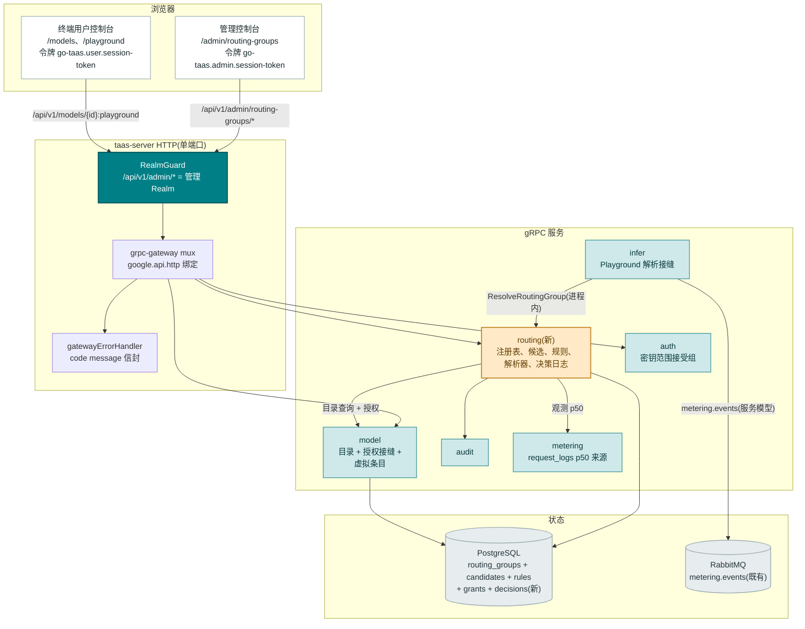
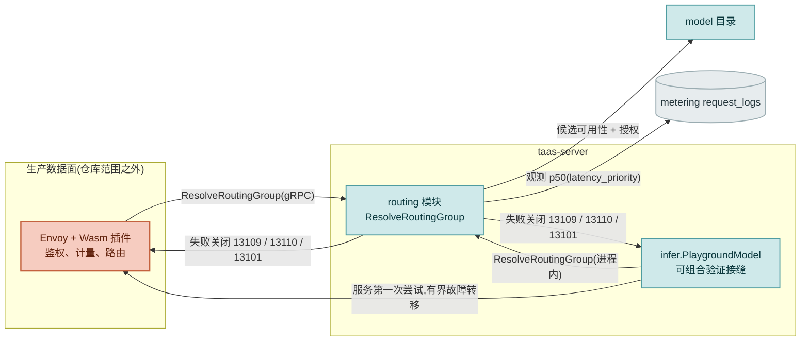
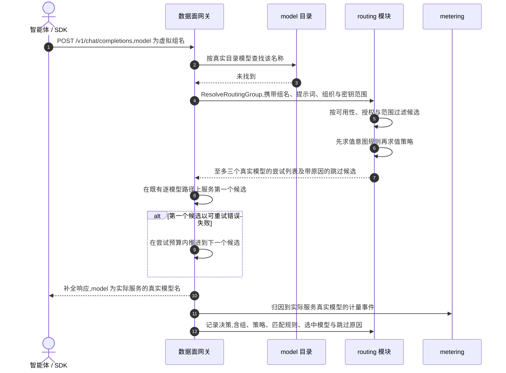
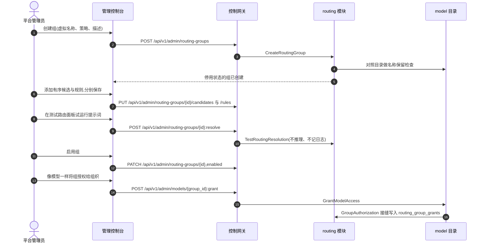
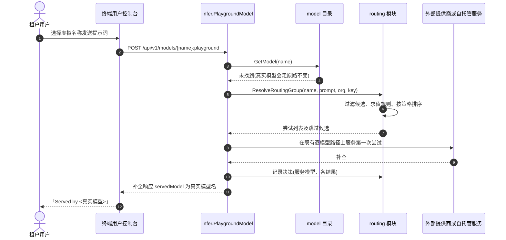

# 智能模型路由 — 架构与详细设计

| 属性 | 内容 |
| --- | --- |
| 特性点 | 智能模型路由 — 路由组(虚拟模型):管理员以虚拟名称(如 `auto-chat`)创建路由组,持有按序排列的真实目录模型候选列表(自托管或已发布外部模型)及权重与可选的成本/延迟层级标注;调用方请求虚拟名称,平台按有界、可审计的策略(`manual` / `weighted` / `cost_priority` / `latency_priority`)逐请求选择一个候选,可被显式关键词/正则意图规则覆盖;每次决策均记录日志;不静默替换 — 真实模型 id 始终原路路由,响应记录实际服务的模型(待办第 49 行) |
| 文档范围 | 特性 49 的架构与详细设计:新建 `routing` 模块,拥有路由组注册表、候选列表、意图规则、请求时解析与决策日志;`taas.routing.v1.RoutingService` proto,十个 RPC 仅绑定在 `/api/v1/admin/routing-groups/*` 之下,外加一个内部 `ResolveRoutingGroup` RPC;`routing_groups`、`routing_group_candidates`、`routing_group_rules` 与 `routing_decisions` 等表;精确的解析算法(资格过滤 → 意图规则匹配 → 策略排序 → 3 次尝试截断);与模型目录、授权(#13)、密钥范围(#46)、Playground、计量归因与审计的集成接缝;错误处理(13101–13113 及 10038/10036);配置、安全、发布,以及逐层的函数级任务清单 |
| 负责模块 | 新建 `routing` 模块(`services/routing`):路由组注册表、候选、规则、解析器与决策日志;`model`(可授权列表与脱敏用户目录新增虚拟条目);`auth`(密钥范围校验接受组名);`infer`(基于模型的 Playground 中可组合验证的虚拟名称解析接缝);`metering`(归因到实际服务的真实模型 — 代码不变,为约束性规则);`audit`(routing 事件);`pkg/errors`(131xx 块);`pkg/config`(routing 配置节);`pkg/server`(管理端前缀绑定,Realm 守卫不变);`web` 管理控制台(`RoutingGroupsPage`、`RoutingGroupDetailPage`、`RoutingDecisionsPage`)以及既有租户页面上的 Auto 标记与实际服务模型展示 |
| 相关文档 | [需求分析与 UI/UX 设计](../design/intelligent-model-routing.zh-cn.md) · [架构设计](../design/architecture.zh-cn.md) §2.2 `model`、§2.4 `infer`、§3.1 控制网关、§3.2 数据面(Envoy + Wasm)、§4.3 推理请求与计费闭环 · [推理路由策略](./inference-routing-policies.zh-cn.md)(本特性扩展的 #45 重试类别与不替换不变式) · [外部模型提供商](./external-model-providers.zh-cn.md)(已发布外部模型作为候选,以及本特性参照的模块模板) · [按租户模型授权](./model-authorization.zh-cn.md)(路由组复用的授权路径) · [API 密钥模型范围](./api-key-model-scoping.zh-cn.md)(作用于候选的密钥范围过滤) · [控制台双面分离](./console-surface-separation.zh-cn.md)(两个控制台面、`AdminShell`、脱敏投影规则) |
| 状态 | 架构设计完成,已移交开发者智能体 |

---

## 1. 概述与目标

特性 #45 为 go-taas 带来了**同模型**路由:服务同一个精确目录模型与版本的推理服务部署有序列表,配合有界重试。仍然缺失的是**面向调用方**的能力:请求**一个稳定的虚拟名称**,由平台逐请求挑选实际服务的模型 — 简单提示选最便宜的,高负载下选最快的,提示明确要求时选专用模型 — 而管理员重新平衡机群时调用方无需改写客户端。

本特性新增**路由组(虚拟模型)**。管理员以虚拟名称(如 `auto-chat`)创建路由组,持有**真实目录模型** — 自托管或已发布外部(#48)— 的按序候选列表,每项带权重与可选的成本/延迟层级标注。调用方请求虚拟名称;平台按有界、显式的策略逐请求选择一个候选,可被可审计的关键词/正则意图规则覆盖;每次决策均记录日志且可查询。**不静默替换不变式**是核心产品规则:点名真实模型 id 的请求始终原样送达该模型,响应始终记录是哪个真实模型服务的。

**目标**:

- 三个管理页面:`/admin/routing-groups`(`RoutingGroupsPage`)、`/admin/routing-groups/:groupId`(`RoutingGroupDetailPage`)与 `/admin/routing-groups/decisions`(`RoutingDecisionsPage`),位于 `AdminShell` 内,包含组表格、创建对话框、候选编辑器、策略配置、意图规则编辑器、试运行测试面板与可过滤的决策日志(设计 §5.3–§5.5)。
- 新建 `routing` 模块,拥有路由组注册表、候选列表、意图规则、请求时解析与决策日志,并拥有独立错误块 **131xx**(设计 D2、D12)。
- 新 `taas.routing.v1.RoutingService` 上十个 RPC 的精确管理端前缀绑定,外加一个内部 `ResolveRoutingGroup` RPC(设计 §6)。
- **四个有界策略**(`manual`、`weighted`、`cost_priority`、`latency_priority`),层级由管理员声明(绝不抓取价格),观测 p50 延迟来自既有请求日志路径(设计 D3)。
- **显式、有序的关键词/正则意图规则**,匹配时覆盖策略,带试运行测试面板,正则仅限 RE2(设计 D4)。
- 端到端的**不静默替换不变式**:真实模型 id → 原路不变;虚拟名称 → 组解析;响应记录实际服务的真实模型(设计 D5、§1.4)。
- 授权/范围集成:路由组与模型完全相同地被授权(#13),可列入密钥的模型范围(#46),且每个候选在解析时被**独立**检查,记录跳过原因,无资格则失败关闭 **13109**(设计 D6)。
- 沿有序候选列表的**有界故障转移**,基于 #45 可重试类别,总计至多 3 次尝试;`manual` 为别名 — 恰好一次尝试(设计 D7)。
- **计量归因到实际服务的真实模型**,以及带界保留(默认 7 天)的**决策日志**(设计 D8、D9)。
- 编号验收标准(AC1–AC16),可在 Nightwatch 与 FVT 中针对 compose 栈测试。

**非目标**(来自设计文档,重申):同模型部署排序与重试(特性 #45,原样复用);嵌入/语义分类器与老虎机/自适应路由(明确排除);调用方控制的逐请求路由开关(明确排除);实时价格抓取或自动层级发现(层级由管理员声明);金丝雀/百分比流量切分;按租户或按组织覆盖组;自动候选健康摘除(网关既有健康路由与 #45 处理就绪性);AIBrix 侧路由配置(特性 #47 仍为运行时投影);计量/计费管道本身(特性 #4/#25/#28,原样复用);以及任何新的终端用户管理页面(设计 D11 — 租户消费虚拟名称,不管理它们)。

### 1.1 本文档阅读顺序

第 2 节记录架构决策(AD1–AD15;AD12–AD15 为架构补充的细化项,已标注)。第 3–5 节为组件视图、数据模型与 API 设计。第 6 节为前端架构(页面 → 路由 → API 前缀表、导航、共享组件、鉴权守卫)。第 7–8 节为时序图与错误处理。第 9–11 节为配置、安全与发布。第 12 节为验收标准追溯。第 13–15 节为函数级详细设计(含精确解析算法)、有序实现任务清单与延后项。

---

## 2. 架构决策

AD1–AD11 将 UI/UX 设计的决策(D1–D11)重述为实现级规则。**AD12–AD15 为架构补充的细化项**;每项均标注其细化的设计决策,并保持该决策的意图,使开发者与测试智能体按统一解读实现。

| # | 决策 | 理由 |
| --- | --- | --- |
| AD1 | **管理仅限管理端面**:路由 `/admin/routing-groups`、`/admin/routing-groups/:groupId` 与 `/admin/routing-groups/decisions`,API 前缀 `/api/v1/admin/routing-groups/*`。**没有 `/api/v1/*` 管理绑定**,也没有新的终端用户管理页面。租户消费复用既有用户面(`/models`、`/playground`、`/v1`),采用脱敏投影 | 设计 D1/D11。组配置(候选、权重、层级、策略、规则)是管理员知识;租户只看到虚拟名称、Auto 标记与实际服务的模型。与管理端专属的提供商(#48)、运行时(#47)与路由策略(#45)面一致 |
| AD2 | **新建 `routing` 模块**(`services/routing`)拥有路由组注册表、候选列表、意图规则、请求时解析与决策日志,并拥有独立错误块 **13101–13113**(13105 未分配,见 AD9)。`model` 仍拥有目录,`infer` 仍拥有推理服务,数据面网关仍拥有逐模型服务 | 设计 D2。路由组是独立关注点(一个虚拟名称映射多个真实模型,带选择策略与决策历史);独立模块使其不混入目录与 #45 策略引擎 — 后者的对象轴是一个模型内的部署 |
| AD3 | **四个策略有界且可解释**:`manual`(固定候选为唯一尝试)、`weighted`(按权重比例随机抽取一次,其余合格候选按权重降序作为故障转移尾部)、`cost_priority`(合格候选按声明的 `cost_tier` 升序,缺失层级 = 6,并列按声明顺序)、`latency_priority`(合格候选按 15 分钟窗口内观测 p50 延迟升序;无样本候选回退到声明的 `latency_tier` 升序,缺失层级 = 6,排在有样本候选之后)。层级为管理员声明的标注,绝不抓取价格 | 设计 D3。每次选择都可由管理员可见配置加平台观测延迟解释;无老虎机、无嵌入、无隐藏裁判 |
| AD4 | **意图规则是作用于提示词的显式有序分类器**:`keyword`(大小写不敏感子串,1–256 字符)或 `regex`(RE2,必须可编译,1–256 字符);按声明顺序求值;**首个匹配的启用规则胜出**,其目标成为第一次尝试;匹配的规则记入决策日志。试运行 `TestRoutingResolution` 预览匹配与尝试列表,不执行推理、不记日志 | 设计 D4。沿用 AIBrix 语义路由器的模式,但在 go-taas 自己的控制面以显式、可审计的规则实现 — RE2 的线性时间约束了求值成本 |
| AD5 | **不静默替换**(约束性不变式):点名**真实目录模型 id 或名称**的请求始终送达该模型 — 不查询任何组、不创建决策日志条目。智能路由**仅**在调用方显式请求**已启用组的虚拟名称**时生效。响应记录实际服务的真实模型:OpenAI 兼容的 `model` 字段与 Playground 的 `servedModel` 字段携带**实际服务**模型的名称,绝不携带虚拟名称 | 设计 D5、§1.4。调用虚拟名称即调用方已选择平台代选 — 这是该名称的契约;调用方始终可以验证是谁应答 |
| AD6 | **路由组与模型完全相同地授权给组织**(特性 #13),并可列入密钥的模型范围(特性 #46)。请求时每个候选必须**独立**满足 (a) 目录可用性(外部候选必须已发布)、(b) 组织授权、(c) 密钥范围;不合格候选被跳过并记录原因(`skipped_unavailable` / `skipped_unauthorized`);若一个不剩则请求失败关闭 **13109** | 设计 D6。组是*入口*权限,候选是*服务*权限 — 两者都强制执行,跳过原因使配置错误在决策日志中可见 |
| AD7 | **沿有序候选列表的有界故障转移**,基于 #45 可重试类别(响应前连接/超时、HTTP 429、HTTP 5xx),总计至多 **3 次尝试**;`manual` 为别名 — 恰好一次尝试,不转移。当每次尝试都失败时,调用方收到最后一次尝试的既有错误,决策日志按候选记录 `failed_retryable` | 设计 D7。复用 #45 的有界重试语义;限制延迟与重复工作风险;别名行为可预期 |
| AD8 | **计量与计费归因到实际服务的真实模型**(其真实价格矩阵),与直接请求该模型完全一致;请求日志展示真实服务模型。组归因存在于决策日志 — 它是组归因视图,不是计费事实 | 设计 D8。计费事实是实际计算 token 的模型;组归因是叠加其上的运营视图 |
| AD9 | **路由块新错误码(13101–13113)**,紧随提供商 130xx 之后的下一个空闲块:**13101 `CodeRoutingGroupNotFound`**、**13102 `CodeRoutingGroupNameConflict`**、**13103 `CodeRoutingGroupNameInvalid`**、**13104 `CodeRoutingGroupCandidateInvalid`**、**13106 `CodeRoutingGroupCandidateExists`**、**13107 `CodeRoutingGroupStrategyInvalid`**、**13108 `CodeRoutingGroupRuleInvalid`**、**13109 `CodeRoutingGroupNoEligibleCandidate`**、**13110 `CodeRoutingGroupDisabled`**、**13111 `CodeRoutingGroupInUse`**、**13112 `CodeRoutingGroupRuleExists`**、**13113 `CodeRoutingGroupNameReserved`**。**13105 有意不分配** — 设计的 D12 表跳过了它;常量即不定义,为未来路由码留出空位。Realm 失败复用 **10038**,角色失败复用 **10036** | 设计 D12。新模块(AD2)获得新块;独立错误码使每种失败模式可操作,并让解析器精确失败关闭 |
| AD10 | **虚拟名称做保留校验**:模式 `^[a-z][a-z0-9-]{2,63}$`(3–64 字符),不得与真实目录模型名冲突(**13113**),也不得与其他组冲突(**13102**)。虚拟名称与真实模型名在网关共享一个解析命名空间,且**真实模型匹配始终优先**(AD5) | 设计 D10。冲突会造成静默替换或解析歧义 |
| AD11 | **每次路由决策均记录日志**,保留有界(默认 7 天,`routing.decisionRetentionDays`):`{decision_id, request_id, 组, 策略, 匹配规则, 选中模型, 各候选的结果与跳过原因, API 密钥, 组织, 时间戳}`,组名与候选名反规范化,使日志在删除后仍可读。试运行绝不记日志 | 设计 D9。决策透明是平台代选的验收条件;有界保留使日志保持运营性 |
| AD12 | **对设计 D6/FR6.1 的细化 — 组授权是一行 `model_id` 为组 id 的 `model_authorizations` 记录,经由新的 `routing` 侧接缝写入,而非经由 `model.GrantModelAccess`。** `model` 模块获得 `GrantableLister` 形态的读取接缝(由 `routing` 实现),使管理端授权面板与脱敏用户目录能在模型旁列出组,但 `/api/v1/admin/models/*` 上的授权/撤销/列表 RPC 仍**仅校验目录模型**;组经由同一 RPC 面**按 id** 授权,由 routing 模块作为校验接缝。具体:`model.Service` 新增 `SetGroupAuthorizer(g GroupAuthorization)`,其中 `GroupAuthorization` 暴露 `GroupExists(ctx, id) (bool, error)` 与 `CountGroupGrants(ctx, id) (int64, error)`;`GrantModelAccess`/`RevokeModelAccess`/`ListModelAuthorizations` 先尝试组接缝(命中已启用或已停用组的 id 路由到 `routing` 仓库的授权表 `routing_group_grants`),否则原样回落到目录路径 | 设计说"与模型完全相同地授权",但 `model_authorizations` 表以目录 `models.id` 为键;把组 id 写入其中会破坏 #13 的默认允许规则(对组 id 的 `CountAuthorizations` 与模型的无法区分)。同构的 `routing_group_grants` 表(复合唯一 `(group_id, organization_id)`、`granted_by`、`created_at`)复用整套授权交互与语义而不触碰 #13 不变式。管理端授权面板本就在 `/admin/models/:modelId`;设计的 FR6.1 保持该面,故接缝必须位于 `model` — 但**数据**位于 `routing`,保持模块归属清晰(AD2) |
| AD13 | **对设计 FR6.2 的细化 — 密钥范围列表存储组 id,`VerifyAPIKey` 的范围检查原样接受组 id。** `auth.validateKeyScope` 的存在性检查经由新的 `GroupExistenceChecker` 接缝拓宽(`SetGroupExistenceChecker`,即 `SetModelExistenceChecker` 模式):不是目录模型 id 的条目对照路由组检查;未知 → 既有 10008 无效范围错误。范围判定比较保持纯字符串相等(列表中的组 id 授权请求中的组 id),因此数据面强制路径**无需变更** — Playground 解析器将解析出的候选 id 经由同一 `VerifyAPIKey` 契约传递 | 设计说"已授权的组名可列入密钥的模型范围";范围列存储按相等比较的不透明 id 字符串,故组 id 经既有强制路径流动而数据面零变更。仅拓宽**写入时校验**接缝使 `auth` 与 `routing` 内部解耦(与 #46 的 AD6 相同的未接线即放行的过渡形态) |
| AD14 | **对设计 FR5.2/FR3.4 的细化 — 强制接缝是一个内部 `ResolveRoutingGroup` RPC,由基于模型的 Playground 在仓库内演练,延迟来源是计量 `request_logs` 表。** 生产数据面网关(Envoy + Wasm,仓库范围之外)调用 `ResolveRoutingGroup` 并遍历尝试列表。由于本仓库没有服务端 `/v1/*` 处理器,同一解析器经 `RoutingResolver` 接缝接入 `infer.PlaygroundModel`(`POST /api/v1/models/{model_id}:playground`,用户面)(`SetRoutingResolver`,即 `SetExternalModelProxy` 模式):当模型查找未命中时,Playground 解析虚拟名称,在既有逐模型路径上服务第一次尝试(外部代理或自托管响应),记录决策并返回 `servedModel`。`latency_priority` 从 `request_logs`(`model_id`、`latency_ms`、`status='success'`、`created_at` 在最近 15 分钟内)读取观测 p50,按计量模块的最近秩百分位约定,每次解析一条查询算出 | 设计钉住了数据面契约,但本仓库必须可在无 Envoy 的情况下验证(#48 的 AD14 模式)。Playground 是仓库内唯一租户可达的推理调用,且已携带 `model_id` + `api_key_id` + 组织。`request_logs` 是既有的逐请求延迟记录(特性 #12),含 `ModelID` + `LatencyMs` + `Status` — 自然的观测延迟来源,无需新增埋点 |
| AD15 | **对设计 FR1.1/FR7.2 的细化 — `request_count_24h` 与决策过滤器由 `routing_decisions` 以普通索引查询算出,决策日志的 `candidates_considered` 是 jsonb 列。** `request_count_24h` 是 `routing_decisions` 上 `group_id = ?` 且 `created_at > now()-24h` 的 `COUNT(*)`(管理列表页至多 100 个组;不值得反规范化计数器)。`candidates_considered` 数组(每候选的模型 id、名称、结果、详情)作为 jsonb 字符串列存储在 `routing_decisions` 上 — 即 `routing_policies.service_ids` 约定 — 在仓库边界解码 | 反规范化计数器需要为列表页小功能在请求路径上做事务更新;jsonb 使决策行自包含(FR7.4 的反规范化规则),而无需保留清理时要级联的逐候选表 |

---

## 3. 组件视图

### 3.1 归属

| 层 / 组件 | 拥有 | 本特性变更 |
| --- | --- | --- |
| **静态包(SPA)** | 一个 Vite 包(`web/dist`)嵌入 `taas-server`;由网关的 SPA 回退服务 | 三个新管理页面(`RoutingGroupsPage`、`RoutingGroupDetailPage`、`RoutingDecisionsPage`)、一个导航项、`App.tsx` 路由注册(静态 `decisions` 在 `:groupId` 之前)、i18n 键、用户目录/详情页上的 Auto 徽标、Playground 的实际服务模型行,以及管理端授权面板与密钥范围选择器中的组条目 |
| **网关(`pkg/server`)** | HTTP 组合:`RealmGuard` → `withConsole` → grpc-gateway mux;统一错误渲染器;SPA 回退 | 无变更 — 新 RPC 绑定在 `/api/v1/admin/routing-groups/*` 之下,`RealmGuard` 已将其归类为管理面 |
| **grpc-gateway mux** | 依据 `google.api.http` 注解的路径 → RPC 路由 | 十个路由 RPC 的新绑定(第 5 节)。`ResolveRoutingGroup` **不携带** HTTP 注解,仅限内部 gRPC |
| **`routing`(新)** | `routing_groups`、`routing_group_candidates`、`routing_group_rules`、`routing_group_grants` 与 `routing_decisions` 表;十个管理 RPC;解析器(资格、规则、策略);决策日志及其保留运行器 | 新服务:`services/routing` |
| **`model`** | 目录(`models`、`model_versions`、`model_authorizations`)与管理端/可用投影 | `GrantModelAccess`/`RevokeModelAccess`/`ListModelAuthorizations` 经 `GroupAuthorization` 接缝接受组 id(AD12);`ListAvailableModels`/`GetAvailableModel` 经 `VirtualModelLister` 接缝将已授权组追加为脱敏虚拟条目(`virtual: true`);`ListModels`(管理端)不变 |
| **`auth`** | API 密钥、会话、`VerifyAPIKey` | `validateKeyScope` 经 `GroupExistenceChecker` 接缝接受组 id(AD13);判定比较与数据面强制不变 |
| **`infer`** | 推理服务与基于模型的 Playground | `PlaygroundModel` 在目录查找未命中时经注入的 `RoutingResolver` 解析虚拟名称,服务第一次尝试,记录决策并返回 `servedModel`;新增 `SetRoutingResolver` 设置器(即 `SetExternalModelProxy` 模式) |
| **`metering`** | 凭证、用量记录、请求日志 | **代码无变更** — 归因到实际服务的真实模型是约束性规则(AD8):Playground 路径以服务模型的 id 发出计量事件,与直接请求完全一致 |
| **`audit`** | 尽力而为审计记录器 | 复用:routing 模块为 `routing.*` 事件调用 `Recorder.Record` |
| **`pkg/mq`** | 规范主题 | **无新主题** — 解析是同步内部 RPC,决策日志是数据库写入;Playground 路径在既有 `metering.events` 主题上发布 |
| **`pkg/errors`** | 按模块的错误块 | 一个新路由块:**13101–13113**(13105 未分配) |
| **`pkg/config`** | 合并配置树 | 新 `routing` 配置节(决策保留天数、保留运行器、延迟窗口) |
| **`test/e2e/mock`** | compose 测试夹具 | 原样复用 — `mock-infer` 扮演自托管候选;外部路径复用 #48 夹具 |

### 3.2 组件视图



### 3.3 请求身份链

路由管理 RPC 是**管理面、管理角色、平台级**(AD1)。链路为:

1. `RealmGuard`(HTTP,`pkg/server/realm.go`)— 路径前缀 `/api/v1/admin/routing-groups/*` 决定期望 Realm 为 `admin`。无 `Authorization` 头:放行(过渡形态)。有头:从 Redis 解析会话 Realm;不匹配 → **10038**;未知/过期/无 Realm → **10027**。
2. grpc-gateway mux — 按注解路径路由并转发 `authorization`。
3. `routing` 处理器 — 解析操作者(`SessionUserResolver`)并经 `tenancy.RoleGuard` 对每个 RPC 把关管理角色(**10036**),即 `provider.requireAdminRole` 形态:读写均要求管理角色;不要求也不接受 `X-Organization-Id`(组是平台全局的)。

用户 Realm 会话出现在任何 `/api/v1/admin/routing-groups/*` 路由上被以 **10038 `CodeRealmMismatch`** 拒绝(设计 FR8.4、AC13)。缺少所需角色的会话收到 **10036 `CodeForbidden`**(AC14)。

### 3.4 强制接缝

两个调用方共享一个解析契约(AD14):



- **`ResolveRoutingGroup`** 是内部 gRPC RPC(`taas.routing.v1.RoutingService`,无 `google.api.http` 注解)。给定 `{group_name, prompt, org_id, api_key_id}`,返回 `{attempt_list[{model_id, model_name}](≤ 3), skipped[{model_id, model_name, reason}]}` 或失败关闭码(**13101** 未知、**13110** 已停用、**13109** 无合格候选)。
- **可组合验证路径**(AD14):`infer.PlaygroundModel` 在目录模型查找未命中时调用注入的 `RoutingResolver`(由 `routing.Service` 实现),在既有逐模型路径上遍历尝试列表(外部候选走外部代理,否则走自托管响应),记录决策并返回 `servedModel`。这为 AC7–AC11 提供了真实的仓库内执行路径。
- **不静默替换**(AD5):解析器**仅**在真实模型查找未命中之后被咨询;真实模型请求绝不进入路由路径,也绝不创建决策条目。

---

## 4. 数据模型

本特性新增**五张表**,全部由 `routing` 服务的 `Migrate` 经 `db.AutoMigrate(...)` 创建(第 4.5 节)。无既有表变更。

### 4.1 `routing_groups`

| 列 | 类型 | 说明 |
| --- | --- | --- |
| `id` | string(PK,uuid) | 服务端生成 UUID v4,对外为 `group_id` |
| `name` | string(64,唯一) | 虚拟名称,`^[a-z][a-z0-9-]{2,63}$`,经 `uniqueIndex` 唯一 |
| `description` | string(256) | 可选,默认 `''` |
| `strategy` | string(32) | `manual` / `weighted` / `cost_priority` / `latency_priority`;默认 `weighted` |
| `enabled` | bool | 创建时默认 `false`;启用时校验 FR1.4 |
| `created_by` / `updated_by` | string(64) | 操作管理员用户 id(未解析时为空,过渡形态) |
| `created_at` / `updated_at` | timestamp | UTC |

GORM 模型为 `services/routing/routing_model.go` 中的 `Group`;`TableName()` 返回 `"routing_groups"`。

### 4.2 `routing_group_candidates`

| 列 | 类型 | 说明 |
| --- | --- | --- |
| `id` | string(PK,uuid) | 服务端生成 UUID v4,对外为 `candidate_id` |
| `group_id` | string(uuid,索引) | 所属组;与 `model_id` 复合唯一 |
| `model_id` | string(uuid) | 真实目录模型 id;`uniqueIndex:idx_routing_group_candidates_group_model (group_id, model_id)` |
| `model_name` | string(128) | 保存时反规范化(FR7.4) |
| `weight` | int | 1–100,默认 10 |
| `cost_tier` | int(可空) | 1–5(1 = 成本最低);`NULL` = 未声明 |
| `latency_tier` | int(可空) | 1–5(1 = 最快);`NULL` = 未声明 |
| `pinned` | bool | 默认 `false`;仅对 `manual` 有意义 |
| `position` | int | 声明顺序,从 0 起 |
| `created_at` / `updated_at` | timestamp | UTC |

GORM 模型为 `services/routing/routing_model.go` 中的 `Candidate`;`TableName()` 返回 `"routing_group_candidates"`。整个列表由 `ReplaceRoutingGroupCandidates` 原子替换(单事务内全删 + 全插),沿用 #45 策略保存模式 — 没有逐行 CRUD。

### 4.3 `routing_group_rules`

| 列 | 类型 | 说明 |
| --- | --- | --- |
| `id` | string(PK,uuid) | 服务端生成 UUID v4,对外为 `rule_id` |
| `group_id` | string(uuid,索引) | 所属组 |
| `name` | string(64) | 1–64 字符,组内唯一:`uniqueIndex:idx_routing_group_rules_group_name (group_id, name)` |
| `match_type` | string(16) | `keyword` / `regex` |
| `pattern` | string(256) | 1–256 字符;`regex` 必须可在 RE2 编译 |
| `target_model_id` | string(uuid) | 必须是同组候选 |
| `target_model_name` | string(128) | 保存时反规范化 |
| `enabled` | bool | 默认 `true` |
| `position` | int | 声明顺序,从 0 起 |
| `created_at` / `updated_at` | timestamp | UTC |

GORM 模型为 `services/routing/routing_model.go` 中的 `Rule`;`TableName()` 返回 `"routing_group_rules"`。由 `ReplaceRoutingGroupRules` 原子替换(0–50 条)。

### 4.4 `routing_group_grants` 与 `routing_decisions`

**`routing_group_grants`**(AD12)— 一行表示"该组织可使用该路由组";与 `model_authorizations` 同构同义:

| 列 | 类型 | 说明 |
| --- | --- | --- |
| `id` | string(PK,uuid) | 服务端生成 UUID v4 |
| `group_id` | string(uuid) | `uniqueIndex:idx_routing_group_grants_group_org (group_id, organization_id), priority:1` |
| `organization_id` | string(64) | 复合唯一键的另一半 |
| `granted_by` | string(64) | 调用方用户 id |
| `created_at` | timestamp | UTC,与 `group_id` 一起索引 |

默认允许规则为推导所得、绝不存储:零授权行的组对所有组织开放,第一行即限制其(重申 #13 的 AD2 规则)。授权幂等(`ON CONFLICT DO NOTHING`),且仅在决策日志反规范化中于组删除后存续 — `DeleteRoutingGroup` 在存在授权时被阻断(**13111**),故授权仅经显式撤销删除。

**`routing_decisions`**(AD11、AD15)— 每次真实解析一行(试运行绝不记日志):

| 列 | 类型 | 说明 |
| --- | --- | --- |
| `id` | string(PK,uuid) | 对外为 `decision_id` |
| `request_id` | string(128),索引 | 推理请求 id |
| `group_id` | string(uuid) | 索引(与 `created_at`) |
| `group_name` | string(64) | 反规范化(FR7.4) |
| `strategy` | string(32) | 决策时组的策略 |
| `matched_rule_id` | string(uuid) | 无规则匹配时为空 |
| `matched_rule_name` | string(64) | 反规范化;`none` 的呈现由 UI 决定 |
| `selected_model_id` | string(uuid) | 决策失败关闭时为空 |
| `selected_model_name` | string(128) | 反规范化 |
| `candidates` | jsonb | `[{model_id, model_name, outcome, detail}]`;结果 ∈ {`served`、`skipped_unavailable`、`skipped_unauthorized`、`failed_retryable`、`not_attempted`} |
| `api_key_id` | string(64) | 调用密钥 |
| `organization_id` | string(64) | 索引 |
| `created_at` | timestamp | UTC,索引(`idx_routing_decisions_group_created (group_id, created_at)`、`idx_routing_decisions_created (created_at)`) |

GORM 模型为 `services/routing/routing_model.go` 中的 `GroupGrant` 与 `Decision`;`TableName()` 返回 `"routing_group_grants"` / `"routing_decisions"`。

### 4.5 迁移与 init-SQL 升级路径

本仓库**不**使用手写 init-SQL 脚本:每张表的 schema 即所属服务 `Migrate` 经 `db.AutoMigrate(...)` 创建的 GORM 模型(如 `services/provider/service.go` 的 `Migrate` → `AutoMigrate(&Provider{}, &ProviderModel{})`),且 `deploy/` 下没有 `.sql` 文件。升级路径为:

1. 将 `Group`、`Candidate`、`Rule`、`GroupGrant` 与 `Decision` 加入 `services/routing/routing_model.go`。
2. `routing.Service.Migrate(ctx)` 返回 `db.AutoMigrate(&Group{}, &Candidate{}, &Rule{}, &GroupGrant{}, &Decision{})`;`MigrateSchemaForFVT(db)` 为 FVT 环境做同样的事。
3. `apps/taas-server/main.go` 注册 `routing` 服务(在 `provider` 之后、`infer` 旁),使表在服务启动时创建。
4. 无 init-SQL 编辑、无手工 DDL、无数据回填。表初始为空,既有部署升级后行为不变 — 不存在任何组,每个请求保持今天的真实模型路径(AD5)。

---

## 5. API 设计

### 5.1 面映射

每个管理 RPC **仅**绑定在管理前缀 `/api/v1/admin/routing-groups/*`;内部解析器无 HTTP 注解(AD1、AD14)。变更的用户面 RPC 保持既有绑定。

| RPC | HTTP 方法 + 路径 | 面 | 状态 |
| --- | --- | --- | --- |
| `ListRoutingGroups` | `GET /api/v1/admin/routing-groups` | 管理 | 新增 |
| `CreateRoutingGroup` | `POST /api/v1/admin/routing-groups` | 管理 | 新增 |
| `GetRoutingGroup` | `GET /api/v1/admin/routing-groups/{group_id}` | 管理 | 新增 |
| `UpdateRoutingGroup` | `PATCH /api/v1/admin/routing-groups/{group_id}` | 管理 | 新增 |
| `DeleteRoutingGroup` | `DELETE /api/v1/admin/routing-groups/{group_id}` | 管理 | 新增 |
| `ReplaceRoutingGroupCandidates` | `PUT /api/v1/admin/routing-groups/{group_id}/candidates` | 管理 | 新增 |
| `ReplaceRoutingGroupRules` | `PUT /api/v1/admin/routing-groups/{group_id}/rules` | 管理 | 新增 |
| `TestRoutingResolution` | `POST /api/v1/admin/routing-groups/{group_id}:resolve` | 管理 | 新增 |
| `ListRoutingDecisions` | `GET /api/v1/admin/routing-groups/decisions` | 管理 | 新增 |
| `GetRoutingDecision` | `GET /api/v1/admin/routing-groups/decisions/{decision_id}` | 管理 | 新增 |
| `ResolveRoutingGroup` | 内部 gRPC(无 HTTP 注解) | 内部 | 新增 |
| `ListAvailableModels` / `GetAvailableModel` | `GET /api/v1/models`、`/api/v1/models/{model_id}` | 用户 | 变更(虚拟条目) |
| `PlaygroundModel` | `POST /api/v1/models/{model_id}:playground` | 用户 | 变更(接受组名,新增 `served_model`) |
| `GrantModelAccess` / `RevokeModelAccess` / `ListModelAuthorizations` | `POST /api/v1/admin/models/{model_id}:grant` / `:revoke`、`GET /api/v1/admin/models/{model_id}/authorizations` | 管理 | 变更(接受组 id) |
| `CreateAPIKey` / `UpdateAPIKeyScope` | `POST /api/v1/auth/api-keys`、`PUT /api/v1/auth/api-keys/{key_id}/scope` | 用户 | 变更(范围接受组 id) |

网关路由说明:grpc-gateway 按**精确路径模式**匹配,`GET /api/v1/admin/routing-groups/decisions`(静态段)与 `GET /api/v1/admin/routing-groups/{group_id}` 一并注册 — 网关的模式匹配器优先字面量段而非通配符,与 `GET /api/v1/admin/billing/reports/schedules` 与 `/api/v1/admin/billing/reports/{report_id}` 的既有共存一致。SPA 路由表将 `/admin/routing-groups/decisions` 注册在 `/admin/routing-groups/:groupId` **之前**(FR8.1)。

### 5.2 Proto 契约(`proto/taas/routing/v1/routing.proto`,新)

```proto
syntax = "proto3";

package taas.routing.v1;

import "google/api/annotations.proto";
import "taas/common/v1/common.proto";

option go_package = "github.com/go-taas/go-taas/proto/taas/routing/v1;routingv1";

// RoutingService 提供路由组注册表、候选与规则列表、试运行解析器
// 与决策日志(特性 #49)。
// 管理面 API:服务于 /api/v1/admin/routing-groups 之下。
service RoutingService {
  // ListRoutingGroups 返回组及策略、候选数、规则数与 24 小时请求数。
  // 支持分页、名称搜索与策略/启用过滤。
  rpc ListRoutingGroups(ListRoutingGroupsRequest) returns (ListRoutingGroupsResponse) {
    option (google.api.http) = {get: "/api/v1/admin/routing-groups"};
  }

  // CreateRoutingGroup 创建停用状态的组。候选与规则随后在详情页配置。
  rpc CreateRoutingGroup(CreateRoutingGroupRequest) returns (CreateRoutingGroupResponse) {
    option (google.api.http) = {
      post: "/api/v1/admin/routing-groups"
      body: "*"
    };
  }

  // GetRoutingGroup 返回单个组及其有序候选与规则列表。
  // 未知 id -> 13101。
  rpc GetRoutingGroup(GetRoutingGroupRequest) returns (GetRoutingGroupResponse) {
    option (google.api.http) = {get: "/api/v1/admin/routing-groups/{group_id}"};
  }

  // UpdateRoutingGroup 编辑名称、描述、策略与启用状态。
  // 启用要求 >= 1 个候选;启用 manual 组要求恰好一个固定候选 -> 13107。
  // 名称变更会重新校验保留名规则。
  rpc UpdateRoutingGroup(UpdateRoutingGroupRequest) returns (UpdateRoutingGroupResponse) {
    option (google.api.http) = {
      patch: "/api/v1/admin/routing-groups/{group_id}"
      body: "*"
    };
  }

  // DeleteRoutingGroup 删除组。存在组织授权引用时被阻断 -> 13111。
  // 决策日志条目存续(其反规范化了组名)。
  rpc DeleteRoutingGroup(DeleteRoutingGroupRequest) returns (DeleteRoutingGroupResponse) {
    option (google.api.http) = {delete: "/api/v1/admin/routing-groups/{group_id}"};
  }

  // ReplaceRoutingGroupCandidates 原子替换有序候选列表(1-20 条)。
  // 每条必须引用真实目录模型;重复 -> 13106;字段非法 -> 13104。
  rpc ReplaceRoutingGroupCandidates(ReplaceRoutingGroupCandidatesRequest) returns (ReplaceRoutingGroupCandidatesResponse) {
    option (google.api.http) = {
      put: "/api/v1/admin/routing-groups/{group_id}/candidates"
      body: "*"
    };
  }

  // ReplaceRoutingGroupRules 原子替换有序规则列表(0-50 条)。
  // 名称重复 -> 13112;模式、正则或目标非法 -> 13108。
  rpc ReplaceRoutingGroupRules(ReplaceRoutingGroupRulesRequest) returns (ReplaceRoutingGroupRulesResponse) {
    option (google.api.http) = {
      put: "/api/v1/admin/routing-groups/{group_id}/rules"
      body: "*"
    };
  }

  // TestRoutingResolution 是试运行:给定提示词,返回匹配的规则(或无)、
  // 尝试列表与带原因的跳过候选 — 不执行推理、不写决策日志条目。
  rpc TestRoutingResolution(TestRoutingResolutionRequest) returns (TestRoutingResolutionResponse) {
    option (google.api.http) = {
      post: "/api/v1/admin/routing-groups/{group_id}:resolve"
      body: "*"
    };
  }

  // ListRoutingDecisions 返回决策日志。支持分页与
  // 组/策略/匹配规则/选中模型/结果/时间范围过滤。
  rpc ListRoutingDecisions(ListRoutingDecisionsRequest) returns (ListRoutingDecisionsResponse) {
    option (google.api.http) = {get: "/api/v1/admin/routing-groups/decisions"};
  }

  // GetRoutingDecision 返回单个决策及考虑过的候选。
  // 未知 id -> 13101。
  rpc GetRoutingDecision(GetRoutingDecisionRequest) returns (GetRoutingDecisionResponse) {
    option (google.api.http) = {get: "/api/v1/admin/routing-groups/decisions/{decision_id}"};
  }

  // ResolveRoutingGroup 将虚拟名称解析为有序尝试列表及带原因的
  // 跳过候选,或失败关闭码(13101 未知、13110 已停用、13109 无合格候选)。
  // 这是内部 RPC:没有 google.api.http 注解,绝不可经网关到达。
  // 由数据面网关与 infer.PlaygroundModel 调用。
  rpc ResolveRoutingGroup(ResolveRoutingGroupRequest) returns (ResolveRoutingGroupResponse) {}
}

message RoutingGroup {
  string group_id = 1;
  string name = 2;
  string description = 3;
  string strategy = 4; // manual | weighted | cost_priority | latency_priority
  bool enabled = 5;
  int64 candidate_count = 6;
  int64 rule_count = 7;
  int64 request_count_24h = 8;
  int64 created_at = 9;
  int64 updated_at = 10;
}

message RoutingGroupCandidate {
  string candidate_id = 1;
  string model_id = 2;
  string model_name = 3;
  int32 weight = 4;    // 1-100,默认 10
  int32 cost_tier = 5;    // 1-5,0 = 未声明
  int32 latency_tier = 6; // 1-5,0 = 未声明
  bool pinned = 7;
  int32 position = 8;
}

message RoutingGroupRule {
  string rule_id = 1;
  string name = 2;
  string match_type = 3; // keyword | regex
  string pattern = 4;
  string target_model_id = 5;
  string target_model_name = 6;
  bool enabled = 7;
  int32 position = 8;
}

message ListRoutingGroupsRequest {
  taas.common.v1.PageRequest page = 1;
  string name = 2;      // 子串搜索
  string strategy = 3;  // 可选过滤
  string enabled = 4;   // "" | "true" | "false"
}
message ListRoutingGroupsResponse {
  taas.common.v1.Response response = 1;
  repeated RoutingGroup groups = 2;
  taas.common.v1.PageMeta page_meta = 3;
}

message CreateRoutingGroupRequest {
  string name = 1;
  string description = 2;
  string strategy = 3; // 默认 weighted
}
message CreateRoutingGroupResponse {
  taas.common.v1.Response response = 1;
  RoutingGroup group = 2;
}

message GetRoutingGroupRequest {
  string group_id = 1;
}
message GetRoutingGroupResponse {
  taas.common.v1.Response response = 1;
  RoutingGroup group = 2;
  repeated RoutingGroupCandidate candidates = 3;
  repeated RoutingGroupRule rules = 4;
}

message UpdateRoutingGroupRequest {
  string group_id = 1;
  string name = 2;
  string description = 3;
  string strategy = 4;
  bool enabled = 5;
}
message UpdateRoutingGroupResponse {
  taas.common.v1.Response response = 1;
  RoutingGroup group = 2;
}

message DeleteRoutingGroupRequest {
  string group_id = 1;
}
message DeleteRoutingGroupResponse {
  taas.common.v1.Response response = 1;
}

message RoutingGroupCandidateInput {
  string model_id = 1;
  int32 weight = 2;
  int32 cost_tier = 3;
  int32 latency_tier = 4;
  bool pinned = 5;
}
message ReplaceRoutingGroupCandidatesRequest {
  string group_id = 1;
  repeated RoutingGroupCandidateInput candidates = 2;
}
message ReplaceRoutingGroupCandidatesResponse {
  taas.common.v1.Response response = 1;
  repeated RoutingGroupCandidate candidates = 2;
}

message RoutingGroupRuleInput {
  string name = 1;
  string match_type = 2;
  string pattern = 3;
  string target_model_id = 4;
  bool enabled = 5;
}
message ReplaceRoutingGroupRulesRequest {
  string group_id = 1;
  repeated RoutingGroupRuleInput rules = 2;
}
message ReplaceRoutingGroupRulesResponse {
  taas.common.v1.Response response = 1;
  repeated RoutingGroupRule rules = 2;
}

message TestRoutingResolutionRequest {
  string group_id = 1;
  string prompt = 2;
}
message TestRoutingResolutionResponse {
  taas.common.v1.Response response = 1;
  string matched_rule_id = 2; // 无匹配时为空
  string matched_rule_name = 3;
  repeated RoutingGroupCandidate attempts = 4; // <= 3,有序
  repeated SkippedCandidate skipped = 5;
}
message SkippedCandidate {
  string model_id = 1;
  string model_name = 2;
  string reason = 3; // skipped_unavailable | skipped_unauthorized
}

message DecisionCandidate {
  string model_id = 1;
  string model_name = 2;
  string outcome = 3; // served | skipped_unavailable | skipped_unauthorized | failed_retryable | not_attempted
  string detail = 4;
}

message RoutingDecision {
  string decision_id = 1;
  string request_id = 2;
  string group_id = 3;
  string group_name = 4;
  string strategy = 5;
  string matched_rule_id = 6;
  string matched_rule_name = 7;
  string selected_model_id = 8;
  string selected_model_name = 9;
  repeated DecisionCandidate candidates_considered = 10;
  string api_key_id = 11;
  string organization_id = 12;
  int64 created_at = 13;
}

message ListRoutingDecisionsRequest {
  taas.common.v1.PageRequest page = 1;
  string group_id = 2;
  string strategy = 3;
  string matched_rule = 4;    // 名称搜索
  string selected_model = 5;  // 名称搜索
  string outcome = 6;         // served | failed
  string range = 7;           // 1h | 24h | 7d
}
message ListRoutingDecisionsResponse {
  taas.common.v1.Response response = 1;
  repeated RoutingDecision decisions = 2;
  taas.common.v1.PageMeta page_meta = 3;
}

message GetRoutingDecisionRequest {
  string decision_id = 1;
}
message GetRoutingDecisionResponse {
  taas.common.v1.Response response = 1;
  RoutingDecision decision = 2;
}

message ResolveRoutingGroupRequest {
  string group_name = 1;
  string prompt = 2;
  string org_id = 3;
  string api_key_id = 4;
}
message ResolveRoutingGroupResponse {
  taas.common.v1.Response response = 1;
  repeated string attempt_model_ids = 2;   // <= 3,有序
  repeated string attempt_model_names = 3; // 与 attempt_model_ids 平行
  repeated SkippedCandidate skipped = 4;
  string matched_rule_id = 5;
  string matched_rule_name = 6;
  string strategy = 7;
}
```

### 5.3 变更契约

**`PlaygroundModel`**(`proto/taas/infer/v1/infer.proto`,增量):`PlaygroundModelResponse` 新增 `string served_model = 7;` — 实际服务的真实模型**名称**(当请求点名真实模型且 Playground 未解析组时为空,既有调用方不受影响)。请求不变:`model_id`(路径字段)现在可携带组的虚拟名称。

**`AvailableModel`**(`proto/taas/model/v1/model.proto`,增量):新增 `bool virtual = 8;` — 已授权路由组的脱敏条目为 true。虚拟条目携带 `model_id`(组 id)、`name`(虚拟名称)、空 `latest_version`、`virtual: true`,其余为空(无自动扩缩、无兼容性、无外部标记)。`ListAvailableModels`/`GetAvailableModel` 将组织的已授权组追加在目录模型之后。

**`GrantModelAccess` / `RevokeModelAccess` / `ListModelAuthorizations`**(`proto/taas/model/v1/model.proto`,结构不变):`model_id` 路径字段现在可携带路由组的 id;服务经 `GroupAuthorization` 接缝将其路由到组授权路径(AD12)。`ListModelAuthorizations` 的响应不变(授权行两种情况都携带资源 id)。

**`CreateAPIKey` / `UpdateAPIKeyScope`**(`proto/taas/auth/v1/auth.proto`,结构不变):`models` 列表条目现在可为路由组 id;`validateKeyScope` 先按目录模型 id 解析每个条目,再按组 id 解析(AD13)。

### 5.4 校验契约

| 字段 | 规则 | 错误 |
| --- | --- | --- |
| 组名 | 必填,3–64 字符,`^[a-z][a-z0-9-]{2,63}$` | 13103 |
| 组名唯一性 | 无其他同名组 | 13102 |
| 组名保留 | 无同名真实目录模型 | 13113 |
| 描述 | ≤ 256 字符 | 13103 |
| 策略 | 四个值之一 | 13107 |
| 启用 | ≥ 1 个候选;`manual` 要求恰好一个固定候选 | 13107 |
| 候选模型 | 必须存在于目录(自托管或已发布外部);不允许嵌套组 | 13104 |
| 候选模型唯一性 | 列表内无重复 `model_id` | 13106 |
| 候选权重 | 1–100(默认 10) | 13104 |
| 候选层级 | 1–5 或为空 | 13104 |
| 候选固定 | 仅 `manual` 允许,至多一个 | 13104 |
| 候选列表大小 | 1–20 条 | 13104 |
| 规则名 | 必填,1–64 字符,组内唯一 | 13112 |
| 规则匹配类型 | `keyword` / `regex` | 13108 |
| 规则模式 | 1–256 字符;`regex` 必须可在 RE2 编译 | 13108 |
| 规则目标 | 必须是同组候选 | 13108 |
| 规则列表大小 | 0–50 条 | 13108 |
| 删除组 | 不得有组织授权引用 | 13111 |

序列化约定不变:成功 HTTP 200,业务错误为 `{"code": <int>, "message": "..."}`,int64 字段序列化为 JSON 字符串。

---

## 6. 前端架构

### 6.1 页面 → 路由 → API 前缀表

| 页面 | 路由 | API 前缀 | 面 |
| --- | --- | --- | --- |
| `RoutingGroupsPage`(新) | `/admin/routing-groups` | `/api/v1/admin/routing-groups` | 管理 |
| `RoutingGroupDetailPage`(新) | `/admin/routing-groups/:groupId` | `/api/v1/admin/routing-groups/{group_id}`、`.../candidates`、`.../rules`、`...:resolve` | 管理 |
| `RoutingDecisionsPage`(新) | `/admin/routing-groups/decisions` | `/api/v1/admin/routing-groups/decisions`、`.../decisions/{decision_id}` | 管理 |
| `ModelsPage`(变更) | `/models` | `/api/v1/models` | 用户 |
| `ModelDetailPage`(用户,变更) | `/models/:modelId` | `/api/v1/models/{model_id}` | 用户 |
| `PlaygroundPage`(变更) | `/playground` | `/api/v1/models/{model_id}:playground` | 用户 |
| `ModelDetailPage`(管理端,变更) | `/admin/models/:modelId` | `/api/v1/admin/models/{model_id}:grant` / `:revoke` / `/authorizations` | 管理 |
| `ApiKeysPage`(用户,变更) | `/api-keys` | `/api/v1/auth/api-keys/{key_id}/scope` | 用户 |

三个管理页面不含任何 `/api/v1/*` 调用;变更的用户页面不含任何 `/api/v1/admin/*` 调用(FR8.3、AC13)。

### 6.2 导航位置

`AdminShell` 的 `ADMIN_NAV_ITEMS` 在路由策略之后新增一项(FR8.1):

```tsx
{ path: '/admin/routing-policies', labelKey: 'nav.routingPolicies', testid: 'nav-routing-policies', icon: ArrowsSplit },
{ path: '/admin/routing-groups', labelKey: 'nav.routingGroups', testid: 'nav-routing-groups', icon: Shuffle },
```

`App.tsx` 注册路由,静态 `decisions` 路由在 `:groupId` **之前**:

```tsx
<Route path="/admin/routing-groups" element={<RoutingGroupsPage />} />
<Route path="/admin/routing-groups/decisions" element={<RoutingDecisionsPage />} />
<Route path="/admin/routing-groups/:groupId" element={<RoutingGroupDetailPage />} />
```

### 6.3 复用的共享组件与状态

- `Dialog`(创建/删除/停用确认)、`data` 表格样式、`PageMeta` 分页、`badge` 类(`Manual` / `Weighted` / `Cost priority` / `Latency priority` 策略徽标、`Auto` 徽标、外部候选上的 `External` 徽标)— 均为既有控制台约定。
- `RoutingPoliciesPage` 的有序列表编辑器模式(上移/下移/移除行操作、添加行、一次原子保存)被候选与规则镜像复用。
- `ModelAuthorizationsPanel`(管理端模型详情)形态不变 — 授权列表因 API 接受组 id 而自然新增标记「Auto」的组行(AD12)。
- `ApiKeysPage` 的密钥范围选择器列出 `/api/v1/models` 输出,现含虚拟条目 — 「(Auto)」标签来自 `virtual` 标志;无新请求。
- Playground 的模型选择器与响应面板从新的 `servedModel` 字段获得虚拟选项标签与「Served by」行。

### 6.4 各面鉴权守卫

- 三个管理页面渲染于 `AdminShell` 内,其外壳守卫强制管理会话 Realm(`/admin/login`,令牌 `go-taas.admin.session-token`);管理 API 路由上的用户 Realm 会话被 `RealmGuard` 以 **10038** 拒绝,外壳重定向到 `/admin/login?reason=realm`。
- 缺少所需角色的会话收到 **10036**;每个页面渲染标准的无权限状态并附返回 `/admin` 的链接(AC14)。
- 变更的用户页面保持 `UserShell` 守卫(用户会话 Realm);无新守卫逻辑。

### 6.5 `data-testid` 钩子(约束性,kebab-case)

`routing-groups-table`、`routing-group-row-{group_id}`、`routing-groups-add`、`routing-group-candidate-list`、`routing-group-candidate-row-{model_id}`、`routing-group-rule-row-{rule_id}`、`routing-group-test-prompt`、`routing-group-test-result`、`routing-decisions-table`、`routing-decision-row-{decision_id}`、`models-auto-badge`、`playground-served-model` — 以及既有约定(`nav-routing-groups`、`routing-groups-empty`、`routing-group-enabled-toggle-{group_id}`、`routing-group-delete-{group_id}`、`routing-group-save-candidates`、`routing-group-save-rules`、`routing-group-test-preview`)。

---

## 7. 时序图

### 7.1 虚拟名称请求解析(强制路径)



### 7.2 创建 → 配置 → 启用 → 授权(管理员路径)



### 7.3 Playground 解析(可组合验证路径)



---

## 8. 错误处理

| 条件 | HTTP | 码 | 常量 | 说明 |
| --- | --- | --- | --- | --- |
| 未知路由组(get/update/delete/candidates/rules/resolve) | 500 | 13101 | `CodeRoutingGroupNotFound` | 失败关闭 |
| 组名重复(create/update) | 500 | 13102 | `CodeRoutingGroupNameConflict` | |
| 组名或描述非法 | 500 | 13103 | `CodeRoutingGroupNameInvalid` | 模式/长度 |
| 候选字段非法(模型引用、权重、层级、固定、列表大小) | 500 | 13104 | `CodeRoutingGroupCandidateInvalid` | |
| *(未分配)* | — | 13105 | — | 设计 D12 有意跳过;为未来路由码保留 |
| 组内候选模型重复 | 500 | 13106 | `CodeRoutingGroupCandidateExists` | |
| 策略或策略配置非法(manual 无固定候选、无候选即启用) | 500 | 13107 | `CodeRoutingGroupStrategyInvalid` | |
| 意图规则非法(模式、正则编译、目标、列表大小) | 500 | 13108 | `CodeRoutingGroupRuleInvalid` | |
| 请求时无合格候选 | 500 | 13109 | `CodeRoutingGroupNoEligibleCandidate` | **失败关闭** — 所有候选均被跳过 |
| 请求已停用的组 | 500 | 13110 | `CodeRoutingGroupDisabled` | **失败关闭** |
| 组被使用(有组织授权引用) | 500 | 13111 | `CodeRoutingGroupInUse` | 删除守卫 |
| 组内规则名重复 | 500 | 13112 | `CodeRoutingGroupRuleExists` | |
| 虚拟名称被真实目录模型保留 | 500 | 13113 | `CodeRoutingGroupNameReserved` | |
| 管理路由上的用户 Realm 会话 | 500 | 10038 | `CodeRealmMismatch` | 复用 — Realm 分离 |
| 会话缺少所需角色 | 500 | 10036 | `CodeForbidden` | 复用 — 权限拒绝 |
| 既非真实模型也非组的名称 | 500 | 10101 | `CodeModelNotFound` | 复用 — 既有模型未找到错误,不新增码(FR5.3) |
| 组织未获授权的候选 | 500 | 10105 | `CodeModelUnauthorized` | 在直接候选路径上复用;解析器改为记录 `skipped_unauthorized` |
| 范围密钥之外的组 | 500 | 10039 | `CodeAPIKeyModelNotAllowed` | 复用 — 既有密钥范围强制(FR6.2) |

所有业务错误使用统一信封 `{"code": <int>, "message": "..."}` 与 HTTP 500,为仓库约定。失败关闭码(13109、13110)在决策条目写入**之后**返回给调用方(FR5.5),使失败可在日志中检查。

---

## 9. 配置

`pkg/config` 新增 `routing` 配置节(`RoutingConfig`,`mapstructure:"routing"`),在 `applyDefaults` 中取默认值,在 `Validate` 中校验:

| 键 | 类型 | 默认 | 说明 |
| --- | --- | --- | --- |
| `routing.decisionRetentionDays` | int | 7 | 决策日志保留(设计 D9/FR7.3);范围 1–90 |
| `routing.retention.enabled` | bool | true | 保留运行器的开关(仓库的布尔约定) |
| `routing.retention.batchSize` | int | 1000 | 每次保留清理删除的行数 |
| `routing.retention.interval` | duration | 1h | 清理轮询周期 |
| `routing.latencyWindow` | duration | 15m | `latency_priority` 的观测 p50 窗口(设计 FR3.4) |

`configs/config.yaml` 新增:

```yaml
# 智能模型路由(特性 #49)。routing 模块拥有路由组注册表、
# 请求时解析器与决策日志。
routing:
  # decisionRetentionDays 约束决策日志保留(FR7.3)。
  decisionRetentionDays: 7
  # retention 配置决策日志保留运行器。
  retention:
    enabled: true
    batchSize: 1000
    interval: 1h
  # latencyWindow 是 latency_priority 的观测 p50 窗口。
  latencyWindow: 15m
```

compose 栈(`deploy/compose/docker-compose.yaml`)无需新环境变量 — 默认值生效;部署可经标准 `CONFIG_` 环境映射覆盖(如 `CONFIG_ROUTING_DECISIONRETENTIONDAYS`)。

---

## 10. 安全考量

- **Realm 分离**(约束性):每个管理 RPC 均为管理面;用户 Realm 会话在处理器之前被以 **10038** 拒绝;管理页面绝不调用 `/api/v1/*`(AC13)。
- **角色强制**:每个管理 RPC 经 `tenancy.RoleGuard` 要求管理角色(**10036**);组为平台全局(不接受 `X-Organization-Id`)。
- **脱敏租户投影**(FR8.5):用户目录的虚拟条目仅携带 `model_id`、`name`、`description`、`virtual: true` — 绝不携带候选、权重、层级、策略或规则。Playground 展示实际服务模型的名称(透明性),而非组的配置。
- **失败关闭解析**:已停用的组(13110)、未知名称(13101)或全部不合格的候选列表(13109)绝不回落到真实模型 — 调用方得到显式错误,决策日志记录每个候选被跳过的原因。
- **无凭据面**:routing 模块不存储任何密钥;候选仅引用目录模型。外部候选路径复用 #48 代理,其仅在内存中持有解密后的密钥。
- **规则中的提示词处理**:关键词/正则模式在服务端对照提示词匹配;模式为 RE2(线性时间 — 无 ReDoS),上限 256 字符,每组至多 50 条规则按序求值,约束了每请求的分类成本。决策日志记录规则**名**与模型名,绝不记录提示词文本。
- **审计**:每次组变更发出带操作管理员的 `routing.*` 审计事件(FR1.7);授权以组 id 为资源发出 `model.grant`/`model.revoke`(#13 约定)。

---

## 11. 发布与升级说明

1. **仅增量**:五张新表经 AutoMigrate、新 proto 文件、增量响应字段(`served_model`、`virtual`)、拓宽的校验接缝。无既有列、消息字段编号或路由变更;既有调用方不受影响(缺失的 `served_model` 为空;无组的目录不列虚拟条目)。
2. **部署顺序**:无 — routing 服务在 `apps/taas-server/main.go` 中注册于 `infer` 旁;其 `Migrate` 在启动时建表。接缝(`SetRoutingResolver`、`SetGroupAuthorization`、`SetGroupExistenceChecker`、`SetVirtualModelLister`)均为 nil 安全:未接线时 Playground 的虚拟名称分支以既有模型未找到错误失败关闭,与今天的行为完全一致。
3. **无种子数据**:表初始为空;管理员创建第一个组之前不存在任何组,升级在行为上不可见(AD5 的不变式保证真实模型请求绝不咨询路由)。
4. **特性激活由管理员驱动**:组仅在 创建 → 候选 →(规则)→ 启用 → 授权 之后影响流量;每一步都被校验与审计。
5. **回滚**:停用所有组(或删除它们 — 授权须先撤销,13111)即完全恢复特性前行为;回滚部署中可删除这些表,因为没有其他代码读取它们。
6. **数据面生产说明**:Envoy+Wasm 网关按其自身发布节奏采纳 `ResolveRoutingGroup`(仓库范围之外);契约由本文档冻结,并由 Playground 接缝在仓库内钉住(AD14)。

---

## 12. 验收标准追溯

| AC | 设计需求 | 架构章节 |
| --- | --- | --- |
| AC1 组表格含搜索/过滤/排序/分页 | FR1.1 | §5.1–5.2(`ListRoutingGroups`)、§6.1–6.2、§13(web) |
| AC2 创建对话框校验(13103/13102/13113)、停用态创建 | FR1.2、FR1.6 | §5.4、§8、§13(服务校验顺序) |
| AC3 候选编辑器、13106/13104、原子保存 | FR2.1–FR2.4 | §4.2、§5.2、§5.4、§13(仓库替换) |
| AC4 策略配置、manual 固定、启用守卫(13107) | FR1.4、FR3.1 | §5.4、§13(解析器)、§8 |
| AC5 规则编辑器、13108/13112、自上而下首匹配 | FR4.1–FR4.3 | §4.3、§5.4、§13(规则匹配器) |
| AC6 试运行面板、不推理、不记日志 | FR4.5 | §5.2(`TestRoutingResolution`)、§13(试运行标志) |
| AC7 不静默替换、实际服务模型响应 | FR5.1、FR5.4、§1.4 | AD5、§3.4、§13(Playground 钩子)、§7.1 |
| AC8 端到端虚拟消费与计量归因 | FR5.2、FR6.3 | AD8、AD14、§7.3、§13(计量规则) |
| AC9 意图规则覆盖在 served-by 与日志中可见 | FR4.4 | §13(解析器排序)、§4.4 |
| AC10 策略行为(manual/weighted/cost/latency) | FR3.1–FR3.4 | AD3、§13(策略排序器) |
| AC11 授权失败关闭(跳过、13109、13110) | FR3.6、FR5.3、D6 | AD6、§13(资格过滤)、§8 |
| AC12 决策页面、过滤器、抽屉 | FR7.1–FR7.2 | §4.4、§5.2、§6.1、§13(web) |
| AC13 Realm 分离(10038)、无跨面调用 | FR8.3–FR8.4 | §3.3、§6.1–6.4、§10 |
| AC14 角色拒绝(10036)、无权限状态 | FR8.4 | §3.3、§6.4、§8 |
| AC15 租户 Auto 标记、Playground 标签、授权/范围列表 | FR6.1–FR6.2、FR8.5 | AD12、AD13、§5.3、§6.3 |
| AC16 守卫(13111)与页面状态 | FR1.5、§5.3–§5.5 | §5.4、§8、§13(web 状态) |

---

## 13. 详细设计

### 13.1 文件布局

| 模块 | 文件 | 职责 |
| --- | --- | --- |
| `proto/taas/routing/v1` | `routing.proto` | `RoutingService` 契约(第 5.2 节);生成的 `pb.go` 被 git 忽略(仅提交 `.proto`) |
| `services/routing` | `routing_model.go` | `Group`、`Candidate`、`Rule`、`GroupGrant`、`Decision` GORM 模型 + 边界常量 |
| | `routing_repository.go` | 组 CRUD、名称查询、候选/规则原子替换、授权操作、`request_count_24h` |
| | `decision_repository.go` | 决策插入、过滤列表、获取、保留删除、观测 p50 查询 |
| | `resolver.go` | `Resolve(ctx, groupName, prompt, orgID, apiKeyID, dryRun)` — 资格过滤、规则匹配器、策略排序器与尝试截断 |
| | `service.go` | 十个管理 RPC + `ResolveRoutingGroup`、`Migrate`、`NewForFVT`、`MigrateSchemaForFVT`、接缝与设置器 |
| | `retention_runner.go` | 决策日志保留运行器(`RequestLogRetentionRunner` 模式) |
| `services/model` | `service.go`(增量) | 授权/撤销/列表上的 `GroupAuthorization` 接缝;可用投影上的 `VirtualModelLister` 接缝 |
| `services/auth` | `model_authorizer.go`(增量) | `GroupExistenceChecker` 接缝 + `checkModelsExist` 拓宽 |
| `services/infer` | `playground_model.go`(增量) | 虚拟名称分支:查找未命中 → `RoutingResolver` → 服务 → 记录 → `servedModel` |
| | `service.go`(增量) | `RoutingResolver` 接口 + `SetRoutingResolver` 设置器 |
| `pkg/errors` | `codes.go`、`messages.go` | 提供商块之后的 131xx 块 |
| `pkg/config` | `api.go`、`configuration.go` | `RoutingConfig`、默认值、校验 |
| `apps/taas-server` | `main.go` | 注册 + 接缝接线 + 保留运行器 |
| `web/src` | `pages/RoutingGroupsPage.tsx`、`pages/RoutingGroupDetailPage.tsx`、`pages/RoutingDecisionsPage.tsx` | 三个管理页面 |
| | `shells/AdminShell.tsx`、`App.tsx` | 导航项 + 路由 |
| | `pages/user/ModelsPage.tsx`、`pages/user/ModelDetailPage.tsx`、`pages/user/PlaygroundPage.tsx` | Auto 徽标、虚拟条目、served-by 行 |
| | `api.ts`、`locales/en.ts`、`locales/zh.ts` | 类型 + i18n 键 |
| `test/fvt` | `routing_fvt_test.go` | FVT 套件(第 14 节) |

### 13.2 `services/routing` — 服务层

`Service` 实现 `routingv1.RoutingServiceServer`,镜像提供商模块的形态:

- **字段**:`components server.Components`;`groupRepo *Repository`;`decisionRepo *DecisionRepository`;接缝 `catalog ModelCatalog`(扩展)、`sessionOrgResolver`、`sessionUserResolver`、`roleGuard`、`auditRecorder`、`latencySource LatencySource`。
- **`New(components)`** / **`NewForFVT(db)`** / **`MigrateSchemaForFVT(db)`** — 提供商模式;`Migrate` AutoMigrate 五个模型。
- **`requireAdminRole(ctx)`** — 提供商的精确形态(解析活动组织、解析操作者、`RequireRole(..., roleAdmin)`;无会话/组织时跳过,管理 Realm 守卫是边界)。
- **`actor(ctx)`** — 操作用户 id 或 `"system"`。
- **`recordAudit(ctx, action, resourceID, metadata)`** — 尽力而为的 `routing.*` 事件。

逐 RPC 职责:

- **`ListRoutingGroups`**:`requireAdminRole` → 构造 `GroupFilter{Name, Strategy, Enabled, Offset, Limit}` → `repo.List` → 对每个组 `decisionRepo.CountSince(groupID, now-24h)`(AD15)→ 映射为 `RoutingGroup` 摘要。
- **`CreateRoutingGroup`**:`requireAdminRole` → 校验名称(模式 → 13103;`repo.FindByName` → 13102;`catalog.ModelNameExists` → 13113)→ 校验描述长度(13103)与策略(13107)→ 以 `enabled=false` 插入 → 审计 `routing.group_created`。
- **`GetRoutingGroup`**:`requireAdminRole` → `repo.GetByID`(13101)→ `repo.ListCandidates` + `repo.ListRules` 按 `position` 排序 → 完整投影。
- **`UpdateRoutingGroup`**:`requireAdminRole` → `repo.GetByID`(13101)→ 名称变更时重跑创建时名称校验 → 策略变更时校验取值(13107)→ `enabled=true` 时:加载候选;为零 → 13107;`manual` 无恰好一个固定候选 → 13107;非 manual 组上的固定候选 → 13104 → 持久化 → 审计 `routing.group_updated`,切换时附加 `routing.group_enabled`/`routing.group_disabled`。
- **`DeleteRoutingGroup`**:`requireAdminRole` → `repo.GetByID`(13101)→ `repo.CountGrants(groupID)` > 0 → **13111** → 单事务删除组及其候选/规则(决策存续,已反规范化)→ 审计 `routing.group_deleted`。
- **`ReplaceRoutingGroupCandidates`**:`requireAdminRole` → `repo.GetByID`(13101)→ 校验列表(1–20 条;每个 `model_id` 经 `catalog.GetModel` 存在于目录 — 嵌套组 id 以 13104 失败;无重复 → 13106;权重 1–100、层级 1–5 或空 → 13104;固定仅限 `manual` 且至多一个 → 13104)→ 从目录行反规范化 `model_name` → `repo.ReplaceCandidates`(事务性删除+插入,position 从 0 起)→ 审计带前/后的 `routing.candidates_updated`。
- **`ReplaceRoutingGroupRules`**:`requireAdminRole` → `repo.GetByID`(13101)→ 加载当前候选(目标必须引用它们)→ 校验(0–50 条;名称 1–64 且列表内唯一 → 13112;匹配类型 → 13108;模式 1–256,`regex` 需 `regexp.Compile` → 13108;目标 ∈ 候选 → 13108)→ `repo.ReplaceRules` → 审计 `routing.rules_updated`。
- **`TestRoutingResolution`**:`requireAdminRole` → `repo.GetByID`(13101)→ `resolver.Resolve(ctx, group, prompt, org, "", dryRun=true)` — 试运行使用**平台组织**上下文(管理面无租户组织;面板的目的是规则/策略预览,响应以原因分离跳过候选)→ 返回匹配规则、尝试与跳过;**不写决策**。
- **`ListRoutingDecisions`**:`requireAdminRole` → 从请求构造 `DecisionFilter{GroupID, Strategy, MatchedRule, SelectedModel, Outcome, Since}`(`range` 预设 1h/24h/7d → `Since`;`outcome=served` → `selected_model_id != ''`,`outcome=failed` → `selected_model_id = ''`)→ `decisionRepo.List` 最新在前 → 映射。
- **`GetRoutingDecision`**:`requireAdminRole` → `decisionRepo.GetByID`(13101)→ 含解码 `candidates` 的完整投影。
- **`ResolveRoutingGroup`**(内部):`repo.FindByName`(未命中 → 13101)→ `!enabled` → 13110 → `resolver.Resolve(ctx, group, prompt, orgID, apiKeyID, dryRun=false)` → 成功时调用方(网关/Playground)经 `RecordDecision` 记录最终结果;解析器本身返回计划。**解析器在无合格候选时返回失败关闭 13109,Playground 在传播错误之前记录决策条目**(FR5.5)。

### 13.3 `services/routing` — 解析器(`resolver.go`)

`Resolve(ctx, group *Group, prompt, orgID, apiKeyID string, dryRun bool) (*Resolution, error)` 按顺序执行约束性算法:

1. **加载**组的候选(按 `position` 排序)与规则(按 `position` 排序,仅 `enabled`)。
2. **资格过滤**(FR3.6)— 对每个候选,按声明顺序:
   - **(a) 可用性**:`catalog.GetModel(model_id)`;未命中或未发布的外部模型 → 跳过 `skipped_unavailable`(详情 "model unavailable")。自托管模型存在即可用(网关的既有健康路由与 #45 处理服务就绪性 — AD「无健康摘除」)。
   - **(b) 组织授权**:`catalog.IsModelAuthorized(model_id, orgID)`(#13 默认允许规则)→ 跳过 `skipped_unauthorized`(详情 "org not granted")。
   - **(c) 密钥范围**:`apiKeyID` 非空且密钥为模型范围时,经 `KeyScopeLister` 接缝(由 `auth` 实现)获取密钥范围列表;范围密钥的列表不含该候选 → 跳过 `skipped_unauthorized`(详情 "not in key scope")。非范围密钥跳过此检查。
   - 合格候选继续;每次跳过均记录原因。
3. **无合格候选** → 失败关闭 **13109**(试运行:返回跳过列表与空尝试列表且不报错,使面板可渲染)。
4. **意图规则**(FR4.3–FR4.4)— 按 `position` 顺序对提示词求值启用的规则:`keyword` → `strings.Contains(strings.ToLower(prompt), strings.ToLower(pattern))`;`regex` → 预编译 RE2 的 `MatchString`。**首个匹配胜出**;其目标(保存时校验保证是候选,但可能在第 2 步被过滤)**仅在合格时**成为第一次尝试;匹配但不合格的目标回落到策略顺序(匹配仍被记录)。无匹配 → `matched_rule` 为空。
5. **策略排序**(AD3)— 对合格候选排序:
   - `manual`:仅固定候选(构造上它是唯一合格尝试;若被过滤,第 3 步已失败关闭)。
   - `weighted`:按 `weight` 比例概率抽取一个候选(单次 `rand.Intn(totalWeight)` 遍历);抽中者在前,其余按权重降序(并列按声明顺序)。
   - `cost_priority`:`cost_tier` 升序,缺失 = 6(并列按声明顺序)。
   - `latency_priority`:先是有观测样本的候选,按观测 p50 升序(来自 `latencySource.ObservedP50(ctx, modelIDs, window)` — 一条 `request_logs` 查询:`SELECT model_id, latency_ms FROM request_logs WHERE model_id IN ? AND status = 'success' AND created_at > ?`,按计量最近秩约定算 p50);然后是无样本候选,按声明 `latency_tier` 升序(缺失 = 6,并列按声明顺序)。
6. **组装尝试列表**:规则目标在前(匹配且合格时),然后是策略顺序去掉目标后的部分,**截断为 3**(FR3.5)。`manual` 恰好产生一次尝试。
7. **返回** `Resolution{Attempts, Skipped, MatchedRule, Strategy}`。网关/Playground 在既有逐模型路径上按 #45 可重试类别(响应前连接/超时、HTTP 429、HTTP 5xx)在 3 次尝试预算内遍历;`manual` 绝不推进。

`RecordDecision(ctx, req)` 写入决策条目:`request_id`、反规范化的组/规则/模型名、`candidates` jsonb(每个候选带最终结果 — 应答者为 `served`,可重试失败的尝试为 `failed_retryable`,未尝试的尾部为 `not_attempted`,第 2 步的 `skipped_*` 原样携带)、`api_key_id`、`organization_id`。由 Playground 接缝在响应确定后(成功或失败关闭)、响应提交之前调用(FR5.5)。试运行绝不调用它。

### 13.4 `services/routing` — 仓库

**`Repository`**(`routing_repository.go`,`database.Manager` 模式):`Create`(uuid,唯一冲突 → 13102)、`GetByID`(13101)、`FindByName`(未命中返回 nil, nil)、`Update`(map 更新,唯一冲突 → 13102)、`Delete`(事务性组 + 候选 + 规则)、`List(GroupFilter)`(LIKE 搜索、策略/启用过滤、分页 + 总数)、`ListCandidates(groupID)` / `ReplaceCandidates(groupID, rows)`(事务性删除+插入)、`ListRules(groupID)` / `ReplaceRules(groupID, rows)`、`GrantAccess` / `RevokeAccess` / `ListGrants` / `CountGrants` / `HasGrant` / `IsGroupAuthorized`(`routing_group_grants` 上的 `model_authorizations` 形态)、`CountGrantsForGroups(ids)`(批量,供管理端可授权列表)。

**`DecisionRepository`**(`decision_repository.go`):`Insert`(uuid,`candidates` 编码为 jsonb)、`GetByID`(13101)、`List(DecisionFilter)`(组/策略/匹配规则 LIKE/选中模型 LIKE/结果/时间范围过滤,`created_at DESC` 分页)、`CountSince(groupID, since)`(24h 计数器)、`DeleteBefore(cutoff, batchSize)`(保留)、`ObservedP50(modelIDs, since)`(上述延迟查询,在 Go 中按最近秩百分位分组)。

### 13.5 集成接缝

**`model.GroupAuthorization`**(AD12)— 由 `routing.Service` 实现:

```go
type GroupAuthorization interface {
    GroupExists(ctx context.Context, groupID string) (bool, error)
    GrantGroupAccess(ctx context.Context, groupID, organizationID, grantedBy string) error
    RevokeGroupAccess(ctx context.Context, groupID, organizationID string) error
    ListGroupAuthorizations(ctx context.Context, groupID string, offset, limit int) ([]*GroupGrantRow, int64, error)
    CountGroupGrants(ctx context.Context, groupID string) (int64, error)
}
```

`model.GrantModelAccess` 解析路径 id:`repo.GetModel(id)` 成功 → 不变的目录路径;以 10101 失败 → `groupAuth.GroupExists(id)` → 为真 → 组授权路径(审计 `model.grant`,资源为组 id);否则 → 10101 不变。`RevokeModelAccess` 与 `ListModelAuthorizations` 镜像此逻辑。接缝为 nil → 仅目录,过渡形态。

**`model.VirtualModelLister`** — 由 `routing.Service` 实现:

```go
type VirtualModelLister interface {
    // ListGrantedGroups 以脱敏虚拟条目(id、名称、描述)返回组织已授权的组,
    // 遵循默认允许规则(零授权 = 所有组)。
    ListGrantedGroups(ctx context.Context, organizationID string) ([]*VirtualModelEntry, error)
}
```

`ListAvailableModels` 将条目以 `virtual: true`、空 `latest_version`、无自动扩缩/兼容性/外部字段追加在目录模型之后;`GetAvailableModel` 经同一接缝解析虚拟 id。接缝为 nil → 输出不变。

**`auth.GroupExistenceChecker`**(AD13)— 由 `routing.Service` 实现:

```go
type GroupExistenceChecker interface {
    GroupExists(ctx context.Context, groupID string) (bool, error)
}
```

`checkModelsExist` 先尝试 `ModelExists`;未命中回落到 `GroupExists`;两者皆未命中 → 既有 10008 无效范围错误。接缝为 nil → 仅目录。

**`infer.RoutingResolver`**(AD14)— 由 `routing.Service` 实现:

```go
type RoutingResolver interface {
    // ResolveRoutingGroup 将虚拟名称解析为有序尝试列表及跳过候选,
    // 或失败关闭码(13101/13110/13109)。RecordDecision 持久化最终结果;
    // 由 Playground 在响应确定后调用。
    ResolveRoutingGroup(ctx context.Context, groupName, prompt, orgID, apiKeyID string) (*routingv1.ResolveRoutingGroupResponse, error)
    RecordDecision(ctx context.Context, group *routingv1.ResolveRoutingGroupResponse, requestID, selectedModelID, selectedModelName string, outcomes map[string]string) error
}
```

`PlaygroundModel` 的钩子,在 `GetModel` 以 10101 失败之后、返回错误之前:若 `s.routingResolver != nil`,调用 `ResolveRoutingGroup(req.GetModelId(), req.GetPrompt(), orgID, req.GetApiKeyId())`;成功时服务第一次尝试 — 外部候选走既有 `playExternalModel` 路径,自托管候选走既有 `FindBlockingServiceByModel` 路径 — 可重试失败时在尝试列表内推进(有界,AD7);记录决策;返回响应并将 `ServedModel` 设为服务模型的**名称**。解析器错误(13101/13110/13109)时:记录失败关闭决策(13101 未知除外 — 它是普通模型未找到路径,不记日志,FR5.3)并传播错误码。真实模型请求绝不进入此分支(AD5)。

**`routing.LatencySource`** — 由 `metering.Repository` 实现(或经共享 GORM 句柄直接读取,即 `infer.modelRepository` 模式;决策为:在 routing 模块内针对 `request_logs` 实现窄接口 `ObservedP50(ctx, modelIDs []string, since time.Time) (map[string]int64, error)`,保持 metering 模块不变 — 该表对 routing 只读)。

**`routing.KeyScopeLister`** — 由 `auth.Service` 实现:

```go
type KeyScopeLister interface {
    // APIKeyModels 返回密钥的模型范围列表(空 = 非范围)。
    APIKeyModels(ctx context.Context, apiKeyID string) ([]string, error)
}
```

### 13.6 接线(`apps/taas-server/main.go`)

在 `providerSvc` 之后、`inferSvc` 旁:

```go
// 特性 #49:routing 服务拥有路由组注册表、请求时解析器与决策日志。
// 在 model(其目录接缝)之后、infer(其 Playground 接缝)旁迁移。
routingSvc := routing.New(srv.Components())
srv.RegisterService(routingSvc)
```

在 `Init()` 之后的接线块中:

```go
routingSvc.SetSessionOrgResolver(authSvc)
routingSvc.SetSessionUserResolver(authSvc)
routingSvc.SetRoleGuard(tenancy.NewRoleGuard(gormDB))
routingSvc.SetAuditRecorder(auditRecorder)
routingSvc.SetModelCatalog(modelSvc)
routingSvc.SetKeyScopeLister(authSvc)
modelSvc.SetGroupAuthorization(routingSvc)
modelSvc.SetVirtualModelLister(routingSvc)
authSvc.SetGroupExistenceChecker(routingSvc)
inferSvc.SetRoutingResolver(routingSvc)
```

以及保留运行器:

```go
if runner := routing.NewDecisionRetentionRunnerRunner(srv.Components()); runner != nil {
    srv.AddRunner(runner)
}
```

### 13.7 前端详细设计

- **`RoutingGroupsPage`**:加载 `GET /api/v1/admin/routing-groups?{page, name, strategy, enabled}`;渲染表格(等宽名称 + `Auto` 徽标、策略徽标、候选数、规则数、24h 请求数、启用开关、更新时间、查看/删除操作);创建对话框提交后导航到详情页;删除确认受 13111 守卫约束(页面仅在收到 13111 响应时禁用删除并经提示文案说明;权威守卫在服务端)。状态:加载骨架、空态、错误横幅 + 重试、过期数据横幅、无权限(10036)。
- **`RoutingGroupDetailPage`**:加载 `GET .../{group_id}`;四张卡片 — 概览(名称/描述/策略/启用表单,保存时 `PATCH`)、候选(有序编辑器,`PUT .../candidates`)、意图规则(有序编辑器,`PUT .../rules`)、测试路由(提示词文本域,`POST ...:resolve`,结果面板含匹配规则、尝试列表、带原因的跳过)。客户端校验镜像 §5.4 并使用设计的错误文案;策略下拉展示一句话语义提示;从 `manual` 切走时清除固定候选并提示。
- **`RoutingDecisionsPage`**:加载 `GET .../decisions?{page, group_id, strategy, matched_rule, selected_model, outcome, range}`;工具栏过滤;行点击打开抽屉展示完整条目与考虑候选表;`?group=<id>` 预过滤(从详情页的查看决策导航而来)。
- **用户页面**:`ModelsPage` 为 `virtual` 条目渲染 `Auto` 徽标(`models-auto-badge`)与 `—` 版本;用户 `ModelDetailPage` 展示 Auto 标记与「平台管理的模型组」说明,虚拟条目隐藏自动扩缩/兼容性/压测区块;`PlaygroundPage` 将虚拟选项标注为「`<名称>` (Auto)」,并在 `servedModel` 与请求名不同时渲染「Served by `<真实模型>`」(`playground-served-model`)。
- **`api.ts`**:`RoutingGroup`、`RoutingGroupCandidate`、`RoutingGroupRule`、`RoutingDecision`、`TestRoutingResolutionResponse` 类型;`AvailableModel` 新增 `virtual?: boolean`;`PlaygroundInferResponse` 新增 `servedModel?: string`。
- **i18n**:`en.ts`/`zh.ts` 中的 `nav.routingGroups`、`routingGroups.*` 与 `routingDecisions.*` 键(`routingPolicies.*` 约定)。

### 13.8 错误码位置

`pkg/errors/codes.go` 在提供商块(13001–13016)之后新增:

```go
// Routing: 13101-13199(特性 #49,设计 D12)。13105 有意不分配 —
// 设计的表跳过了它。
CodeRoutingGroupNotFound          Code = 13101 // ROUTING_GROUP_NOT_FOUND
CodeRoutingGroupNameConflict      Code = 13102 // ROUTING_GROUP_NAME_CONFLICT
CodeRoutingGroupNameInvalid       Code = 13103 // ROUTING_GROUP_NAME_INVALID
CodeRoutingGroupCandidateInvalid  Code = 13104 // ROUTING_GROUP_CANDIDATE_INVALID
CodeRoutingGroupCandidateExists   Code = 13106 // ROUTING_GROUP_CANDIDATE_EXISTS
CodeRoutingGroupStrategyInvalid   Code = 13107 // ROUTING_GROUP_STRATEGY_INVALID
CodeRoutingGroupRuleInvalid       Code = 13108 // ROUTING_GROUP_RULE_INVALID
CodeRoutingGroupNoEligibleCandidate Code = 13109 // ROUTING_GROUP_NO_ELIGIBLE_CANDIDATE
CodeRoutingGroupDisabled          Code = 13110 // ROUTING_GROUP_DISABLED
CodeRoutingGroupInUse             Code = 13111 // ROUTING_GROUP_IN_USE
CodeRoutingGroupRuleExists        Code = 13112 // ROUTING_GROUP_RULE_EXISTS
CodeRoutingGroupNameReserved      Code = 13113 // ROUTING_GROUP_NAME_RESERVED
```

`messages.go` 新增十二条消息("routing group not found"、"routing group name already exists"、"invalid routing group name"、"invalid routing group candidate"、"routing group candidate already exists"、"invalid routing group strategy"、"invalid routing group rule"、"no eligible routing group candidate"、"routing group disabled"、"routing group in use"、"routing group rule already exists"、"routing group name reserved by a model")。

---

## 14. 有序实现任务清单

1. **`pkg/errors`**:新增 131xx 块(13105 不分配)+ 消息。
2. **`pkg/config`**:`RoutingConfig` + 默认值 + 校验 + `configs/config.yaml` 配置节。
3. **`proto/taas/routing/v1/routing.proto`**:完整契约(第 5.2 节);重新生成。
4. **`services/routing/routing_model.go`**:五个 GORM 模型 + 边界常量。
5. **`services/routing/routing_repository.go`**:组 CRUD、候选/规则替换、授权、列表/过滤。
6. **`services/routing/decision_repository.go`**:决策插入/列表/获取、`CountSince`、`DeleteBefore`、`ObservedP50`。
7. **`services/routing/resolver.go`**:资格过滤、规则匹配器、策略排序器、截断、`RecordDecision`。
8. **`services/routing/service.go`**:十个管理 RPC + `ResolveRoutingGroup`、`Migrate`、`NewForFVT`、`MigrateSchemaForFVT`、接缝(`ModelCatalog`、`KeyScopeLister`)与设置器。
9. **`services/routing/retention_runner.go`**:决策保留运行器。
10. **`services/model`**:`GroupAuthorization` + `VirtualModelLister` 接缝及其在授权/撤销/列表与可用投影中的使用。
11. **`services/auth`**:`GroupExistenceChecker` 接缝与 `checkModelsExist` 拓宽。
12. **`services/infer`**:`RoutingResolver` 接口、`SetRoutingResolver`、以及带 `served_model` 的 `PlaygroundModel` 虚拟名称分支。
13. **`apps/taas-server/main.go`**:注册、接缝接线、保留运行器。
14. **`web/src/api.ts` + locales**:类型与 i18n 键。
15. **`web/src/pages/RoutingGroupsPage.tsx`** + 导航 + 路由。
16. **`web/src/pages/RoutingGroupDetailPage.tsx`** + 路由。
17. **`web/src/pages/RoutingDecisionsPage.tsx`** + 路由(在 `:groupId` 之前)。
18. **用户页面**:Auto 徽标、虚拟详情说明、Playground served-by 行、密钥范围选择器标签。
19. **`test/fvt/routing_fvt_test.go`**:FVT 套件 — 注册表 CRUD + 校验码;候选/规则替换码;解析器矩阵(manual/weighted/cost/latency、规则覆盖、资格跳过、13109/13110 失败关闭);决策日志 + 过滤 + 保留;授权/范围集成;Playground `servedModel` + 计量归因;Realm/角色负例(10038/10036)。
20. **`test/e2e`**:AC1–AC16 控制台面的 Nightwatch 套件(`routing-policies` 套件的结构)。

---

## 15. 延后项

| 项 | 位置 |
| --- | --- |
| 金丝雀 / 百分比流量切分与按组织组覆盖 | 如有要求则后续迭代(设计 §8) |
| 自动候选健康摘除 | 网关的既有健康路由与 #45 处理就绪性(设计 §8) |
| 实时价格抓取或自动成本/延迟层级发现 | 明确排除 — 层级由管理员声明(设计 D3) |
| 嵌入 / 语义分类器、老虎机与自适应路由 | 明确排除(设计 §1.2) |
| 决策日志导出或长期分析视图 | 计费报告/分析特性(#25/#28/#29)仍为分析面;决策日志为运营性且有界保留 |
| 数据面(Envoy + Wasm)采纳 `ResolveRoutingGroup` | 仓库范围之外;契约在此冻结并由 Playground 接缝钉住(AD14) |
