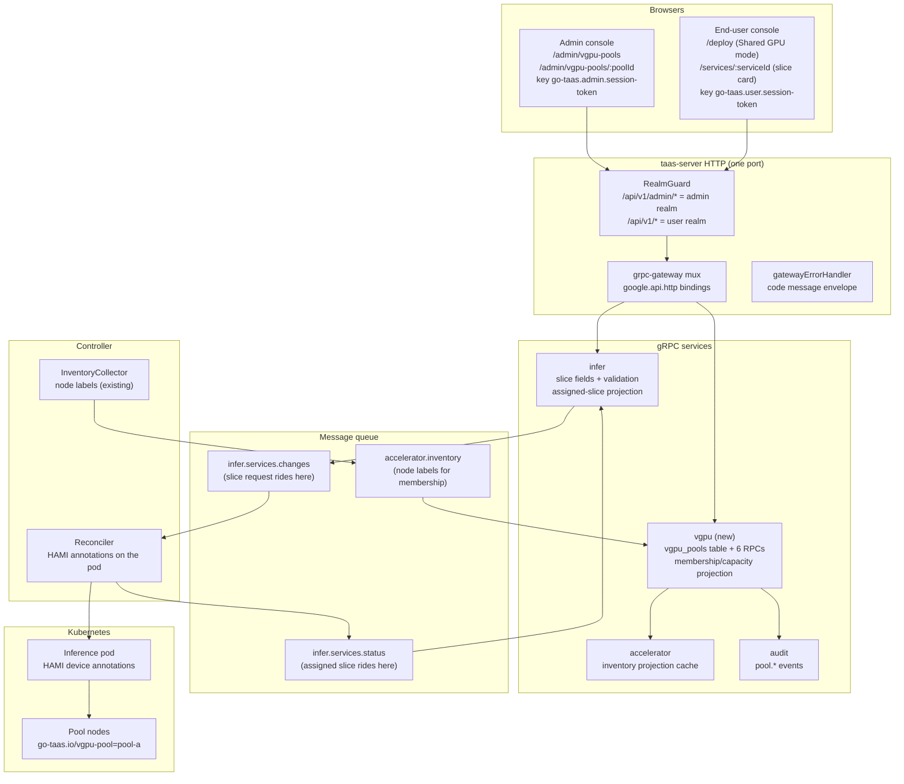
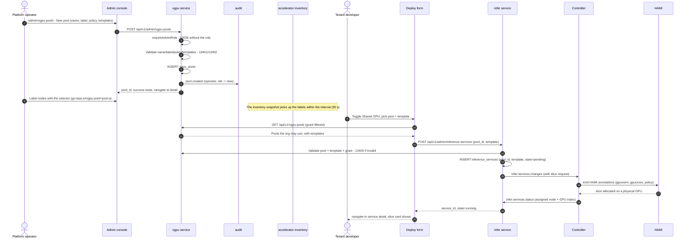
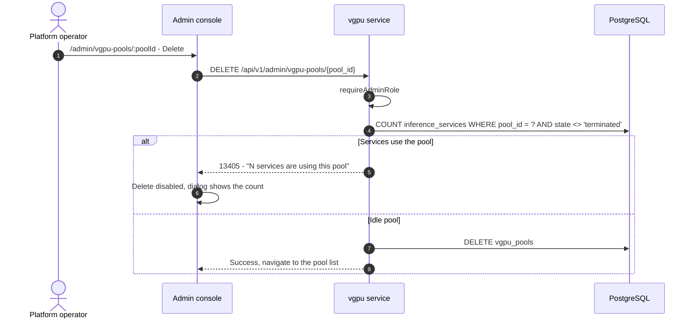

# HAMI-Based vGPU Slicing Pool — Architecture and Detailed Design

| Attribute | Content |
| --- | --- |
| Feature point | HAMI-based vGPU slicing pool — designate multiple nodes as a vGPU slicing pool via a node label, allow multiple small inference jobs to co-schedule onto a single physical GPU (backlog row 52) |
| Document scope | Architecture and detailed design for feature-52: the new `vgpu` module (pool CRUD, label-driven node membership, slice templates, capacity accounting, scheduling hints), the `infer` extension (shared-GPU deploy fields, the assigned-slice projection on the service detail), the Controller's HAMI-annotation emission and pool-membership collection, the 134xx error block, the admin pages `/admin/vgpu-pools` and `/admin/vgpu-pools/:poolId`, the deploy-form Shared GPU mode and the service-detail slice card, configuration, security, rollout, and a function-level task list per layer |
| Owning modules | `vgpu` (new module — pool membership, slice templates, capacity accounting, scheduling hints); `infer` (deploy-form vGPU fields, service slice assignment); `Controller` (turns scheduling hints into HAMI device requests, collects pool membership); `k8s` (node labels, extended resources, HAMI annotations); `pkg/server` gateway (admin + user prefix bindings); `pkg/errors` (the 134xx block); `pkg/config` (the `vgpu` section); `pkg/mq` (one new subject); `audit` (reused — `pool.*` events); `web` admin console (`VGPUPoolsPage`, `VGPUPoolDetailPage`) and end-user console (`DeployDialog` Shared GPU mode, `ServiceDetailPage` slice card) |
| Related documents | [Requirement Analysis and UI/UX Design](../design/vgpu-slicing-pool.md) · [Architecture Design](../design/architecture.md) §2.3 heterogeneous compute, §2.4 `infer`, §2.7 Controller · [Accelerator Inventory & Health](./accelerator-inventory.md) (the per-node GPU fleet view this feature's pool nodes are a labeled subset of; the projection model the pool membership derives from) · [Model Catalog & One-Click Deployment](./model-catalog-deployment.md) (the deploy form this feature extends, the `inference_services` table) · [Inference Autoscaling](./inference-autoscaling.md) (slice-aware replica sizing) · [Service Quota Management](./service-quota-management.md) (the resource dimension slice count is deferred from) · [Multi-Cluster Management](./multi-cluster-management.md) (pool membership across clusters) · [Console Surface Separation](./console-surface-separation.md) (the two surfaces, the masked-projection rule) |
| Status | Architecture complete, handed to the Developer agent |

---

## 1. Overview and Goals

The accelerator tier today allocates **whole physical GPUs** to inference services. For small models (a 7B chat model, a small embedding model, a lightweight reranker) a whole `A800` or `H800` is grossly over-provisioned: the model's weights and KV cache fit in a fraction of the card's memory, and the compute is idle most of the time. The accelerator-inventory feature (#18) gave the operator the fleet picture but is **read-only** — it does not change how a GPU is consumed. What is missing is the ability to **share** a physical GPU among several small inference jobs, each isolated in its own slice.

This feature adds a **vGPU slicing pool**: the operator designates a set of nodes as a slicing pool via a node label, defines **slice templates** (memory fraction + compute fraction) that represent how a physical GPU is carved up, and inference services can opt into a **shared-GPU mode** that requests a slice instead of a whole card. The platform's Controller turns the slice request into HAMI device annotations, and HAMI (the CNCF-incubating heterogeneous GPU sharing middleware the platform already lists as an accelerator-tier inspiration) handles the actual device sharing, isolation, and scheduling.

The core invariants: sharing is **opt-in per service and only on pool nodes** (D2); slice templates are the **bounded, operator-curated vocabulary** — a deploy picks a template, never raw memory/compute values (D3); HAMI is the sharing mechanism and go-taas stays **vendor-neutral** (D4); the pool's placement policy is a **pool-level setting** passed to HAMI as a scheduling hint (D5); there is **no performance-isolation guarantee** — a shared GPU is a shared resource (D6); slice allocation is **capacity telemetry, not metering** — billing stays per-request token-based (D7); and a per-org slice-count quota is **deferred** (D8).

**Goals**:

- Two admin pages: `/admin/vgpu-pools` (`VGPUPoolsPage` — pool table with selector, policy, templates, nodes, allocation, utilization; create dialog) and `/admin/vgpu-pools/:poolId` (`VGPUPoolDetailPage` — node membership, per-GPU allocation, services using slices, edit dialog, delete flow), per design §5.1–§5.3.
- The deploy form's **Shared GPU mode** (design §5.4): a toggle, a pool dropdown (grant-filtered), a slice-template dropdown, and the shared-GPU note; the service detail's **slice card** (design §5.5).
- A new `vgpu` module owning pool membership (label selector), slice templates, and capacity accounting, with its own error block **134xx** (design §6).
- Five admin RPCs on `VGPUService` bound under `/api/v1/admin/vgpu-pools/*`, one tenant-visible `ListVGPUPools` bound under `/api/v1/vgpu-pools`, and the `infer` extension (`CreateInferenceService` gains `pool_id` + `slice_template_id`; `GetInferenceService` gains the assigned slice) (design §6).
- The Controller's HAMI-annotation emission (`nvidia.com/gpumem`, `nvidia.com/gpucores`, the placement-policy annotation) and the pool-membership collection (label-driven, from the accelerator inventory snapshot) (design §6 notes 2–4).
- Numbered acceptance criteria (AC1–AC13) testable in Nightwatch, FVT and unit tests; the HAMI contract verified synthetically (the established out-of-repository pattern).

**Non-goals** (from the design, restated): MIG partitioning as the platform mechanism (D4 — HAMI abstracts MIG and other backends); per-tenant GPU performance-isolation guarantees (D6 — shared GPU is shared; best-effort isolation); slice-level metering/billing (D7 — metering stays per-request token-based); a per-org slice-count quota (D8 — deferred to a clean follow-up); raw HAMI annotations in the deploy form (D3 — slice templates are the bounded vocabulary); automatic slicing of every GPU (D2 — sharing is opt-in per service); a separate HAMI WebUI (the admin console is the surface); pool-level billing/pricing (future work — pricing stays per-model × card-type); and the HAMI implementation itself (out of repository scope — the annotation contract is pinned here and verified synthetically).

### 1.1 Reading order of this document

Section 2 records the architecture decisions (AD1–AD16; AD11–AD16 are refinements the architecture adds, marked as such). Sections 3–5 are the component view, the data model and the API design (including the pinned HAMI contract). Section 6 is the frontend architecture (page → route → API-prefix table, navigation, shared components, auth guard). Sections 7–8 are the sequence diagrams and error handling. Sections 9–11 are configuration, security and rollout. Section 12 is the acceptance-criteria traceability. Sections 13–15 are the function-level detailed design, the ordered implementation task list, and the deferred items.

---

## 2. Architecture Decisions

AD1–AD10 restate the UI/UX design's decisions (D1–D8) as implementation-level rules; AD11–AD16 are refinements the architecture adds, marked as such.

| # | Decision | Rationale |
| --- | --- | --- |
| AD1 | **A pool is a named set of nodes designated by a node label.** The operator creates a pool, picks a label key/value (e.g. `go-taas.io/vgpu-pool=pool-a`), and any node carrying that label is a member. Membership is **declarative**: the Controller watches nodes for the label selector and reports membership; a node that loses the label leaves the pool (its slices drain naturally as services finish) | Design D1. Matches the architecture's node-labeling model (§2.3) and HAMI's own `gpu=on` opt-in; membership survives node churn (a new labeled node joins automatically) |
| AD2 | **Sharing is opt-in per service, and only on pool nodes.** A deploy can choose "Shared GPU" mode; without it, the service gets a whole card as today. Non-pool nodes never share | Design D2. Sharing has isolation/performance trade-offs; tenants and operators must choose it deliberately |
| AD3 | **Slice templates are the bounded vocabulary.** A pool defines named templates (e.g. `small` = 8 GiB / 25% compute, `medium` = 16 GiB / 50%, `large` = 24 GiB / 75%); a deploy picks a template, never raw memory/compute values | Design D3. Keeps capacity planning honest (the operator controls the carve-ups) and the deploy form simple (a dropdown, not two number fields) |
| AD4 | **HAMI is the sharing mechanism; go-taas stays vendor-neutral.** The Controller emits HAMI annotations; HAMI handles NVIDIA (incl. MIG), Iluvatar, MetaX and other backends behind one resource model | Design D4. The platform already lists HAMI as an accelerator-tier inspiration; delegating device sharing to HAMI keeps go-taas vendor-neutral and avoids reimplementing device virtualization |
| AD5 | **The pool's placement policy is a pool-level setting** (binpack / spread / mutex), surfaced as a dropdown on the pool page and passed to HAMI as a scheduling hint | Design D5. HAMI's scheduling vocabulary maps directly; the operator chooses consolidation (binpack) vs isolation (spread/mutex) per pool |
| AD6 | **No performance-isolation guarantee.** The pool page and the deploy form state that a shared GPU is a shared resource; memory/compute isolation is best-effort per HAMI backend | Design D6. Honest about the shared-resource trade-off; avoids over-promising to tenants |
| AD7 | **Slice allocation is capacity telemetry, not metering.** The pool's allocation view shows how many slices of each template are allocated/free; billing stays per-request token-based (#4) | Design D7. Keeps the metering chain untouched; the pool view is an operations surface |
| AD8 | **Slice count as a quota dimension is deferred.** The service-quota feature (#51) ships four dimensions; a per-org slice-count quota is future work | Design D8. Keeps this feature focused on the sharing mechanism; quota integration is a clean follow-up |
| AD9 | **Pool management is admin-only; the deploy-form slice picker is end-user.** Pool CRUD, templates and capacity accounting are admin (`/admin/vgpu-pools` + `/api/v1/admin/vgpu-pools/*`); the deploy form's pool/template dropdowns and the service-detail slice card are end-user (`/api/v1/vgpu-pools` + the `/api/v1/infer/*` extension). A user-realm session on an admin route gets **10038**; a session without the platform-admin role gets **10036** | Design D10/FR5.1. Consistent with the console-surface separation; pool internals (fleet-wide capacity) are operator knowledge, the deploy-time slice choice is the tenant's |
| AD10 | **The tenant-visible pool list is grant-filtered at the service layer.** A pool is usable by an org only if the org is granted access (mirroring the model-grant model of feature #13); the caller's org is resolved from the session, never from a client-supplied id. A pool with no grant is hidden | Design FR5.3. The deploy form's pool dropdown must not leak pools the org cannot use; the grant check is server-side, never trusted from the client |
| AD11 | **REFINEMENT of design D1/FR1.1 — the pool is a database table; membership and capacity are projections.** The pool's own state (name, label selector, placement policy, slice templates) is a GORM table `vgpu_pools` owned by the new `vgpu` module. Node membership and per-GPU slice allocation are **not** stored — they are a projection of the accelerator-inventory snapshot (which already carries node labels and per-GPU state, feature #18) plus the HAMI-reported device state collected by the Controller (design FR3.3: "capacity is a projection of HAMI's reported device state, not a separate database table") | The design pins "pool membership is declarative" and "capacity is a projection, not a database table" but does not pin where the pool's own state lives. A `vgpu_pools` table is the smallest faithful reading: the pool's CRUD state (name, selector, policy, templates) is durable and audited, while the volatile membership/capacity is derived from the cluster. This avoids a second source of truth for capacity while keeping the pool's configuration durable |
| AD12 | **REFINEMENT of design D1/FR1.1 — pool membership is derived from the accelerator-inventory snapshot, not a separate node watch.** The `vgpu` module consumes the same `accelerator.inventory` snapshot the accelerator service does (feature #18); a node is a pool member when its `labels` map contains the pool's selector key/value. The Controller's inventory collector already publishes node labels (feature #18, AD3) — no new node watch is needed | The design says "the Controller watches nodes for the label selector and reports membership" (design §6 note 2). The inventory collector already lists nodes and publishes their labels on an interval; reusing that snapshot is the smallest change and keeps one node-collection loop. The pool's membership view is therefore as fresh as the inventory interval (default 30 s) |
| AD13 | **REFINEMENT of design D4/FR4.3 — the slice request rides the existing `infer.services.changes` change event.** `CreateInferenceService` persists `pool_id` + `slice_template_id` on the `inference_services` row and publishes them in the change event; the Controller reads them and emits HAMI annotations on the pod. No new MQ subject for the slice request itself | The design says "the Controller turns the slice request into HAMI annotations" without pinning the transport. The existing change event is the natural carrier — the Controller already decodes it to build the Deployment. Adding two fields to the change event is additive and keeps one desired-state channel |
| AD14 | **REFINEMENT of design D4/FR4.4 — the assigned slice is a projection of the Controller's status report.** The Controller reports the assigned physical GPU (node + GPU index) back on the existing `infer.services.status` subject once HAMI schedules the slice; the `infer` status consumer stores it on the `inference_services` row, and `GetInferenceService` returns it. A whole-card service has no slice | The design says "the service detail shows the assigned physical GPU once scheduled" without pinning how the Controller learns it. The status report is the existing feedback channel; the Controller reads the pod's node + the HAMI device annotation to report the slice. The slice card is therefore as fresh as the status report |
| AD15 | **REFINEMENT of design D5/FR1.2 — the placement policy is a closed enum validated at create/update.** `binpack` / `spread` / `mutex` are the only accepted values; an invalid value returns **13401** with the field named. The policy is stored on the pool row and passed to HAMI as the `hami.io/gpu-scheduler-policy` annotation | Design D5. A closed enum keeps the pool page's dropdown and the Controller's annotation mapping in lockstep; an unknown policy must never reach the Controller |
| AD16 | **REFINEMENT of design FR1.6 — pool mutations are audited with `pool.created` / `pool.updated` / `pool.deleted`.** The audit trail records the acting operator and the old → new pool state (selector, policy, templates). List/read RPCs are not audited, per the platform's read-path convention | Design FR1.6. Pool changes are capacity decisions with fairness implications; the audit trail answers "who changed this pool and when" |

---

## 3. Component View

### 3.1 Ownership

| Layer / component | Owns | Changes in this feature |
| --- | --- | --- |
| **Static bundle (SPA)** | One Vite bundle (`web/dist`), embedded into `taas-server` at `pkg/server/console/`; served by the gateway's SPA fallback | Two new admin pages (`VGPUPoolsPage`, `VGPUPoolDetailPage`), the deploy-form Shared GPU mode in `DeployDialog`, the slice card in `ServiceDetailPage`, nav items, and the route registrations in `App.tsx` |
| **Gateway (`pkg/server`)** | HTTP composition: `RealmGuard` → `withConsole` → `runtime.ServeMux`; the unified error renderer; the SPA fallback | No change — the new RPCs bind under `/api/v1/admin/vgpu-pools/*` (admin) and `/api/v1/vgpu-pools` (user), and the realm guard already classifies those prefixes |
| **grpc-gateway mux** | Path → RPC routing from `google.api.http` annotations | New bindings for the six new RPCs (Section 5) |
| **`vgpu` (new)** | The `vgpu_pools` table, the pool CRUD RPCs, the membership/capacity projection, the tenant-visible pool list | New service: `services/vgpu` |
| **`infer`** | The `inference_services` slice fields, the deploy-time slice validation, the assigned-slice projection | `CreateInferenceService` gains `pool_id` + `slice_template_id`; `GetInferenceService` gains the assigned slice |
| **`internal/controller`** | Kubernetes reconciliation; HAMI-annotation emission; pool-membership collection | The reconciler emits HAMI annotations when a change event carries a slice request; the inventory collector already publishes node labels (no new loop) |
| **`pkg/k8s`** | The Kubernetes client (clientset + dynamic) | No change — the reconciler uses the existing clientset |
| **`pkg/mq`** | The canonical subjects | No new subject (the slice request rides `infer.services.changes`; the assigned slice rides `infer.services.status`) |
| **`pkg/errors`** | Code blocks per module | A new **134xx** block after the quota block (133xx) |
| **`pkg/config`** | The merged configuration tree | A new `vgpu` section (pool defaults, the HAMI annotation names) |
| **`audit`** | The audit trail | Reused — `pool.created` / `pool.updated` / `pool.deleted` events |

### 3.2 Runtime component view



---

## 4. Data Model

### 4.1 The `vgpu_pools` Table (new, owned by `vgpu`)

| Column | PostgreSQL type | Constraints | Description |
| --- | --- | --- | --- |
| `id` | `uuid` | PRIMARY KEY | Server-generated UUID v4, exposed as `pool_id` |
| `name` | `varchar(63)` | NOT NULL, UNIQUE | DNS-safe pool name, 1–63 chars (FR1.2) |
| `label_key` | `varchar(128)` | NOT NULL | The node-label key, e.g. `go-taas.io/vgpu-pool` |
| `label_value` | `varchar(128)` | NOT NULL | The node-label value, e.g. `pool-a` |
| `placement_policy` | `varchar(16)` | NOT NULL DEFAULT 'binpack' | `binpack` / `spread` / `mutex` (AD15) |
| `templates` | `jsonb` | NOT NULL DEFAULT '[]' | The slice-template array (name, memory_gib, compute_pct, description) |
| `created_at` | `timestamptz` | NOT NULL | Creation time (UTC) |
| `updated_at` | `timestamptz` | NOT NULL | Last change |

Indexes:

| Index | Definition | Purpose |
| --- | --- | --- |
| Primary key | `(id)` | Pool identity |
| Unique | `(name)` | Duplicate pool-name rejection (FR1.2) |

Design notes:

- **`templates` as `jsonb`**: the slice-template set is a bounded, operator-curated list on the pool; JSON keeps the schema flexible without a join table. The template validation (FR2.2) runs at create/update time, so the stored JSON is always valid.
- **Membership and capacity are not stored** (AD11): node membership is derived from the accelerator-inventory snapshot (AD12), and per-GPU slice allocation is a projection of the HAMI-reported device state collected by the Controller (design FR3.3). The pool row holds only the pool's own configuration.
- **No `vgpu_pool_members` or `vgpu_slice_allocations` tables**: both are projections (AD11, AD12). This keeps the cluster as the single source of truth for capacity.

### 4.2 The `inference_services` Table (additive columns)

The existing `inference_services` table (feature #2) gains three additive columns:

| Column | PostgreSQL type | Constraints | Description |
| --- | --- | --- | --- |
| `pool_id` | `uuid` | NULL | The vGPU pool the service's slices come from; NULL = whole-card (AD2) |
| `slice_template_id` | `varchar(63)` | NULL | The template name within the pool; NULL = whole-card |
| `assigned_slice` | `jsonb` | NULL | The assigned physical GPU once scheduled: `{"node_id", "gpu_index", "memory_gib", "compute_pct"}` (AD14) |

Design notes:

- **`pool_id` + `slice_template_id` are NULL for whole-card services** (AD2): the pre-feature behavior is preserved exactly — a service created without Shared GPU mode has no pool/template and no slice card.
- **`assigned_slice` is written by the `infer` status consumer** from the Controller's status report (AD14): it is NULL until HAMI schedules the slice, then populated with the physical GPU. A whole-card service keeps it NULL.
- **No FK on `pool_id`**: the pool may be deleted only when no service uses it (FR1.5, 13405), so a dangling reference is prevented at the application layer; a hard FK would complicate the delete-blocked flow.

### 4.3 Migration and init-SQL upgrade path

This repository does **not** use hand-written init-SQL scripts: every schema change is the GORM model created/altered by the owning service's `Migrate` via `db.AutoMigrate(...)`, and there are no `.sql` files under `deploy/`. The upgrade path is:

1. Add the `VGPUPool` model in `services/vgpu/vgpu_model.go`; the new `vgpu` service's `Migrate` AutoMigrates it.
2. Add the three fields to `InferenceService` in `services/infer/infer_model.go`; the existing infer `Migrate` AutoMigrates them.
3. No data backfill: existing `inference_services` rows read NULL/NULL/NULL = whole-card, exactly the pre-feature behavior. No manual DDL, no compose change.

---

## 5. API Design

### 5.1 Surface mapping

Six RPCs are new (five admin, one user); two existing RPCs change behavior (one contract change, one response extension). No RPC is dual-bound: the admin RPCs are fleet-scoped management, the user RPC is the grant-filtered deploy-time read.

| RPC | HTTP method + path | Surface | Status | Purpose |
| --- | --- | --- | --- | --- |
| `ListVGPUPools` (new `taas.vgpu.v1.VGPUService`) | `GET /api/v1/admin/vgpu-pools` | admin | **new** | Pool rows with selector, policy, templates, node count, aggregate allocation; pagination, name search, node-count filter |
| `CreateVGPUPool` | `POST /api/v1/admin/vgpu-pools` | admin | **new** | Create a pool; audited; 13401 on bad input |
| `GetVGPUPool` | `GET /api/v1/admin/vgpu-pools/{pool_id}` | admin | **new** | One pool's full detail (nodes, per-GPU allocation, services); unknown pool → 13406 |
| `UpdateVGPUPool` | `PATCH /api/v1/admin/vgpu-pools/{pool_id}` | admin | **new** | Update policy/templates/selector; audited; 13402 on bad templates |
| `DeleteVGPUPool` | `DELETE /api/v1/admin/vgpu-pools/{pool_id}` | admin | **new** | Delete a pool; 13405 if services use it |
| `ListVGPUPools` (tenant-visible) | `GET /api/v1/vgpu-pools` | user | **new** | Pools the caller's org may use (grant-filtered), with templates — for the deploy form |
| `CreateInferenceService` (`taas.infer.v1`) | `POST /api/v1/admin/inference-services` | admin | **changed** | Gains optional `pool_id` + `slice_template_id`; 13403 if the pool/template is invalid or not granted |
| `GetInferenceService` (`taas.infer.v1`) | `GET /api/v1/admin/inference-services/{service_id}` | admin | **changed** | Response gains the assigned slice (pool, template, physical GPU) when shared-GPU |

Gateway routing notes: `GET /api/v1/admin/vgpu-pools` (collection root) and `GET /api/v1/admin/vgpu-pools/{pool_id}` are distinct paths — no wildcard conflict; the PATCH follows the existing `UpdateOrganization` convention on the same mux. The tenant-visible `GET /api/v1/vgpu-pools` is a distinct user-prefix path, so the realm guard classifies it as the user surface.

**Surface decision (recorded)**: the design doc's §4 table assigns the deploy form to the end-user surface (`/deploy`, `/api/v1/infer/*`), but the existing deploy form (feature #2) lives on the admin surface — `DeployDialog` is used in the admin `ModelsPage`/`ModelDetailPage` and calls `POST /api/v1/admin/inference-services`. Consistent with the existing architecture, the Shared GPU deploy mode extends the **existing admin deploy form**; the tenant-visible `ListVGPUPools` (grant-filtered) is a **user-surface** RPC that the deploy form uses to populate the pool dropdown. The service-detail slice card extends the existing admin `ServiceDetailPage`. This preserves the design's intent (a grant-filtered, template-bounded slice picker) while keeping the deploy form where it actually lives. The design's `/deploy` end-user route is not created; the deploy form remains admin-surface.

### 5.2 Proto contract

**New `proto/taas/vgpu/v1/vgpu.proto`** — the `VGPUService` with five admin RPCs and one user RPC:

```proto
syntax = "proto3";
package taas.vgpu.v1;

import "google/api/annotations.proto";
import "taas/common/v1/common.proto";

option go_package = "github.com/go-taas/go-taas/proto/taas/vgpu/v1;vgpuv1";

// VGPUService manages vGPU slicing pools (feature #52). Pool CRUD is
// admin-surface; the tenant-visible ListVGPUPools is user-surface and
// grant-filtered.
service VGPUService {
  // ListVGPUPools returns every pool with its selector, placement
  // policy, slice templates, node count and aggregate allocation
  // (admin surface, requireAdminRole).
  rpc ListVGPUPools(ListVGPUPoolsRequest) returns (ListVGPUPoolsResponse) {
    option (google.api.http) = {get: "/api/v1/admin/vgpu-pools"};
  }

  // CreateVGPUPool creates a pool (admin surface). Audited as
  // pool.created; 13401 on invalid input.
  rpc CreateVGPUPool(CreateVGPUPoolRequest) returns (CreateVGPUPoolResponse) {
    option (google.api.http) = {
      post: "/api/v1/admin/vgpu-pools"
      body: "*"
    };
  }

  // GetVGPUPool returns one pool's full detail (admin surface). An
  // unknown pool returns 13406.
  rpc GetVGPUPool(GetVGPUPoolRequest) returns (GetVGPUPoolResponse) {
    option (google.api.http) = {get: "/api/v1/admin/vgpu-pools/{pool_id}"};
  }

  // UpdateVGPUPool updates the placement policy, slice templates and
  // node-label selector (admin surface). Audited as pool.updated;
  // 13402 on invalid templates.
  rpc UpdateVGPUPool(UpdateVGPUPoolRequest) returns (UpdateVGPUPoolResponse) {
    option (google.api.http) = {
      patch: "/api/v1/admin/vgpu-pools/{pool_id}"
      body: "*"
    };
  }

  // DeleteVGPUPool deletes a pool (admin surface). 13405 if services
  // use it; audited as pool.deleted.
  rpc DeleteVGPUPool(DeleteVGPUPoolRequest) returns (DeleteVGPUPoolResponse) {
    option (google.api.http) = {delete: "/api/v1/admin/vgpu-pools/{pool_id}"};
  }

  // ListVGPUPools (tenant-visible) returns the pools the caller's org
  // may use, with their slice templates, for the deploy form (user
  // surface; the org is resolved from the session, never from a
  // client-supplied id).
  rpc ListTenantVGPUPools(ListTenantVGPUPoolsRequest) returns (ListTenantVGPUPoolsResponse) {
    option (google.api.http) = {get: "/api/v1/vgpu-pools"};
  }
}

// SliceTemplate is one bounded carve-up of a physical GPU (AD3).
message SliceTemplate {
  string name = 1;        // unique within the pool, e.g. "small"
  int64 memory_gib = 2;   // 1 - card memory
  int64 compute_pct = 3;  // 5 - 100
  string description = 4; // optional
}

// VGPUPool is the FR1.1 projection.
message VGPUPool {
  string pool_id = 1;
  string name = 2;
  string label_key = 3;
  string label_value = 4;
  string placement_policy = 5; // binpack | spread | mutex
  repeated SliceTemplate templates = 6;
  int64 node_count = 7;        // derived from the inventory snapshot (AD12)
  repeated TemplateAllocation allocation = 8; // aggregate per template
  int64 utilization_pct = 9;   // allocated memory / total pool memory
}

// TemplateAllocation is one template's aggregate allocation (FR3.2).
message TemplateAllocation {
  string template_name = 1;
  int64 allocated = 2;
  int64 free = 3;
}

// PoolNode is one member node's projection (AD12).
message PoolNode {
  string node_id = 1;
  string name = 2;
  repeated PoolGPU gpus = 3;
  string health = 4; // from the accelerator inventory
}

// PoolGPU is one physical GPU's slice allocation (FR3.1).
message PoolGPU {
  int64 index = 1;
  string model = 2;
  repeated SliceAllocation slices = 3;
  bool full = 4; // no template fits in the remaining capacity
}

// SliceAllocation is one allocated slice on a physical GPU.
message SliceAllocation {
  string template_name = 1;
  string service_id = 2;
  int64 memory_gib = 3;
  int64 compute_pct = 4;
}

message ListVGPUPoolsRequest {
  taas.common.v1.PageRequest page = 1;
  string name = 2;        // name substring search, case-insensitive
  string placement_policy = 3; // binpack | spread | mutex | empty = all
}

message ListVGPUPoolsResponse {
  taas.common.v1.Response response = 1;
  repeated VGPUPool pools = 2;
  taas.common.v1.PageMeta page_meta = 3;
}

message CreateVGPUPoolRequest {
  string name = 1;
  string label_key = 2;
  string label_value = 3;
  string placement_policy = 4; // default binpack
  repeated SliceTemplate templates = 5;
}

message CreateVGPUPoolResponse {
  taas.common.v1.Response response = 1;
  VGPUPool pool = 2;
}

message GetVGPUPoolRequest {
  string pool_id = 1;
}

message GetVGPUPoolResponse {
  taas.common.v1.Response response = 1;
  VGPUPool pool = 2;
  repeated PoolNode nodes = 3;
  repeated SliceService services = 4; // services using slices
}

// SliceService is one service using a slice of the pool.
message SliceService {
  string service_id = 1;
  string name = 2;
  string template_name = 3;
  string node_id = 4;
  int64 gpu_index = 5;
  int64 memory_gib = 6;
  int64 compute_pct = 7;
  string state = 8;
}

message UpdateVGPUPoolRequest {
  string pool_id = 1;
  // optional tracks presence: absent = unchanged.
  optional string placement_policy = 2;
  repeated SliceTemplate templates = 3; // full replacement when present
  optional string label_key = 4;
  optional string label_value = 5;
}

message UpdateVGPUPoolResponse {
  taas.common.v1.Response response = 1;
  VGPUPool pool = 2;
}

message DeleteVGPUPoolRequest {
  string pool_id = 1;
}

message DeleteVGPUPoolResponse {
  taas.common.v1.Response response = 1;
}

message ListTenantVGPUPoolsRequest {
  taas.common.v1.PageRequest page = 1;
}

message ListTenantVGPUPoolsResponse {
  taas.common.v1.Response response = 1;
  repeated TenantVGPUPool pools = 2;
}

// TenantVGPUPool is the grant-filtered deploy-time projection (AD10).
message TenantVGPUPool {
  string pool_id = 1;
  string name = 2;
  repeated SliceTemplate templates = 3;
}
```

**Change to `proto/taas/infer/v1/infer.proto`** — `CreateInferenceServiceRequest` gains the two optional slice fields (fields 9–10; fields 1–8 are taken), and `GetInferenceServiceResponse` gains the assigned slice (field 6; fields 1–5 are taken):

```proto
message CreateInferenceServiceRequest {
  string name = 1;
  string model_id = 2;
  string model_version = 3;
  string image_id = 4;
  int32 replicas = 5;
  string accelerator = 6;
  string accelerator_type = 7;
  AutoscalingPolicy autoscaling = 8;
  // pool_id + slice_template_id opt the service into shared-GPU mode
  // (feature #52, AD2). Both must be present together; absent = whole
  // card. 13403 if the pool/template is invalid or not granted.
  string pool_id = 9;
  string slice_template_id = 10;
}

message GetInferenceServiceResponse {
  taas.common.v1.Response response = 1;
  InferenceServiceSummary service = 2;
  repeated string endpoints = 3;
  AutoscalingPolicy autoscaling = 4;
  AutoscalingStatus autoscaling_status = 5;
  // assigned_slice is the physical GPU the service's slices landed on
  // once HAMI schedules them (feature #52, AD14). Nil for whole-card
  // services or before scheduling.
  AssignedSlice assigned_slice = 6;
}

// AssignedSlice is the assigned physical GPU (AD14).
message AssignedSlice {
  string pool_id = 1;
  string pool_name = 2;
  string template_name = 3;
  int64 memory_gib = 4;
  int64 compute_pct = 5;
  string node_id = 6;
  int64 gpu_index = 7;
}
```

### 5.3 The pinned HAMI contract (data plane, out of repository scope)

HAMI is not in this repository; the contract below is binding for the data-plane track and is verified synthetically in FVT (the established pattern — the compose mock honors it for e2e). The Controller emits the following on the inference pod when a change event carries a slice request:

1. **Resource requests**: the pod's engine container requests the HAMI extended resources instead of a whole card — `nvidia.com/gpumem` = the template's memory in MiB and `nvidia.com/gpucores` = the template's compute percentage (design §6 note 3). For non-NVIDIA accelerators, the equivalent HAMI resource names apply (the `gpuResourceName` mapping in the reconciler is extended).
2. **Placement-policy annotation**: the pod carries `hami.io/gpu-scheduler-policy` = the pool's placement policy (`binpack` / `spread` / `mutex`) (design §6 note 3, AD15).
3. **Node affinity**: the pod's `nodeSelector` is constrained to the pool's label selector (`go-taas.io/vgpu-pool=pool-a`) so HAMI schedules only onto pool nodes (AD2 — non-pool nodes never share).
4. **Assigned-slice report**: once HAMI schedules the slice, the Controller reads the pod's node and the HAMI device annotation and reports the assigned physical GPU (node + GPU index) on the `infer.services.status` subject (AD14).

The contract, item by item:

- **Whole-card services are unchanged**: a change event without `pool_id`/`slice_template_id` produces the existing whole-card resource request (`nvidia.com/gpu` = 1) and no HAMI annotations (AD2).
- **The HAMI resource model is the pinned contract** (design §6 note 3): `nvidia.com/gpumem` (MiB) and `nvidia.com/gpucores` (percentage) on the engine container, plus the placement-policy annotation. The exact HAMI annotation names are configurable (Section 9) so a HAMI version change is a config change, not a code change.
- **Error rendering**: the HAMI contract is verified synthetically in FVT (the compose mock honors it); the control plane never renders HAMI errors — a HAMI scheduling failure surfaces as a `failed` service state with the failure reason, the existing deployment-failure path.

### 5.4 Validation contract

| Field | Rule | Error |
| --- | --- | --- |
| `name` (create) | DNS-safe, 1–63 chars, unique | 13401 |
| `label_key` / `label_value` (create) | non-empty, ≤ 128 chars | 13401 |
| `placement_policy` | `binpack` / `spread` / `mutex` (empty = binpack) | 13401 |
| `templates` (create/update) | each: name unique within the pool, memory 1–card memory, compute 5–100 | 13402 |
| `pool_id` (get/update/delete) | must exist | 13406 |
| `pool_id` + `slice_template_id` (deploy) | both present together; pool exists and is granted to the org; template exists in the pool | 13403 |
| `DeleteVGPUPool` | no service uses the pool's slices | 13405 (count named) |
| `ListTenantVGPUPools` org context | resolved from the session (transitional header fallback); empty → | 10005 |

Serialization conventions unchanged: HTTP 200 on success, business errors as `{"code": <int>, "message": "..."}`, int64 fields as JSON strings (memory GiB, compute %, utilization).

---

## 6. Frontend Architecture

### 6.1 Page → route → API-prefix table

| Page / component | Route | API prefix | Surface |
| --- | --- | --- | --- |
| `VGPUPoolsPage` (new, `web/src/pages/VGPUPoolsPage.tsx`) | `/admin/vgpu-pools` | `/api/v1/admin/vgpu-pools` | admin |
| `VGPUPoolDetailPage` (new, `web/src/pages/VGPUPoolDetailPage.tsx`) | `/admin/vgpu-pools/:poolId` | `/api/v1/admin/vgpu-pools` | admin |
| `DeployDialog` Shared GPU mode (changed, `web/src/components/DeployDialog.tsx`) | `/admin/models`, `/admin/models/:id` (existing) | `/api/v1/vgpu-pools` (pool dropdown) + `/api/v1/admin/inference-services` (create) | admin |
| `ServiceDetailPage` slice card (changed, `web/src/pages/ServiceDetailPage.tsx`) | `/admin/inference-services/:id` (existing) | `/api/v1/admin/inference-services` | admin |

The admin pages contain **no `/api/v1/*` call** (except the deploy form's grant-filtered pool dropdown, which is a user-surface read the admin deploy form legitimately uses); the user pages contain **no `/api/v1/admin/*` call** (AC11). Per the console-surface separation, the admin pages are admin-realm sources (`web/src/pages/*.tsx`).

**Surface decision (recorded)**: the design doc's §4 table assigns the deploy form and service detail to the end-user surface. Consistent with the existing architecture (the deploy form and service detail are admin-surface today), the Shared GPU mode and slice card extend the **admin** `DeployDialog` and `ServiceDetailPage`. The tenant-visible `ListVGPUPools` is a user-surface RPC used by the deploy form's pool dropdown. This is the interpretation most consistent with the existing architecture; the design's `/deploy` end-user route is not created.

### 6.2 Navigation placement

`AdminShell`'s `ADMIN_NAV_ITEMS` gains one item in the infrastructure cluster (beside Accelerators):

```tsx
{ path: '/admin/vgpu-pools', labelKey: 'nav.vgpuPools', testid: 'nav-vgpu-pools', icon: Layers },
```

`App.tsx` registers the two routes in the admin block:

```tsx
<Route path="/admin/vgpu-pools" element={<VGPUPoolsPage />} />
<Route path="/admin/vgpu-pools/:poolId" element={<VGPUPoolDetailPage />} />
```

### 6.3 Shared components and state to reuse

- `Dialog` (the create/edit dialogs and their inline validation), the `data` table styles, `PageMeta` pagination, `usePolling` (`web/src/components.tsx`) for the pool list refresh and the detail page, the badge/progress-bar classes, the drawer pattern from `RoutingDecisionsPage`/`AcceleratorNodeDetailPage` — all existing console conventions.
- **`SliceTemplateEditor`** (`web/src/pages/vgpu/SliceTemplateEditor.tsx`): the reusable template editor (add rows: name, memory GiB, compute %, description; validation per FR2.2) used by both the create dialog and the edit dialog.
- **`AllocationBar`** (`web/src/pages/vgpu/AllocationBar.tsx`): the utilization bar (amber ≥ 80%, red 100%) used by the pool list and the pool detail header.
- The **shared-GPU note** copy (design §5.4) lives in `DeployDialog.tsx` as a constant; the **slice card** copy lives in `ServiceDetailPage.tsx`.

### 6.4 Auth guard per surface

- `VGPUPoolsPage` and `VGPUPoolDetailPage` render inside `AdminShell`, whose shell guard enforces the admin session realm (`/admin/login`, token `go-taas.admin.session-token`); a user-realm session on an admin route gets **10038** from the realm guard. A session without the platform-admin role receives **10036** from `requireAdminRole`; the page renders the standard permission-denied state with a link back to `/admin` (AC12).
- The deploy form's pool dropdown calls the user-surface `GET /api/v1/vgpu-pools`; the deploy form itself is admin-surface (the existing `DeployDialog`). The grant filter is server-side (AD10) — the dropdown shows only pools the org may use.
- `ServiceDetailPage` renders inside `AdminShell` (admin realm); the slice card is informational and requires no extra role gate.

### 6.5 `data-testid` hooks (binding, kebab-case)

Admin: `nav-vgpu-pools`, `vgpu-pool-table`, `vgpu-pool-row-{pool_id}`, `vgpu-pool-name-{pool_id}`, `vgpu-pool-selector-{pool_id}`, `vgpu-pool-policy-{pool_id}`, `vgpu-pool-templates-{pool_id}`, `vgpu-pool-nodes-{pool_id}`, `vgpu-pool-allocation-{pool_id}`, `vgpu-pool-utilization-{pool_id}`, `vgpu-pool-create`, `vgpu-pool-create-dialog`, `vgpu-pool-name-input`, `vgpu-pool-label-key-input`, `vgpu-pool-label-value-input`, `vgpu-pool-policy-select`, `vgpu-pool-template-row-{index}`, `vgpu-pool-template-error-{index}`, `vgpu-pool-save`, `vgpu-pool-search`, `vgpu-pool-filter-policy`, `vgpu-pool-pagination`, `vgpu-pool-empty`, `vgpu-pool-permission-denied`, `vgpu-pool-node-row-{node_id}`, `vgpu-pool-gpu-row-{node_id}-{index}`, `vgpu-pool-service-row-{service_id}`, `vgpu-pool-edit-{pool_id}`, `vgpu-pool-edit-dialog`, `vgpu-pool-delete-{pool_id}`, `vgpu-pool-delete-dialog`, `vgpu-pool-delete-blocked-{pool_id}`.

Deploy form: `deploy-shared-gpu-toggle`, `deploy-pool-select`, `deploy-slice-template-select`, `deploy-shared-gpu-note`, `deploy-pool-empty`, `deploy-slice-error`.

Service detail: `service-slice-card`, `service-slice-pool`, `service-slice-template`, `service-slice-gpu`.

---

## 7. Sequence Diagrams

### 7.1 The operator creates a pool and a tenant deploys onto a slice



### 7.2 The operator deletes a pool (blocked when in use)



---

## 8. Error Handling

| Condition | HTTP | Code | Constant | Notes |
| --- | --- | --- | --- | --- |
| Pool create/update input invalid | 500 | 13401 | `CodeVGPUPoolInvalid` | Validation; the field is named in the message |
| Slice template invalid | 500 | 13402 | `CodeVGPUSliceTemplateInvalid` | Memory/compute bounds, duplicate name |
| Deploy references an invalid/ungranted pool or template | 500 | 13403 | `CodeVGPUSliceUnavailable` | Deploy rejected; the pool/template is named |
| Pool delete blocked by active services | 500 | 13405 | `CodeVGPUPoolInUse` | The count of services is named |
| Unknown pool | 500 | 13406 | `CodeVGPUPoolNotFound` | |
| User-realm session on an admin route | 500 | 10038 | `CodeRealmMismatch` | Reused — realm separation (FR5.1) |
| Session without the required role | 500 | 10036 | `CodeForbidden` | Reused — permission denial (FR5.1) |
| No org context on `ListTenantVGPUPools` | 500 | 10005 | `CodeOrganizationNotFound` | Reused — the org-guard convention |

Rendering split (binding for the Test agent): **all 134xx codes are control-plane business errors** through grpc-gateway with the unified `{"code": <int>, "message": "..."}` envelope and HTTP 500, the repo convention. The HAMI contract is verified synthetically (Section 5.3); a HAMI scheduling failure surfaces as a `failed` service state with the failure reason, not a 134xx code.

---

## 9. Configuration

New `vgpu` section in `pkg/config` (`VGPUConfig`, mapped `mapstructure:"vgpu"`), defaulted in `applyDefaults`, validated in `Validate`:

| Key | Type | Default | Notes |
| --- | --- | --- | --- |
| `vgpu.membershipInterval` | duration | `30s` | The freshness bound of the pool membership/capacity projection (the accelerator-inventory interval, AD12) |
| `vgpu.hami.memResource` | string | `"nvidia.com/gpumem"` | The HAMI memory resource name (Section 5.3) |
| `vgpu.hami.coreResource` | string | `"nvidia.com/gpucores"` | The HAMI compute resource name |
| `vgpu.hami.policyAnnotation` | string | `"hami.io/gpu-scheduler-policy"` | The placement-policy annotation name |
| `vgpu.hami.poolLabelPrefix` | string | `"go-taas.io/vgpu-pool"` | The default pool label key prefix |

`configs/config.yaml` gains:

```yaml
# vGPU slicing pools (feature #52). The vgpu module owns the pool
# configuration; membership and capacity are projections of the
# accelerator-inventory snapshot and the HAMI-reported device state.
vgpu:
  # membershipInterval bounds the freshness of the pool membership and
  # capacity projection (the accelerator-inventory interval).
  membershipInterval: 30s
  hami:
    # The HAMI resource/annotation names are configurable so a HAMI
    # version change is a config change, not a code change.
    memResource: "nvidia.com/gpumem"
    coreResource: "nvidia.com/gpucores"
    policyAnnotation: "hami.io/gpu-scheduler-policy"
    poolLabelPrefix: "go-taas.io/vgpu-pool"
```

---

## 10. Security Considerations

1. **Realm separation** (FR5.1, AC11): pool management is admin-only (`/api/v1/admin/vgpu-pools/*`); the tenant-visible pool list is user-surface (`/api/v1/vgpu-pools`). A user-realm session on an admin route gets **10038**; a session without the platform-admin role gets **10036**. The admin pages contain no `/api/v1/*` call and the user pages no `/api/v1/admin/*` call.
2. **Grant-filtered tenant pool list** (AD10, AC7): the tenant-visible `ListVGPUPools` enforces org grants at the service layer — the caller's org is resolved from the session, never from a client-supplied id. A pool the org is not granted is hidden; a deploy referencing an ungranted pool returns **13403**.
3. **No raw HAMI annotations to tenants** (D3): the deploy form exposes only the bounded slice-template vocabulary; a tenant can never request arbitrary memory/compute fractions, keeping capacity planning honest.
4. **Shared-resource honesty** (D6): the pool page and the deploy form state that a shared GPU is a shared resource; memory/compute isolation is best-effort per HAMI backend. No performance-isolation guarantee is promised.
5. **Audit** (AD16): every pool create/update/delete is audited (`pool.created` / `pool.updated` / `pool.deleted` with the acting operator and old → new state). List/read RPCs are not audited, per the platform's read-path convention.
6. **Delete-blocked** (FR1.5): a pool with active slice users cannot be deleted (13405 naming the count); the operator must first move or delete those services. This prevents a dangling `pool_id` on running services.

---

## 11. Rollout / Upgrade Notes

1. **Additive schema**: the `vgpu_pools` table is new; the three `inference_services` columns are additive (NULL = whole-card). No backfill, no manual DDL, no compose change.
2. **Backward compatibility**: existing `CreateInferenceService` calls without `pool_id`/`slice_template_id` behave exactly as today (whole-card, no HAMI annotations). Existing services have no slice card.
3. **Controller rollout**: the reconciler's HAMI-annotation emission is additive — a change event without a slice request produces the existing whole-card pod. The Controller can roll out before or after the `vgpu` service.
4. **HAMI dependency**: HAMI must be installed on the pool nodes for shared-GPU services to schedule. A pool with no HAMI on its nodes yields `failed` services with a clear failure reason (the existing deployment-failure path). The HAMI contract is configurable (Section 9) and verified synthetically.
5. **Propagation windows**: pool membership/capacity is as fresh as the inventory interval (default 30 s, AD12); the assigned slice is as fresh as the status report (AD14). Both are documented in the admin page copy.
6. **Rollback**: rolling the binary back leaves the `vgpu_pools` table and the three `inference_services` columns in place (harmless — nothing else reads them) and restores the pre-feature behavior completely (whole-card deploys). Pool values survive a rollback and re-apply on re-upgrade.
7. **Load**: the pool list adds one COUNT per page row (best-effort, page-bounded); the membership/capacity projection reuses the existing inventory snapshot (no new collection loop).

---

## 12. Acceptance-Criteria Traceability

| AC | Design requirement | Architecture sections |
| --- | --- | --- |
| AC1 admin pool table (name, selector, policy, templates, nodes, allocation, utilization) + search + policy filter + pagination | FR1.1, §5.3 | §5.1–5.2 (`ListVGPUPools`), §4.1, §6.1–6.3, §13.2–13.3, §13.8 |
| AC2 create-dialog validation (name DNS-safe/unique, label selector, templates memory/compute/duplicate), 13401/13402 with the field named | FR1.2, FR2.2 | §5.4, AD15, §13.2 (Create), §13.8 |
| AC3 pool membership: labeling a node makes it appear; removing the label removes it; empty state | FR1.3, D1 | AD11, AD12, §13.3, §13.4 |
| AC4 per-GPU allocation: allocated slices (template, service, memory/compute used vs free), `full` when no template fits | FR3.1 | AD11, AD12, §13.3, §13.4 |
| AC5 deploy form: Shared GPU toggle reveals pool + template dropdowns + note; pool constrains accelerator/card-type; toggle disabled when no usable pool | FR4.1–FR4.2 | §6.1–6.3, §13.8 |
| AC6 slice assignment (synthetic): shared-GPU deploy emits HAMI annotations; service detail shows the slice card | FR4.3–FR4.4, §6 note 3 | §5.3 (pinned contract), AD13, AD14, §7.1, §13.5–13.6 |
| AC7 invalid/ungranted slice: 13403 + inline copy; tenant pool list grant-filtered | FR4.3, FR5.3 | AD10, §5.4, §13.2 (deploy validation), §13.8 |
| AC8 non-destructive template change: running services keep their slices | FR1.4, D6 | AD16, §13.2 (Update), §11.5 |
| AC9 delete blocked: 13405 naming the count, dialog disables delete; idle pool deletes | FR1.5 | §5.4, §7.2, §13.2 (Delete) |
| AC10 audit: pool.created / pool.updated / pool.deleted with operator and old → new | FR1.6 | AD16, §4.1, §7.1, §13.2 |
| AC11 negative realm separation (10038), no cross-surface calls | FR5.1 | §3.3, §6.1, §6.4, §10 |
| AC12 role denial (10036) + permission-denied state with the `/admin` link | FR5.1, §5.3 | §3.3, §6.4, §8 |
| AC13 states: loading, empty, error, permission-denied on both admin pages; loading/empty/error on the deploy form | FR5.2, §5.4 | §6.3, §13.8 |

---

## 13. Detailed Design

### 13.1 File layout

| Module | File | Responsibility |
| --- | --- | --- |
| `proto/taas/vgpu/v1` | `vgpu.proto` (new) | The `VGPUService` + messages (Section 5.2); regenerate |
| `proto/taas/infer/v1` | `infer.proto` | `CreateInferenceServiceRequest` fields 9–10, `GetInferenceServiceResponse` field 6; regenerate |
| `services/vgpu` | `vgpu_model.go` (new) | The `VGPUPool` GORM model (Section 4.1) |
| | `vgpu_repository.go` (new) | Pool CRUD, the membership/capacity projection reads, the in-use COUNT |
| | `vgpu_service.go` (new) | The six RPCs, `requireAdminRole`, the `sessionOrgResolver` seam, the grant check |
| | `membership.go` (new) | The membership/capacity projection from the accelerator-inventory snapshot (AD12) |
| `services/infer` | `infer_model.go` | The three additive `InferenceService` fields (Section 4.2) |
| | `service.go`, the infer repository | The deploy-time slice validation, the assigned-slice status consumption |
| `internal/controller` | `reconciler.go` | The HAMI-annotation emission in `buildDeployment` (Section 13.5) |
| `pkg/errors` | `codes.go`, `messages.go` | The 134xx block after the quota block |
| `pkg/config` | `api.go`, `configuration.go` | `VGPUConfig` (+ `VGPUHAMIConfig`), defaults, validation |
| `apps/taas-server` | `main.go` | The `vgpu` service registration, the seam wiring (Section 13.9) |
| `web/src` | `pages/VGPUPoolsPage.tsx` (new) | The admin pool list: table, filter bar, create dialog |
| | `pages/VGPUPoolDetailPage.tsx` (new) | The admin pool detail: node membership, per-GPU allocation, services, edit dialog, delete flow |
| | `pages/vgpu/{SliceTemplateEditor,AllocationBar}.tsx` (new) | The shared template editor and allocation bar |
| | `components/DeployDialog.tsx` (changed) | The Shared GPU toggle, pool + template dropdowns, the note |
| | `pages/ServiceDetailPage.tsx` (changed) | The slice card |
| | `shells/AdminShell.tsx`, `App.tsx` | Nav item, routes |
| | `api.ts`, `locales/en.ts`, `locales/zh.ts` | Types + i18n keys |
| `test/fvt` | `vgpu_fvt_test.go` (new) | The FVT suite (Section 14) |
| `test/e2e` | the Nightwatch suite | AC1–AC2, AC5, AC9, AC11–AC13's console surfaces |

### 13.2 `services/vgpu` — the pool service layer

`Service` (the new struct) holds: `repo *Repository`, `membership *MembershipProjection`, `roleGuard`, `sessionResolver`, `sessionOrgResolver` (the billing pattern), `auditRecorder`, and `grantChecker` (the model-grant seam, feature #13). `requireAdminRole(ctx)` mirrors the provider shape exactly: resolve the active org via `sessionOrgResolver` (tolerate `CodeSessionInvalid`), resolve the actor via `sessionResolver`, skip when either is absent (the admin realm guard is the boundary), else `roleGuard.RequireRole(ctx, orgID, userID, roleAdmin)` → **10036**.

Per-RPC responsibilities:

- **`ListVGPUPools`**: `requireAdminRole` → validate `placement_policy` filter (**13401**) → `repo.ListVGPUPools(ctx, filter)` (pool rows) → per pool assemble the projection: `node_count` from `membership.NodeCount(poolID)`, `allocation` from `membership.TemplateAllocation(poolID)`, `utilization_pct` from `membership.Utilization(poolID)` → `PageMeta`. Projection assembly is per page row only (bounded), best-effort (a projection miss logs a warning and yields 0 for that row — the list never fails on projection).
- **`CreateVGPUPool`**: `requireAdminRole` → validate name (DNS-safe, 1–63, unique — **13401**), label key/value (non-empty, ≤ 128 — **13401**), placement policy (closed enum — **13401**), templates (per FR2.2 — **13402**) → `repo.CreateVGPUPool(ctx, pool, actor, now)` → `recordAudit("pool.created", ...)` (best-effort) → the created pool.
- **`GetVGPUPool`**: `requireAdminRole` → `repo.GetVGPUPool(ctx, poolID)` (**13406** on unknown) → assemble the full projection: `nodes` from `membership.Nodes(poolID)` (each node with its GPUs and per-GPU slice allocation), `services` from `repo.ListSliceServices(ctx, poolID)` → the full response.
- **`UpdateVGPUPool`**: `requireAdminRole` → load the pool (**13406**) → validate the present fields (policy enum, templates — **13401/13402**) → diff against the current values; no actual change → return the current pool (no write, no audit) → `repo.UpdateVGPUPool(ctx, poolID, patch, actor, now)` → `recordAudit("pool.updated", ...)` (best-effort) → the updated pool. Changing the selector warns "Membership will change to match the new label"; changing templates does not evict running services (D6 — non-destructive).
- **`DeleteVGPUPool`**: `requireAdminRole` → load the pool (**13406**) → `repo.CountSliceServices(ctx, poolID)`; `count > 0` → **13405** naming the count → `repo.DeleteVGPUPool(ctx, poolID)` → `recordAudit("pool.deleted", ...)` (best-effort).
- **`ListTenantVGPUPools`**: resolve the org (`sessionOrgResolver.SessionActiveOrg`, the transitional header fallback, empty → **10005**) → `repo.ListGrantedPools(ctx, orgID)` (pools the org is granted, via the `grantChecker` seam) → the grant-filtered projection (pool_id, name, templates). No role gate; no org parameter exists on the request.

### 13.3 `services/vgpu` — the pool repository

`vgpu_repository.go` (the `database.Manager` pattern, same handle as the other services):

- `ListVGPUPools(ctx, filter)` — `SELECT` pool rows; `name` matches `name ILIKE '%q%'`; `placement_policy` filters when non-empty; ordered by `name`, paginated with a total.
- `GetVGPUPool(ctx, poolID)` — one row or GORM `ErrRecordNotFound` → **13406**.
- `CreateVGPUPool(ctx, pool, actor, now)` — the INSERT.
- `UpdateVGPUPool(ctx, poolID, patch, actor, now)` — the UPDATE of the changed columns.
- `DeleteVGPUPool(ctx, poolID)` — the DELETE.
- `CountSliceServices(ctx, poolID)` — `COUNT(*) FROM inference_services WHERE pool_id = ? AND state <> 'terminated'`.
- `ListSliceServices(ctx, poolID)` — the services using the pool's slices (service_id, name, template, node, GPU index, memory/compute, state).
- `ListGrantedPools(ctx, orgID)` — the pools the org is granted (via the `grantChecker` seam, feature #13's model-grant model).

### 13.4 `services/vgpu` — the membership/capacity projection (AD12)

`membership.go`:

- `MembershipProjection` — holds `mu sync.RWMutex` and `nodes map[string]*AcceleratorNode` (the accelerator-inventory projection, feature #18). It consumes the `accelerator.inventory` snapshot (the same subject the accelerator service consumes) and keeps a local copy of the node labels + per-GPU state.
- `NodeCount(poolID)` — count the nodes whose `labels` contain the pool's selector key/value.
- `Nodes(poolID)` — the member nodes with their GPUs and per-GPU slice allocation (from the HAMI-reported device state, collected by the Controller and carried in the inventory snapshot).
- `TemplateAllocation(poolID)` — aggregate allocated/free per template across the pool's GPUs.
- `Utilization(poolID)` — allocated memory / total pool memory.
- The projection is refreshed on each inventory snapshot (the `membershipInterval`, default 30 s); a node that loses the label leaves the pool (its slices drain naturally as services finish).

### 13.5 `internal/controller` — the HAMI-annotation emission (AD13)

`reconciler.go` `buildDeployment`:

- The `changeEvent` struct gains `PoolID string json:"pool_id,omitempty"` and `SliceTemplateID string json:"slice_template_id,omitempty"`.
- When both are present, `buildDeployment` emits the HAMI contract (Section 5.3): the engine container requests `nvidia.com/gpumem` = template memory MiB and `nvidia.com/gpucores` = template compute (via an extended `engineResources` that takes the slice), the pod carries the `hami.io/gpu-scheduler-policy` annotation, and the `nodeSelector` is constrained to the pool's label selector.
- When absent, the existing whole-card path is unchanged (AD2).
- The assigned-slice report: once the pod is scheduled, the reconciler reads the pod's node and the HAMI device annotation and reports the assigned physical GPU (node + GPU index) on the `infer.services.status` subject (AD14).

### 13.6 `services/infer` — the deploy-time slice validation and the assigned-slice projection

- `CreateInferenceService`: when `pool_id` + `slice_template_id` are both present, validate them before publish — the pool exists and is granted to the org, and the template exists in the pool (**13403** otherwise). Persist `pool_id` + `slice_template_id` on the row and publish them in the change event (AD13). When both are absent, the existing whole-card path is unchanged.
- The status consumer: when the Controller's status report carries an assigned slice, store it in `assigned_slice` on the row (AD14).
- `GetInferenceService`: return the `assigned_slice` (pool, template, physical GPU) when shared-GPU; a whole-card service returns none.

### 13.7 Error-code placement

`pkg/errors/codes.go` gains the block after the quota block (133xx):

```go
// vgpu module error codes (feature #52, design D4). The block holds
// the vGPU slicing-pool failure modes; 13407-13499 are reserved for
// future vgpu codes. All 134xx codes surface through grpc-gateway as
// the unified envelope; the HAMI contract is verified synthetically.
CodeVGPUPoolInvalid           Code = 13401 // VGPU_POOL_INVALID
CodeVGPUSliceTemplateInvalid  Code = 13402 // VGPU_SLICE_TEMPLATE_INVALID
CodeVGPUSliceUnavailable      Code = 13403 // VGPU_SLICE_UNAVAILABLE
CodeVGPUPoolInUse             Code = 13405 // VGPU_POOL_IN_USE
CodeVGPUPoolNotFound          Code = 13406 // VGPU_POOL_NOT_FOUND
```

`messages.go` gains the five messages, each naming the field/count where the design requires it ("invalid vGPU pool", "invalid slice template", "the requested slice is unavailable or not granted", "N services are using this pool", "vGPU pool not found").

### 13.8 Frontend detailed design

- **`VGPUPoolsPage`** (`/admin/vgpu-pools`): loads `GET /api/v1/admin/vgpu-pools?{page, name, placement_policy}`; renders the pool table — Name, Node label selector ("`go-taas.io/vgpu-pool=pool-a`"), Placement policy, Templates ("small, medium, large"), Nodes (count), Allocation ("small 12/20 · medium 3/8"), Utilization (bar, amber ≥ 80%, red 100%). Filter bar: name search, placement-policy filter, pagination. Row click opens the detail. **Create dialog**: Name (required, DNS-safe, 1–63, unique — inline validation), Node label selector (key + value, required), Placement policy (dropdown, default binpack), and the `SliceTemplateEditor` (add rows: name, memory GiB, compute %, description; validation per FR2.2). Save → `POST /api/v1/admin/vgpu-pools`; a **13401/13402** response highlights the offending field with the server copy; success shows a toast and navigates to the new pool's detail. States: loading skeletons; empty ("No vGPU pools yet — create one to share GPUs across small inference jobs"); error (stale with retry); permission-denied (10036, link to `/admin`).
- **`VGPUPoolDetailPage`** (`/admin/vgpu-pools/:poolId`): loads `GET /api/v1/admin/vgpu-pools/{pool_id}`; renders the pool header (name, selector, policy, aggregate utilization bar, Edit/Delete actions), the node membership table (Node, Physical GPUs model + count, per-GPU allocation with expandable rows showing each GPU's allocated slices: template, service, memory/compute used vs free, Health from the accelerator inventory; a node is `full` when no template fits), and the services-using-slices table (Service, Template, Physical GPU, Memory/compute, State, links to the service detail). **Edit dialog**: placement policy + the `SliceTemplateEditor`; changing the selector warns "Membership will change to match the new label"; changing templates warns "Running services keep their current slices". Save → `PATCH /api/v1/admin/vgpu-pools/{pool_id}`. **Delete flow**: Delete opens a confirm dialog; if services use the pool, the server returns **13405** and the dialog shows "N services are using this pool. Move or delete them before deleting the pool." with delete disabled. States: loading; empty (pool has no member nodes — "No nodes carry this label yet"; a hint to label nodes); error; permission-denied.
- **`DeployDialog`** (Shared GPU mode): below the accelerator/card-type fields, a **"Shared GPU" toggle** (default off). When off, nothing changes. When on: a **pool dropdown** appears (from `GET /api/v1/vgpu-pools`, grant-filtered — AD10); selecting a pool constrains the accelerator/card-type fields to the pool's nodes; a **slice-template dropdown** appears (from the selected pool), each option labeled "small — 8 GiB / 25% compute" with a short description; a **shared-GPU note** appears ("This service will share a physical GPU with other services. Memory and compute are isolated best-effort; performance is not guaranteed."). Submit calls `POST /api/v1/admin/inference-services` with `pool_id` + `slice_template_id`; a **13403** response shows inline copy. States: loading (pools fetching); empty (no pools the org may use — "No shared-GPU pools are available for your organization" and the toggle is disabled with a tooltip); error (stale with retry).
- **`ServiceDetailPage`** (slice card): when the service is shared-GPU, a **slice card** appears in the spec section: Pool name, Template ("small — 8 GiB / 25%"), and once scheduled, the assigned physical GPU ("node-a · GPU 0"). A whole-card service shows no slice card. The card links to nothing on the user surface (pool detail is admin-only); it is informational.
- **`api.ts`**: `VGPUPool`, `SliceTemplate`, `TemplateAllocation`, `PoolNode`, `PoolGPU`, `SliceAllocation`, `SliceService`, `TenantVGPUPool`, `AssignedSlice` types; the int64 fields typed as strings (the serialization convention).
- **i18n**: `nav.vgpuPools` and the `vgpu.*` keys (table, dialog, templates, detail, deploy, slice card, states) in `en.ts`/`zh.ts` (the `routingGroups.*` convention).

### 13.9 The integration seams and wiring (`apps/taas-server/main.go`)

In the post-`Init()` wiring block:

```go
// Feature #52: the vGPU slicing-pool seams. The vgpu module owns the
// pool configuration; membership/capacity derive from the accelerator
// inventory, and the deploy-time grant check reuses the model-grant
// seam (feature #13).
vgpuSvc := vgpu.New(srv.Components())
vgpuSvc.SetSessionOrgResolver(authSvc)
vgpuSvc.SetGrantChecker(modelSvc) // the feature #13 grant seam
srv.AddService(vgpuSvc)
```

The `vgpu` service consumes the `accelerator.inventory` snapshot (the same subject the accelerator service consumes) to maintain its membership/capacity projection (AD12). Nil seams are safe everywhere: a nil grant checker grants nothing (fail-closed — a pool with no grant is hidden), and a nil membership projection answers 0 — the transitional shape every seam follows.

---

## 14. Ordered Implementation Task List

1. **`pkg/errors`**: the 134xx block + messages (field/count named where required).
2. **`pkg/config`**: `VGPUConfig` (+ `VGPUHAMIConfig`) + defaults + validation + the `configs/config.yaml` section.
3. **`proto/taas/vgpu/v1/vgpu.proto`**: the `VGPUService` + messages; **`proto/taas/infer/v1/infer.proto`**: fields 9–10 and field 6; regenerate.
4. **`services/vgpu/vgpu_model.go`**: the `VGPUPool` GORM model.
5. **`services/vgpu/vgpu_repository.go`**: pool CRUD, the in-use COUNT, the slice-services read, the granted-pools read.
6. **`services/vgpu/membership.go`**: the membership/capacity projection from the accelerator-inventory snapshot.
7. **`services/vgpu/vgpu_service.go`**: the six RPCs, `requireAdminRole`, the `sessionOrgResolver` seam, the grant check.
8. **`services/infer`**: the three additive fields, the deploy-time slice validation (13403), the assigned-slice status consumption, the `GetInferenceService` projection.
9. **`internal/controller/reconciler.go`**: the `changeEvent` slice fields, the HAMI-annotation emission in `buildDeployment`, the assigned-slice report.
10. **`apps/taas-server/main.go`**: the `vgpu` service registration + the seam wiring.
11. **`web/src/api.ts` + locales**: types and i18n keys.
12. **`web/src/pages/VGPUPoolsPage.tsx`** + `pages/vgpu/` components + nav + route (table, filter bar, create dialog).
13. **`web/src/pages/VGPUPoolDetailPage.tsx`** + nav + route (node membership, per-GPU allocation, services, edit dialog, delete flow).
14. **`web/src/components/DeployDialog.tsx`** (Shared GPU mode) + **`web/src/pages/ServiceDetailPage.tsx`** (slice card).
15. **Unit tests** (`services/vgpu`, `services/infer`, sqlite in-memory): pool CRUD validation per field (13401/13402); the template validation (memory/compute bounds, duplicate name); the in-use COUNT and the delete-blocked logic (13405); the grant-filtered tenant list (AD10); the deploy-time slice validation (13403); the membership projection (label add/remove, per-GPU allocation, `full`); the assigned-slice status consumption. Coverage ≥ 80% on the new files.
16. **`test/fvt/vgpu_fvt_test.go`**: the admin RPC matrix (list filters, get + projection, create/update/delete + audit + 13401/13402/13405/13406); the tenant pool list grant scoping (AC7); the deploy-time slice validation (AC7); the synthetic HAMI-contract tests (AC6 — the pinned annotations, the placement-policy annotation, the assigned-slice report); realm/role negatives (10038/10036, AC11/AC12); the membership projection (AC3, AC4).
17. **`test/e2e`**: the Nightwatch suite for AC1, AC2, AC5, AC9, AC11–AC13's console surfaces (the `routing-groups` suite's structure), with the compose mock honoring the pinned HAMI contract.

---

## 15. Deferred Items

| Item | Where |
| --- | --- |
| MIG partitioning as the platform mechanism | Deliberately excluded (design §1.2, D4) — HAMI abstracts MIG and other backends |
| Per-tenant GPU performance-isolation guarantees | Deliberately excluded (D6) — shared GPU is shared; best-effort isolation |
| Slice-level metering / billing | Deliberately excluded (D7) — metering stays per-request token-based (#4) |
| Per-org slice-count quota | Deferred — the service-quota feature (#51) ships four dimensions; slice quota is a clean follow-up (D8) |
| Raw HAMI annotations in the deploy form | Deliberately excluded (D3) — slice templates are the bounded vocabulary |
| Automatic slicing of every GPU | Deliberately excluded (D2) — sharing is opt-in per service |
| A separate HAMI WebUI | Deliberately excluded — the admin console is the surface |
| Pool-level billing / pricing | Future work — pricing stays per-model × card-type (#8) |
| The HAMI implementation | Data-plane track, out of repository scope — the annotation contract is pinned in Section 5.3 and verified synthetically |
| A user-surface `/deploy` route | Not created — the deploy form stays admin-surface (the design's §4 end-user assignment is superseded by the existing architecture; recorded in §5.1 and §6.1) |