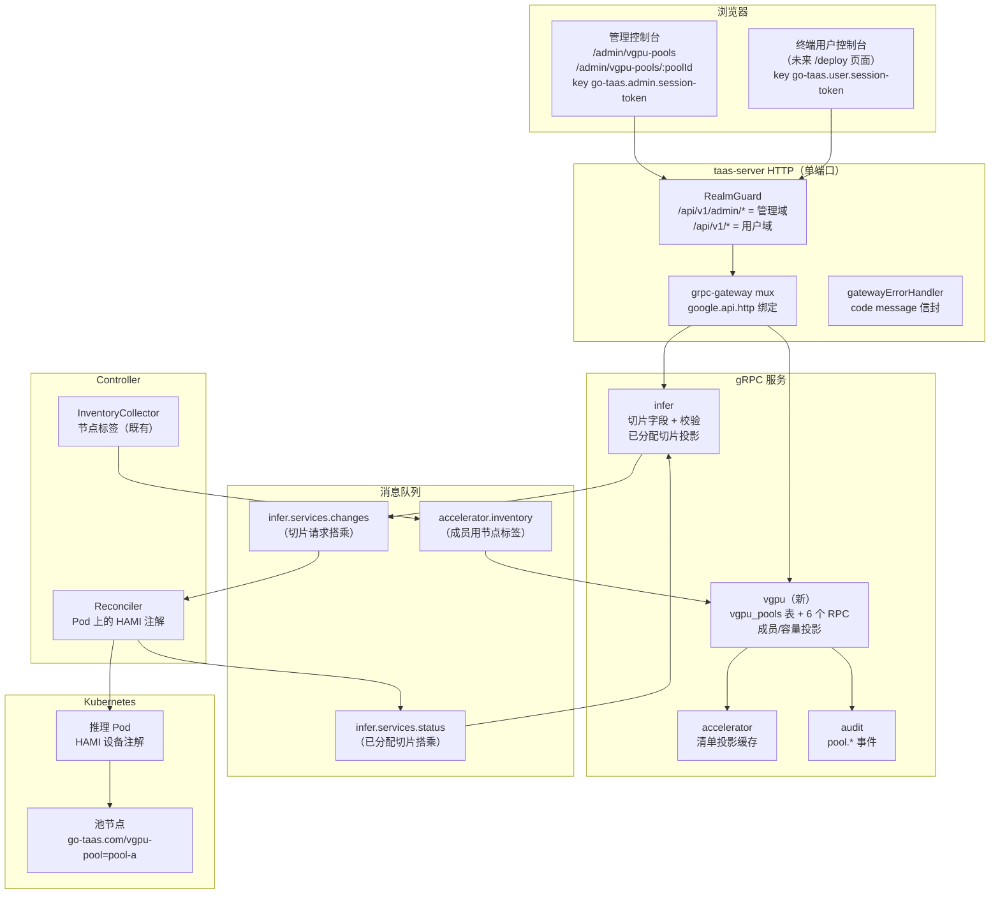
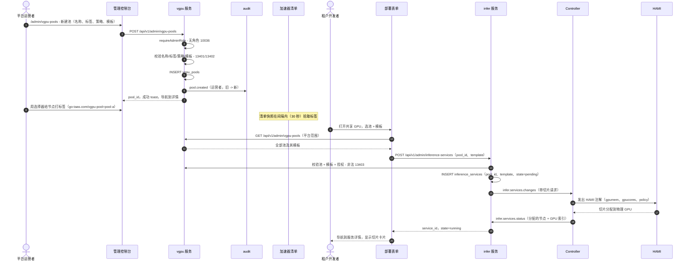
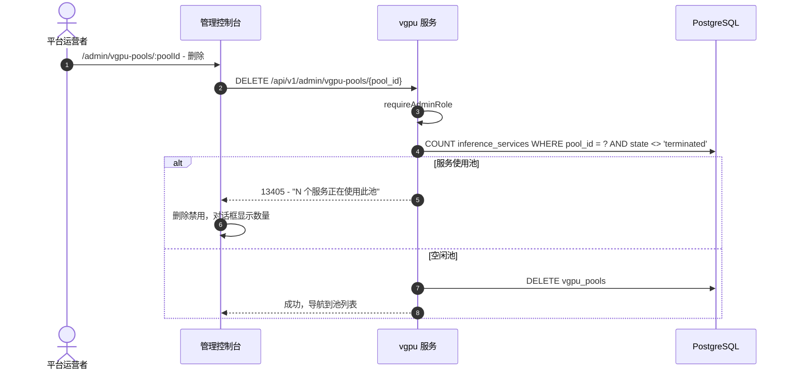

# 基于 HAMI 的 vGPU 切片池 — 架构与详细设计

| 属性 | 内容 |
| --- | --- |
| 功能点 | 基于 HAMI 的 vGPU 切片池 — 通过节点标签将多个节点指定为 vGPU 切片池，允许多个小推理任务共调度到同一块物理 GPU 上（backlog 第 52 行） |
| 文档范围 | 功能-52 的架构与详细设计：新 `vgpu` 模块（池 CRUD、标签驱动节点成员、切片模板、容量核算、调度提示）、`infer` 扩展（共享 GPU 部署字段、服务详情的已分配切片投影）、Controller 的 HAMI 注解发出与池成员采集、134xx 错误块、管理页面 `/admin/vgpu-pools` 与 `/admin/vgpu-pools/:poolId`、部署表单共享 GPU 模式与服务详情切片卡片、配置、安全、上线，以及按层的函数级任务清单 |
| 负责模块 | `vgpu`（新模块 — 池成员、切片模板、容量核算、调度提示）；`infer`（部署表单 vGPU 字段、服务切片分配）；`Controller`（将调度提示转为 HAMI 设备请求、采集池成员）；`k8s`（节点标签、扩展资源、HAMI 注解）；`pkg/server` 网关（管理 + 用户前缀绑定）；`pkg/errors`（134xx 块）；`pkg/config`（`vgpu` 段）；`pkg/mq`（无新主题）；`audit`（复用 — `pool.*` 事件）；`web` 管理控制台（`VGPUPoolsPage`、`VGPUPoolDetailPage`、`DeployDialog` 共享 GPU 模式、`ServiceDetailPage` 切片卡片） |
| 相关文档 | [需求分析与 UI/UX 设计](../design/vgpu-slicing-pool.zh-cn.md) · [架构设计](../design/architecture.zh-cn.md) §2.3 异构计算、§2.4 `infer`、§2.7 Controller · [加速器清单与健康](./accelerator-inventory.zh-cn.md)（本功能池节点是其带标签子集的按节点 GPU 机群视图；池成员所派生的投影模型）· [模型目录与一键部署](./model-catalog-deployment.zh-cn.md)（本功能扩展的部署表单、`inference_services` 表）· [推理弹性伸缩](./inference-autoscaling.zh-cn.md)（切片感知副本规模）· [服务配额管理](./service-quota-management.zh-cn.md)（切片数配额维度由此延迟而来）· [多集群管理](./multi-cluster-management.zh-cn.md)（跨集群池成员）· [控制台表面分离](./console-surface-separation.zh-cn.md)（两个表面、脱敏投影规则） |
| 状态 | 架构完成，已移交开发者 agent |

---

## 1. 概述与目标

今天的加速器层把**整块物理 GPU** 分配给推理服务。对于小模型（7B 聊天模型、小 embedding 模型、轻量 reranker），一整块 `A800` 或 `H800` 是严重过度配置：模型的权重与 KV cache 只占卡内存的一小部分，算力大部分时间闲置。加速器清单功能（#18）给了运营者机群全貌，但它是**只读**的 — 不改变 GPU 的消耗方式。缺失的是**共享**一块物理 GPU 的能力：让几个小推理任务同时跑在同一块 GPU 上，各自隔离在自己的切片里。

本功能新增**vGPU 切片池**：运营者通过节点标签把一组节点指定为切片池，定义**切片模板**（显存比例 + 算力比例）表示一块物理 GPU 如何被切分，推理服务可以选择**共享 GPU 模式**请求一个切片而非整卡。平台的 Controller 把切片请求转为 HAMI 设备注解，由 HAMI（平台已在加速器层列为灵感的 CNCF 孵化级异构 GPU 共享中间件）处理实际的设备共享、隔离与调度。

核心不变量：共享**按服务可选，且只在池节点上**（D2）；切片模板是**有界、运营者策划的词汇表** — 部署选模板，绝不选原始显存/算力值（D3）；HAMI 是共享机制，go-taas 保持**厂商中立**（D4）；池的放置策略是**池级设置**，作为调度提示传给 HAMI（D5）；**无性能隔离保证** — 共享 GPU 就是共享资源（D6）；切片分配是**容量遥测，不是计量** — 计费保持按请求 token 计（D7）；按组织切片数配额**延迟**（D8）。

**目标**：

- 两个管理页面：`/admin/vgpu-pools`（`VGPUPoolsPage` — 带选择器、策略、模板、节点、分配、利用率的池表格；创建对话框）与 `/admin/vgpu-pools/:poolId`（`VGPUPoolDetailPage` — 节点成员、按 GPU 分配、使用切片的服务、编辑对话框、删除流程），按设计 §5.1–§5.3。
- 部署表单的**共享 GPU 模式**（设计 §5.4）：开关、池下拉（平台范围，管理面读取）、切片模板下拉、共享 GPU 说明；服务详情的**切片卡片**（设计 §5.5）。
- 新 `vgpu` 模块拥有池成员（标签选择器）、切片模板与容量核算，带自己的错误块 **134xx**（设计 §6）。
- `VGPUService` 上五个管理 RPC 绑定在 `/api/v1/admin/vgpu-pools/*` 下，一个租户可见 `ListVGPUPools` 绑定在 `/api/v1/vgpu-pools` 下，以及 `infer` 扩展（`CreateInferenceService` 增加 `pool_id` + `slice_template_id`；`GetInferenceService` 增加已分配切片）（设计 §6）。
- Controller 的 HAMI 注解发出（`nvidia.com/gpumem`、`nvidia.com/gpucores`、放置策略注解）与池成员采集（标签驱动，来自加速器清单快照）（设计 §6 注 2–4）。
- 编号验收标准（AC1–AC13）可在 Nightwatch、FVT 与单元测试中测试；HAMI 契约合成验证（既有的仓库外模式）。

**非目标**（来自设计，重述）：以 MIG 分区作为平台机制（D4 — HAMI 抽象 MIG 与其他后端）；按租户 GPU 性能隔离保证（D6 — 共享 GPU 就是共享；尽力隔离）；切片级计量/计费（D7 — 计量保持按请求 token 计）；按组织切片数配额（D8 — 延迟到干净的后续）；部署表单暴露原始 HAMI 注解（D3 — 切片模板是有界词汇）；自动切分每块 GPU（D2 — 共享按服务可选）；独立 HAMI WebUI（管理控制台就是表面）；池级计费/定价（后续工作 — 定价保持按模型 × 卡型）；以及 HAMI 实现本身（仓库外 — 注解契约在此钉死并合成验证）。

### 1.1 本文档阅读顺序

第 2 节记录架构决策（AD1–AD16；AD11–AD16 是架构新增的细化，已标注）。第 3–5 节是组件视图、数据模型与 API 设计（含钉死的 HAMI 契约）。第 6 节是前端架构（页面 → 路由 → API 前缀表、导航、共享组件、认证守卫）。第 7–8 节是时序图与错误处理。第 9–11 节是配置、安全与上线。第 12 节是验收标准可追溯性。第 13–15 节是函数级详细设计、有序实现任务清单与延迟项。

---

## 2. 架构决策

AD1–AD10 把 UI/UX 设计的决策（D1–D8）重述为实现级规则；AD11–AD16 是架构新增的细化，已标注。

| # | 决策 | 理由 |
| --- | --- | --- |
| AD1 | **池是一组由节点标签指定的命名节点。** 运营者创建池、选标签键/值（如 `go-taas.com/vgpu-pool=pool-a`），任何带该标签的节点都是成员。成员是**声明式**的：Controller 观察节点上的标签选择器并上报成员；失去标签的节点离开池（其切片随服务结束自然排空） | 设计 D1。契合架构的节点标签模型（§2.3）与 HAMI 自身的 `gpu=on` 加入；成员能承受节点更替（新打标签的节点自动加入） |
| AD2 | **共享按服务可选，且只在池节点上。** 部署可选"共享 GPU"模式；不选则如今天一样拿整卡。非池节点永不共享 | 设计 D2。共享有隔离/性能权衡；租户与运营者必须刻意选择 |
| AD3 | **切片模板是有界词汇。** 池定义命名模板（如 `small` = 8 GiB / 25% 算力、`medium` = 16 GiB / 50%、`large` = 24 GiB / 75%）；部署选模板，绝不选原始显存/算力值 | 设计 D3。让容量规划诚实（运营者控制切分）且部署表单简单（下拉而非两个数字字段） |
| AD4 | **HAMI 是共享机制；go-taas 保持厂商中立。** Controller 发出 HAMI 注解；HAMI 在一个资源模型下处理 NVIDIA（含 MIG）、Iluvatar、MetaX 等后端 | 设计 D4。平台已把 HAMI 列为加速器层灵感；把设备共享委托给 HAMI 让 go-taas 保持厂商中立，避免重造设备虚拟化 |
| AD5 | **池的放置策略是池级设置**（binpack / spread / mutex），在池页面以下拉呈现，作为调度提示传给 HAMI | 设计 D5。HAMI 的调度词汇直接映射；运营者按池选择整合（binpack）vs 隔离（spread/mutex） |
| AD6 | **无性能隔离保证。** 池页面与部署表单都说明共享 GPU 是共享资源；显存/算力隔离按 HAMI 后端尽力而为 | 设计 D6。对共享资源权衡诚实；避免向租户过度承诺 |
| AD7 | **切片分配是容量遥测，不是计量。** 池的分配视图显示每个模板多少切片已分配/空闲；计费保持按请求 token 计（#4） | 设计 D7。不触碰计量链；池视图是运维表面 |
| AD8 | **切片数作为配额维度延迟。** 服务配额功能（#51）交付四个维度；按组织切片数配额是后续工作 | 设计 D8。让本功能聚焦共享机制；配额集成是干净的后续 |
| AD9 | **池管理仅限管理面；部署表单切片选择器在管理面。** 池 CRUD、模板与容量核算在管理面（`/admin/vgpu-pools` + `/api/v1/admin/vgpu-pools/*`）；部署表单的池/模板下拉与服务详情切片卡片也在管理面（`/api/v1/admin/vgpu-pools` + `/api/v1/admin/inference-services` 扩展）。用户域会话访问管理路由得到 **10038**；无平台管理员角色的会话得到 **10036** | 设计 D10/FR5.1。与控制台表面分离一致；池内部（机群容量）是运营者知识，部署时的切片选择由管理部署表单完成（租户可见的授权过滤池列表留给未来终端用户部署表面） |
| AD10 | **租户可见池列表在服务层授权过滤。** 组织仅当被授权访问池时才可用（镜像功能 #13 的模型授权模型）；调用者组织从会话解析，绝不信任客户端提供的 id。无授权的池隐藏 | 设计 FR5.3。部署表单的池下拉不得泄露组织不能用的池；授权检查在服务端，绝不信任客户端 |
| AD11 | **细化设计 D1/FR1.1 — 池是数据库表；成员与容量是投影。** 池自身状态（名称、标签选择器、放置策略、切片模板）是 `vgpu` 模块拥有的 GORM 表 `vgpu_pools`。节点成员与按 GPU 切片分配**不存储** — 它们是加速器清单快照（已带节点标签与按 GPU 状态，功能 #18）加 Controller 采集的 HAMI 上报设备状态的投影（设计 FR3.3："容量是 HAMI 上报设备状态的投影，不是独立数据库表"） | 设计钉死"池成员是声明式的"与"容量是投影，不是数据库表"，但未钉死池自身状态放哪。`vgpu_pools` 表是最小忠实解读：池的 CRUD 状态（名称、选择器、策略、模板）持久且审计，而易变的成员/容量从集群派生。这避免容量的第二真相源，同时让池配置持久 |
| AD12 | **细化设计 D1/FR1.1 — 池成员从加速器清单快照派生，而非独立节点观察。** `vgpu` 模块消费与加速器服务相同的 `accelerator.inventory` 快照（功能 #18）；当节点的 `labels` 映射含池的选择器键/值时，该节点是池成员。Controller 的清单采集器已发布节点标签（功能 #18，AD3）— 无需新节点观察 | 设计说"Controller 观察节点上的标签选择器并上报成员"（设计 §6 注 2）。清单采集器已按间隔列出节点并发布其标签；复用该快照是最小改动，保持一个节点采集循环。池成员视图因此与清单间隔一样新（默认 30 秒） |
| AD13 | **细化设计 D4/FR4.3 — 切片请求搭乘既有 `infer.services.changes` 变更事件。** `CreateInferenceService` 把 `pool_id` + `slice_template_id` 持久化到 `inference_services` 行并发布到变更事件；Controller 读取它们并在 Pod 上发出 HAMI 注解。切片请求本身无新 MQ 主题 | 设计说"Controller 把切片请求转为 HAMI 注解"而未钉死传输。既有变更事件是自然载体 — Controller 已解码它来构建 Deployment。给变更事件加两个字段是增量的，保持一个期望状态通道 |
| AD14 | **细化设计 D4/FR4.4 — 已分配切片是 Controller 状态上报的投影。** 一旦 HAMI 调度切片，Controller 在既有 `infer.services.status` 主题上把分配的物理 GPU（节点 + GPU 索引）上报回来；`infer` 状态消费者把它存到 `inference_services` 行，`GetInferenceService` 返回它。整卡服务无切片 | 设计说"服务详情显示调度后分配的物理 GPU"而未钉死 Controller 如何得知。状态上报是既有反馈通道；Controller 读 Pod 的节点与 HAMI 设备注解来上报切片。切片卡片因此与状态上报一样新 |
| AD15 | **细化设计 D5/FR1.2 — 放置策略是创建/更新时校验的封闭枚举。** `binpack` / `spread` / `mutex` 是仅有的接受值；非法值返回 **13401** 并点名字段。策略存在池行上，作为 `hami.io/gpu-scheduler-policy` 注解传给 HAMI | 设计 D5。封闭枚举让池页面的下拉与 Controller 的注解映射保持同步；未知策略绝不进入 Controller |
| AD16 | **细化设计 FR1.6 — 池变更以 `pool.created` / `pool.updated` / `pool.deleted` 审计。** 审计轨迹记录操作运营者与旧 → 新池状态（选择器、策略、模板）。列表/读取 RPC 不审计，按平台读路径约定 | 设计 FR1.6。池变更是带公平性影响的容量决策；审计轨迹回答"谁在何时改了哪个池" |

---

## 3. 组件视图

### 3.1 归属

| 层 / 组件 | 拥有 | 本功能变更 |
| --- | --- | --- |
| **静态包（SPA）** | 一个 Vite 包（`web/dist`），嵌入 `taas-server` 的 `pkg/server/console/`；由网关的 SPA 回退提供 | 两个新管理页面（`VGPUPoolsPage`、`VGPUPoolDetailPage`）、`DeployDialog` 的共享 GPU 模式、`ServiceDetailPage` 的切片卡片、导航项、`App.tsx` 的路由注册 |
| **网关（`pkg/server`）** | HTTP 组合：`RealmGuard` → `withConsole` → `runtime.ServeMux`；统一错误渲染器；SPA 回退 | 无变更 — 新 RPC 绑定在 `/api/v1/admin/vgpu-pools/*`（管理）与 `/api/v1/vgpu-pools`（用户）下，域守卫已分类这些前缀 |
| **grpc-gateway mux** | 从 `google.api.http` 注解做路径 → RPC 路由 | 六个新 RPC 的新绑定（第 5 节） |
| **`vgpu`（新）** | `vgpu_pools` 表、池 CRUD RPC、成员/容量投影、租户可见池列表 | 新服务：`services/vgpu` |
| **`infer`** | `inference_services` 切片字段、部署时切片校验、已分配切片投影 | `CreateInferenceService` 增加 `pool_id` + `slice_template_id`；`GetInferenceService` 增加已分配切片 |
| **`internal/controller`** | Kubernetes 协调；HAMI 注解发出；池成员采集 | 当变更事件携带切片请求时，协调器发出 HAMI 注解；清单采集器已发布节点标签（无新循环） |
| **`pkg/k8s`** | Kubernetes 客户端（clientset + dynamic） | 无变更 — 协调器用既有 clientset |
| **`pkg/mq`** | 规范主题 | 无新主题（切片请求搭乘 `infer.services.changes`；已分配切片搭乘 `infer.services.status`） |
| **`pkg/errors`** | 每模块代码块 | 配额块（133xx）之后的新 **134xx** 块 |
| **`pkg/config`** | 合并配置树 | 新 `vgpu` 段（池默认、HAMI 注解名） |
| **`audit`** | 审计轨迹 | 复用 — `pool.created` / `pool.updated` / `pool.deleted` 事件 |

### 3.2 运行时组件视图



---

## 4. 数据模型

### 4.1 `vgpu_pools` 表（新，`vgpu` 拥有）

| 列 | PostgreSQL 类型 | 约束 | 描述 |
| --- | --- | --- | --- |
| `id` | `uuid` | PRIMARY KEY | 服务端生成 UUID v4，暴露为 `pool_id` |
| `name` | `varchar(63)` | NOT NULL, UNIQUE | DNS 安全池名，1–63 字符（FR1.2） |
| `label_key` | `varchar(128)` | NOT NULL | 节点标签键，如 `go-taas.com/vgpu-pool` |
| `label_value` | `varchar(128)` | NOT NULL | 节点标签值，如 `pool-a` |
| `placement_policy` | `varchar(16)` | NOT NULL DEFAULT 'binpack' | `binpack` / `spread` / `mutex`（AD15） |
| `templates` | `jsonb` | NOT NULL DEFAULT '[]' | 切片模板数组（name、memory_gib、compute_pct、description） |
| `created_at` | `timestamptz` | NOT NULL | 创建时间（UTC） |
| `updated_at` | `timestamptz` | NOT NULL | 最后变更 |

索引：

| 索引 | 定义 | 用途 |
| --- | --- | --- |
| 主键 | `(id)` | 池身份 |
| 唯一 | `(name)` | 拒绝重复池名（FR1.2） |

设计说明：

- **`templates` 为 `jsonb`**：切片模板集是池上的有界、运营者策划列表；JSON 保持模式灵活，无需连接表。模板校验（FR2.2）在创建/更新时运行，因此存储的 JSON 总是有效。
- **成员与容量不存储**（AD11）：节点成员从加速器清单快照派生（AD12），按 GPU 切片分配是 Controller 采集的 HAMI 上报设备状态的投影（设计 FR3.3）。池行只存池自身的配置。
- **无 `vgpu_pool_members` 或 `vgpu_slice_allocations` 表**：两者都是投影（AD11、AD12）。这让集群成为容量的唯一真相源。

### 4.2 `inference_services` 表（增量列）

既有 `inference_services` 表（功能 #2）增加三列：

| 列 | PostgreSQL 类型 | 约束 | 描述 |
| --- | --- | --- | --- |
| `pool_id` | `uuid` | NULL | 服务切片来源的 vGPU 池；NULL = 整卡（AD2） |
| `slice_template_id` | `varchar(63)` | NULL | 池内模板名；NULL = 整卡 |
| `assigned_slice` | `jsonb` | NULL | 调度后的已分配物理 GPU：`{"node_id", "gpu_index", "memory_gib", "compute_pct"}`（AD14） |

设计说明：

- **`pool_id` + `slice_template_id` 对整卡服务为 NULL**（AD2）：功能前行为完全保留 — 未选共享 GPU 模式创建的服务无池/模板、无切片卡片。
- **`assigned_slice` 由 `infer` 状态消费者写入**（来自 Controller 的状态上报，AD14）：在 HAMI 调度切片前为 NULL，之后填充物理 GPU。整卡服务保持 NULL。
- **`pool_id` 无外键**：池仅当无服务使用它时才可删除（FR1.5，13405），因此在应用层防止悬空引用；硬外键会复杂化删除阻塞流程。

### 4.3 迁移与 init-SQL 升级路径

本仓库**不**用手写 init-SQL 脚本：每个模式变更都是拥有服务的 `Migrate` 通过 `db.AutoMigrate(...)` 创建/修改的 GORM 模型，`deploy/` 下无 `.sql` 文件。升级路径：

1. 在 `services/vgpu/vgpu_model.go` 加 `VGPUPool` 模型；新 `vgpu` 服务的 `Migrate` AutoMigrate 它。
2. 在 `services/infer/infer_model.go` 给 `InferenceService` 加三字段；既有 infer `Migrate` AutoMigrate 它们。
3. 无数据回填：既有 `inference_services` 行读 NULL/NULL/NULL = 整卡，正是功能前行为。无手工 DDL、无 compose 变更。

---

## 5. API 设计

### 5.1 表面映射

六个 RPC 是新的（五个管理、一个用户）；两个既有 RPC 改变行为（一个契约变更、一个响应扩展）。无 RPC 双绑定：管理 RPC 是机群范围管理，用户 RPC 是授权过滤的部署时读取。

| RPC | HTTP 方法 + 路径 | 表面 | 状态 | 用途 |
| --- | --- | --- | --- | --- |
| `ListVGPUPools`（新 `taas.vgpu.v1.VGPUService`） | `GET /api/v1/admin/vgpu-pools` | 管理 | **新** | 带选择器、策略、模板、节点数、聚合分配的池行；分页、名称搜索、节点数过滤 |
| `CreateVGPUPool` | `POST /api/v1/admin/vgpu-pools` | 管理 | **新** | 创建池；审计；输入非法 13401 |
| `GetVGPUPool` | `GET /api/v1/admin/vgpu-pools/{pool_id}` | 管理 | **新** | 一个池的完整详情（节点、按 GPU 分配、服务）；未知池 → 13406 |
| `UpdateVGPUPool` | `PATCH /api/v1/admin/vgpu-pools/{pool_id}` | 管理 | **新** | 更新策略/模板/选择器；审计；模板非法 13402 |
| `DeleteVGPUPool` | `DELETE /api/v1/admin/vgpu-pools/{pool_id}` | 管理 | **新** | 删除池；有服务使用则 13405 |
| `ListVGPUPools`（租户可见） | `GET /api/v1/vgpu-pools` | 用户 | **新** | 调用者组织可用的池（授权过滤），带模板 — 留给未来终端用户部署表面 |
| `CreateInferenceService`（`taas.infer.v1`） | `POST /api/v1/admin/inference-services` | 管理 | **变更** | 增加可选 `pool_id` + `slice_template_id`；池/模板非法或未授权 13403 |
| `GetInferenceService`（`taas.infer.v1`） | `GET /api/v1/admin/inference-services/{service_id}` | 管理 | **变更** | 共享 GPU 时响应增加已分配切片（池、模板、物理 GPU） |

网关路由说明：`GET /api/v1/admin/vgpu-pools`（集合根）与 `GET /api/v1/admin/vgpu-pools/{pool_id}` 是不同路径 — 无通配符冲突；PATCH 遵循同一 mux 上既有 `UpdateOrganization` 约定。租户可见 `GET /api/v1/vgpu-pools` 是不同用户前缀路径，因此域守卫把它分类为用户表面。

**表面决策（记录）**：设计文档 §4 表把部署表单分配到终端用户面（`/deploy`、`/api/v1/infer/*`），但既有部署表单（功能 #2）在管理面 — `DeployDialog` 用于管理 `ModelsPage`/`ModelDetailPage` 并调用 `POST /api/v1/admin/inference-services`。与既有架构一致，共享 GPU 部署模式扩展**既有管理部署表单**；池下拉读取**管理面** `ListVGPUPools`（`GET /api/v1/admin/vgpu-pools`，平台范围），使管理部署表单绝不调用用户面路由。租户可见 `ListVGPUPools`（授权过滤，`GET /api/v1/vgpu-pools`）保持为**用户面** RPC，留给未来终端用户部署表面。服务详情切片卡片扩展既有管理 `ServiceDetailPage`。这保留设计意图（模板有界的切片选择器），同时让部署表单留在它实际所在处并严格分离两个控制台表面。设计中的 `/deploy` 终端用户路由不创建；部署表单保持管理面。

### 5.2 Proto 契约

**新 `proto/taas/vgpu/v1/vgpu.proto`** — 带五个管理 RPC 与一个用户 RPC 的 `VGPUService`：

```proto
syntax = "proto3";
package taas.vgpu.v1;

import "google/api/annotations.proto";
import "taas/common/v1/common.proto";

option go_package = "github.com/go-taas/go-taas/proto/taas/vgpu/v1;vgpuv1";

// VGPUService 管理 vGPU 切片池（功能 #52）。池 CRUD 是管理面；
// 租户可见 ListVGPUPools 是用户面且授权过滤。
service VGPUService {
  // ListVGPUPools 返回每个池及其选择器、放置策略、切片模板、
  // 节点数与聚合分配（管理面，requireAdminRole）。
  rpc ListVGPUPools(ListVGPUPoolsRequest) returns (ListVGPUPoolsResponse) {
    option (google.api.http) = {get: "/api/v1/admin/vgpu-pools"};
  }

  // CreateVGPUPool 创建池（管理面）。以 pool.created 审计；
  // 输入非法 13401。
  rpc CreateVGPUPool(CreateVGPUPoolRequest) returns (CreateVGPUPoolResponse) {
    option (google.api.http) = {
      post: "/api/v1/admin/vgpu-pools"
      body: "*"
    };
  }

  // GetVGPUPool 返回一个池的完整详情（管理面）。未知池返回 13406。
  rpc GetVGPUPool(GetVGPUPoolRequest) returns (GetVGPUPoolResponse) {
    option (google.api.http) = {get: "/api/v1/admin/vgpu-pools/{pool_id}"};
  }

  // UpdateVGPUPool 更新放置策略、切片模板与节点标签选择器（管理面）。
  // 以 pool.updated 审计；模板非法 13402。
  rpc UpdateVGPUPool(UpdateVGPUPoolRequest) returns (UpdateVGPUPoolResponse) {
    option (google.api.http) = {
      patch: "/api/v1/admin/vgpu-pools/{pool_id}"
      body: "*"
    };
  }

  // DeleteVGPUPool 删除池（管理面）。有服务使用则 13405；
  // 以 pool.deleted 审计。
  rpc DeleteVGPUPool(DeleteVGPUPoolRequest) returns (DeleteVGPUPoolResponse) {
    option (google.api.http) = {delete: "/api/v1/admin/vgpu-pools/{pool_id}"};
  }

  // ListVGPUPools（租户可见）返回调用者组织可用的池及其切片模板，
  // 留给未来终端用户部署表面（用户面；组织从会话解析，绝不从客户端提供的 id）。
  rpc ListTenantVGPUPools(ListTenantVGPUPoolsRequest) returns (ListTenantVGPUPoolsResponse) {
    option (google.api.http) = {get: "/api/v1/vgpu-pools"};
  }
}

// SliceTemplate 是物理 GPU 的一个有界切分（AD3）。
message SliceTemplate {
  string name = 1;        // 池内唯一，如 "small"
  int64 memory_gib = 2;   // 1 - 卡显存
  int64 compute_pct = 3;  // 5 - 100
  string description = 4; // 可选
}

// VGPUPool 是 FR1.1 投影。
message VGPUPool {
  string pool_id = 1;
  string name = 2;
  string label_key = 3;
  string label_value = 4;
  string placement_policy = 5; // binpack | spread | mutex
  repeated SliceTemplate templates = 6;
  int64 node_count = 7;        // 从清单快照派生（AD12）
  repeated TemplateAllocation allocation = 8; // 每模板聚合
  int64 utilization_pct = 9;   // 已分配显存 / 池总显存
}

// TemplateAllocation 是一个模板的聚合分配（FR3.2）。
message TemplateAllocation {
  string template_name = 1;
  int64 allocated = 2;
  int64 free = 3;
}

// PoolNode 是一个成员节点的投影（AD12）。
message PoolNode {
  string node_id = 1;
  string name = 2;
  repeated PoolGPU gpus = 3;
  string health = 4; // 来自加速器清单
}

// PoolGPU 是一块物理 GPU 的切片分配（FR3.1）。
message PoolGPU {
  int64 index = 1;
  string model = 2;
  repeated SliceAllocation slices = 3;
  bool full = 4; // 剩余容量放不下任何模板
}

// SliceAllocation 是物理 GPU 上的一个已分配切片。
message SliceAllocation {
  string template_name = 1;
  string service_id = 2;
  int64 memory_gib = 3;
  int64 compute_pct = 4;
}

message ListVGPUPoolsRequest {
  taas.common.v1.PageRequest page = 1;
  string name = 2;        // 名称子串搜索，不区分大小写
  string placement_policy = 3; // binpack | spread | mutex | 空 = 全部
}

message ListVGPUPoolsResponse {
  taas.common.v1.Response response = 1;
  repeated VGPUPool pools = 2;
  taas.common.v1.PageMeta page_meta = 3;
}

message CreateVGPUPoolRequest {
  string name = 1;
  string label_key = 2;
  string label_value = 3;
  string placement_policy = 4; // 默认 binpack
  repeated SliceTemplate templates = 5;
}

message CreateVGPUPoolResponse {
  taas.common.v1.Response response = 1;
  VGPUPool pool = 2;
}

message GetVGPUPoolRequest {
  string pool_id = 1;
}

message GetVGPUPoolResponse {
  taas.common.v1.Response response = 1;
  VGPUPool pool = 2;
  repeated PoolNode nodes = 3;
  repeated SliceService services = 4; // 使用切片的服务
}

// SliceService 是使用池切片的一个服务。
message SliceService {
  string service_id = 1;
  string name = 2;
  string template_name = 3;
  string node_id = 4;
  int64 gpu_index = 5;
  int64 memory_gib = 6;
  int64 compute_pct = 7;
  string state = 8;
}

message UpdateVGPUPoolRequest {
  string pool_id = 1;
  // optional 跟踪存在性：缺省 = 不变。
  optional string placement_policy = 2;
  repeated SliceTemplate templates = 3; // 存在时整体替换
  optional string label_key = 4;
  optional string label_value = 5;
}

message UpdateVGPUPoolResponse {
  taas.common.v1.Response response = 1;
  VGPUPool pool = 2;
}

message DeleteVGPUPoolRequest {
  string pool_id = 1;
}

message DeleteVGPUPoolResponse {
  taas.common.v1.Response response = 1;
}

message ListTenantVGPUPoolsRequest {
  taas.common.v1.PageRequest page = 1;
}

message ListTenantVGPUPoolsResponse {
  taas.common.v1.Response response = 1;
  repeated TenantVGPUPool pools = 2;
}

// TenantVGPUPool 是授权过滤的部署时投影（AD10）。
message TenantVGPUPool {
  string pool_id = 1;
  string name = 2;
  repeated SliceTemplate templates = 3;
}
```

**变更 `proto/taas/infer/v1/infer.proto`** — `CreateInferenceServiceRequest` 增加两个可选切片字段（字段 9–10；字段 1–8 已占用），`GetInferenceServiceResponse` 增加已分配切片（字段 6；字段 1–5 已占用）：

```proto
message CreateInferenceServiceRequest {
  string name = 1;
  string model_id = 2;
  string model_version = 3;
  string image_id = 4;
  int32 replicas = 5;
  string accelerator = 6;
  string accelerator_type = 7;
  AutoscalingPolicy autoscaling = 8;
  // pool_id + slice_template_id 让服务选择共享 GPU 模式
  // （功能 #52，AD2）。两者必须同时出现；缺省 = 整卡。
  // 池/模板非法或未授权 13403。
  string pool_id = 9;
  string slice_template_id = 10;
}

message GetInferenceServiceResponse {
  taas.common.v1.Response response = 1;
  InferenceServiceSummary service = 2;
  repeated string endpoints = 3;
  AutoscalingPolicy autoscaling = 4;
  AutoscalingStatus autoscaling_status = 5;
  // assigned_slice 是 HAMI 调度切片后服务切片落地的物理 GPU
  // （功能 #52，AD14）。整卡服务或调度前为 nil。
  AssignedSlice assigned_slice = 6;
}

// AssignedSlice 是已分配物理 GPU（AD14）。
message AssignedSlice {
  string pool_id = 1;
  string pool_name = 2;
  string template_name = 3;
  int64 memory_gib = 4;
  int64 compute_pct = 5;
  string node_id = 6;
  int64 gpu_index = 7;
}
```

### 5.3 钉死的 HAMI 契约（数据面，仓库外）

HAMI 不在本仓库；下面的契约对数据面轨道有约束力，并在 FVT 中合成验证（既有模式 — compose mock 为 e2e 遵守它）。当变更事件携带切片请求时，Controller 在推理 Pod 上发出以下内容：

1. **资源请求**：Pod 的引擎容器请求 HAMI 扩展资源而非整卡 — `nvidia.com/gpumem` = 模板显存 MiB、`nvidia.com/gpucores` = 模板算力百分比（设计 §6 注 3）。对非 NVIDIA 加速器，应用等价的 HAMI 资源名（协调器中的 `gpuResourceName` 映射被扩展）。
2. **放置策略注解**：Pod 携带 `hami.io/gpu-scheduler-policy` = 池的放置策略（`binpack` / `spread` / `mutex`）（设计 §6 注 3，AD15）。
3. **节点亲和**：Pod 的 `nodeSelector` 被约束到池的标签选择器（`go-taas.com/vgpu-pool=pool-a`），让 HAMI 只在池节点上调度（AD2 — 非池节点永不共享）。
4. **已分配切片上报**：一旦 HAMI 调度切片，Controller 读 Pod 的节点与 HAMI 设备注解，在 `infer.services.status` 主题上上报分配的物理 GPU（节点 + GPU 索引）（AD14）。

契约逐项：

- **整卡服务不变**：无 `pool_id`/`slice_template_id` 的变更事件产生既有整卡资源请求（`nvidia.com/gpu` = 1）且无 HAMI 注解（AD2）。
- **HAMI 资源模型是钉死的契约**（设计 §6 注 3）：引擎容器上的 `nvidia.com/gpumem`（MiB）与 `nvidia.com/gpucores`（百分比），加放置策略注解。确切 HAMI 注解名可配置（第 9 节），因此 HAMI 版本变更是配置变更而非代码变更。
- **错误渲染**：HAMI 契约在 FVT 中合成验证（compose mock 遵守它）；控制面绝不渲染 HAMI 错误 — HAMI 调度失败以 `failed` 服务状态与失败原因呈现，走既有部署失败路径。

### 5.4 校验契约

| 字段 | 规则 | 错误 |
| --- | --- | --- |
| `name`（创建） | DNS 安全、1–63 字符、唯一 | 13401 |
| `label_key` / `label_value`（创建） | 非空、≤ 128 字符 | 13401 |
| `placement_policy` | `binpack` / `spread` / `mutex`（空 = binpack） | 13401 |
| `templates`（创建/更新） | 每个：池内名称唯一、显存 1–卡显存、算力 5–100 | 13402 |
| `pool_id`（获取/更新/删除） | 必须存在 | 13406 |
| `pool_id` + `slice_template_id`（部署） | 两者同时出现；池存在且授权给组织；模板在池内 | 13403 |
| `DeleteVGPUPool` | 无服务使用池的切片 | 13405（点名数量） |
| `ListTenantVGPUPools` 组织上下文 | 从会话解析（过渡头回退）；空 → | 10005 |

序列化约定不变：成功 HTTP 200，业务错误为 `{"code": <int>, "message": "..."}`，int64 字段为 JSON 字符串（显存 GiB、算力 %、利用率）。

---

## 6. 前端架构

### 6.1 页面 → 路由 → API 前缀表

| 页面 / 组件 | 路由 | API 前缀 | 表面 |
| --- | --- | --- | --- |
| `VGPUPoolsPage`（新，`web/src/pages/VGPUPoolsPage.tsx`） | `/admin/vgpu-pools` | `/api/v1/admin/vgpu-pools` | 管理 |
| `VGPUPoolDetailPage`（新，`web/src/pages/VGPUPoolDetailPage.tsx`） | `/admin/vgpu-pools/:poolId` | `/api/v1/admin/vgpu-pools` | 管理 |
| `DeployDialog` 共享 GPU 模式（变更，`web/src/components/DeployDialog.tsx`） | `/admin/models`、`/admin/models/:id`（既有） | `/api/v1/admin/vgpu-pools`（池下拉）+ `/api/v1/admin/inference-services`（创建） | 管理 |
| `ServiceDetailPage` 切片卡片（变更，`web/src/pages/ServiceDetailPage.tsx`） | `/admin/inference-services/:id`（既有） | `/api/v1/admin/inference-services` | 管理 |

管理页面**无 `/api/v1/*` 调用**；用户页面**无 `/api/v1/admin/*` 调用**（AC11）。按控制台表面分离，管理页面是管理域源（`web/src/pages/*.tsx`）。

**表面决策（记录）**：设计文档 §4 表把部署表单与服务详情分配到终端用户面。与既有架构一致（部署表单与服务详情今天在管理面），共享 GPU 模式与切片卡片扩展**管理** `DeployDialog` 与 `ServiceDetailPage`。部署表单的池下拉读取**管理面** `ListVGPUPools`（`GET /api/v1/admin/vgpu-pools`，平台范围）；租户可见 `ListVGPUPools`（`GET /api/v1/vgpu-pools`，授权过滤）留给未来终端用户部署表面。这是与既有架构及控制台表面分离最一致的解读；设计中的 `/deploy` 终端用户路由不创建。

### 6.2 导航放置

`AdminShell` 的 `ADMIN_NAV_ITEMS` 在基础设施簇（Accelerators 旁）增加一项：

```tsx
{ path: '/admin/vgpu-pools', labelKey: 'nav.vgpuPools', testid: 'nav-vgpu-pools', icon: Layers },
```

`App.tsx` 在管理块注册两个路由：

```tsx
<Route path="/admin/vgpu-pools" element={<VGPUPoolsPage />} />
<Route path="/admin/vgpu-pools/:poolId" element={<VGPUPoolDetailPage />} />
```

### 6.3 复用共享组件与状态

- `Dialog`（创建/编辑对话框及其内联校验）、`data` 表格样式、`PageMeta` 分页、`usePolling`（`web/src/components.tsx`）用于池列表刷新与详情页、徽章/进度条类、`RoutingDecisionsPage`/`AcceleratorNodeDetailPage` 的抽屉模式 — 都是既有控制台约定。
- **`SliceTemplateEditor`**（`web/src/pages/vgpu/SliceTemplateEditor.tsx`）：可复用模板编辑器（加行：名称、显存 GiB、算力 %、描述；按 FR2.2 校验），创建对话框与编辑对话框都用。
- **`AllocationBar`**（`web/src/pages/vgpu/AllocationBar.tsx`）：利用率条（琥珀 ≥ 80%、红 100%），池列表与池详情头部都用。
- **共享 GPU 说明**文案（设计 §5.4）作为常量放在 `DeployDialog.tsx`；**切片卡片**文案放在 `ServiceDetailPage.tsx`。

### 6.4 每表面认证守卫

- `VGPUPoolsPage` 与 `VGPUPoolDetailPage` 在 `AdminShell` 内渲染，其外壳守卫强制管理会话域（`/admin/login`，token `go-taas.admin.session-token`）；用户域会话访问管理路由从域守卫得到 **10038**。无平台管理员角色的会话从 `requireAdminRole` 得到 **10036**；页面渲染标准权限拒绝状态并链接回 `/admin`（AC12）。
- 部署表单的池下拉调用管理面 `GET /api/v1/admin/vgpu-pools`（平台范围）；部署表单本身在管理面（既有 `DeployDialog`）。下拉显示每个池及其模板；授权检查在部署时于服务端运行（AD10）— 引用未授权池的部署返回 **13403**。
- `ServiceDetailPage` 在 `AdminShell` 内渲染（管理域）；切片卡片是信息性的，无需额外角色门。

### 6.5 `data-testid` 钩子（约束性，kebab-case）

管理：`nav-vgpu-pools`、`vgpu-pool-table`、`vgpu-pool-row-{pool_id}`、`vgpu-pool-name-{pool_id}`、`vgpu-pool-selector-{pool_id}`、`vgpu-pool-policy-{pool_id}`、`vgpu-pool-templates-{pool_id}`、`vgpu-pool-nodes-{pool_id}`、`vgpu-pool-allocation-{pool_id}`、`vgpu-pool-utilization-{pool_id}`、`vgpu-pool-create`、`vgpu-pool-create-dialog`、`vgpu-pool-name-input`、`vgpu-pool-label-key-input`、`vgpu-pool-label-value-input`、`vgpu-pool-policy-select`、`vgpu-pool-template-row-{index}`、`vgpu-pool-template-error-{index}`、`vgpu-pool-save`、`vgpu-pool-search`、`vgpu-pool-filter-policy`、`vgpu-pool-pagination`、`vgpu-pool-empty`、`vgpu-pool-permission-denied`、`vgpu-pool-node-row-{node_id}`、`vgpu-pool-gpu-row-{node_id}-{index}`、`vgpu-pool-service-row-{service_id}`、`vgpu-pool-edit-{pool_id}`、`vgpu-pool-edit-dialog`、`vgpu-pool-delete-{pool_id}`、`vgpu-pool-delete-dialog`、`vgpu-pool-delete-blocked-{pool_id}`。

部署表单：`deploy-shared-gpu-toggle`、`deploy-pool-select`、`deploy-slice-template-select`、`deploy-shared-gpu-note`、`deploy-pool-empty`、`deploy-slice-error`。

服务详情：`service-slice-card`、`service-slice-pool`、`service-slice-template`、`service-slice-gpu`。

---

## 7. 时序图

### 7.1 运营者创建池，租户部署到切片



### 7.2 运营者删除池（使用中时被阻塞）



---

## 8. 错误处理

| 条件 | HTTP | 代码 | 常量 | 说明 |
| --- | --- | --- | --- | --- |
| 池创建/更新输入非法 | 500 | 13401 | `CodeVGPUPoolInvalid` | 校验；消息点名字段 |
| 切片模板非法 | 500 | 13402 | `CodeVGPUSliceTemplateInvalid` | 显存/算力界、重名 |
| 部署引用非法/未授权池或模板 | 500 | 13403 | `CodeVGPUSliceUnavailable` | 部署被拒；点名池/模板 |
| 池删除被活动服务阻塞 | 500 | 13405 | `CodeVGPUPoolInUse` | 点名服务数量 |
| 未知池 | 500 | 13406 | `CodeVGPUPoolNotFound` | |
| 用户域会话访问管理路由 | 500 | 10038 | `CodeRealmMismatch` | 复用 — 域分离（FR5.1） |
| 无所需角色的会话 | 500 | 10036 | `CodeForbidden` | 复用 — 权限拒绝（FR5.1） |
| `ListTenantVGPUPools` 无组织上下文 | 500 | 10005 | `CodeOrganizationNotFound` | 复用 — 组织守卫约定 |

渲染拆分（对测试 agent 有约束力）：**所有 134xx 代码都是控制面业务错误**，经 grpc-gateway 以统一 `{"code": <int>, "message": "..."}` 信封与 HTTP 500 呈现，仓库约定。HAMI 契约合成验证（第 5.3 节）；HAMI 调度失败以 `failed` 服务状态与失败原因呈现，而非 134xx 代码。

---

## 9. 配置

`pkg/config` 新增 `vgpu` 段（`VGPUConfig`，`mapstructure:"vgpu"`），在 `applyDefaults` 设默认，在 `Validate` 校验：

| 键 | 类型 | 默认 | 说明 |
| --- | --- | --- | --- |
| `vgpu.membershipInterval` | duration | `30s` | 池成员/容量投影的新鲜度界（加速器清单间隔，AD12） |
| `vgpu.hami.memResource` | string | `"nvidia.com/gpumem"` | HAMI 显存资源名（第 5.3 节） |
| `vgpu.hami.coreResource` | string | `"nvidia.com/gpucores"` | HAMI 算力资源名 |
| `vgpu.hami.policyAnnotation` | string | `"hami.io/gpu-scheduler-policy"` | 放置策略注解名 |
| `vgpu.hami.poolLabelPrefix` | string | `"go-taas.com/vgpu-pool"` | 默认池标签键前缀 |

`configs/config.yaml` 增加：

```yaml
# vGPU 切片池（功能 #52）。vgpu 模块拥有池配置；
# 成员与容量是加速器清单快照与 HAMI 上报设备状态的投影。
vgpu:
  # membershipInterval 约束池成员与容量投影的新鲜度
  # （加速器清单间隔）。
  membershipInterval: 30s
  hami:
    # HAMI 资源/注解名可配置，因此 HAMI 版本变更是配置变更
    # 而非代码变更。
    memResource: "nvidia.com/gpumem"
    coreResource: "nvidia.com/gpucores"
    policyAnnotation: "hami.io/gpu-scheduler-policy"
    poolLabelPrefix: "go-taas.com/vgpu-pool"
```

---

## 10. 安全考虑

1. **域分离**（FR5.1，AC11）：池管理仅限管理面（`/api/v1/admin/vgpu-pools/*`）；租户可见池列表在用户面（`/api/v1/vgpu-pools`）。用户域会话访问管理路由得到 **10038**；无平台管理员角色的会话得到 **10036**。管理页面无 `/api/v1/*` 调用，用户页面无 `/api/v1/admin/*` 调用。
2. **授权过滤租户池列表**（AD10，AC7）：租户可见 `ListVGPUPools` 在服务层强制组织授权 — 调用者组织从会话解析，绝不从客户端提供的 id。组织未授权的池隐藏；引用未授权池的部署返回 **13403**。
3. **不向租户暴露原始 HAMI 注解**（D3）：部署表单只暴露有界切片模板词汇；租户绝不可能请求任意显存/算力比例，保持容量规划诚实。
4. **共享资源诚实**（D6）：池页面与部署表单都说明共享 GPU 是共享资源；显存/算力隔离按 HAMI 后端尽力而为。不承诺性能隔离保证。
5. **审计**（AD16）：每次池创建/更新/删除都审计（`pool.created` / `pool.updated` / `pool.deleted`，含操作运营者与旧 → 新状态）。列表/读取 RPC 不审计，按平台读路径约定。
6. **删除阻塞**（FR1.5）：有活动切片用户的池不能删除（13405 点名数量）；运营者必须先迁移或删除这些服务。这防止运行中服务上的悬空 `pool_id`。

---

## 11. 上线 / 升级说明

1. **增量模式**：`vgpu_pools` 表是新的；三个 `inference_services` 列是增量的（NULL = 整卡）。无回填、无手工 DDL、无 compose 变更。
2. **向后兼容**：不带 `pool_id`/`slice_template_id` 的既有 `CreateInferenceService` 调用行为与今天完全一致（整卡、无 HAMI 注解）。既有服务无切片卡片。
3. **Controller 上线**：协调器的 HAMI 注解发出是增量的 — 无切片请求的变更事件产生既有整卡 Pod。Controller 可在 `vgpu` 服务之前或之后上线。
4. **HAMI 依赖**：共享 GPU 服务要调度，池节点上必须装 HAMI。池节点上无 HAMI 的池产生 `failed` 服务并带清晰失败原因（既有部署失败路径）。HAMI 契约可配置（第 9 节）并合成验证。
5. **传播窗口**：池成员/容量与清单间隔一样新（默认 30 秒，AD12）；已分配切片与状态上报一样新（AD14）。两者都在管理页面文案中说明。
6. **回滚**：回滚二进制会留下 `vgpu_pools` 表与三个 `inference_services` 列（无害 — 无其他东西读它们）并完全恢复功能前行为（整卡部署）。池值在回滚后存活，重新升级时重新生效。
7. **负载**：池列表每页行加一个 COUNT（尽力而为，页有界）；成员/容量投影复用既有清单快照（无新采集循环）。

---

## 12. 验收标准可追溯性

| AC | 设计要求 | 架构章节 |
| --- | --- | --- |
| AC1 管理池表格（名称、选择器、策略、模板、节点、分配、利用率）+ 搜索 + 策略过滤 + 分页 | FR1.1、§5.3 | §5.1–5.2（`ListVGPUPools`）、§4.1、§6.1–6.3、§13.2–13.3、§13.8 |
| AC2 创建对话框校验（名称 DNS 安全/唯一、标签选择器、模板显存/算力/重名），13401/13402 点名字段 | FR1.2、FR2.2 | §5.4、AD15、§13.2（Create）、§13.8 |
| AC3 池成员：打标签出现；去标签移除；空状态 | FR1.3、D1 | AD11、AD12、§13.3、§13.4 |
| AC4 按 GPU 分配：已分配切片（模板、服务、显存/算力已用 vs 空闲），放不下任何模板时 `full` | FR3.1 | AD11、AD12、§13.3、§13.4 |
| AC5 部署表单：共享 GPU 开关揭示池 + 模板下拉 + 说明；选池约束加速器/卡型；无可用池时开关禁用 | FR4.1–FR4.2 | §6.1–6.3、§13.8 |
| AC6 切片分配（合成）：共享 GPU 部署发出 HAMI 注解；服务详情显示切片卡片 | FR4.3–FR4.4、§6 注 3 | §5.3（钉死契约）、AD13、AD14、§7.1、§13.5–13.6 |
| AC7 非法/未授权切片：13403 + 内联文案；租户池列表授权过滤 | FR4.3、FR5.3 | AD10、§5.4、§13.2（部署校验）、§13.8 |
| AC8 非破坏模板变更：运行中服务保留其切片 | FR1.4、D6 | AD16、§13.2（Update）、§11.5 |
| AC9 删除阻塞：13405 点名数量，对话框禁用删除；空闲池删除 | FR1.5 | §5.4、§7.2、§13.2（Delete） |
| AC10 审计：pool.created / pool.updated / pool.deleted 含运营者与旧 → 新 | FR1.6 | AD16、§4.1、§7.1、§13.2 |
| AC11 负向域分离（10038），无跨表面调用 | FR5.1 | §3.3、§6.1、§6.4、§10 |
| AC12 角色拒绝（10036）+ 权限拒绝状态带 `/admin` 链接 | FR5.1、§5.3 | §3.3、§6.4、§8 |
| AC13 状态：两个管理页面加载/空/错误/权限拒绝；部署表单加载/空/错误 | FR5.2、§5.4 | §6.3、§13.8 |

---

## 13. 详细设计

### 13.1 文件布局

| 模块 | 文件 | 职责 |
| --- | --- | --- |
| `proto/taas/vgpu/v1` | `vgpu.proto`（新） | `VGPUService` + 消息（第 5.2 节）；重新生成 |
| `proto/taas/infer/v1` | `infer.proto` | `CreateInferenceServiceRequest` 字段 9–10、`GetInferenceServiceResponse` 字段 6；重新生成 |
| `services/vgpu` | `vgpu_model.go`（新） | `VGPUPool` GORM 模型（第 4.1 节） |
| | `vgpu_repository.go`（新） | 池 CRUD、成员/容量投影读取、使用中 COUNT |
| | `vgpu_service.go`（新） | 六个 RPC、`requireAdminRole`、`sessionOrgResolver` 缝、授权检查 |
| | `membership.go`（新） | 从加速器清单快照的成员/容量投影（AD12） |
| `services/infer` | `infer_model.go` | `InferenceService` 三个增量字段（第 4.2 节） |
| | `service.go`、infer 仓库 | 部署时切片校验、已分配切片状态消费 |
| `internal/controller` | `reconciler.go` | `buildDeployment` 中的 HAMI 注解发出（第 13.5 节） |
| `pkg/errors` | `codes.go`、`messages.go` | 配额块之后的 134xx 块 |
| `pkg/config` | `api.go`、`configuration.go` | `VGPUConfig`（+ `VGPUHAMIConfig`）、默认、校验 |
| `apps/taas-server` | `main.go` | `vgpu` 服务注册、缝接线（第 13.9 节） |
| `web/src` | `pages/VGPUPoolsPage.tsx`（新） | 管理池列表：表格、过滤条、创建对话框 |
| | `pages/VGPUPoolDetailPage.tsx`（新） | 管理池详情：节点成员、按 GPU 分配、服务、编辑对话框、删除流程 |
| | `pages/vgpu/{SliceTemplateEditor,AllocationBar}.tsx`（新） | 共享模板编辑器与分配条 |
| | `components/DeployDialog.tsx`（变更） | 共享 GPU 开关、池 + 模板下拉、说明 |
| | `pages/ServiceDetailPage.tsx`（变更） | 切片卡片 |
| | `shells/AdminShell.tsx`、`App.tsx` | 导航项、路由 |
| | `api.ts`、`locales/en.ts`、`locales/zh.ts` | 类型 + i18n 键 |
| `test/fvt` | `vgpu_fvt_test.go`（新） | FVT 套件（第 14 节） |
| `test/e2e` | Nightwatch 套件 | AC1–AC2、AC5、AC9、AC11–AC13 的控制台表面 |

### 13.2 `services/vgpu` — 池服务层

`Service`（新结构）持有：`repo *Repository`、`membership *MembershipProjection`、`roleGuard`、`sessionResolver`、`sessionOrgResolver`（计费模式）、`auditRecorder`、`grantChecker`（模型授权缝，功能 #13）。`requireAdminRole(ctx)` 精确镜像 provider 形态：经 `sessionOrgResolver` 解析活动组织（容忍 `CodeSessionInvalid`）、经 `sessionResolver` 解析操作者、任一缺省则跳过（管理域守卫是边界）、否则 `roleGuard.RequireRole(ctx, orgID, userID, roleAdmin)` → **10036**。

各 RPC 职责：

- **`ListVGPUPools`**：`requireAdminRole` → 校验 `placement_policy` 过滤（**13401**）→ `repo.ListVGPUPools(ctx, filter)`（池行）→ 每池组装投影：`node_count` 来自 `membership.NodeCount(poolID)`、`allocation` 来自 `membership.TemplateAllocation(poolID)`、`utilization_pct` 来自 `membership.Utilization(poolID)` → `PageMeta`。投影组装仅限每页行（有界），尽力而为（投影未命中记录警告并对该行给 0 — 列表绝不因投影失败）。
- **`CreateVGPUPool`**：`requireAdminRole` → 校验名称（DNS 安全、1–63、唯一 — **13401**）、标签键/值（非空、≤ 128 — **13401**）、放置策略（封闭枚举 — **13401**）、模板（按 FR2.2 — **13402**）→ `repo.CreateVGPUPool(ctx, pool, actor, now)` → `recordAudit("pool.created", ...)`（尽力而为）→ 创建的池。
- **`GetVGPUPool`**：`requireAdminRole` → `repo.GetVGPUPool(ctx, poolID)`（未知 **13406**）→ 组装完整投影：`nodes` 来自 `membership.Nodes(poolID)`（每节点及其 GPU 与按 GPU 切片分配）、`services` 来自 `repo.ListSliceServices(ctx, poolID)` → 完整响应。
- **`UpdateVGPUPool`**：`requireAdminRole` → 加载池（**13406**）→ 校验存在字段（策略枚举、模板 — **13401/13402**）→ 与当前值 diff；无实际变更 → 返回当前池（不写、不审计）→ `repo.UpdateVGPUPool(ctx, poolID, patch, actor, now)` → `recordAudit("pool.updated", ...)`（尽力而为）→ 更新后的池。改选择器警告"成员将随新标签变化"；改模板不驱逐运行中服务（D6 — 非破坏）。
- **`DeleteVGPUPool`**：`requireAdminRole` → 加载池（**13406**）→ `repo.CountSliceServices(ctx, poolID)`；`count > 0` → **13405** 点名数量 → `repo.DeleteVGPUPool(ctx, poolID)` → `recordAudit("pool.deleted", ...)`（尽力而为）。
- **`ListTenantVGPUPools`**：解析组织（`sessionOrgResolver.SessionActiveOrg`，过渡头回退，空 → **10005**）→ `repo.ListGrantedPools(ctx, orgID)`（组织被授权的池，经 `grantChecker` 缝）→ 授权过滤投影（pool_id、name、templates）。无角色门；请求上无组织参数。

### 13.3 `services/vgpu` — 池仓库

`vgpu_repository.go`（`database.Manager` 模式，与其他服务同句柄）：

- `ListVGPUPools(ctx, filter)` — `SELECT` 池行；`name` 匹配 `name ILIKE '%q%'`；`placement_policy` 非空时过滤；按 `name` 排序、分页带总数。
- `GetVGPUPool(ctx, poolID)` — 一行或 GORM `ErrRecordNotFound` → **13406**。
- `CreateVGPUPool(ctx, pool, actor, now)` — INSERT。
- `UpdateVGPUPool(ctx, poolID, patch, actor, now)` — 变更列的 UPDATE。
- `DeleteVGPUPool(ctx, poolID)` — DELETE。
- `CountSliceServices(ctx, poolID)` — `COUNT(*) FROM inference_services WHERE pool_id = ? AND state <> 'terminated'`。
- `ListSliceServices(ctx, poolID)` — 使用池切片的服务（service_id、name、template、node、GPU index、memory/compute、state）。
- `ListGrantedPools(ctx, orgID)` — 组织被授权的池（经 `grantChecker` 缝，功能 #13 的模型授权模型）。

### 13.4 `services/vgpu` — 成员/容量投影（AD12）

`membership.go`：

- `MembershipProjection` — 持有 `mu sync.RWMutex` 与 `nodes map[string]*AcceleratorNode`（加速器清单投影，功能 #18）。它消费 `accelerator.inventory` 快照（与加速器服务相同的主题）并保留节点标签与按 GPU 状态的本地副本。
- `NodeCount(poolID)` — 统计 `labels` 含池选择器键/值的节点数。
- `Nodes(poolID)` — 成员节点及其 GPU 与按 GPU 切片分配（来自 Controller 采集并携带在清单快照中的 HAMI 上报设备状态）。
- `TemplateAllocation(poolID)` — 跨池 GPU 的每模板聚合已分配/空闲。
- `Utilization(poolID)` — 已分配显存 / 池总显存。
- 投影在每次清单快照时刷新（`membershipInterval`，默认 30 秒）；失去标签的节点离开池（其切片随服务结束自然排空）。

### 13.5 `internal/controller` — HAMI 注解发出（AD13）

`reconciler.go` `buildDeployment`：

- `changeEvent` 结构增加 `PoolID string json:"pool_id,omitempty"` 与 `SliceTemplateID string json:"slice_template_id,omitempty"`。
- 两者都存在时，`buildDeployment` 发出 HAMI 契约（第 5.3 节）：引擎容器请求 `nvidia.com/gpumem` = 模板显存 MiB、`nvidia.com/gpucores` = 模板算力（经接受切片的扩展 `engineResources`），Pod 携带 `hami.io/gpu-scheduler-policy` 注解，`nodeSelector` 被约束到池的标签选择器。
- 缺省时，既有整卡路径不变（AD2）。
- 已分配切片上报：Pod 调度后，协调器读 Pod 的节点与 HAMI 设备注解，在 `infer.services.status` 主题上上报分配的物理 GPU（节点 + GPU 索引）（AD14）。

### 13.6 `services/infer` — 部署时切片校验与已分配切片投影

- `CreateInferenceService`：当 `pool_id` + `slice_template_id` 都存在时，发布前校验 — 池存在且授权给组织、模板在池内（否则 **13403**）。把 `pool_id` + `slice_template_id` 持久化到行并发布到变更事件（AD13）。两者都缺省时，既有整卡路径不变。
- 状态消费者：当 Controller 的状态上报携带已分配切片时，把它存到行的 `assigned_slice`（AD14）。
- `GetInferenceService`：共享 GPU 时返回 `assigned_slice`（池、模板、物理 GPU）；整卡服务返回无。

### 13.7 错误码放置

`pkg/errors/codes.go` 在配额块（133xx）之后增加块：

```go
// vgpu 模块错误码（功能 #52，设计 D4）。该块持有 vGPU 切片池
// 失败模式；13407-13499 保留给未来 vgpu 代码。所有 134xx 代码
// 经 grpc-gateway 以统一信封呈现；HAMI 契约合成验证。
CodeVGPUPoolInvalid           Code = 13401 // VGPU_POOL_INVALID
CodeVGPUSliceTemplateInvalid  Code = 13402 // VGPU_SLICE_TEMPLATE_INVALID
CodeVGPUSliceUnavailable      Code = 13403 // VGPU_SLICE_UNAVAILABLE
CodeVGPUPoolInUse             Code = 13405 // VGPU_POOL_IN_USE
CodeVGPUPoolNotFound          Code = 13406 // VGPU_POOL_NOT_FOUND
```

`messages.go` 增加五条消息，各在设计要求处点名字段/数量（"invalid vGPU pool"、"invalid slice template"、"the requested slice is unavailable or not granted"、"N services are using this pool"、"vGPU pool not found"）。

### 13.8 前端详细设计

- **`VGPUPoolsPage`**（`/admin/vgpu-pools`）：加载 `GET /api/v1/admin/vgpu-pools?{page, name, placement_policy}`；渲染池表格 — 名称、节点标签选择器（"`go-taas.com/vgpu-pool=pool-a`"）、放置策略、模板（"small, medium, large"）、节点（数量）、分配（"small 12/20 · medium 3/8"）、利用率（条，琥珀 ≥ 80%、红 100%）。过滤条：名称搜索、放置策略过滤、分页。行点击打开详情。**创建对话框**：名称（必填、DNS 安全、1–63、唯一 — 内联校验）、节点标签选择器（键 + 值、必填）、放置策略（下拉、默认 binpack）、`SliceTemplateEditor`（加行：名称、显存 GiB、算力 %、描述；按 FR2.2 校验）。保存 → `POST /api/v1/admin/vgpu-pools`；**13401/13402** 响应高亮违规字段并带服务端文案；成功显示 toast 并导航到新池详情。状态：加载骨架；空（"No vGPU pools yet — create one to share GPUs across small inference jobs"）；错误（陈旧带重试）；权限拒绝（10036，链接 `/admin`）。
- **`VGPUPoolDetailPage`**（`/admin/vgpu-pools/:poolId`）：加载 `GET /api/v1/admin/vgpu-pools/{pool_id}`；渲染池头部（名称、选择器、策略、聚合利用率条、编辑/删除操作）、节点成员表（节点、物理 GPU 型号 + 数量、按 GPU 分配带可展开行显示每块 GPU 的已分配切片：模板、服务、显存/算力已用 vs 空闲、来自加速器清单的健康；放不下任何模板时节点 `full`）、使用切片服务表（服务、模板、物理 GPU、显存/算力、状态、链接服务详情）。**编辑对话框**：放置策略 + `SliceTemplateEditor`；改选择器警告"成员将随新标签变化"；改模板警告"运行中服务保留其当前切片"。保存 → `PATCH /api/v1/admin/vgpu-pools/{pool_id}`。**删除流程**：删除打开确认对话框；若有服务使用池，服务端返回 **13405**，对话框显示"N 个服务正在使用此池。删除前请先迁移或删除这些服务。"并禁用删除。状态：加载；空（池无成员节点 — "No nodes carry this label yet"；提示给节点打标签）；错误；权限拒绝。
- **`DeployDialog`**（共享 GPU 模式）：在加速器/卡型字段下方，一个**"共享 GPU"开关**（默认关）。关时无变化。开时：出现**池下拉**（来自 `GET /api/v1/admin/vgpu-pools`，平台范围 — 管理面读取）；选池把加速器/卡型字段约束到池的节点；出现**切片模板下拉**（来自所选池），每个选项标注"small — 8 GiB / 25% compute"并带短描述；出现**共享 GPU 说明**（"This service will share a physical GPU with other services. Memory and compute are isolated best-effort; performance is not guaranteed."）。提交调用 `POST /api/v1/admin/inference-services` 并带 `pool_id` + `slice_template_id`；**13403** 响应显示内联文案。状态：加载（池获取中）；空（无共享 GPU 池 — "No shared-GPU pools are available for your organization" 且开关禁用带 tooltip）；错误（陈旧带重试）。
- **`ServiceDetailPage`**（切片卡片）：服务为共享 GPU 时，规格区出现**切片卡片**：池名、模板（"small — 8 GiB / 25%"）、调度后分配的物理 GPU（"node-a · GPU 0"）。整卡服务无切片卡片。卡片在用户面不链接任何东西（池详情仅限管理面）；它是信息性的。
- **`api.ts`**：`VGPUPool`、`SliceTemplate`、`TemplateAllocation`、`PoolNode`、`PoolGPU`、`SliceAllocation`、`SliceService`、`TenantVGPUPool`、`AssignedSlice` 类型；int64 字段类型化为字符串（序列化约定）。
- **i18n**：`nav.vgpuPools` 与 `vgpu.*` 键（表格、对话框、模板、详情、部署、切片卡片、状态）在 `en.ts`/`zh.ts`（`routingGroups.*` 约定）。

### 13.9 集成缝与接线（`apps/taas-server/main.go`）

在 `Init()` 之后的接线块：

```go
// 功能 #52：vGPU 切片池缝。vgpu 模块拥有池配置；
// 成员/容量从加速器清单派生，部署时授权检查复用模型授权缝
// （功能 #13）。
vgpuSvc := vgpu.New(srv.Components())
vgpuSvc.SetSessionOrgResolver(authSvc)
vgpuSvc.SetGrantChecker(modelSvc) // 功能 #13 授权缝
srv.AddService(vgpuSvc)
```

`vgpu` 服务消费 `accelerator.inventory` 快照（与加速器服务相同的主题）来维护其成员/容量投影（AD12）。空缝处处安全：空授权检查器授权无（fail-closed — 无授权的池隐藏），空成员投影回答 0 — 每个缝遵循的过渡形态。

---

## 14. 有序实现任务清单

1. **`pkg/errors`**：134xx 块 + 消息（按要求点名字段/数量）。
2. **`pkg/config`**：`VGPUConfig`（+ `VGPUHAMIConfig`）+ 默认 + 校验 + `configs/config.yaml` 段。
3. **`proto/taas/vgpu/v1/vgpu.proto`**：`VGPUService` + 消息；**`proto/taas/infer/v1/infer.proto`**：字段 9–10 与字段 6；重新生成。
4. **`services/vgpu/vgpu_model.go`**：`VGPUPool` GORM 模型。
5. **`services/vgpu/vgpu_repository.go`**：池 CRUD、使用中 COUNT、切片服务读取、授权池读取。
6. **`services/vgpu/membership.go`**：从加速器清单快照的成员/容量投影。
7. **`services/vgpu/vgpu_service.go`**：六个 RPC、`requireAdminRole`、`sessionOrgResolver` 缝、授权检查。
8. **`services/infer`**：三个增量字段、部署时切片校验（13403）、已分配切片状态消费、`GetInferenceService` 投影。
9. **`internal/controller/reconciler.go`**：`changeEvent` 切片字段、`buildDeployment` 中的 HAMI 注解发出、已分配切片上报。
10. **`apps/taas-server/main.go`**：`vgpu` 服务注册 + 缝接线。
11. **`web/src/api.ts` + locales**：类型与 i18n 键。
12. **`web/src/pages/VGPUPoolsPage.tsx`** + `pages/vgpu/` 组件 + 导航 + 路由（表格、过滤条、创建对话框）。
13. **`web/src/pages/VGPUPoolDetailPage.tsx`** + 导航 + 路由（节点成员、按 GPU 分配、服务、编辑对话框、删除流程）。
14. **`web/src/components/DeployDialog.tsx`**（共享 GPU 模式）+ **`web/src/pages/ServiceDetailPage.tsx`**（切片卡片）。
15. **单元测试**（`services/vgpu`、`services/infer`，sqlite 内存）：每字段池 CRUD 校验（13401/13402）；模板校验（显存/算力界、重名）；使用中 COUNT 与删除阻塞逻辑（13405）；授权过滤租户列表（AD10）；部署时切片校验（13403）；成员投影（标签增删、按 GPU 分配、`full`）；已分配切片状态消费。新文件覆盖率 ≥ 80%。
16. **`test/fvt/vgpu_fvt_test.go`**：管理 RPC 矩阵（列表过滤、获取 + 投影、创建/更新/删除 + 审计 + 13401/13402/13405/13406）；租户池列表授权范围（AC7）；部署时切片校验（AC7）；合成 HAMI 契约测试（AC6 — 钉死注解、放置策略注解、已分配切片上报）；域/角色负向（10038/10036，AC11/AC12）；成员投影（AC3、AC4）。
17. **`test/e2e`**：AC1、AC2、AC5、AC9、AC11–AC13 控制台表面的 Nightwatch 套件（`routing-groups` 套件结构），compose mock 遵守钉死的 HAMI 契约。

---

## 15. 延迟项

| 项 | 去向 |
| --- | --- |
| 以 MIG 分区作为平台机制 | 刻意排除（设计 §1.2，D4）— HAMI 抽象 MIG 与其他后端 |
| 按租户 GPU 性能隔离保证 | 刻意排除（D6）— 共享 GPU 就是共享；尽力隔离 |
| 切片级计量 / 计费 | 刻意排除（D7）— 计量保持按请求 token 计（#4） |
| 按组织切片数配额 | 延迟 — 服务配额功能（#51）交付四个维度；切片配额是干净的后续（D8） |
| 部署表单暴露原始 HAMI 注解 | 刻意排除（D3）— 切片模板是有界词汇 |
| 自动切分每块 GPU | 刻意排除（D2）— 共享按服务可选 |
| 独立 HAMI WebUI | 刻意排除 — 管理控制台就是表面 |
| 池级计费 / 定价 | 后续工作 — 定价保持按模型 × 卡型（#8） |
| HAMI 实现 | 数据面轨道，仓库外 — 注解契约在第 5.3 节钉死并合成验证 |
| 用户面 `/deploy` 路由 | 不创建 — 部署表单保持管理面（设计 §4 的终端用户分配被既有架构取代；记录于 §5.1 与 §6.1） |