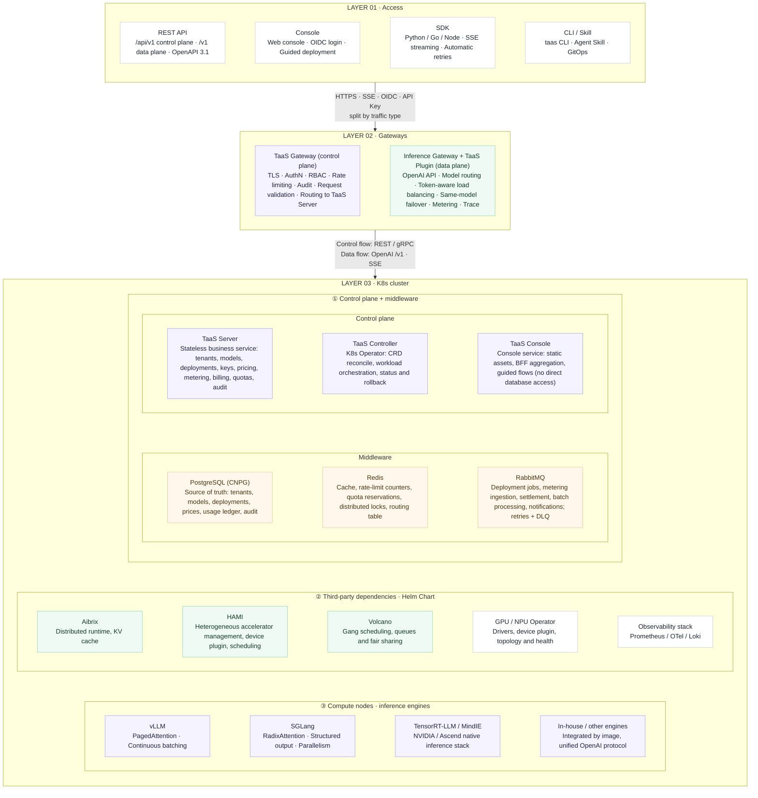
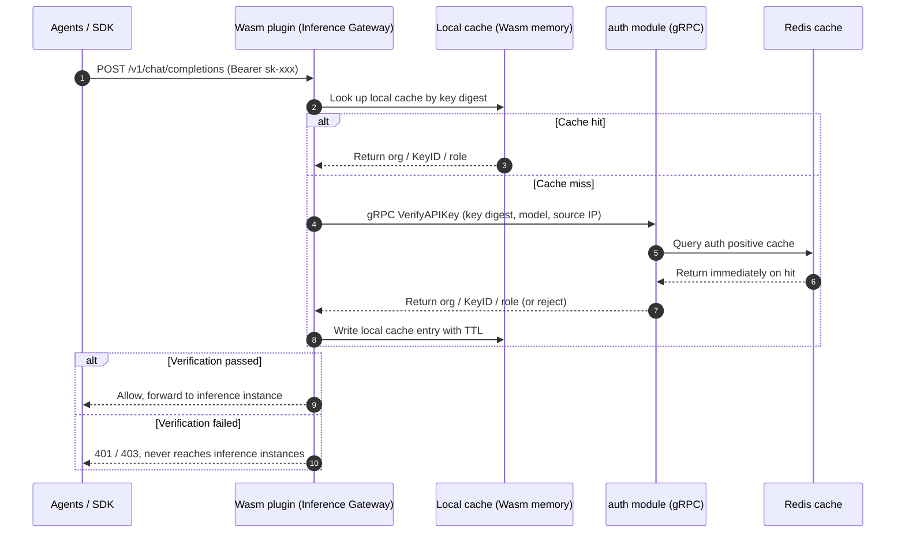
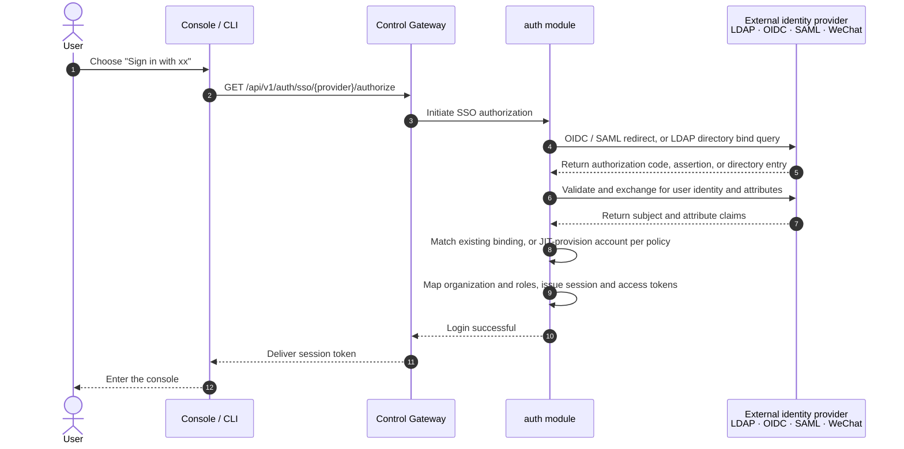
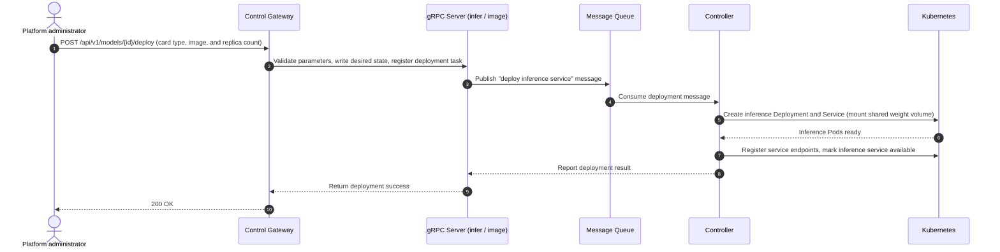
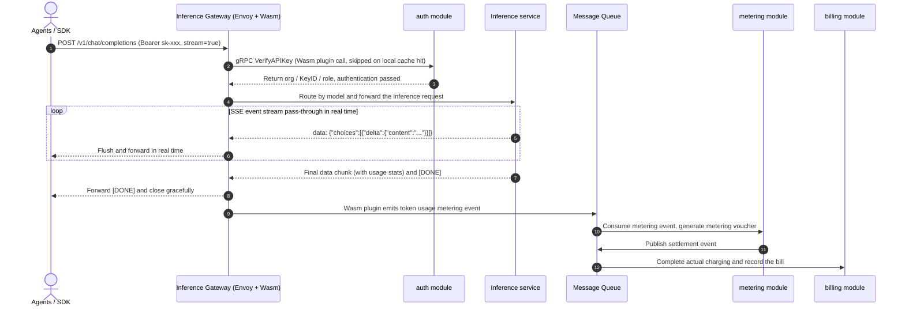

# Go TaaS Architecture Design

| Attribute | Content |
| --- | --- |
| Project name | Go TaaS (Token as a Service) |
| Overall positioning | An open-source, privately deployable **Token factory**: it turns heterogeneous, fragmented accelerator capacity into metered, billable, SLA-backed tokens. Not another MaaS — a TaaS operates the supply side: deployment, scheduling, metering, billing, routing and governance |
| Document scope | Defines the system topology, the 26 microservice modules and their responsibility boundaries, control plane/data plane partitioning, cluster networking, and collaboration flows; implementation details such as data models, storage parameters, and runtime configuration are carried by each module's detailed design documents |
| What makes it a TaaS | Tokens are metered per class (prompt / completion / cached / reasoning); tenants are isolated by key, quota and data boundary; quota, balance, billing and settlement form a closed loop; the SLA binds model, card type and context length; and the core KPI is cost per token, not call volume |
| Core architecture principles | Separate control plane and data plane gateways; the 26 microservice gRPC servers deployed as a single unit and decoupled from the Controller through a message queue; inference services and the control plane deployed in the same Kubernetes cluster; admission control applied at the gateway and control-plane create paths rather than in a dedicated quota service |

---

## 1. Architecture Overview and Topology Design



### 1.1 Control Plane / Data Plane Separation

- **Control plane**: hosts the platform's own APIs — SSO federated login, users and organizations, API Keys, model and image management, inference service orchestration, pricing, and bills. Its entry point is the **Control Gateway** (HTTP), auto-generated from the Protobuf contract by `grpc-gateway` and backed by the unified gRPC Server.
- **Data plane**: hosts inference service APIs — OpenAI-compatible endpoints such as `/v1/chat/completions` and `/v1/embeddings`. Its entry point is the **Inference Gateway**, built on **Envoy** and serving programmatic callers such as **agents / SDKs**; authentication, metering, and routing are all performed at the gateway by **Wasm plugins**.
- **Independent deployment**: the two gateways are deployed as separate workloads. Control plane APIs and inference APIs are fully isolated in scaling, upgrade cadence, and failure domains — an overloaded or upgrading Inference Gateway does not affect platform management capabilities, and vice versa.

#### 1.1.1 How the split is deployed

The two gateways are separate workloads with separate addresses, and the
chart publishes both:

| Plane | Workload | Entry point | Serves |
| --- | --- | --- | --- |
| Control | `taasServer` (Deployment) | the platform Gateway's route for the console hostname (e.g. `taas.example.com`) | `/api/v1/*`, `/api/v1/admin/*`, the console |
| Data | AIBrix Envoy gateway (`aibrix-eg` Gateway → Envoy proxy Service) | the platform Gateway's route for the inference hostname (e.g. `api.example.com`) | `/v1/chat/completions`, `/v1/embeddings`, … |

`dataPlane.enabled` + `dataPlane.hostname` make the chart create an
`HTTPRoute` that forwards the inference hostname straight to the inference
gateway's Service (plus the `ReferenceGrant` the cross-namespace backend
needs). Inference traffic therefore never enters the control-plane
process, and a control-plane rollout cannot interrupt a streaming response
in flight.

Because the inference hostname is a deployment fact rather than a build
constant, it is also an operator setting: the admin console's **Platform
settings** page (`/admin/settings`, `GET|PUT /api/v1/admin/platform-settings`)
stores it, and `GetInferenceEndpoint` reports
`<scheme>://<hostname>/v1` to the quickstart page, the API docs and every
client that asks. Precedence is: the console setting, then
`infer.endpointBaseURL`, then the gateway discovered in the cluster.

Saving the hostname is not just a database write: the server patches the
data-plane `HTTPRoute` (selected by the `app.kubernetes.io/component:
data-plane` label) so the route serves exactly the saved hostname. The write
happens **before** the value is stored, and a route that cannot be found or
patched fails the update with `12909` — otherwise the console would advertise
an endpoint that answers 404. Clearing the hostname is a no-op so an
accidental empty field cannot take the data plane offline. The route's
parent Gateway, backend Service and timeouts stay chart-owned: they are
install-time facts, while the hostname is the one part an operator changes at
runtime. `served_hostnames` in the settings response reports what the route
actually publishes, which is how the console shows whether the setting is in
effect.

The stored value has two forms on purpose. Users are given the **public**
URL, while the platform's own calls (the console playground) prefer an
**in-cluster** URL — a public hostname is not necessarily resolvable from a
pod, and hairpinning inference through the public ingress would add a hop
the split exists to avoid. Set `inference_gateway_internal_url` when the
cluster cannot resolve the public name.

### 1.2 Service Topology and Communication Mechanisms

- **Unified gRPC service process**: the gRPC servers of **all 26 microservices** (`auth`, `tenancy`, `account`, `model`, `image`, `infer`, `runtime`, `routing`, `provider`, `metering`, `billing`, `batch`, `audit`, `webhook`, `notification`, `observability`, `tracing`, `resourcemetrics`, `accelerator`, `cluster`, `optimization`, `prompt`, `evaluation`, `fault`, `vgpu`, `docs`) are deployed together in a single Deployment; modules call each other in-process, with no separate process per module;
- **Message queue decouples gRPC servers from the Controller**: the message queue (Kafka / RabbitMQ) carries **message passing between the microservice gRPC servers and the Controller**. gRPC servers only expose APIs, write desired state, and publish messages; the Controller consumes messages and drives Kubernetes resources, so the two can scale and restart independently;
- **Auto-generated RESTful APIs**: control plane HTTP/JSON APIs and OpenAPI documents are auto-generated from the Protobuf contract by `grpc-gateway`;
- **The data plane bypasses business processes**: inference requests are proxied by Envoy directly to inference instances; authentication and metering happen inside Wasm plugins, so business processes never become a forwarding bottleneck and streaming responses are not copied twice.

### 1.3 Deployment and Resource Model

- **Single cluster**: inference services and the control plane are deployed in the **same Kubernetes cluster**, sharing one control plane, message queue, and observability stack;
- **Cluster networking**: the cluster runs a CNI pod network with ClusterIP Services and CoreDNS service discovery for east-west traffic; north-south traffic enters through an Envoy Gateway with TLS termination; NetworkPolicies isolate the control plane, data plane, and tenant namespaces; an optional RDMA fabric (RoCE / InfiniBand) carries the inference data path while the control plane stays on standard Ethernet (see §5.2);
- **Quota and admission control**: the platform does not introduce a standalone quota microservice; admission control lives where the traffic is — per-API-key request-rate limits and per-organization service quotas (max concurrent inference requests, max inference services, max batch jobs per day, max output tokens per request) are enforced at the inference gateway and on the control-plane create paths, and organization spend limits are enforced by the billing chain. Within those bounds, administrators create inference services against the **cluster's available resources**, and cluster capacity is naturally bounded by the Kubernetes scheduler and node resources;
- **Workload isolation**: inference workloads and control plane workloads are isolated through Namespaces, node labels, and taints/tolerations, so they coexist stably within one cluster.
- **Bundled dependencies**: the Helm chart provisions single-replica PostgreSQL, Redis, RabbitMQ, and **Keycloak** in-cluster by default (each switchable to an external instance via `dependencies.<name>.mode`). The bundled Keycloak seeds the `go-taas` realm and an `admin`/`admin` user so the console is usable out of the box; the auth Migrate hook seeds the matching SSO provider row from `auth.seedSso` config (issuer/redirectUri point at the bundled Keycloak and the exposed URL).
- **Resource labeling**: every resource the chart and the controller create carries the standard `app.kubernetes.io/*` labels (`name`, `instance`, `version`, `managed-by`, `part-of: go-taas`, plus `component` for `server`, `controller`, `postgresql`, `redis`, `rabbitmq`, and `keycloak`). Platform-specific keys use the project's own DNS prefix `go-taas.com/` (the official website), never a domain the project does not control: `go-taas.com/service-id`, `go-taas.com/replica-index`, `go-taas.com/origin`, `go-taas.com/model`, `go-taas.com/model-id`, `go-taas.com/task-type`, `go-taas.com/task-id`, `go-taas.com/role`, `go-taas.com/accelerator`, `go-taas.com/accelerator-type`, `go-taas.com/driver-version`, `go-taas.com/device-plugin`, and `go-taas.com/vgpu-pool`. Keys that appear in selectors are an API surface: renaming one is a rolling-update event for the affected workloads, not a cosmetic change.

---

## 2. Component Responsibilities

The dependencies and responsibility boundaries between components are as follows:

```mermaid
flowchart TD
    subgraph edge["Edge"]
        direction LR
        CGW["Control Gateway (HTTP)<br/>grpc-gateway · /api/v1/* · /api/v1/admin/*"]
        DGW["Inference Gateway<br/>Envoy + Wasm (auth · metering · routing)"]
    end

    subgraph mods["Microservices — one Deployment (26 modules)"]
        direction TB
        subgraph m_acc["Access and tenancy"]
            direction LR
            AUTH["auth"]
            TENANCY["tenancy"]
            ACCOUNT["account"]
        end
        subgraph m_mid["Models and inference"]
            direction LR
            MODEL["model"]
            IMAGE["image"]
            INFER["infer"]
            RUNTIME["runtime"]
            ROUTING["routing"]
            PROVIDER["provider"]
            ACCELERATOR["accelerator"]
            CLUSTER["cluster"]
            BATCH["batch"]
        end
        subgraph m_bill["Metering, billing and cost"]
            direction LR
            METERING["metering"]
            BILLING["billing"]
            OPTIMIZATION["optimization"]
        end
        subgraph m_obs["Observability and automation"]
            direction LR
            OBSERVABILITY["observability"]
            TRACING["tracing"]
            RESOURCEMETRICS["resourcemetrics"]
            AUDIT["audit"]
            WEBHOOK["webhook"]
            NOTIFICATION["notification"]
        end
        subgraph m_prompt["Prompt tooling and docs"]
            direction LR
            PROMPT["prompt"]
            EVALUATION["evaluation"]
            DOCS["docs"]
        end
    end

    CGW --> mods
    DGW --> RT["Inference services"]
    DGW -.->|gRPC verify API key| AUTH
    DGW -.->|metering events| MQ["Message queue (Kafka / RabbitMQ)"]

    AUTH --> PG[(PostgreSQL)]
    AUTH --> RD[(Redis)]
    AUTH --> IDP["External identity providers<br/>LDAP · OIDC · SAML · WeChat"]
    TENANCY --> PG
    ACCOUNT --> PG
    MODEL --> PG
    MODEL --> JFS[(JuiceFS)]
    IMAGE --> PG
    IMAGE --> REG[("Image registry / MinIO")]
    IMAGE --> MQ
    INFER --> PG
    INFER --> MQ
    RUNTIME --> MQ
    ROUTING --> PG
    PROVIDER --> PG
    PROVIDER --> EXT["External LLM providers<br/>DeepSeek · OpenAI-compatible"]
    BATCH --> PG
    BATCH --> FSTORE[("Batch file store<br/>input / result / error JSONL")]
    METERING --> PG
    METERING --> RD
    METERING --> MQ
    BILLING --> PG
    BILLING --> MQ
    OPTIMIZATION --> PG
    OBSERVABILITY --> PG
    TRACING --> PG
    RESOURCEMETRICS --> PG
    AUDIT --> PG
    WEBHOOK --> HOOK["Outbound HTTPS endpoints"]
    NOTIFICATION --> PG
    PROMPT --> PG
    EVALUATION --> PG
    EVALUATION --> MQ
    DOCS --> PG

    MQ --> CTRL["Controller<br/>K8s resource reconciliation"]
    MQ --> ACCELERATOR
    MQ --> CLUSTER
    CTRL --> K8S["Kubernetes API<br/>inference workloads · image pre-pull · resource samples"]
    CTRL --> RESOURCEMETRICS
    RT -.-> JFS
    classDef edge fill:#007F86,stroke:#00565C,stroke-width:2px,color:#FFFFFF
    classDef svc fill:#CFE9EA,stroke:#4E9CA0,stroke-width:1.5px,color:#0B383D
    classDef core fill:#0B4F55,stroke:#083B40,stroke-width:2px,color:#FFFFFF
    classDef store fill:#E7ECEE,stroke:#9AACB1,stroke-width:1.5px,color:#23343A
    classDef ext fill:#FBE7CF,stroke:#D08A3C,stroke-width:2px,color:#6B3B08
    classDef gpu fill:#FADDD1,stroke:#D2704E,stroke-width:2px,color:#71260E
    class CGW,DGW edge
    class MQ,CTRL core
    class AUTH,TENANCY,ACCOUNT,MODEL,IMAGE,INFER,RUNTIME,ROUTING,PROVIDER,ACCELERATOR,CLUSTER,BATCH,METERING,BILLING,OPTIMIZATION,OBSERVABILITY,TRACING,RESOURCEMETRICS,AUDIT,WEBHOOK,NOTIFICATION,PROMPT,EVALUATION,DOCS svc
    class PG,RD,JFS,REG,FSTORE store
    class IDP,EXT,HOOK ext
    class K8S,RT gpu
    style edge fill:#EFF7F7,stroke:#9CC7C9,stroke-width:1.5px,color:#2A6A6F
    style mods fill:#F5F9F9,stroke:#B4C7CA,stroke-width:1.5px,color:#2F5B60
    style m_acc fill:#EAF4F5,stroke:#A9CDCF,stroke-width:1px,color:#2A6A6F
    style m_mid fill:#EAF4F5,stroke:#A9CDCF,stroke-width:1px,color:#2A6A6F
    style m_bill fill:#EAF4F5,stroke:#A9CDCF,stroke-width:1px,color:#2A6A6F
    style m_obs fill:#EAF4F5,stroke:#A9CDCF,stroke-width:1px,color:#2A6A6F
    style m_prompt fill:#EAF4F5,stroke:#A9CDCF,stroke-width:1px,color:#2A6A6F
```



### Microservice inventory

The single Deployment hosts 26 microservice modules. Every module is listed
below with its responsibility boundary and the feature points it implements
(backlog numbers):

| # | Module | Core responsibility | Feature points |
| --- | --- | --- | --- |
| 1 | `auth` | Local and SSO-federated authentication (LDAP / OIDC / SAML / WeChat), account binding and JIT provisioning, sessions and tokens, API Key lifecycle and verification, per-key rate limits, per-key model scoping, role-based console routing | #1, #7, #11, #22, #46 |
| 2 | `tenancy` | Organization / project isolation, members, roles and invitations (RBAC), console-surface separation, per-organization service quotas | #6, #10, #17, #51 |
| 3 | `account` | Account profile and GDPR-style account-data export bundles | #41 |
| 4 | `model` | Model catalog, versioning and rollback, weight paths and model-hub download, per-tenant model authorization | #2, #13, #32 |
| 5 | `image` | Inference engine image registry, versioning and import, node-level pre-pull tasks, model × engine × card-type compatibility matrix | #3, #19 |
| 6 | `infer` | Inference service lifecycle (deploy, scale, upgrade, rollback), autoscaling, routing policies, playground (incl. side-by-side comparison), SDK quickstart, service logs, load testing | #2, #12, #16, #20, #21, #33, #35, #45 |
| 7 | `runtime` | Platform serving scheme (plain Deployment vs AIBrix), runtime component health and registered-model projection | #47 |
| 8 | `routing` | Routing groups (virtual models) over real catalog candidates: weights, cost/latency strategies, intent rules, decision trail | #49 |
| 9 | `provider` | External provider registry, encrypted write-only keys, upstream-model curation and publishing into the catalog, connectivity probes | #48 |
| 10 | `metering` | Token metering and tamper-proof vouchers, usage records, request logs, usage dashboards, per-key usage analytics, error analysis | #4, #9, #12, #28, #31 |
| 11 | `billing` | Model × card-type price matrix, balance/quota accounts, charging and settlement, payments / invoices / auto-recharge, org spend limits, cost analytics, forecasting, billing reports | #5, #8, #11, #14, #25, #29, #36 |
| 12 | `batch` | Batch inference jobs: JSONL submission and validation, asynchronous worker, progress tracking, result / error download | #42 |
| 13 | `audit` | Audit logging of control-plane and auth events with activity export, deployment history and audit | #15, #34 |
| 14 | `webhook` | Outbound webhook endpoints, event subscriptions, HMAC signing, retry policy and delivery log | #23 |
| 15 | `notification` | In-console notification center, per-user preferences, threshold alerts and read/unread state | #26 |
| 16 | `observability` | Model performance aggregation (latency / throughput / error rate / token throughput) and platform component health & status page | #24, #30 |
| 17 | `tracing` | Per-request traces with phase-level latency breakdown (TTFT / generation / total) and request-id lookup | #27 |
| 18 | `resourcemetrics` | Per-service CPU / memory / GPU utilization series sampled by the Controller | #37 |
| 19 | `accelerator` | Accelerator inventory and health: per-node vendor, card model, driver and device-plugin status, allocated/free counts, readiness | #18 |
| 20 | `cluster` | Multi-cluster registry, cluster health and workload placement, cluster-targeted deployments | #40 |
| 21 | `optimization` | Cost optimization recommendations: rule-based, quantified, dismissible savings advice (advice-only, never acts) | #50 |
| 22 | `prompt` | Prompt library: create, version, organize, search, per-prompt usage counters, playground hand-off | #43 |
| 23 | `evaluation` | Prompt evaluation suites: variable-based cases, scored runs, run comparison | #44 |
| 24 | `fault` | Incident management: fault policies, detected faults, root-cause analysis and deployment correlation | — |
| 25 | `vgpu` | vGPU slicing pools and slice templates over HAMi; slice accounting consumed by the deploy path | #52 |
| 26 | `docs` | Curated user-realm API catalog served to the in-console API documentation explorer | #38 |


### 2.1 `auth` — Authentication, SSO Federation, and Multi-Tenancy

**Core responsibilities:**

- **Local account authentication**: user registration, login, and password policies; credentials are stored only as salted hashes;
- **Third-party SSO federated authentication**: a built-in **pluggable identity provider (IdP) framework** connects directly to existing enterprise account systems, without re-implementing the login chain for every protocol (OIDC and the built-in local account system are implemented; the remaining enterprise protocols are under construction):
  - **OIDC / OAuth 2.0**: GitHub, Google, GitLab, and self-hosted enterprise IdPs;
  - **SAML 2.0** (under construction): enterprise-grade single sign-on;
  - **LDAP / LDAPS** (under construction): connects to enterprise directory services (Active Directory, OpenLDAP, etc.), supporting user-DN bind and group-based filtering;
  - **WeChat** (under construction): QR-code login via WeChat Open Platform and WeCom (Enterprise WeChat);
- **Multiple coexisting IdPs with pluggable configuration**: administrators can enable multiple IdPs at the same time, configuring protocol parameters, visibility scope, default organization, and whether auto-registration is allowed for each one; new providers plug in as independent extensions without touching the core login logic;
- **Account binding and JIT provisioning**: stable identifiers such as `issuer + subject` (OIDC / SAML) or `DN` (LDAP) serve as the primary key of the external identity and are bound to platform accounts; the first login can auto-create an account (Just-In-Time Provisioning), or auto-creation can be disabled so that administrators pre-assign accounts;
- **Attribute and role mapping** (under construction): maps the username, email, group, and role claims returned by the IdP to platform organizations, projects, and roles, delivering permissions based on the enterprise organizational structure;
- **Sessions and tokens**: after a successful SSO login, the platform issues a session and an access token, supporting token rotation and Single Logout; local password login can be toggled independently, coexisting with SSO or disabled entirely;
- Management and isolation of the two-level (organization / project) multi-tenancy model;
- Full API Key lifecycle management (creation, verification, revocation, expiry control); the plaintext is shown only once at creation, and the system stores only the salted hash digest;
- **API Key verification for the Control Gateway and the data plane Inference Gateway**: exposes an authentication gRPC interface for the Inference Gateway's Wasm plugin to call on every request, backed by a Redis positive cache for high-concurrency, low-latency verification;

**External dependencies:** PostgreSQL (accounts, tenants, and identity bindings), Redis (auth cache and sessions), external identity providers (LDAP / OIDC / SAML / WeChat)

### 2.2 `model` — Model Asset Management

**Core responsibilities:**

- Metadata registration and version management for open-source LLMs (Qwen, DeepSeek, LLaMA, etc.);
- Maintenance of model weight paths in object storage, so inference services can mount them directly through the shared file system;
- Tenant-level model authorization, deciding the set of models each tenant may consume.

**External dependencies:** PostgreSQL (model metadata), MinIO and JuiceFS (weight storage)

### 2.3 `image` — Inference Image Management

**Core responsibilities:**

- Unified management of inference engine container images: registration, versioning, and adaptation relationships for the supported engine families (vLLM / SGLang / TensorRT-LLM) across multiple heterogeneous accelerator cards;
- Maintains the adaptation matrix between images and card types, engines, and model formats, providing the selectable image list for inference service orchestration;
- Drives image pre-pulling and caching: publishes pre-pull tasks to the message queue, which the Controller executes to pull images onto compute nodes ahead of time, shortening inference replica cold-start time;
- Verifies image provenance and integrity to keep untrusted images out of the inference chain.

**External dependencies:** image registry / MinIO (image and metadata storage), message queue (pre-pull task delivery)

### 2.4 `infer` — Inference Service Management

**Core responsibilities:**

- Heterogeneous compute management: unified management of **multiple heterogeneous accelerator cards** through a vendor-neutral node label and extended-resource model, so new card types are onboarded by labeling nodes rather than by changing the control plane;
- Lifecycle management of inference services: desired-state maintenance and change delivery for deployment, scaling, upgrade, and decommissioning;
- Inference engine adaptation: presents a unified OpenAI-compatible surface that hides engine differences;
- Health status and available endpoint registration of inference instances, used by the data plane gateway for routing;
- Quota-aware admission: inference services are created with the administrator-specified replica count and card types, bounded by the organization's service quota (feature #51) and the cluster's available resources.

**External dependencies:** message queue (change delivery), MinIO and JuiceFS (shared mounting of weights and images)

### 2.5 `metering` — Token Metering

**Core responsibilities:**

- Consumes metering events published by the data plane gateway's Wasm plugin, extracting token usage (Prompt / Completion / Cached / Reasoning);
- Generates tamper-proof metering vouchers;
- Delivers them asynchronously to the billing chain through the message queue, decoupling the inference chain from the accounting chain.

**External dependencies:** Redis (metering buffer), message queue (Kafka / RabbitMQ)

### 2.6 `billing` — Billing and Accounting

**Core responsibilities:**

- Maintains the "model × card type" price matrix, supporting tiered pricing and packages;
- Fund reservation at request admission and actual settlement after the request completes;
- Charge management for both account modes: balance (prepaid) and quota (postpaid);
- Bill generation, usage statistics, and reconciliation.

**External dependencies:** PostgreSQL (accounting data), message queue (metering event consumption)

### 2.7 Controller — Resource Reconciliation

**Core responsibilities:**

- Consumes change messages from the message queue and turns them into actual Kubernetes actions: creating/updating/deleting inference workloads, Services, and Endpoints;
- Executes image pre-pulling: lands the pre-pull tasks published by the `image` module onto specific nodes;
- Continuous reconciliation: observes gaps between actual and desired state and converges them, keeping inference services available;
- Decoupled from the gRPC servers through the message queue, so it can scale, restart, and upgrade independently.

**External dependencies:** message queue (message consumption), Kubernetes API, MinIO and JuiceFS (weight and image mounting)

---

## 3. Gateway Design

### 3.1 Control Gateway

- **Positioning**: the entry point for platform management APIs, serving only administrators and the console;
- **Implementation**: `grpc-gateway` auto-generates the HTTP/JSON proxy and OpenAPI documents from the Protobuf contract; all business logic lives in the unified gRPC Server;
- **Capabilities**: SSO federated login entry (authorization initiation and callback), model and image management, inference service orchestration, API Key and organization management, pricing and bill queries, and more;
- **Carries no inference traffic**: fully separated from the inference data plane for independent releases and fault isolation;
- **Admin/user surface separation**: the end-user console at `/` (API `/api/v1/*`) and the admin console at `/admin` (API `/api/v1/admin/*`) are separate surfaces with independent sessions and login flows (features #17 and #22); a request that carries a session from the wrong surface is rejected before any handler runs. User-facing account APIs (login, signup) stay under `/api/v1/auth/*`, while the admin web console is served under the `/admin` path prefix (`/admin/models`, `/admin/inference-services`, `/admin/api-keys`, …).

### 3.2 Data Plane (Inference) Gateway: Envoy + Wasm

The Inference Gateway is built on **Envoy** and implements the following capabilities at the gateway through **Wasm plugins**, so that inference traffic never passes through business processes:

| Capability | Description |
| --- | --- |
| **Authentication** | Parses the API Key from the `Authorization` header and **verifies it by calling the `auth` module's verification interface over gRPC**; invalid or revoked keys are rejected at the gateway and never reach inference instances |
| **Metering** | Parses token usage from streaming (SSE) and non-streaming responses, and emits metering events to the message queue for `metering` and `billing` to consume |
| **Routing** | Selects healthy inference instances per model, load balances, and retries on failure, shielding callers from backend instance changes |
| **Streaming pass-through** | Keeps SSE pass-through with per-event flush, avoiding buffering-induced latency |
| **Observability** | Uniformly produces access logs and metrics for capacity observation and troubleshooting |

> Note: because authentication and metering are pushed down to gateway Wasm plugins, the platform needs no standalone quota/rate-limiting service. Admission control is applied where the traffic is: per-API-key request-rate limits and per-organization service quotas (max concurrent requests, max inference services, max batch jobs per day, max output tokens per request) are enforced at the inference gateway and on the control-plane create paths, with organization spend limits enforced by the billing chain; the check order is rate → quota → funds.

#### 3.2.1 The plugin pipeline, in order

Every inference request traverses the same ordered pipeline inside Envoy. The
order matters: an authentication failure must be cheaper than a quota check,
and metering must never be able to reject a request.

| # | Step | What it does |
| --- | --- | --- |
| 01 | **Auth** | Parses `Authorization: Bearer sk-…`, verifies the key against the `auth` module (local cache → gRPC), and resolves the tenant, key id, scopes and model allow-list |
| 02 | **Quota** | Token-bucket rate limit plus a concurrency lease; atomic decrement in Redis; fail-closed by default, or degrade per policy |
| 03 | **Route** | `RoutingGroup` → healthy deployment → weighted / latency / cost selection; failover only between deployments of the *same* model |
| 04 | **Meter** | Takes token usage from the engine's `usage` object, falls back to gateway counting; emits an event keyed by `request_id`, written to the queue asynchronously |
| 05 | **Trace** | Injects `traceparent`; records queueing, prefill, decode and total latency; redacts prompt content in logs |
| 06 | **Guard** | Body size, `max_tokens`, timeout and cancellation propagation; fast ejection of an unhealthy upstream |
| 07 | **Cache** | Optional idempotent result cache; prefix-cache affinity. A cache hit does not change how the request is billed |
| 08 | **Degrade** | On Redis or queue unavailability: local token bucket plus local buffering, then compensating replay after recovery |

Two trade-offs are deliberate:

- **A metering failure must not block inference.** Refusing service when the
  metering component is down widens the blast radius from "the bill is
  slightly off" to "everything is down". The request is admitted, the event
  enters a compensation queue, and reconciliation attributes the difference
  afterwards by `request_id`.
- **The plugin runs inside Envoy rather than as a sidecar.** It ships,
  canaries and rolls back independently of the server, and adds no network
  hop. At the P99 that streaming inference targets, one extra hop is tens of
  milliseconds.

> **Hard constraint.** The plugin must be stateless, hot-upgradable and able
> to degrade. A metering failure may never block inference, but it must land
> in the compensation queue and be visible in the reconciliation report. An
> invisible failure is worse than the failure itself.

> **Implementation carrier.** The plugin contract above is what the data
> plane must satisfy; the carrier in this repository is AIBrix's Go
> `ext_proc` gateway plugin rather than a Wasm module. The request pipeline,
> the idempotency rules and the degradation behaviour are the same, but a
> Wasm build remains the target because it can be published, canaried and
> rolled back independently of the gateway image. Treat "Wasm" in this
> document as the target and "ext_proc" as today's shipping carrier.


### 3.3 The Inference Gateway's API Key Authentication Chain

Every request on the inference data plane must have its API Key verified, and the authoritative decision belongs to the `auth` module. The Wasm plugin therefore makes no business decisions of its own — it **calls the `auth` module over gRPC** to complete verification:



- **Caller**: Envoy's Wasm plugin, initiating authentication at the request-header phase; implemented preferably with Envoy's `ext_authz` gRPC filter, or with a direct gRPC call from the Wasm plugin;
- **Callee**: the authentication gRPC interface exposed by the `auth` module, taking the API Key digest and request context (model, source IP) as input and returning the organization, Key ID, role, and the context needed for metering; the Wasm plugin **never connects to the database directly**;
- **Layered caching**: the Wasm plugin keeps a TTL-based local cache (30s recommended) keyed by the key digest; on a miss it falls back to `auth`, which is fronted by a Redis positive cache — the two cache layers keep per-request authentication overhead at the sub-millisecond level;
- **Timeout and failure policy**: authentication calls have millisecond-level timeouts and retries; on timeout or `auth` unavailability, requests are rejected under a **fail-closed** policy so that unauthorized traffic never reaches inference instances;
- **Revocation propagation**: the local cache TTL bounds the worst-case delay before a revocation takes effect; the control plane can broadcast cache invalidation to satisfy stricter immediate-revocation requirements;
- **Responsibility boundary**: the Wasm plugin only handles "calling, caching, and deciding"; authoritative judgments — API Key hash comparison, organization ownership, revocation, and expiry — always stay in the `auth` module.

---

## 4. Module Collaboration Flows

### 4.1 SSO Federated Login and Account Mapping



- **Pluggable**: adding an SSO provider only requires implementing the unified IdP plugin interface (authorization, callback, identity and attribute extraction), without touching the `auth` core login logic;
- **Security**: callbacks strictly validate `state` / `nonce` / signatures to prevent request forgery; external identities serve only as binding identifiers, and the platform always authorizes by its internal user ID.

### 4.2 One-Click Model Deployment Flow
The two flows are asymmetric, and that asymmetry is the design: the deployment
path is asynchronous and every hop can fail, so it needs a state machine,
retries and rollback; the inference path is synchronous and must be fast, so
everything after metering is asynchronous and never blocks the response.

| # | Deployment (control plane, asynchronous) |
| --- | --- |
| 1 | The console or API submits model, engine, card type, replicas and inference parameters |
| 2 | The gateway authenticates; the server validates quota and parameters |
| 3 | The server writes the deployment row (`PENDING`) plus an outbox event and returns a deployment id |
| 4 | The outbox publisher delivers the event to the queue |
| 5 | The controller reconciles: creates the workload objects, renders the Deployment, Service and autoscaling policy |
| 6 | Kubernetes + HAMi + Volcano place devices; the image is pre-pulled; the model cache is mounted |
| 7 | Health checks and warmup pass; the state becomes `READY` and endpoints are registered |
| 8 | The gateway refreshes routing; the model is callable; audit and notification complete |




### 4.3 Inference Request and Billing Loop
| # | Inference (data plane, synchronous until metering) |
| --- | --- |
| 1 | The client calls `/v1/chat/completions` with an API key and `stream=true` |
| 2 | The plugin verifies the key, the tenant/user state and the model scope |
| 3 | Quota: concurrency, rate and balance are checked; Redis decrements atomically; failure returns 429/402 |
| 4 | Routing: the routing group picks a healthy deployment, then an instance by weight, latency, cost and prefix affinity |
| 5 | The request is forwarded to the vLLM / SGLang pod and streamed back as SSE |
| 6 | Metering reads the upstream `usage` and emits an idempotent usage event keyed by `request_id` |
| 7 | Async: event → queue → consumer → the PostgreSQL usage ledger |
| 8 | Settlement: daily/hourly aggregation → bills, balances, quota; dashboards and alerts update |




---

### 3.4 Metering Discipline and Ledger Rules

Metering accuracy decides everything downstream: pricing, quota, billing,
gross margin. A customer will tolerate an expensive price; nobody tolerates a
bill they cannot explain.

The difficulty is not counting tokens, it is the **definition**. A gateway
that tokenizes on its own is affected by chat templates, tool-call framing and
multimodal input, so its count differs slightly from what the engine actually
computed. The engine's `usage` is therefore authoritative, with gateway
counting as a fallback, reconciled daily.

Usage also splits into four token classes — **prompt, completion, cached,
reasoning** — because their cost structures differ and they should be priced
differently.

A stream that disconnects mid-response is the canonical edge case: the engine
may already have computed tokens the gateway never received the full response
for, and a retry may double-bill. The rules below exist to make that
impossible rather than to be fixed later.

| Rule | Why |
| --- | --- |
| Engine `usage` is authoritative; gateway counting is the fallback | The engine is the only party that knows what it computed |
| Every request carries a `request_id`; metering events are idempotent on it | Disconnects and retries must not double-bill |
| The ledger is **append-only**, partitioned by day, never updated in place | An auditable bill needs an immutable history |
| Balances are derived by an idempotent aggregation job, never per request | Updating a balance per request cannot survive inference peak load |
| Each tenant gets a daily hash chain | Tamper-evident history without a blockchain |
| Bills are aggregated from the ledger; daily reconciliation covers ≥ 99.5 % of events with ≤ 0.1 % variance | Reconciliation is a product feature, not an accounting chore |

The reason these read like finance requirements is that they are product
requirements: a customer must be able to drill from an invoice down to a
single call by `request_id`, and any difference must be attributable. Without
those two, an SLA is an empty promise.

## 5. Storage and Network

### 5.1 Storage Tiers

| Storage | Serves | Responsibility |
| --- | --- | --- |
| **Longhorn** | The Kubernetes cluster itself | Provides persistent volumes (PVCs) for the control plane and in-cluster stateful components; block storage and replica redundancy via CSI |
| **MinIO** | Inference services | S3-compatible object storage holding inference engine images and model weight originals, and serving as the backend of JuiceFS |
| **JuiceFS** | Inference services | Mounts object storage as a POSIX file system; multiple replicas share the same weights and images, achieving second-level mounting and node-level caching |

- **Separation of duties**: Longhorn serves only in-cluster components (PostgreSQL, Redis, etc.) and takes no part in the inference data path; inference weights and images uniformly go through MinIO + JuiceFS;
- **Shared acceleration**: inference replicas share one JuiceFS volume, and with node-local caching, no replica re-pulls tens of GB of weights.

### 5.2 Network Design Inside the Kubernetes Cluster

The cluster runs its own network plane, shown as the **Cluster Network** zone in the
topology diagram. It has four concerns:

| Plane | Purpose | Design |
| --- | --- | --- |
| **Pod network (east-west)** | Pod-to-pod and pod-to-service traffic | A standard CNI plugin provides the flat pod network and IPAM; every microservice, the Controller, the gateways, and the inference instances live on it |
| **Service discovery** | Stable addressing for the 26 microservice modules and the Controller | ClusterIP Services per exposure unit (gRPC server, gateways, message queue, Redis, PostgreSQL) resolved through CoreDNS; modules call each other in-process, so service discovery is only needed between workloads |
| **North-south entry** | Console and API access from outside the cluster | An Envoy Gateway terminates TLS and routes `/` (end-user console), `/admin` (admin console), `/v1/*` (inference API), and `/api/v1/*` to the Control Gateway or the Inference Gateway |
| **Isolation & policy** | Blast-radius containment between the control plane, the data plane, and tenants | Namespace separation plus NetworkPolicies that allow only the flows in the topology diagram (consoles → gateways, gateways → gRPC server/data plane, gRPC server ↔ message queue, Controller → Kubernetes API, inference → weight storage); egress from the `provider` module to external LLM endpoints and from `webhook` to customer endpoints is explicitly allow-listed |
| **Transport tiers** | Separate high-bandwidth inference traffic from management traffic | The control plane uses the standard Ethernet network; the inference data path (requests/responses, KV Cache transfer, multi-card communication) can be placed on an optional RDMA fabric (RoCE / InfiniBand) |

- **Physical/logical separation**: inference's high-volume, low-latency traffic goes over RDMA while the control plane uses the standard network, avoiding mutual interference;
- **On-demand enablement**: RDMA is an enhancement of the inference network; where RDMA is not deployed, inference traffic can fall back to the standard network;
- **Failure containment**: because the Control Gateway and the Inference Gateway are separate Envoy Gateway-backed, with independent Services and Deployments, a network or upgrade fault on the inference path never blocks platform management traffic and vice versa;
- **External egress**: only two modules need outbound internet access — `provider` (external LLM providers, connect-only probes with a five-state result) and `webhook` (customer HTTPS endpoints) — plus `model` for model-hub downloads; everything else stays inside the cluster network.

---

## 6. External System Dependency Boundaries

| External system | Used by | Responsibility |
| --- | --- | --- |
| PostgreSQL | auth · tenancy · account · model · image · infer · routing · provider · metering · billing · batch · audit · webhook · notification · observability · tracing · resourcemetrics · cluster · optimization · prompt · evaluation · docs | Business data persistence and the transactional ledger |
| Redis | auth · metering | Auth cache (positive API-Key cache, sessions) and metering buffer |
| Longhorn | Control plane stateful components | Persistent storage (PVCs) for the cluster itself |
| MinIO | model · image | Object storage: model weights and inference engine images |
| JuiceFS | model · infer · Controller | Shared multi-replica mounting of weights and images |
| Kubernetes | Controller | Creation and reconciliation of inference workloads, image pre-pulling, accelerator snapshots and resource-metric samples |
| Kafka / RabbitMQ | Microservice gRPC servers · Controller | Message passing between the gRPC servers and the Controller (deployments, image pre-pulls, runtime scheme, accelerator/cluster snapshots, metering events) |
| Envoy | Inference Gateway (data plane) | Authentication, metering, and proxying of inference requests |
| Envoy Gateway / CNI / CoreDNS | All in-cluster workloads | North-south entry with TLS, pod networking and service discovery (see §5.2) |
| Image registry (Harbor) | image | Source and destination of imported inference engine images |
| External LLM providers (DeepSeek / OpenAI-compatible) | provider · infer | Upstream inference endpoints for published external models; connectivity is probed with a five-state result |
| External identity providers (LDAP / OIDC / SAML / WeChat) | auth | Third-party SSO federated login and the source of user attributes |
| Customer webhook endpoints (HTTPS) | webhook | Outbound event delivery with HMAC signing and retry policy |
| Model hubs (ModelScope / HuggingFace) | model | Model weight download into the shared JuiceFS volume |
| **AIBrix** | Controller · infer · runtime | Distributed inference runtime and the inference gateway: model deployment objects (`ModelClaim`, `PodAutoscaler`), KV-cache-aware routing, and the Envoy proxy that fronts the data plane. Installed as its own Helm release; the chart's `dataPlane` values publish its gateway under the inference hostname |
| **HAMi** | Controller · vgpu | Heterogeneous accelerator virtualisation: device plugin, per-pod slice scheduling and the placement-policy annotation the controller sets for a shared-GPU service |
| **Volcano** (`under construction`) | Controller · batch | Gang scheduling, queues and fair sharing for batch jobs and multi-pod inference roles. Optional: plain Kubernetes scheduling is used when it is not installed |
| **GPU / NPU operators** | Controller · accelerator | Vendor driver, device plugin, topology and health; the accelerator inventory reads the node labels they publish |
| **Observability stack** (Prometheus · OpenTelemetry · Loki) | observability · tracing · all workloads | Metrics, traces and log aggregation; the console's observability pages read the aggregates the platform already stores |
| **Inference engines** (vLLM · SGLang · TensorRT-LLM · MindIE · bring-your-own) | Controller · infer | Serve the model behind an OpenAI-compatible API. Registered as an image so a new engine is a registry entry, not a code change |

> Authentication chain: before allowing a request through, the Inference Gateway's Wasm plugin verifies the API Key by **calling the `auth` module over gRPC**; on a Wasm local-cache miss it falls back to `auth`, which is fronted by a Redis positive cache — the two cache layers keep latency low under high concurrency, and requests are rejected fail-closed on timeout or unavailability.

## 7. Capacity, SLO and Platform Design Decisions

### 7.1 Capacity

```
replicas = ceil(peak QPS × mean tokens per request ÷ (per-replica tokens/s × target utilisation))
```

Example: `100 × 1200 ÷ (8000 × 0.7) ≈ 3` replicas.

Two mistakes are common. Per-replica throughput must be **measured**, not
taken from a datasheet: the gap between nominal peak and real aggregate
throughput is typically one batching pipeline wide. And mean tokens per
request must come from the traffic distribution, not from an average —
long-tail requests dominate residence time.

Concurrency follows from throughput rather than the other way round: an
8-GPU instance at 2,000 output tokens/s with 50 tokens/s per request serves
about 40 concurrent streams, not 2,000. Little's Law gives the sanity check
(`arrival rate × residence time ≈ concurrency`).

### 7.2 SLO targets

| Metric | Target | Note |
| --- | --- | --- |
| Gateway availability | ≥ 99.95% | The data plane is the entry point for all traffic; the target is deliberately higher than inference itself |
| Inference availability | ≥ 99.9% | Counted per model and per card type, never mixed |
| TTFT P95 | < 1.5 s | Baseline: 7B model, 1K prompt; must be calibrated per deployment |
| TPOT P95 | < 50 ms | Per-token latency; it is what streaming responsiveness means |
| Metering accuracy | ≥ 99.5% | Reconciled against engine `usage`; every difference attributed |
| Control-plane API P95 | < 300 ms | Excludes asynchronous deployment time |

These are targets to be calibrated against a real baseline, not contract
figures. An SLA must bind the model, card type, context length and
concurrency, and publish a baseline plus a degradation policy rather than a
single number: 99.9% availability means something different for a 7B model at
1K context and a 70B model at 128K context, and an SLA that does not say so
is easy to sign and impossible to settle.

### 7.3 Platform design decisions

| Decision | Rationale |
| --- | --- |
| **A CRD is the single source of truth for desired state.** The server writes a CR; the controller reconciles it. | Drift detection and rollback need an object the cluster owns, not a one-shot command. See the current-status note below. |
| **Outbox + idempotent consumers.** Business transactions commit with the event, and delivery is decoupled from the commit. | Idempotency on `request_id` / `deployment_id` is what makes at-least-once delivery safe |
| **Metering trusts the engine's `usage`.** | A gateway tokenizer drifts from the engine under chat templates; the engine is authoritative and the gateway count is the fallback |
| **The hot path never writes the database.** The gateway only touches local cache and the queue; PostgreSQL is written by the server and async consumers. | Inference peak can be orders of magnitude above management traffic; one promotional campaign must not kill the platform |
| **Support multiple clusters from day one.** P0 may deploy a single cluster, but the data model carries `cluster_id` and `placement_policy`. | Adding these fields later means changing tables, APIs and permissions at once — and something always gets missed |
| **Cell-based (unitised) architecture.** A cell of roughly 100–500 accelerators carries its own gateway, controller and Redis. | Contain the blast radius: one failing cell must not take every tenant with it. The cost is operational complexity; the benefit is fault isolation and elastic capacity |
| **API-first, SDK generated.** OpenAPI is the contract; the console, SDK and CLI all call the same API. | Behaviour drift between entry points is otherwise inevitable |
| **Choose boring technology.** Go + PostgreSQL + Redis + RabbitMQ + Kubernetes. | Innovation belongs in inference optimisation and the compatibility matrix, not in the substrate |

> **Current-status note.** CRD-as-source-of-truth is the target design. The
> repository today publishes desired-state **change events** over the message
> queue and the controller writes the Deployment, Service, autoscaler and
> serving-gateway routing objects directly; `ModelClaim` is written as an
> AIBrix CR. Moving the workload objects themselves behind a CRD is the
> remaining step of this decision, tracked as a gap rather than described as
> done.

## 8. Repository Layout

The repository is split by responsibility boundary, not by technical layer.

| Path | Content | Note |
| --- | --- | --- |
| `services/` | 26 business-service packages | One package per domain: `auth`, `tenancy`, `account`, `model`, `image`, `infer`, `runtime`, `routing`, `provider`, `metering`, `billing`, `batch`, `audit`, `webhook`, `notification`, `observability`, `tracing`, `resourcemetrics`, `accelerator`, `cluster`, `optimization`, `prompt`, `evaluation`, `fault`, `vgpu`, `docs` |
| `apps/` | Executables | `taas-server` and `taas-controller` |
| `internal/controller` | Kubernetes operator | Reconciliation, workload orchestration, state machine and rollback |
| `pkg/` | Shared libraries | `config`, `database`, `grpcmiddleware`, `k8s`, `mq`, `redisx`, `registry`, `modelhub`, `logger`, `errors`, `server` |
| `proto/` | Interface contract | Protobuf definitions; `buf` generates the gRPC stubs, the HTTP gateway and the OpenAPI document |
| `web/` | Frontend SPA | React 18 + TypeScript + Vite; one build serves both the user console and the admin console |
| `deploy/` | Deployment | `helm/go-taas` (production chart) and `compose` (local development) |
| `site/` | Documentation site | Bilingual architecture and design documents, one per feature |
| `test/` | Tests | `fvt` (in-process full-stack verification) and `e2e` (browser end-to-end) |

All 26 services run in **one Deployment** and call each other in-process.
That is a deliberate avoidance of distributed complexity at this stage, not
an oversight. The only real asynchronous boundary is the one that matters:
a business transaction hands the desired state to the controller over the
message queue, so API response time and cluster convergence time are
decoupled and a failed deployment never holds a request thread.
