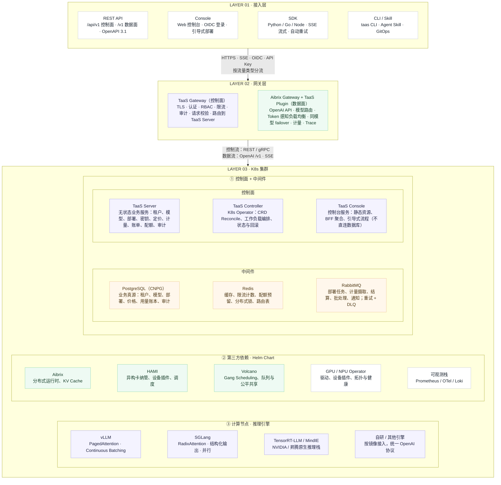
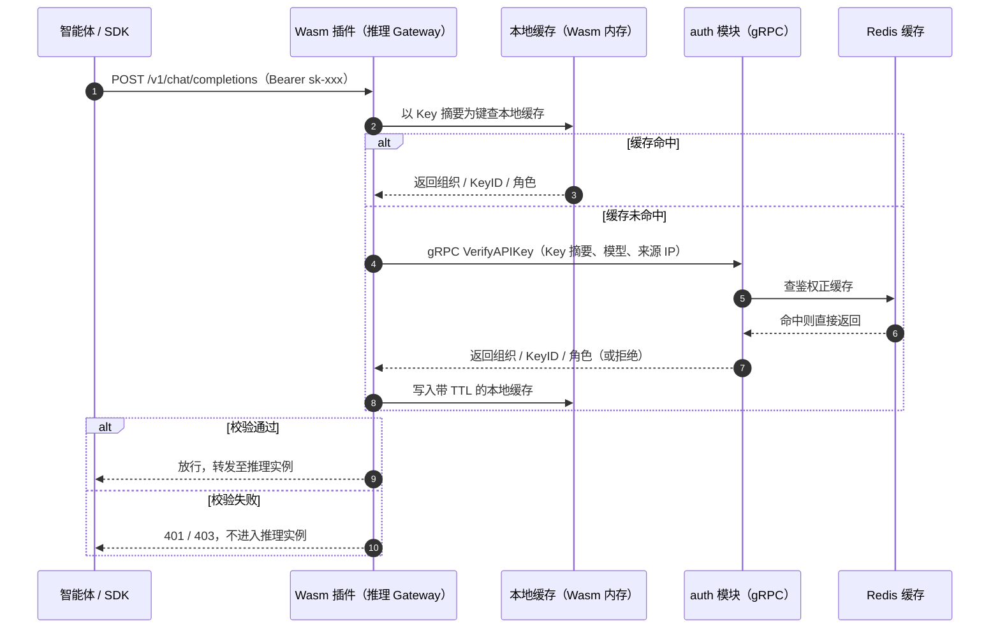
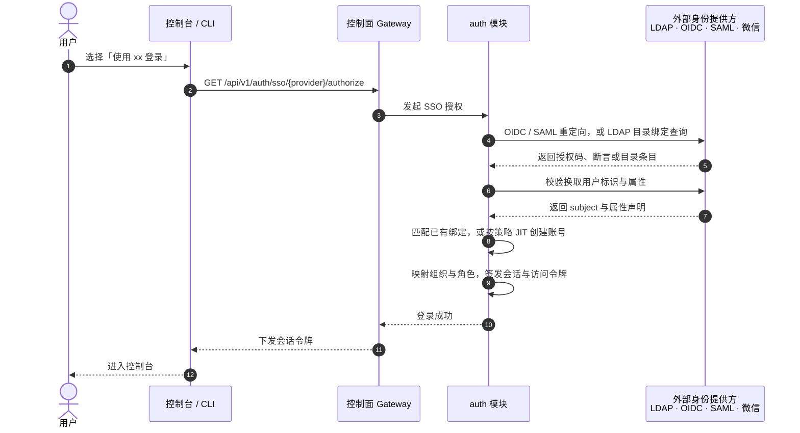
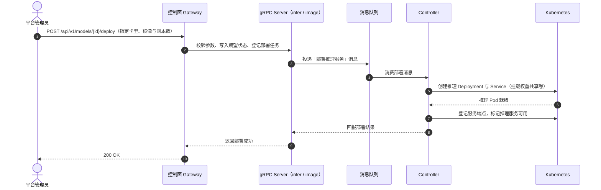
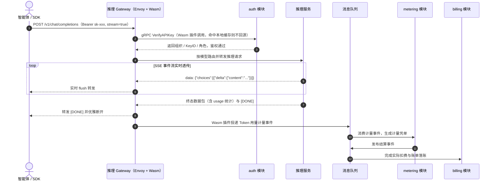

# Go TaaS 架构设计文档

| 属性 | 内容 |
| --- | --- |
| 项目名称 | Go TaaS（Token as a Service） |
| 整体定位 | 基于 Kubernetes 的一站式开源大模型推理服务与计费平台，面向智能体 / SDK 提供 OpenAI 兼容的推理接入与计量结算 |
| 文档范围 | 定义系统拓扑、24 个微服务模块的职责边界、控制面/数据面划分、集群网络与协作流程；数据模型、存储参数、运行时配置等实现细节由各模块的详细设计文档另行承载 |
| 核心架构原则 | 控制面与数据面网关分离；24 个微服务 gRPC server 合并部署并通过消息队列与 Controller 解耦；推理服务与控制面部署于同一 Kubernetes 集群；准入控制在网关与控制面创建路径上完成，而非独立配额服务 |

---

## 1. 架构总览与拓扑设计

### 1.1 控制面与数据面分离

- **控制面（Control Plane）**：承载平台自身的 API——SSO 联邦登录、用户与组织、API Key、模型与镜像管理、推理服务编排、定价与账单。入口是**控制面 Gateway**（HTTP），由 `grpc-gateway` 从 Protobuf 契约自动生成，背后是统一的 gRPC Server。
- **数据面（Data Plane）**：承载推理服务的 API——OpenAI 兼容的 `/v1/chat/completions`、`/v1/embeddings` 等端点。入口是**推理 Gateway**，基于 **Envoy** 实现，面向**智能体 / SDK** 等程序化调用方，鉴权、计量与路由均由 **Wasm 插件**在网关侧完成。
- **独立部署**：两个网关各自作为独立工作负载部署。控制面 API 与推理 API 在扩缩容、升级节奏与故障域上完全隔离——推理 Gateway 过载或升级不会影响平台管理能力，反之亦然。

### 1.2 服务形态与通信机制

- **统一 gRPC 服务进程**：**全部 24 个微服务**（`auth`、`tenancy`、`account`、`model`、`image`、`infer`、`runtime`、`routing`、`provider`、`metering`、`billing`、`batch`、`audit`、`webhook`、`notification`、`observability`、`tracing`、`resourcemetrics`、`accelerator`、`cluster`、`optimization`、`prompt`、`evaluation`、`docs`）的 gRPC server 合并部署于同一个 Deployment，模块间在进程内直接调用，无需为每个模块单独部署进程；
- **消息队列解耦 gRPC server 与 Controller**：消息队列（Kafka / RabbitMQ）承担**微服务 gRPC server 与 Controller 之间的消息传递**。gRPC server 只负责对外接口与期望状态写入并投递消息，Controller 消费消息后驱动 Kubernetes 资源，二者可独立扩缩容与重启；
- **RESTful API 自动生成**：控制面 HTTP/JSON 接口与 OpenAPI 文档由 `grpc-gateway` 从 Protobuf 契约自动生成；
- **数据面不经过业务进程**：推理请求由 Envoy 直接代理至推理实例，鉴权与计量在 Wasm 插件内完成，避免业务进程成为转发瓶颈，也避免流式响应的二次拷贝。

### 1.3 部署与资源形态

- **单一集群**：推理服务与控制面部署在**同一个 Kubernetes 集群**内，共享一套控制面、消息队列与可观测性设施；
- **集群网络**：集群内运行 CNI Pod 网络，并通过 ClusterIP Service 与 CoreDNS 提供东西向服务发现；南北向流量经 Envoy Gateway + TLS 终结进入；NetworkPolicy 对控制面、数据面与租户命名空间做隔离；推理数据链路可选走 RDMA 网络（RoCE / InfiniBand），控制面保持常规以太网（详见 §5.2）；
- **配额与准入控制**：平台不引入独立的配额微服务，准入控制落在流量所在的位置——按 API Key 的请求限流与按组织的服务配额（最大并发推理请求数、推理服务数、每日批量作业数、单请求最大输出 token 数）在推理 Gateway 与控制面创建路径上强制，组织支出上限由计费链路强制。在上述约束内，管理员按**集群可用资源**创建推理服务，集群容量由 Kubernetes 调度器与节点资源自然约束；
- **负载隔离**：推理工作负载与控制面工作负载通过 Namespace、节点标签与污点/容忍度隔离，可在同一集群内稳定共存。

---

## 2. 组件职责定义

各组件间的依赖关系与职责边界如下：

```mermaid
flowchart TD
    subgraph edge["入口"]
        direction LR
        CGW["控制面 Gateway（HTTP）<br/>grpc-gateway · /api/v1/* · /api/v1/admin/*"]
        DGW["推理 Gateway<br/>Envoy + Wasm（鉴权 · 计量 · 路由）"]
    end

    subgraph mods["微服务 —— 单个 Deployment（24 个模块）"]
        direction TB
        subgraph m_acc["接入与租户"]
            direction LR
            AUTH["auth"]
            TENANCY["tenancy"]
            ACCOUNT["account"]
        end
        subgraph m_mid["模型与推理"]
            direction LR
            MODEL["model"]
            IMAGE["image"]
            INFER["infer"]
            RUNTIME["runtime"]
            ROUTING["routing"]
            PROVIDER["provider"]
            ACCELERATOR["accelerator"]
            CLUSTER["cluster"]
            BATCH["batch"]
        end
        subgraph m_bill["计量、计费与成本"]
            direction LR
            METERING["metering"]
            BILLING["billing"]
            OPTIMIZATION["optimization"]
        end
        subgraph m_obs["可观测与自动化"]
            direction LR
            OBSERVABILITY["observability"]
            TRACING["tracing"]
            RESOURCEMETRICS["resourcemetrics"]
            AUDIT["audit"]
            WEBHOOK["webhook"]
            NOTIFICATION["notification"]
        end
        subgraph m_prompt["提示词与文档"]
            direction LR
            PROMPT["prompt"]
            EVALUATION["evaluation"]
            DOCS["docs"]
        end
    end

    CGW --> mods
    DGW --> RT["推理服务"]
    DGW -.->|gRPC 校验 API Key| AUTH
    DGW -.->|计量事件| MQ["消息队列（Kafka / RabbitMQ）"]

    AUTH --> PG[(PostgreSQL)]
    AUTH --> RD[(Redis)]
    AUTH --> IDP["外部身份提供方<br/>LDAP · OIDC · SAML · 微信"]
    TENANCY --> PG
    ACCOUNT --> PG
    MODEL --> PG
    MODEL --> JFS[(JuiceFS)]
    IMAGE --> PG
    IMAGE --> REG[("镜像仓库 / MinIO")]
    IMAGE --> MQ
    INFER --> PG
    INFER --> MQ
    RUNTIME --> MQ
    ROUTING --> PG
    PROVIDER --> PG
    PROVIDER --> EXT["外部大模型提供方<br/>DeepSeek · OpenAI 兼容"]
    BATCH --> PG
    BATCH --> FSTORE[("批量文件存储<br/>输入 / 结果 / 错误 JSONL")]
    METERING --> PG
    METERING --> RD
    METERING --> MQ
    BILLING --> PG
    BILLING --> MQ
    OPTIMIZATION --> PG
    OBSERVABILITY --> PG
    TRACING --> PG
    RESOURCEMETRICS --> PG
    AUDIT --> PG
    WEBHOOK --> HOOK["客户 HTTPS 端点"]
    NOTIFICATION --> PG
    PROMPT --> PG
    EVALUATION --> PG
    EVALUATION --> MQ
    DOCS --> PG

    MQ --> CTRL["Controller<br/>K8s 资源调谐"]
    MQ --> ACCELERATOR
    MQ --> CLUSTER
    CTRL --> K8S["Kubernetes API<br/>推理负载 · 镜像预热 · 资源采样"]
    CTRL --> RESOURCEMETRICS
    RT -.-> JFS
    classDef edge fill:#007F86,stroke:#00565C,stroke-width:2px,color:#FFFFFF
    classDef svc fill:#CFE9EA,stroke:#4E9CA0,stroke-width:1.5px,color:#0B383D
    classDef core fill:#0B4F55,stroke:#083B40,stroke-width:2px,color:#FFFFFF
    classDef store fill:#E7ECEE,stroke:#9AACB1,stroke-width:1.5px,color:#23343A
    classDef ext fill:#FBE7CF,stroke:#D08A3C,stroke-width:2px,color:#6B3B08
    classDef gpu fill:#FADDD1,stroke:#D2704E,stroke-width:2px,color:#71260E
    class CGW,DGW edge
    class MQ,CTRL core
    class AUTH,TENANCY,ACCOUNT,MODEL,IMAGE,INFER,RUNTIME,ROUTING,PROVIDER,ACCELERATOR,CLUSTER,BATCH,METERING,BILLING,OPTIMIZATION,OBSERVABILITY,TRACING,RESOURCEMETRICS,AUDIT,WEBHOOK,NOTIFICATION,PROMPT,EVALUATION,DOCS svc
    class PG,RD,JFS,REG,FSTORE store
    class IDP,EXT,HOOK ext
    class K8S,RT gpu
    style edge fill:#EFF7F7,stroke:#9CC7C9,stroke-width:1.5px,color:#2A6A6F
    style mods fill:#F5F9F9,stroke:#B4C7CA,stroke-width:1.5px,color:#2F5B60
    style m_acc fill:#EAF4F5,stroke:#A9CDCF,stroke-width:1px,color:#2A6A6F
    style m_mid fill:#EAF4F5,stroke:#A9CDCF,stroke-width:1px,color:#2A6A6F
    style m_bill fill:#EAF4F5,stroke:#A9CDCF,stroke-width:1px,color:#2A6A6F
    style m_obs fill:#EAF4F5,stroke:#A9CDCF,stroke-width:1px,color:#2A6A6F
    style m_prompt fill:#EAF4F5,stroke:#A9CDCF,stroke-width:1px,color:#2A6A6F
```

### 微服务清单

单个 Deployment 承载 24 个微服务模块，逐项列明职责边界与对应特性点（backlog 编号）：

| # | 模块 | 核心职责 | 特性点 |
| --- | --- | --- | --- |
| 1 | `auth` | 本地与 SSO 联邦认证（LDAP / OIDC / SAML / 微信）、账号绑定与 JIT 预置、会话与令牌、API Key 全生命周期与校验、按 Key 限流、按 Key 模型范围限定、基于角色的控制台路由 | #1、#7、#11、#22、#46 |
| 2 | `tenancy` | 组织 / 项目两级隔离、成员/角色/邀请（RBAC）、控制台面分离、按组织的服务配额 | #6、#10、#17、#51 |
| 3 | `account` | 账户信息与符合 GDPR 的账户数据导出包 | #41 |
| 4 | `model` | 模型目录、版本管理与回滚、权重路径与模型仓库下载、租户级模型授权 | #2、#13、#32 |
| 5 | `image` | 推理引擎镜像的登记/版本/导入、节点级预热任务、模型 × 引擎 × 卡型兼容性矩阵 | #3、#19 |
| 6 | `infer` | 推理服务生命周期（部署、扩缩容、升级、回滚）、弹性伸缩、路由策略、playground（含多模型对比）、SDK 快速开始、服务日志、压测 | #2、#12、#16、#20、#21、#33、#35、#45 |
| 7 | `runtime` | 平台服务形态（普通 Deployment 与 AIBrix）、运行时组件健康与被纳管模型投影 | #47 |
| 8 | `routing` | 路由组（虚拟模型）与真实目录模型候选：权重、成本/时延策略、意图规则、决策轨迹 | #49 |
| 9 | `provider` | 外部提供方注册表、加密只写密钥、上游模型治理与发布入目录、连通性探测 | #48 |
| 10 | `metering` | Token 计量与防篡改凭单、用量记录、请求日志、用量看板、按 Key 用量分析、错误分析 | #4、#9、#12、#28、#31 |
| 11 | `billing` | 「模型 × 卡型」价格矩阵、余额/额度账户、扣费与结算、支付/发票/自动充值、组织支出上限、成本分析、用量成本预测、账单报表 | #5、#8、#11、#14、#25、#29、#36 |
| 12 | `batch` | 批量推理作业：JSONL 提交与校验、异步 worker、进度跟踪、结果/错误下载 | #42 |
| 13 | `audit` | 控制面与鉴权事件的审计日志与活动导出、部署历史审计 | #15、#34 |
| 14 | `webhook` | 出站 Webhook 端点、事件订阅、HMAC 签名、重试策略与投递日志 | #23 |
| 15 | `notification` | 控制台内通知中心、按用户偏好、阈值告警与已读/未读状态 | #26 |
| 16 | `observability` | 模型性能聚合（时延 / 吞吐 / 错误率 / token 吞吐）与平台组件健康、状态页 | #24、#30 |
| 17 | `tracing` | 单条请求链路与分阶段时延（TTFT / 生成 / 总时延）、按 request-id 检索 | #27 |
| 18 | `resourcemetrics` | Controller 采样的按服务 CPU / 内存 / GPU 利用率时序 | #37 |
| 19 | `accelerator` | 加速器清单与健康：每节点厂商、卡型、驱动与 Device Plugin 状态、已分配/空闲数量、就绪度 | #18 |
| 20 | `cluster` | 多集群注册、集群健康与工作负载分布、按集群的部署路由 | #40 |
| 21 | `optimization` | 成本优化建议：规则化、可量化、可忽略的节省建议（仅建议，不自动执行） | #50 |
| 22 | `prompt` | 提示词库：创建、版本化、归类、搜索、每提示词用量统计、跳转 playground | #43 |
| 23 | `evaluation` | 提示词评测套件：基于变量的用例、可评分运行、运行对比 | #44 |
| 24 | `docs` | 面向租户面的 API 目录，供控制台内 API 文档浏览器使用 | #38 |

### 2.1 `auth` —— 认证、SSO 联邦与多租户管理

**核心职责：**

- **本地账号认证**：用户注册、登录与密码策略，凭据仅以加盐哈希落库；
- **第三方 SSO 联邦认证**：内置**插件化身份提供方（IdP）框架**，可直接对接企业既有账号体系，无需为每种协议重复实现登录链路：
  - **OIDC / OAuth 2.0**：GitHub、Google、GitLab 以及企业自建 IdP；
  - **SAML 2.0**：企业级单点登录；
  - **LDAP / LDAPS**：对接企业目录服务（Active Directory、OpenLDAP 等），支持基于用户 DN 绑定与按组过滤；
  - **微信**：微信开放平台与企业微信扫码登录；
- **多 IdP 并存与可插拔配置**：管理员可同时启用多个 IdP，并分别配置协议参数、可见范围、默认组织与是否允许自动注册；新增提供方以独立插件接入，不侵入核心登录逻辑；
- **账号绑定与 JIT 预置**：以 `issuer + subject`（OIDC / SAML）或 `DN`（LDAP）等稳定标识作为外部身份主键，与平台账号绑定；首次登录可自动创建账号（Just-In-Time Provisioning），亦可关闭自动创建，改由管理员预先分配；
- **属性与角色映射**：把 IdP 返回的用户名、邮箱、组与角色声明映射为平台的组织、项目与角色，实现基于企业组织架构的权限下发；
- **会话与令牌**：SSO 登录成功后签发平台会话与访问令牌，支持令牌轮换与统一登出（Single Logout）；本地密码登录可独立开关，与 SSO 并存或完全禁用；
- 组织 / 项目两级多租户体系的管理与隔离；
- API Key 全生命周期管理（创建、鉴权、吊销、过期控制），明文仅在创建时展示一次，系统只保存加盐哈希摘要；
- **为控制面 Gateway 与数据面推理 Gateway 提供 API Key 校验能力**：对外暴露鉴权 gRPC 接口，供推理 Gateway 的 Wasm 插件逐请求调用，并以 Redis 正缓存支撑高并发低时延校验；

**外部依赖：** PostgreSQL（账户、租户与身份绑定数据）、Redis（鉴权缓存与会话）、外部身份提供方（LDAP / OIDC / SAML / 微信）

### 2.2 `model` —— 模型资产管理

**核心职责：**

- 开源大模型（Qwen、DeepSeek、LLaMA 等）的元数据注册与版本管理；
- 模型权重在对象存储中的路径维护，供推理服务通过共享文件系统直接挂载；
- 租户级模型授权管理，决定各租户可消费的模型范围。

**外部依赖：** PostgreSQL（模型元数据）、MinIO 与 JuiceFS（权重存储）

### 2.3 `image` —— 推理镜像管理

**核心职责：**

- 统一管理推理引擎容器镜像：各主流引擎族（vLLM / SGLang / TensorRT-LLM）在多种异构加速卡上的镜像登记、版本与适配关系；
- 维护镜像与卡型、引擎、模型格式的适配矩阵，为推理服务编排提供可选的镜像清单；
- 驱动镜像预热与缓存：向消息队列投递预热任务，由 Controller 在各算力节点提前拉取镜像，缩短推理副本冷启动时间；
- 校验镜像来源与完整性，避免不可信镜像进入推理链路。

**外部依赖：** 镜像仓库 / MinIO（镜像与元数据存储）、消息队列（预热任务投递）

### 2.4 `infer` —— 推理服务管理

**核心职责：**

- 异构算力纳管：通过厂商无关的节点标签与扩展资源模型，统一纳管**多种异构加速卡**，新增卡型只需为节点打标，无需改动控制面；
- 推理服务的生命周期管理：部署、扩缩容、升级与下线的期望状态维护与变更投递；
- 推理引擎适配：对外统一呈现 OpenAI 兼容能力，屏蔽各引擎差异；
- 推理实例的健康状态与可用端点登记，供数据面 Gateway 路由使用；
- 配额感知的准入：创建推理服务时按管理员指定的副本数与卡型使用资源，同时受组织服务配额（特性 #51）与集群可用资源约束。

**外部依赖：** 消息队列（变更投递）、MinIO 与 JuiceFS（权重与镜像共享挂载）

### 2.5 `metering` —— Token 计量

**核心职责：**

- 消费数据面 Gateway 的 Wasm 插件投递的计量事件，提取 Token 用量（Prompt / Completion / Cached / Reasoning）；
- 生成防篡改的计量凭单；
- 通过消息队列异步投递给计费链路，解耦推理链路与账务链路。

**外部依赖：** Redis（计量缓冲）、消息队列（Kafka / RabbitMQ）

### 2.6 `billing` —— 计费与账务

**核心职责：**

- 维护「模型 × 卡型」价格矩阵，支持阶梯价与套餐；
- 请求准入时的资金预占与请求完成后的实际结算；
- 余额（预付费）与额度（后付费）两种账户模式的扣费管理；
- 账单生成、用量统计与对账。

**外部依赖：** PostgreSQL（账务数据）、消息队列（计量事件消费）

### 2.7 Controller —— 资源调谐

**核心职责：**

- 消费消息队列中的变更消息，将其转化为 Kubernetes 资源的实际动作：创建/更新/删除推理工作负载、Service 与 Endpoint；
- 执行镜像预热：把 `image` 模块投递的预热任务落到具体节点；
- 持续调谐：观测实际状态与期望状态的差异并收敛，保证推理服务可用；
- 与 gRPC server 通过消息队列解耦，可独立扩缩容、重启与升级。

**外部依赖：** 消息队列（消息消费）、Kubernetes API、MinIO 与 JuiceFS（权重与镜像挂载）

---

## 3. 网关设计

### 3.1 控制面 Gateway

- **定位**：平台管理 API 的入口，只服务管理员与控制台；
- **实现**：`grpc-gateway` 从 Protobuf 契约自动生成 HTTP/JSON 代理与 OpenAPI 文档，业务逻辑完全在统一 gRPC Server 内；
- **承载能力**：SSO 联邦登录入口（授权发起与回调）、模型与镜像管理、推理服务编排、API Key 与组织管理、定价与账单查询等；
- **不承载推理流量**：与推理数据面完全分离，便于独立发布与故障隔离；
- **管理员/用户面分离**：普通用户控制台位于 `/`（API `/api/v1/*`），管理控制台位于 `/admin`（API `/api/v1/admin/*`），两者为独立面、独立会话与独立登录流程（特性 #17、#22）；携带错误面会话的请求会在进入任何 handler 之前被拒绝。用户账户类 API（登录、注册）位于 `/api/v1/auth/*`，管理控制台 Web 页面位于 `/admin` 路径前缀（`/admin/models`、`/admin/inference-services`、`/admin/api-keys` 等）。

### 3.2 数据面（推理）Gateway：Envoy + Wasm

推理 Gateway 基于 **Envoy** 构建，通过 **Wasm 插件**在网关侧实现以下能力，使推理流量不经过业务进程：

| 能力 | 说明 |
| --- | --- |
| **鉴权** | 解析 `Authorization` 头中的 API Key，**通过 gRPC 调用 `auth` 模块的鉴权接口**完成校验；非法或已吊销的 Key 在网关侧直接拒绝，不进入推理实例 |
| **计量** | 从流式（SSE）与非流式响应中解析 Token 用量，生成计量事件投递至消息队列，供 `metering` 与 `billing` 消费 |
| **路由** | 按模型选择健康推理实例、负载均衡与失败重试，屏蔽后端实例变化 |
| **流式透传** | 保持 SSE 逐事件 Flush 透传，避免缓冲导致的额外时延 |
| **可观测性** | 统一产出访问日志与指标，用于容量观测与问题定位 |

> 说明：由于鉴权与计量下沉到网关 Wasm 插件，平台不再需要独立的配额/限流服务。准入控制落在流量所在的位置：按 API Key 的请求限流与按组织的服务配额（最大并发请求数、推理服务数、每日批量作业数、单请求最大输出 token 数）在推理 Gateway 与控制面创建路径上强制，组织支出上限由计费链路强制；校验顺序为 限流 → 配额 → 资金。

### 3.3 推理 Gateway 的 API Key 鉴权调用链

推理数据面的每一次请求都需要校验 API Key，而鉴权的权威判断属于 `auth` 模块。因此 Wasm 插件不自己做业务判断，而是**通过 gRPC 调用 `auth` 模块**完成校验：

- **调用方**：Envoy 的 Wasm 插件，在请求头阶段发起鉴权；实现上优先使用 Envoy 的 `ext_authz` gRPC 过滤器，或由 Wasm 插件直接发起 gRPC 调用；
- **调用目标**：`auth` 模块暴露的鉴权 gRPC 接口，入参为 API Key 摘要与请求上下文（模型、来源 IP），出参为组织、Key ID、角色与计量所需上下文；Wasm 插件**不直连数据库**；
- **缓存分层**：Wasm 插件内维护带 TTL 的本地缓存（建议 30s），以 Key 摘要为键；未命中时再回源 `auth`，`auth` 侧再以 Redis 作为正缓存，两级缓存把逐请求鉴权开销保持在亚毫秒级；
- **超时与失败策略**：鉴权调用设置毫秒级超时与重试，超时或 `auth` 不可用时按 **fail-closed** 策略拒绝请求，避免未授权流量进入推理实例；
- **吊销生效**：本地缓存 TTL 决定吊销的最长生效延迟，可在控制面提供缓存失效广播以满足更严格的即时吊销要求；
- **职责边界**：Wasm 插件只负责“调用、缓存与判定”，API Key 的哈希比对、组织归属、吊销与过期等权威判断始终由 `auth` 模块完成。

---

## 4. 模块协作流程

### 4.1 SSO 联邦登录与账号映射

- **可插拔**：新增一种 SSO 提供方只需实现统一的 IdP 插件接口（授权、回调、标识与属性提取），不改动 `auth` 核心登录逻辑；
- **安全**：回调严格校验 `state` / `nonce` / 签名，避免请求伪造；外部身份仅作为绑定标识，平台始终以内部用户 ID 作为授权主体。

### 4.2 模型一键部署流程

### 4.3 推理请求与计费闭环

---

## 5. 存储与网络

### 5.1 存储分层

| 存储 | 服务对象 | 承担职责 |
| --- | --- | --- |
| **Longhorn** | Kubernetes 集群自身 | 为控制面与集群内有状态组件提供持久卷（PVC）；通过 CSI 提供块存储与副本冗余 |
| **MinIO** | 推理服务 | S3 兼容对象存储，存放推理引擎镜像与模型权重原始件，并作为 JuiceFS 的后端 |
| **JuiceFS** | 推理服务 | 将对象存储挂载为 POSIX 文件系统，多副本共享同一份权重与镜像，实现秒级挂载与节点级缓存 |

- **职责分离**：Longhorn 只面向集群内部件（PostgreSQL、Redis 等），不参与推理数据链路；推理权重与镜像统一走 MinIO + JuiceFS；
- **共享加速**：推理多副本共享 JuiceFS 卷，配合节点本地缓存，避免每个副本重复拉取数十 GB 权重。

### 5.2 Kubernetes 集群内网络设计

集群拥有独立的网络平面，在拓扑图中以「**集群网络**」区域呈现，包含四类关注点：

| 平面 | 用途 | 设计 |
| --- | --- | --- |
| **Pod 网络（东西向）** | Pod 之间与 Pod 到 Service 的流量 | 由标准 CNI 插件提供扁平 Pod 网络与 IPAM；24 个微服务、Controller、两个 Gateway 与推理实例都运行在该网络之上 |
| **服务发现** | 为 24 个微服务模块与 Controller 提供稳定寻址 | 按暴露单元（gRPC Server、两个 Gateway、消息队列、Redis、PostgreSQL）各建一个 ClusterIP Service，经 CoreDNS 解析；模块间为进程内调用，服务发现只用于工作负载之间 |
| **南北向入口** | 集群外访问控制台与 API | 由 Envoy Gateway 终结 TLS，并把 `/`（普通用户控制台）、`/admin`（管理控制台）、`/v1/*`（推理 API）、`/api/v1/*` 路由到控制面 Gateway 或推理 Gateway |
| **隔离与策略** | 控制面、数据面与租户之间的爆炸半径收敛 | 命名空间隔离 + NetworkPolicy 只放行拓扑图中的流量（控制台 → Gateway、Gateway → gRPC Server/数据面、gRPC Server ↔ 消息队列、Controller → Kubernetes API、推理服务 → 权重存储）；`provider` 到外部大模型端点、`webhook` 到客户端的出向流量显式放行 |
| **传输分层** | 将高带宽推理流量与管理流量分离 | 控制面使用常规以太网；推理数据链路（请求/响应、KV Cache 传输、多卡通信）可选走 RDMA 网络（RoCE / InfiniBand） |

- **物理/逻辑分离**：推理的大流量与低时延诉求走 RDMA，控制面走常规网络，避免相互干扰；
- **按需启用**：RDMA 是推理网络的增强能力，未部署 RDMA 时推理流量可回落至常规网络；
- **故障收敛**：控制面 Gateway 与推理 Gateway 是相互独立的 Envoy Gateway 后端，拥有各自的 Service 与 Deployment，推理链路的网络或升级故障不会阻塞平台管理流量，反之亦然；
- **出向访问**：只有 `provider`（外部大模型提供方，只做 connect 式五态探测）、`webhook`（客户 HTTPS 端点）与 `model`（模型仓库下载）需要访问集群外网络，其余组件全部停留在集群网络内部。

---

## 6. 外部系统依赖边界

| 外部系统 | 使用组件 | 承担职责 |
| --- | --- | --- |
| PostgreSQL | auth · tenancy · account · model · image · infer · routing · provider · metering · billing · batch · audit · webhook · notification · observability · tracing · resourcemetrics · cluster · optimization · prompt · evaluation · docs | 业务数据持久化与事务账本 |
| Redis | auth · metering | 鉴权缓存（API Key 正缓存、会话）与计量缓冲 |
| Longhorn | 控制面有状态组件 | 集群自身持久化存储（PVC） |
| MinIO | model · image | 对象存储：模型权重与推理引擎镜像 |
| JuiceFS | model · infer · Controller | 权重与镜像的多副本共享挂载 |
| Kubernetes | Controller | 推理负载、镜像预热、加速器快照与资源指标采样的创建与调谐 |
| Kafka / RabbitMQ | 微服务 gRPC server · Controller | gRPC server 与 Controller 之间的消息传递（部署、镜像预热、运行时形态、加速器/集群快照、计量事件） |
| Envoy | 推理 Gateway（数据面） | 推理请求的鉴权、计量与代理转发 |
| Envoy Gateway / CNI / CoreDNS | 集群内全部工作负载 | 南北向入口与 TLS 终结、Pod 网络与服务发现（见 §5.2） |
| 镜像仓库（Harbor） | image | 推理引擎镜像导入的源与目标仓库 |
| 外部大模型提供方（DeepSeek / OpenAI 兼容） | provider · infer | 已发布外部模型的上游推理端点；连通性以五态结果探测 |
| 外部身份提供方（LDAP / OIDC / SAML / 微信） | auth | 第三方 SSO 联邦登录与用户属性来源 |
| 客户 Webhook 端点（HTTPS） | webhook | 带 HMAC 签名与重试策略的出站事件投递 |
| 模型仓库（ModelScope / HuggingFace） | model | 模型权重下载到共享 JuiceFS 卷 |

> 鉴权调用链：推理 Gateway 的 Wasm 插件在放行前通过 **gRPC 调用 `auth` 模块**校验 API Key；未命中 Wasm 本地缓存时回源 `auth`，`auth` 再以 Redis 正缓存先承接，两级缓存保证高并发下的低时延，并在超时或不可用时按 fail-closed 拒绝。
