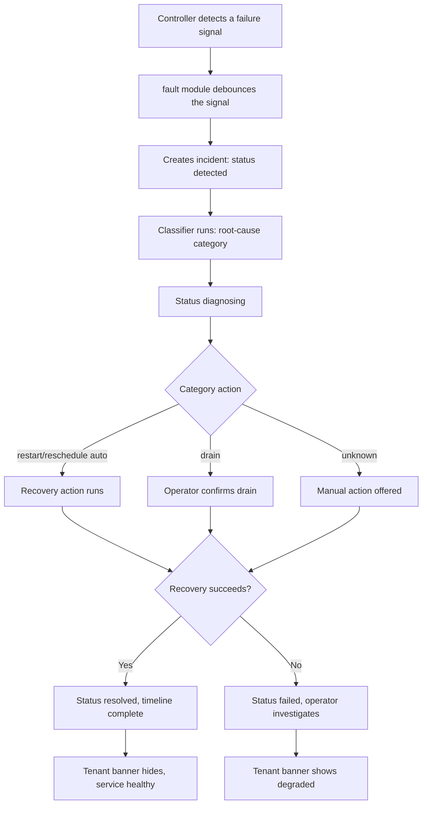
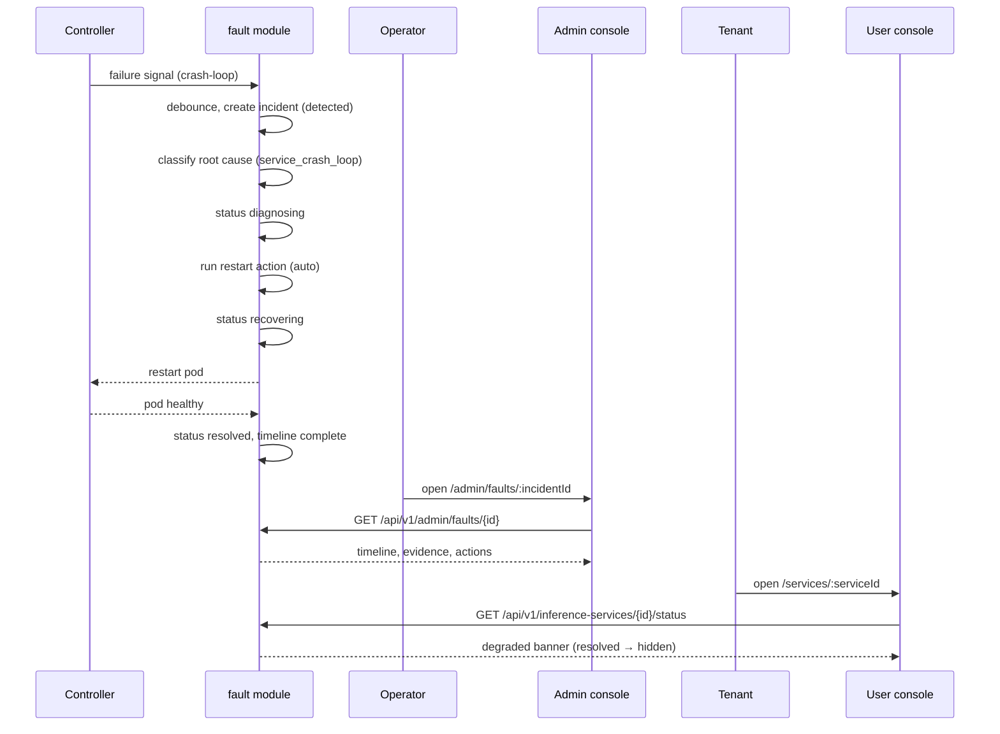

# Fault Diagnosis & Automatic Fault Tolerance — Requirement Analysis and UI/UX Design

| Attribute | Content |
| --- | --- |
| Feature point | Fault diagnosis & automatic fault tolerance — detect inference-service / node / accelerator failures, diagnose root cause, and automatically recover (restart / reschedule / drain) with operator visibility (backlog row 53) |
| Document scope | Requirement analysis, competitive research and the incident-lifecycle decision (detect → diagnose → recover → resolve, root-cause classifier, automatic recovery actions with operator override), the admin-surface pages `/admin/faults` and `/admin/faults/:incidentId` (incident list, diagnosis detail, auto-recovery policy, incident timeline), the end-user-surface service status / incident banner, the page → API surface table, and numbered acceptance criteria |
| Owning modules | `fault` (new module — incident lifecycle, root-cause classifier, recovery actions, auto-recovery policy), `infer` (service status extension, incident banner data), `Controller` (detection signals, recovery execution), `k8s` (pod/node/accelerator state reads, restart/reschedule/drain actions), `audit` (recovery actions), `pkg/server` gateway (admin + user prefix bindings), `web` admin + end-user console |
| Related documents | [Architecture Design](./architecture.md) — §2.4 `infer`, §2.7 Controller · [System Health & Service Status](./system-health-status.md) — the component-health surface this feature's incident management extends; its non-goals explicitly deferred incident management and incident timelines here · [Error Analysis](./error-analysis.md) — the aggregate error surface this feature's per-incident diagnosis complements · [Accelerator Inventory & Health](./accelerator-inventory.md) — the accelerator failure signals this feature consumes · [Deployment History & Audit](./deployment-history-audit.md) — the change-event trail recovery actions are recorded in · [Model Catalog & One-Click Deployment](./model-catalog-deployment.md) — the service lifecycle restart/reschedule targets · [Inference Autoscaling](./inference-autoscaling.md) — why recovery reschedules rather than scales · [Console Surface Separation](./console-surface-separation.md) — the two surfaces, the masked-projection rule |
| Status | Design complete, handed to the Architect agent |

---

## 1. Background and Competitive Research

### 1.1 Why Fault Diagnosis & Auto-Recovery Comes Now

The platform's reliability story is **detection without response**. The system-health feature (#30) tells the operator *whether* a component is healthy, the accelerator inventory (#18) tells *whether* a GPU node is healthy, and error analysis (#31) aggregates *what* errors occur — but none of them **act**. When an inference service crash-loops, a node goes `NotReady`, or a GPU device plugin fails, the operator must notice the degraded state in one of these read-only surfaces, then manually restart the pod, reschedule the service, or drain the node using Kubernetes tooling. The platform has no incident lifecycle, no root-cause diagnosis, and no automatic recovery.

The system-health design explicitly deferred "incident management or incident timelines" to a later feature. This feature is that later feature: it closes the loop from **detection** (a failure signal) through **diagnosis** (a root-cause classifier) to **recovery** (an automatic action with operator override) and **resolution** (an incident timeline), all visible in the console.

### 1.2 Access Pattern: Incident Lifecycle + Root-Cause Classifier + Auto-Recovery vs the Alternatives

| Pattern | What it is | Why we adopt / reject it |
| --- | --- | --- |
| **Incident lifecycle (detect → diagnose → recover → resolve) + a deterministic root-cause classifier + automatic recovery actions with operator override** (adopted) | The `fault` module watches failure signals, classifies each into a root-cause category, runs a bounded automatic recovery action (restart / reschedule / drain), records every step in an incident timeline, and lets the operator override or manually trigger actions. | The only pattern that turns the platform's existing read-only health signals into **action** while keeping the operator in control. A deterministic classifier (no hidden ML judge) is auditable and testable; operator override prevents runaway automation. |
| Pure alerting (notify, human acts) | Detect a failure and page the operator; the operator manually recovers. | Rejected as the *primary* path: the platform already has notification (#26) and health (#30); the gap is **automatic recovery**. Alerting remains as a complement, not the mechanism. |
| Full autonomous self-healing (no operator) | The platform recovers everything automatically with no human in the loop. | Rejected: some actions (node drain) are disruptive and must be operator-confirmed; a noisy recovery loop can thrash. Auto-recovery is bounded and override-able (D4). |
| ML-based root-cause prediction | A model predicts failures before they happen and suggests causes. | Rejected: predictive detection is explicitly out of scope (D7); the classifier is deterministic rules over observed signals, auditable and testable. |
| Manual-only recovery (no automation) | The operator diagnoses and recovers by hand. | Rejected: that is today's state; the whole point is automatic recovery with operator visibility. |
| Extending system-health (#30) | Add incident management to the `/admin/status` page. | Rejected: system-health is a read-only aggregation; incidents are a stateful lifecycle with actions. A dedicated `fault` module and `/admin/faults` surface keeps concerns separate (D1). |

### 1.3 Comparable-Product Interaction Patterns

| Product | Fault/incident pattern | go-taas decision |
| --- | --- | --- |
| **Datadog** | Incident management with severity, status, timeline, and responders; monitors trigger incidents; runbooks | Adopt the **incident timeline** (every detection/diagnosis/recovery step timestamped) and the **severity + status** model; **reject** the responder/on-call workflow (single-operator platform) |
| **PagerDuty** | Incident lifecycle with acknowledge/resolve, escalation policies, runbooks | Adopt the **acknowledge → resolve** lifecycle and the **runbook** idea (a recovery action is a bounded runbook step); **reject** escalation policies and on-call scheduling |
| **AWS CloudWatch + Auto Recovery** | Alarms on metrics; EC2 auto-recovery restarts an instance on hardware failure; ASG replaces unhealthy instances | Adopt the **automatic recovery action** pattern (restart on failure) and the **replacement** idea (reschedule to another node); **reject** the metric-alarm authoring surface (go-taas detects from cluster state, not user-authored alarms) |
| **Kubernetes self-healing** | Kubelet restarts crashed containers; ReplicaSet replaces failed pods; node controller drains `NotReady` nodes | Adopt the **restart / reschedule / drain** action vocabulary (it maps to Kubernetes primitives) and the **crash-loop / NotReady** detection signals; **reject** exposing raw pod internals as the product surface (the incident is the surface, not pod names) |
| **RunPod / Baseten** | Service health with status badges; failed deployments show an error and a retry | Adopt the **service status badge** and the **incident banner** on the tenant surface; **reject** hiding the failure (the banner is explicit) |
| **statuspage.io** | Public incident timeline with status updates | Adopt the **incident timeline** shape; **reject** the public/third-party framing (go-taas incidents are internal, admin + tenant-scoped) |
| **Volcengine Ark / Aliyun Bailian** | Service status with error states and retry; limited auto-recovery visibility | Adopt the **tenant-visible degraded banner**; **reject** the opacity (go-taas shows the incident to the tenant whose service is affected) |

### 1.4 Distilled Decisions

| # | Decision | Rationale |
| --- | --- | --- |
| D1 | **A dedicated `fault` module and `/admin/faults` surface.** Incidents are a stateful lifecycle with actions, distinct from the read-only system-health aggregation (#30). | Keeps the incident lifecycle, classifier, and recovery actions in one auditable home; system-health stays a pure aggregation. |
| D2 | **The incident lifecycle is detect → diagnose → recover → resolve.** Every incident has a status (`detected` → `diagnosing` → `recovering` → `resolved`, or `failed` if recovery fails) and a timeline of timestamped steps. | Mirrors the industry-standard incident lifecycle (Datadog, PagerDuty) and gives the operator a clear state machine. |
| D3 | **The root-cause classifier is deterministic rules over observed signals**, not an ML model. Categories: `service_crash_loop`, `node_not_ready`, `accelerator_device_plugin`, `oom`, `image_pull_failure`, `unknown`. | Auditable and testable; no hidden judge. Each category maps to a bounded recovery action. |
| D4 | **Automatic recovery is bounded and operator-override-able.** Restart and reschedule run automatically (with a per-category policy); drain requires operator confirmation. The operator can disable auto-recovery per category, override an in-flight action, or manually trigger one. | Restart/reschedule are low-risk and safe to automate; drain is disruptive and must be confirmed. Operator override prevents runaway automation. |
| D5 | **Recovery actions are recorded in the deployment-history trail** (`deployment.updated` with a `recovery` actor) and the audit trail. | Recovery is a deployment mutation; recording it in the existing trail (#17) keeps one source of truth for service changes. |
| D6 | **The tenant surface shows a service status / incident banner** — a compact banner on the service list and detail pages when a service is degraded or under recovery, linking operators to the admin incident view. | Tenants whose service is affected must see the degraded state (RunPod/Baseten pattern); the banner is explicit, not hidden. |
| D7 | **Predictive failure detection is out of scope.** The classifier reacts to observed failures, not predicted ones. | Keeps the feature bounded and honest; prediction is future work. |
| D8 | **Self-healing of the control plane itself is out of scope.** The `fault` module recovers inference services, nodes, and accelerators — not the platform's own components. | The control plane's health is system-health's (#30) concern; this feature targets the inference data path. |

---

## 2. User Roles and User Stories

### 2.1 Roles

| Role | Surface | Description |
| --- | --- | --- |
| Platform operator | admin | Monitors incidents, reads root-cause diagnoses, reviews and overrides automatic recovery actions, configures auto-recovery policy, drains nodes. |
| Tenant admin / developer | end-user | Sees a service status / incident banner when their service is degraded or under recovery; understands the service is being recovered. |

### 2.2 User Stories

**Admin surface (`/admin/faults`, `/admin/faults/:incidentId`):**

- **US1** As a platform operator, I see a list of incidents with severity, status, root cause, affected service/node, and time, so that I can triage what needs attention.
- **US2** As a platform operator, I open an incident and see its diagnosis timeline (detect → diagnose → recover → resolve) with the root-cause evidence, so that I understand what happened and why.
- **US3** As a platform operator, I review an automatic recovery action before it runs (for drain) or after it runs (for restart/reschedule), and I can override or manually trigger an action, so that I stay in control.
- **US4** As a platform operator, I configure the auto-recovery policy per root-cause category (auto-restart on/off, auto-reschedule on/off, drain always-confirm), so that automation matches my risk tolerance.
- **US5** As a platform operator, I see which recovery actions were taken and when, so that I can audit the platform's self-healing.

**End-user surface (service list, service detail):**

- **US6** As a tenant developer, I see a banner on my service when it is degraded or under recovery, so that I know the platform is handling a failure rather than silently failing.
- **US7** As a tenant developer, I understand from the banner that my service is being recovered (restart/reschedule) and will return, so that I do not mistake recovery for a permanent outage.

---

## 3. Functional Requirements

### FR1 — Incident lifecycle (admin)

- **FR1.1** `ListIncidents` (`GET /api/v1/admin/faults`) returns incidents, newest first, each with `incident_id`, `severity` (critical / warning / info), `status` (`detected` / `diagnosing` / `recovering` / `resolved` / `failed`), `root_cause` (category), `target_type` (service / node / accelerator), `target_name`, `started_at`, `resolved_at`, and `auto_recovered` (bool). Pagination, filters (status, severity, root cause, target type), and search.
- **FR1.2** `GetIncident` (`GET /api/v1/admin/faults/{incident_id}`) returns one incident's full detail: the diagnosis timeline (each step with timestamp, actor, and detail), the root-cause evidence, the recovery actions taken (or pending), and the current status. Unknown incident → 13506.
- **FR1.3** An incident is created when the `fault` module detects a failure signal (FR3); it moves through the lifecycle (D2) and is `resolved` when the target returns to healthy, or `failed` if recovery could not restore it.
- **FR1.4** Incidents are retained for a bounded window (default 30 days) and then archived; the retention is documented on the page.

### FR2 — Root-cause diagnosis (admin)

- **FR2.1** The classifier maps a failure signal to a root-cause category: `service_crash_loop` (repeated container restarts), `node_not_ready` (node `NotReady` condition), `accelerator_device_plugin` (device-plugin unhealthy from #18), `oom` (OOMKilled), `image_pull_failure` (ImagePullBackOff), or `unknown`.
- **FR2.2** The incident detail shows the **root-cause evidence**: the signals that drove the classification (e.g. "container restarted 5 times in 3 minutes", "node condition NotReady since 14:02", "device plugin unhealthy"). The evidence is the classifier's inputs, not a hidden explanation.
- **FR2.3** An `unknown` root cause still creates an incident and offers a manual recovery action; the operator can reclassify it.

### FR3 — Detection signals (Controller)

- **FR3.1** The Controller watches inference-service pods (crash-loop, OOMKilled, ImagePullBackOff), nodes (`NotReady`), and accelerator device-plugin health (from #18), and publishes failure signals to the `fault` module.
- **FR3.2** A signal is debounced (e.g. a crash-loop is reported after N restarts in a window, not on the first restart) to avoid incident storms; the debounce window is documented.
- **FR3.3** Detection is reactive (D7): the module reacts to observed failures, never predicts them.

### FR4 — Automatic recovery (admin)

- **FR4.1** Each root-cause category has a default recovery action: `service_crash_loop` → **restart** (auto), `oom` → **restart** (auto), `image_pull_failure` → **restart** (auto, after the image is fixed), `node_not_ready` → **reschedule** (auto) then **drain** (operator-confirmed), `accelerator_device_plugin` → **reschedule** (auto) then **drain** (operator-confirmed), `unknown` → **manual**.
- **FR4.2** The auto-recovery policy is configurable per category: auto-restart on/off, auto-reschedule on/off, and drain always-confirm. The policy page (`/admin/faults/policy`) edits these; changes are audited.
- **FR4.3** The operator can **override** an in-flight recovery action (cancel it) or **manually trigger** one (restart / reschedule / drain) on an incident. Manual actions are recorded in the timeline with the operator as actor.
- **FR4.4** A drain action requires operator confirmation (a confirm dialog naming the node and the services affected); it is never automatic.
- **FR4.5** Every recovery action is recorded in the deployment-history trail (`deployment.updated`, actor `recovery`) and the audit trail (D5).

### FR5 — Tenant surface: service status / incident banner

- **FR5.1** `GetServiceStatus` (`GET /api/v1/inference-services/{service_id}/status`) returns the service's status including any active incident: `{state, degraded: bool, incident: {incident_id, severity, status, root_cause, message} | null}`.
- **FR5.2** The end-user service list and detail pages show a **degraded banner** when the service has an active incident: a compact strip with the severity color, a plain-language message ("This service is being recovered — a failure was detected and the platform is restarting it"), and the root-cause category. The banner links to nothing on the user surface (incident detail is admin-only); it is informational.
- **FR5.3** The banner hides when the service is healthy (no active incident). The tenant surface exposes **no** incident mutation — incidents and recovery are admin-only (D6).

### FR6 — Surface, realm and API binding

- **FR6.1** Incident management is admin-only (`/admin/faults` + `/api/v1/admin/faults/*`); the service status / banner is end-user (`/api/v1/infer/*` extension). A user-realm session on an admin route gets **10038 `CodeRealmMismatch`**; a session without the platform-admin role gets **10036 `CodeForbidden`**.
- **FR6.2** The admin pages render: the incident list (severity, status, root cause, target, time), the incident detail (diagnosis timeline, root-cause evidence, recovery actions, override/manual controls), the policy page (per-category auto-recovery toggles), and all states (loading, empty, error, permission-denied).
- **FR6.3** All recovery actions and policy changes are audited (FR4.5); list/read calls are not audited, consistent with the platform's read-path convention.

---

## 4. Surface Assignment

| Page | Surface | Route | API prefix |
| --- | --- | --- | --- |
| Faults (incident list) | admin | `/admin/faults` | `/api/v1/admin/faults/*` |
| Incident detail | admin | `/admin/faults/:incidentId` | `/api/v1/admin/faults/*` |
| Auto-recovery policy | admin | `/admin/faults/policy` | `/api/v1/admin/faults/*` |
| Service status / incident banner | end-user | `/services` and `/services/:serviceId` (existing) | `/api/v1/infer/*` (extension) |

---

## 5. Page and Flow Design

### 5.1 Page Map

| Page | Surface | Route | Primary components |
| --- | --- | --- | --- |
| Faults | admin | `/admin/faults` | Incident table (severity, status, root cause, target, time), filters, pagination |
| Incident detail | admin | `/admin/faults/:incidentId` | Incident header, diagnosis timeline, root-cause evidence, recovery actions, override/manual controls |
| Auto-recovery policy | admin | `/admin/faults/policy` | Per-category auto-recovery toggles, drain-confirm setting |
| Service status / banner | end-user | `/services`, `/services/:serviceId` | Degraded banner component |

### 5.2 Page: `/admin/faults` — Faults (admin)

**Incident table**: Severity (badge: critical red / warning amber / info blue), Status (detected / diagnosing / recovering / resolved / failed), Root cause (category chip), Target ("service: chat-7b" / "node: node-a" / "accelerator: node-a GPU 0"), Auto-recovered (checkmark or dash), Started (relative), Resolved (relative or dash). Row click opens the incident detail.

**Filter bar**: status filter, severity filter, root-cause filter, target-type filter, search, pagination.

**States**: loading skeletons; empty ("No incidents — the platform is healthy"); error (stale with retry); permission-denied (standard, link to `/admin`).

### 5.3 Page: `/admin/faults/:incidentId` — Incident Detail (admin)

**Incident header**: severity badge, status, root-cause category, target, started/resolved times, and the auto-recovered flag.

**Diagnosis timeline** (vertical): each step with a timestamp, actor (`system` or an operator), and detail — e.g. "14:02:03 · system · detected crash-loop (5 restarts in 3 min)", "14:02:04 · system · diagnosed service_crash_loop", "14:02:05 · system · restarting pod", "14:02:40 · system · resolved — service healthy". A `failed` incident shows the failed step in red.

**Root-cause evidence** card: the classifier's inputs (the signals that drove the category), e.g. "container restarted 5 times in 3 minutes", "node condition NotReady since 14:02", "device plugin unhealthy". For `unknown`, a note that no signal matched and a manual reclassify control.

**Recovery actions** card: the action taken or pending (restart / reschedule / drain), its status (pending / running / succeeded / failed / overridden), and controls: **Override** (cancel an in-flight action) and **Manual action** (restart / reschedule / drain buttons). A drain button opens a confirm dialog naming the node and affected services.

**States**: loading; error; permission-denied; a resolved incident shows a "Resolved" banner and no active action controls.

### 5.4 Page: `/admin/faults/policy` — Auto-Recovery Policy (admin)

**Per-category rows**: each root-cause category with its default action and toggles — Auto-restart (on/off), Auto-reschedule (on/off), and a global "Drain always requires confirmation" toggle (always on, shown for transparency). Changing a toggle shows a success toast and is audited.

**States**: loading; error; permission-denied.

### 5.5 Page: `/services` and `/services/:serviceId` — Service Status / Incident Banner (end-user)

When a service has an active incident, a **degraded banner** appears at the top of the service row (list) or the service detail: a compact strip with the severity color, a plain-language message ("This service is being recovered — a failure was detected and the platform is restarting it"), and the root-cause category chip. The banner is informational and links to nothing on the user surface. It hides when the service is healthy.

**States**: loading (banner hidden until status loads); the banner is absent when healthy; error (the status call fails — the banner is hidden and the service shows its normal state).

### 5.6 Flows

---

## 6. API Surface Implications

The fault RPCs live in a new **`fault`** module (admin surface) plus a small **`infer`** status extension (user surface). The Controller publishes detection signals; the `fault` module owns the incident lifecycle, classifier, and recovery actions.

| RPC | Route | Prefix | Status | Purpose |
| --- | --- | --- | --- | --- |
| `ListIncidents` (`taas.fault.v1`) | `GET /api/v1/admin/faults` | admin | **new** | Incident rows with severity, status, root cause, target, times; pagination, filters, search |
| `GetIncident` | `GET /api/v1/admin/faults/{incident_id}` | admin | **new** | One incident's timeline, evidence, actions; unknown → 13506 |
| `UpdateAutoRecoveryPolicy` | `PATCH /api/v1/admin/faults/policy` | admin | **new** | Per-category auto-recovery toggles; audited; 13502 on bad input |
| `GetAutoRecoveryPolicy` | `GET /api/v1/admin/faults/policy` | admin | **new** | Current policy for the policy page |
| `TriggerRecoveryAction` | `POST /api/v1/admin/faults/{incident_id}:recover` | admin | **new** | Manually trigger restart/reschedule/drain; drain requires a confirm flag; 13503 if invalid |
| `OverrideRecoveryAction` | `POST /api/v1/admin/faults/{incident_id}:override` | admin | **new** | Cancel an in-flight recovery action; 13504 if none in flight |
| `GetServiceStatus` (`taas.infer.v1`) | `GET /api/v1/inference-services/{service_id}/status` | user | **new** | Service status with any active incident (masked — own service only) |

**Contract notes for the Architect agent**:

1. The `fault` module owns the incident lifecycle, the deterministic root-cause classifier, and the recovery actions; it is a new service module with its own error block (135xx), not an extension of `infer` or `observability`.
2. The Controller publishes failure signals (crash-loop, OOMKilled, ImagePullBackOff, node `NotReady`, device-plugin unhealthy) to the `fault` module via the message queue; the module debounces and classifies them.
3. Recovery actions map to Kubernetes primitives: restart = delete pod (ReplicaSet recreates), reschedule = delete pod with a node-anti-affinity hint, drain = cordon + drain the node. The Controller executes them; the `fault` module records them.
4. The tenant-visible `GetServiceStatus` must enforce service scoping at the service layer (the caller's org from the session), never trusting a client-supplied service id; it returns only the caller's own service's incident.
5. Recovery actions are recorded in the deployment-history trail (`deployment.updated`, actor `recovery`) and the audit trail (D5).
6. Serialization conventions unchanged: HTTP 200 on success, business errors as `{"code": <int>, "message": "..."}`, int64 fields as JSON strings.

Error codes (`pkg/errors/codes.go`):

| Condition | Code | Constant | Notes |
| --- | --- | --- | --- |
| Policy input invalid | 13502 | `CodeFaultPolicyInvalid` | **New** (D4) — validation, category named |
| Recovery action invalid (e.g. drain without confirm, unknown action) | 13503 | `CodeFaultRecoveryInvalid` | **New** (D4) — action rejected |
| No in-flight action to override | 13504 | `CodeFaultNoActionInFlight` | **New** (D4) — override rejected |
| Unknown incident | 13506 | `CodeFaultNotFound` | **New** (D4) |
| User-realm session on an admin route | 10038 | `CodeRealmMismatch` | Reused — realm separation (FR6.1) |
| Session without the required role | 10036 | `CodeForbidden` | Reused — permission denial (FR6.1) |

---

## 7. Acceptance Criteria

| # | Criterion | Level |
| --- | --- | --- |
| AC1 | `/admin/faults` renders the incident table with severity, status, root cause, target, auto-recovered, started and resolved columns, plus status/severity/root-cause/target filters, search and pagination | Nightwatch E2E |
| AC2 | **Incident lifecycle (synthetic)**: a crash-loop signal creates an incident that moves detected → diagnosing → recovering → resolved, with each step timestamped in the diagnosis timeline; a recovery that fails leaves the incident `failed` | FVT (fault contract) + Nightwatch E2E |
| AC3 | **Root-cause classification**: a crash-loop signal is classified `service_crash_loop`, a `NotReady` node `node_not_ready`, an unhealthy device plugin `accelerator_device_plugin`, an OOMKilled `oom`, an ImagePullBackOff `image_pull_failure`; the incident detail shows the classifier's evidence | FVT + Nightwatch E2E |
| AC4 | **Automatic recovery**: with auto-restart on, a crash-loop incident triggers a restart automatically and records it in the timeline and the deployment-history trail (`deployment.updated`, actor `recovery`); with auto-restart off, no action runs and the operator is offered a manual one | FVT + Nightwatch E2E |
| AC5 | **Drain requires confirmation**: a drain action never runs automatically; the confirm dialog names the node and affected services, and the server rejects a drain without the confirm flag (**13503**) | FVT + Nightwatch E2E |
| AC6 | **Operator override and manual trigger**: the operator can cancel an in-flight action (**13504** if none) and manually trigger restart/reschedule/drain; manual actions are recorded with the operator as actor | FVT + Nightwatch E2E |
| AC7 | **Policy page**: `/admin/faults/policy` shows per-category auto-recovery toggles; changing one persists, is audited, and affects subsequent incidents | Nightwatch E2E + FVT |
| AC8 | **Tenant banner**: a service with an active incident shows the degraded banner on the service list and detail pages with severity color, plain-language message and root-cause chip; the banner hides when the service is healthy | Nightwatch E2E |
| AC9 | **Tenant scoping**: `GET /api/v1/inference-services/{id}/status` returns only the caller's own service's incident; no other service's incident appears; the tenant surface has no incident mutation route | FVT + Nightwatch E2E |
| AC10 | **Audit**: every recovery action and policy change appears in the audit trail; recovery actions also appear in the deployment-history trail | FVT |
| AC11 | **Negative realm separation**: a valid user-realm session token sent to `GET /api/v1/admin/faults` is rejected with **10038**; the admin pages contain no `/api/v1/*` call and the user pages no `/api/v1/admin/*` call | FVT + Nightwatch E2E |
| AC12 | A session without the required role receives **10036** and the admin page shows the standard permission-denied state with a link back to `/admin` | Nightwatch E2E |
| AC13 | **States**: the admin pages provide loading, empty ("No incidents — the platform is healthy"), error and permission-denied states; the tenant banner is absent when healthy and hidden on a status-call error | Nightwatch E2E |

---

## 8. Out of Scope (tracked elsewhere)

| Item | Where |
| --- | --- |
| Predictive failure detection | Deliberately excluded (D7) — the classifier reacts to observed failures |
| Self-healing of the control plane itself | Deliberately excluded (D8) — system-health (#30) covers platform components |
| Cross-cluster failover | Future work — recovery is within a cluster |
| On-call / escalation / responder workflows | Deliberately excluded — single-operator platform (Datadog/PagerDuty pattern rejected) |
| User-authored metric alarms | Deliberately excluded — detection is from cluster state, not user alarms (AWS pattern rejected) |
| Incident alerting / notifications | Feature #26 (notification center) consumes observability events — out of scope here |
| Public / third-party status page | Deliberately excluded — incidents are internal (admin + tenant-scoped) |
| Root-cause reclassification persistence | Future work — the operator can reclassify an `unknown` incident, but the reclassification is not persisted as a learning signal |