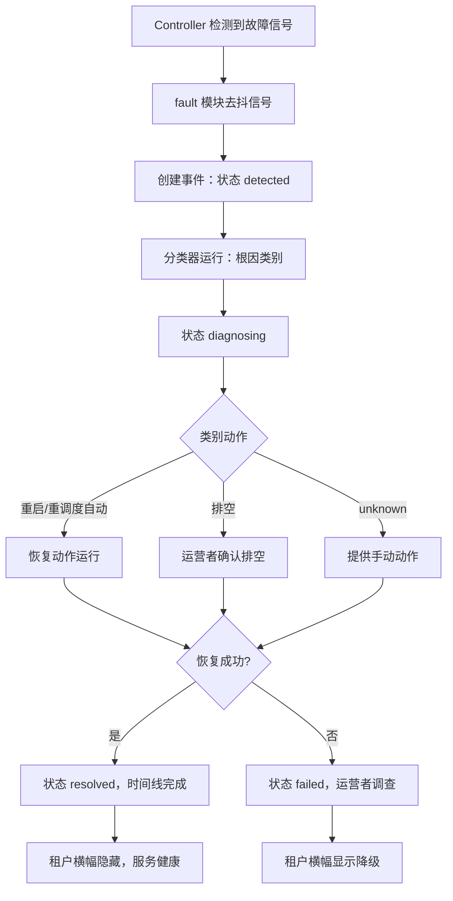
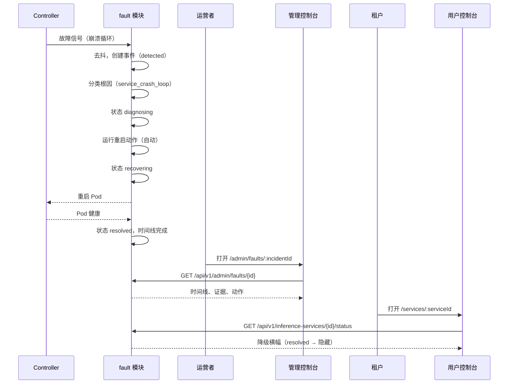

# 故障诊断与自动容错 — 需求分析与 UI/UX 设计

| 属性 | 内容 |
| --- | --- |
| 功能点 | 故障诊断与自动容错 — 检测推理服务 / 节点 / 加速器故障，诊断根因，并自动恢复（重启 / 重调度 / 排空）且运营者可见（backlog 第 53 行） |
| 文档范围 | 需求分析、竞品调研与事件生命周期决策（检测 → 诊断 → 恢复 → 解决、根因分类器、带运营者覆盖的自动恢复动作）、管理面页面 `/admin/faults` 与 `/admin/faults/:incidentId`（事件列表、诊断详情、自动恢复策略、事件时间线）、终端用户面服务状态 / 事件横幅、页面 → API 表面映射表，以及编号验收标准 |
| 负责模块 | `fault`（新模块 — 事件生命周期、根因分类器、恢复动作、自动恢复策略）、`infer`（服务状态扩展、事件横幅数据）、`Controller`（检测信号、恢复执行）、`k8s`（Pod/节点/加速器状态读取、重启/重调度/排空动作）、`audit`（恢复动作）、`pkg/server` 网关（管理 + 用户前缀绑定）、`web` 管理控制台 + 终端用户控制台 |
| 相关文档 | [架构设计](./architecture.md) — §2.4 `infer`、§2.7 Controller · [系统健康与服务状态](./system-health-status.zh-cn.md) — 本功能事件管理扩展的组件健康表面；其 non-goals 明确将事件管理与事件时间线推迟至此 · [错误分析](./error-analysis.zh-cn.md) — 本功能按事件诊断补充的聚合错误表面 · [加速器清单与健康](./accelerator-inventory.zh-cn.md) — 本功能消费的加速器故障信号 · [部署历史与审计](./deployment-history-audit.zh-cn.md) — 恢复动作记录其中的变更事件轨迹 · [模型目录与一键部署](./model-catalog-deployment.zh-cn.md) — 重启/重调度目标的服务生命周期 · [推理弹性伸缩](./inference-autoscaling.zh-cn.md) — 为什么恢复重调度而非伸缩 · [控制台表面分离](./console-surface-separation.zh-cn.md) — 两个表面、脱敏投影规则 |
| 状态 | 设计完成，已移交架构师 agent |

---

## 1. 背景与竞品调研

### 1.1 为什么现在做故障诊断与自动容错

平台的可靠性故事是**只检测不响应**。系统健康功能（#30）告诉运营者组件*是否*健康，加速器清单（#18）告诉 GPU 节点*是否*健康，错误分析（#31）聚合*发生什么*错误 — 但其中没有一个会**行动**。当推理服务崩溃循环、节点进入 `NotReady`、或 GPU 设备插件失败时，运营者必须在这些只读表面之一注意到降级状态，然后用 Kubernetes 工具手动重启 Pod、重调度服务或排空节点。平台没有事件生命周期、没有根因诊断、也没有自动恢复。

系统健康设计明确把"事件管理与事件时间线"推迟到后续功能。本功能就是那个后续功能：它把从**检测**（故障信号）经**诊断**（根因分类器）到**恢复**（带运营者覆盖的自动动作）再到**解决**（事件时间线）的闭环补全，全部在控制台可见。

### 1.2 访问模式：事件生命周期 + 根因分类器 + 自动恢复 vs 备选方案

| 模式 | 是什么 | 采用 / 拒绝理由 |
| --- | --- | --- |
| **事件生命周期（检测 → 诊断 → 恢复 → 解决）+ 确定性根因分类器 + 带运营者覆盖的自动恢复动作**（采用） | `fault` 模块监视故障信号，把每个信号分类到根因类别，运行有界的自动恢复动作（重启 / 重调度 / 排空），在事件时间线记录每一步，并让运营者覆盖或手动触发动作。 | 唯一能把平台现有只读健康信号变成**行动**、同时让运营者保持掌控的模式。确定性分类器（无隐藏 ML 裁判）可审计可测；运营者覆盖防止自动化失控。 |
| 纯告警（通知，人行动） | 检测故障并呼叫运营者；运营者手动恢复。 | 作为*主*路径拒绝：平台已有通知（#26）与健康（#30）；缺口是**自动恢复**。告警作为补充而非机制。 |
| 完全自主自愈（无运营者） | 平台自动恢复一切，无人在环。 | 拒绝：某些动作（节点排空）有破坏性，必须运营者确认；吵闹的恢复循环会抖动。自动恢复有界且可覆盖（D4）。 |
| 基于 ML 的根因预测 | 模型在故障发生前预测并建议原因。 | 拒绝：预测性检测明确范围外（D7）；分类器是对观测信号的确定性规则，可审计可测。 |
| 仅手动恢复（无自动化） | 运营者手动诊断与恢复。 | 拒绝：那是今天的现状；重点正是带运营者可见性的自动恢复。 |
| 扩展系统健康（#30） | 把事件管理加到 `/admin/status` 页面。 | 拒绝：系统健康是只读聚合；事件是带动作的有状态生命周期。专用 `fault` 模块与 `/admin/faults` 表面保持关注点分离（D1）。 |

### 1.3 竞品交互模式

| 产品 | 故障/事件模式 | go-taas 决策 |
| --- | --- | --- |
| **Datadog** | 事件管理带严重度、状态、时间线与响应者；监控触发事件；runbook | 采纳**事件时间线**（每个检测/诊断/恢复步骤带时间戳）与**严重度 + 状态**模型；**拒绝**响应者/值班工作流（单运营者平台） |
| **PagerDuty** | 事件生命周期带确认/解决、升级策略、runbook | 采纳**确认 → 解决**生命周期与**runbook**思想（恢复动作是有界的 runbook 步骤）；**拒绝**升级策略与值班排班 |
| **AWS CloudWatch + Auto Recovery** | 指标告警；EC2 自动恢复在硬件故障时重启实例；ASG 替换不健康实例 | 采纳**自动恢复动作**模式（故障时重启）与**替换**思想（重调度到另一节点）；**拒绝**指标告警创作表面（go-taas 从集群状态检测，而非用户创作的告警） |
| **Kubernetes 自愈** | Kubelet 重启崩溃容器；ReplicaSet 替换失败 Pod；节点控制器排空 `NotReady` 节点 | 采纳**重启 / 重调度 / 排空**动作词汇（映射到 Kubernetes 原语）与**崩溃循环 / NotReady** 检测信号；**拒绝**把原始 Pod 内部暴露为产品表面（事件是表面，而非 Pod 名） |
| **RunPod / Baseten** | 服务健康带状态徽章；失败部署显示错误与重试 | 采纳租户面的**服务状态徽章**与**事件横幅**；**拒绝**隐藏失败（横幅是显式的） |
| **statuspage.io** | 公开事件时间线带状态更新 | 采纳**事件时间线**形态；**拒绝**公开/第三方框架（go-taas 事件是内部的，管理面 + 租户范围） |
| **火山方舟 / 阿里云百炼** | 服务状态带错误态与重试；自动恢复可见性有限 | 采纳**租户可见降级横幅**；**拒绝**不透明（go-taas 向服务受影响的租户显示事件） |

### 1.4 提炼决策

| # | 决策 | 理由 |
| --- | --- | --- |
| D1 | **专用 `fault` 模块与 `/admin/faults` 表面。** 事件是带动作的有状态生命周期，区别于只读的系统健康聚合（#30）。 | 让事件生命周期、分类器与恢复动作在一个可审计的家；系统健康保持纯聚合。 |
| D2 | **事件生命周期是检测 → 诊断 → 恢复 → 解决。** 每个事件有状态（`detected` → `diagnosing` → `recovering` → `resolved`，或恢复失败则 `failed`）与带时间戳步骤的时间线。 | 镜像行业标准事件生命周期（Datadog、PagerDuty），给运营者清晰的状态机。 |
| D3 | **根因分类器是对观测信号的确定性规则**，不是 ML 模型。类别：`service_crash_loop`、`node_not_ready`、`accelerator_device_plugin_failure`、`oom`、`image_pull_failure`、`unknown`。 | 可审计可测；无隐藏裁判。每个类别映射到有界的恢复动作。 |
| D4 | **自动恢复有界且运营者可覆盖。** 重启与重调度自动运行（按类别策略）；排空要求运营者确认。运营者可按类别禁用自动恢复、覆盖进行中的动作、或手动触发一个。 | 重启/重调度低风险可安全自动化；排空有破坏性必须确认。运营者覆盖防止自动化失控。 |
| D5 | **恢复动作记录在部署历史轨迹**（`deployment.updated`，actor `recovery`）与审计轨迹。 | 恢复是部署变更；记录在现有轨迹（#17）保持服务变更单一事实源。 |
| D6 | **租户面显示服务状态 / 事件横幅** — 服务列表与详情页在服务降级或恢复中时显示紧凑横幅，运营者链接到管理面事件视图。 | 服务受影响的租户必须看到降级状态（RunPod/Baseten 模式）；横幅显式而非隐藏。 |
| D7 | **预测性故障检测范围外。** 分类器对观测故障反应，而非预测。 | 让功能有界诚实；预测是后续工作。 |
| D8 | **控制面自身的自愈范围外。** `fault` 模块恢复推理服务、节点与加速器 — 而非平台自身组件。 | 控制面健康是系统健康（#30）的关注点；本功能针对推理数据面。 |

---

## 2. 用户角色与用户故事

### 2.1 角色

| 角色 | 表面 | 描述 |
| --- | --- | --- |
| 平台运营者 | 管理面 | 监控事件、读取根因诊断、审查与覆盖自动恢复动作、配置自动恢复策略、排空节点。 |
| 租户管理员 / 开发者 | 终端用户面 | 服务降级或恢复中时看到服务状态 / 事件横幅；理解服务正在被恢复。 |

### 2.2 用户故事

**管理面（`/admin/faults`、`/admin/faults/:incidentId`）：**

- **US1** 作为平台运营者，我看到带严重度、状态、根因、受影响服务/节点与时间的事件列表，以便分诊需要关注的内容。
- **US2** 作为平台运营者，我打开一个事件并看到其诊断时间线（检测 → 诊断 → 恢复 → 解决）与根因证据，以便理解发生了什么、为什么。
- **US3** 作为平台运营者，我在自动恢复动作运行前（排空）或运行后（重启/重调度）审查它，并能覆盖或手动触发动作，以便保持掌控。
- **US4** 作为平台运营者，我按根因类别配置自动恢复策略（自动重启开/关、自动重调度开/关、排空始终确认），以便自动化匹配我的风险容忍度。
- **US5** 作为平台运营者，我看到采取了哪些恢复动作、何时，以便审计平台的自愈。

**终端用户面（服务列表、服务详情）：**

- **US6** 作为租户开发者，我的服务降级或恢复中时看到横幅，以便知道平台正在处理故障而非静默失败。
- **US7** 作为租户开发者，我从横幅理解我的服务正在被恢复（重启/重调度）并将恢复，以便不把恢复误认为永久宕机。

---

## 3. 功能需求

### FR1 — 事件生命周期（管理面）

- **FR1.1** `ListIncidents`（`GET /api/v1/admin/faults`）返回事件，最新在前，每个含 `incident_id`、`severity`（critical / warning / info）、`status`（`detected` / `diagnosing` / `recovering` / `resolved` / `failed`）、`root_cause`（类别）、`target_type`（service / node / accelerator）、`target_name`、`started_at`、`resolved_at`、`auto_recovered`（bool）。分页、过滤（状态、严重度、根因、目标类型）、搜索。
- **FR1.2** `GetIncident`（`GET /api/v1/admin/faults/{incident_id}`）返回一个事件的完整详情：诊断时间线（每步带时间戳、actor、详情）、根因证据、已采取（或待定）的恢复动作、当前状态。未知事件 → 13506。
- **FR1.3** 当 `fault` 模块检测到故障信号（FR3）时创建事件；它沿生命周期（D2）移动，目标恢复健康时 `resolved`，恢复无法恢复时 `failed`。
- **FR1.4** 事件保留有界窗口（默认 30 天）后归档；保留期在页面记录。

### FR2 — 根因诊断（管理面）

- **FR2.1** 分类器把故障信号映射到根因类别：`service_crash_loop`（容器反复重启）、`node_not_ready`（节点 `NotReady` 条件）、`accelerator_device_plugin_failure`（来自 #18 的设备插件不健康）、`oom`（OOMKilled）、`image_pull_failure`（ImagePullBackOff）、或 `unknown`。
- **FR2.2** 事件详情显示**根因证据**：驱动分类的信号（如"容器 3 分钟内重启 5 次"、"节点条件 NotReady 自 14:02"、"设备插件不健康"）。证据是分类器的输入，不是隐藏解释。
- **FR2.3** `unknown` 根因仍创建事件并提供手动恢复动作；运营者可重新分类。

### FR3 — 检测信号（Controller）

- **FR3.1** Controller 监视推理服务 Pod（崩溃循环、OOMKilled、ImagePullBackOff）、节点（`NotReady`）、加速器设备插件健康（来自 #18），并向 `fault` 模块发布故障信号。
- **FR3.2** 信号去抖（如崩溃循环在窗口内 N 次重启后上报，而非首次重启），避免事件风暴；去抖窗口记录在案。
- **FR3.3** 检测是反应式的（D7）：模块对观测故障反应，绝不预测。

### FR4 — 自动恢复（管理面）

- **FR4.1** 每个根因类别有默认恢复动作：`service_crash_loop` → **重启**（自动）、`oom` → **重启**（自动）、`image_pull_failure` → **重启**（自动，镜像修复后）、`node_not_ready` → **重调度**（自动）再 **排空**（运营者确认）、`accelerator_device_plugin_failure` → **重调度**（自动）再 **排空**（运营者确认）、`unknown` → **手动**。
- **FR4.2** 自动恢复策略按类别可配置：自动重启开/关、自动重调度开/关、排空始终确认。策略页面（`/admin/faults/policy`）编辑这些；变更审计。
- **FR4.3** 运营者可**覆盖**进行中的恢复动作（取消）或**手动触发**一个（重启 / 重调度 / 排空）作用于事件。手动动作以运营者为 actor 记录在时间线。
- **FR4.4** 排空动作要求运营者确认（确认对话框点名节点与受影响服务）；绝不自动。
- **FR4.5** 每个恢复动作记录在部署历史轨迹（`deployment.updated`，actor `recovery`）与审计轨迹（D5）。

### FR5 — 租户面：服务状态 / 事件横幅

- **FR5.1** `GetServiceStatus`（`GET /api/v1/inference-services/{service_id}/status`）返回服务状态含任何活动事件：`{state, degraded: bool, incident: {incident_id, severity, status, root_cause, message} | null}`。
- **FR5.2** 终端用户服务列表与详情页在服务有活动事件时显示**降级横幅**：紧凑条带严重度颜色、通俗信息（"此服务正在被恢复 — 检测到故障，平台正在重启它"）、根因类别。横幅在用户面不链接任何内容（事件详情仅限管理面）；仅作信息展示。
- **FR5.3** 服务健康（无活动事件）时横幅隐藏。终端用户面暴露**无**事件变更 — 事件与恢复仅限管理面（D6）。

### FR6 — 表面、域与 API 绑定

- **FR6.1** 事件管理仅限管理面（`/admin/faults` + `/api/v1/admin/faults/*`）；服务状态 / 横幅在终端用户面（`/api/v1/infer/*` 扩展）。用户域会话访问管理路由得到 **10038 `CodeRealmMismatch`**；无平台管理员角色的会话得到 **10036 `CodeForbidden`**。
- **FR6.2** 管理页面渲染：事件列表（严重度、状态、根因、目标、时间）、事件详情（诊断时间线、根因证据、恢复动作、覆盖/手动控制）、策略页面（按类别自动恢复开关）、以及所有状态（加载、空、错误、权限拒绝）。
- **FR6.3** 所有恢复动作与策略变更都审计（FR4.5）；列表/读取调用不审计，与平台读路径约定一致。

---

## 4. 表面分配

| 页面 | 表面 | 路由 | API 前缀 |
| --- | --- | --- | --- |
| 故障（事件列表） | 管理面 | `/admin/faults` | `/api/v1/admin/faults/*` |
| 事件详情 | 管理面 | `/admin/faults/:incidentId` | `/api/v1/admin/faults/*` |
| 自动恢复策略 | 管理面 | `/admin/faults/policy` | `/api/v1/admin/faults/*` |
| 服务状态 / 事件横幅 | 终端用户面 | `/services` 与 `/services/:serviceId`（现有） | `/api/v1/infer/*`（扩展） |

---

## 5. 页面与流程设计

### 5.1 页面地图

| 页面 | 表面 | 路由 | 主要组件 |
| --- | --- | --- | --- |
| 故障 | 管理面 | `/admin/faults` | 事件表格（严重度、状态、根因、目标、时间）、过滤、分页 |
| 事件详情 | 管理面 | `/admin/faults/:incidentId` | 事件头部、诊断时间线、根因证据、恢复动作、覆盖/手动控制 |
| 自动恢复策略 | 管理面 | `/admin/faults/policy` | 按类别自动恢复开关、排空确认设置 |
| 服务状态 / 横幅 | 终端用户面 | `/services`、`/services/:serviceId` | 降级横幅组件 |

### 5.2 页面：`/admin/faults` — 故障（管理面）

**事件表格**：严重度（徽章：critical 红 / warning 琥珀 / info 蓝）、状态（detected / diagnosing / recovering / resolved / failed）、根因（类别 chip）、目标（"service: chat-7b" / "node: node-a" / "accelerator: node-a GPU 0"）、自动恢复（对勾或破折号）、开始（相对）、解决（相对或破折号）。行点击打开事件详情。

**过滤条**：状态过滤、严重度过滤、根因过滤、目标类型过滤、搜索、分页。

**状态**：加载骨架；空（"无事件 — 平台健康"）；错误（过期带重试）；权限拒绝（标准，链接到 `/admin`）。

### 5.3 页面：`/admin/faults/:incidentId` — 事件详情（管理面）

**事件头部**：严重度徽章、状态、根因类别、目标、开始/解决时间、自动恢复标志。

**诊断时间线**（垂直）：每步带时间戳、actor（`system` 或运营者）、详情 — 如 "14:02:03 · system · 检测到崩溃循环（3 分钟内 5 次重启）"、"14:02:04 · system · 诊断为 service_crash_loop"、"14:02:05 · system · 重启 Pod"、"14:02:40 · system · 已解决 — 服务健康"。`failed` 事件以红色显示失败步骤。

**根因证据**卡片：分类器的输入（驱动类别的信号），如 "容器 3 分钟内重启 5 次"、"节点条件 NotReady 自 14:02"、"设备插件不健康"。`unknown` 时显示无信号匹配的说明与手动重新分类控件。

**恢复动作**卡片：已采取或待定的动作（重启 / 重调度 / 排空）、其状态（pending / running / succeeded / failed / overridden）、以及控件：**覆盖**（取消进行中的动作）与**手动动作**（重启 / 重调度 / 排空按钮）。排空按钮打开确认对话框点名节点与受影响服务。

**状态**：加载；错误；权限拒绝；已解决事件显示"已解决"横幅且无活动动作控件。

### 5.4 页面：`/admin/faults/policy` — 自动恢复策略（管理面）

**按类别行**：每个根因类别带默认动作与开关 — 自动重启（开/关）、自动重调度（开/关）、以及全局"排空始终要求确认"开关（始终开，为透明展示）。切换开关显示成功 toast 并审计。

**状态**：加载；错误；权限拒绝。

### 5.5 页面：`/services` 与 `/services/:serviceId` — 服务状态 / 事件横幅（终端用户面）

当服务有活动事件时，服务行（列表）或服务详情顶部出现**降级横幅**：紧凑条带严重度颜色、通俗信息（"此服务正在被恢复 — 检测到故障，平台正在重启它"）、根因类别 chip。横幅在用户面不链接任何内容。服务健康时隐藏。

**状态**：加载（横幅在状态加载前隐藏）；健康时横幅不存在；错误（状态调用失败 — 横幅隐藏，服务显示正常状态）。

### 5.6 流程

---

## 6. API 表面影响

故障 RPC 位于新 **`fault`** 模块（管理面）外加一个小的 **`infer`** 状态扩展（用户面）。Controller 发布检测信号；`fault` 模块拥有事件生命周期、分类器与恢复动作。

| RPC | 路由 | 前缀 | 状态 | 用途 |
| --- | --- | --- | --- | --- |
| `ListIncidents`（`taas.fault.v1`） | `GET /api/v1/admin/faults` | 管理面 | **新** | 事件行含严重度、状态、根因、目标、时间；分页、过滤、搜索 |
| `GetIncident` | `GET /api/v1/admin/faults/{incident_id}` | 管理面 | **新** | 一个事件的时间线、证据、动作；未知 → 13506 |
| `UpdateAutoRecoveryPolicy` | `PATCH /api/v1/admin/faults/policy` | 管理面 | **新** | 按类别自动恢复开关；审计；非法输入 13502 |
| `GetAutoRecoveryPolicy` | `GET /api/v1/admin/faults/policy` | 管理面 | **新** | 供策略页面的当前策略 |
| `TriggerRecoveryAction` | `POST /api/v1/admin/faults/{incident_id}:recover` | 管理面 | **新** | 手动触发重启/重调度/排空；排空要求确认标志；非法则 13503 |
| `OverrideRecoveryAction` | `POST /api/v1/admin/faults/{incident_id}:override` | 管理面 | **新** | 取消进行中的恢复动作；无进行中则 13504 |
| `GetServiceStatus`（`taas.infer.v1`） | `GET /api/v1/inference-services/{service_id}/status` | 用户面 | **新** | 服务状态含任何活动事件（脱敏 — 仅自己的服务） |

**给架构师 agent 的契约说明**：

1. `fault` 模块拥有事件生命周期、确定性根因分类器与恢复动作；它是带自有错误块（135xx）的新服务模块，不是 `infer` 或 `observability` 的扩展。
2. Controller 通过消息队列向 `fault` 模块发布故障信号（崩溃循环、OOMKilled、ImagePullBackOff、节点 `NotReady`、设备插件不健康）；模块去抖并分类。
3. 恢复动作映射到 Kubernetes 原语：重启 = 删除 Pod（ReplicaSet 重建）、重调度 = 删除 Pod 并带节点反亲和提示、排空 = cordon + drain 节点。Controller 执行；`fault` 模块记录。
4. 租户可见的 `GetServiceStatus` 必须在服务层强制服务范围（会话中的调用者组织），绝不信任客户端提供的服务 id；只返回调用者自己服务的事件。
5. 恢复动作记录在部署历史轨迹（`deployment.updated`，actor `recovery`）与审计轨迹（D5）。
6. 序列化约定不变：成功 HTTP 200，业务错误为 `{"code": <int>, "message": "..."}`，int64 字段为 JSON 字符串。

错误码（`pkg/errors/codes.go`）：

| 条件 | 码 | 常量 | 说明 |
| --- | --- | --- | --- |
| 策略输入非法 | 13502 | `CodeFaultPolicyInvalid` | **新**（D4）— 校验，点名类别 |
| 恢复动作非法（如排空无确认、未知动作） | 13503 | `CodeFaultRecoveryInvalid` | **新**（D4）— 动作拒绝 |
| 无进行中动作可覆盖 | 13504 | `CodeFaultNoActionInFlight` | **新**（D4）— 覆盖拒绝 |
| 未知事件 | 13506 | `CodeFaultNotFound` | **新**（D4） |
| 用户域会话访问管理路由 | 10038 | `CodeRealmMismatch` | 复用 — 域分离（FR6.1） |
| 会话缺少所需角色 | 10036 | `CodeForbidden` | 复用 — 权限拒绝（FR6.1） |

---

## 7. 验收标准

| # | 标准 | 级别 |
| --- | --- | --- |
| AC1 | `/admin/faults` 渲染事件表格，含严重度、状态、根因、目标、自动恢复、开始与解决列，外加状态/严重度/根因/目标过滤、搜索与分页 | Nightwatch E2E |
| AC2 | **事件生命周期（合成）**：崩溃循环信号创建事件并沿 detected → diagnosing → recovering → resolved 移动，每步在诊断时间线带时间戳；恢复失败则事件保持 `failed` | FVT（故障契约）+ Nightwatch E2E |
| AC3 | **根因分类**：崩溃循环信号分类为 `service_crash_loop`、`NotReady` 节点为 `node_not_ready`、不健康设备插件为 `accelerator_device_plugin_failure`、OOMKilled 为 `oom`、ImagePullBackOff 为 `image_pull_failure`；事件详情显示分类器证据 | FVT + Nightwatch E2E |
| AC4 | **自动恢复**：自动重启开时，崩溃循环事件自动触发重启并记录在时间线与部署历史轨迹（`deployment.updated`，actor `recovery`）；自动重启关时不运行动作且向运营者提供手动动作 | FVT + Nightwatch E2E |
| AC5 | **排空要求确认**：排空动作绝不自动运行；确认对话框点名节点与受影响服务，服务器拒绝无确认标志的排空（**13503**） | FVT + Nightwatch E2E |
| AC6 | **运营者覆盖与手动触发**：运营者可取消进行中的动作（无则 **13504**）并手动触发重启/重调度/排空；手动动作以运营者为 actor 记录 | FVT + Nightwatch E2E |
| AC7 | **策略页面**：`/admin/faults/policy` 显示按类别自动恢复开关；变更持久化、审计并影响后续事件 | Nightwatch E2E + FVT |
| AC8 | **租户横幅**：有活动事件的服务在服务列表与详情页显示降级横幅，含严重度颜色、通俗信息与根因 chip；服务健康时横幅隐藏 | Nightwatch E2E |
| AC9 | **租户范围**：`GET /api/v1/inference-services/{id}/status` 只返回调用者自己服务的事件；不出现其他服务的事件；租户面无事件变更路由 | FVT + Nightwatch E2E |
| AC10 | **审计**：每个恢复动作与策略变更出现在审计轨迹；恢复动作也出现在部署历史轨迹 | FVT |
| AC11 | **负向域分离**：有效用户域会话 token 发送到 `GET /api/v1/admin/faults` 被 **10038** 拒绝；管理页面无 `/api/v1/*` 调用、用户页面无 `/api/v1/admin/*` 调用 | FVT + Nightwatch E2E |
| AC12 | 无所需角色的会话收到 **10036** 且管理页面显示标准权限拒绝状态并链接回 `/admin` | Nightwatch E2E |
| AC13 | **状态**：管理页面提供加载、空（"无事件 — 平台健康"）、错误与权限拒绝状态；租户横幅健康时不存在、状态调用错误时隐藏 | Nightwatch E2E |

---

## 8. 范围外（另行跟踪）

| 项 | 位置 |
| --- | --- |
| 预测性故障检测 | 刻意排除（D7）— 分类器对观测故障反应 |
| 控制面自身的自愈 | 刻意排除（D8）— 系统健康（#30）覆盖平台组件 |
| 跨集群故障转移 | 后续工作 — 恢复在集群内 |
| 值班 / 升级 / 响应者工作流 | 刻意排除 — 单运营者平台（Datadog/PagerDuty 模式拒绝） |
| 用户创作的指标告警 | 刻意排除 — 检测来自集群状态，而非用户告警（AWS 模式拒绝） |
| 事件告警 / 通知 | 功能 #26（通知中心）消费可观测性事件 — 此处范围外 |
| 公开 / 第三方状态页 | 刻意排除 — 事件是内部的（管理面 + 租户范围） |
| 根因重新分类持久化 | 后续工作 — 运营者可重新分类 `unknown` 事件，但重新分类不作为学习信号持久化 |