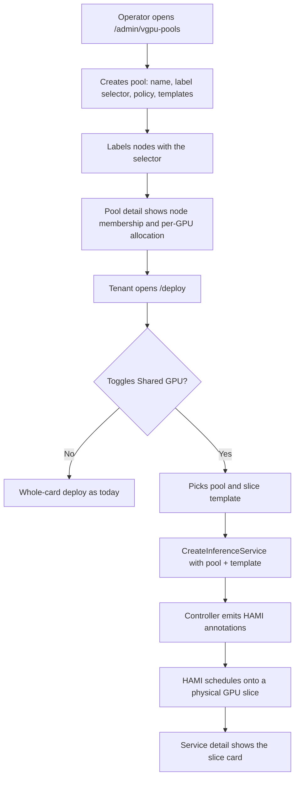
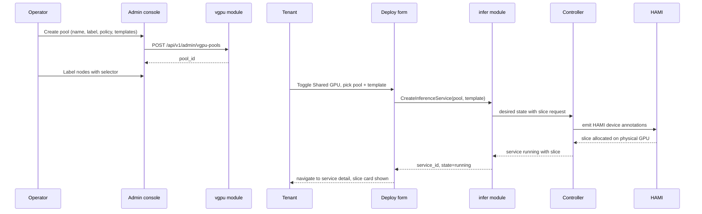

# HAMI-Based vGPU Slicing Pool — Requirement Analysis and UI/UX Design

| Attribute | Content |
| --- | --- |
| Feature point | HAMI-based vGPU slicing pool — designate multiple nodes as a vGPU slicing pool via a node label, allow multiple small inference jobs to co-schedule onto a single physical GPU (backlog row 52) |
| Document scope | Requirement analysis, competitive research and the slicing-model decision (label-driven pool membership, slice templates, slice-aware scheduling hints), the admin-surface pages `/admin/vgpu-pools` and `/admin/vgpu-pools/:poolId` (pool CRUD, node membership, slice-template management, per-pool allocation), the end-user-surface vGPU-aware deploy mode and service-detail slice display, the page → API surface table, and numbered acceptance criteria |
| Owning modules | `vgpu` (new module — pool membership, slice templates, capacity accounting, scheduling hints), `infer` (deploy-form vGPU fields, service slice assignment), `Controller` (turns scheduling hints into HAMI device requests), `k8s` (node labels, extended resources, HAMI annotations), `pkg/server` gateway (admin + user prefix bindings), `web` admin + end-user console |
| Related documents | [Architecture Design](./architecture.md) — §2.3 heterogeneous compute, §2.4 `infer`, §2.7 Controller · [Accelerator Inventory & Health](./accelerator-inventory.md) — the per-node GPU fleet view this feature's pool nodes are a labeled subset of · [Model Catalog & One-Click Deployment](./model-catalog-deployment.md) — the deploy form this feature extends · [Inference Autoscaling](./inference-autoscaling.md) — slice-aware replica sizing · [Service Quota Management](./service-quota-management.md) — the resource dimension slice count is deferred from · [Multi-Cluster Management](./multi-cluster-management.md) — pool membership across clusters · [Console Surface Separation](./console-surface-separation.md) — the two surfaces, the masked-projection rule |
| Status | Design complete, handed to the Architect agent |

---

## 1. Background and Competitive Research

### 1.1 Why a vGPU Slicing Pool Comes Now

The accelerator tier today allocates **whole physical GPUs** to inference services. The deploy form (feature #2) lets an administrator pick an accelerator and a card type, and the Controller schedules the service's replicas onto nodes that have that card type free — but a replica always consumes an entire GPU. For small models (a 7B chat model, a small embedding model, a lightweight reranker) a whole `A800` or `H800` is grossly over-provisioned: the model's weights and KV cache fit in a fraction of the card's memory, and the compute is idle most of the time. The result is a fleet of half-empty GPUs that the platform bills at full price and that autoscaling (#16) happily scales *up* on.

The accelerator-inventory feature (#18) gave the operator the fleet picture — which nodes carry which GPUs, how many are allocated vs free — but it is **read-only** and does not change how a GPU is consumed. What is missing is the ability to **share** a physical GPU among several small inference jobs, so that a single `A800` can serve, say, three small chat models and two embedding models at once, each isolated in its own slice.

This feature adds a **vGPU slicing pool**: the operator designates a set of nodes as a slicing pool via a node label, defines **slice templates** (memory fraction + compute fraction) that represent how a physical GPU is carved up, and inference services can opt into a **shared-GPU mode** that requests a slice instead of a whole card. The platform's Controller turns the slice request into HAMI device annotations, and HAMI (the CNCF-incubating heterogeneous GPU sharing middleware the platform already lists as an accelerator-tier inspiration) handles the actual device sharing, isolation, and scheduling.

### 1.2 Access Pattern: Label-Driven Pool + Slice Templates vs the Alternatives

| Pattern | What it is | Why we adopt / reject it |
| --- | --- | --- |
| **Label-driven pool membership + operator-defined slice templates + opt-in shared-GPU deploy mode** (adopted) | The operator labels nodes to join a pool; the pool defines slice templates (memory + compute fractions); a deploy can opt into shared-GPU mode and pick a slice template; the Controller emits HAMI annotations; HAMI shares the physical GPU. | The only pattern that keeps the **operator in control of capacity** (which nodes share, how they are carved) while giving **tenants a simple opt-in** (pick a slice, not a YAML). Matches the architecture's node-labeling model (§2.3) and the deploy form's guided-form philosophy (feature #2 D2). |
| Raw HAMI annotations in the deploy form | Expose `nvidia.com/gpumem` / `nvidia.com/gpucores` directly to the deployer. | Rejected: leaks HAMI internals and lets a tenant request arbitrary memory/compute fractions, defeating capacity planning. Slice templates are the bounded, operator-curated vocabulary (D3). |
| Automatic slicing of every GPU | Every node is a pool; every deploy is shared by default. | Rejected: sharing has isolation and performance trade-offs (a noisy neighbor can degrade a co-tenant's latency). Sharing must be **opt-in** per service, and only on operator-designated nodes (D2). |
| MIG partitioning as the slicing mechanism | Use NVIDIA MIG to carve physical GPUs into hardware-isolated instances. | Rejected as the *platform's* mechanism: MIG is NVIDIA-vendor-specific and requires specific card models; HAMI already abstracts MIG and non-NVIDIA accelerators behind one resource model. go-taas stays vendor-neutral (D4). |
| Per-tenant GPU isolation guarantees | Promise hard isolation between co-tenant slices. | Rejected for v1: HAMI provides memory/compute isolation where the backend supports it, but go-taas does not promise performance isolation (a shared GPU is a shared GPU). Documented as a shared-resource caveat (D6). |
| Slice-level metering | Meter each slice's usage separately. | Rejected: metering stays per-request token-based (#4); the slice is a deployment-time resource, not a metering dimension. The pool's allocation view is capacity telemetry, not billing (D7). |

### 1.3 Comparable-Product Interaction Patterns

| Product | GPU-sharing pattern | go-taas decision |
| --- | --- | --- |
| **HAMI (Project-HAMi)** | Kubernetes-native GPU virtualization: request a fraction of a physical accelerator by memory (`nvidia.com/gpumem`) and compute (`nvidia.com/gpucores`); node label (`gpu=on`) opts a node in; scheduler policies (binpack / spread / mutex / topology-aware); dynamic MIG; WebUI for cluster/device management | Adopt the **resource model** (memory + compute fraction on a physical GPU) and the **node-label opt-in**; adopt the **binpack/spread** scheduling vocabulary for the pool's placement policy; **reject** exposing raw annotations to tenants (D3) and **reject** building our own WebUI (the admin console is the surface, not a separate HAMI WebUI) |
| **NVIDIA MIG** | Hardware partitioning of a physical GPU into isolated instances (e.g. 1g.5gb, 2g.10gb profiles); vendor-specific, requires supported cards | Adopt the **slice-template** idea (named, bounded carve-ups of a card) as the UI vocabulary; **reject** MIG as the platform mechanism (D4) — HAMI abstracts it |
| **NVIDIA vGPU (virtualization)** | Time-sliced / MIG-based virtual GPUs for VMs; licensing per vGPU | Reject: VM-oriented, licensing-heavy; go-taas is container-native via HAMI |
| **RunPod** | GPU marketplace with fractional GPU options (e.g. "RTX 4090 24GB" or "A100 40GB" with memory tiers); per-pod GPU allocation | Adopt the **memory-tier picker** pattern (a small set of named slice sizes, not arbitrary values); **reject** the marketplace framing (go-taas pools are operator-curated, not a public market) |
| **Vast.ai** | Per-host GPU cards with fractional allocation; utilization shown per host | Adopt the **per-pool utilization** view (how full is each pool / physical GPU); **reject** the marketplace framing |
| **Together AI / SiliconFlow** | Serverless + dedicated endpoints; SiliconFlow exposes per-key concurrency and shared compute; Together shows GPU type per endpoint | Adopt the **"shared GPU" as an explicit, labeled option** in the deploy form (not hidden); **reject** serverless (go-taas is dedicated services) |
| **Aliyun Bailian / Volcengine Ark** | Compute instance types with GPU specs; no fractional GPU in the standard deploy flow | Adopt the **instance-type picker** shape (a dropdown of named slice templates); **reject** the absence of sharing (that is the gap this feature fills) |

### 1.4 Distilled Decisions

| # | Decision | Rationale |
| --- | --- | --- |
| D1 | **A pool is a named set of nodes designated by a node label.** The operator creates a pool, picks a label key/value (e.g. `go-taas.com/vgpu-pool=pool-a`), and any node carrying that label is a member. | Matches the architecture's node-labeling model (§2.3) and HAMI's own `gpu=on` opt-in; membership is declarative and survives node churn (a new labeled node joins automatically). |
| D2 | **Sharing is opt-in per service, and only on pool nodes.** A deploy can choose "Shared GPU" mode; without it, the service gets a whole card as today. | Sharing has isolation/performance trade-offs; tenants and operators must choose it deliberately. Non-pool nodes never share. |
| D3 | **Slice templates are the bounded vocabulary.** A pool defines named templates (e.g. `small` = 8 GiB / 25% compute, `medium` = 16 GiB / 50%, `large` = 24 GiB / 75%); a deploy picks a template, never raw memory/compute values. | Keeps capacity planning honest (the operator controls the carve-ups) and the deploy form simple (a dropdown, not two number fields). |
| D4 | **HAMI is the sharing mechanism; go-taas stays vendor-neutral.** The Controller emits HAMI annotations; HAMI handles NVIDIA (incl. MIG), Iluvatar, MetaX and other backends behind one resource model. | The platform already lists HAMI as an accelerator-tier inspiration; delegating device sharing to HAMI keeps go-taas vendor-neutral and avoids reimplementing device virtualization. |
| D5 | **The pool's placement policy is a pool-level setting** (binpack / spread / mutex), surfaced as a dropdown on the pool page and passed to HAMI as a scheduling hint. | HAMI's scheduling vocabulary maps directly; the operator chooses consolidation (binpack) vs isolation (spread/mutex) per pool. |
| D6 | **No performance-isolation guarantee.** The pool page and the deploy form state that a shared GPU is a shared resource; memory/compute isolation is best-effort per HAMI backend. | Honest about the shared-resource trade-off; avoids over-promising to tenants. |
| D7 | **Slice allocation is capacity telemetry, not metering.** The pool's allocation view shows how many slices of each template are allocated/free; billing stays per-request token-based (#4). | Keeps the metering chain untouched; the pool view is an operations surface. |
| D8 | **Slice count as a quota dimension is deferred.** The service-quota feature (#51) ships four dimensions; a per-org slice-count quota is future work. | Keeps this feature focused on the sharing mechanism; quota integration is a clean follow-up. |

---

## 2. User Roles and User Stories

### 2.1 Roles

| Role | Surface | Description |
| --- | --- | --- |
| Platform operator | admin | Manages vGPU pools: creates pools, designates nodes via labels, defines slice templates, sets placement policy, monitors per-pool allocation. |
| Tenant admin / developer | end-user | Deploys inference services; opts into shared-GPU mode and picks a slice template; reads the assigned slice on the service detail page. |

### 2.2 User Stories

**Admin surface (`/admin/vgpu-pools`, `/admin/vgpu-pools/:poolId`):**

- **US1** As a platform operator, I create a vGPU pool with a name, a node-label selector, and a placement policy, so that I can designate which nodes share their GPUs.
- **US2** As a platform operator, I define slice templates (memory + compute fraction) on a pool, so that tenants have a bounded set of carve-ups to choose from.
- **US3** As a platform operator, I see each pool's node membership and per-physical-GPU allocation (how many slices of each template are allocated/free), so that I can plan capacity.
- **US4** As a platform operator, I edit a pool's templates and placement policy, and delete a pool, so that I can adjust capacity as demand changes.
- **US5** As a platform operator, I see which inference services are using which slices, so that I can debug placement and identify noisy neighbors.

**End-user surface (deploy form, service detail):**

- **US6** As a tenant developer, I deploy a small model with "Shared GPU" mode and pick a slice template, so that I pay for a fraction of a GPU instead of a whole card.
- **US7** As a tenant developer, I see on the service detail page which slice (pool, template, physical GPU) my service was assigned, so that I understand my service's resource footprint.
- **US8** As a tenant developer, I see a clear explanation of what shared-GPU mode means (shared resource, best-effort isolation), so that I can make an informed choice.

---

## 3. Functional Requirements

### FR1 — Pool management (admin)

- **FR1.1** `ListVGPUPools` (`GET /api/v1/admin/vgpu-pools`) returns all pools with their node-label selector, placement policy, slice templates, node count, and aggregate allocation (allocated/free slices per template). Pagination, name search, and a filter by node count.
- **FR1.2** `CreateVGPUPool` (`POST /api/v1/admin/vgpu-pools`) creates a pool: **name** (required, DNS-safe, 1–63 chars, unique), **node label selector** (key + value, required), **placement policy** (binpack / spread / mutex, default binpack), and an initial set of **slice templates**. Validation errors are inline and never reach the Controller.
- **FR1.3** `GetVGPUPool` (`GET /api/v1/admin/vgpu-pools/{pool_id}`) returns one pool's full detail: selector, policy, templates, node membership (each node with its physical GPUs and per-GPU slice allocation), and the services using slices.
- **FR1.4** `UpdateVGPUPool` (`PATCH /api/v1/admin/vgpu-pools/{pool_id}`) updates the placement policy and slice templates. Changing the node-label selector is allowed but warns that membership will change; changing templates does not evict running services (D6 — non-destructive).
- **FR1.5** `DeleteVGPUPool` (`DELETE /api/v1/admin/vgpu-pools/{pool_id}`) deletes a pool. If services are actively using slices, the delete is blocked with a **13405** error naming the count; the operator must first move or delete those services.
- **FR1.6** All pool mutations are audited (pool.created / pool.updated / pool.deleted with operator and old → new); list/read calls are not audited, consistent with the platform's read-path convention.

### FR2 — Slice templates (admin)

- **FR2.1** A slice template has: **name** (unique within the pool, e.g. `small`), **memory GiB** (integer, 1–card memory), **compute %** (integer, 5–100), and an optional **description**. The template's memory must not exceed the pool's smallest physical GPU memory.
- **FR2.2** The pool page validates templates: memory within card bounds, compute within 5–100, no duplicate names. Invalid templates show inline copy and are rejected with **13402**.
- **FR2.3** Templates are the only slice vocabulary exposed to tenants (D3); the deploy form reads them from the pool, never raw values.

### FR3 — Capacity accounting (admin)

- **FR3.1** The pool detail page shows, per physical GPU on each member node, the allocated slices (which template, which service) and the free capacity (remaining memory/compute). A physical GPU is `full` when no template fits in the remaining memory/compute.
- **FR3.2** The pool list page shows aggregate allocation per template: "small: 12/20 allocated", "medium: 3/8", etc., plus a pool-level utilization bar (allocated memory / total pool memory).
- **FR3.3** Capacity is a projection of HAMI's reported device state (collected by the Controller), not a separate database table (D7 — capacity telemetry).

### FR4 — vGPU-aware deployment (end-user)

- **FR4.1** The deploy form (feature #2) gains a **"Shared GPU" toggle** (default off). When off, the form behaves exactly as today (whole card). When on, a **pool dropdown** (from `ListVGPUPools` filtered to pools the tenant's org may use) and a **slice-template dropdown** (from the selected pool) appear.
- **FR4.2** When Shared GPU is on, the accelerator/card-type fields are constrained to the selected pool's nodes; the form shows the template's memory/compute and a plain-language note: "This service will share a physical GPU with other services. Isolation is best-effort."
- **FR4.3** Submit calls `CreateInferenceService` with the pool id and slice-template id; the response returns `service_id` with `state=pending`; the console navigates to the service detail page, which polls until the state leaves `pending`.
- **FR4.4** The service detail page shows, when the service is shared-GPU, a **slice card**: pool name, template name, memory/compute, and the assigned physical GPU (node + GPU index) once scheduled. A whole-card service shows no slice card.
- **FR4.5** The tenant surface exposes **no** pool mutation — pools and templates are admin-only (D3).

### FR5 — Surface, realm and API binding

- **FR5.1** Pool management is admin-only (`/admin/vgpu-pools` + `/api/v1/admin/vgpu-pools/*`); the deploy-form slice picker is end-user (`/api/v1/infer/*` extension). A user-realm session on an admin route gets **10038 `CodeRealmMismatch`**; a session without the platform-admin role gets **10036 `CodeForbidden`**.
- **FR5.2** The admin pages render: the pool list (name, selector, policy, templates, nodes, allocation, utilization), the pool detail (node membership, per-GPU allocation, services, edit dialog, delete), and all states (loading, empty, error, permission-denied).
- **FR5.3** The deploy form's pool dropdown is filtered by the tenant's org grants (a pool is usable by an org only if the org is granted access — mirroring the model-grant model of feature #13); a pool with no grant is hidden.

---

## 4. Surface Assignment

| Page | Surface | Route | API prefix |
| --- | --- | --- | --- |
| vGPU pools (list) | admin | `/admin/vgpu-pools` | `/api/v1/admin/vgpu-pools/*` |
| vGPU pool detail | admin | `/admin/vgpu-pools/:poolId` | `/api/v1/admin/vgpu-pools/*` |
| Deploy form — Shared GPU mode | end-user | `/deploy` (existing) | `/api/v1/infer/*` (extension) |
| Service detail — slice card | end-user | `/services/:serviceId` (existing) | `/api/v1/infer/*` (extension) |

---

## 5. Page and Flow Design

### 5.1 Page Map

| Page | Surface | Route | Primary components |
| --- | --- | --- | --- |
| vGPU pools | admin | `/admin/vgpu-pools` | Pool table (name, selector, policy, templates, nodes, allocation, utilization), create dialog, empty/loading/error states |
| vGPU pool detail | admin | `/admin/vgpu-pools/:poolId` | Pool header, node membership table, per-GPU allocation, services using slices, edit dialog, delete flow |
| Deploy form | end-user | `/deploy` | Shared GPU toggle, pool dropdown, slice-template dropdown, shared-GPU note |
| Service detail | end-user | `/services/:serviceId` | Slice card (pool, template, physical GPU) |

### 5.2 Page: `/admin/vgpu-pools` — vGPU Pools (admin)

**Pool table**: Name, Node label selector ("`go-taas.com/vgpu-pool=pool-a`"), Placement policy (binpack / spread / mutex), Templates ("small, medium, large"), Nodes (count), Allocation ("small 12/20 · medium 3/8"), Utilization (bar, amber ≥ 80%, red 100%). Row click opens the pool detail; a "New pool" button opens the create dialog.

**Filter bar**: name search, placement-policy filter, pagination.

**Create dialog**: Name (required, DNS-safe, 1–63, unique — inline validation), Node label selector (key + value, required), Placement policy (dropdown, default binpack), and a template editor (add rows: name, memory GiB, compute %, description; validation per FR2.2). Save (POST) shows a success toast and navigates to the new pool's detail.

**States**: loading skeletons; empty ("No vGPU pools yet — create one to share GPUs across small inference jobs"); error (stale with retry); permission-denied (standard, link to `/admin`).

### 5.3 Page: `/admin/vgpu-pools/:poolId` — vGPU Pool Detail (admin)

**Pool header**: name, selector, placement policy, aggregate utilization bar, and actions (Edit, Delete).

**Node membership table**: Node, Physical GPUs (model + count), Per-GPU allocation (expandable rows showing each GPU's allocated slices: template, service, memory/compute used vs free), Health (from accelerator inventory #18). A node is `full` when no template fits in remaining capacity.

**Services using slices table**: Service, Template, Physical GPU (node + index), Memory/compute, State. Links to the service detail.

**Edit dialog**: placement policy + slice templates (same editor as create); changing the selector warns "Membership will change to match the new label"; changing templates warns "Running services keep their current slices". Save (PATCH) shows a success toast.

**Delete flow**: Delete opens a confirm dialog; if services use slices, the server returns **13405** and the dialog shows "N services are using this pool. Move or delete them before deleting the pool." with the delete disabled.

**States**: loading; empty (pool has no member nodes — "No nodes carry this label yet"; a hint to label nodes); error; permission-denied.

### 5.4 Page: `/deploy` — Deploy Form, Shared GPU Mode (end-user)

The existing deploy form (feature #2) gains a **"Shared GPU" toggle** below the accelerator/card-type fields. When off, nothing changes. When on:

- A **pool dropdown** appears (from `ListVGPUPools`, filtered to pools the org may use — FR5.3). Selecting a pool constrains the accelerator/card-type fields to the pool's nodes.
- A **slice-template dropdown** appears (from the selected pool), each option labeled "small — 8 GiB / 25% compute" with a short description.
- A **shared-GPU note** appears: "This service will share a physical GPU with other services. Memory and compute are isolated best-effort; performance is not guaranteed."
- Submit calls `CreateInferenceService` with the pool + template; validation errors are inline.

**States**: loading (pools fetching); empty (no pools the org may use — "No shared-GPU pools are available for your organization" and the toggle is disabled with a tooltip); error (stale with retry); the toggle is disabled while no usable pool exists.

### 5.5 Page: `/services/:serviceId` — Service Detail, Slice Card (end-user)

When the service is shared-GPU, a **slice card** appears in the spec section: Pool name, Template ("small — 8 GiB / 25%"), and once scheduled, the assigned physical GPU ("node-a · GPU 0"). A whole-card service shows no slice card. The card links to nothing on the user surface (pool detail is admin-only); it is informational.

### 5.6 Flows

---

## 6. API Surface Implications

The vGPU RPCs live in a new **`vgpu`** module (admin surface) plus a small **`infer`** extension (user surface). The Controller turns slice requests into HAMI annotations; HAMI is out of repository scope — its contract (the `nvidia.com/gpumem` / `nvidia.com/gpucores` resource model and the `hami.io/*` annotations) is pinned here.

| RPC | Route | Prefix | Status | Purpose |
| --- | --- | --- | --- | --- |
| `ListVGPUPools` (`taas.vgpu.v1`) | `GET /api/v1/admin/vgpu-pools` | admin | **new** | Pool rows with selector, policy, templates, nodes, allocation; pagination, search, policy filter |
| `CreateVGPUPool` | `POST /api/v1/admin/vgpu-pools` | admin | **new** | Create a pool; audited; 13401 on bad input |
| `GetVGPUPool` | `GET /api/v1/admin/vgpu-pools/{pool_id}` | admin | **new** | One pool's full detail (nodes, per-GPU allocation, services); unknown pool → 13406 |
| `UpdateVGPUPool` | `PATCH /api/v1/admin/vgpu-pools/{pool_id}` | admin | **new** | Update policy/templates/selector; audited; 13402 on bad templates |
| `DeleteVGPUPool` | `DELETE /api/v1/admin/vgpu-pools/{pool_id}` | admin | **new** | Delete a pool; 13405 if services use it |
| `ListVGPUPools` (tenant-visible) | `GET /api/v1/vgpu-pools` | user | **new** | Pools the caller's org may use (grant-filtered), with templates — for the deploy form |
| `CreateInferenceService` (`taas.infer.v1`) | `POST /api/v1/inference-services` | user | **changed** | Gains optional `pool_id` + `slice_template_id`; 13403 if the pool/template is invalid or not granted |
| `GetInferenceService` (`taas.infer.v1`) | `GET /api/v1/inference-services/{service_id}` | user | **changed** | Response gains the assigned slice (pool, template, physical GPU) when shared-GPU |

**Contract notes for the Architect agent**:

1. The `vgpu` module owns pool membership (label selector), slice templates, and capacity accounting; it is a new service module with its own error block (134xx), not an extension of `infer` or `image`.
2. Pool membership is **declarative**: the Controller watches nodes for the label selector and reports membership; a node that loses the label leaves the pool (its slices drain naturally as services finish).
3. The Controller translates a slice request into HAMI annotations (`nvidia.com/gpumem` = template memory MiB, `nvidia.com/gpucores` = template compute, plus the pool's placement-policy annotation `hami.io/gpu-scheduler-policy`). HAMI's resource model is the pinned contract (FR5.4-style synthetic verification).
4. Capacity accounting is a projection of HAMI's reported device state (collected by the Controller), not a new database table (D7).
5. The tenant-visible `ListVGPUPools` must enforce org grants at the service layer (the caller's org from the session), never trusting a client-supplied org id.
6. Serialization conventions unchanged: HTTP 200 on success, business errors as `{"code": <int>, "message": "..."}`, int64 fields as JSON strings.

Error codes (`pkg/errors/codes.go`):

| Condition | Code | Constant | Notes |
| --- | --- | --- | --- |
| Pool create/update input invalid | 13401 | `CodeVGPUPoolInvalid` | **New** (D4) — validation, field named |
| Slice template invalid | 13402 | `CodeVGPUSliceTemplateInvalid` | **New** (D4) — memory/compute bounds, duplicate name |
| Deploy references an invalid/ungranted pool or template | 13403 | `CodeVGPUSliceUnavailable` | **New** (D4) — deploy rejected |
| Pool delete blocked by active services | 13405 | `CodeVGPUPoolInUse` | **New** (D4) — count named |
| Unknown pool | 13406 | `CodeVGPUPoolNotFound` | **New** (D4) |
| User-realm session on an admin route | 10038 | `CodeRealmMismatch` | Reused — realm separation (FR5.1) |
| Session without the required role | 10036 | `CodeForbidden` | Reused — permission denial (FR5.1) |

---

## 7. Acceptance Criteria

| # | Criterion | Level |
| --- | --- | --- |
| AC1 | `/admin/vgpu-pools` renders the pool table with name, label selector, placement policy, templates, node count, allocation and utilization columns, plus search, policy filter and pagination | Nightwatch E2E |
| AC2 | The create dialog validates the name (DNS-safe, unique), label selector, and templates (memory within card bounds, compute 5–100, no duplicate names) — an invalid value shows inline copy and the server returns **13401/13402** with the field named | Nightwatch E2E + FVT |
| AC3 | **Pool membership**: labeling a node with the pool's selector makes it appear in the pool detail's node table; removing the label removes it; a pool with no member nodes shows the "No nodes carry this label yet" empty state | FVT + Nightwatch E2E |
| AC4 | **Per-GPU allocation**: the pool detail shows each physical GPU's allocated slices (template, service, memory/compute used vs free) and marks a GPU `full` when no template fits in remaining capacity | FVT + Nightwatch E2E |
| AC5 | **Deploy form**: toggling Shared GPU reveals the pool and slice-template dropdowns and the shared-GPU note; selecting a pool constrains the accelerator/card-type fields; the toggle is disabled with a tooltip when no usable pool exists | Nightwatch E2E |
| AC6 | **Slice assignment (synthetic)**: a shared-GPU deploy with a valid pool + template creates the service and the Controller emits HAMI annotations (`nvidia.com/gpumem`, `nvidia.com/gpucores`, placement policy); the service detail shows the slice card with pool, template and physical GPU once scheduled | FVT (HAMI contract) + Nightwatch E2E |
| AC7 | **Invalid/ungranted slice**: a deploy referencing an invalid pool/template or a pool the org is not granted returns **13403** and the form shows inline copy; the tenant-visible pool list is grant-filtered | FVT + Nightwatch E2E |
| AC8 | **Non-destructive template change**: changing a pool's templates does not evict running services; they keep their current slices | FVT |
| AC9 | **Delete blocked**: deleting a pool with active slice users returns **13405** naming the count and the dialog disables delete; deleting an idle pool succeeds | FVT + Nightwatch E2E |
| AC10 | **Audit**: every pool create/update/delete appears in the audit trail (pool.created / pool.updated / pool.deleted, operator, old → new) | FVT |
| AC11 | **Negative realm separation**: a valid user-realm session token sent to `GET /api/v1/admin/vgpu-pools` is rejected with **10038**; the admin pages contain no `/api/v1/*` call and the user pages no `/api/v1/admin/*` call | FVT + Nightwatch E2E |
| AC12 | A session without the required role receives **10036** and the admin page shows the standard permission-denied state with a link back to `/admin` | Nightwatch E2E |
| AC13 | **States**: both admin pages provide loading, empty, error and permission-denied states as specified; the deploy form provides loading, empty (no usable pool) and error states | Nightwatch E2E |

---

## 8. Out of Scope (tracked elsewhere)

| Item | Where |
| --- | --- |
| MIG partitioning as the platform mechanism | Deliberately excluded (D4) — HAMI abstracts MIG and other backends |
| Per-tenant GPU performance-isolation guarantees | Deliberately excluded (D6) — shared GPU is shared; best-effort isolation |
| Slice-level metering / billing | Deliberately excluded (D7) — metering stays per-request token-based (#4) |
| Per-org slice-count quota | Deferred — the service-quota feature (#51) ships four dimensions; slice quota is a clean follow-up (D8) |
| Raw HAMI annotations in the deploy form | Deliberately excluded (D3) — slice templates are the bounded vocabulary |
| Automatic slicing of every GPU | Deliberately excluded (D2) — sharing is opt-in per service |
| A separate HAMI WebUI | Deliberately excluded — the admin console is the surface |
| Pool-level billing / pricing | Future work — pricing stays per-model × card-type (#8) |