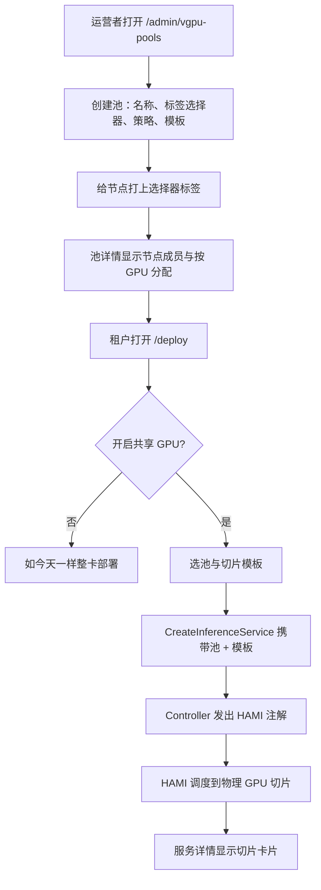
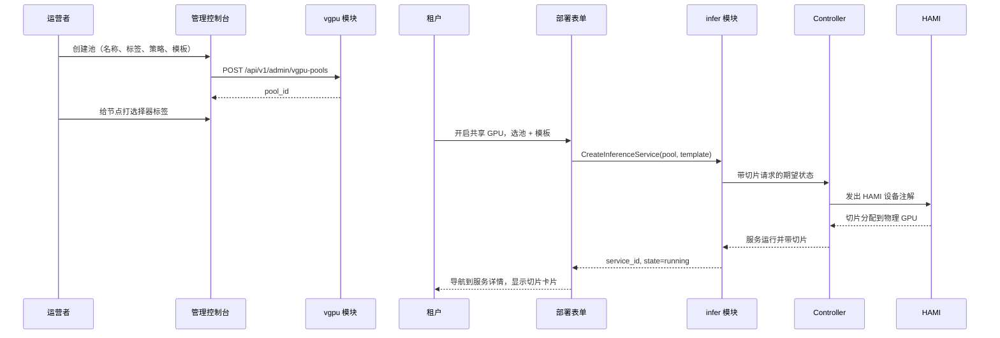

# 基于 HAMI 的 vGPU 切片池 — 需求分析与 UI/UX 设计

| 属性 | 内容 |
| --- | --- |
| 功能点 | 基于 HAMI 的 vGPU 切片池 — 通过节点标签将多个节点指定为 vGPU 切片池，允许多个小推理任务共调度到同一块物理 GPU 上（backlog 第 52 行） |
| 文档范围 | 需求分析、竞品调研与切片模型决策（标签驱动的池成员、切片模板、切片感知调度提示）、管理面页面 `/admin/vgpu-pools` 与 `/admin/vgpu-pools/:poolId`（池 CRUD、节点成员、切片模板管理、按池分配）、终端用户面 vGPU 感知部署模式与服务详情切片展示、页面 → API 表面映射表，以及编号验收标准 |
| 负责模块 | `vgpu`（新模块 — 池成员、切片模板、容量核算、调度提示）、`infer`（部署表单 vGPU 字段、服务切片分配）、`Controller`（将调度提示转为 HAMI 设备请求）、`k8s`（节点标签、扩展资源、HAMI 注解）、`pkg/server` 网关（管理 + 用户前缀绑定）、`web` 管理控制台 + 终端用户控制台 |
| 相关文档 | [架构设计](./architecture.md) — §2.3 异构计算、§2.4 `infer`、§2.7 Controller · [加速器清单与健康](./accelerator-inventory.zh-cn.md) — 本功能池节点是其带标签子集的按节点 GPU 机群视图 · [模型目录与一键部署](./model-catalog-deployment.zh-cn.md) — 本功能扩展的部署表单 · [推理弹性伸缩](./inference-autoscaling.zh-cn.md) — 切片感知副本规模 · [服务配额管理](./service-quota-management.zh-cn.md) — 切片数配额维度由此延迟而来 · [多集群管理](./multi-cluster-management.zh-cn.md) — 跨集群池成员 · [控制台表面分离](./console-surface-separation.zh-cn.md) — 两个表面、脱敏投影规则 |
| 状态 | 设计完成，已移交架构师 agent |

---

## 1. 背景与竞品调研

### 1.1 为什么现在做 vGPU 切片池

今天的加速器层把**整块物理 GPU** 分配给推理服务。部署表单（功能 #2）让管理员选择加速器与卡型，Controller 把服务的副本调度到有空闲该卡型的节点上 — 但一个副本总是消耗一整块 GPU。对于小模型（7B 聊天模型、小 embedding 模型、轻量 reranker），一整块 `A800` 或 `H800` 是严重过度配置：模型的权重与 KV cache 只占卡内存的一小部分，算力大部分时间闲置。结果是机群里一半空的 GPU，平台按全价计费，而弹性伸缩（#16）还乐意为它扩容*上去*。

加速器清单功能（#18）给了运营者机群全貌 — 哪些节点带哪些 GPU、多少已分配 vs 空闲 — 但它是**只读**的，不改变 GPU 的消耗方式。缺失的是**共享**一块物理 GPU 的能力：让几个小推理任务同时跑在同一块 `A800` 上，例如三个小聊天模型加两个 embedding 模型，各自隔离在自己的切片里。

本功能新增**vGPU 切片池**：运营者通过节点标签把一组节点指定为切片池，定义**切片模板**（显存比例 + 算力比例）表示一块物理 GPU 如何被切分，推理服务可以选择**共享 GPU 模式**请求一个切片而非整卡。平台的 Controller 把切片请求转为 HAMI 设备注解，由 HAMI（平台已在加速器层列为灵感的 CNCF 孵化级异构 GPU 共享中间件）处理实际的设备共享、隔离与调度。

### 1.2 访问模式：标签驱动池 + 切片模板 vs 备选方案

| 模式 | 是什么 | 采用 / 拒绝理由 |
| --- | --- | --- |
| **标签驱动池成员 + 运营者定义切片模板 + 可选共享 GPU 部署模式**（采用） | 运营者给节点打标签加入池；池定义切片模板（显存 + 算力比例）；部署可选择共享 GPU 模式并选一个切片模板；Controller 发出 HAMI 注解；HAMI 共享物理 GPU。 | 唯一能让**运营者掌控容量**（哪些节点共享、如何切分）同时给**租户简单可选**（选切片而非 YAML）的模式。契合架构的节点标签模型（§2.3）与部署表单的引导式表单理念（功能 #2 D2）。 |
| 部署表单直接暴露 HAMI 注解 | 直接把 `nvidia.com/gpumem` / `nvidia.com/gpucores` 暴露给部署者。 | 拒绝：泄露 HAMI 内部细节，且让租户请求任意显存/算力比例，破坏容量规划。切片模板是有界、运营者策划的词汇表（D3）。 |
| 自动切分每块 GPU | 每个节点都是池；每个部署默认共享。 | 拒绝：共享有隔离与性能权衡（吵闹邻居会拖慢同租户延迟）。共享必须按服务**可选**，且只在运营者指定的节点上（D2）。 |
| 以 MIG 分区作为切分机制 | 用 NVIDIA MIG 把物理 GPU 切成硬件隔离实例。 | 作为*平台*机制拒绝：MIG 是 NVIDIA 厂商特定且要求特定卡型；HAMI 已在一个资源模型下抽象 MIG 与非 NVIDIA 加速器。go-taas 保持厂商中立（D4）。 |
| 按租户 GPU 隔离保证 | 承诺同租户切片间硬隔离。 | v1 拒绝：HAMI 在后端支持处提供显存/算力隔离，但 go-taas 不承诺性能隔离（共享 GPU 就是共享 GPU）。作为共享资源注意事项记录（D6）。 |
| 切片级计量 | 分别计量每个切片的用量。 | 拒绝：计量保持按请求 token 计（#4）；切片是部署时资源，不是计量维度。池的分配视图是容量遥测，不是计费（D7）。 |

### 1.3 竞品交互模式

| 产品 | GPU 共享模式 | go-taas 决策 |
| --- | --- | --- |
| **HAMI（Project-HAMi）** | Kubernetes 原生 GPU 虚拟化：按显存（`nvidia.com/gpumem`）与算力（`nvidia.com/gpucores`）请求物理加速器的一部分；节点标签（`gpu=on`）让节点加入；调度策略（binpack / spread / mutex / 拓扑感知）；动态 MIG；WebUI 做集群与设备管理 | 采纳**资源模型**（物理 GPU 上的显存 + 算力比例）与**节点标签加入**；采纳 **binpack/spread** 调度词汇作为池的放置策略；**拒绝**向租户暴露原始注解（D3）与自建 WebUI（管理控制台就是表面，而非独立 HAMI WebUI） |
| **NVIDIA MIG** | 把物理 GPU 硬件分区成隔离实例（如 1g.5gb、2g.10gb 配置）；厂商特定，要求受支持卡型 | 采纳**切片模板**思想（卡的命名、有界切分）作为 UI 词汇；**拒绝**把 MIG 作为平台机制（D4）— HAMI 抽象它 |
| **NVIDIA vGPU（虚拟化）** | 面向 VM 的时间切片 / MIG 虚拟 GPU；按 vGPU 授权 | 拒绝：面向 VM、授权繁重；go-taas 通过 HAMI 容器原生 |
| **RunPod** | GPU 市场带分数 GPU 选项（如 "RTX 4090 24GB" 或 "A100 40GB" 带显存档）；按 Pod GPU 分配 | 采纳**显存档选择器**模式（一组命名切片大小，而非任意值）；**拒绝**市场框架（go-taas 池是运营者策划，不是公开市场） |
| **Vast.ai** | 按主机 GPU 卡带分数分配；按主机显示利用率 | 采纳**按池利用率**视图（每个池 / 物理 GPU 有多满）；**拒绝**市场框架 |
| **Together AI / SiliconFlow** | Serverless + 专用端点；SiliconFlow 暴露按 Key 并发与共享算力；Together 按端点显示 GPU 类型 | 采纳部署表单中**"共享 GPU"作为显式、带标签的选项**（不隐藏）；**拒绝** serverless（go-taas 是专用服务） |
| **阿里云百炼 / 火山方舟** | 带 GPU 规格的计算实例类型；标准部署流无分数 GPU | 采纳**实例类型选择器**形态（命名切片模板下拉）；**拒绝**无共享（这正是本功能填补的缺口） |

### 1.4 提炼决策

| # | 决策 | 理由 |
| --- | --- | --- |
| D1 | **池是一组由节点标签指定的命名节点。** 运营者创建池、选标签键/值（如 `go-taas.com/vgpu-pool=pool-a`），任何带该标签的节点都是成员。 | 契合架构的节点标签模型（§2.3）与 HAMI 自身的 `gpu=on` 加入；成员是声明式的，能承受节点更替（新打标签的节点自动加入）。 |
| D2 | **共享按服务可选，且只在池节点上。** 部署可选"共享 GPU"模式；不选则如今天一样拿整卡。 | 共享有隔离/性能权衡；租户与运营者必须刻意选择。非池节点永不共享。 |
| D3 | **切片模板是有界词汇表。** 池定义命名模板（如 `small` = 8 GiB / 25% 算力、`medium` = 16 GiB / 50%、`large` = 24 GiB / 75%）；部署选模板，绝不选原始显存/算力值。 | 让容量规划诚实（运营者控制切分）且部署表单简单（下拉而非两个数字字段）。 |
| D4 | **HAMI 是共享机制；go-taas 保持厂商中立。** Controller 发出 HAMI 注解；HAMI 在一个资源模型下处理 NVIDIA（含 MIG）、Iluvatar、MetaX 等后端。 | 平台已把 HAMI 列为加速器层灵感；把设备共享委托给 HAMI 让 go-taas 保持厂商中立，避免重造设备虚拟化。 |
| D5 | **池的放置策略是池级设置**（binpack / spread / mutex），在池页面以下拉呈现，作为调度提示传给 HAMI。 | HAMI 的调度词汇直接映射；运营者按池选择整合（binpack）vs 隔离（spread/mutex）。 |
| D6 | **无性能隔离保证。** 池页面与部署表单都说明共享 GPU 是共享资源；显存/算力隔离按 HAMI 后端尽力而为。 | 对共享资源权衡诚实；避免向租户过度承诺。 |
| D7 | **切片分配是容量遥测，不是计量。** 池的分配视图显示每个模板多少切片已分配/空闲；计费保持按请求 token 计（#4）。 | 不触碰计量链；池视图是运维表面。 |
| D8 | **切片数作为配额维度延迟。** 服务配额功能（#51）交付四个维度；按组织切片数配额是后续工作。 | 让本功能聚焦共享机制；配额集成是干净的后续。 |

---

## 2. 用户角色与用户故事

### 2.1 角色

| 角色 | 表面 | 描述 |
| --- | --- | --- |
| 平台运营者 | 管理面 | 管理 vGPU 池：创建池、通过标签指定节点、定义切片模板、设置放置策略、监控按池分配。 |
| 租户管理员 / 开发者 | 终端用户面 | 部署推理服务；选择共享 GPU 模式并选切片模板；在服务详情页读取分配的切片。 |

### 2.2 用户故事

**管理面（`/admin/vgpu-pools`、`/admin/vgpu-pools/:poolId`）：**

- **US1** 作为平台运营者，我创建带名称、节点标签选择器与放置策略的 vGPU 池，以便指定哪些节点共享其 GPU。
- **US2** 作为平台运营者，我在池上定义切片模板（显存 + 算力比例），以便租户有一组有界的切分可选。
- **US3** 作为平台运营者，我看到每个池的节点成员与按物理 GPU 的分配（每个模板多少切片已分配/空闲），以便规划容量。
- **US4** 作为平台运营者，我编辑池的模板与放置策略、删除池，以便随需求变化调整容量。
- **US5** 作为平台运营者，我看到哪些推理服务在用哪些切片，以便排查放置并识别吵闹邻居。

**终端用户面（部署表单、服务详情）：**

- **US6** 作为租户开发者，我用"共享 GPU"模式部署小模型并选切片模板，以便为一块 GPU 的一部分付费而非整卡。
- **US7** 作为租户开发者，我在服务详情页看到我的服务被分配到哪个切片（池、模板、物理 GPU），以便理解服务的资源占用。
- **US8** 作为租户开发者，我看到共享 GPU 模式的清晰说明（共享资源、尽力隔离），以便做出知情选择。

---

## 3. 功能需求

### FR1 — 池管理（管理面）

- **FR1.1** `ListVGPUPools`（`GET /api/v1/admin/vgpu-pools`）返回所有池及其节点标签选择器、放置策略、切片模板、节点数与聚合分配（每个模板已分配/空闲切片）。分页、名称搜索、按节点数过滤。
- **FR1.2** `CreateVGPUPool`（`POST /api/v1/admin/vgpu-pools`）创建池：**名称**（必填、DNS 安全、1–63 字符、唯一）、**节点标签选择器**（键 + 值、必填）、**放置策略**（binpack / spread / mutex、默认 binpack）、以及初始**切片模板**集。校验错误内联显示，绝不进入 Controller。
- **FR1.3** `GetVGPUPool`（`GET /api/v1/admin/vgpu-pools/{pool_id}`）返回一个池的完整详情：选择器、策略、模板、节点成员（每个节点及其物理 GPU 与按 GPU 切片分配）、以及使用切片的服务。
- **FR1.4** `UpdateVGPUPool`（`PATCH /api/v1/admin/vgpu-pools/{pool_id}`）更新放置策略与切片模板。允许改节点标签选择器但警告成员会变化；改模板不驱逐运行中的服务（D6 — 非破坏）。
- **FR1.5** `DeleteVGPUPool`（`DELETE /api/v1/admin/vgpu-pools/{pool_id}`）删除池。若有服务正在使用切片，删除被 **13405** 错误阻止并点名数量；运营者必须先迁移或删除这些服务。
- **FR1.6** 所有池变更都审计（pool.created / pool.updated / pool.deleted，含运营者与旧 → 新）；列表/读取调用不审计，与平台读路径约定一致。

### FR2 — 切片模板（管理面）

- **FR2.1** 切片模板含：**名称**（池内唯一，如 `small`）、**显存 GiB**（整数，1–卡显存）、**算力 %**（整数，5–100）、以及可选**描述**。模板显存不得超过池内最小物理 GPU 显存。
- **FR2.2** 池页面校验模板：显存在卡界内、算力在 5–100、无重名。非法模板显示内联文案并以 **13402** 拒绝。
- **FR2.3** 模板是暴露给租户的唯一切片词汇（D3）；部署表单从池读取模板，绝不读原始值。

### FR3 — 容量核算（管理面）

- **FR3.1** 池详情页显示每个成员节点上每块物理 GPU 的已分配切片（哪个模板、哪个服务）与空闲容量（剩余显存/算力）。当剩余显存/算力放不下任何模板时，物理 GPU 标记为 `full`。
- **FR3.2** 池列表页显示每个模板的聚合分配："small: 12/20 已分配"、"medium: 3/8" 等，外加池级利用率条（已分配显存 / 池总显存）。
- **FR3.3** 容量是 HAMI 上报设备状态（由 Controller 采集）的投影，不是独立数据库表（D7 — 容量遥测）。

### FR4 — vGPU 感知部署（终端用户面）

- **FR4.1** 部署表单（功能 #2）新增**"共享 GPU"开关**（默认关）。关时表单行为与今天完全一致（整卡）。开时出现**池下拉**（来自 `ListVGPUPools`，过滤到租户组织可用的池）与**切片模板下拉**（来自所选池）。
- **FR4.2** 共享 GPU 开时，加速器/卡型字段被约束到所选池的节点；表单显示模板的显存/算力与一句通俗说明："此服务将与其他服务共享一块物理 GPU。隔离为尽力而为。"
- **FR4.3** 提交调用 `CreateInferenceService` 并携带池 id 与切片模板 id；响应返回 `service_id` 且 `state=pending`；控制台导航到服务详情页，轮询直到状态离开 `pending`。
- **FR4.4** 服务详情页在服务为共享 GPU 时显示**切片卡片**：池名、模板名、显存/算力、以及调度后分配的物理 GPU（节点 + GPU 索引）。整卡服务不显示切片卡片。
- **FR4.5** 终端用户面暴露**无**池变更 — 池与模板仅限管理面（D3）。

### FR5 — 表面、域与 API 绑定

- **FR5.1** 池管理仅限管理面（`/admin/vgpu-pools` + `/api/v1/admin/vgpu-pools/*`）；部署表单切片选择器在终端用户面（`/api/v1/infer/*` 扩展）。用户域会话访问管理路由得到 **10038 `CodeRealmMismatch`**；无平台管理员角色的会话得到 **10036 `CodeForbidden`**。
- **FR5.2** 管理页面渲染：池列表（名称、选择器、策略、模板、节点、分配、利用率）、池详情（节点成员、按 GPU 分配、服务、编辑对话框、删除）、以及所有状态（加载、空、错误、权限拒绝）。
- **FR5.3** 部署表单的池下拉按租户组织授权过滤（组织仅当被授权访问池时才可用 — 镜像功能 #13 的模型授权模型）；无授权的池隐藏。

---

## 4. 表面分配

| 页面 | 表面 | 路由 | API 前缀 |
| --- | --- | --- | --- |
| vGPU 池（列表） | 管理面 | `/admin/vgpu-pools` | `/api/v1/admin/vgpu-pools/*` |
| vGPU 池详情 | 管理面 | `/admin/vgpu-pools/:poolId` | `/api/v1/admin/vgpu-pools/*` |
| 部署表单 — 共享 GPU 模式 | 终端用户面 | `/deploy`（现有） | `/api/v1/infer/*`（扩展） |
| 服务详情 — 切片卡片 | 终端用户面 | `/services/:serviceId`（现有） | `/api/v1/infer/*`（扩展） |

---

## 5. 页面与流程设计

### 5.1 页面地图

| 页面 | 表面 | 路由 | 主要组件 |
| --- | --- | --- | --- |
| vGPU 池 | 管理面 | `/admin/vgpu-pools` | 池表格（名称、选择器、策略、模板、节点、分配、利用率）、创建对话框、空/加载/错误状态 |
| vGPU 池详情 | 管理面 | `/admin/vgpu-pools/:poolId` | 池头部、节点成员表格、按 GPU 分配、使用切片的服务、编辑对话框、删除流程 |
| 部署表单 | 终端用户面 | `/deploy` | 共享 GPU 开关、池下拉、切片模板下拉、共享 GPU 说明 |
| 服务详情 | 终端用户面 | `/services/:serviceId` | 切片卡片（池、模板、物理 GPU） |

### 5.2 页面：`/admin/vgpu-pools` — vGPU 池（管理面）

**池表格**：名称、节点标签选择器（"`go-taas.com/vgpu-pool=pool-a`"）、放置策略（binpack / spread / mutex）、模板（"small, medium, large"）、节点（数量）、分配（"small 12/20 · medium 3/8"）、利用率（条，≥ 80% 琥珀、100% 红）。行点击打开池详情；"新建池"按钮打开创建对话框。

**过滤条**：名称搜索、放置策略过滤、分页。

**创建对话框**：名称（必填、DNS 安全、1–63、唯一 — 内联校验）、节点标签选择器（键 + 值、必填）、放置策略（下拉、默认 binpack）、以及模板编辑器（添加行：名称、显存 GiB、算力 %、描述；按 FR2.2 校验）。保存（POST）显示成功 toast 并导航到新池详情。

**状态**：加载骨架；空（"尚无 vGPU 池 — 创建一个以在小推理任务间共享 GPU"）；错误（过期带重试）；权限拒绝（标准，链接到 `/admin`）。

### 5.3 页面：`/admin/vgpu-pools/:poolId` — vGPU 池详情（管理面）

**池头部**：名称、选择器、放置策略、聚合利用率条、以及操作（编辑、删除）。

**节点成员表格**：节点、物理 GPU（型号 + 数量）、按 GPU 分配（可展开行显示每块 GPU 的已分配切片：模板、服务、显存/算力已用 vs 空闲）、健康（来自加速器清单 #18）。当剩余容量放不下任何模板时节点标记为 `full`。

**使用切片的服务表格**：服务、模板、物理 GPU（节点 + 索引）、显存/算力、状态。链接到服务详情。

**编辑对话框**：放置策略 + 切片模板（与创建相同的编辑器）；改选择器警告"成员将随新标签变化"；改模板警告"运行中的服务保留当前切片"。保存（PATCH）显示成功 toast。

**删除流程**：删除打开确认对话框；若有服务使用切片，服务器返回 **13405**，对话框显示"N 个服务正在使用此池。删除前请先迁移或删除它们。"并禁用删除。

**状态**：加载；空（池无成员节点 — "尚无节点带此标签"；提示给节点打标签）；错误；权限拒绝。

### 5.4 页面：`/deploy` — 部署表单，共享 GPU 模式（终端用户面）

现有部署表单（功能 #2）在加速器/卡型字段下方新增**"共享 GPU"开关**。关时无变化。开时：

- 出现**池下拉**（来自 `ListVGPUPools`，过滤到组织可用的池 — FR5.3）。选池把加速器/卡型字段约束到池的节点。
- 出现**切片模板下拉**（来自所选池），每个选项标注"small — 8 GiB / 25% 算力"并带简短描述。
- 出现**共享 GPU 说明**："此服务将与其他服务共享一块物理 GPU。显存与算力尽力隔离；性能不保证。"
- 提交调用 `CreateInferenceService` 并携带池 + 模板；校验错误内联显示。

**状态**：加载（池获取中）；空（组织无可用的池 — "您的组织暂无可用共享 GPU 池"，开关禁用并带 tooltip）；错误（过期带重试）；无可用池时开关禁用。

### 5.5 页面：`/services/:serviceId` — 服务详情，切片卡片（终端用户面）

当服务为共享 GPU 时，规格区出现**切片卡片**：池名、模板（"small — 8 GiB / 25%"）、以及调度后的物理 GPU（"node-a · GPU 0"）。整卡服务不显示切片卡片。卡片在用户面不链接任何内容（池详情仅限管理面）；仅作信息展示。

### 5.6 流程

---

## 6. API 表面影响

vGPU RPC 位于新 **`vgpu`** 模块（管理面）外加一个小的 **`infer`** 扩展（用户面）。Controller 把切片请求转为 HAMI 注解；HAMI 在仓库范围之外 — 其契约（`nvidia.com/gpumem` / `nvidia.com/gpucores` 资源模型与 `hami.io/*` 注解）在此钉死。

| RPC | 路由 | 前缀 | 状态 | 用途 |
| --- | --- | --- | --- | --- |
| `ListVGPUPools`（`taas.vgpu.v1`） | `GET /api/v1/admin/vgpu-pools` | 管理面 | **新** | 池行含选择器、策略、模板、节点、分配；分页、搜索、策略过滤 |
| `CreateVGPUPool` | `POST /api/v1/admin/vgpu-pools` | 管理面 | **新** | 创建池；审计；非法输入 13401 |
| `GetVGPUPool` | `GET /api/v1/admin/vgpu-pools/{pool_id}` | 管理面 | **新** | 一个池的完整详情（节点、按 GPU 分配、服务）；未知池 → 13406 |
| `UpdateVGPUPool` | `PATCH /api/v1/admin/vgpu-pools/{pool_id}` | 管理面 | **新** | 更新策略/模板/选择器；审计；模板非法 13402 |
| `DeleteVGPUPool` | `DELETE /api/v1/admin/vgpu-pools/{pool_id}` | 管理面 | **新** | 删除池；有服务使用则 13405 |
| `ListVGPUPools`（租户可见） | `GET /api/v1/vgpu-pools` | 用户面 | **新** | 调用者组织可用的池（授权过滤）含模板 — 供部署表单 |
| `CreateInferenceService`（`taas.infer.v1`） | `POST /api/v1/inference-services` | 用户面 | **改** | 新增可选 `pool_id` + `slice_template_id`；池/模板非法或未授权则 13403 |
| `GetInferenceService`（`taas.infer.v1`） | `GET /api/v1/inference-services/{service_id}` | 用户面 | **改** | 响应在共享 GPU 时新增分配的切片（池、模板、物理 GPU） |

**给架构师 agent 的契约说明**：

1. `vgpu` 模块拥有池成员（标签选择器）、切片模板与容量核算；它是带自有错误块（134xx）的新服务模块，不是 `infer` 或 `image` 的扩展。
2. 池成员是**声明式**的：Controller 监视节点上的标签选择器并上报成员；失去标签的节点离开池（其切片随服务自然结束而排空）。
3. Controller 把切片请求转为 HAMI 注解（`nvidia.com/gpumem` = 模板显存 MiB、`nvidia.com/gpucores` = 模板算力、外加池的放置策略注解 `hami.io/gpu-scheduler-policy`）。HAMI 的资源模型是钉死的契约（FR5.4 式合成验证）。
4. 容量核算是对 HAMI 上报设备状态（由 Controller 采集）的投影，不是新数据库表（D7）。
5. 租户可见的 `ListVGPUPools` 必须在服务层强制组织授权（会话中的调用者组织），绝不信任客户端提供的组织 id。
6. 序列化约定不变：成功 HTTP 200，业务错误为 `{"code": <int>, "message": "..."}`，int64 字段为 JSON 字符串。

错误码（`pkg/errors/codes.go`）：

| 条件 | 码 | 常量 | 说明 |
| --- | --- | --- | --- |
| 池创建/更新输入非法 | 13401 | `CodeVGPUPoolInvalid` | **新**（D4）— 校验，点名字段 |
| 切片模板非法 | 13402 | `CodeVGPUSliceTemplateInvalid` | **新**（D4）— 显存/算力界、重名 |
| 部署引用非法/未授权的池或模板 | 13403 | `CodeVGPUSliceUnavailable` | **新**（D4）— 部署拒绝 |
| 池删除被活动服务阻止 | 13405 | `CodeVGPUPoolInUse` | **新**（D4）— 点名数量 |
| 未知池 | 13406 | `CodeVGPUPoolNotFound` | **新**（D4） |
| 用户域会话访问管理路由 | 10038 | `CodeRealmMismatch` | 复用 — 域分离（FR5.1） |
| 会话缺少所需角色 | 10036 | `CodeForbidden` | 复用 — 权限拒绝（FR5.1） |

---

## 7. 验收标准

| # | 标准 | 级别 |
| --- | --- | --- |
| AC1 | `/admin/vgpu-pools` 渲染池表格，含名称、标签选择器、放置策略、模板、节点数、分配与利用率列，外加搜索、策略过滤与分页 | Nightwatch E2E |
| AC2 | 创建对话框校验名称（DNS 安全、唯一）、标签选择器与模板（显存在卡界内、算力 5–100、无重名）— 非法值显示内联文案且服务器返回 **13401/13402** 并点名字段 | Nightwatch E2E + FVT |
| AC3 | **池成员**：给节点打上池选择器标签使其出现在池详情节点表；移除标签则移除；无成员节点的池显示"尚无节点带此标签"空状态 | FVT + Nightwatch E2E |
| AC4 | **按 GPU 分配**：池详情显示每块物理 GPU 的已分配切片（模板、服务、显存/算力已用 vs 空闲），并在剩余容量放不下任何模板时标记 GPU `full` | FVT + Nightwatch E2E |
| AC5 | **部署表单**：开启共享 GPU 显示池与切片模板下拉及共享 GPU 说明；选池约束加速器/卡型字段；无可用池时开关禁用并带 tooltip | Nightwatch E2E |
| AC6 | **切片分配（合成）**：带有效池 + 模板的共享 GPU 部署创建服务，Controller 发出 HAMI 注解（`nvidia.com/gpumem`、`nvidia.com/gpucores`、放置策略）；调度后服务详情显示含池、模板与物理 GPU 的切片卡片 | FVT（HAMI 契约）+ Nightwatch E2E |
| AC7 | **非法/未授权切片**：引用非法池/模板或组织未授权池的部署返回 **13403** 且表单显示内联文案；租户可见池列表按授权过滤 | FVT + Nightwatch E2E |
| AC8 | **非破坏模板变更**：改池模板不驱逐运行中的服务；它们保留当前切片 | FVT |
| AC9 | **删除被阻止**：删除有活动切片用户的池返回 **13405** 点名数量且对话框禁用删除；删除空闲池成功 | FVT + Nightwatch E2E |
| AC10 | **审计**：每次池创建/更新/删除都出现在审计轨迹（pool.created / pool.updated / pool.deleted、运营者、旧 → 新） | FVT |
| AC11 | **负向域分离**：有效用户域会话 token 发送到 `GET /api/v1/admin/vgpu-pools` 被 **10038** 拒绝；管理页面无 `/api/v1/*` 调用、用户页面无 `/api/v1/admin/*` 调用 | FVT + Nightwatch E2E |
| AC12 | 无所需角色的会话收到 **10036** 且管理页面显示标准权限拒绝状态并链接回 `/admin` | Nightwatch E2E |
| AC13 | **状态**：两个管理页面按规格提供加载、空、错误与权限拒绝状态；部署表单提供加载、空（无可用池）与错误状态 | Nightwatch E2E |

---

## 8. 范围外（另行跟踪）

| 项 | 位置 |
| --- | --- |
| 以 MIG 分区作为平台机制 | 刻意排除（D4）— HAMI 抽象 MIG 与其他后端 |
| 按租户 GPU 性能隔离保证 | 刻意排除（D6）— 共享 GPU 即共享；尽力隔离 |
| 切片级计量 / 计费 | 刻意排除（D7）— 计量保持按请求 token 计（#4） |
| 按组织切片数配额 | 延迟 — 服务配额功能（#51）交付四个维度；切片配额是干净的后续（D8） |
| 部署表单暴露原始 HAMI 注解 | 刻意排除（D3）— 切片模板是有界词汇 |
| 自动切分每块 GPU | 刻意排除（D2）— 共享按服务可选 |
| 独立 HAMI WebUI | 刻意排除 — 管理控制台就是表面 |
| 池级计费 / 定价 | 后续工作 — 定价保持按模型 × 卡型（#8） |